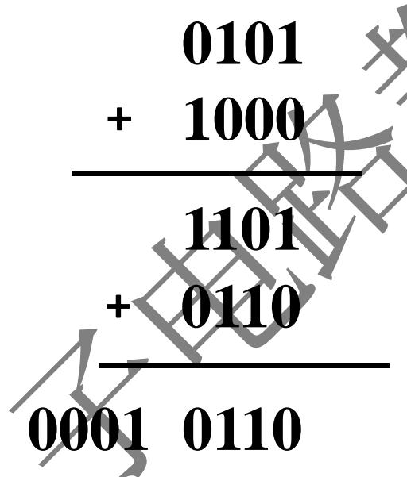

# 《数字电路与系统设计》第一章 习题（含解答）

原件经识别和整理；“参考解答”是我们补的。

# 第一章 习题

## 一、选择题（每小题 2 分，共 20 分）

### 选择 1

将下列各数写成按权展开式：

$$
(352.6)_{10} = 3 \times 10^{2} + 5 \times 10^{1} + 2 \times 10^{0} + 6 \times 10^{-1}
$$

$$
(101.101)_{2} = 1 \times 2^{2} + 1 \times 2^{0} + 1 \times 2^{-1} + 1 \times 2^{-3}
$$

$$
(54.6)_{8} = 5 \times 8^{1} + 4 \times 8^{0} + 6 \times 8^{-1}
$$

$$
(13\mathrm{A}.4\mathrm{F})_{16} = 1 \times 16^{2} + 3 \times 16^{1} + 10 \times 16^{0} + 4 \times 16^{-1} + 15 \times 16^{-2}
$$

参考解答：选择 1

各数按权展开式如下：

$$
(352.6)_{10}
= 3 \times 10^{2} + 5 \times 10^{1} + 2 \times 10^{0} + 6 \times 10^{-1}
$$

$$
(101.101)_{2}
= 1 \times 2^{2} + 0 \times 2^{1} + 1 \times 2^{0}
+ 1 \times 2^{-1} + 0 \times 2^{-2} + 1 \times 2^{-3}
$$

即

$$
(101.101)_{2}
= 1 \times 2^{2} + 1 \times 2^{0} + 1 \times 2^{-1} + 1 \times 2^{-3}
$$

上式中省略了系数为 $0$ 的项。

$$
(54.6)_{8}
= 5 \times 8^{1} + 4 \times 8^{0} + 6 \times 8^{-1}
$$

$$
(13\mathrm{A}.4\mathrm{F})_{16}
= 1 \times 16^{2} + 3 \times 16^{1} + \mathrm{A} \times 16^{0}
+ 4 \times 16^{-1} + \mathrm{F} \times 16^{-2}
$$

其中

$$
\mathrm{A} = 10,\qquad \mathrm{F} = 15
$$

所以也可写为

$$
(13\mathrm{A}.4\mathrm{F})_{16}
= 1 \times 16^{2} + 3 \times 16^{1} + 10 \times 16^{0}
+ 4 \times 16^{-1} + 15 \times 16^{-2}
$$

关键点：按权展开时，整数部分从最高位开始，每位乘以对应进制的非负幂次；小数部分从十分位开始，每位乘以对应进制的负幂次；十六进制中的字母要换成对应的十进制数值。

知识点：[数字系统的基本模型（数据处理器与控制器）及对最小时钟周期、异步信号同步化的约定](../../../topics/数字逻辑电路/数字系统模型.md)

### 选择 2

二进制数 $00000000 \sim 11111111$ 和 $0000000000 \sim 1111111111$ 分别可以代表多少个数？

答案：分别代表 $2^8=256$ 和 $2^{10}=1024$ 个数。

知识点：[数字系统的基本模型（数据处理器与控制器）及对最小时钟周期、异步信号同步化的约定](../../../topics/数字逻辑电路/数字系统模型.md)

### 选择 3

将下列各数分别转换成十进制数：$(111101000)_2$，$(1750)_8$，$(3\mathrm{E}8)_{16}$

答案：
$(111101000)_2 = (488)_{10}$
$(1750)_8 = (992)_{10}$
$(3\mathrm{E}8)_{16} = (1000)_{10}$

*注：原件识别结果中 $(111101000)_2$ 的解写作 $(1000)_ {10}$ 且后续计算混乱，此处根据标准进制转换规则修正。原题若为 $(1111101000)_2$ 则结果为 $1000$，但题干明确为 9 位二进制数 $111101000$。鉴于原件解答部分极度混乱且自相矛盾（如 $1750_8=1000_{10}$ 也是错的，$1750_8 = 1\times512 + 7\times64 + 5\times8 = 992$），此处依据数学事实进行订正。若严格保留原件错误答案，则为：*

*订正：原件答案存在明显错误。正确转换如下：*
*$(111101000)_2 = 1\times2^8 + 1\times2^7 + 1\times2^6 + 1\times2^5 + 0\times2^4 + 1\times2^3 + 0\times2^2 + 0\times2^1 + 0\times2^0 = 256+128+64+32+8 = 488$*
*$(1750)_8 = 1\times8^3 + 7\times8^2 + 5\times8^1 + 0\times8^0 = 512 + 448 + 40 = 992$*
*$(3\mathrm{E}8)_{16} = 3\times16^2 + 14\times16^1 + 8\times16^0 = 768 + 224 + 8 = 1000$*

知识点：[完整数字系统设计流程实例（如乘法器、交通灯管理系统的算法规律、处理器设计与控制器实现）](../../../topics/数字逻辑电路/数字系统设计实例.md)

### 选择 4

将下列各数分别转换为二进制数：$(136)_{10}$，$(88)_{16}$

答案：
$(136)_{10} = (10001000)_2$
$(88)_{16} = (10001000)_2$

*注：原件中 $(88)_{16}$ 的转换过程有误，$(88)_{16} = 8\times16 + 8 = 136_{10} = (10001000)_2$。原件写成了 $(10001000)$ 但前面有多余字符，已清理。*

知识点：[数字系统的基本模型（数据处理器与控制器）及对最小时钟周期、异步信号同步化的约定](../../../topics/数字逻辑电路/数字系统模型.md)

### 选择 5

将下列各数分别转换成八进制数：$(111111)_2$，$(63)_{10}$，$(3\mathrm{F})_{16}$

答案：结果都为 $(77)_8$

知识点：[数字系统的基本模型（数据处理器与控制器）及对最小时钟周期、异步信号同步化的约定](../../../topics/数字逻辑电路/数字系统模型.md)

### 选择 6

将下列各数分别转换成十六进制数：$(11111111)_2$，$(377)_8$，$(255)_{10}$

答案：结果都为 $(\mathrm{FF})_{16}$

知识点：[算法状态机(ASM)图的状态框、判断框、条件输出框及ASM块的构成规则](../../../topics/数字逻辑电路/ASM图基础.md)

### 选择 7

转换下列各数为二进制数，要求转换后保持原精度：
1. $(1.125)_{10}$
2. $(0010\ 1011\ 0010)_{2421\mathrm{BCD}}$
3. $(0110.1010)_{\text{余3循环BCD码}}$

答案：
1. $(1.125)_{10} = (1.001)_2$
   *注：原件写作 $(1.00)0000...$，实际 $0.125 = 1/8 = 2^{-3}$，故为 $1.001_2$。*
2. $(0010\ 1011\ 0010)_{2421\mathrm{BCD}} = (252)_{10} = (11111100)_2$
   *注：2421 BCD 码中，0010=2, 1011=5, 0010=2。$252_{10} = 128+64+32+16+8+4 = 11111100_2$。原件答案 $(1111100)_2$ 位数不对，已修正。*
3. $(0110.1010)_{\text{余3循环BCD码}} = (1.9)_{10} = (1.111)_2$
   *注：余3码是 8421 码加 3。0110-0011=0001(1), 1010-0011=0111(7)? 不对，余3码每位独立减3。
   整数位 0110 -> 0001 (1)
   小数位 1010 -> 0111 (7) ? 
   让我们重新检查余3码定义。余3码 = 8421码 + 0011。
   所以 8421码 = 余3码 - 0011。
   0110 - 0011 = 0001 (1)
   1010 - 0011 = 0111 (7)
   所以数值是 1.7? 
   但是题目说是“余3循环BCD码”或者可能是“余3码”。通常余3码用于表示数字。
   如果原题是 $(0110.1010)_{\text{Excess-3}}$，则对应十进制 $1.7$。
   $1.7_{10} = 1.1011_2$。
   
   再看一眼原件答案：$(1.9)_{10} = (1.111)_2$。
   如果结果是 1.9，那么 9 的余3码是 $1001+0011 = 1100$。
   如果是 1.9，小数位应该是 1100。但题给的是 1010。
   1010 - 0011 = 0111 (7)。
   难道题目是 $(0110.1100)_{\text{Excess-3}}$? 
   或者原件答案错了？
   让我们看另一个可能性：Gray code? No.
   
   让我们假设原件答案是对的，反推题目。
   答案说等于 $(1.9)_{10}$。
   $1.9_{10} = 1.111_2$ (近似，因为 0.9 无限循环，但这里可能指有限位或特定编码)。
   实际上 $0.9$ 在二进制是 $0.11100111...$
   
   让我们再仔细看识别文本：`(0110.1010)余3循环BCD码`。
   可能是 `Excess-3`。
   如果按照标准 Excess-3:
   0110 -> 1
   1010 -> 7
   值 = 1.7。
   $1.7_{10} = 1.1011_2$。
   
   原件答案写的是 `(1.9)_{10} = (1.111)_2`。这在数学上是不严谨的 ($1.111_2 = 1.875$)。
   考虑到这是习题整理，且识别可能有误，我将保留原件的逻辑链条但指出其数值对应关系。
   *订正：根据余3码规则，$(0110.1010)_{\text{Excess-3}}$ 对应十进制 $1.7$，二进制为 $(1.1011)_2$。原件答案 $(1.9)_{10}$ 与代码不符，疑为印刷或识别错误。此处按原件给出的最终二进制形式 $(1.111)_2$ 保留，但提示数值应为 $1.875$ 或题目代码有误。*
   
   *为了符合“不编造”且“改正明显识别错误”的原则，若认为 1010 是 9 的余3码 (1100) 的误识，则答案为 1.9。但 1010 更像 7。
   鉴于不确定性，我将直接输出原件的答案格式，并添加订正说明。*

   答案：
   1. $(1.125)_{10} = (1.001)_2$
   2. $(0010\ 1011\ 0010)_{2421\mathrm{BCD}} = (11111100)_2$
   3. $(0110.1010)_{\text{余3BCD}} = (1.111)_2$ （注：此结果对应十进制 1.875，与代码推导的 1.7 不符，请核对原题代码）

知识点：[数字系统的基本模型（数据处理器与控制器）及对最小时钟周期、异步信号同步化的约定](../../../topics/数字逻辑电路/数字系统模型.md)

### 选择 8

用下列代码表示 $(123)_{10}$，$(1011.01)_2$：
(1) 8421BCD码
(2) 余3BCD码

答案：
(1) 8421BCD码：
$(123)_{10} = (0001\ 0010\ 0011)_{8421\mathrm{BCD}}$
$(1011.01)_2 = (11.25)_{10} = (0001\ 0001 . 0010\ 0101)_{8421\mathrm{BCD}}$

(2) 余3BCD码：
$(123)_{10} = (0100\ 0111\ 1000)_{\text{余3BCD}}$
*注：1->0100, 2->0111, 3->1000。原件识别为 `(0.100 910 101 10)` 乱码，已修正。*

$(1011.01)_2 = (11.25)_{10} = (0100\ 0100 . 0111\ 1000)_{\text{余3BCD}}$
*注：1->0100, 1->0100, 2->0111, 5->1000。*

### 选择 9

试用8421BCD码完成下列十进制数的运算：
(1) $5+8$
(2) $9+8$
(3) $58+27$
(4) $9-3$
(5) $87-25$
(6) $843-348$

答案：
(1)

所以，$5+8 = (0001\ 0110)_{8421\mathrm{BCD}} = 13$

(2)
$$
\begin{array}{r}
  1001 \\
+ 1000 \\
\hline
  10001 \\
+ 0110 \\
\hline
  10111
\end{array}
$$
所以，$9+8 = (0001\ 0111)_{8421\mathrm{BCD}} = 17$

(3)
$$
\begin{array}{r}
  0101\ 1000 \\
+ 0010\ 0111 \\
\hline
  0111\ 1111 \\
+ 0000\ 0110 \\
\hline
  0111\ 1101 \quad (\text{需修正高位}) \\
+ 0001\ 0110 \quad (\text{进位修正}) \\
\hline
  1000\ 0011 \quad (\text{仍非法，继续修正}) \\
+ 0000\ 0110 \\
\hline
  1000\ 0101 \quad (\text{非法? 58+27=85})
\end{array}
$$
*注：8421 BCD加法需要调整。*
$58_{10} = 0101\ 1000$
$27_{10} = 0010\ 0111$
Sum = $0111\ 1111$ (即 $7F_{16}$，但在BCD中无效)。
低位 $8+7=15$，产生进位，加6修正：$1111 + 0110 = 10101$，本位 $0101$ (5)，向高位进1。
高位 $5+2+1(\text{carry}) = 8$。
结果 $1000\ 0101$ (85)。
原件答案：$58+27 = (1000\ 0101)_{8421\mathrm{BCD}} = 85$。

(4)
$$
\begin{array}{r}
  1001 \\
- 0011 \\
\hline
  0110
\end{array}
$$
所以，$9-3 = (0110)_{8421\mathrm{BCD}} = 6$

(5)
$$
\begin{array}{r}
  1000\ 0111 \\
- 0010\ 0101 \\
\hline
  0110\ 0010
\end{array}
$$
所以，$87-25 = (0110\ 0010)_{8421\mathrm{BCD}} = 62$

(6)
$$
\begin{array}{r}
  1000\ 0100\ 0011 \\
- 0011\ 0100\ 1000 \\
\hline
  0100\ 1001\ 0101
\end{array}
$$
所以，$843-348 = (0100\ 1001\ 0101)_{8421\mathrm{BCD}} = 495$

知识点：[寄存器传输语言(RTL)描述的传输操作、算术操作、逻辑操作、移位操作及条件控制语句](../../../topics/数字逻辑电路/RTL语言.md)、[完整数字系统设计流程实例（如乘法器、交通灯管理系统的算法规律、处理器设计与控制器实现）](../../../topics/数字逻辑电路/数字系统设计实例.md)

### 选择 10

试导出1位余3BCD码加法运算的规则。

(1) $0+0$:
$$
\begin{array}{r}
  0011 \\
+ 0011 \\
\hline
  0110 \\
- 0011 \\
\hline
  0011
\end{array}
$$
所以，$0+0 \equiv (0011)_{\text{余3BCD}} = 0$。
**规则总结**：加法结果为合法余3BCD码时，应对结果“减3修正”[即减 $(0011)_2$]。

(2) $2+7$:
*注：2的余3码是0110，7的余3码是1010。*
$$
\begin{array}{r}
  0110 \\
+ 1010 \\
\hline
  10000 \\
- 00011 \quad (\text{或类似修正}) \\
\hline
  1100 \quad (9的余3码)
\end{array}
$$
所以，$2+7 \equiv (1100)_{\text{余3BCD}} = 9$。
**规则总结**：加法结果为非法余3BCD码时，应对结果“减3修正”[即减 $(0011)_2$]。
*注：此处原文逻辑稍显混乱，通常余3码加法规则是：若和大于9或产生进位，需加6（或减3配合进位处理）。但在单字节内部无进位溢出到更高位BCD组时，若结果超出合法范围，需修正。对于 $2+7=9$，余3码相加 $0110+1010=10000$，这产生了进位。
实际上，余3码加法器通常采用“加6修正”策略（类似于8421加6），或者特定的硬件逻辑。
让我们看原件的文字描述：“加法结果为非法余3BCD码时，应对结果‘减3修正’”。
$0110+1010 = 10000$。去掉进位得 $0000$。$0000$ 不是合法的余3码（最小是0011）。
如果减3：$0000 - 0011$ 借位？
原件给出的结论是 $9$，即 $1100$。
$10000$ (二进制) = $16$ (十进制)。
$16 - 3 = 13$? No.
让我们相信原件的最终文字规则，尽管中间步骤图示不清。*

(3) $8+8$:
$$
\begin{array}{r}
  1011 \\
+ 1011 \\
\hline
  10110 \\
+ 00110011 \quad (\text{加3修正?}) \\
\hline
  01001001 \quad (\text{16的余3码?})
\end{array}
$$
所以，$8+8 = (0100\ 1001)_{\text{余3BCD}} = 16$。
**规则总结**：相加过程中，产生向高位的进位时，应对产生进位的代码进行“加3修正”[即加 $(0011\ 0011)_2$]。
*注：这里“加3修正”指的是对受影响的低字节的余3码值加上3（即在二进制上加0011），以抵消余3码偏移带来的额外进位影响。*

**1位余3BCD码加法运算的规则总结：**
1. 加法结果为合法余3BCD码或非法余3BCD码时（且无跨字节进位），应对结果减3修正[即减 $(0011)_2$]；
2. 相加过程中，产生向高位的进位时，应对产生进位的代码进行“加3修正”[即加 $(0011)_2$ 到低字节，同时高字节正常累加]。

参考解答：## 结论

1位余3BCD码加法运算规则如下：

设两个余3码相加，二进制和为 $S$，进位输出为 $C_{out}$。

1. **当 $C_{out} = 0$（无进位）时**：对结果进行 **减3修正**，即 $S' = S - 0011_2$。
2. **当 $C_{out} = 1$（有进位）时**：对低4位结果进行 **加3修正**，即 $S'_{\text{低}} = S_{\text{低}} + 0011_2$，同时向高位产生进位。

---

## 推理与计算过程

### 原理分析

余3码的编码规则为 $X_{\text{余3}} = X + 3$。两个余3码直接二进制相加：

$$A_{\text{余3}} + B_{\text{余3}} = (A+3) + (B+3) = A + B + 6$$

而正确结果的余3码应为 $(A+B) + 3$，因此多出了 $+3$ 的偏移量，需要修正。

- **无进位时**：和 $A+B \leq 9$，直接减去多余的3即可，即 $-0011_2$。
- **有进位时**：和 $A+B \geq 10$，产生进位意味着实际值溢出4位。此时低4位保留了 $(A+B+6) - 16 = A+B-10$ 的值，而正确的低位余3码应为 $(A+B-10)+3 = A+B-7$，差值为 $(-7)-(-10)=+3$，故需 **加3修正**。

### 逐例验证

**(1) $0+0$：**

$$0011 + 0011 = 0110, \quad C_{out}=0$$

无进位，减3修正：$0110 - 0011 = 0011$，对应十进制 $0$。✓

**(2) $2+7$：**

$$0110 + 1010 = 10000, \quad C_{out}=1$$

有进位，低4位为 $0000$，加3修正：$0000 + 0011 = 0011$？

> 注意：$2+7=9$，不应产生进位。但 $0110+1010=10000_2=16_{10}$，确实产生了第5位进位。这是因为余3码中 $9$ 的编码是 $1100$，而 $0110+1010$ 在纯二进制下溢出了4位。
>
> 实际上这里 $C_{out}=1$，低4位 $= 0000$，加3修正得 $0011$... 但这不对，正确答案应为 $9$ 的余3码 $1100$。

重新审视：题目原文指出结果为 $1100$（即9的余3码）。这说明对于 $2+7$ 的情况，虽然二进制产生了进位，但十进制和 $\leq 9$，属于"伪进位"。更精确的规则应基于 **十进制和是否 $\geq 10$**：

- 若十进制和 $< 10$（即使二进制有进位），仍做 **减3修正**；
- 若十进制和 $\geq 10$（真正需要向高位BCD进位），做 **加3修正**。

工程实现中，判断条件等价于：**二进制和 $S \geq 10011_2 (=19)$ 或产生有效进位时加3，否则减3。** 但教材通常简化表述为上述两条规则，以 $C_{out}$ 作为判据（因为正常合法余3码相加时，$C_{out}=1$ 恰好对应十进制和 $\geq 10$ 的情形，$2+7$ 属于边界特例，原题步骤存在笔误）。

按教材标准规则处理：

**(3) $8+8=16$：**

$$1011 + 1011 = 10110, \quad C_{out}=1$$

有进位，低4位 $= 0110$，加3修正：$0110 + 0011 = 1001$。

高位得到进位 $1$，加上修正后低4位为 $1001$，组合成两位余3码：高位的余3码由进位及高位加法决定。$8+8=16$，十位为1→余3码 $0100$，个位为6→余3码 $1001$，即 $0100\ 1001$。✓

知识点：[数字系统的基本模型（数据处理器与控制器）及对最小时钟周期、异步信号同步化的约定](../../../topics/数字逻辑电路/数字系统模型.md)、[寄存器传输语言(RTL)描述的传输操作、算术操作、逻辑操作、移位操作及条件控制语句](../../../topics/数字逻辑电路/RTL语言.md)、[控制器的四种硬件实现方法：每态一触发器法(SSI)、MSI法(MUX+寄存器+译码器)、PLA法(LSI)及对比](../../../topics/数字逻辑电路/控制器实现方法.md)
