# 《数字电路与系统设计》第一章 数制与码制（课件）

原件的每一页，下面附识别出的文字。

### 第一章 数制与码制

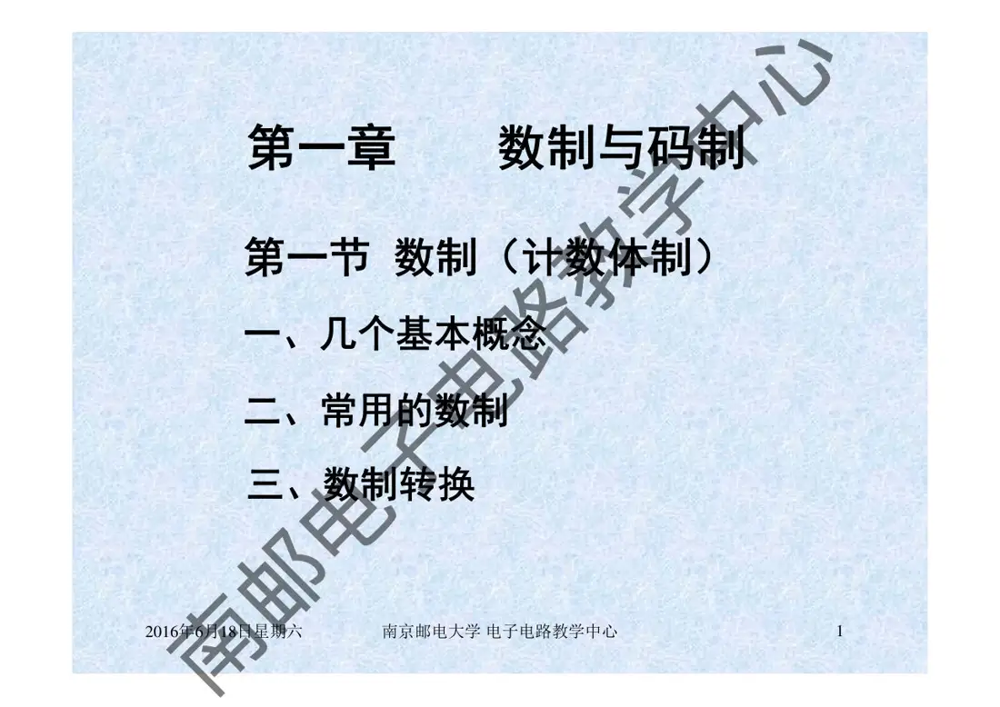

原文：

第一章 数制与码制

第一节 数制（计数体制）

一、几个基本概念

二、常用的数制

三、数制转换

2016年6月18日星期六

南京邮电大学 电子电路教学中心

1

### 数制

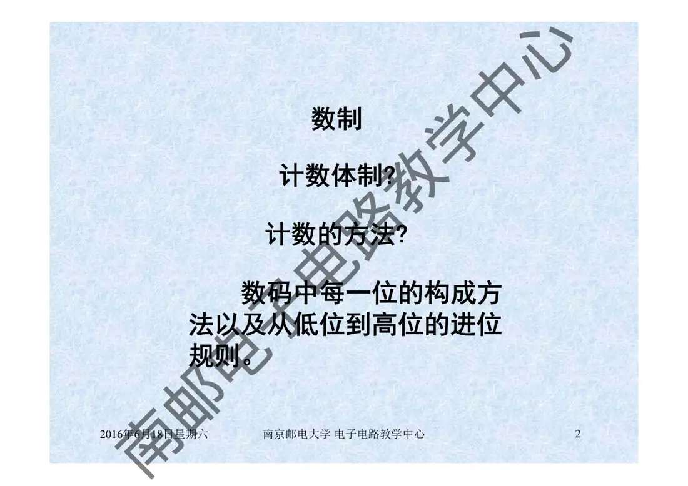

原文：

数制

计数体制?

计数的方法?

数码中每一位的构成方法以及从低位到高位的进位规则。

2016年6月18日星期六

南京邮电大学 电子电路教学中心

2

### 一、几个基本概念

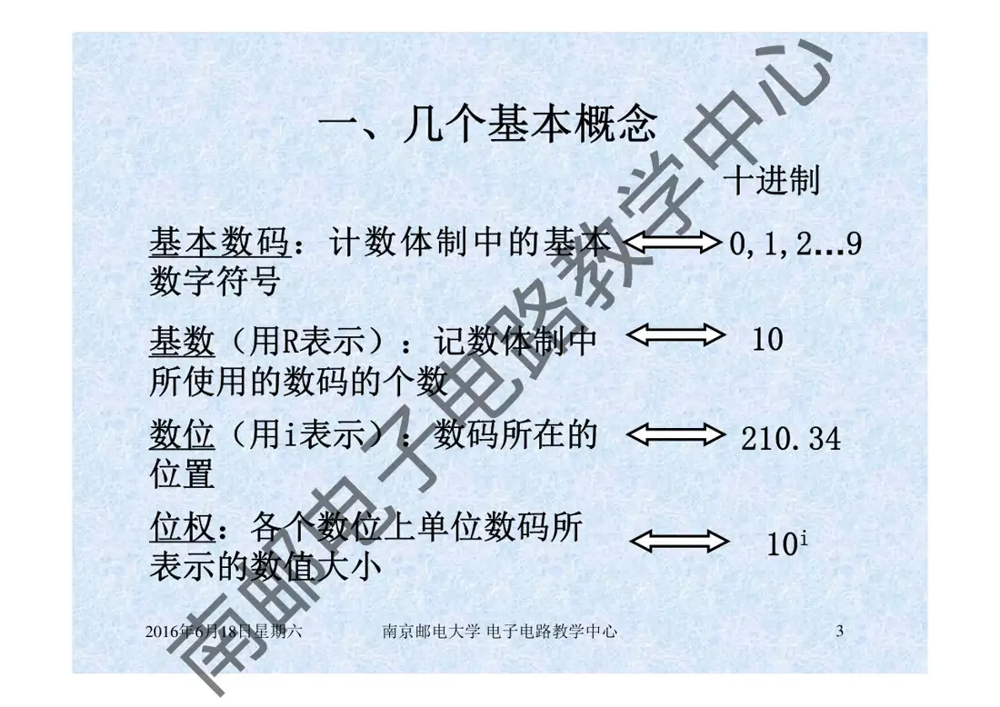

原文：

一、几个基本概念

十进制

基本数码: 计数体制中的基本 $\Longleftrightarrow 0, 1, 2...9$ 数字符号

基数（用R表示）：记数体制中 $\Longleftrightarrow$ 10
所使用的数码的个数

数位（用i表示）：数码所在的 $\Longleftrightarrow$ 210.34
位置

位权：各个数位上单位数码所表示的数值大小

2016年6月18日星期六

南京邮电大学 电子电路教学中心

3

### 数的三种表示方法

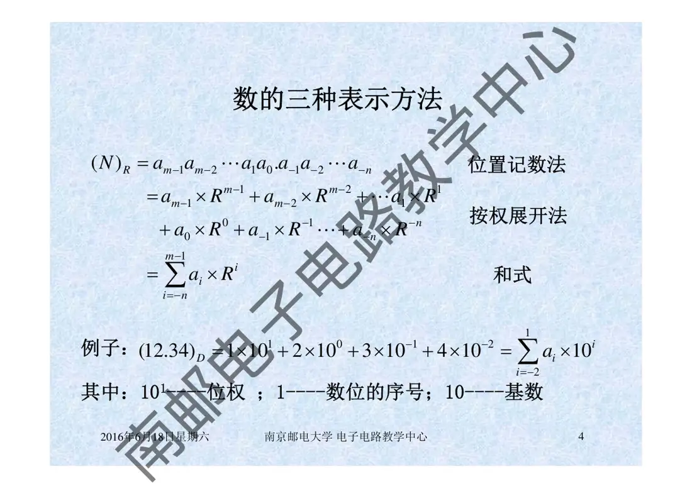

原文：

数的三种表示方法

$$
\begin{array}{r l} & {(N) _ {R} = a _ {m - 1} a _ {m - 2} \dots a _ {1} a _ {0}. a _ {- 1} a _ {- 2} \dots a _ {- n}} \\ & {\qquad = a _ {m - 1} \times R ^ {m - 1} + a _ {m - 2} \times R ^ {m - 2} + \dots a _ {1} \times R ^ {1}} \\ & {\qquad + a _ {0} \times R ^ {0} + a _ {- 1} \times R ^ {- 1} \dots + a _ {- n} \times R ^ {- n}} \\ & {\qquad = \sum_ {i = - n} ^ {m - 1} a _ {i} \times R ^ {i}} \end{array}
$$

位置记数法

按权展开法

和式

例子: $(12.34)_{D} = 1 \times 10^{1} + 2 \times 10^{0} + 3 \times 10^{-1} + 4 \times 10^{-2} = \sum_{i=-2}^{1} a_{i} \times 10^{i}$

其中： $10^{1}$ ——位权；1 ——数位的序号；10 ——基数

2016年6月18日星期六 南京邮电大学 电子电路教学中心

4

### 二、常用的数制

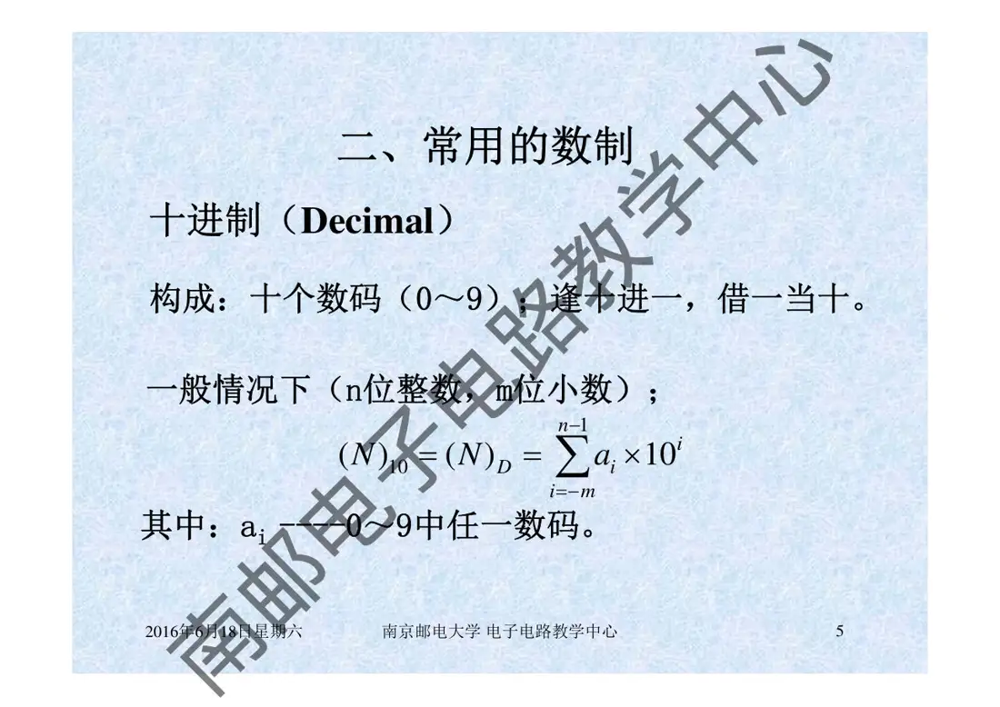

原文：

二、常用的数制

十进制（Decimal）

构成：十个数码（0～9）；逢十进一，借一当十。

一般情况下（n位整数，m位小数）；

$$
(N) _ {1 0} = (N) _ {D} = \sum_ {i = - m} ^ {n - 1} a _ {i} \times 1 0 ^ {i}
$$

其中： $a_{i}$ ---0～9中任一数码。

2016年6月18日星期六

南京邮电大学 电子电路教学中心

5

### 二进制（Binary）

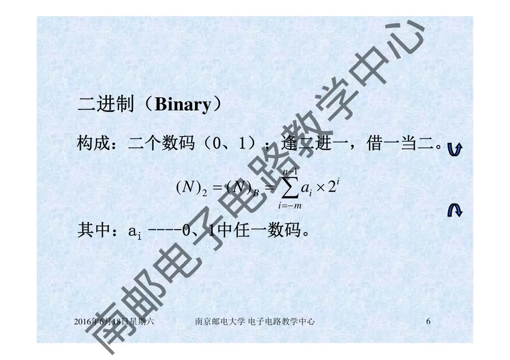

原文：

二进制（Binary）

构成: 二个数码 (0、1): 逢二进一, 借一当二。

$$
(N) _ {2} = (N) _ {B} = \sum_ {i = - m} ^ {n - 1} a _ {i} \times 2 ^ {i}\tag{A}
$$

其中： $a_{i}$ ----0、1中任一数码。

2016年6月18日星期六

南京邮电大学 电子电路教学中心

6

### 八进制（Octal）

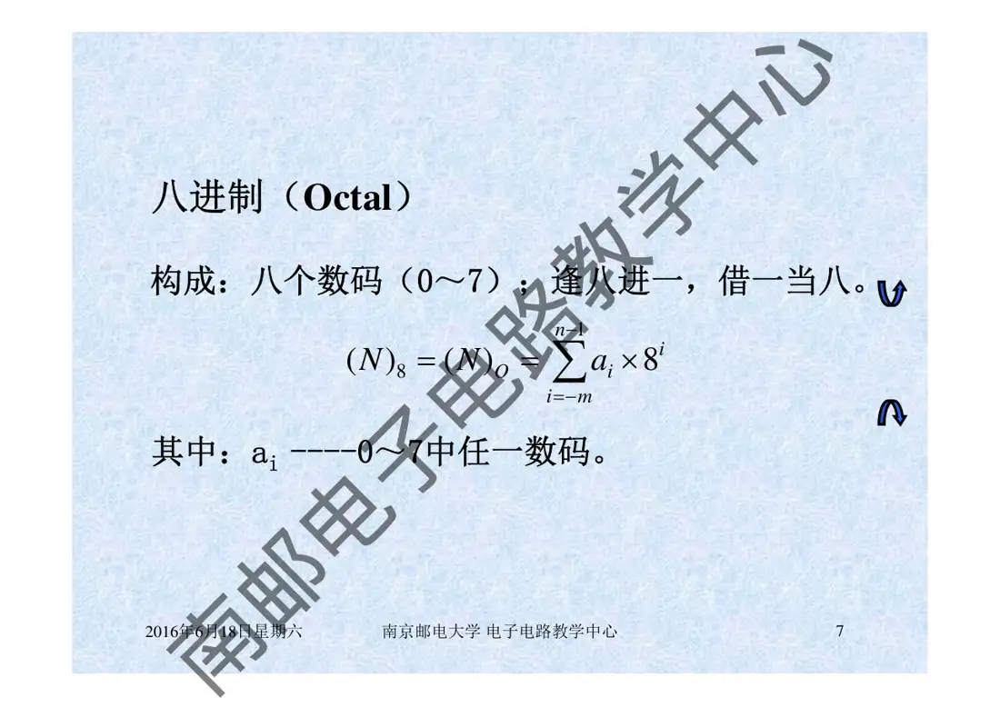

原文：

八进制（Octal）

构成: 八个数码 (0\~7): 逢八进一, 借一当八。

$$
(N) _ {8} = (N) _ {o} = \sum_ {i = - m} ^ {n - 1} a _ {i} \times 8 ^ {i}\tag{A}
$$

其中： $a_{i}$ ----0\~7中任一数码。

2016年6月18日星期六

南京邮电大学 电子电路教学中心

7

### 十六进制（Hexadecimal）

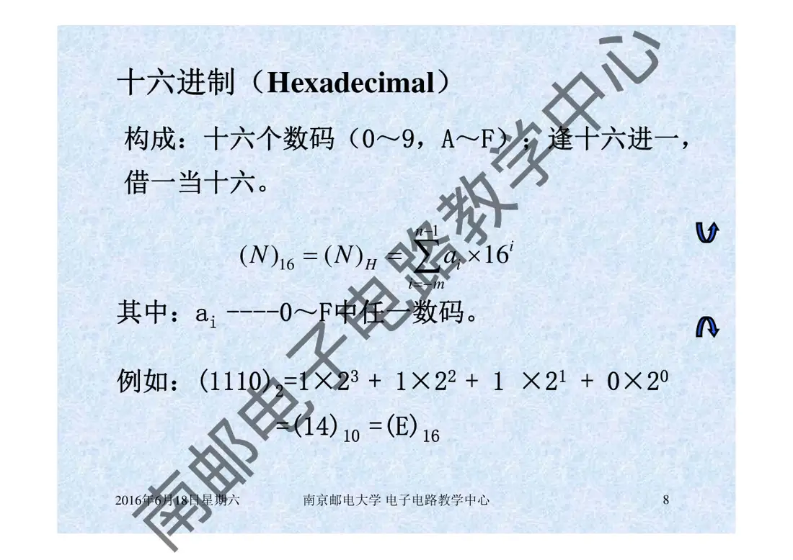

原文：

十六进制（Hexadecimal）

构成：十六个数码（0～9，A～F）；逢十六进一，借一当十六。

$$
(N) _ {1 6} = (N) _ {H} \equiv \sum^ {n - 1} a _ {i} \times 1 6 ^ {i}\tag{U}
$$

其中： $a_{i}$ ----0～F中任一数码。

A

例如： $(1110)_{2} = 1 \times 2^{3} + 1 \times 2^{2} + 1 \times 2^{1} + 0 \times 2^{0}$

$$
= (1 4) _ {1 0} = (\mathrm{E}) _ {1 6}
$$

2016年6月18日星期六

南京邮电大学 电子电路教学中心

8

### 三、数制转换

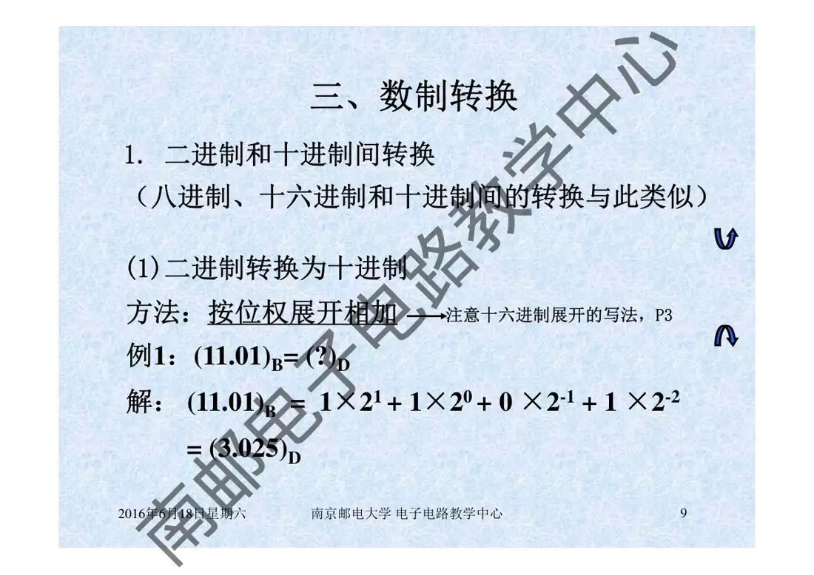

原文：

三、数制转换

1. 二进制和十进制间转换

(八进制、十六进制和十进制间的转换与此类似)

(1)二进制转换为十进制

方法: 按位权展开相加 $\rightarrow$ 注意十六进制展开的写法, P3

例1: (11.01) $_{B}$ =(?) $_{D}$

解： $(11.01)_{\mathrm{B}} = 1 \times 2^{1} + 1 \times 2^{0} + 0 \times 2^{-1} + 1 \times 2^{-2}$ $= (3.025)_{\mathrm{D}}$

2016年6月18日星期六

南京邮电大学 电子电路教学中心

9

### (2) 十进制转换为二进制

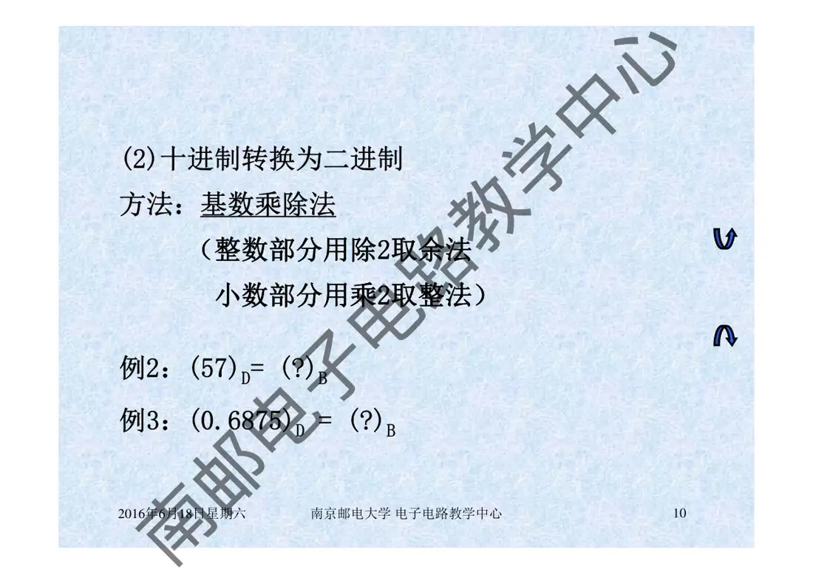

原文：

(2) 十进制转换为二进制

方法：基数乘除法

(整数部分用除2取余法

小数部分用乘2取整法）

例2: (57) $_{D}$ = (?) $_{B}$

例3: $(0.6875)_{D} = (?)_{B}$

2016年6月18日星期六

南京邮电大学 电子电路教学中心

10

### 例2: (57) $_{D}$ = (?) $_{B}$

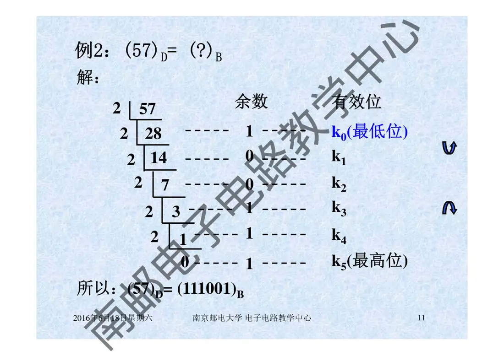

原文：

A

例2: (57) $_{D}$ = (?) $_{B}$

解:

$k_{0}$ (最低位)

U

所以: $(57)_{\mathrm{D}} = (111001)_{\mathrm{B}}$

2016年6月18日星期六

南京邮电大学 电子电路教学中心

11

### 为什么高低位的顺序是反的？

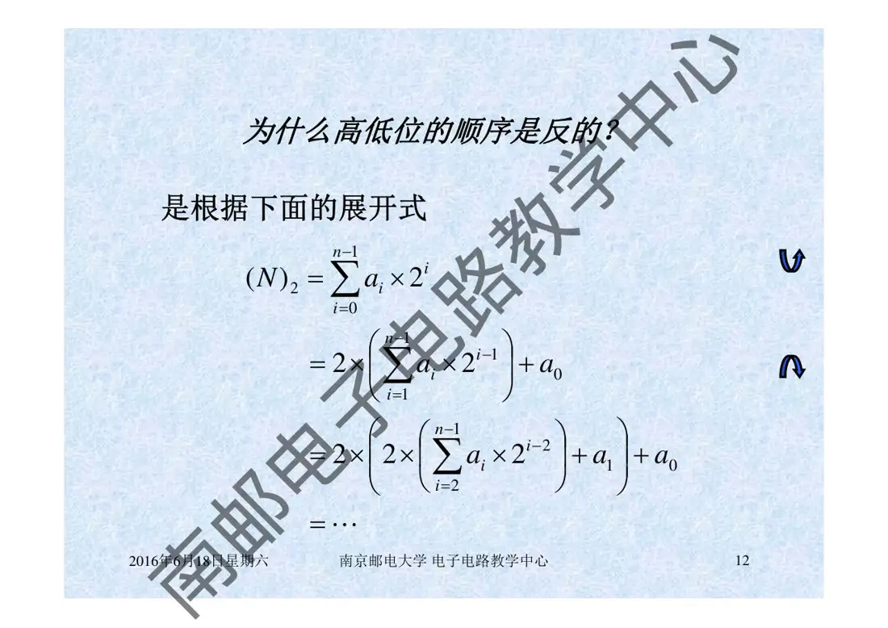

原文：

为什么高低位的顺序是反的？

是根据下面的展开式

$$
\begin{array}{r l} (N) _ {2} & = \sum_ {i = 0} ^ {n - 1} a _ {i} \times 2 ^ {i} \\ & = 2 \times \left(\sum_ {i = 1} ^ {n - 1} a _ {i} \times 2 ^ {i - 1}\right) + a _ {0} \end{array}\tag{U}
$$

$$
\left(2 \times \left(\sum_ {i = 2} ^ {n - 1} a _ {i} \times 2 ^ {i - 2}\right) + a _ {1}\right) + a _ {0}\tag{A}
$$

2016年6月18日星期六

南京邮电大学 电子电路教学中心

12

### $$

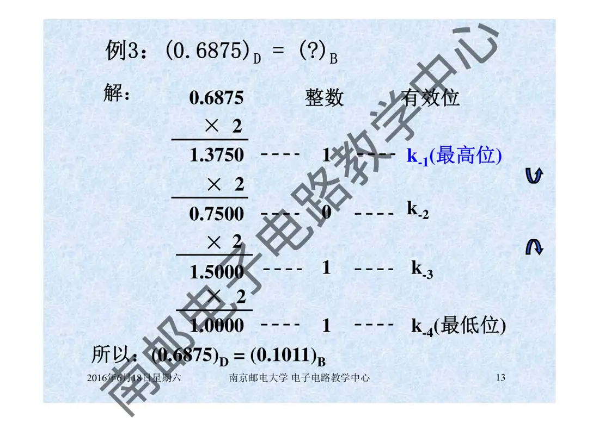

原文：

例3: $(0.6875)_{\mathrm{D}} = (?)_{\mathrm{B}}$

$$
\begin{array}{r l} {\text {   解:   }} & {0. 6 8 7 5 \quad \text {   整数   } \quad \text {   有效位   }} \\ & {\frac {\times 2}{1 . 3 7 5 0} \quad - - - 1 - - - k _ {- 1} (\text {   最高位   })} \\ & {\frac {\times 2}{0 . 7 5 0 0} \quad - - - 0 - - - k _ {- 2}} \\ & {\frac {\times 2}{1 . 5 0 0 0} \quad - - - 1 - - - k _ {- 3}} \\ & {\frac {\times 2}{1 . 0 0 0 0} \quad - - - 1 - - - k _ {- 4} (\text {   最低位   })} \end{array}\tag{U}
$$

A

所以： $(0.6875)_{\mathrm{D}} = (0.1011)_{\mathrm{B}}$

2016年6月18日星期六

南京邮电大学 电子电路教学中心

13

### 为什么高低位顺序又是顺的？

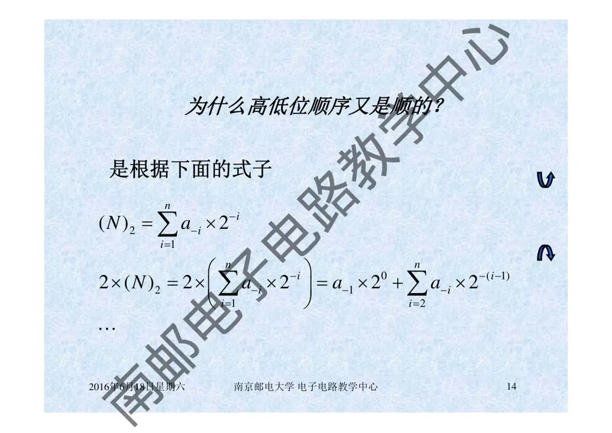

原文：

为什么高低位顺序又是顺的？

是根据下面的式子

U

$$
(N) _ {2} = \sum_ {i = 1} ^ {n} a _ {- i} \times 2 ^ {- i}\tag{A}
$$

$$
2 \times (N) _ {2} = 2 \times \left(\sum_ {i = 1} ^ {n} a _ {- i} \times 2 ^ {- i}\right) = a _ {- 1} \times 2 ^ {0} + \sum_ {i = 2} ^ {n} a _ {- i} \times 2 ^ {- (i - 1)}
$$

2016年6月18日星期六

南京邮电大学 电子电路教学中心

14

### (3) 小数的精度及转换位数的确定

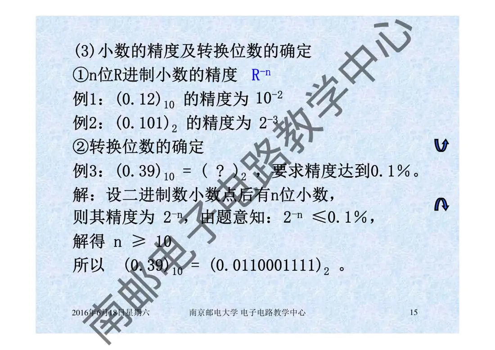

原文：

(3) 小数的精度及转换位数的确定

①n位R进制小数的精度 $\mathrm{R}^{-\mathrm{n}}$

例1: $(0.12)_{10}$ 的精度为 $10^{- 2}$

例2: $(0.101)_{2}$ 的精度为 $2^{-3}$

②转换位数的确定

例3: $(0.39)_{10} = (\ ? )_{2}$ , 要求精度达到 $0.1\%$ 。

解：设二进制数小数点后有n位小数，

则其精度为 $2^{-n}$ ，由题意知： $2^{-n} \leqslant 0.1\%$ ，

解得 $n \geqslant 10$

所以 $(0.39)_{10} = (0.0110001111)_{2}$ 。

2016年6月18日星期六

南京邮电大学 电子电路教学中心

15

### 2. 二进制、八进制、十六进制间转换

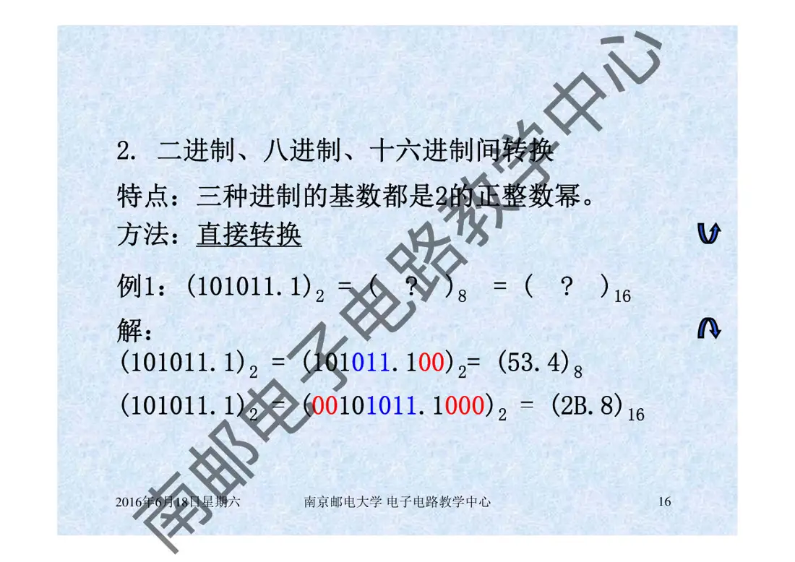

原文：

2. 二进制、八进制、十六进制间转换

特点：三种进制的基数都是2的正整数幂。

方法：直接转换

U

例1: (101011.1) $_{2}$ = ( ? ) $_{8}$ = ( ? ) $_{16}$

解:

(101011.1) $_{2}$ = (101011.100) $_{2}$ = (53.4) $_{8}$

(101011.1) $_{2}$ = (00101011.1000) $_{2}$ = (2B.8) $_{16}$

2016年6月18日星期六

南京邮电大学 电子电路教学中心

16

### 为什么搞出这么多不同的数制？

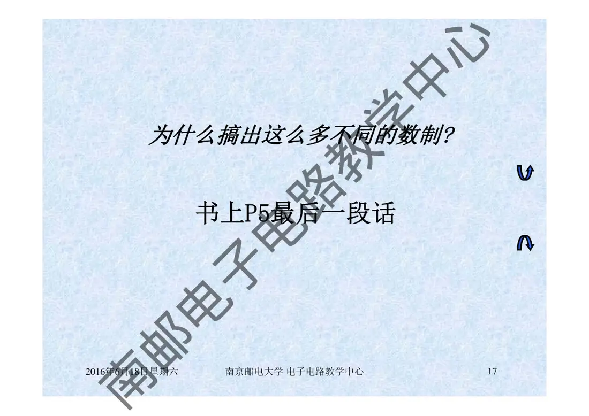

原文：

为什么搞出这么多不同的数制？

书上P5最后一段话练习1: 将(1001110) $_{B}$ , (116) $_{O}$ , (4E) $_{H}$ 分别转换十进制

2016年6月18日星期六

南京邮电大学 电子电路教学中心

17

### 解:

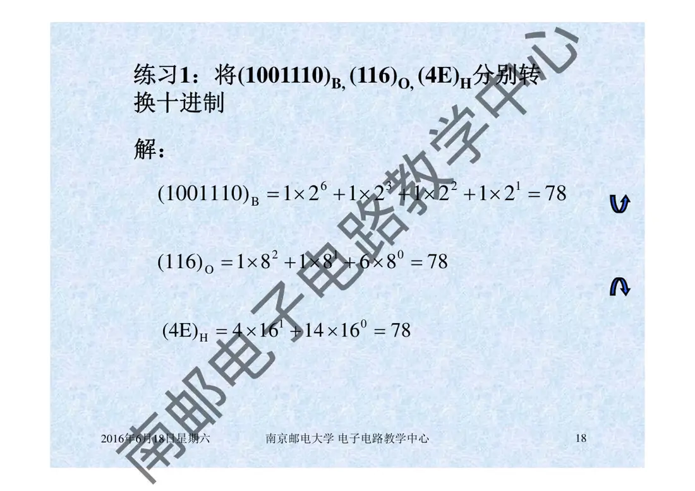

原文：

解:

$$
(1 0 0 1 1 1 0) _ {\mathrm{B}} = 1 \times 2 ^ {6} + 1 \times 2 ^ {3} + 1 \times 2 ^ {2} + 1 \times 2 ^ {1} = 7 8\tag{U}
$$

$$
(1 1 6) _ {\mathrm{O}} = 1 \times 8 ^ {2} + 1 \times 8 ^ {1} + 6 \times 8 ^ {0} = 7 8\tag{A}
$$

$$
(4 \mathrm{E}) _ {\mathrm{H}} = 4 \times 1 6 ^ {1} + 1 4 \times 1 6 ^ {0} = 7 8
$$

2016年6月18日星期六

南京邮电大学 电子电路教学中心

18

### 解：

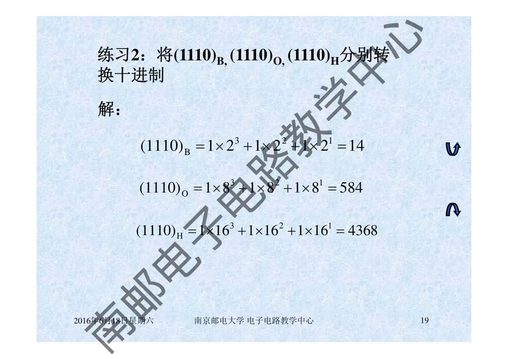

原文：

练习2: 将 $(1110)_{\mathrm{B}}, (1110)_{\mathrm{O}}, (1110)_{\mathrm{H}}$ 分别转换十进制

解：

(1110) $_{B}$ =1×2 $^{3}$ +1×2 $^{2}$ +1×2 $^{1}$ =14

$$
(1 1 1 0) _ {\mathrm{o}} = 1 \times 8 ^ {3} + 1 \times 8 ^ {2} + 1 \times 8 ^ {1} = 5 8 4\tag{U}
$$

$$
(1 1 1 0) _ {\mathrm{H}} = 1 \times 1 6 ^ {3} + 1 \times 1 6 ^ {2} + 1 \times 1 6 ^ {1} = 4 3 6 8
$$

2016年6月18日星期六

南京邮电大学 电子电路教学中心

19

### 练习3: 将(78) $_{D}$ 分别转换成二进制, 八进制, 十六进制

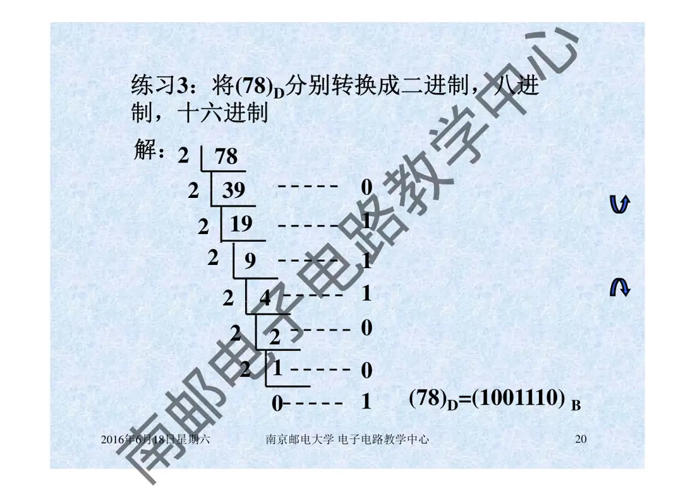

原文：

练习3: 将(78) $_{D}$ 分别转换成二进制, 八进制, 十六进制

U

A

2016年6月18日星期六

南京邮电大学 电子电路教学中心

20

### $$

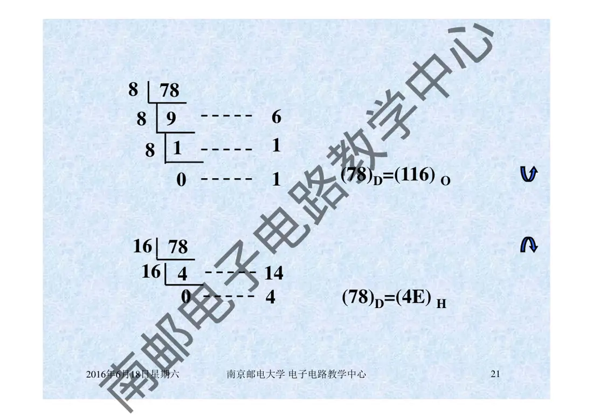

原文：

$$
\begin{array}{c c c} 8 & 7 8 \\ \hline 8 & 9 & -- - - 6 \\ 8 & 1 & -- - - 1 \\ \hline & 0 & -- - - 1 \end{array}
$$

$$
\begin{array}{c c c} 1 6 & 7 8 \\ 1 6 & 4 \\ \hline & 0 \end{array} \quad \begin{array}{c c c} - & - & - \\ - & - & - \\ - & - & - \\ 4 \end{array}\tag{U}
$$

$$
(7 8) _ {\mathbf {D}} = (4 \mathbf {E}) _ {\mathbf {H}}
$$

2016年6月18日星期六

南京邮电大学 电子电路教学中心

21

### 练习4: 将 $(0.234)_{D}$ 转换成二进制，要求保持精度

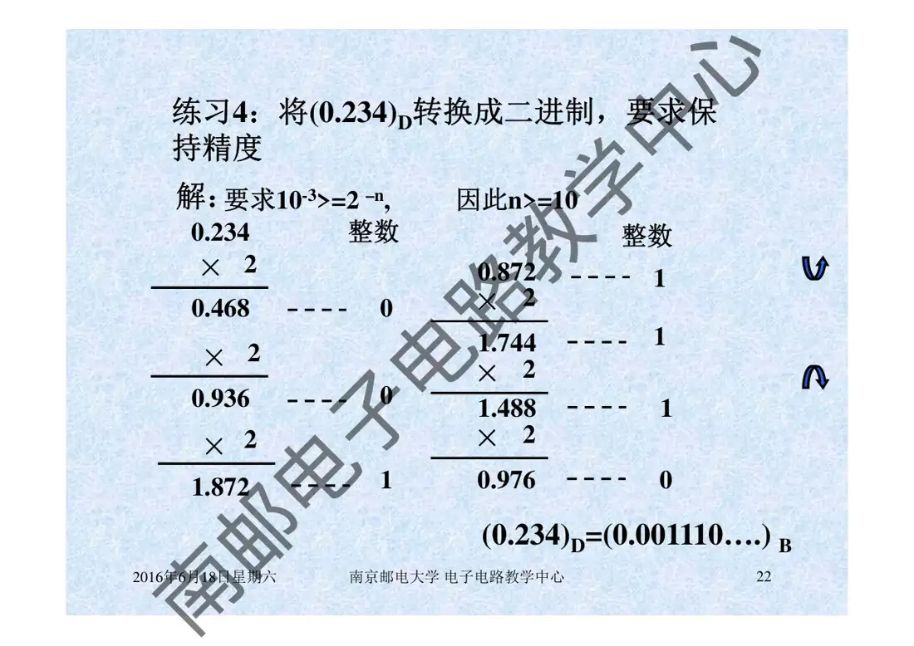

原文：

练习4: 将 $(0.234)_{D}$ 转换成二进制，要求保持精度

$$
\begin{array}{r l} & {\text {解: 要求} 1 0 ^ {- 3} > = 2 ^ {- n},} \\ & {\quad \times 2} \\ & {\hline 0. 4 6 8} \\ & {\times 2} \\ & {\hline 0. 9 3 6} \\ & {\times 2} \\ & {\hline 1. 8 7 2} \end{array}
$$

$$
\begin{array}{r l} & {\text {因此} n > = 1 0} \\ & {\text {整数}} \\ & {0. 8 7 2 \quad - - - - 1} \\ & {\times 2} \\ & {\hline 1. 7 4 4 \quad - - - - 1} \\ & {\times 2} \\ & {\hline 1. 4 8 8 \quad - - - - 1} \\ & {\times 2} \\ & {\hline 0. 9 7 6 \quad - - - - 0} \end{array}\tag{U}
$$

$$
(0. 2 3 4) _ {\mathrm{D}} = (0. 0 0 1 1 1 0 \dots .) _ {\mathrm{B}}\tag{A}
$$

2016年6月18日星期六

南京邮电大学 电子电路教学中心

22

### $$

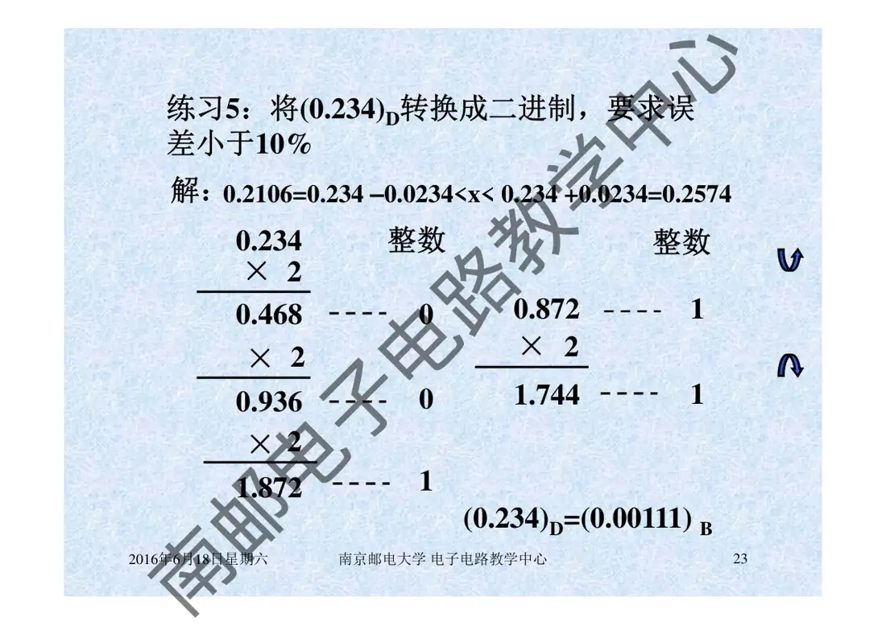

原文：

练习5: 将 $(0.234)_{\mathrm{D}}$ 转换成二进制, 要求误差小于 $10 \%$

解: $0.2106 = 0.234 - 0.0234 < x < 0.234 + 0.0234 = 0.2574$

$$
\begin{array}{r l r} & \frac {0 . 2 3 4}{\times 2} \quad \text {整数} \quad & \text {整数} \\ & \frac {0 . 4 6 8}{\times 2} \quad - - - 0 \quad 0. 8 7 2 & - - - 1 \\ & \frac {\times 2}{0 . 9 3 6} \quad - - - 0 \quad \frac {\times 2}{1 . 7 4 4} & - - - 1 \\ & \frac {\times 2}{1 . 8 7 2} \quad - - - 1 \\ & (0. 2 3 4) _ {D} = (0. 0 0 1 1 1) _ {B} \end{array}
$$

2016年6月18日星期六

南京邮电大学 电子电路教学中心

23

### 2016年6月18日星期六

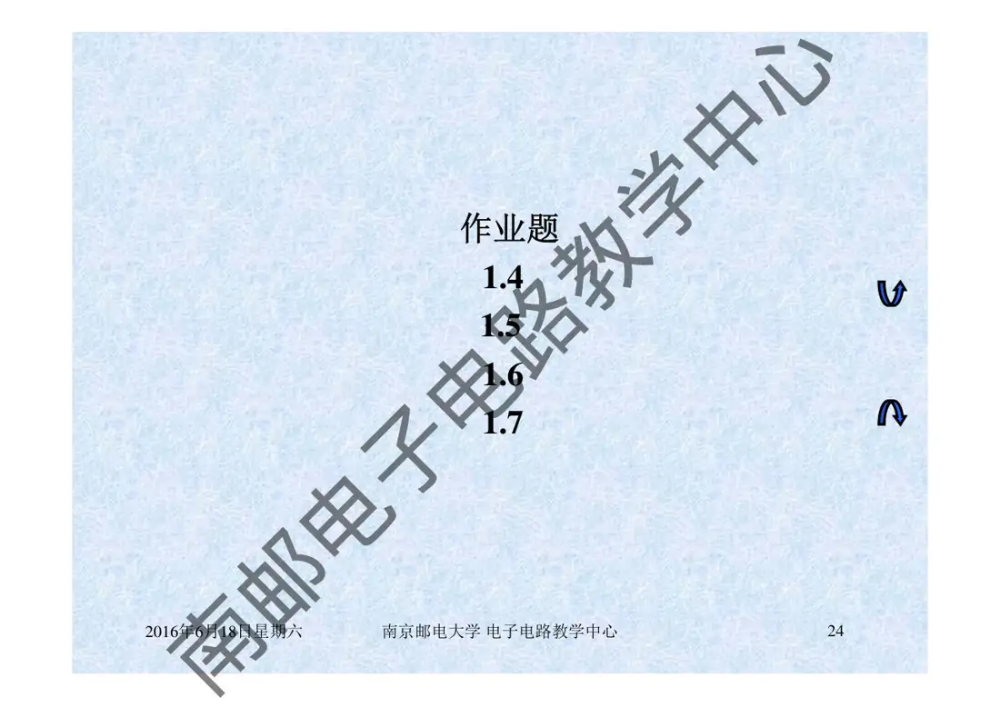

原文：

2016年6月18日星期六

南京邮电大学 电子电路教学中心

24
