# 《数字电路与系统设计》第一章 第二节 码制（课件）

原件的每一页，下面附识别出的文字。

### 第一章 数制与码制

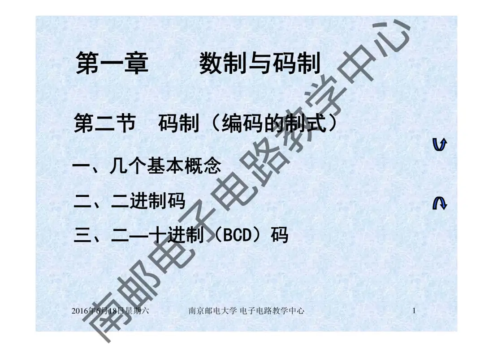

原文：

第一章 数制与码制
第二节 码制（编码的制式）
一、几个基本概念
二、二进制码
三、二—十进制（BCD）码
2016年6月18日星期六 南京邮电大学 电子电路教学中心 1

### 一、 几个基本概念

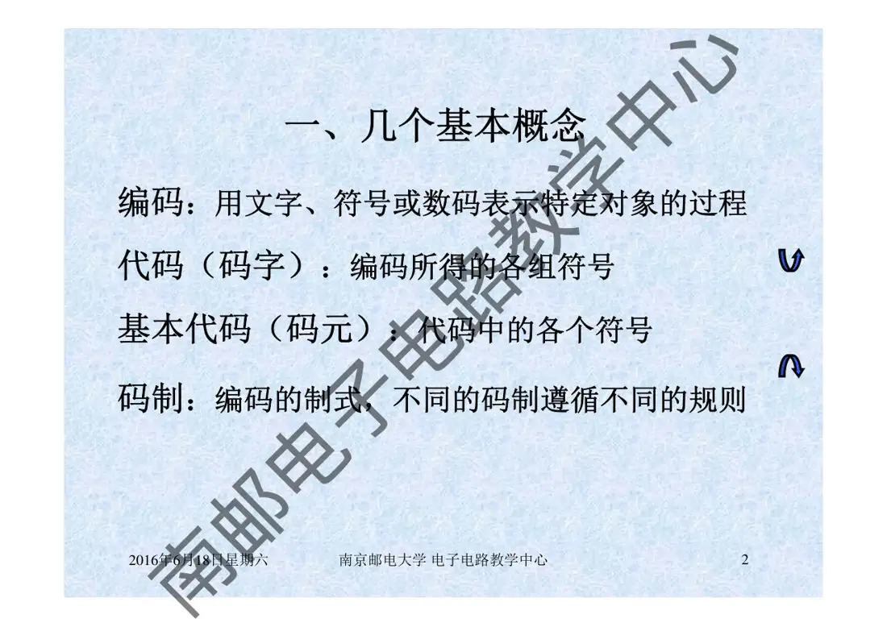

原文：

一、 几个基本概念

编码： 用文字、 符号或数码表示特定对象的过程

代码 （码字） ： 编码所得的各组符号

基本代码 （码元） ： 代码中 的各个符号

码制 ： 编码的制式， 不同的码制遵循不同的规则

20 1 6年6月 1 8 日 星期 六

南京邮电大学 电子电路教学中心

2

### 为什么要进行编码？

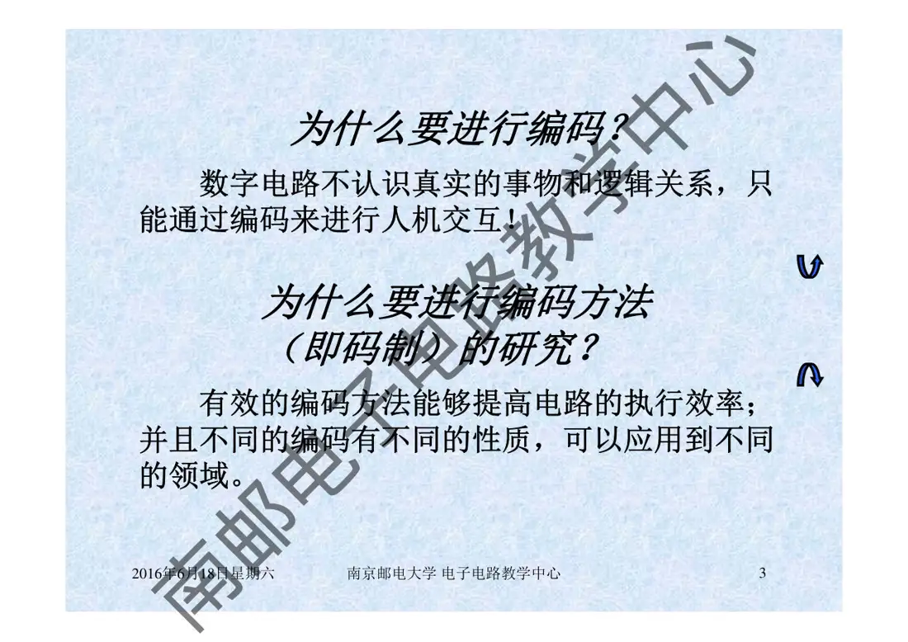

原文：

为什么要进行编码？

数字电路不认识真实的事物和逻辑关系， 只能通过编码来进行人机交互 ！

为什么要进行编码方法（即码制） 的研究？

有效的编码方法能够提高电路的执行效率；并且不同的编码有不同的性质 ， 可以应用到不同的领域。

20 1 6年6月 1 8 日 星期 六

南京邮电大学 电子电路教学中心

3

### 二、 二进制码

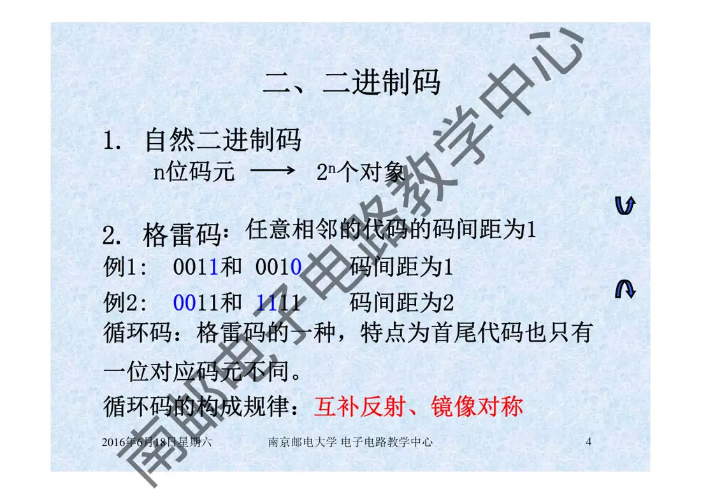

原文：

二、 二进制码

1 自然二进制码.

n位码元 2n个对象

2 格雷码： 任意相邻的代码的码间距为1

例 1 : 0 0 1 1 和 0 0 1 0 码 间 距 为 1

例 2 : 0 0 1 1 和 1 1 1 1 码 间 距 为 2

循环码： 格雷码的一种， 特点为首尾代码也只有一位对应码元不同 。

循环码的构成规律： 互补反射、 镜像对称

20 1 6年6月 1 8 日 星期 六

南京邮电大学 电子电路教学中心

4

### 南京邮电大学 电子电路教学中心

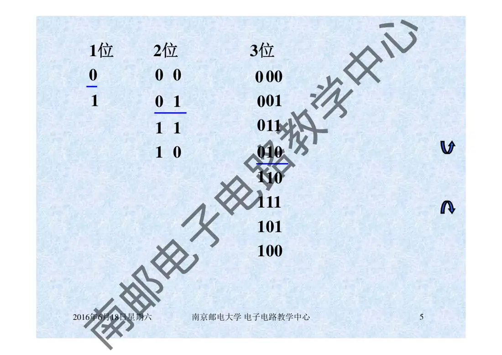

原文：

<table><tr><td>1位</td><td>2位</td><td>3位</td></tr><tr><td>0</td><td>0 0</td><td>000</td></tr><tr><td>1</td><td>0 1</td><td>001</td></tr><tr><td></td><td>1 1</td><td>011</td></tr><tr><td></td><td>1 0</td><td>010</td></tr><tr><td></td><td></td><td>110</td></tr><tr><td></td><td></td><td>111</td></tr><tr><td></td><td></td><td>101</td></tr><tr><td></td><td></td><td>100</td></tr></table>

南京邮电大学 电子电路教学中心

20 1 6年6月 1 8 日 星期 六

5

### 20 1 6年6月 1 8 日 星期 六

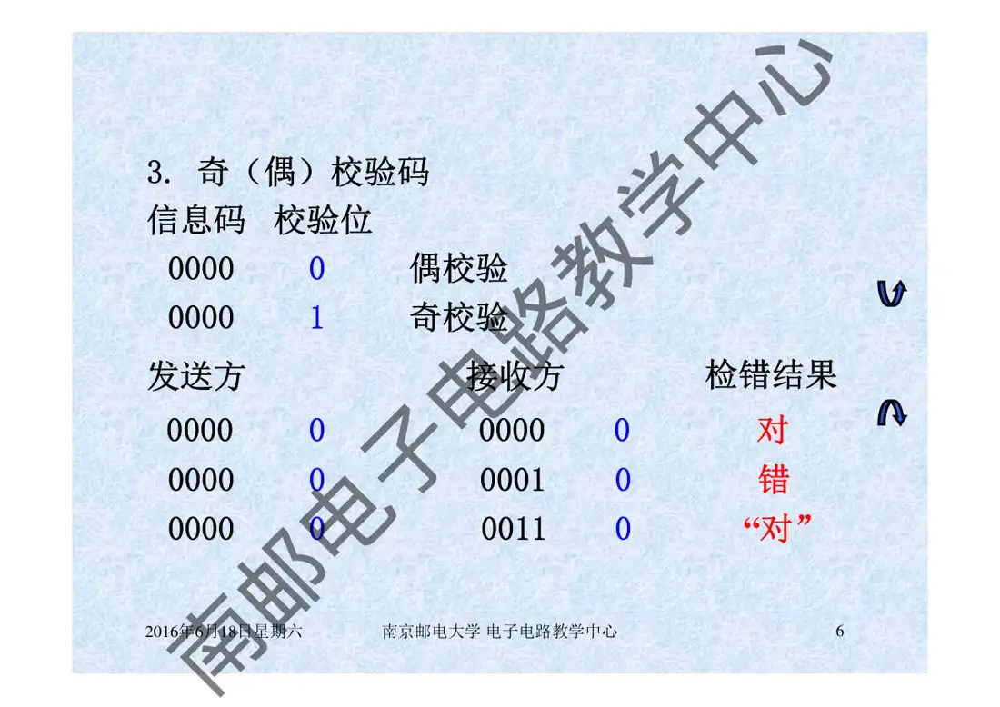

原文：

<table><tr><td colspan="3">3. 奇(偶)校验码</td><td rowspan="2" colspan="2"></td></tr><tr><td>信息码</td><td>校验位</td><td></td></tr><tr><td>0000</td><td>0</td><td>偶校验</td><td></td><td></td></tr><tr><td>0000</td><td>1</td><td>奇校验</td><td></td><td></td></tr><tr><td>发送方</td><td></td><td>接收方</td><td></td><td>检错结果</td></tr><tr><td>0000</td><td>0</td><td>0000</td><td>0</td><td>对</td></tr><tr><td>0000</td><td>0</td><td>0001</td><td>0</td><td>错</td></tr><tr><td>0000</td><td>0</td><td>0011</td><td>0</td><td>“对”</td></tr></table>

20 1 6年6月 1 8 日 星期 六

南京邮电大学 电子电路教学中心

6

### 三、 二—十 制进 （BCD） 码

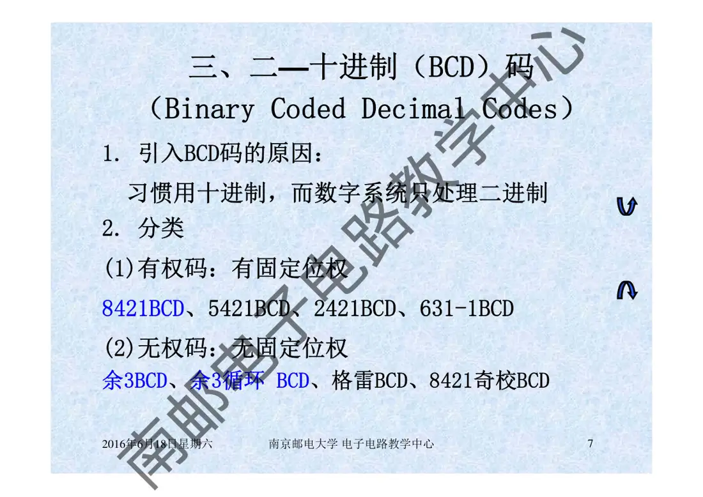

原文：

三、 二—十 制进 （BCD） 码

（ B i nary Co de d De c i ma l Co de s ）

1 . 引 入BCD码 的 原 因 ：

习惯用十进制， 而数字系统只处理二进制

2 . 分类

(1) 有权码： 有固定位权

842 1 BCD 、 542 1 BCD 、 242 1 BCD 、 6 3 1 - 1 BCD

(2) 无权码： 无固定位权

余3BCD 、 余3循环 BCD 、 格雷BCD 、 842 1 奇校BCD

20 1 6年6月 1 8 日 星期 六

南京邮电大学 电子电路教学中心

7

### 南京邮电大学 电子电路教学中心

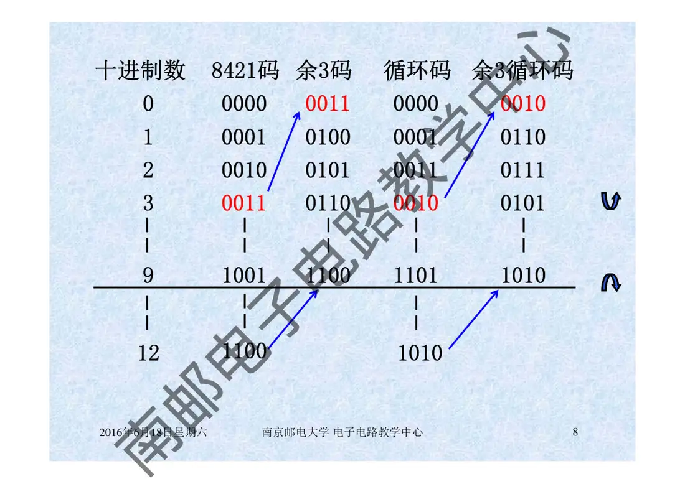

原文：

<table><tr><td>十进制数</td><td>8421码</td><td>余3码</td><td>循环码</td><td>余3循环码</td></tr><tr><td>0</td><td>0000</td><td>0011</td><td>0000</td><td>0010</td></tr><tr><td>1</td><td>0001</td><td>0100</td><td>0001</td><td>0110</td></tr><tr><td>2</td><td>0010</td><td>0101</td><td>0011</td><td>0111</td></tr><tr><td>3</td><td>0011</td><td>0110</td><td>0010</td><td>0101</td></tr><tr><td>|</td><td>|</td><td>|</td><td>|</td><td>|</td></tr><tr><td>|</td><td>|</td><td>|</td><td>|</td><td>|</td></tr><tr><td>9</td><td>1001</td><td>1100</td><td>1101</td><td>1010</td></tr><tr><td>|</td><td>|</td><td></td><td>|</td><td></td></tr><tr><td>|</td><td>|</td><td></td><td>|</td><td></td></tr><tr><td>12</td><td>1100</td><td></td><td>1010</td><td></td></tr></table>

南京邮电大学 电子电路教学中心

20 1 6年6月 1 8 日 星期 六

8

### 3. 多位十进制数的表示

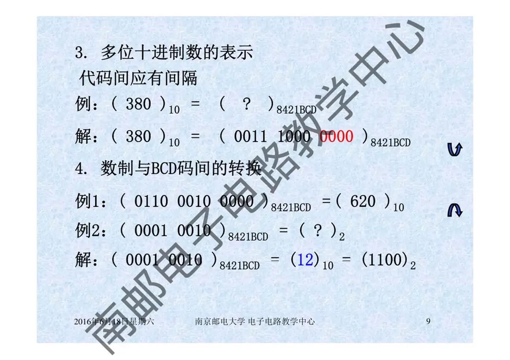

原文：

3. 多位十进制数的表示

代码间应有间隔

例 ： $\left( \begin{array} { c c c c c } { { 3 8 0 } } \end{array} \right) _ { 1 0 } = \left( \begin{array} { c c c c } { { 2 } } & { { } } \end{array} \right) _ { 8 4 2 1 8 \mathrm { { G D } } }$

解 ： $( \begin{array} { c } { { 3 8 0 } } \end{array} ) _ { 1 0 } \ = \ ( \begin{array} { c } { { 0 0 1 1 \ \underline { { { 1 } } } 0 0 0 } } \end{array} ) 0 0 0 0 0 \ ) _ { 8 4 2 1 \mathrm { B C D } }$

4. 数制与BCD码间 的转换

例 1 ： ( 0 1 1 0 0 0 1 0 0 0 0 0 ) $\mathrm { \Delta \ b 4 2 1 B C D } = \left( \begin{array} { c c c } { 6 2 0 } \end{array} \right) \mathrm { _ { 1 0 } }$

例 2 ： ( 0 0 0 1 0 0 1 0 ) $\mathrm { 8 4 2 1 B C D } = ( ? ) _ { 2 }$

解 ： ( 0 0 0 1 0 0 1 0 ) $\mathrm { \Gamma } _ { 8 4 2 1 8 \mathrm { C D } } = \left( 1 2 \right) _ { 1 0 } = \left( 1 1 0 0 \right) _ { 2 }$

20 1 6年6月 1 8 日 星期 六

南京邮电大学 电子电路教学中心

9

### 练 习 ： ( 0 1 0 1 1 0 1 0) 余3码 = ( ? ) 2

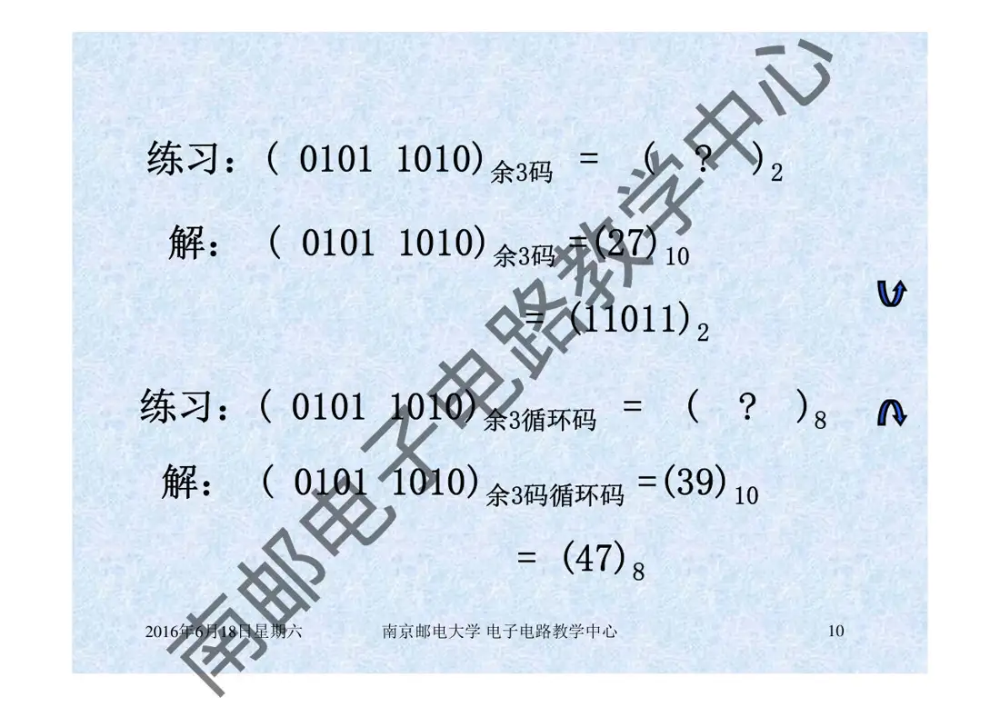

原文：

练 习 ： ( 0 1 0 1 1 0 1 0) 余3码 = ( ? ) 2

解 ： ( 0 1 0 1 1 0 1 0 ) 余3码 = ( 2 7 ) 1 0

= ( 1 1 0 1 1 ) 2

练 习 ： ( 0 1 0 1 1 0 1 0) 余3循环码 = ( ? ) 8

解 ： ( 0 1 0 1 1 0 1 0 ) 余3码循环码 = ( 3 9 ) 1 0 ( 4 7 ) 8

20 1 6年6月 1 8 日 星期 六

南京邮电大学 电子电路教学中心

1 0

### 练 习 ： ( 0 1 0 1 1 0 1 0) 2 = ( ? )

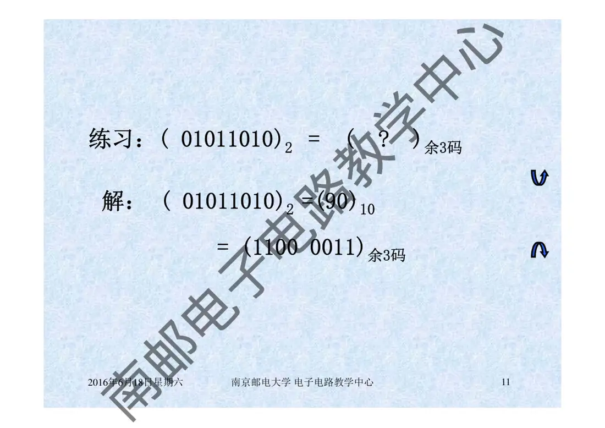

原文：

练 习 ： ( 0 1 0 1 1 0 1 0) 2 = ( ? )

解 ： ( 0 1 0 1 1 0 1 0 ) 2 = ( 9 0 ) 1 0

20 1 6年6月 1 8 日 星期 六

南京邮电大学 电子电路教学中心

1 1

### 5 . 842 1 BCD   的 加 减法运算

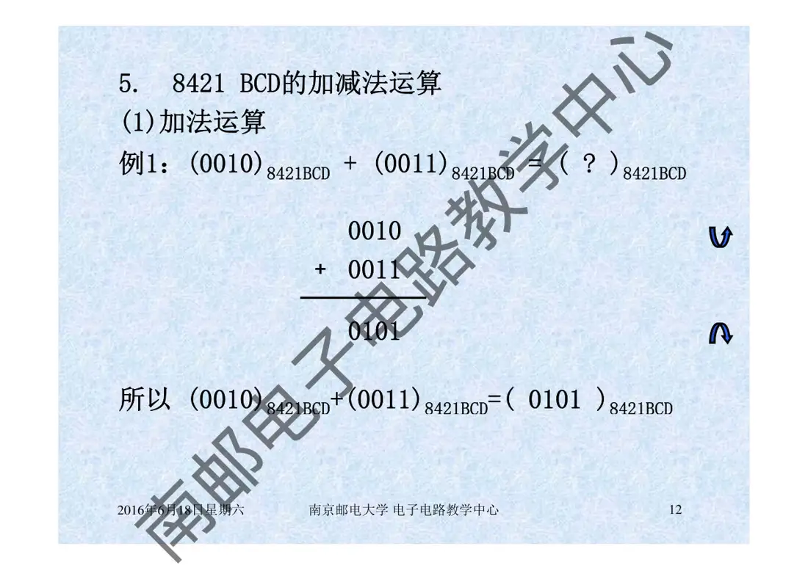

原文：

5 . 842 1 BCD   的 加 减法运算

(1) 加法运算

例 1 ： ( 0 0 1 0 ) 842 1 BCD + ( 0 0 1 1 ) 842 1 BCD = ( ? ) 842 1 BCD

所 以 ( 0 0 1 0 ) 842 1 BCD+ ( 0 0 1 1 ) 842 1 BCD= ( 0 1 0 1 ) 842 1 BCD

20 1 6年6月 1 8 日 星期 六

南京邮电大学 电子电路教学中心

1 2

### 非法码加6修正

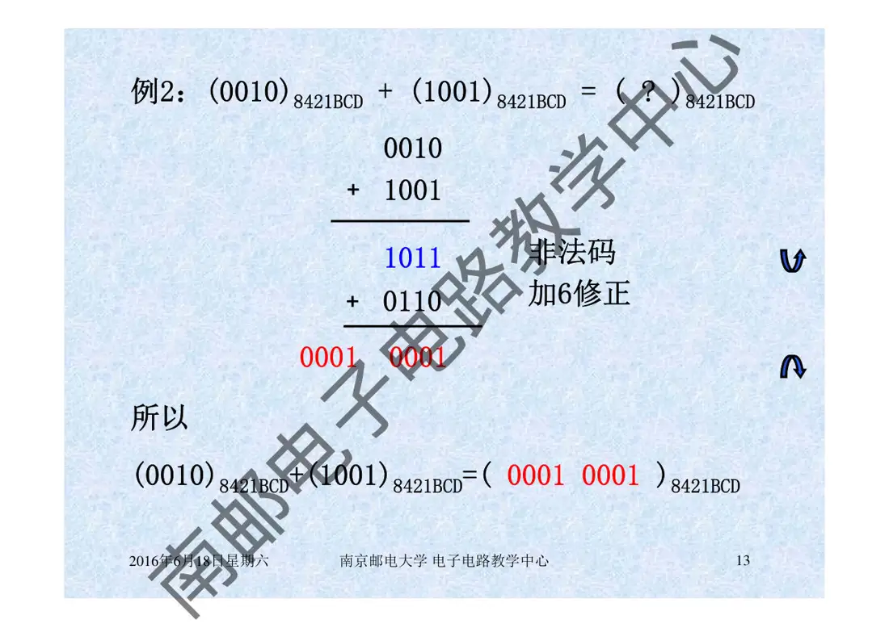

原文：

非法码加6修正

U

A

所以

$$
(0 0 1 0) _ {8 4 2 1 \mathrm{BCD}} + (1 0 0 1) _ {8 4 2 1 \mathrm{BCD}} = (0 0 0 1 0 0 0 1) _ {8 4 2 1 \mathrm{BCD}}
$$

20 1 6年6月 1 8 日 星期 六

南京邮电大学 电子电路教学中心

1 3

### 所以

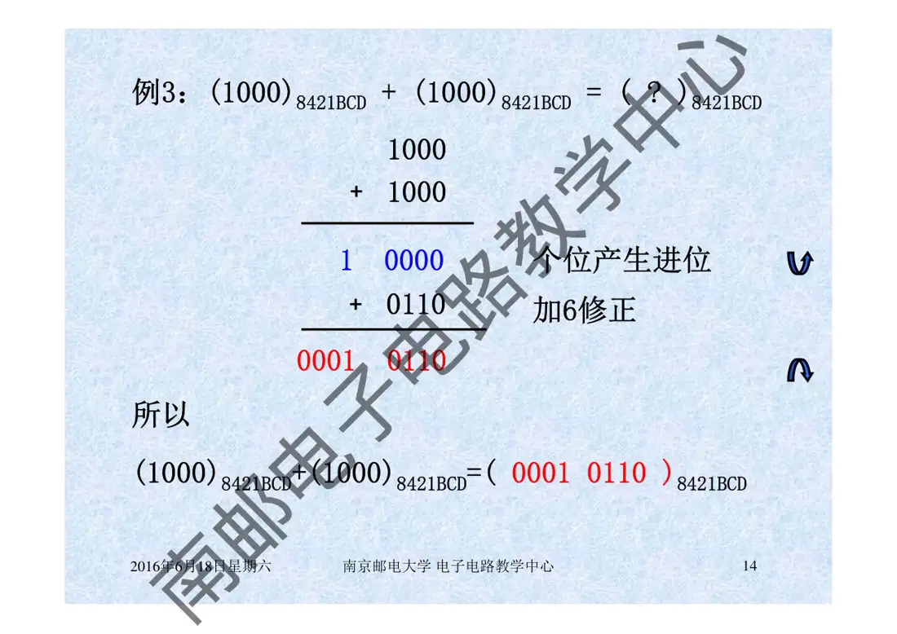

原文：

所以

$$
(1 0 0 0) _ {8 4 2 1 \mathrm{BCD}} + (1 0 0 0) _ {8 4 2 1 \mathrm{BCD}} = (0 0 0 1 0 1 1 0) _ {8 4 2 1 \mathrm{BCD}}
$$

20 1 6年6月 1 8 日 星期 六

南京邮电大学 电子电路教学中心

1 4

### 20 1 6年6月 1 8 日 星期 六

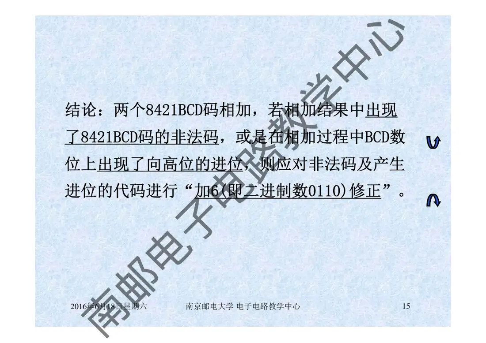

原文：

结论： 两个8421BCD码相加， 若相加结果中 出现了8421BCD码的非法码， 或是在相加过程中BCD数位上出现了 向高位的进位 则应对非法码及产生进位的代码进行 “加6 (即二进制数0110) 修正” 。

20 1 6年6月 1 8 日 星期 六

南京邮电大学 电子电路教学中心

1 5

### (2) 减法运算

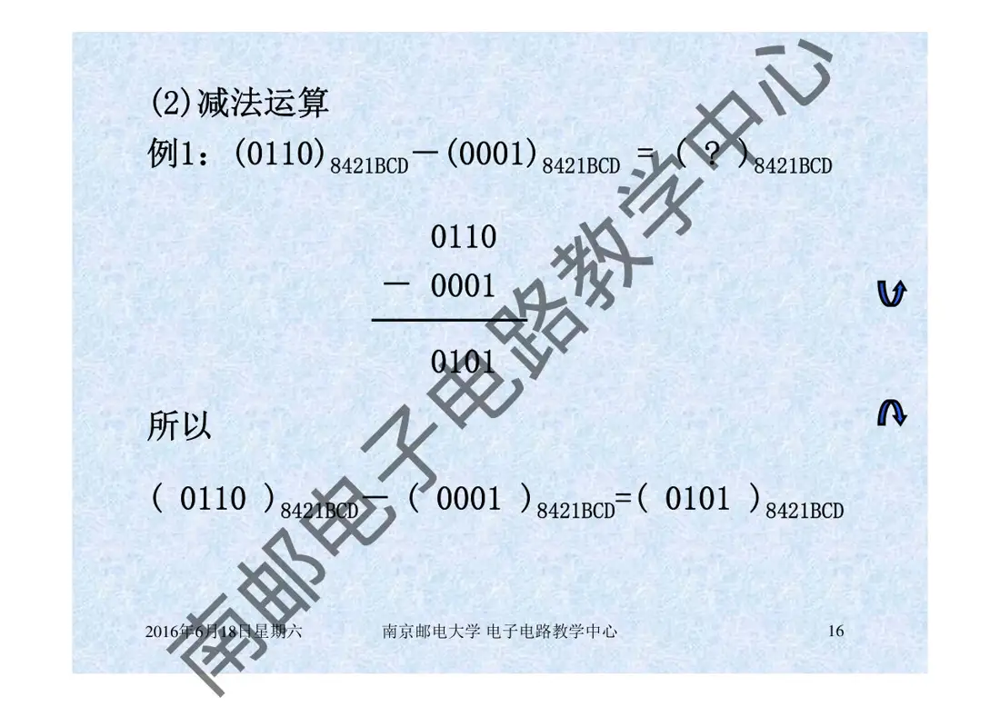

原文：

(2) 减法运算

例 1 ： ( 0 1 1 0 ) 842 1 BCD － ( 0 0 0 1 ) 842 1 BCD = ( ? ) 842 1 BCD

20 1 6年6月 1 8 日 星期 六

南京邮电大学 电子电路教学中心

1 6

### 例 2 ：

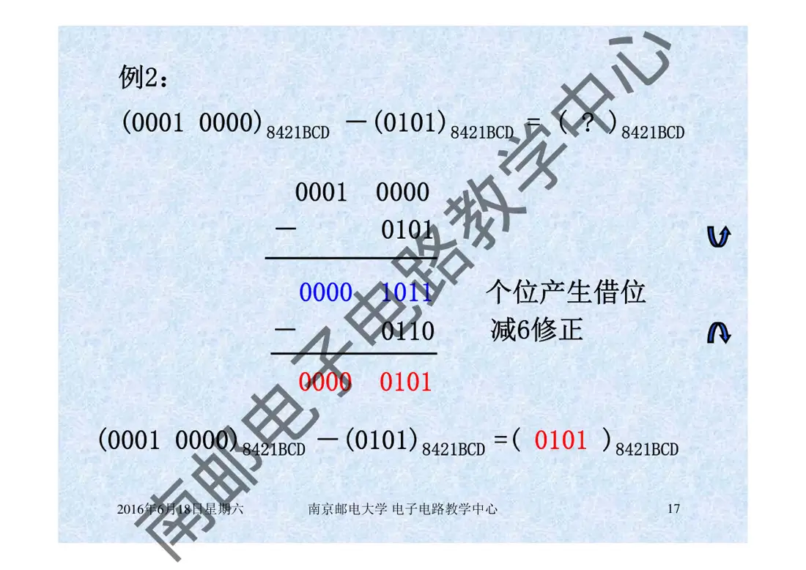

原文：

例 2 ：

( 0 0 0 1 0 0 0 0 ) 842 1 BCD － ( 0 1 0 1 ) 842 1 BCD = ( ? ) 842 1 BCD

$$
(0 0 0 1 0 0 0 0) _ {8 4 2 1 \mathrm{BCD}} - (0 1 0 1) _ {8 4 2 1 \mathrm{BCD}} = (0 1 0 1) _ {8 4 2 1 \mathrm{BCD}}
$$

20 1 6年6月 1 8 日 星期 六

南京邮电大学 电子电路教学中心

1 7

### 为什么不用考虑非法码的出现？

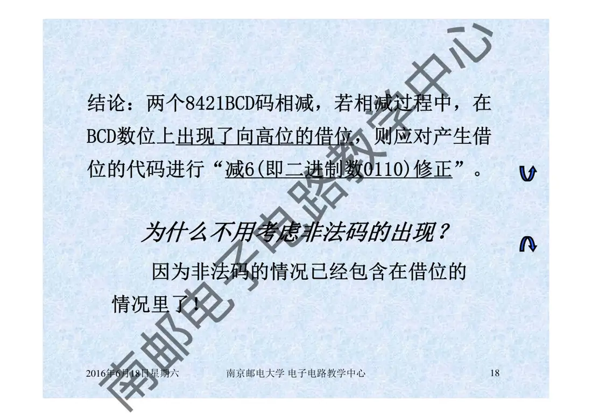

原文：

结论： 两个8421BCD码相减， 若相减过程中 ， 在BCD数位上出现了 向高位的借位， 则应对产生借位的代码进行 “减6 (即 进制数二 01 10) 修正” 。

为什么不用考虑非法码的出现？

因为非法码的情况已经包含在借位的情况里了 ！

20 1 6年6月 1 8 日 星期 六

南京邮电大学 电子电路教学中心

1 8

### $$

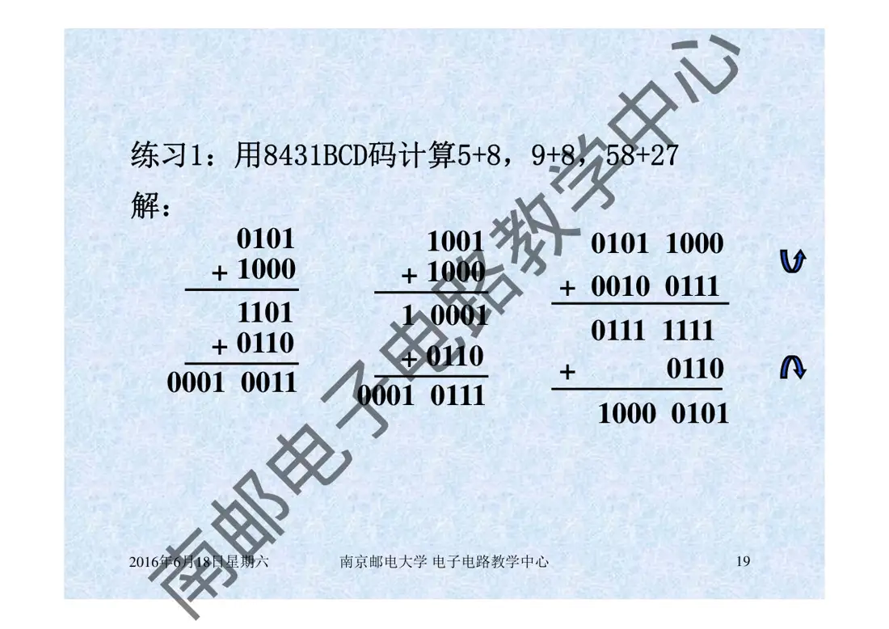

原文：

练 习 1 ： 用 843 1 BCD码计算 5 +8 ， 9 +8 ， 5 8 +2 7解 ：

$$
\begin{array}{c c c} \frac {0 1 0 1}{+ 1 0 0 0} & \frac {1 0 0 1}{+ 1 0 0 0} & \frac {0 1 0 1 \quad 1 0 0 0}{+ 0 0 1 0 \quad 0 1 1 1} \\ \hline 1 1 0 1 & \frac {1 \quad 0 0 0 1}{+ 0 1 1 0} & \frac {0 1 1 1 \quad 1 1 1 1}{+ \quad 0 1 1 0} \\ \frac {+ 0 1 1 0}{0 0 0 1 \quad 0 0 1 1} & \frac {+ \quad 0 1 1 0}{0 0 0 1 \quad 0 1 1 1} & \frac {1 0 0 0 \quad 0 1 0 1}{} \end{array}
$$

20 1 6年6月 1 8 日 星期 六

南京邮电大学 电子电路教学中心

1 9

### 20 1 6年6月 1 8 日 星期 六

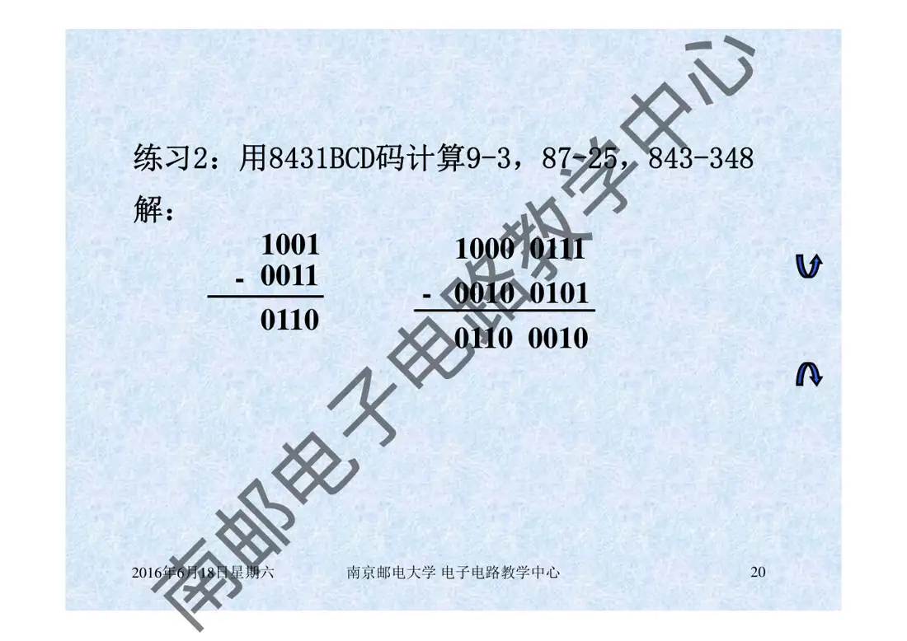

原文：

练 习 2 ： 用 843 1 BCD码计算9-3 ， 8 7-2 5 ， 843-3 48解 ：

20 1 6年6月 1 8 日 星期 六

南京邮电大学 电子电路教学中心

20

### 第 21 页

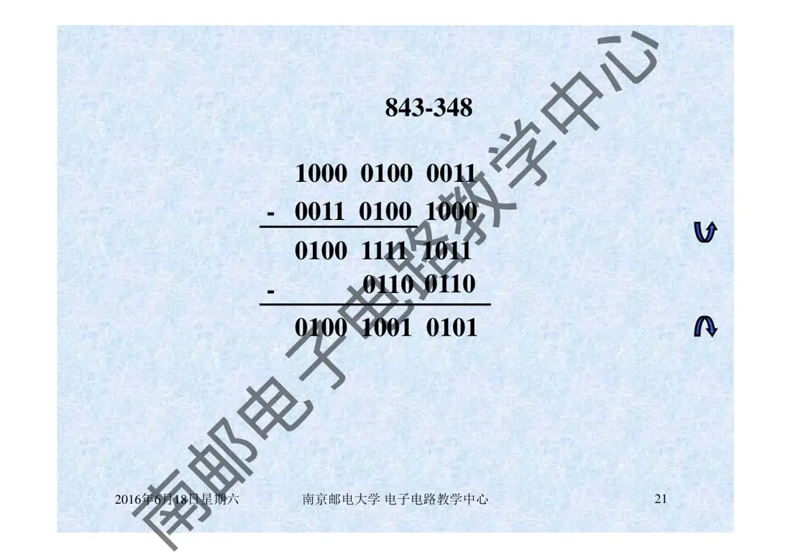

原文：

<table><tr><td colspan="3">843-348</td></tr><tr><td>1000</td><td>0100</td><td>0011</td></tr><tr><td>-</td><td>0011</td><td>0100 1000</td></tr><tr><td>/</td><td>0100</td><td>1111 1011</td></tr><tr><td>-</td><td></td><td>0110 0110</td></tr><tr><td>/</td><td>0100</td><td>1001 0101</td></tr></table>

### 20 1 6年6月 1 8 日 星期 六

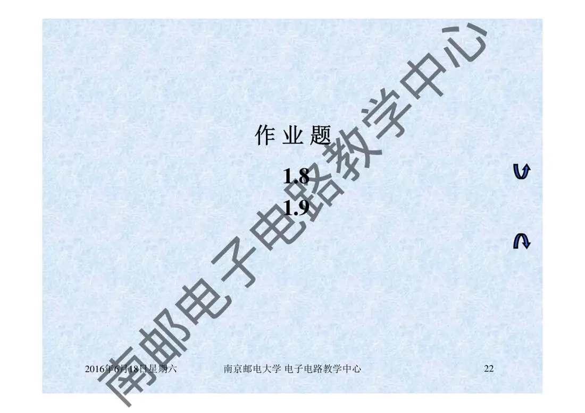

原文：

20 1 6年6月 1 8 日 星期 六

南京邮电大学 电子电路教学中心

22
