# 《数字电路与系统设计》第七章 数字系统设计基础（课件）

原件的每一页，下面附识别出的文字。

### 第七章 数字系统设计基础

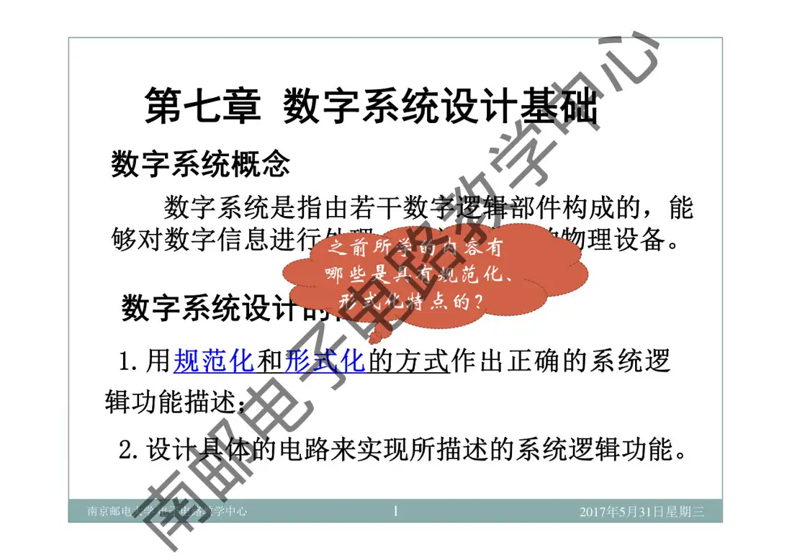

原文：

第七章 数字系统设计基础

数字系统概念

数字系统是指 由若干数字逻辑部件构成的， 能够对数字信息进行处理、 传送及存之前所学 的 内 容有 的物理设备。

哪 些 是具有 规 范 化

数字系统设计的

任务形 式化特 点 的 ？

1 用规范化和形式化的方式作 出 正确 的系统逻辑功能描述；

2. 设计具体的 电路来实现所描述的系统逻辑功能。

南京邮电大学 电子电路教学中心

1

20 1 7年5 月 3 1 日 星期三

### 7 1. 概述 （本章只讨论只有 个主时钟的 同步数字系统）一

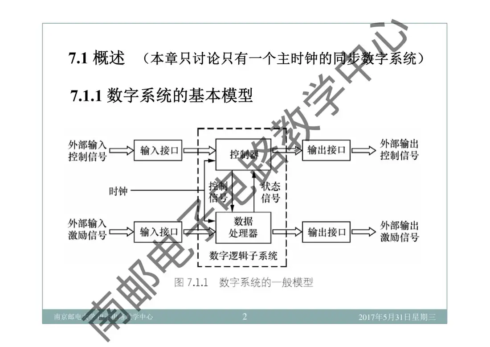

原文：

7 1. 概述 （本章只讨论只有 个主时钟的 同步数字系统）一

7 1 1 数字系统的基本模型. .

南京邮电大学 电子电路教学中心

2

20 1 7年5 月 3 1 日 星期三

### 1． 数据处理器

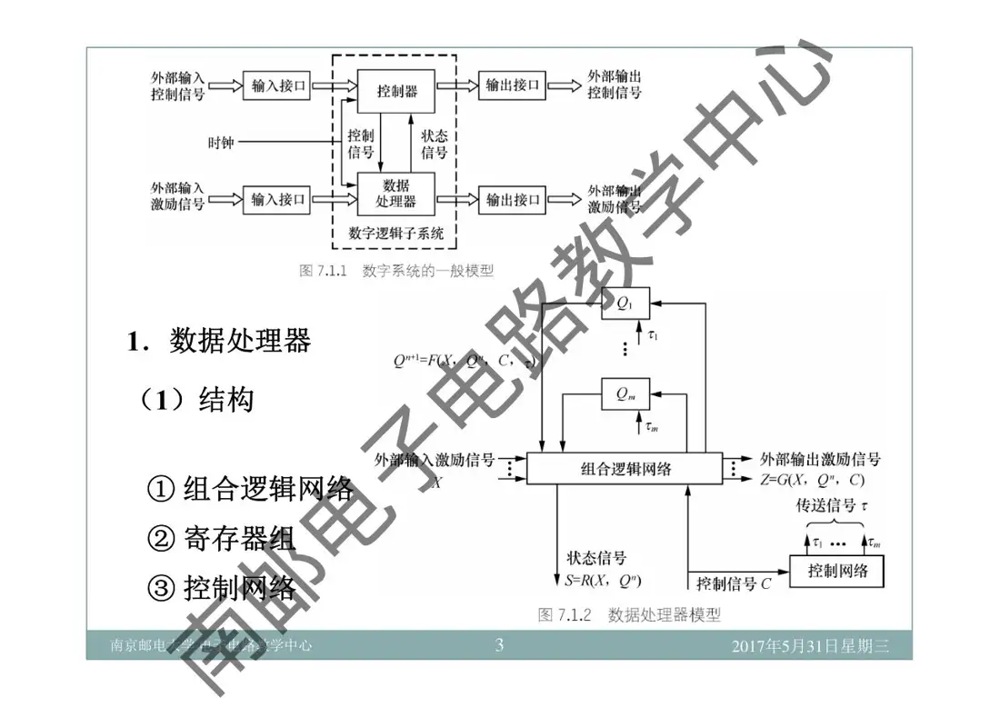

原文：

1． 数据处理器

（ 1 ） 结 构

① 组合逻辑网络

② 寄存器组

③ 控制网络

图 7.1.2 数据处理器模型

南京邮电大学 电子电路教学中心

3

20 1 7年5 月 3 1 日 星期三

### 1． 数据处理器 （2） 描述方法

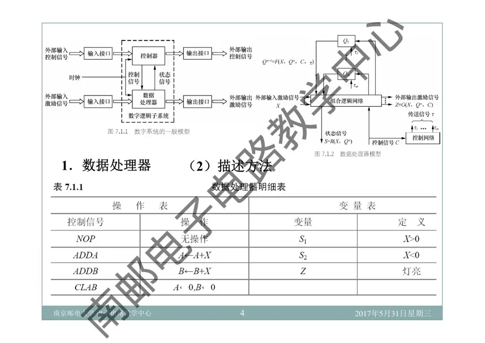

原文：

1． 数据处理器 （2） 描述方法

图 7.1.2 数据处理器模型 表 7.1.1 数据处理器明细表
<table><tr><td colspan="2">操作表</td><td colspan="2">变量表</td></tr><tr><td>控制信号</td><td>操作</td><td>变量</td><td>定义</td></tr><tr><td>NOP</td><td>无操作</td><td> $S_1$ </td><td>X&gt;0</td></tr><tr><td>ADDA</td><td>A←A+X</td><td> $S_2$ </td><td>X&lt;0</td></tr><tr><td>ADDB</td><td>B←B+X</td><td>Z</td><td>灯亮</td></tr><tr><td>CLAB</td><td>A←0,B←0</td><td></td><td></td></tr></table>

南京邮电大学 电子电路教学中心

4

20 1 7年5 月 3 1 日 星期三

### 2 ． 控制器

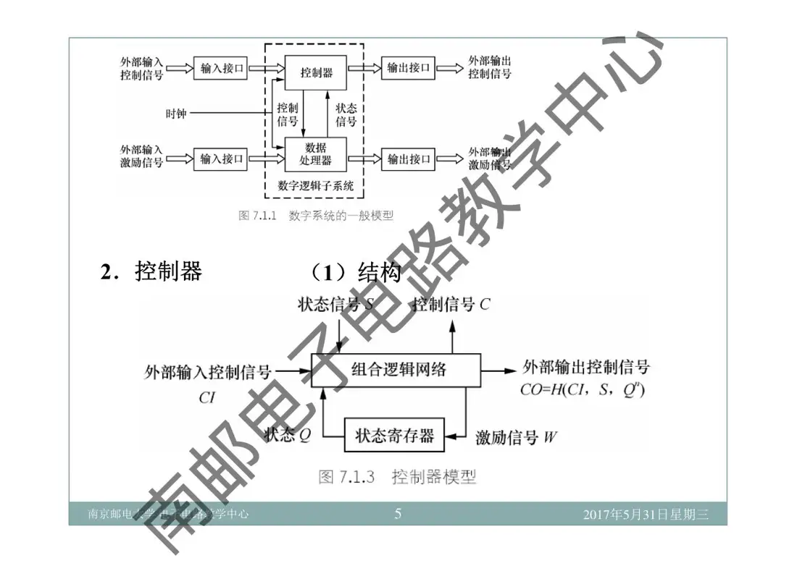

原文：

2 ． 控制器

（ 1 ） 结 构

南京邮电大学 电子电路教学中心

5

20 1 7年5 月 3 1 日 星期三

### 2 ． 控制器

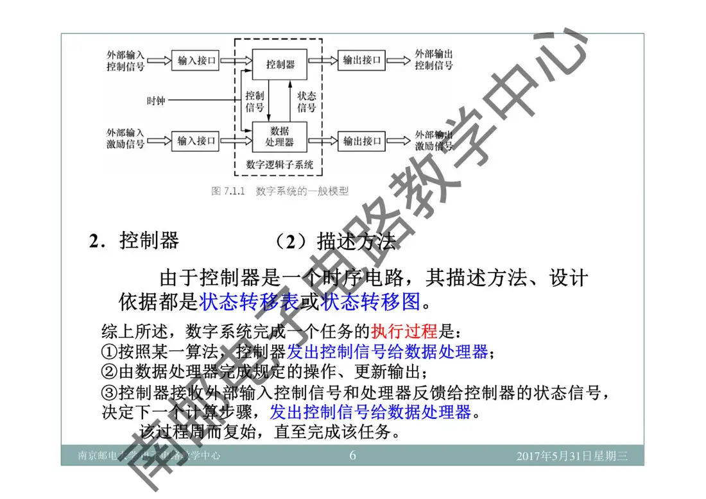

原文：

2 ． 控制器

（2） 描述方法

由于控制器是一个时序 电路， 其描述方法、 设计依据都是状态转移表或状态转移图 。

综上所述， 数字系统完成一个任务的执行过程是：

①按照某一算法， 控制器发出控制信号给数据处理器；

②由数据处理器完成规定的操作、 更新输出 ；

③控制器接收外部输入控制信号和处理器反馈给控制器的状态信号，决定下一个计算步骤 发出控制信号给数据处理器

该过程周而复始， 直至完成该任务。

南京邮电大学 电子电路教学中心

6

20 1 7年5 月 3 1 日 星期三

### 7 1 2 同步数字系统时序约定

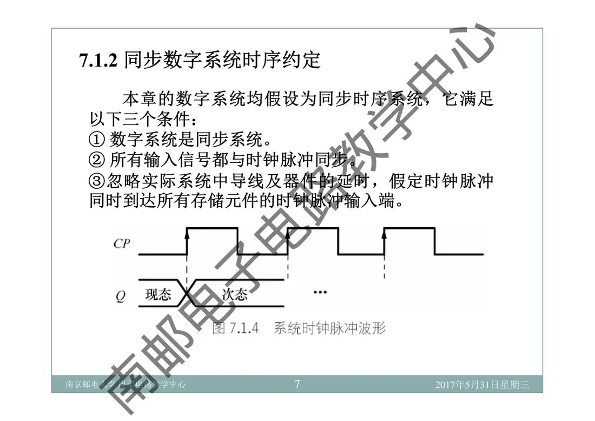

原文：

7 1 2 同步数字系统时序约定

本章 的数字系统均假设为 同步时序系统， 它满足以下三个条件： VA

① 数字系统是同步系统。

② 所有输入信号都与时钟脉冲同步。

③忽略实际系统 中导线及器件的延时， 假定时钟脉冲同时到达所有存储元件的时钟脉冲输入端。

南京邮电大学 电子电路教学中心

7

20 1 7年5 月 3 1 日 星期三

### 1． 最小时钟周期

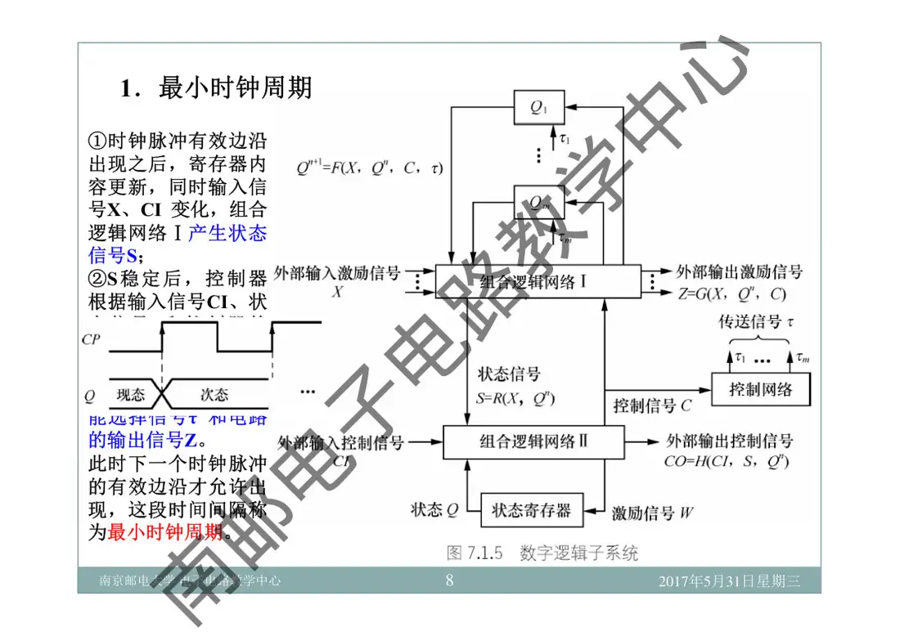

原文：

1． 最小时钟周期

①时钟脉冲有效边沿出现之后 ， 寄存器 内容更新， 同时输入信号X、 CI 变化， 组合逻辑网络 Ⅰ 产生状态信号S；

②S稳定 后 ， 控制 器根据输入信号CI、 状CPQ 立稳 寄存能选择信号τ 和 电路的输出信号Z。此时下一个时钟脉冲的有效边沿才允许出现， 这段时 间 间 隔称为最小时钟周期。

南京邮电大学 电子电路教学中心

8

20 1 7年5 月 3 1 日 星期三

### 2． 异步信号转换成同步信号

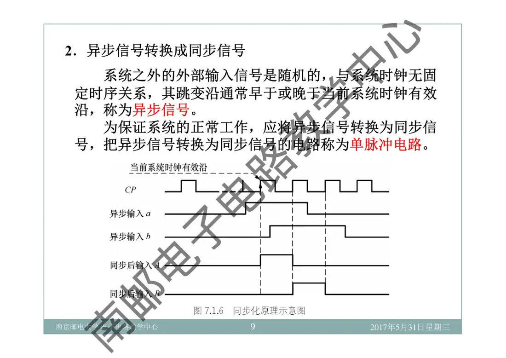

原文：

2． 异步信号转换成同步信号

系统之外的外部输入信号是随机的， 与系统时钟无固定时序关系， 其跳变沿通常早于或晚于当前系统时钟有效沿， 称为异步信号。 V

为保证系统的正常工作， 应将异步信号转换为同步信号， 把异步信号转换为同步信号的 电路称为单脉冲 电路。

南京邮电大学 电子电路教学中心

9

20 1 7年5 月 3 1 日 星期三

### 2． 异步信号转换成同步信号

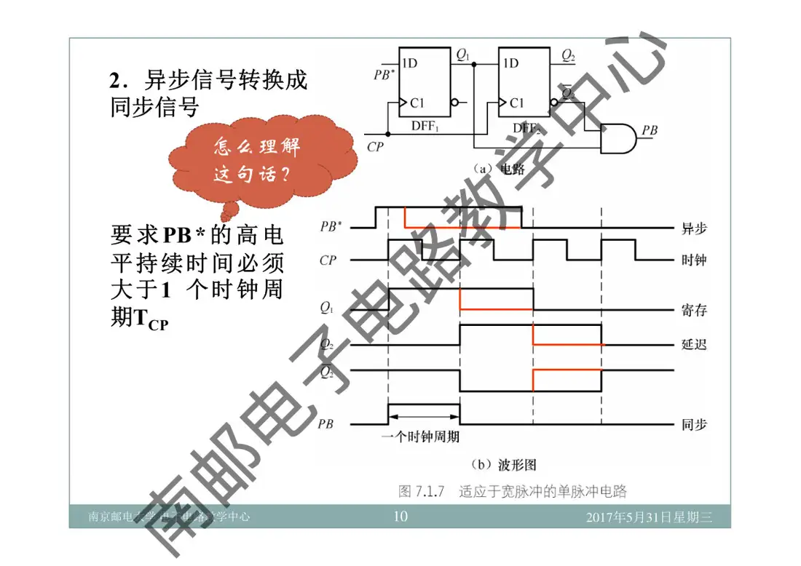

原文：

2． 异步信号转换成同步信号

怎 解 么 理这 句 话 ？

要 求 PB \* 的 高 电平持续 时 间 必 须大于 1 个 时钟 周期 $\mathbf { T _ { C P } }$

南京邮电大学 电子电路教学中心

1 0

20 1 7年5 月 3 1 日 星期三

### 2． 异步信号转换成同步信号

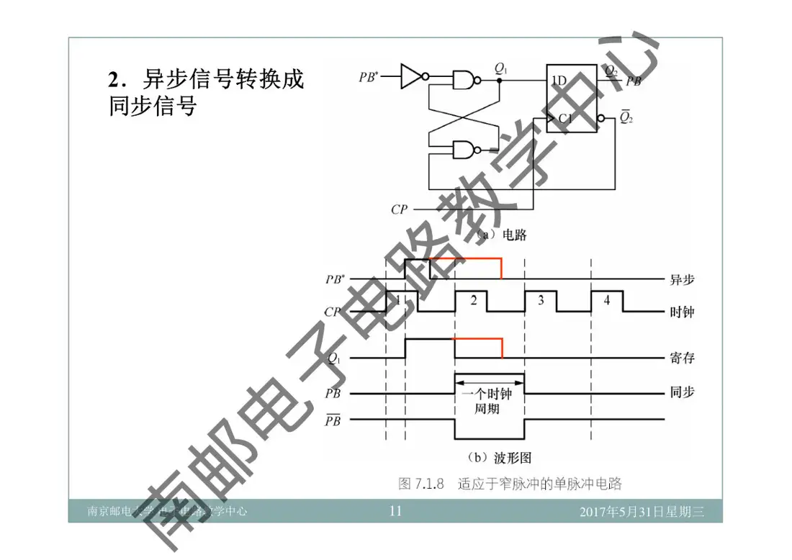

原文：

2． 异步信号转换成同步信号

南京邮电大学 电子电路教学中心

1 1

20 1 7年5 月 3 1 日 星期三

### 7 1 3. . 数字系统的设计方法

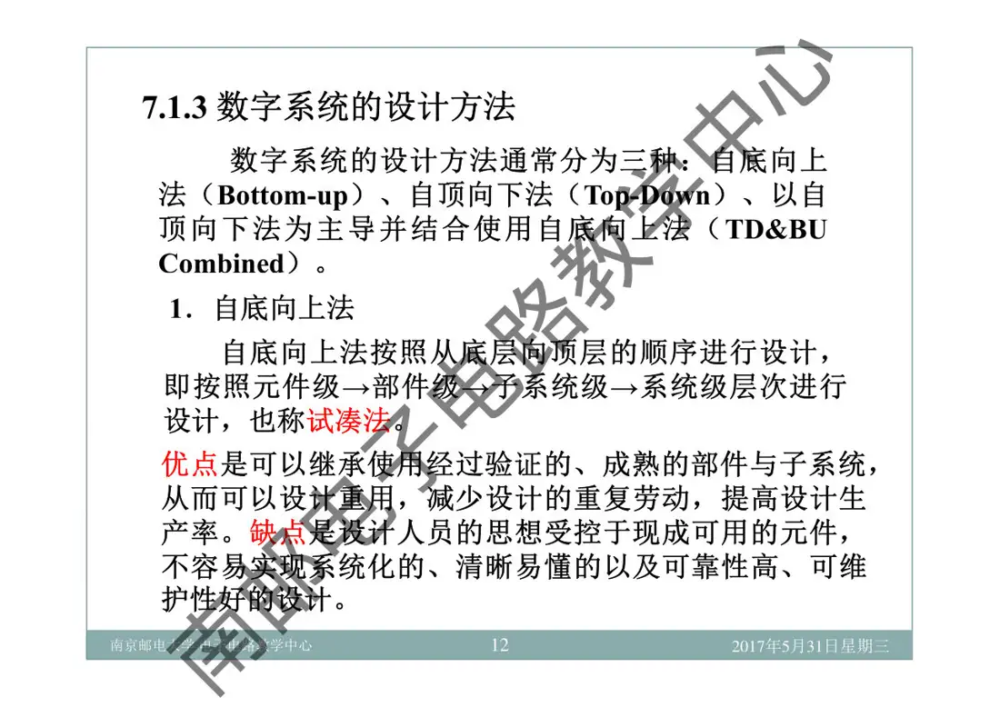

原文：

7 1 3. . 数字系统的设计方法

数字系统的设计方法通常分为三种 ： 自 底 向上法 （ Bottom-up ） 、 自 顶 向 下 法 （ Top-Down ） 、 以 自顶 向 下法为主 导 并结合使用 自 底 向 上法 （ TD&BUCombined ） 。 蛾

1 ． 自 底 向上法

自 底 向上法按照从底层 向顶层 的顺序进行设计，即按照元件级→部件级→子系统级→系统级层次进行设计， 也称试凑法。

优点是可 以继承使用经过验证的、 成熟的部件与子系统，从而可 以设计重用 ， 减少设计的重复劳动， 提高设计生产率。 缺点是设计人员 的思想受控于现成可用 的元件，不容易实现系统化的、 清晰易懂的 以及可靠性高、 可维护性好的设计。

南京邮电大学 电子电路教学中心

1 2

20 1 7年5 月 3 1 日 星期三

### 7 1 3. . 数字系统的设计方法

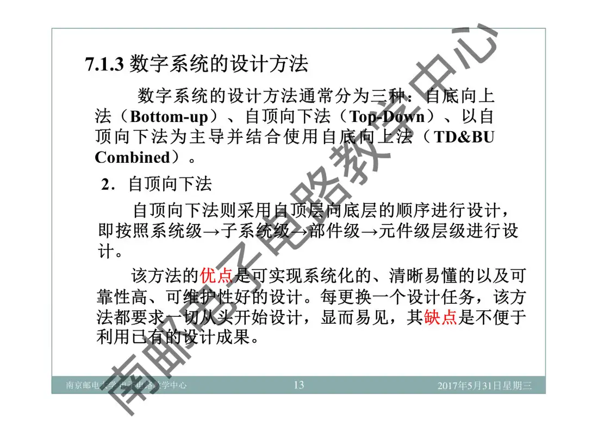

原文：

7 1 3. . 数字系统的设计方法

数字系统的设计方法通常分为三种 ： 自 底 向上法 （ Bottom-up ） 、 自 顶 向 下 法 （ Top-Down ） 、 以 自顶 向 下法为主 导 并结合使用 自 底 向 上法 （ TD&BUCombined ） 。 蛾

2． 自 顶 向下法

自 顶 向下法则采用 自 顶层 向底层的顺序进行设计，即按照系统级→子系统级→部件级→元件级层级进行设计 。 4

该方法的优点是可实现系统化的、 清晰易懂的 以及可靠性高、 可维护性好的设计。 每更换一个设计任务， 该方法都要求一切从头开始设计， 显而易见， 其缺点是不便于利用 已有的设计成果。

南京邮电大学 电子电路教学中心

1 3

20 1 7年5 月 3 1 日 星期三

### 2． 自 顶 向下法

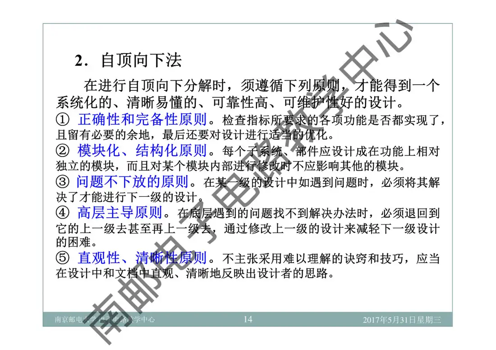

原文：

2． 自 顶 向下法

在进行 自顶向下分解时， 须遵循下列原则， 才能得到一个系统化的、 清晰易懂的、 可靠性高、 可维护性好的设计。

① 正确性和完备性原则 。 检查指标所要求的各项功能是否都实现了 ，且留有必要的余地， 最后还要对设计进行适当的优化。

② 模块化、 结构化原则 。 每个子系统、 部件应设计成在功能上相对独立的模块， 而且对某个模块内部进行修改时不应影响其他的模块。

③ 问题不下放的原则 。 在某一级的设计中如遇到 问题时， 必须将其解决了才能进行下一级的设计。

④ 高层主导原则 。 在底层遇到的 问题找不到解决办法时， 必须退回到它的上一级去甚至再上一级去， 通过修改上一级的设计来减轻下一级设计的 困难。 X

⑤ 直观性、 清晰性原则 。 不主张采用难以理解的诀窍和技巧， 应当在设计中和文档中直观、 清晰地反映出设计者的思路。

南京邮电大学 电子电路教学中心

1 4

20 1 7年5 月 3 1 日 星期三

### 7 1 3. . 数字系统的设计方法

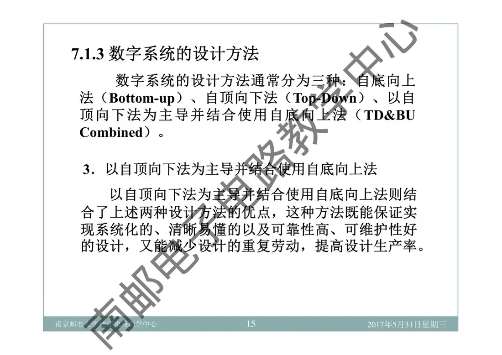

原文：

7 1 3. . 数字系统的设计方法

数字系统的设计方法通常分为三种 ： 自 底 向上法 （ Bottom-up ） 、 自 顶 向 下 法 （ Top-Down ） 、 以 自顶 向 下法为主 导 并结合使用 自 底 向 上法 （ TD&BUCombined ） 。 我

3． 以 自顶向下法为主导并结合使用 自底向上法

以 自 顶 向下法为主导并结合使用 自 底向上法则结合了上述两种设计方法的优点， 这种方法既能保证实现系统化的、 清晰易懂的 以及可靠性高、 可维护性好的设计， 又能减少设计的重复劳动， 提高设计生产率。

南京邮电大学 电子电路教学中心

1 5

20 1 7年5 月 3 1 日 星期三

### 7 1 4. . 数字系统的设计步骤

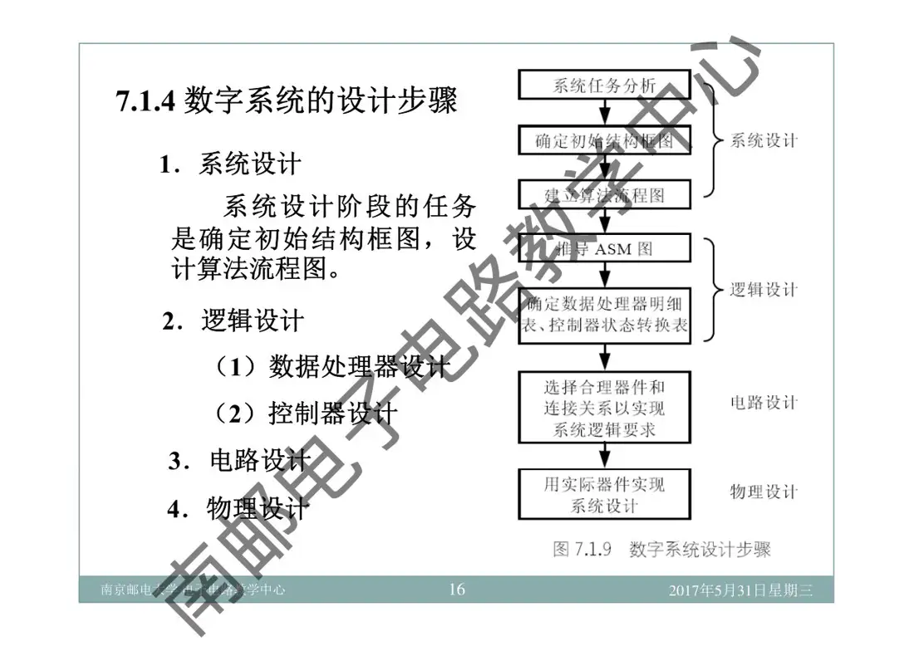

原文：

7 1 4. . 数字系统的设计步骤

1． 系统设计

系 统设计阶段 的任务是确定初始结构框 图 ， 设计算法流程图。 K

2． 逻辑设计

（1） 数据处理器设计

（2） 控制器设计

3． 电路设计

4． 物理设计

南京邮电大学 电子电路教学中心

1 6

20 1 7年5 月 3 1 日 星期三

### 7.2 数字系统的描述工具

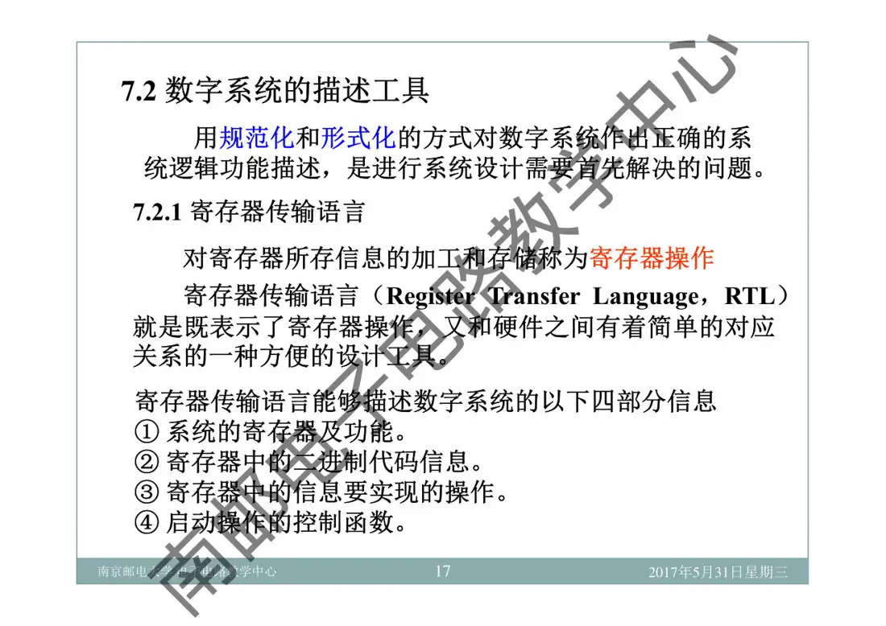

原文：

7.2 数字系统的描述工具

用规范化和形式化的方式对数字系统作出正确的系统逻辑功能描述， 是进行系统设计需要首先解决的 问题。

7.2.1 寄存器传输语言

对寄存器所存信息的加工和存储称为寄存器操作

寄存器传输语 言 （ Register Transfer Language ， RTL ）就是既表示了寄存器操作， 又和硬件之间有着简单的对应关系的一种方便的设计工具。

寄存器传输语言能够描述数字系统的 以下四部分信息

① 系统的寄存器及功能。

② 寄存器中 的二进制代码信息。

③ 寄存器中 的信息要实现的操作。

④ 启动操作的控制函数。

南京邮电大学 电子电路教学中心

1 7

20 1 7年5 月 3 1 日 星期三

### 7.2.1 寄存器传输语言

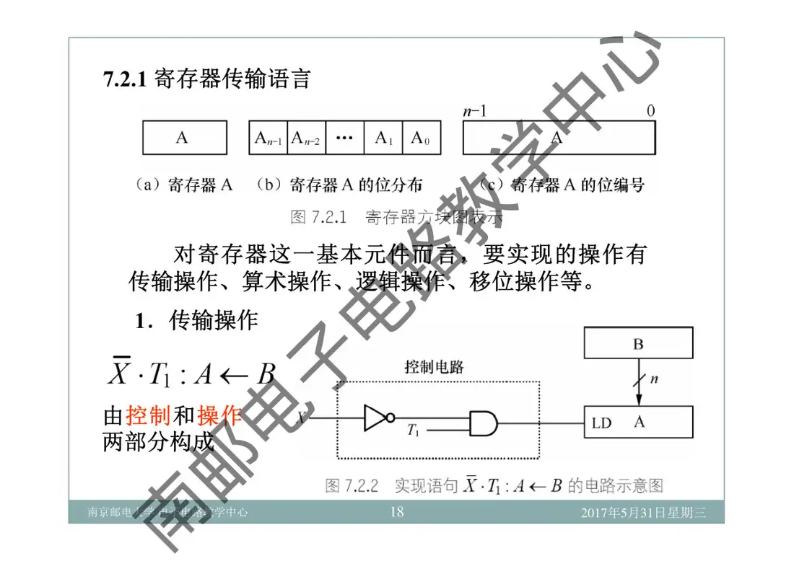

原文：

7.2.1 寄存器传输语言

(b)寄存器A的位分布
<table><tr><td> $A_{n-1}$ </td><td> $A_{n-2}$ </td><td>...</td><td> $A_1$ </td><td> $A_0$ </td></tr></table>

对寄存器这一基本元件而言 ， 要实现的操作有传输操作、 算术操作、 逻辑操作、 移位操作等。

1． 传输操作

南京邮电大学 电子电路教学中心

1 8

20 1 7年5 月 3 1 日 星期三

### $$

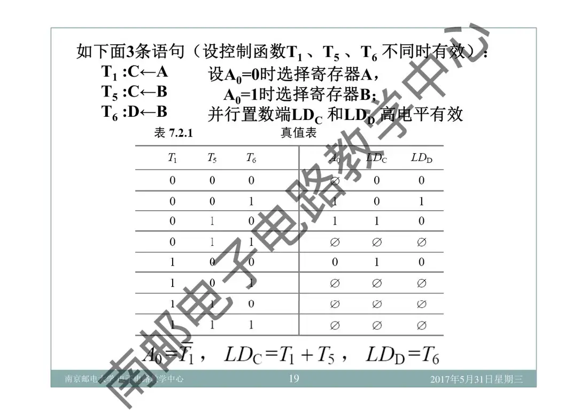

原文：

如下面3条语句 （设控制函数 $\mathbf { T _ { 1 } }$ 、 $\mathbf { T _ { 5 } }$ 、 $\mathrm { \mathbf { T _ { 6 } } }$ 不同时有效） ：

$$
\mathrm{T} _ {1}: \mathrm{C} \leftarrow \mathrm{A}
$$

设 $\bf { A _ { 0 } } \mathrm { = } \bf { 0 }$ 时选择寄存器A，

$$
\mathrm{T} _ {5}: \mathrm{C} \leftarrow \mathrm{B}
$$

${ \bf A _ { 0 } } { = } { \bf 1 }$ 时选择寄存器 $\mathbf { B } _ { \mathbf { j } }$ 山

$$
\mathbf {T} _ {6}: \mathbf {D} \leftarrow \mathbf {B}
$$

并行置数端 $\mathbf { L D _ { C } }$ $\mathbf { L D _ { \overline { { \mathbf { p } } } } }$ 高电平有效

<table><tr><td colspan="6">表7.2.1 真值表</td></tr><tr><td> $T_1$ </td><td> $T_5$ </td><td> $T_6$ </td><td> $A_0$ </td><td> $LD_C$ </td><td> $LD_D$ </td></tr><tr><td>0</td><td>0</td><td>0</td><td>∅</td><td>0</td><td>0</td></tr><tr><td>0</td><td>0</td><td>1</td><td>1</td><td>0</td><td>1</td></tr><tr><td>0</td><td>1</td><td>0</td><td>1</td><td>1</td><td>0</td></tr><tr><td>0</td><td>1</td><td>1</td><td>∅</td><td>∅</td><td>∅</td></tr><tr><td>1</td><td>0</td><td>0</td><td>0</td><td>1</td><td>0</td></tr><tr><td>1</td><td>0</td><td>1</td><td>∅</td><td>∅</td><td>∅</td></tr><tr><td>1</td><td>1</td><td>0</td><td>∅</td><td>∅</td><td>∅</td></tr><tr><td>1</td><td>1</td><td>1</td><td>∅</td><td>∅</td><td>∅</td></tr></table>

南京邮电大学 电子电路教学中心

1 9

20 1 7年5 月 3 1 日 星期三

### 图入2.3多目标多源的寄存器传输对应硬件示意图

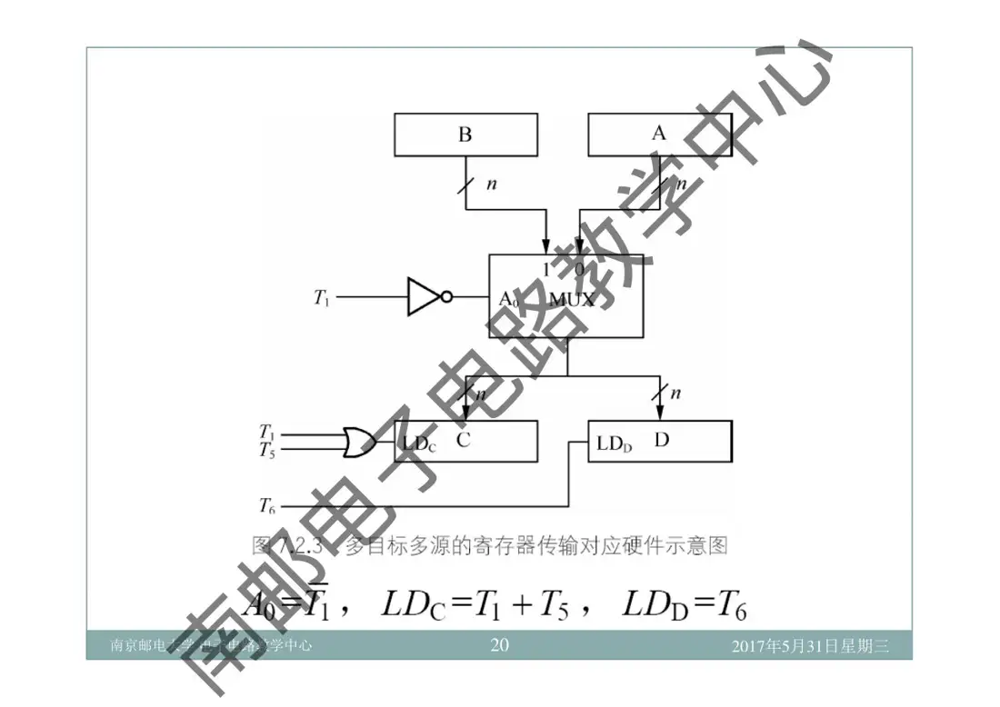

原文：

图入2.3多目标多源的寄存器传输对应硬件示意图

$$
L D _ {\mathrm{C}} = T _ {1} + T _ {5}
$$

$$
L D _ {\mathrm{D}} = T _ {6}
$$

南京邮电大学 电子电路教学中心

20

20 1 7年5 月 3 1 日 星期三

### $$

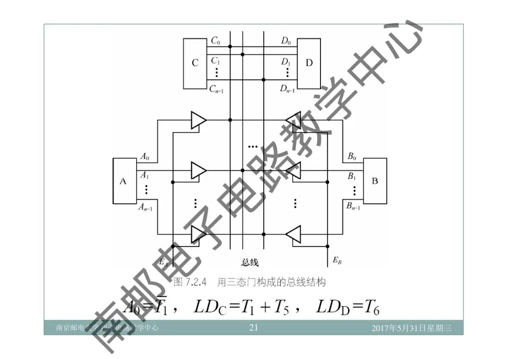

原文：

$$
L D _ {\mathrm{C}} = T _ {1} + T _ {5}, L D _ {\mathrm{D}} = T _ {6}
$$

南京邮电大学 电子电路教学中心

2 1

20 1 7年5 月 3 1 日 星期三

### 表 7.2.2 算术操作

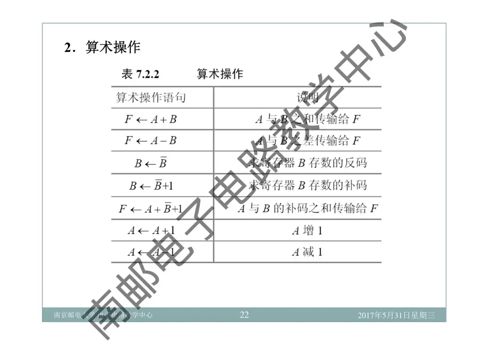

原文：

表 7.2.2 算术操作
<table><tr><td>算术操作语句</td><td>说明</td></tr><tr><td>F←A+B</td><td>A与B之和传输给F</td></tr><tr><td>F←A-B</td><td>A与B之差传输给F</td></tr><tr><td>B←B</td><td>求寄存器B存数的反码</td></tr><tr><td>B←B+1</td><td>求寄存器B存数的补码</td></tr><tr><td>F←A+B+1</td><td>A与B的补码之和传输给F</td></tr><tr><td>A←A+1</td><td>A增1</td></tr><tr><td>A←A-1</td><td>A减1</td></tr></table>

2． 算术操作

南京邮电大学 电子电路教学中心

22

20 1 7年5 月 3 1 日 星期三

### 2． 算术操作

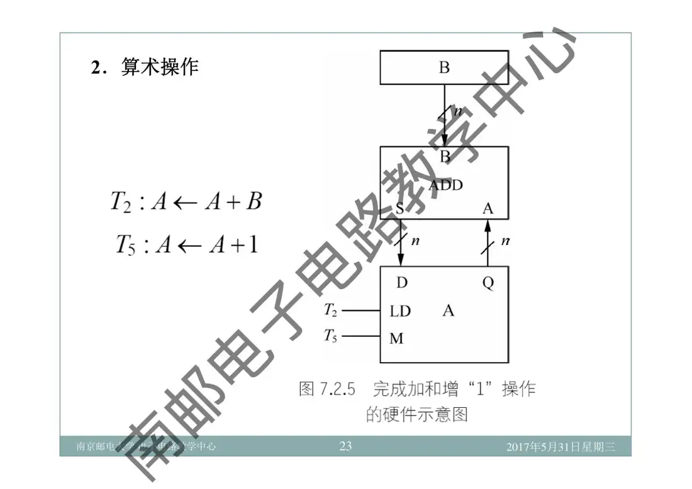

原文：

2． 算术操作

$$
T _ {2}: A \leftarrow A + B
$$

$$
T _ {5}: A \leftarrow A + 1
$$

南京邮电大学 电子电路教学中心

23

20 1 7年5 月 3 1 日 星期三

### 3． 逻辑操作

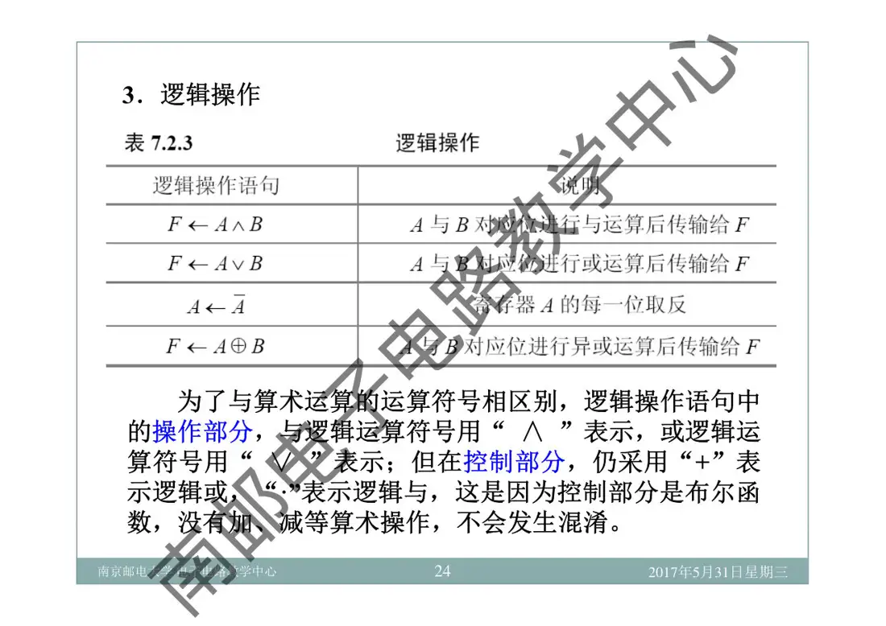

原文：

3． 逻辑操作

表7.2.3
<table><tr><td>逻辑操作语句</td><td>说明</td></tr><tr><td> $F \leftarrow A \land B$ </td><td>A与B对应位进行与运算后传输给F</td></tr><tr><td> $F \leftarrow A \lor B$ </td><td>A与B对应位进行或运算后传输给F</td></tr><tr><td> $A \leftarrow \overline{A}$ </td><td>寄存器A的每一位取反</td></tr><tr><td> $F \leftarrow A \oplus B$ </td><td>A与B对应位进行异或运算后传输给F</td></tr></table>

为了与算术运算的运算符号相区别， 逻辑操作语句 中的操作部分， 与逻辑运算符号用 “ ∧ ” 表示， 或逻辑运算符号用 “ ” 表示； 但在控制部分， 仍采用 “+” 表示逻辑或， “ ·”表示逻辑与， 这是因为控制部分是布尔函数， 没有加 减等算术操作， 不会发生混淆、 。

南京邮电大学 电子电路教学中心

24

20 1 7年5 月 3 1 日 星期三

### 3． 逻辑操作

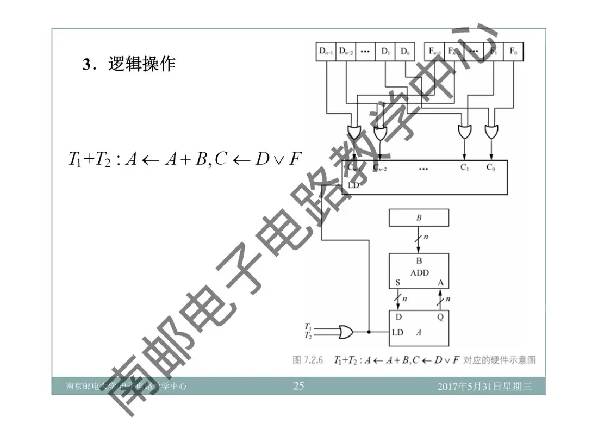

原文：

3． 逻辑操作

南京邮电大学 电子电路教学中心

25

20 1 7年5 月 3 1 日 星期三

### 4． 移位操作

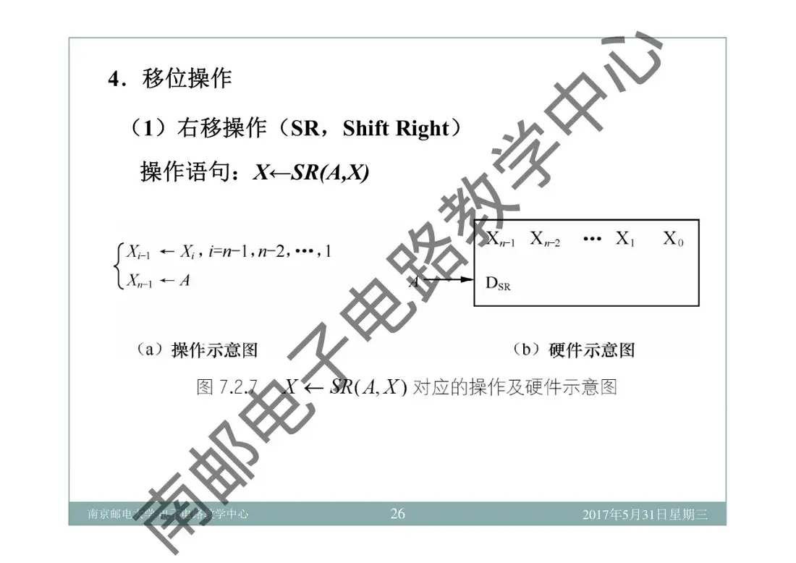

原文：

4． 移位操作

（ 1 ） 右 移 操 作 （ SR ， Shift Right ）操作语句： $X {  S R ( A , X ) }$

$$
\left\{ \begin{array}{l} X _ {i - 1} \leftarrow X _ {i}, i = n - 1, n - 2, \dots , 1 \\ X _ {n - 1} \leftarrow A \end{array} \right.
$$

(a) 操作示意图

(b) 硬件示意图

图 7.2.7 X← SR(A, X) 对应的操作及硬件示意图

南京邮电大学 电子电路教学中心

26

20 1 7年5 月 3 1 日 星期三

### 4． 移位操作

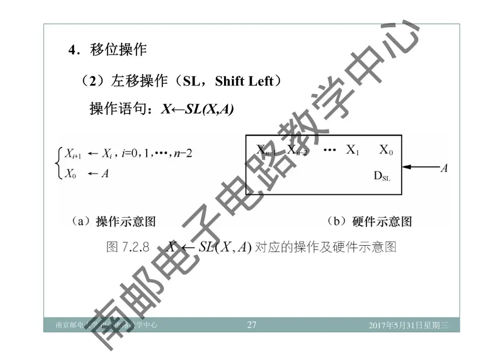

原文：

4． 移位操作

（ 2 ） 左 移 操 作 （ SL ， Shift Left ）操作语句： $X {  S L ( X { , } A ) }$

$$
\left\{ \begin{array}{l} X _ {i + 1} \leftarrow X _ {i}, i = 0, 1, \dots , n - 2 \\ X _ {0} \leftarrow A \end{array} \right.
$$

(a)操作示意图

(b) 硬件示意图

图 7.2.8SL(X,A) 对应的操作及硬件示意图

南京邮电大学 电子电路教学中心

27

20 1 7年5 月 3 1 日 星期三

### 5． 条件控制语句

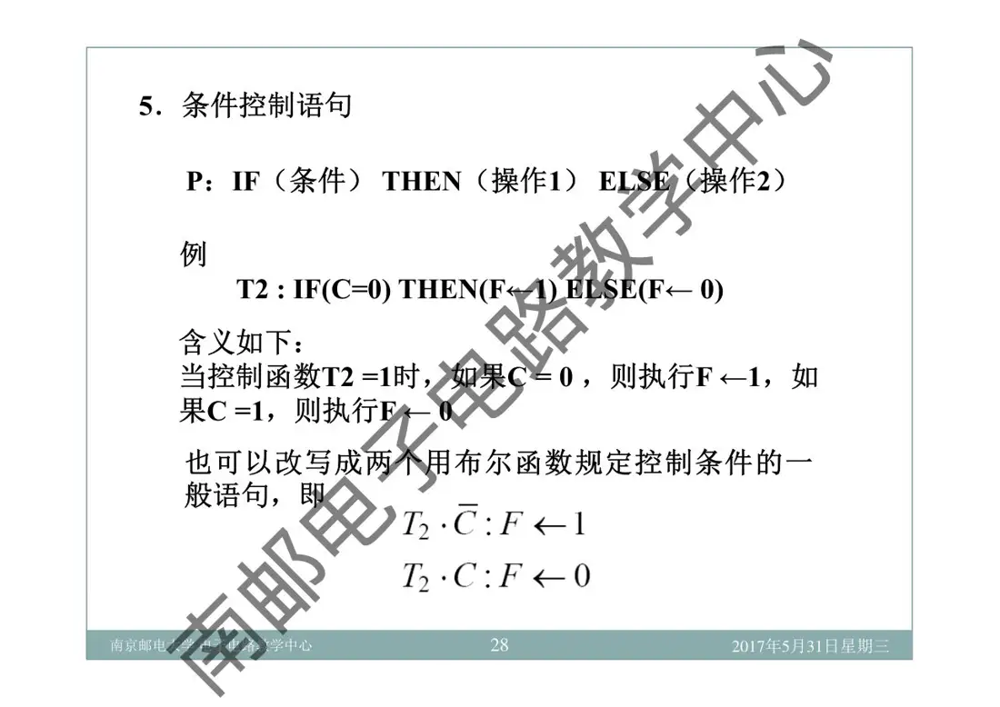

原文：

5． 条件控制语句

P ： IF （ 条件 ） THEN （ 操作1 ） ELSE （ 操作2 ）

例

T2 : IF(C=0) THEN(F←1) ELSE(F← 0)

含义如下：

当控制函数T2 =1时， 如果C = 0 ， 则执行F ←1， 如 果C =1 ， 则执行F ← 0

也可 以改写成两个用布尔 函数规定控制条件的一般语句， 即

$$
T _ {2} \cdot \overline {{C}}: F \leftarrow 1
$$

$$
T _ {2} \cdot C: F \leftarrow 0
$$

南京邮电大学 电子电路教学中心

28

20 1 7年5 月 3 1 日 星期三

### 7.2.2 方框 图

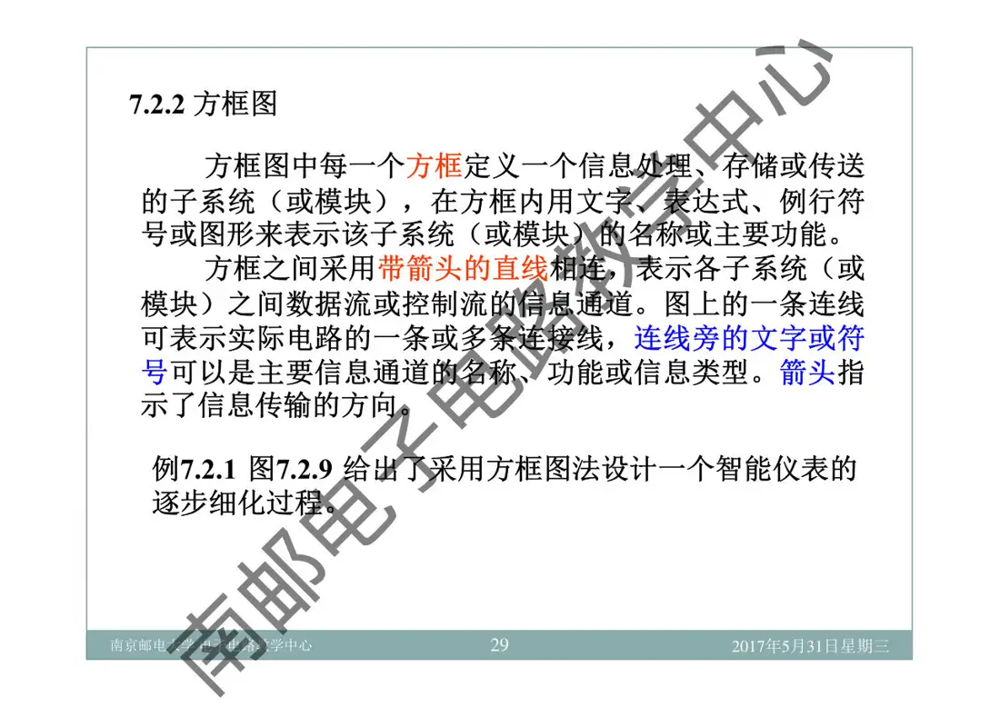

原文：

7.2.2 方框 图

方框图中每一个方框定义一个信息处理、 存储或传送的子系统 （或模块） ， 在方框内用文字、 表达式、 例行符号或图形来表示该子系统 （或模块） 的名称或主要功能。

方框之间采用带箭头的直线相连 表示各子系统 （或模块） 之间数据流或控制流的信息通道。 图上的一条连线可表示实际电路的一条或多条连接线， 连线旁的文字或符号可以是主要信息通道的名称、 功能或信息类型 。 箭头指示了信息传输的方向 。

例7.2.1 图7.2.9 给出 了采用方框图法设计一个智能仪表的逐步细化过程。

南京邮电大学 电子电路教学中心

29

20 1 7年5 月 3 1 日 星期三

### 南京邮电大学 电子电路教学中心

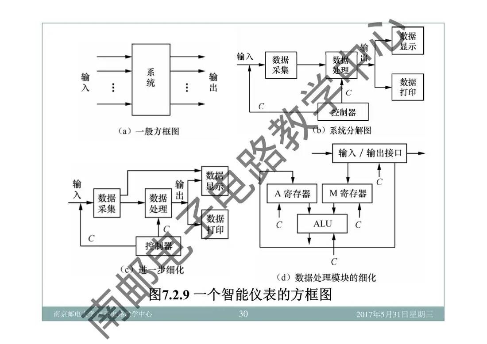

原文：

南京邮电大学 电子电路教学中心

30

20 1 7年5 月 3 1 日 星期三

### 7.2.3 算法流程 图

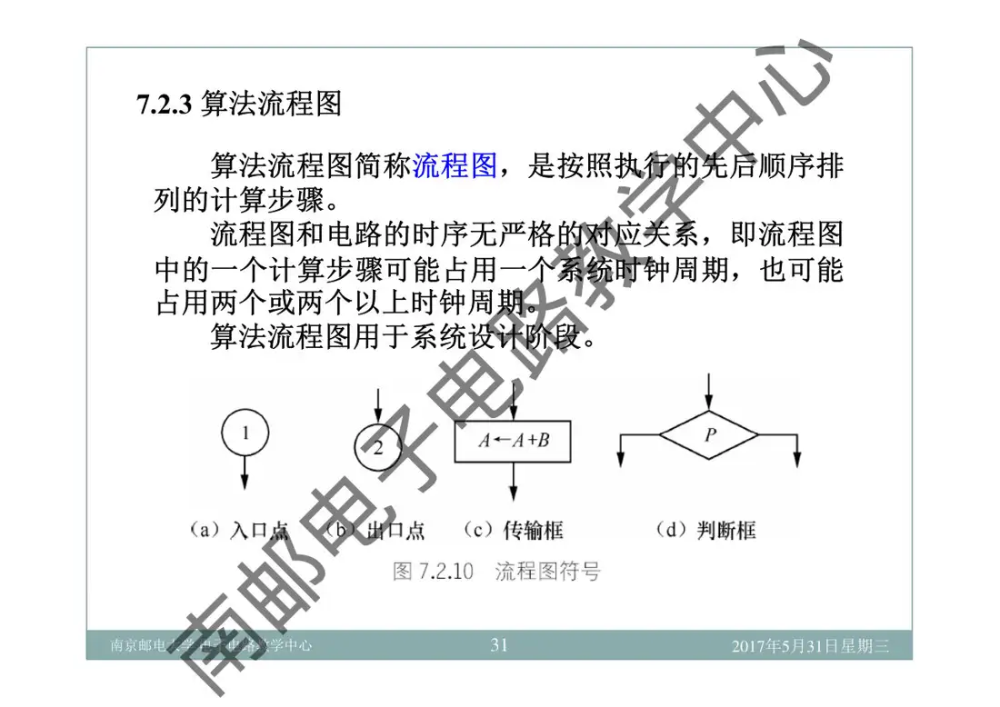

原文：

7.2.3 算法流程 图

算法流程图简称流程图 是按照执行的先后顺序排列的计算步骤。 YA

流程图和 电路的时序无严格的对应关系， 即流程图中 的 个计算步骤可能 占用 个系统时钟周期一 一 ， 也可能占用两个或两个以上时钟周期。

算法流程图用于系统设计阶段。例7.2.2 函数求值， 计算 ${ \bf Z } = { \bf 4 } \times { \bf X } _ { 2 } + 2 \times { \bf X } _ { 1 } + { \bf X } _ { 0 }$ 的值。 已知输入数据X以 串行方式从高位至低位输 $\begin{array} { r } { \operatorname {  ~ \lambda ~ } _ { \operatorname { \partial } } X _ { 1 } , \operatorname {  ~ \lambda ~ } _ { \operatorname { \partial } } X _ { 1 } } \end{array}$ $\bf { X _ { 0 } }$ ， 要求计算完成后， 提供输出Z 。

南京邮电大学 电子电路教学中心

3 1

20 1 7年5 月 3 1 日 星期三

### 南京邮电大学 电子电路教学中心

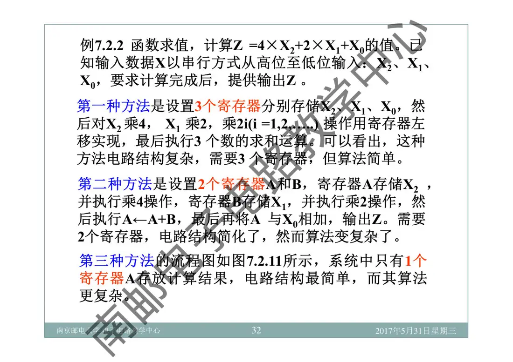

原文：

第一种方法是设置3个寄存器分别存储 $\mathbf { X } _ { 2 } { \times } \mathbf { X } _ { 1 } , \ \mathbf { X } _ { 0 } ,$ ， 然后对 $\mathbf { X } _ { 2 }$ 乘4 ， $\mathbf { X _ { 1 } }$ 乘2， 乘 $2 \mathrm { i } ( \mathrm { i } = 1 , 2 , \hdots )$ 操作用寄存器左移实现， 最后执行3 个数的求和运算。 可以看出 ， 这种方法电路结构复杂， 需要3 个寄存器， 但算法简单。

第二种方法是设置2个寄存器A和B， 寄存器A存储 $\mathbf { X } _ { 2 }$ 并执行乘4操作， 寄存器B存储 $\mathbf { X _ { 1 } }$ ， 并执行乘2操作， 然后执行A←A+B， 最后再将A 与 $\bf { X _ { 0 } }$ 相加， 输出Z。 需要2个寄存器， 电路结构简化了 ， 然而算法变复杂了 。

第三种方法的流程 图如 图7.2.11所示， 系统 中 只有1个寄存器A存放计算结果， 电路结构最简单， 而其算法更复杂。

南京邮电大学 电子电路教学中心

3 2

20 1 7年5 月 3 1 日 星期三

### 南京邮电大学 电子电路教学中心

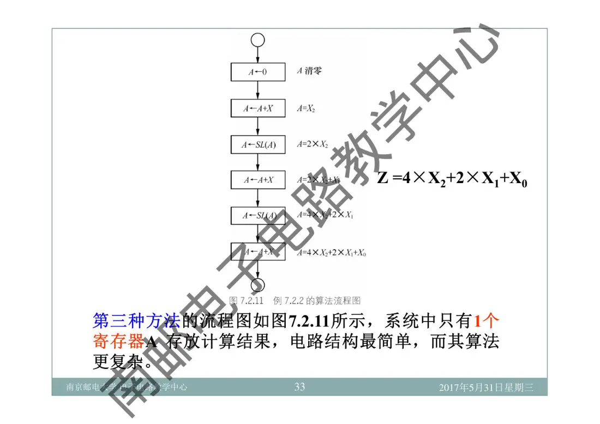

原文：

第三种方法的流程 图如 图7.2.11所示， 系统 中 只有1个寄存器A 存放计算结果， 电路结构最简单， 而其算法更复杂。

南京邮电大学 电子电路教学中心

3 3

20 1 7年5 月 3 1 日 星期三

### 经过3次运算之后 ，A 即为所求输出结果。

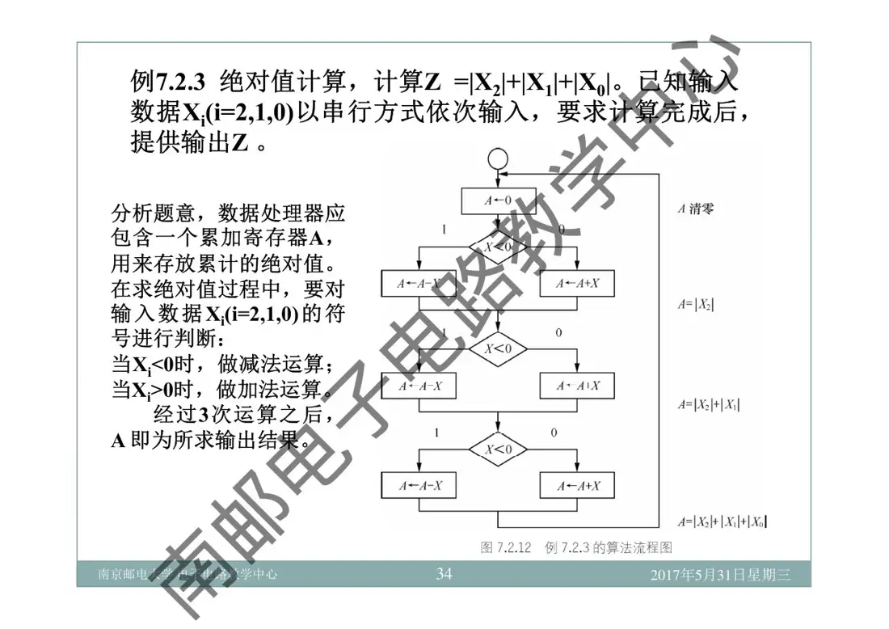

原文：

例7.2.3 绝对值计算， 计算 $\begin{array} { r } { \mathbf { Z _ { \theta } = } \mathbf { | X _ { 2 } | + } \mathbf { | X _ { 1 } | + } \mathbf { | X _ { 0 } | } } \end{array}$ 已知输入数据 $\mathbf { X } _ { \mathbf { i } } ( \mathbf { i } { = } 2 , 1 , \mathbf { 0 } )$ 以 串行方式依次输入， 要求计算完成后，提供输出Z 。 U

分析题意， 数据处理器应包含 个累加寄存器一 A，用来存放累计的绝对值。在求绝对值过程中 ， 要对输入数据 $\mathbf { X } _ { \mathrm { i } } ( \mathbf { i } { = } 2 , 1 , \mathbf { 0 } )$ 的 符号进行判断：

$\bf { X } _ { i } { < } 0$ 时， 做减法运算； $\bf { X } _ { i } { > } 0$ 时， 做加法运算。

经过3次运算之后 ，A 即为所求输出结果。

南京邮电大学 电子电路教学中心

34

20 1 7年5 月 3 1 日 星期三

### ASM 图则精确规定了各操作所需的时间及各操作之间 的时间 间 隔 。

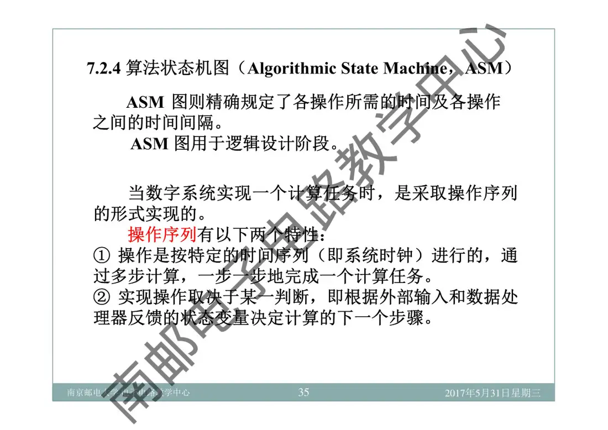

原文：

7 2 4 . . 算法状态机 图 （ Algorithmic State Machine   ， ASM ）

ASM 图则精确规定了各操作所需的时间及各操作之间 的时间 间 隔 。

ASM 图用于逻辑设计阶段。

当数字系统实现一个计算任务时， 是采取操作序列的形式实现的 。 V

操作序列有以下两个特性：

① 操作是按特定的时间序列 （ 即系统时钟 ） 进行的， 通过多步计算， 一步一步地完成一个计算任务。

② 实现操作取决于某一判断， 即根据外部输入和数据处理器反馈的状态变量决定计算的下 个步骤一 。

南京邮电大学 电子电路教学中心

3 5

20 1 7年5 月 3 1 日 星期三

### 1 ． ASM 图符号

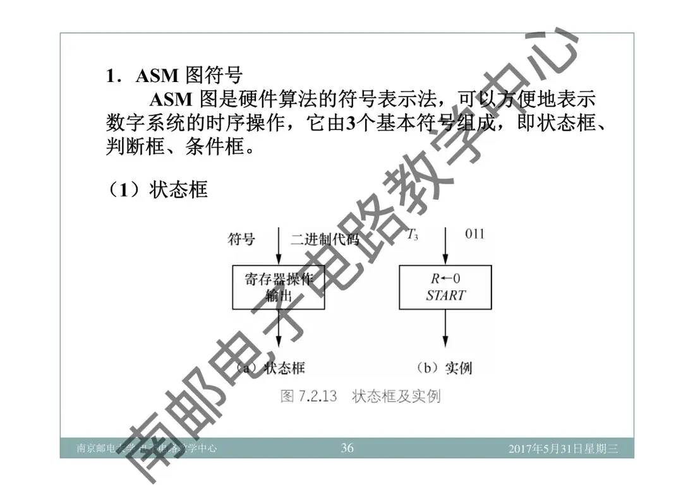

原文：

1 ． ASM 图符号

ASM 图是硬件算法的符号表示法， 可以方便地表示数字系统的时序操作， 它 由3个基本符号组成， 即状态框、判断框、 条件框。

（ 1 ） 状态框

(b) 实例

图 7.2.13 状态框及实例

南京邮电大学 电子电路教学中心

3 6

20 1 7年5 月 3 1 日 星期三

### 1 ． ASM 图符号

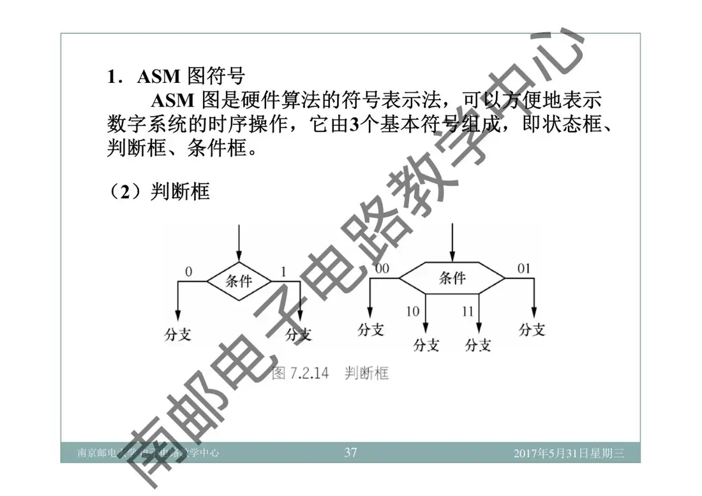

原文：

1 ． ASM 图符号

ASM 图是硬件算法的符号表示法， 可以方便地表示数字系统的时序操作， 它 由3个基本符号组成， 即状态框、判断框、 条件框。 YX

（ 2 ） 判断框

南京邮电大学 电子电路教学中心

37

20 1 7年5 月 3 1 日 星期三

### 1 ． ASM 图符号

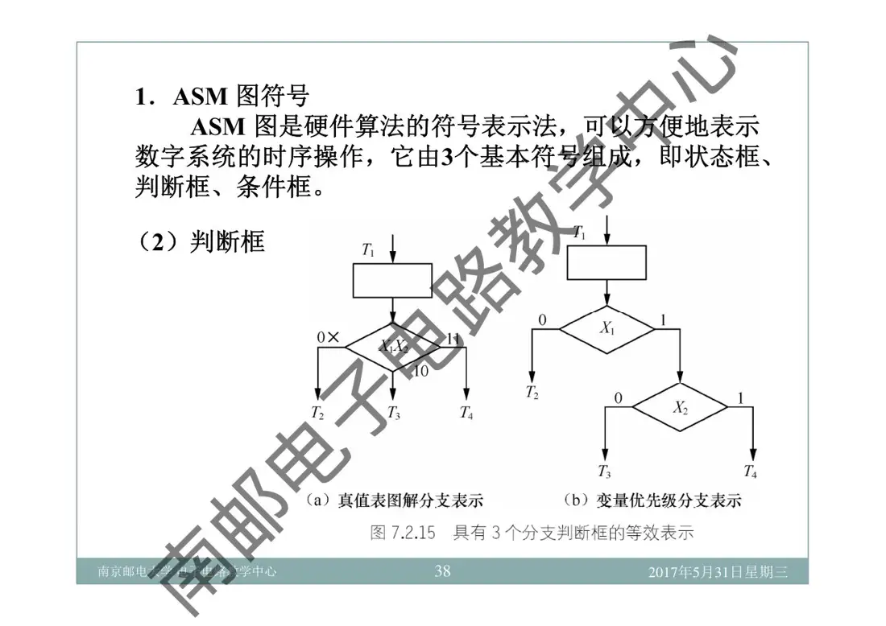

原文：

1 ． ASM 图符号

ASM 图是硬件算法的符号表示法， 可以方便地表示数字系统的时序操作， 它 由3个基本符号组成， 即状态框、判断框、 条件框。

（ 2 ） 判断框

南京邮电大学 电子电路教学中心

3 8

20 1 7年5 月 3 1 日 星期三

### 1 ． ASM 图符号

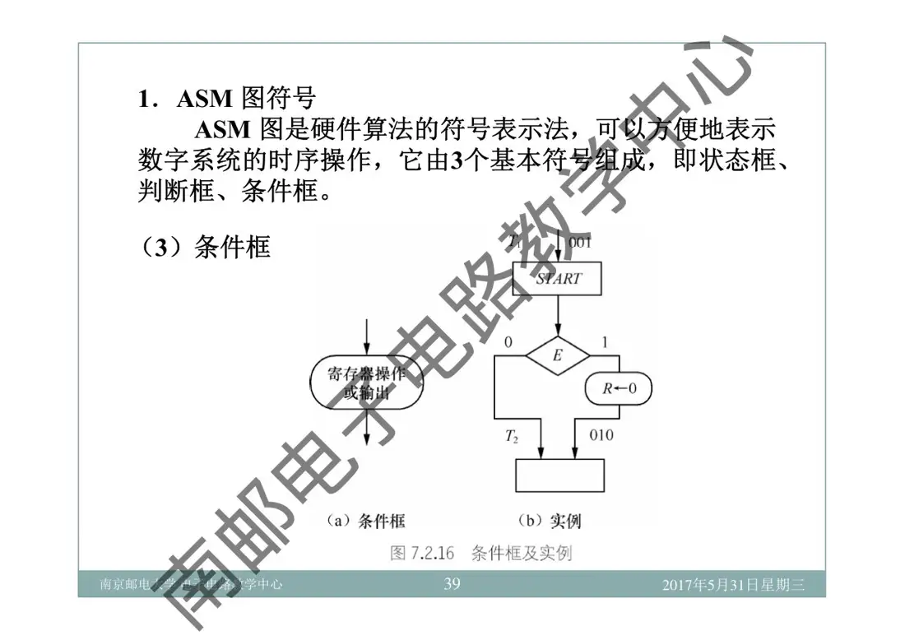

原文：

1 ． ASM 图符号

ASM 图是硬件算法的符号表示法， 可以方便地表示数字系统的时序操作， 它 由3个基本符号组成， 即状态框、判断框、 条件框。

（3 ） 条件框

南京邮电大学 电子电路教学中心

3 9

20 1 7年5 月 3 1 日 星期三

### 2 ． ASM 块

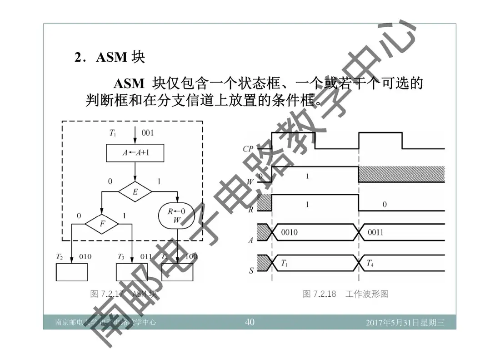

原文：

2 ． ASM 块

ASM 块仅包含一个状态框、 一个或若干个可选的判断框和在分支信道上放置的条件框。

图7.2.17ASM块

南京邮电大学 电子电路教学中心

40

20 1 7年5 月 3 1 日 星期三

### 3． ASM 图与状态转移 图 、 MDS 图

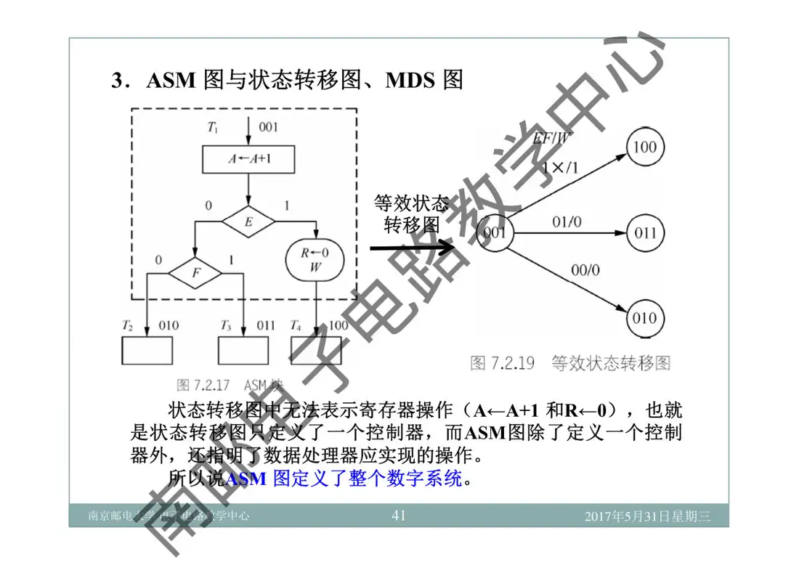

原文：

3． ASM 图与状态转移 图 、 MDS 图

状态转移图 中无法表示寄存器操作 （A←A+1 和R←0） ， 也就是状态转移 图只 定义了 一个控制器， 而ASM图除了 定义一个控制器外， 还指明 了数据处理器应实现的操作。

所以说ASM 图定义了整个数字系统。

南京邮电大学 电子电路教学中心

4 1

20 1 7年5 月 3 1 日 星期三

### ASM 图转换成MDS 图的规则如下:

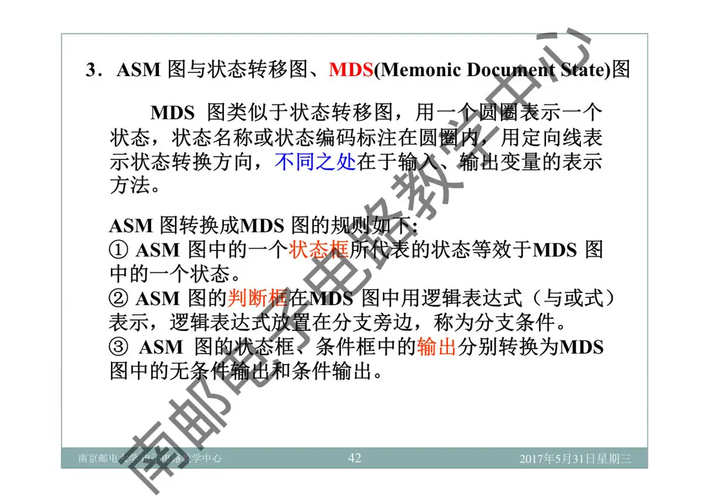

原文：

3 ． ASM 图 与 状态转移 图 、 MDS( ) Memonic Document State 图

MDS 图类似于状态转移 图 ， 用一个圆 圈表示一个状态， 状态名称或状态编码标注在圆 圈 内 ， 用定向线表示状态转换方向 ， 不同之处在于输入、 输出变量的表示方法。

ASM 图转换成MDS 图的规则如下:

① ASM 图中 的 个一 状态框所代表的状态等效于MDS 图中 的一个状态。

② ASM 图的判断框在MDS 图 中用逻辑表达式 （与或式）表示， 逻辑表达式放置在分支旁边， 称为分支条件。

③ ASM 图的状态框、 条件框中 的输出分别转换为MDS图 中 的无条件输出和条件输出 。

南京邮电大学 电子电路教学中心

42

20 1 7年5 月 3 1 日 星期三

### 南京邮电大学 电子电路教学中心

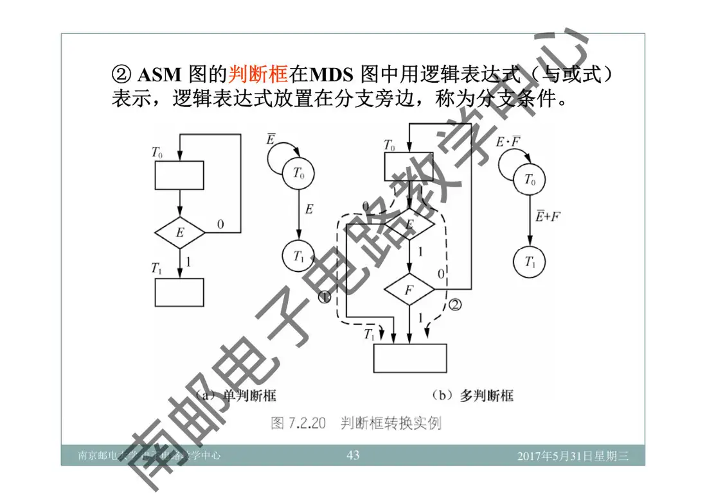

原文：

② ASM 图的判断框在MDS 图 中用逻辑表达式 （与或式）表示， 逻辑表达式放置在分支旁边， 称为分支条件。

南京邮电大学 电子电路教学中心

43

20 1 7年5 月 3 1 日 星期三

### SHIFT↑↓ ADDN=T0· E

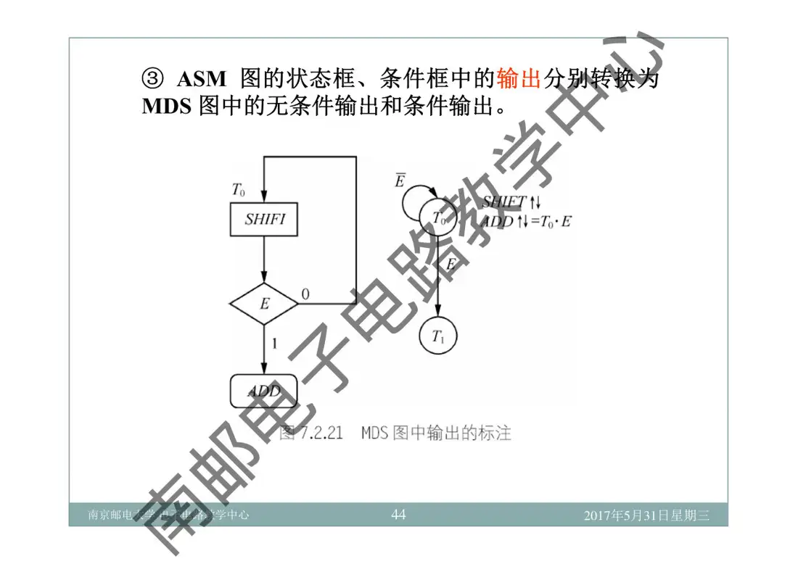

原文：

③ ASM 图 的状态框、 条件框中 的输出分别转换为MDS 图 中 的无条件输出和条件输出 。 X

SHIFT↑↓ ADDN=T0· E

7.2.21 MDS图中输出的标注

南京邮电大学 电子电路教学中心

44

20 1 7年5 月 3 1 日 星期三

### 南京邮电大学 电子电路教学中心

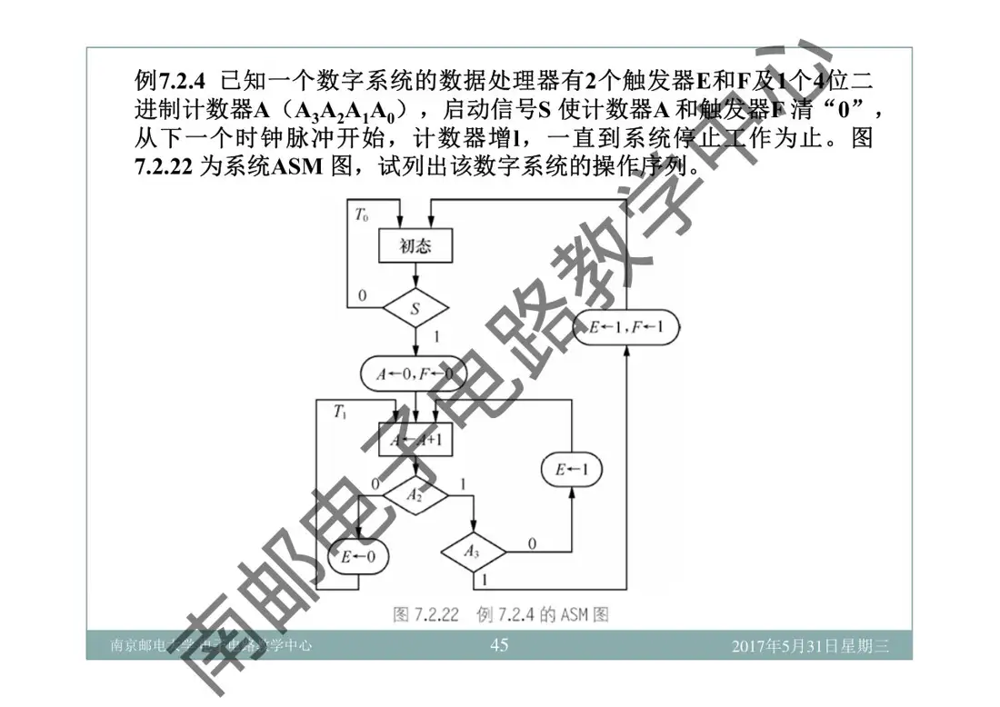

原文：

例7 2 4 已知一个数字系统的数据处理器有2个触发器E和F及1个4位二进制计数器A $( \mathbf { A _ { 3 } A _ { 2 } A _ { 1 } A _ { 0 } } )$ ， 启动信号S 使计数器A 和触发器F 清 “0” ，从下一个时钟脉冲开始 ， 计数器增l， 一直到系 统停止工作为止 。 图7.2.22 为系统ASM 图， 试列 出该数字系统的操作序列 。

南京邮电大学 电子电路教学中心

45

20 1 7年5 月 3 1 日 星期三

### 表 7.2.4 注意序号5、 9、 13 这三行

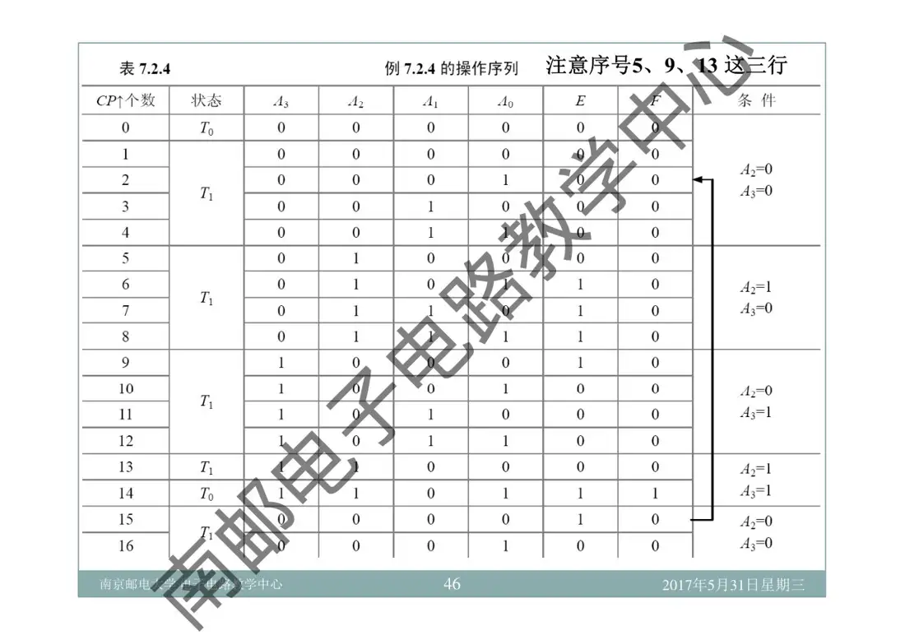

原文：

表 7.2.4 注意序号5、 9、 13 这三行
<table><tr><td>CP↑个数</td><td>状态</td><td> $A_3$ </td><td> $A_2$ </td><td> $A_1$ </td><td> $A_0$ </td><td>E</td><td>F</td><td>条件</td></tr><tr><td>0</td><td> $T_0$ </td><td>0</td><td>0</td><td>0</td><td>0</td><td>0</td><td>0</td><td rowspan="5"> $A_2=0$  $A_3=0$ </td></tr><tr><td>1</td><td rowspan="4"> $T_1$ </td><td>0</td><td>0</td><td>0</td><td>0</td><td>0</td><td>0</td></tr><tr><td>2</td><td>0</td><td>0</td><td>0</td><td>1</td><td>0</td><td>0</td></tr><tr><td>3</td><td>0</td><td>0</td><td>1</td><td>0</td><td>0</td><td>0</td></tr><tr><td>4</td><td>0</td><td>0</td><td>1</td><td>1</td><td>0</td><td>0</td></tr><tr><td>5</td><td rowspan="4"> $T_1$ </td><td>0</td><td>1</td><td>0</td><td>0</td><td>0</td><td>0</td><td rowspan="4"> $A_2=1$  $A_3=0$ </td></tr><tr><td>6</td><td>0</td><td>1</td><td>0</td><td>1</td><td>1</td><td>0</td></tr><tr><td>7</td><td>0</td><td>1</td><td>1</td><td>0</td><td>1</td><td>0</td></tr><tr><td>8</td><td>0</td><td>1</td><td>1</td><td>1</td><td>1</td><td>0</td></tr><tr><td>9</td><td rowspan="4"> $T_1$ </td><td>1</td><td>0</td><td>0</td><td>0</td><td>1</td><td>0</td><td rowspan="4"> $A_2=0$  $A_3=1$ </td></tr><tr><td>10</td><td>1</td><td>0</td><td>0</td><td>1</td><td>0</td><td>0</td></tr><tr><td>11</td><td>1</td><td>0</td><td>1</td><td>0</td><td>0</td><td>0</td></tr><tr><td>12</td><td>1</td><td>0</td><td>1</td><td>1</td><td>0</td><td>0</td></tr><tr><td>13</td><td> $T_1$ </td><td>1</td><td>1</td><td>0</td><td>0</td><td>0</td><td>0</td><td rowspan="2"> $A_2=1$  $A_3=1$ </td></tr><tr><td>14</td><td> $T_0$ </td><td>1</td><td>1</td><td>0</td><td>1</td><td>1</td><td>1</td></tr><tr><td>15</td><td rowspan="2"> $T_1$ </td><td>0</td><td>0</td><td>0</td><td>0</td><td>1</td><td>0</td><td rowspan="2"> $A_2=0$  $A_3=0$ </td></tr><tr><td>16</td><td>0</td><td>0</td><td>0</td><td>1</td><td>0</td><td>0</td></tr></table>

南京邮电大学 电子电路教学中心

46

20 1 7年5 月 3 1 日 星期三

### 4． ASM 图 的建立

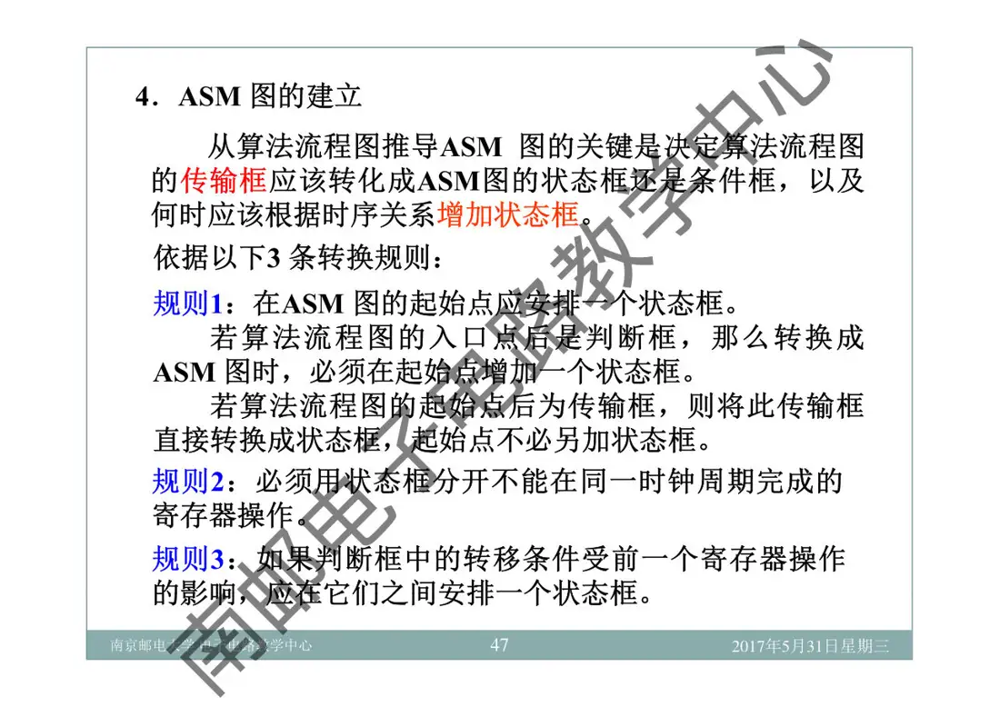

原文：

4． ASM 图 的建立

从算法流程图推导ASM 图的关键是决定算法流程图的传输框应该转化成ASM图 的状 框 条件框态 还是 ， 以及何时应该根据时序关系增加状态框。

依据以下3 条转换规则：

规则1： 在ASM 图的起始点应安排一个状态框。

若算法流程 图 的入 口 点后 是判 断框 ， 那 么 转换成ASM 图时， 必须在起始点增加一个状态框。

若算法流程图 的起始点后为传输框， 则将此传输框直接转换成状态框， 起始点不必另加状态框。

规则2： 必须用状态框分开不能在 同一时钟周期完成的寄存器操作。

规则3： 如果判断框中 的转移条件受前一个寄存器操作的影响 应在它们之间安排一个状态框， 。

南京邮电大学 电子电路教学中心

47

20 1 7年5 月 3 1 日 星期三

### 规则2： 必须用状态框分开不能在 同 时钟周期完成的一寄存器操作。

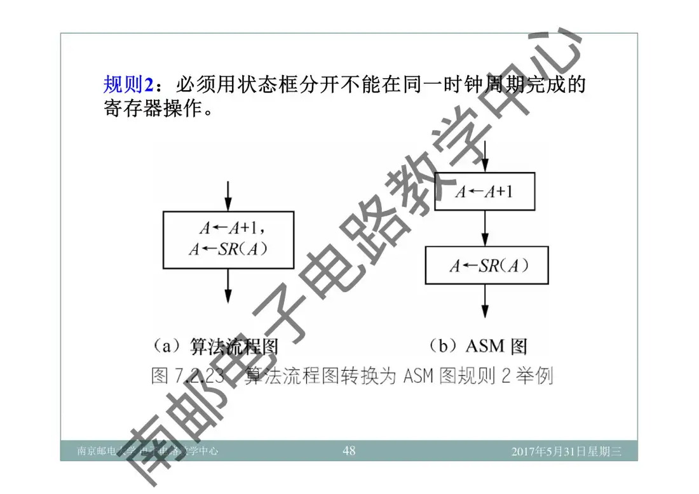

原文：

规则2： 必须用状态框分开不能在 同 时钟周期完成的一寄存器操作。

(a) 算法流程图

(b) ASM 图

图 7 23算法流程图转换为 ASM 图规则 2 举例规则3： 如果判断框中 的转移条件受前 个寄存器操作一的影响， 应在它们之间安排一个状态框。

南京邮电大学 电子电路教学中心

48

20 1 7年5 月 3 1 日 星期三

### （a)算法流程图

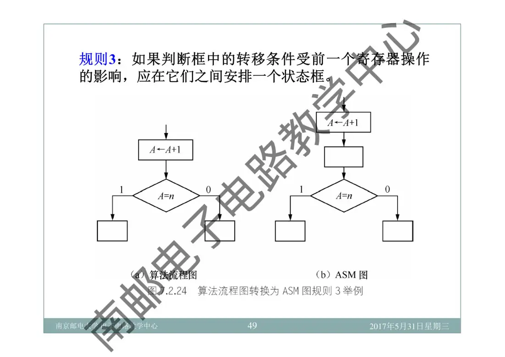

原文：

（a)算法流程图

(b) ASM 图

7.2.24 算法流程图转换为 ASM图规则3举例

南京邮电大学 电子电路教学中心

49

20 1 7年5 月 3 1 日 星期三

### 例7.2.5 根据算法流程图转换为ASM图规则 ， 将图7.2.25

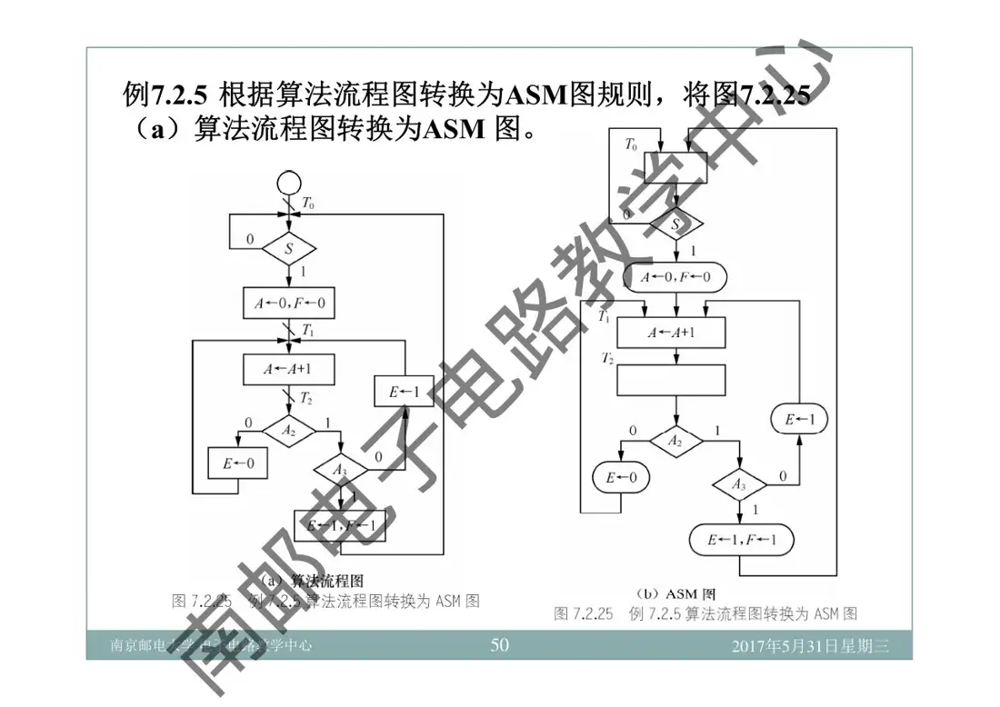

原文：

例7.2.5 根据算法流程图转换为ASM图规则 ， 将图7.2.25

（a） 算法流程图转换为ASM 图 。

（a）算法流程图

南京邮电大学 电子电路教学中心

50

20 1 7年5 月 3 1 日 星期三

### 例7.2.5 根据算法流程图转换为ASM图规则 ， 将图7.2.25

原文：

例7.2.5 根据算法流程图转换为ASM图规则 ， 将图7.2.25

（a） 算法流程图转换为ASM 图 。

南京邮电大学 电子电路教学中心

5 1

20 1 7年5 月 3 1 日 星期三

### 5． ASM 图推导处理器明细表和控制器状态转移图 （表）

原文：

5． ASM 图推导处理器明细表和控制器状态转移图 （表）

图 中RESET表示系统复位信号，BEGIN、 END分别为外部送入系统的启 动命令、 结束命令，BUSY 表示系统是否忙。

该系统完成如下操作：

当系统接收到BEGIN命令后，对数据DATA实现乘2操作， 直到END命令有效为止。 其中寄存器A 左移 次实现乘一 2操作。

南京邮电大学 电子电路教学中心

52

20 1 7年5 月 3 1 日 星期三

### 5． ASM 图推导处理器明细表和控制器状态转移图 （表）

原文：

5． ASM 图推导处理器明细表和控制器状态转移图 （表）

南京邮电大学 电子电路教学中心

5 3

20 1 7年5 月 3 1 日 星期三

### 5． ASM 图推导处理器明细表和控制器状态转移图 （表）

原文：

5． ASM 图推导处理器明细表和控制器状态转移图 （表）

处理器的输入信号为 $\mathbf { C _ { 1 } } { \sim } \mathbf { C _ { 5 } }$ 输出信号为Y 。

<table><tr><td colspan="2">操作表</td><td colspan="2">变量表</td></tr><tr><td>控制信号</td><td>操作</td><td>变量</td><td>定义</td></tr><tr><td> $C_1$ </td><td> $RESET \leftarrow 1$ </td><td>Y</td><td>DATA 连续乘 2 结果输出</td></tr><tr><td> $C_2$ </td><td> $RESET \leftarrow 0, A \leftarrow DATA, BUSY \leftarrow 0$ </td><td></td><td></td></tr><tr><td> $C_3$ </td><td> $A \leftarrow SR(A)$ </td><td></td><td></td></tr><tr><td> $C_4$ </td><td> $BUSY \leftarrow 1$ </td><td></td><td></td></tr><tr><td> $C_5$ </td><td> $Y \leftarrow A, BUSY \leftarrow 0$ </td><td></td><td></td></tr></table>

南京邮电大学 电子电路教学中心

54

20 1 7年5 月 3 1 日 星期三

### 5． ASM 图推导处理器明细表和控制器状态转移图

原文：

5． ASM 图推导处理器明细表和控制器状态转移图

南京邮电大学 电子电路教学中心

55

20 1 7年5 月 3 1 日 星期三

### 5． ASM 图推导处理器明细表和控制器状态转移图

原文：

5． ASM 图推导处理器明细表和控制器状态转移图

南京邮电大学 电子电路教学中心

5 6

20 1 7年5 月 3 1 日 星期三

### 7.3 控制器设计

原文：

7.3 控制器设计

1． 控制器的图形方式设计

（ 1 ） 采用 SSI 电路设计

南京邮电大学 电子电路教学中心

57

20 1 7年5 月 3 1 日 星期三

### 7.3 控制器设计

原文：

7.3 控制器设计

1． 控制器的图形方式设计

（ 1 ） 采用 SSI 电路设计

表 7.3.1 控制器状态转移、输出表
<table><tr><td colspan="3">现态</td><td colspan="3">输入</td><td colspan="2">次态</td><td colspan="4">输出</td></tr><tr><td> $T_i$ </td><td> $Q_1^n$ </td><td> $Q_0^n$ </td><td> $V_0$ </td><td> $V_1$ </td><td> $V_2$ </td><td> $Q_1^{n+1}$ </td><td> $Q_0^{n+1}$ </td><td>INI</td><td>ADD</td><td>SHIFT</td><td>ASSIGN</td></tr><tr><td rowspan="2"> $T_0$ </td><td>0</td><td>0</td><td>0</td><td>∅</td><td>∅</td><td>0</td><td>0</td><td>1</td><td>0</td><td>0</td><td>0</td></tr><tr><td>0</td><td>0</td><td>1</td><td>∅</td><td>∅</td><td>0</td><td>1</td><td>1</td><td>0</td><td>0</td><td>0</td></tr><tr><td rowspan="2"> $T_1$ </td><td>0</td><td>1</td><td>∅</td><td>0</td><td>∅</td><td>1</td><td>0</td><td>0</td><td>0</td><td>0</td><td>0</td></tr><tr><td>0</td><td>1</td><td>∅</td><td>1</td><td>∅</td><td>1</td><td>0</td><td>0</td><td>1</td><td>0</td><td>0</td></tr><tr><td rowspan="2"> $T_2$ </td><td>1</td><td>0</td><td>∅</td><td>∅</td><td>0</td><td>0</td><td>1</td><td>0</td><td>0</td><td>1</td><td>0</td></tr><tr><td>1</td><td>0</td><td>∅</td><td>∅</td><td>1</td><td>1</td><td>1</td><td>0</td><td>0</td><td>1</td><td>0</td></tr><tr><td> $T_3$ </td><td>1</td><td>1</td><td>∅</td><td>∅</td><td>∅</td><td>0</td><td>0</td><td>0</td><td>0</td><td>0</td><td>1</td></tr></table>

南京邮电大学 电子电路教学中心

5 8

20 1 7年5 月 3 1 日 星期三

### $$

原文：

$$
D _ {1} = Q _ {1} ^ {n + 1} = \bar {Q} _ {1} ^ {n} Q _ {0} ^ {n} + Q _ {1} ^ {n}
$$

$$
D _ {0} = Q _ {0} ^ {n + 1} = \overline {{Q}} _ {1} ^ {n} \overline {{Q}} _ {0} ^ {n} V _ {0} + Q _ {1} ^ {n} \overline {{Q}} _ {0} ^ {n}
$$

同理，可得输出函数表达式为

$$
I N T = \bar {Q} _ {1} ^ {n} \bar {Q} _ {0} ^ {n}
$$

$$
A D D = \bar {Q} _ {1} ^ {n} Q _ {0} ^ {n} V _ {1}
$$

$$
S H I F T = Q _ {1} ^ {n} \overline {{Q}} _ {0} ^ {n}
$$

$$
A S S I G N = Q _ {1} ^ {n} Q _ {0} ^ {n}
$$

南京邮电大学 电子电路教学中心

59

20 1 7年5 月 3 1 日 星期三

### （2） 采用MSI 电路设计

原文：

（2） 采用MSI 电路设计

用数据选择器 （MUX） 实现输入 电路， 译码器实现输出 电路， 得到规则的 电路形式。

南京邮电大学 电子电路教学中心

60

20 1 7年5 月 3 1 日 星期三

### 南京邮电大学 电子电路教学中心

原文：

<table><tr><td colspan="3">现态</td><td colspan="3">输入</td><td colspan="2">次态</td><td colspan="4">输出</td></tr><tr><td> $T_i$ </td><td> $Q_1^n$ </td><td> $Q_0^n$ </td><td> $V_0$ </td><td> $V_1$ </td><td> $V_2$ </td><td> $Q_1^{n+1}$ </td><td> $Q_0^{n+1}$ </td><td>INI</td><td>ADD</td><td>SHIFT</td><td>ASSIGN</td></tr><tr><td rowspan="2"> $T_0$ </td><td>0</td><td>0</td><td>0</td><td>∅</td><td>∅</td><td>0</td><td>0</td><td>1</td><td>0</td><td>0</td><td>0</td></tr><tr><td>0</td><td>0</td><td>1</td><td>∅</td><td>∅</td><td>0</td><td>1</td><td>1</td><td>0</td><td>0</td><td>0</td></tr><tr><td rowspan="2"> $T_1$ </td><td>0</td><td>1</td><td>∅</td><td>0</td><td>∅</td><td>1</td><td>0</td><td>0</td><td>0</td><td>0</td><td>0</td></tr><tr><td>0</td><td>1</td><td>∅</td><td>1</td><td>∅</td><td>1</td><td>0</td><td>0</td><td>1</td><td>0</td><td>0</td></tr><tr><td rowspan="2"> $T_2$ </td><td>1</td><td>0</td><td>∅</td><td>∅</td><td>0</td><td>0</td><td>1</td><td>0</td><td>0</td><td>1</td><td>0</td></tr><tr><td>1</td><td>0</td><td>∅</td><td>∅</td><td>1</td><td>1</td><td>1</td><td>0</td><td>0</td><td>1</td><td>0</td></tr><tr><td> $T_3$ </td><td>1</td><td>1</td><td>∅</td><td>∅</td><td>∅</td><td>0</td><td>0</td><td>0</td><td>0</td><td>0</td><td>1</td></tr></table>

南京邮电大学 电子电路教学中心

6 1

20 1 7年5 月 3 1 日 星期三

### （3） 采用每态 个触发器设计一

原文：

（3） 采用每态 个触发器设计一

每态一个触发器也称为一位热码编 码 （ One-HotState Machine Encoding ） ， 在 任 何 个 给 定 时 刻一 ， 只有一个触发器处于 “1 ” 状态， 其余的触发器处于 “0”状态。

表 7.3.2 每态一个触发器方法的编码表
<table><tr><td> $T_0$ </td><td> $T_1$ </td><td> $T_2$ </td><td> $T_3$ </td><td> $Q_0$ </td><td> $Q_1$ </td><td> $Q_2$ </td><td> $Q_3$ </td><td> $T_0$ </td><td> $T_1$ </td><td> $T_2$ </td><td> $T_3$ </td><td> $Q_0$ </td><td> $Q_1$ </td><td> $Q_2$ </td><td> $Q_3$ </td></tr><tr><td>0</td><td>0</td><td>0</td><td>0</td><td>∅</td><td>∅</td><td>∅</td><td>∅</td><td>1</td><td>0</td><td>0</td><td>0</td><td>1</td><td>0</td><td>0</td><td>0</td></tr><tr><td>0</td><td>0</td><td>0</td><td>1</td><td>0</td><td>0</td><td>0</td><td>1</td><td>1</td><td>0</td><td>0</td><td>1</td><td>∅</td><td>∅</td><td>∅</td><td>∅</td></tr><tr><td>0</td><td>0</td><td>1</td><td>0</td><td>0</td><td>0</td><td>1</td><td>0</td><td>1</td><td>0</td><td>1</td><td>0</td><td>∅</td><td>∅</td><td>∅</td><td>∅</td></tr><tr><td>0</td><td>0</td><td>1</td><td>1</td><td>∅</td><td>∅</td><td>∅</td><td>∅</td><td>1</td><td>0</td><td>1</td><td>1</td><td>∅</td><td>∅</td><td>∅</td><td>∅</td></tr><tr><td>0</td><td>1</td><td>0</td><td>0</td><td>0</td><td>1</td><td>0</td><td>0</td><td>1</td><td>1</td><td>0</td><td>0</td><td>∅</td><td>∅</td><td>∅</td><td>∅</td></tr><tr><td>0</td><td>1</td><td>0</td><td>1</td><td>∅</td><td>∅</td><td>∅</td><td>∅</td><td>1</td><td>1</td><td>0</td><td>1</td><td>∅</td><td>∅</td><td>∅</td><td>∅</td></tr><tr><td>0</td><td>1</td><td>1</td><td>0</td><td>∅</td><td>∅</td><td>∅</td><td>∅</td><td>1</td><td>1</td><td>1</td><td>0</td><td>∅</td><td>∅</td><td>∅</td><td>∅</td></tr><tr><td>0</td><td>1</td><td>1</td><td>1</td><td>∅</td><td>∅</td><td>∅</td><td>∅</td><td>1</td><td>1</td><td>1</td><td>1</td><td>∅</td><td>∅</td><td>∅</td><td>∅</td></tr></table>

南京邮电大学 电子电路教学中心

62

20 1 7年5 月 3 1 日 星期三

### 表 7.3.1 控制器状态转移、输出表

原文：

表 7.3.1 控制器状态转移、输出表
<table><tr><td colspan="3">现态</td><td colspan="3">输入</td><td colspan="2">次态</td><td colspan="4">输出</td></tr><tr><td> $T_i$ </td><td> $Q_1^n$ </td><td> $Q_0^n$ </td><td> $V_0$ </td><td> $V_1$ </td><td> $V_2$ </td><td> $Q_1^{n+1}$ </td><td> $Q_0^{n+1}$ </td><td>INI</td><td>ADD</td><td>SHIFT</td><td>ASSIGN</td></tr><tr><td rowspan="2"> $T_0$ </td><td>0</td><td>0</td><td>0</td><td>∅</td><td>∅</td><td>0</td><td>0</td><td>1</td><td>0</td><td>0</td><td>0</td></tr><tr><td>0</td><td>0</td><td>1</td><td>∅</td><td>∅</td><td>0</td><td>1</td><td>1</td><td>0</td><td>0</td><td>0</td></tr><tr><td rowspan="2"> $T_1$ </td><td>0</td><td>1</td><td>∅</td><td>0</td><td>∅</td><td>1</td><td>0</td><td>0</td><td>0</td><td>0</td><td>0</td></tr><tr><td>0</td><td>1</td><td>∅</td><td>1</td><td>∅</td><td>1</td><td>0</td><td>0</td><td>1</td><td>0</td><td>0</td></tr><tr><td rowspan="2"> $T_2$ </td><td>1</td><td>0</td><td>∅</td><td>∅</td><td>0</td><td>0</td><td>1</td><td>0</td><td>0</td><td>1</td><td>0</td></tr><tr><td>1</td><td>0</td><td>∅</td><td>∅</td><td>1</td><td>1</td><td>1</td><td>0</td><td>0</td><td>1</td><td>0</td></tr><tr><td> $T_3$ </td><td>1</td><td>1</td><td>∅</td><td>∅</td><td>∅</td><td>0</td><td>0</td><td>0</td><td>0</td><td>0</td><td>1</td></tr></table>

以求 $D _ { 0 }$ 为例，控制器进入状态的条件是控制器处于 $T _ { 0 }$ 状态， 且 $V _ { 0 } = 0$ ，或控制器处于状态，故

$$
D _ {0} = T _ {0} \bar {V} _ {0} + T _ {3}
$$

南京邮电大学 电子电路教学中心

63

20 1 7年5 月 3 1 日 星期三

### 表 7.3.1 控制器状态转移、输出表

原文：

表 7.3.1 控制器状态转移、输出表
<table><tr><td colspan="3">现态</td><td colspan="3">输入</td><td colspan="2">次态</td><td colspan="4">输出</td></tr><tr><td> $T_i$ </td><td> $Q_1^n$ </td><td> $Q_0^n$ </td><td> $V_0$ </td><td> $V_1$ </td><td> $V_2$ </td><td> $Q_1^{n+1}$ </td><td> $Q_0^{n+1}$ </td><td>INI</td><td>ADD</td><td>SHIFT</td><td>ASSIGN</td></tr><tr><td rowspan="2"> $T_0$ </td><td>0</td><td>0</td><td>0</td><td>∅</td><td>∅</td><td>0</td><td>0</td><td>1</td><td>0</td><td>0</td><td>0</td></tr><tr><td>0</td><td>0</td><td>1</td><td>∅</td><td>∅</td><td>0</td><td>1</td><td>1</td><td>0</td><td>0</td><td>0</td></tr><tr><td rowspan="2"> $T_1$ </td><td>0</td><td>1</td><td>∅</td><td>0</td><td>∅</td><td>1</td><td>0</td><td>0</td><td>0</td><td>0</td><td>0</td></tr><tr><td>0</td><td>1</td><td>∅</td><td>1</td><td>∅</td><td>1</td><td>0</td><td>0</td><td>1</td><td>0</td><td>0</td></tr><tr><td rowspan="2"> $T_2$ </td><td>1</td><td>0</td><td>∅</td><td>∅</td><td>0</td><td>0</td><td>1</td><td>0</td><td>0</td><td>1</td><td>0</td></tr><tr><td>1</td><td>0</td><td>∅</td><td>∅</td><td>1</td><td>1</td><td>1</td><td>0</td><td>0</td><td>1</td><td>0</td></tr><tr><td> $T_3$ </td><td>1</td><td>1</td><td>∅</td><td>∅</td><td>∅</td><td>0</td><td>0</td><td>0</td><td>0</td><td>0</td><td>1</td></tr></table>

$$
D _ {0} = T _ {0} \bar {V} _ {0} + T _ {3}
$$

输出信号的表达式为

同理可得

$$
I N T = T _ {0}
$$

$$
D _ {1} = T _ {0} V _ {0} + T _ {2} \bar {V} _ {2}
$$

$$
A D D = T _ {1} V _ {1}
$$

$$
D _ {2} = T _ {1} V _ {1} + T _ {1} V _ {1} = T _ {1}
$$

$$
S H I F T = T _ {2}
$$

$$
D _ {3} = T _ {2} V _ {2}
$$

$$
A S S I G N = T _ {3}
$$

南京邮电大学 电子电路教学中心

64

20 1 7年5 月 3 1 日 星期三

### $$

原文：

$$
D _ {0} = T _ {0} \bar {V} _ {0} + T _ {3}
$$

同理可得

$$
D _ {1} = T _ {0} V _ {0} + T _ {2} \overline {{{V}}} _ {2}
$$

$$
D _ {2} = T _ {1} \bar {V} _ {1} + T _ {1} V _ {1} = T _ {1}
$$

$$
D _ {3} = T _ {2} V _ {2}
$$

输出信号的表达式为

$$
I N T = T _ {0}
$$

$$
A D D = T _ {1} V _ {1}
$$

ASSIGN=T3

南京邮电大学 电子电路教学中心

65

20 1 7年5 月 3 1 日 星期三

### 南京邮电大学 电子电路教学中心

原文：

南京邮电大学 电子电路教学中心

66

20 1 7年5 月 3 1 日 星期三

### 2． 控制器设计举例

原文：

2． 控制器设计举例

例7 3 1 状态转移图是实现控制器的重要依据， 已知控制器的状态转移图如图7.3.6 所示， 试采用每态 个触发器一法设计该控制器。

选用7 个D 触发器， 并分别用 $\scriptstyle \mathbf { Q _ { 0 } = 1 } , \mathbf { Q _ { 1 } = 1 }$ $\bf { Q } _ { 6 } { = } 1$ 表示七个状态；

控制器有3 个输入条件ready read write、 、burst ， 为 简 化 ， 分 别 用$\mathbf { V _ { 0 } } , \ \mathbf { V _ { 1 } } , \ \mathbf { V _ { 2 } }$ 表示 ；

该电路没有输出 。

图 7.3.6 例 7.3.1 状态转换图

南京邮电大学 电子电路教学中心

67

20 1 7年5 月 3 1 日 星期三

### 2． 控制器设计举例

原文：

2． 控制器设计举例

例7 3 1 状态转移图是实现控制器的重要依据， 已知控制器的状态转移图如图7.3.6 所示， 试采用每态 个触发器一法设计该控制器。

激励方程为

$$
D _ {0} = Q _ {2} \cdot V _ {0} + Q _ {3} \cdot V _ {0} \cdot \overline {{V _ {2}}} + Q _ {6} \cdot V _ {0}
$$

$$
D _ {1} = Q _ {0} \cdot V _ {0}
$$

$$
D _ {2} = Q _ {1} \cdot \overline {{V _ {1}}}
$$

$$
D _ {3} = Q _ {1} \cdot V _ {1}
$$

$$
D _ {4} = Q _ {3} \cdot V _ {0} \cdot V _ {2}
$$

$$
D _ {5} = Q _ {4} \cdot V _ {0}
$$

$$
D _ {6} = Q _ {5} \cdot V _ {0}
$$

南京邮电大学 电子电路教学中心

68

20 1 7年5 月 3 1 日 星期三

### 南京邮电大学 电子电路教学中心

原文：

南京邮电大学 电子电路教学中心

69

20 1 7年5 月 3 1 日 星期三

### 南京邮电大学 电子电路教学中心

原文：

南京邮电大学 电子电路教学中心

70

20 1 7年5 月 3 1 日 星期三
