# 《数字电路与系统设计》第三章 组合逻辑电路 习题课课件（二）

原件的每一页，下面附识别出的文字。

### 3 7. 在双轨输入条件下用最少与非门设计下列组合电路：

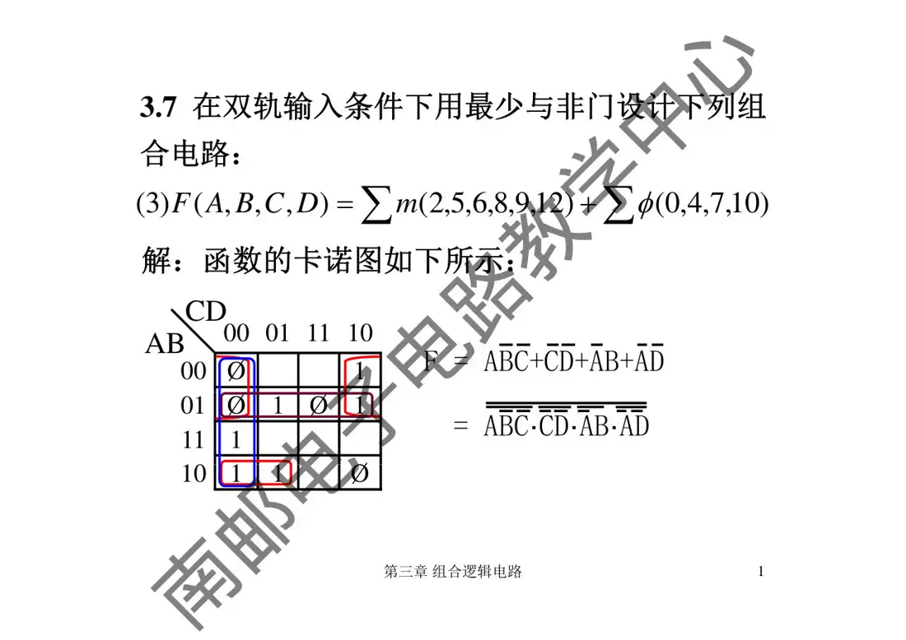

原文：

3 7. 在双轨输入条件下用最少与非门设计下列组合电路：

)3( $F ( A , B , C , D ) = \sum m ( 2 , 5 , 6 , 8 , 9 , 1 2 ) \times \sum \phi ( 0 , 4 , 7 , 1 0 )$

解： 函数的卡诺图如 所示下 ：

$$
\overline {{A B C}} + \overline {{C D}} + \overline {{A B}} + \overline {{A D}}
$$

$$
= \overline {{\mathrm{ABC} \cdot \overline {{\mathrm{CD}}} \cdot \overline {{\mathrm{AB}}} \cdot \overline {{\mathrm{AD}}}}}
$$

第三章 组合逻辑电路

1

### 画逻辑电路， 如下图所示：

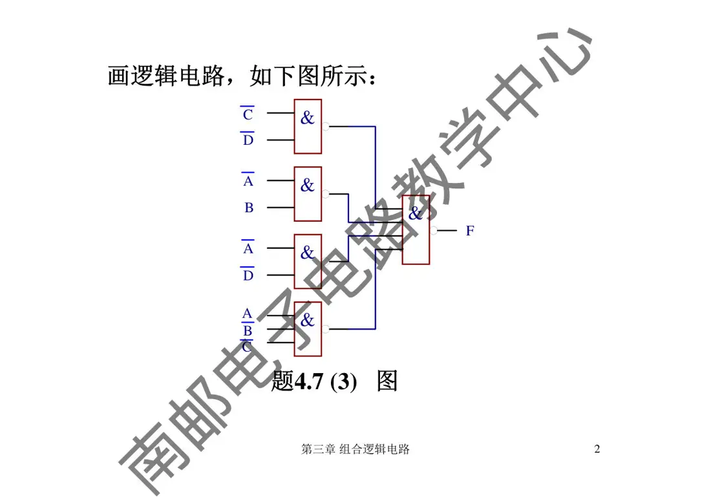

原文：

画逻辑电路， 如下图所示：

2

### $\mathbf { F _ { 1 } }$ ： ABCD是4的倍数 。

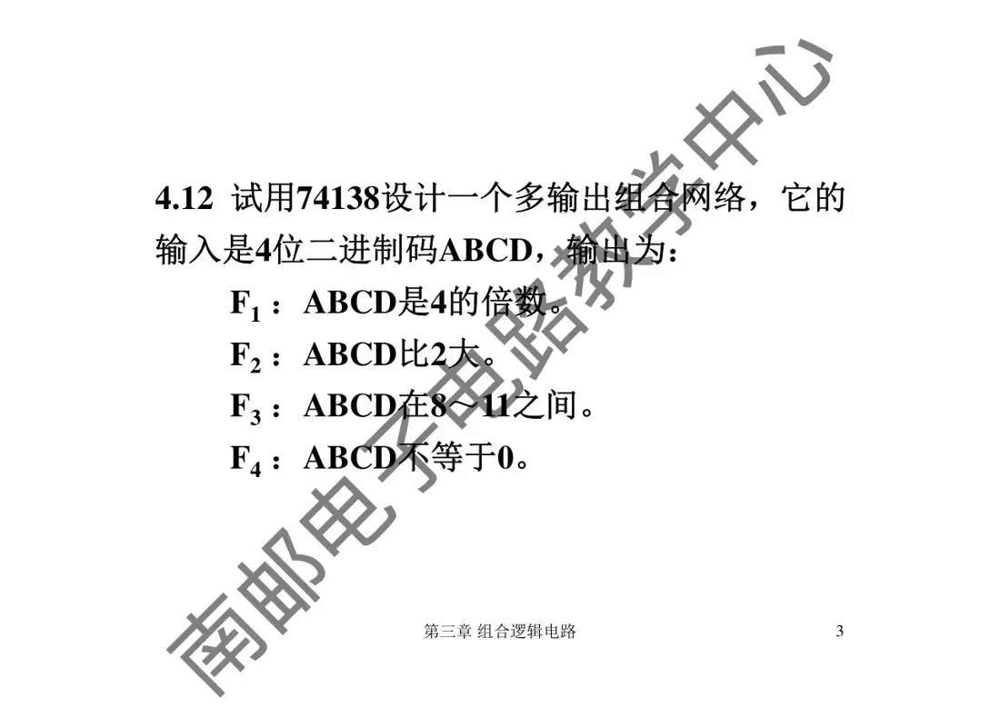

原文：

4 12. 试用74138设计 个多输出组合网络一 ， 它的输入是4位二进制码ABCD， 输出为：

$\mathbf { F _ { 1 } }$ ： ABCD是4的倍数 。

$\mathbf { F } _ { 2 }$ ： ABCD 比2大 。

$\mathbf { F } _ { 3 }$ ： ABCD在8～11之间 。

$\mathrm { { F _ { 4 } } }$ ： ABCD不等于0。

第三章 组合逻辑电路

3

### $$

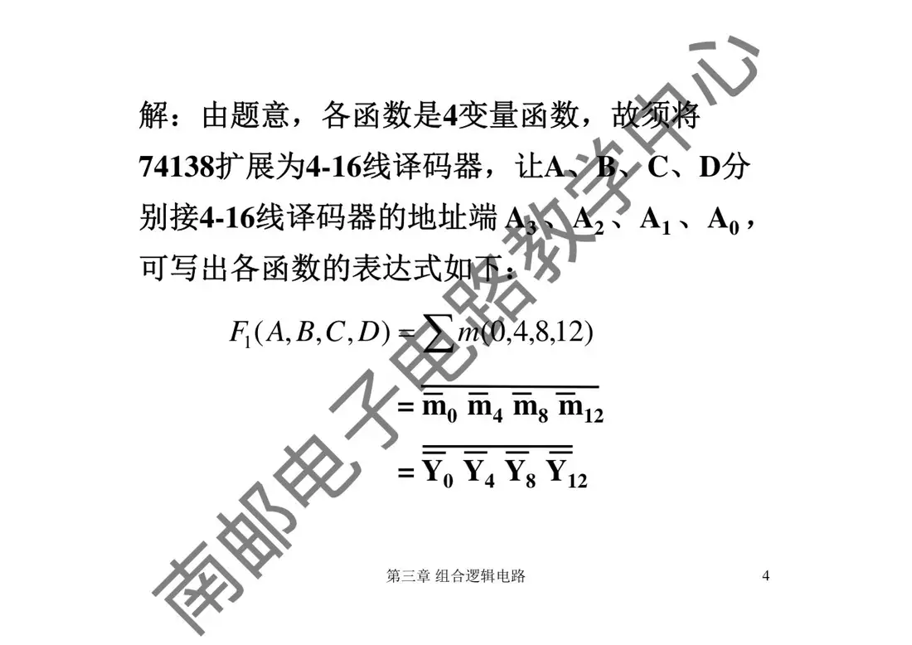

原文：

解： 由题意， 各函数是4变量函数， 故须将74138扩展为4-16线译码器 ， 让A 、 B 、 C 、 D分别接4-16线译码器的地址端 $\mathbf { A } _ { 3 } \setminus \mathbf { \dot { A } } _ { 2 } \setminus \mathbf { \dot { A } } _ { 1 } \setminus \mathbf { A _ { 0 } }$ 可写出各函数的表达式如下：

$$
F _ {1} (A, B, C, D) = \sum m (0, 4, 8, 1 2)
$$

第三章 组合逻辑电路

4

### $$

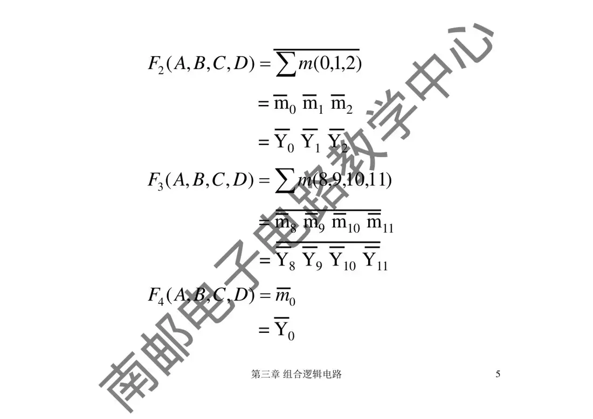

原文：

$$
\begin{array}{r l} F _ {2} (A, B, C, D) & = \overline {{\sum m (0 , 1 , 2)}} \\ & = \overline {{\mathbf {m}}} _ {0} \overline {{\mathbf {m}}} _ {1} \overline {{\mathbf {m}}} _ {2} \\ & = \overline {{\mathbf {Y}}} _ {0} \overline {{\mathbf {Y}}} _ {1} \overline {{\mathbf {Y}}} _ {2} \end{array}
$$

$$
F _ {3} (A, B, C, D) = \sum m (8, 9, 1 0, 1 1)
$$

第三章 组合逻辑电路

5

### 实现电路如下图所示：

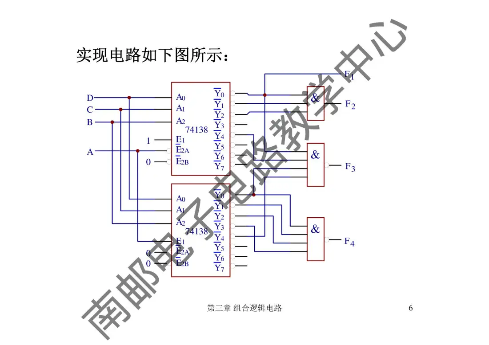

原文：

实现电路如下图所示：

6

### 4.14 试用 74151 实现下 列 函 数 ：

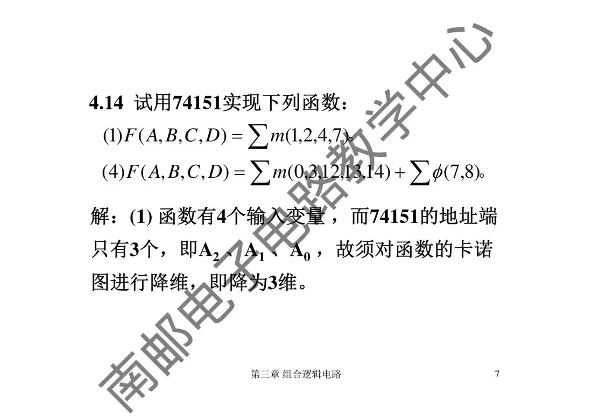

原文：

4.14 试用 74151 实现下 列 函 数 ：

)1( $F ( A , B , C , D ) = \sum m ( 1 , 2 , 4 , 7 )$

)4( $F ( A , B , C , D ) = \sum m ( 0 , 2 , 1 2 , 1 3 , 1 4 ) + \sum \phi ( 7 , 8 ) 。$

解： (1) 函数有4个输入变量 ， 而74151的地址端只有3个， 即 $\mathbf { A } _ { 2 } \times \lfloor \mathbf { A } _ { 1 } \times \mathbf { A } _ { 0 }$ ， 故须对函数的卡诺图进行降维， 即 降为3维。

第三章 组合逻辑电路

7

### AB\CD00011110001101111110

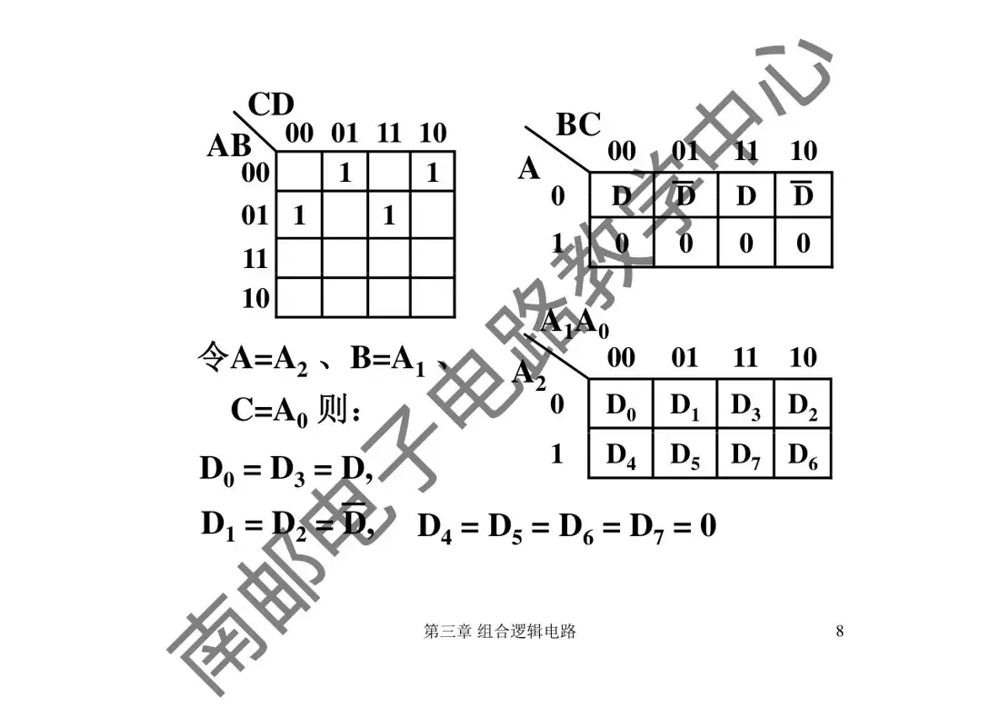

原文：

<table><tr><td>AB\CD</td><td>00</td><td>01</td><td>11</td><td>10</td></tr><tr><td>00</td><td></td><td>1</td><td></td><td>1</td></tr><tr><td>01</td><td>1</td><td></td><td>1</td><td></td></tr><tr><td>11</td><td></td><td></td><td></td><td></td></tr><tr><td>10</td><td></td><td></td><td></td><td></td></tr></table>

令 $\mathbf { A } { = } \mathbf { A } _ { 2 }$ $\mathbf { B = A _ { 1 } }$

$\mathbf { C = A _ { 0 } }$ 则 ：

$$
\mathbf {D} _ {0} = \mathbf {D} _ {3} = \mathbf {D},
$$

$$
\mathbf {D} _ {1} = \mathbf {D} _ {2} = \overline {{\mathbf {D}}},
$$

<table><tr><td></td><td>00</td><td>01</td><td>11</td><td>10</td></tr><tr><td>20</td><td> $D_0$ </td><td> $D_1$ </td><td> $D_3$ </td><td> $D_2$ </td></tr><tr><td>1</td><td> $D_4$ </td><td> $D_5$ </td><td> $D_7$ </td><td> $D_6$ </td></tr></table>

$$
\mathbf {D} _ {4} = \mathbf {D} _ {5} = \mathbf {D} _ {6} = \mathbf {D} _ {7} = \mathbf {0}
$$

第三章 组合逻辑电路

8

### 相应的 电路图如下所示：

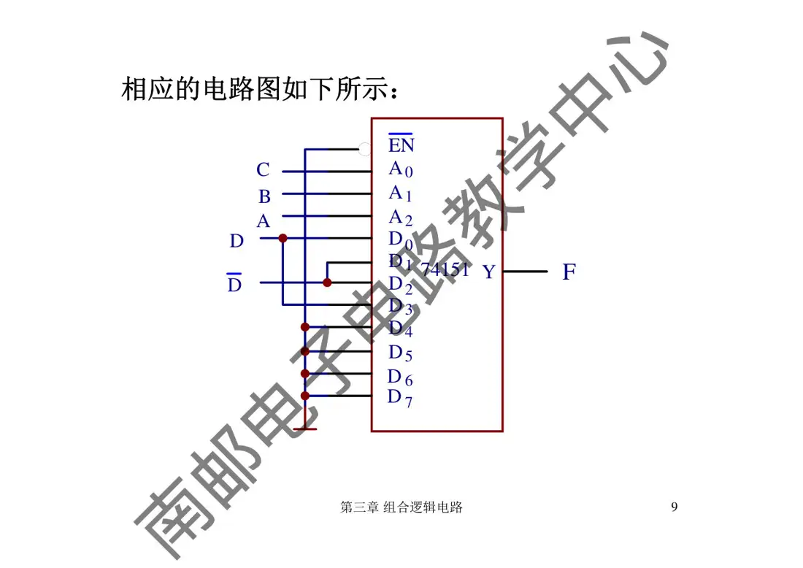

原文：

相应的 电路图如下所示：

9

### AB\CD00011110001101∅1111110∅

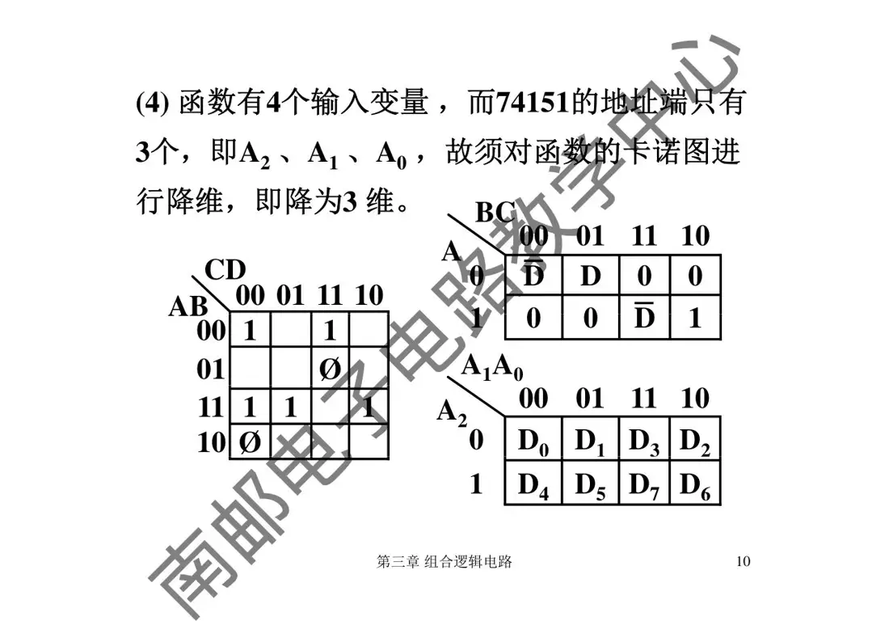

原文：

(4) 函数有4个输入变量 ， 而74151的地址端只有3个， 即 $\mathbf { A } _ { 2 } \setminus \mathbf { A } _ { 1 } \setminus \mathbf { A _ { 0 } }$ ， 故须对函数的卡诺图进行降维， 即 降为3 维。 BC

<table><tr><td>AB\CD</td><td>00</td><td>01</td><td>11</td><td>10</td></tr><tr><td>00</td><td>1</td><td></td><td>1</td><td></td></tr><tr><td>01</td><td></td><td></td><td>∅</td><td></td></tr><tr><td>11</td><td>1</td><td>1</td><td></td><td>1</td></tr><tr><td>10</td><td>∅</td><td></td><td></td><td></td></tr></table>

第三章 组合逻辑电路

1 0

### $$

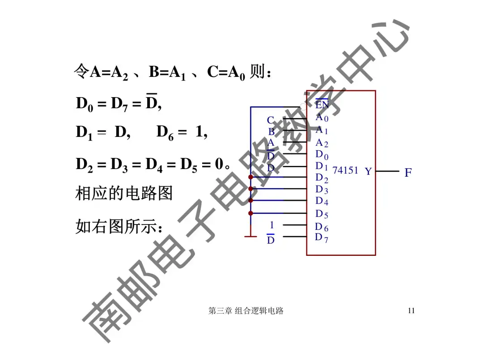

原文：

令 $\mathbf { A } { = } \mathbf { A } _ { 2 }$ $\mathbf { B = A _ { 1 } }$ $\mathbf { C = A _ { 0 } }$ 则 ：

$$
\mathbf {D _ {0}} = \mathbf {D _ {7}} = \overline {{\mathbf {D}}},
$$

$$
\mathbf {D} _ {1} = \mathbf {D}, \quad \mathbf {D} _ {6} = \mathbf {1},
$$

$$
\mathbf {D} _ {2} = \mathbf {D} _ {3} = \mathbf {D} _ {4} = \mathbf {D} _ {5} = \mathbf {0} 。
$$

相应的 电路图

如右图所示：

第三章 组合逻辑电路

1 1

### 4.15 用 ½74153实现下 列 函 数 ：

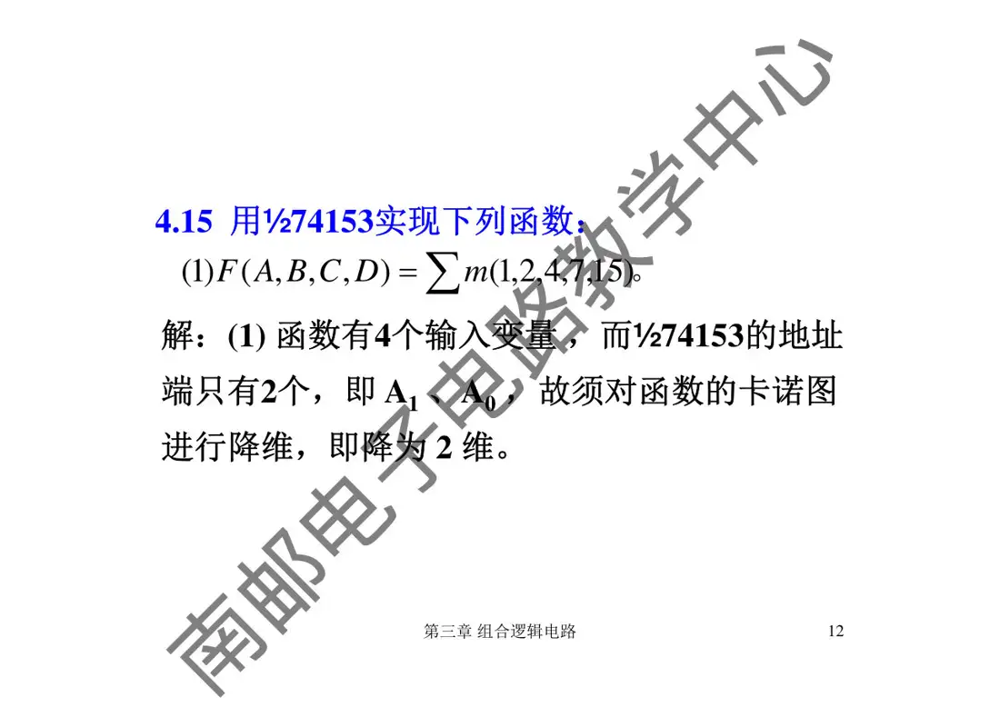

原文：

4.15 用 ½74153实现下 列 函 数 ：

(1) $F ( A , B , C , D ) = \sum m ( 1 , 2 , 4 , 7 , 1 5 ) ) 。$

解： ( )1 函数有4个输入变量 ， 而½74153的地址端只有2个， 即 $\mathbf { A _ { 1 } } \bigotimes \mathbf { A _ { 0 } } \bigotimes$ 故须对函数的卡诺图进行降维， 即 降为 2 维。

第三章 组合逻辑电路

1 2

### AB\CD000111100011011111110

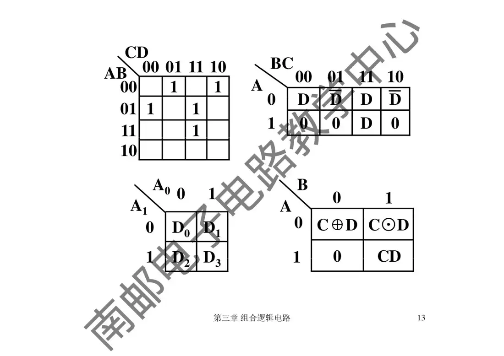

原文：

<table><tr><td>AB\CD</td><td>00</td><td>01</td><td>11</td><td>10</td></tr><tr><td>00</td><td></td><td>1</td><td></td><td>1</td></tr><tr><td>01</td><td>1</td><td></td><td>1</td><td></td></tr><tr><td>11</td><td></td><td></td><td>1</td><td></td></tr><tr><td>10</td><td></td><td></td><td></td><td></td></tr></table>

<table><tr><td rowspan="3">A\B</td><td>0</td><td>1</td></tr><tr><td>C ⊕ D</td><td>C ⊙ D</td></tr><tr><td>0</td><td>CD</td></tr></table>

第三章 组合逻辑电路

1 3

### 相应的 电路图如下图所示：

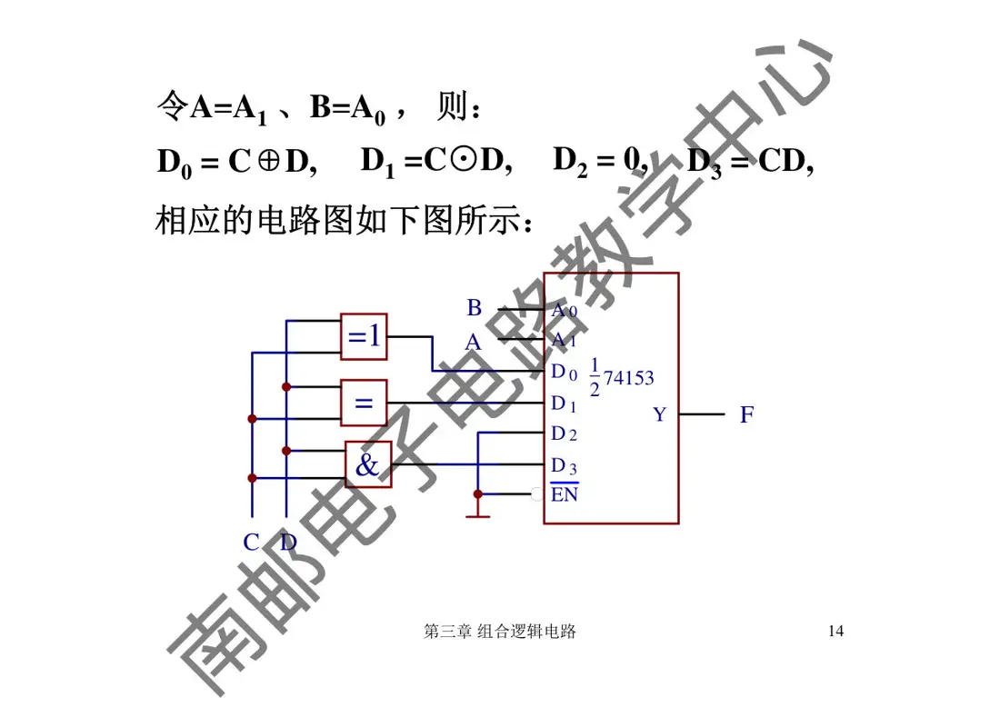

原文：

令 $\mathbf { A } { = } \mathbf { A } _ { 1 }$ $\bf { B } \mathrm { = } \bf { A } _ { 0 }$ ， 则 ：

D0 = C ⊕ D, $\mathbf { D _ { 1 } } \mathbf { = C } \boldsymbol { \odot }$ D , $\mathbf { D } _ { 2 } = \mathbf { 0 } , \ V \mathbf { D } _ { 3 } \equiv \mathbf { C D } ,$

相应的 电路图如下图所示：

第三章 组合逻辑电路

1 4

### 第三章 组合逻辑电路

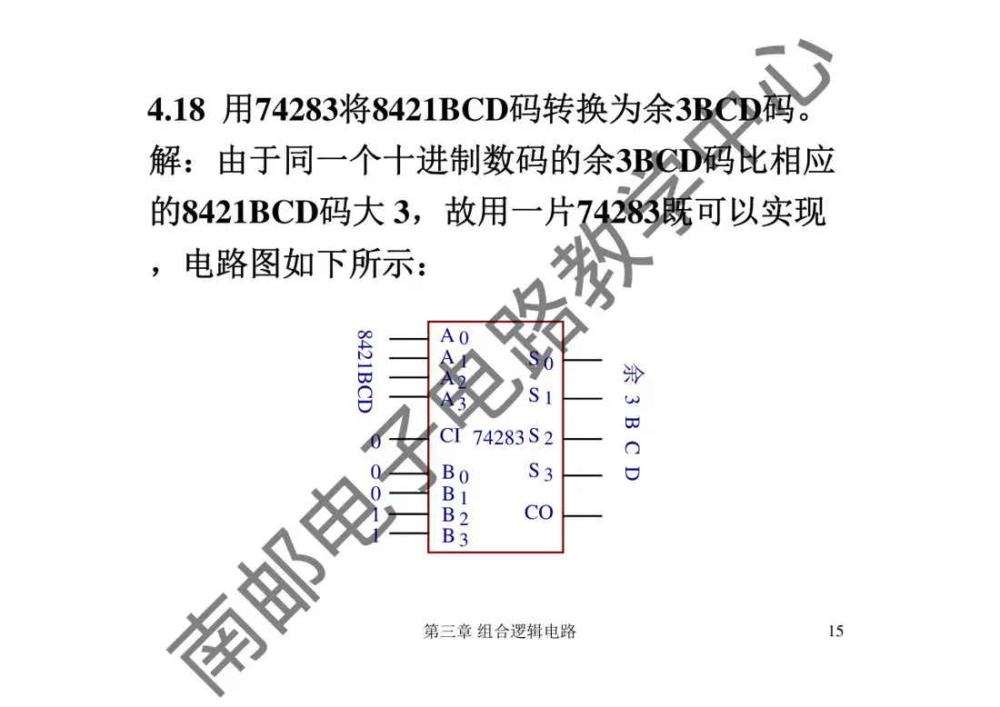

原文：

第三章 组合逻辑电路

4 18. 用 74283将8421BCD码转换为余3BCD码 。解： 由于同一个十进制数码的余3BCD码比相应的8421BCD码大 3， 故用 一片74283既可 以实现， 电路图如下所示： 我

1 5

### 例1 某与非电路的逻辑函数表达式为

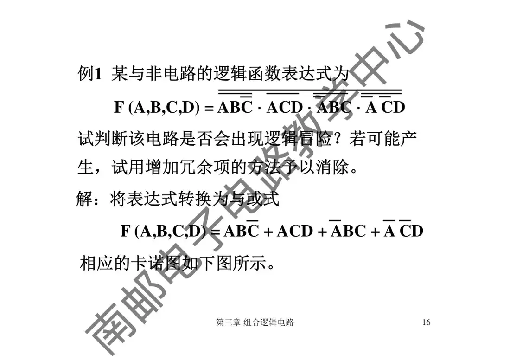

原文：

例1 某与非电路的逻辑函数表达式为

F (A B C D) = ABC · ACD ABC · A CD试判断该电路是否会出现逻辑冒险？ 若可能产生， 试用增加冗余项的方法予以消除。

解： 将表达式转换为与或式

$\mathbf { F } \left( \mathbf { A } , \mathbf { B } , \mathbf { C } , \mathbf { D } \right) { \in } \mathbf { A } \mathbf { B } \overline { { \mathbf { C } } } + \mathbf { A } \mathbf { C } \mathbf { D } + \overline { { \mathbf { A } } } \mathbf { B } \mathbf { C } + \overline { { \mathbf { A } } } \overline { { \mathbf { C } } } \mathbf { D }$ 相应的卡诺图如下图所示。

第三章 组合逻辑电路

1 6

### 由于图 中各卡诺圈相切， 所以该电路可能出现逻辑冒险。 1

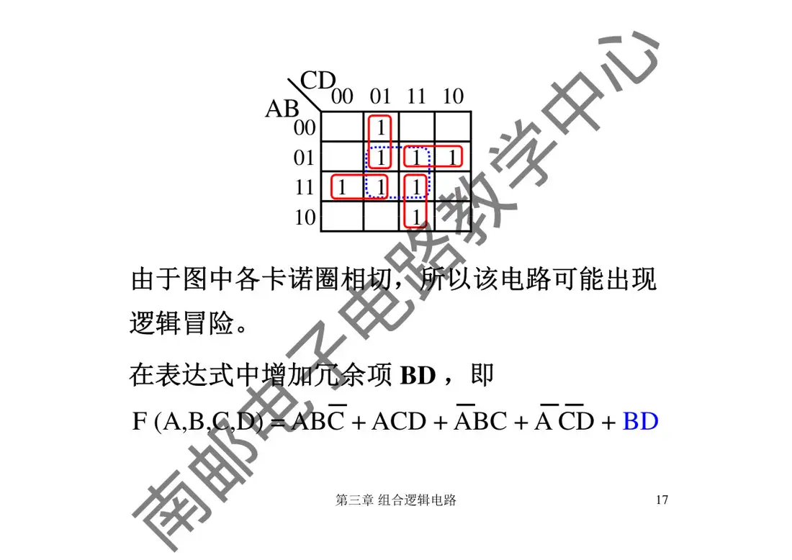

原文：

由于图 中各卡诺圈相切， 所以该电路可能出现逻辑冒险。 1

在表达式中增加冗余项 BD ， 即

$$
\mathrm{F} (\mathrm{A}, \mathrm{B}, \mathrm{C}, \mathrm{D}) = \mathrm{ABC} + \mathrm{ACD} + \overline {{\mathrm{A}}} \mathrm{BC} + \overline {{\mathrm{A}}} \overline {{\mathrm{C}}} \overline {{\mathrm{D}}} + \mathrm{BD}
$$

第三章 组合逻辑电路

1 7

### 增加冗余项后， 相应逻辑电路中应增加 个与一非门， 其与非表达式为：

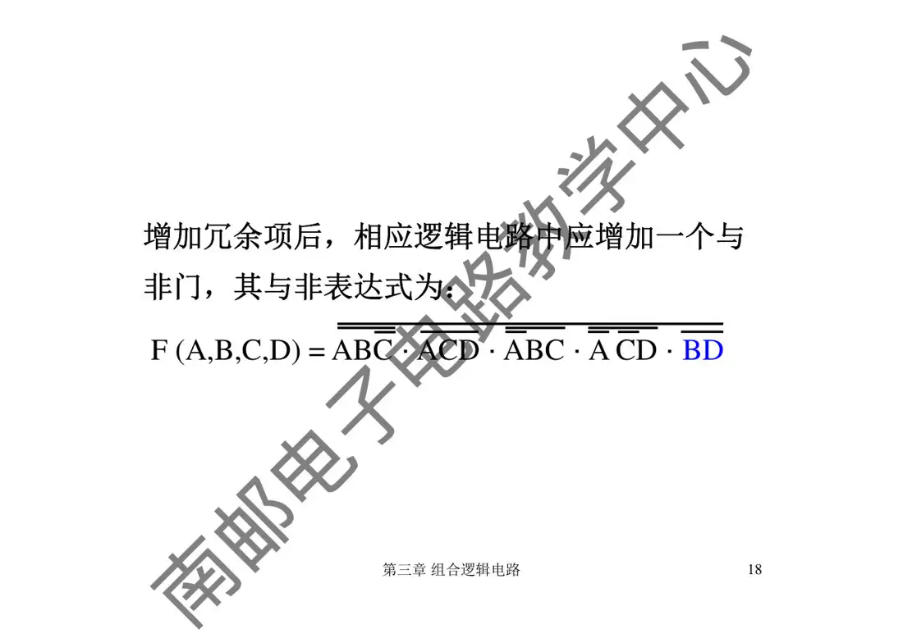

原文：

增加冗余项后， 相应逻辑电路中应增加 个与一非门， 其与非表达式为：

第三章 组合逻辑电路

1 8

### $$

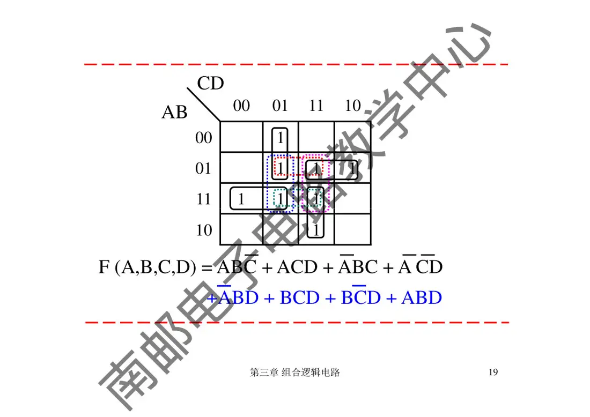

原文：

$$
\begin{array}{r l} \mathrm{F(A,B,C,D)} & = \mathrm {ABC + ACD+ \overline {{A}} BC+ \overline {{A}} CD} \\ & + \overline {{\mathrm{ABD}}} + \mathrm{BCD} + \overline {{\mathrm{BCD}}} + \mathrm{ABD} \end{array}
$$

第三章 组合逻辑电路

1 9

### 20

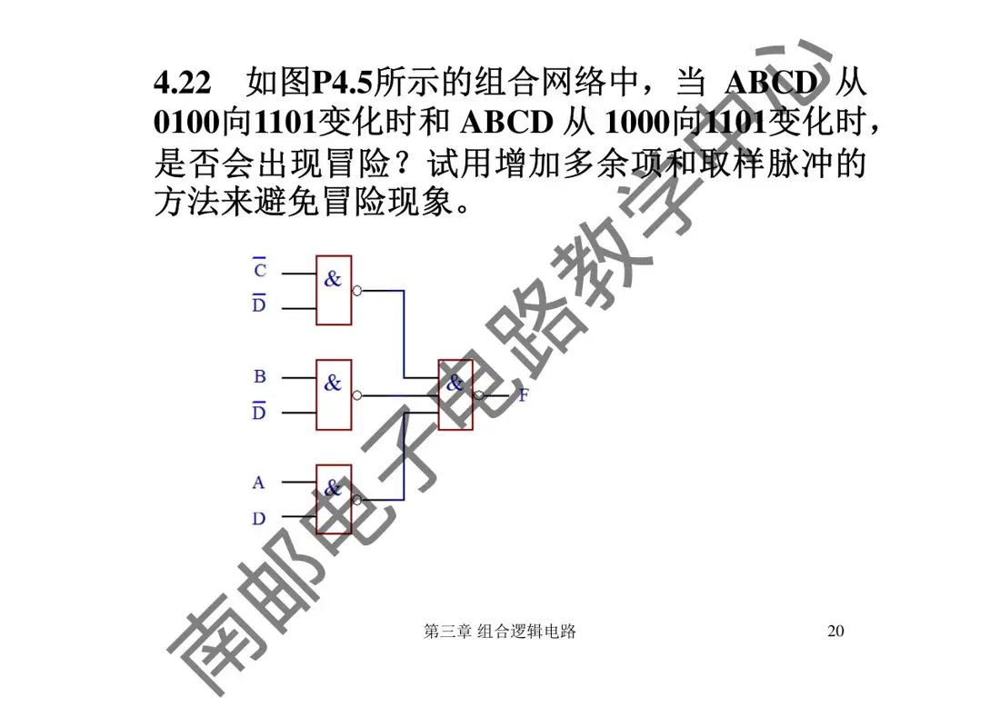

原文：

4.22 如 图P4.5所示的组合网络 中 ， 当 ABCD 从0100 向 1101变化 时和 ABCD 从 1000 向 1101变化 时 ，是否会出现冒 险？ 试用增加多余项和取样脉冲的方法来避免冒险现象。

20

### 第三章 组合逻辑电路

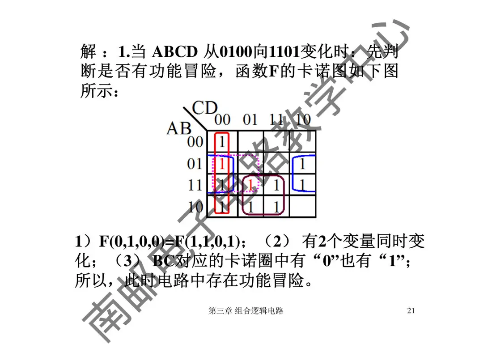

原文：

解 ： 1.当 ABCD 从0100 向 1101变化时 ： 先判断是否有功能 冒 险， 函数F的卡诺 图如下 图所示：

1 ） F(0 1 0 0)=F(1 1 0 1) ； （ 2 ） 有2个变量 同 时变化 ； （ 3 ） BC对应 的卡诺 圈 中有 “0”也有 “ 1” ；所以， 此时 电路中存在功能冒险。

第三章 组合逻辑电路

2 1

### (2) 有2个变量同时变化；

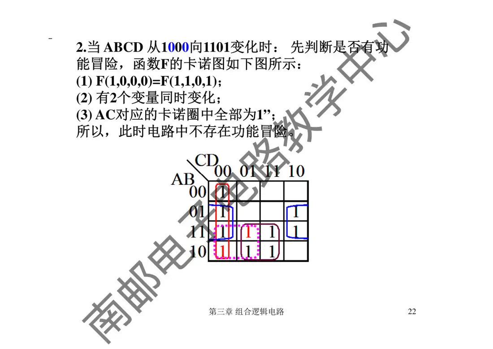

原文：

2.当 ABCD 从1000 向 1101变化时 ： 先判断是否有功能冒险， 函数F的卡诺图如下图所示： X

( 1 ) $\mathbf { F ( 1 , 0 , 0 , 0 ) { = } F ( 1 , 1 , 0 , 1 ) }$ ；

(2) 有2个变量同时变化；

(3) AC对应的卡诺圈 中全部为1”；所以， 此时 电路中不存在功能冒险。再判断是否有逻辑冒险：

22

### 即AC = 10 时， 存在0型逻辑 冒 险 。

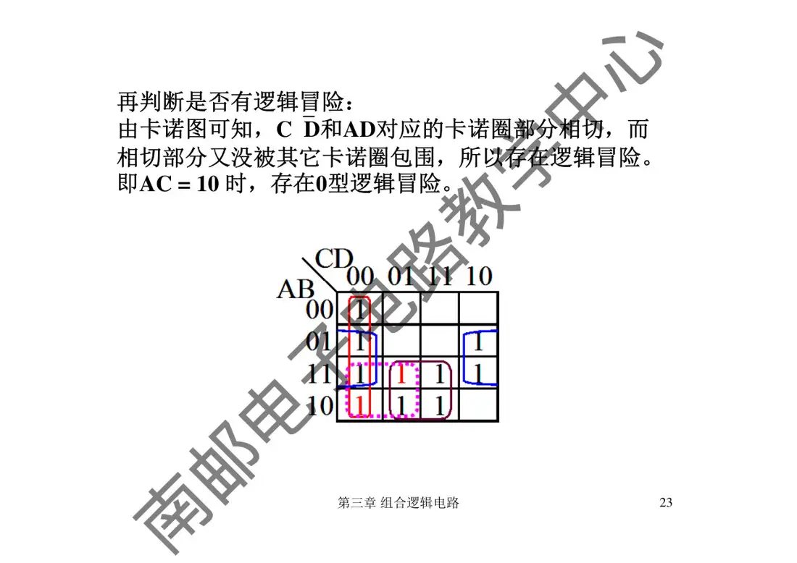

原文：

由卡诺图可知， C D和AD对应的卡诺圈部分相切， 而相切部分又没被其它卡诺圈包围， 所以存在逻辑冒险。

即AC = 10 时， 存在0型逻辑 冒 险 。

23

### 3． 增加多余项的方法消除逻辑冒险：

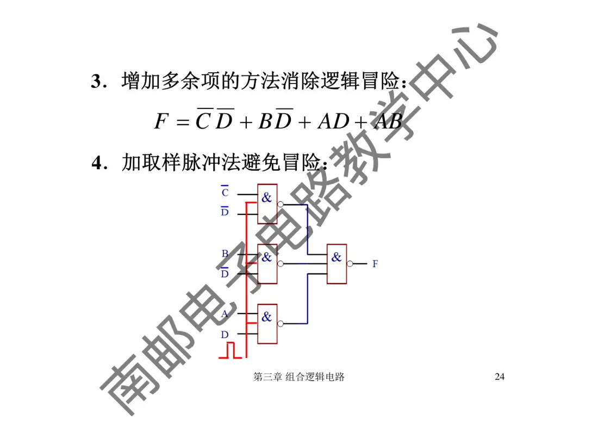

原文：

3． 增加多余项的方法消除逻辑冒险：

$$
F = \overline {{C}} \overline {{D}} + B \overline {{D}} + A D + A B
$$

4． 加取样脉冲法避免冒险：

24
