# 《数字电路与系统设计》第二章 第三节 逻辑代数的公式（课件）

原件的每一页，下面附识别出的文字。

### 第二章 逻辑代数基础

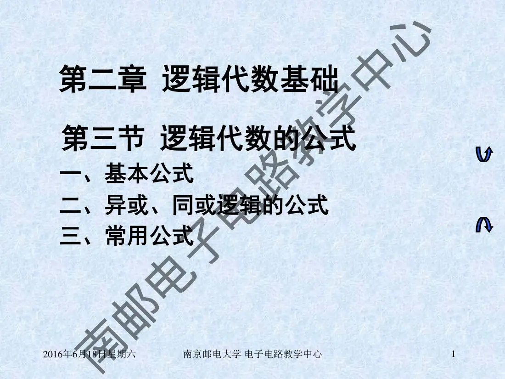

原文：

第二章 逻辑代数基础
第三节 逻辑代数的公式
一、基本公式
二、异或、同或逻辑的公式
三、常用公式

2016年6月18日星期六 南京邮电大学 电子电路教学中心

1

### 一、基本公式

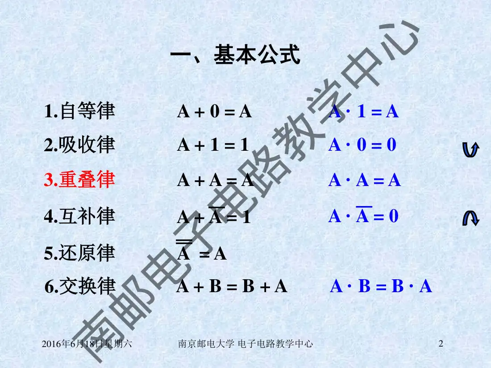

原文：

一、基本公式

1.自等律

2.吸收律

3.重叠律

4.互补律

5.还原律

6.交换律

$$
\mathbf {A} + \mathbf {0} = \mathbf {A}
$$

$$
\mathbf {A} + \mathbf {1} = \mathbf {1}
$$

$$
\mathbf {A} + \mathbf {A} = \mathbf {A}
$$

$$
\mathbf {A} + \overline {{\mathbf {A}}} = \mathbf {1}
$$

$$
\overline {{\overline {{\mathbf {A}}}}} = \mathbf {A}
$$

$$
\mathbf {A} + \mathbf {B} = \mathbf {B} + \mathbf {A}
$$

$$
\cdot 1 = \mathbf {A}
$$

$$
\mathbf {A} \cdot \mathbf {0} = \mathbf {0}\tag{U}
$$

$$
\mathbf {A} \cdot \mathbf {A} = \mathbf {A}
$$

$$
\mathbf {A} \cdot \overline {{\mathbf {A}}} = \mathbf {0}
$$

$$
\curvearrowright
$$

$$
\mathbf {A} \cdot \mathbf {B} = \mathbf {B} \cdot \mathbf {A}
$$

2016年6月18日星期六

南京邮电大学 电子电路教学中心

2

### 7.结合律

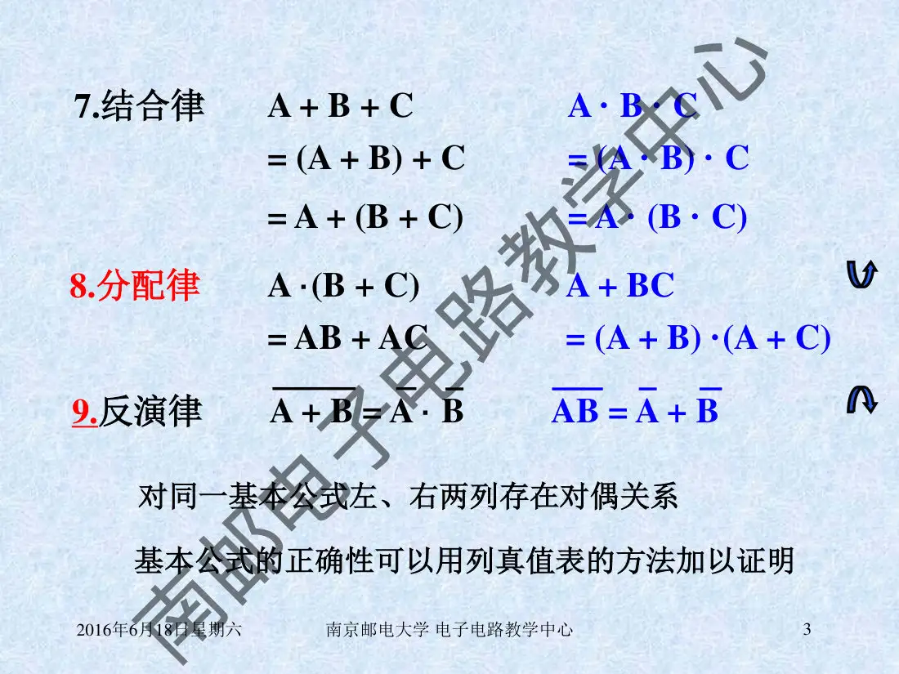

原文：

7.结合律

$$
\begin{array}{r l} & {\mathbf {A} + \mathbf {B} + \mathbf {C}} \\ & {= (\mathbf {A} + \mathbf {B}) + \mathbf {C}} \\ & {= \mathbf {A} + (\mathbf {B} + \mathbf {C})} \end{array}
$$

$$
\mathbf {A} \cdot \mathbf {B} \cdot \mathbf {C}
$$

$$
\mathrm{B}) \cdot \mathrm{C}
$$

$$
(\mathbf {B} \cdot \mathbf {C})
$$

8.分配律

$$
\mathbf {A} \cdot (\mathbf {B} + \mathbf {C})
$$

$$
\mathbf {A} + \mathbf {B C}
$$

$$
= \mathbf {A B} + \mathbf {A C}
$$

$$
= (\mathbf {A} + \mathbf {B}) \cdot (\mathbf {A} + \mathbf {C})
$$

9.反演律

$$
\mathbf {A} + \mathbf {B} = \mathbf {A} \cdot \mathbf {B}
$$

$$
\overline {{\mathbf {A B}}} = \overline {{\mathbf {A}}} + \overline {{\mathbf {B}}}
$$

$$
\curvearrowright
$$

对同一基本公式左、右两列存在对偶关系

基本公式的正确性可以用列真值表的方法加以证明

2016年6月18日星期六 南京邮电大学 电子电路教学中心

3

### 用真值表证明分配律的第二个公式

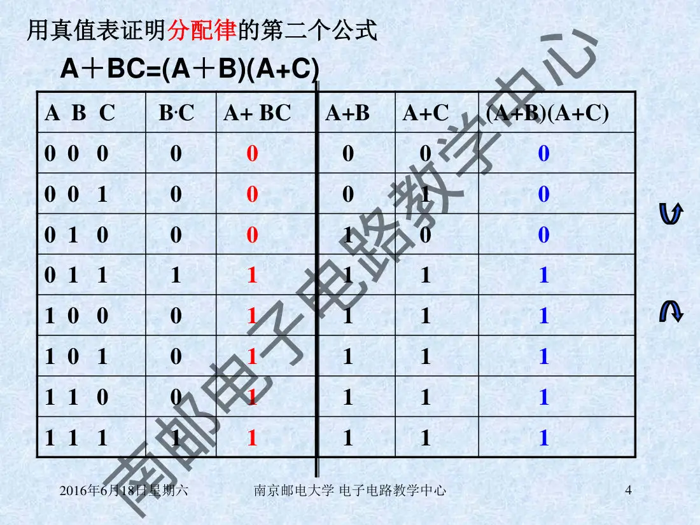

原文：

用真值表证明分配律的第二个公式

<table><tr><td colspan="6">A + BC=(A+B)(A+C)</td></tr><tr><td>A B C</td><td>B·C</td><td>A+ BC</td><td>A+B</td><td>A+C</td><td>(A+B)(A+C)</td></tr><tr><td>0 0 0</td><td>0</td><td>0</td><td>0</td><td>0</td><td>0</td></tr><tr><td>0 0 1</td><td>0</td><td>0</td><td>0</td><td>1</td><td>0</td></tr><tr><td>0 1 0</td><td>0</td><td>0</td><td>1</td><td>0</td><td>0</td></tr><tr><td>0 1 1</td><td>1</td><td>1</td><td>1</td><td>1</td><td>1</td></tr><tr><td>1 0 0</td><td>0</td><td>1</td><td>1</td><td>1</td><td>1</td></tr><tr><td>1 0 1</td><td>0</td><td>1</td><td>1</td><td>1</td><td>1</td></tr><tr><td>1 1 0</td><td>0</td><td>1</td><td>1</td><td>1</td><td>1</td></tr><tr><td>1 1 1</td><td>1</td><td>1</td><td>1</td><td>1</td><td>1</td></tr></table>

2016年6月18日星期六

南京邮电大学 电子电路教学中心

4

### 二、异或、同或逻辑的公式

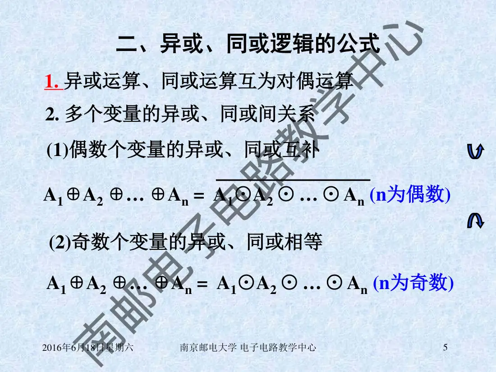

原文：

二、异或、同或逻辑的公式

1. 异或运算、同或运算互为对偶运算

2. 多个变量的异或、同或间关系

(1)偶数个变量的异或、同或互补

$\mathbf { A _ { 1 } } \oplus \mathbf { A _ { 2 } } \oplus \ldots \oplus \mathbf { A _ { n } } = \mathbf { A _ { 1 } } \odot \mathbf { A _ { 2 } } \odot \ldots \odot \mathbf { A _ { n } }$ (n为偶数)

(2)奇数个变量的异或、同或相等

$\mathbf { A _ { 1 } } \oplus \mathbf { A _ { 2 } } \oplus \ldots \oplus \mathbf { A _ { n } } = \mathbf { A _ { 1 } } \odot \mathbf { A _ { 2 } } \odot \ldots \odot \mathbf { A _ { n } }$ (n为奇数)

2016年6月18日星期六 南京邮电大学 电子电路教学中心

5

### 3. 多个常量的异或、同或运算

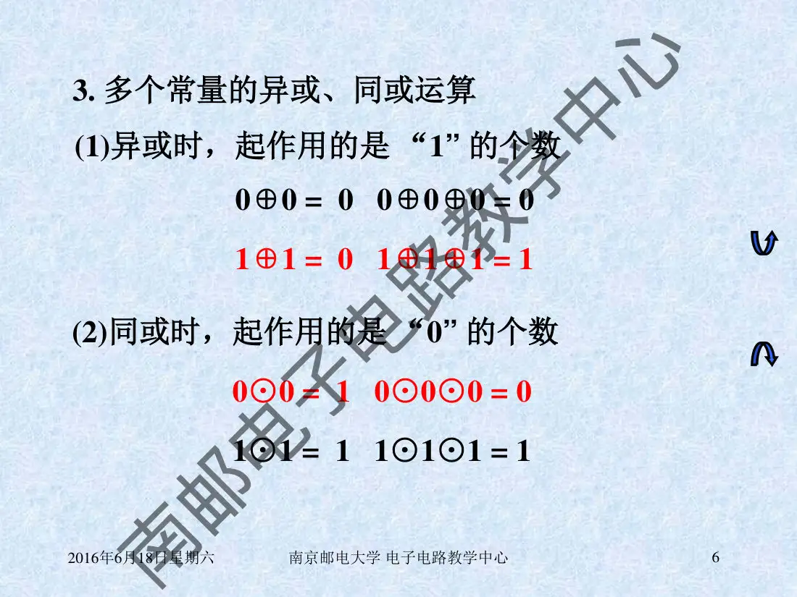

原文：

3. 多个常量的异或、同或运算

(1)异或时，起作用的是 $^ { 6 6 } 1 ^ { 5 9 }$ 的个数

$$
\mathbf {0} \oplus \mathbf {0} = \mathbf {0} \quad \mathbf {0} \oplus \mathbf {0} \oplus \mathbf {0} = \mathbf {0}
$$

$$
\mathbf {1} \oplus \mathbf {1} = \mathbf {0} \quad \mathbf {1} \oplus \mathbf {1} \oplus \mathbf {1} = \mathbf {1}\tag{U}
$$

(2)同或时，起作用的是 $^ { 6 6 } 0 ^ { 9 }$ 的个数

$$
0 \odot 0 = 1 \quad 0 \odot 0 \odot 0 = 0\tag{A}
$$

$$
\mathbf {1} \odot \mathbf {1} = \mathbf {1} \quad \mathbf {1} \odot \mathbf {1} \odot \mathbf {1} = \mathbf {1}
$$

2016年6月18日星期六

南京邮电大学 电子电路教学中心

6

### 三、常用公式

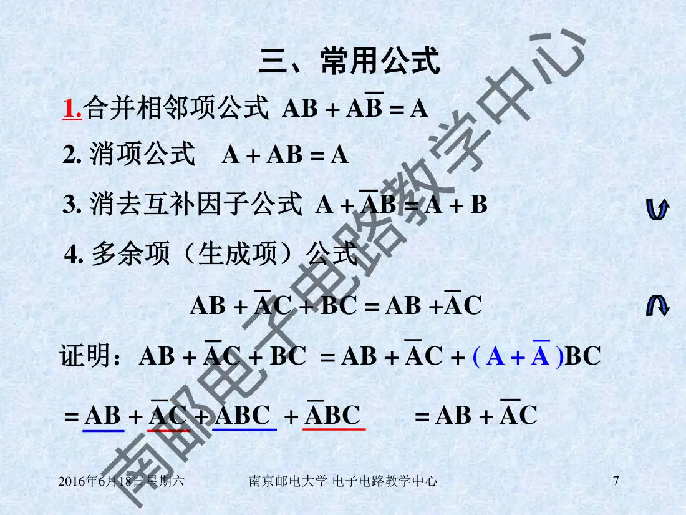

原文：

三、常用公式

1.合并相邻项公式 $\mathbf { A B } + \mathbf { A B } = \mathbf { A }$

2. 消项公式 $\mathbf { A } + \mathbf { A } \mathbf { B } = \mathbf { A }$

3. 消去互补因子公式 $\mathbf { A } + \mathbf { \overline { { A } } } \mathbf { \overline { { B } } } = \mathbf { A } + \mathbf { B }$

U

4. 多余项（生成项）公式

$$
\mathbf {A B} + \overline {{\mathbf {A}}} \mathbf {C} + \mathbf {B C} = \mathbf {A B} + \overline {{\mathbf {A}}} \mathbf {C}
$$

证明： $\mathbf { A B } + \mathbf { \overline { { A } C } } + \mathbf { B C } = \mathbf { A B } + \mathbf { \overline { { A } C } } + ( \mathbf { A } + \mathbf { \overline { { A } } } ) \mathbf { B C }$

$$
= \underline {{\mathbf {A B}}} + \overline {{\mathbf {A C}}} + \underline {{\mathbf {A B C}}} + \overline {{\mathbf {A B C}}} = \mathbf {A B} + \overline {{\mathbf {A C}}}
$$

2016年6月18日星期六

南京邮电大学 电子电路教学中心

7

### 第二章 逻辑代数基础

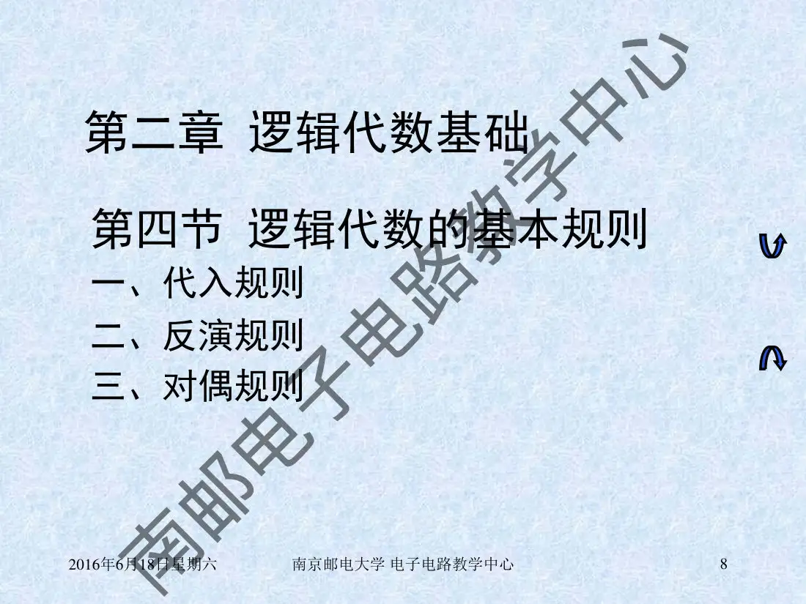

原文：

第二章 逻辑代数基础

第四节 逻辑代数的基本规则

一、代入规则

二、反演规则

三、对偶规则

2016年6月18日星期六 南京邮电大学 电子电路教学中心

8

### 一、代入规则 适用于等式

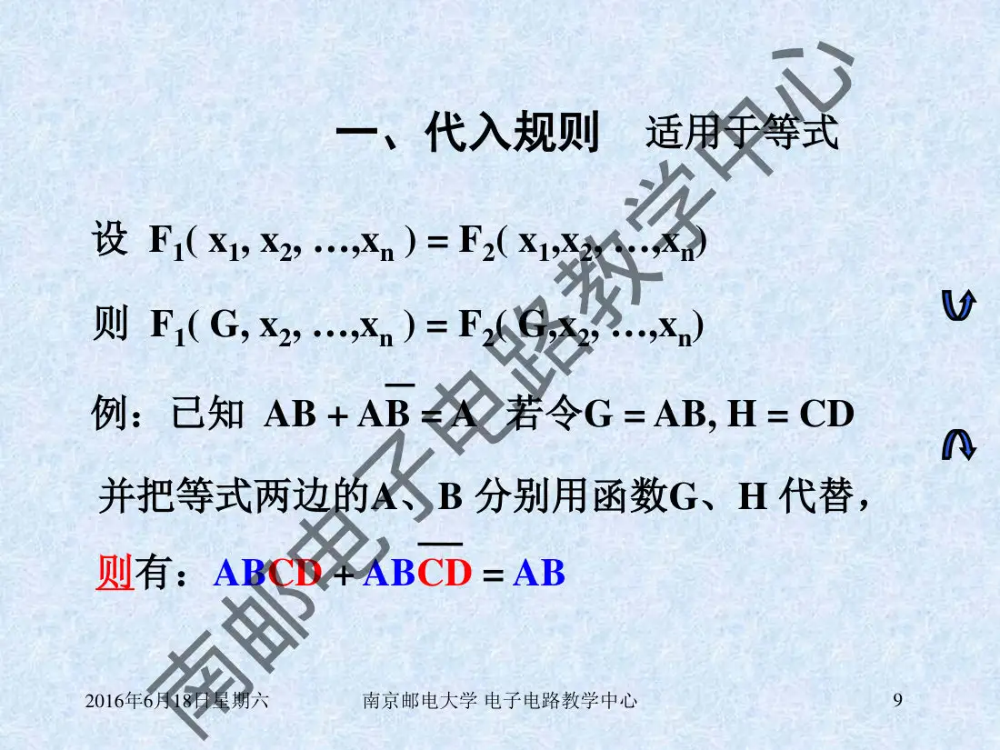

原文：

一、代入规则 适用于等式

设 $\mathbf { F _ { 1 } } ( \mathbf { \Delta x _ { 1 } } , \mathbf { x _ { 2 } } , . . . , \mathbf { x _ { n } } ) = \mathbf { F } _ { 2 } ( \mathbf { \Delta x _ { 1 } } , \mathbf { X _ { 2 } } , \mathbf { \bar { \Delta } } \mathbf { \Delta } \mathbf { \Delta } \mathbf { \Delta } \mathbf { \Delta } \mathbf { \Delta } \mathbf { \Delta } \mathbf { \Delta } \mathbf { \Delta } )$ 则 $\mathbf { F _ { 1 } } ( \mathbf { \Delta G } , \mathbf { x } _ { 2 } , . . . , \mathbf { x _ { n } } ) = \mathbf { F } _ { 2 } ( \mathbf { \Delta G } , \mathbf { x } _ { 2 } ^ { \prime } , . . . , \mathbf { x _ { n } } )$ 例：已知 $\mathbf { A B } + \mathbf { A B } = \mathbf { A }$ $\mathbf { G } = \mathbf { A } \mathbf { B } , \mathbf { H } = \mathbf { C } \mathbf { D }$ 并把等式两边的A、B 分别用函数G、H 代替，则有： $\mathbf { A B C D } + \mathbf { A B C D } = \mathbf { A B }$

2016年6月18日星期六

南京邮电大学 电子电路教学中心

9

### 二、反演规则 用于求反函数

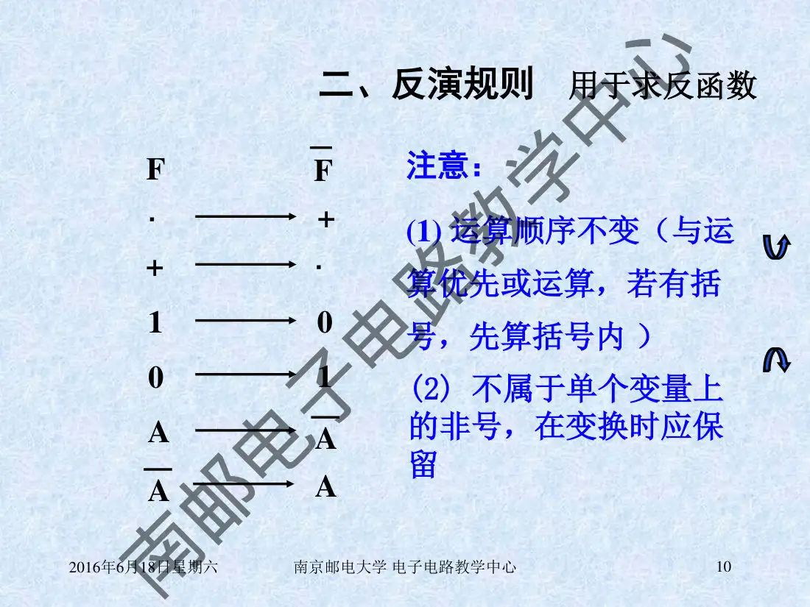

原文：

二、反演规则 用于求反函数

(1) 运算顺序不变（与运算优先或运算，若有括号，先算括号内 ）

(2) 不属于单个变量上的非号，在变换时应保留

2016年6月18日星期六 南京邮电大学 电子电路教学中心

10

### 试用反演规则求反函数 F。

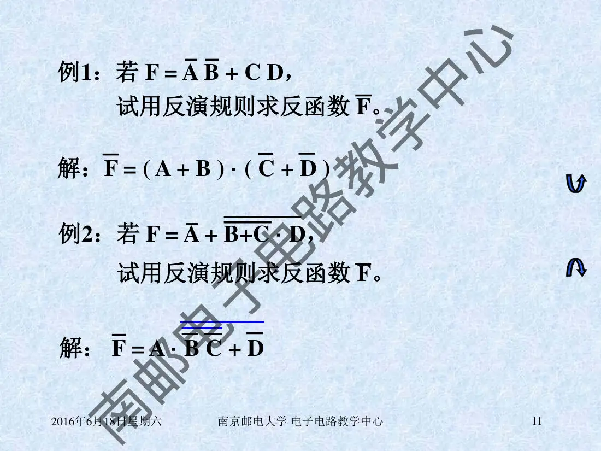

原文：

例1：若 $\mathbf { F } = \mathbf { \overline { { A } } } \ \mathbf { \overline { { B } } } + \mathbf { C } \ \mathbf { D }$ 试用反演规则求反函数 $\overline { { \mathbf { F } } }$

解： $\overline { { \mathbf { F } } } = \left( \mathbf { A } + \mathbf { B } \right) \cdot \left( \overline { { \mathbf { C } } } + \overline { { \mathbf { D } } } \right)$

例2：若 $F = \overline { { \mathbf { A } } } + \overline { { \mathbf { B } + \mathbf { C } } } \cdot \mathbf { D }$

试用反演规则求反函数 F。

解： $\overline { { \mathbf { F } } } = \mathbf { A } \cdot \overline { { \mathbf { B } } } \mathbf { \overline { { C } } } + \overline { { \mathbf { D } } }$ 练习1：若 $\mathbf { F } = \overline { { \mathbf { A } + \mathbf { C } } } \overline { { \mathbf { D } ( \overline { { \mathbf { B } } } + \mathbf { C } ) } }$ 试用反演规则求反函数 $\overline { { \mathbf { F } } }$ o

2016年6月18日星期六

南京邮电大学 电子电路教学中心

11

### 2016年6月18日星期六

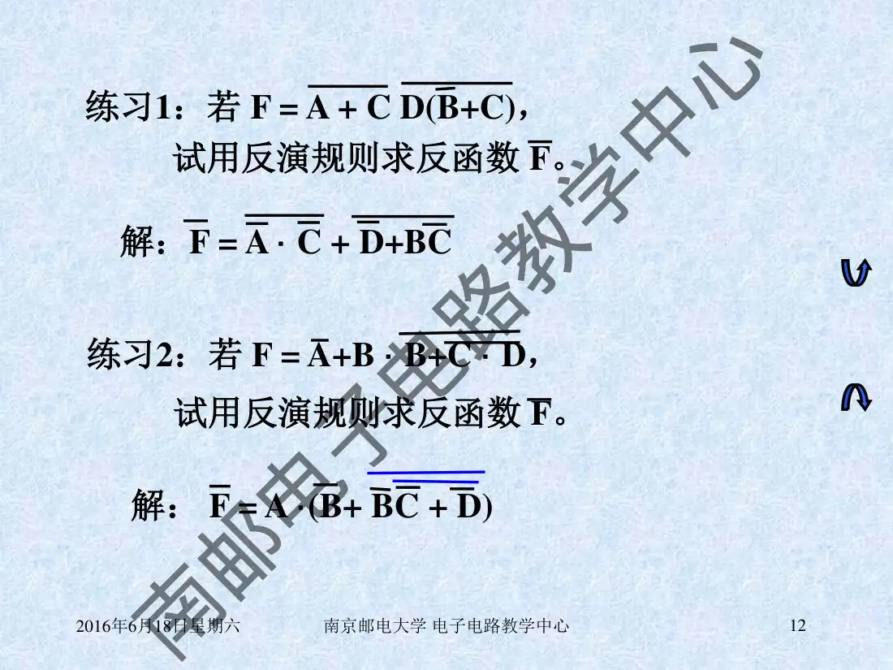

原文：

解： $\overline { { { \bf F } } } = \overline { { { \bf A } } } \cdot \overline { { { \bf C } } } + \overline { { { \bf D } } } + { \bf B } \overline { { { \bf C } } }$

练习2：若 $\mathbf { F } = \overline { { \mathbf { A } } } + \mathbf { B } \mathbf { \therefore } \overline { { \mathbf { B } } } + \mathbf { C } \mathbf { \cdot } \mathbf { D }$ 试用反演规则求反函数 $\mathbf { \overline { { F } } }$ 。

解： $\overline { { \mathbf { F } } } = \overline { { \mathbf { A } \cdot \left( \overline { { \mathbf { B } } } + \overline { { \mathbf { B } } } \overline { { \mathbf { C } } } + \overline { { \mathbf { D } } } \right) } }$

2016年6月18日星期六

南京邮电大学 电子电路教学中心

12

### 常用关系式：

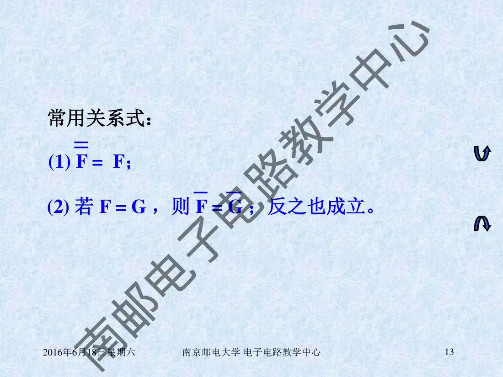

原文：

常用关系式：

(1) $\overline { { \overline { { \mathbf { F } } } } } = \mathbf { F } ;$

(2) 若 F = G ，则 F = G ；反之也成立。

2016年6月18日星期六

南京邮电大学 电子电路教学中心

13

### 三、对偶规则 用于等式的证明

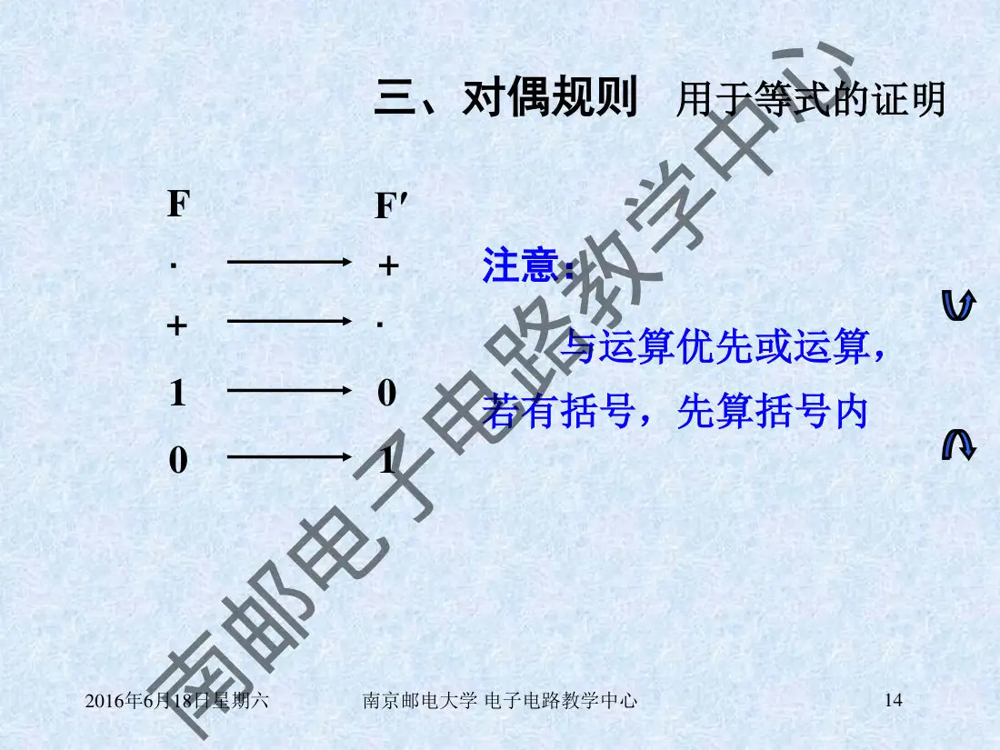

原文：

三、对偶规则 用于等式的证明

F F′

\+ 注意：

与运算优先或运算，

0

若有括号，先算括号内

2016年6月18日星期六 南京邮电大学 电子电路教学中心

14

### 常用关系式：

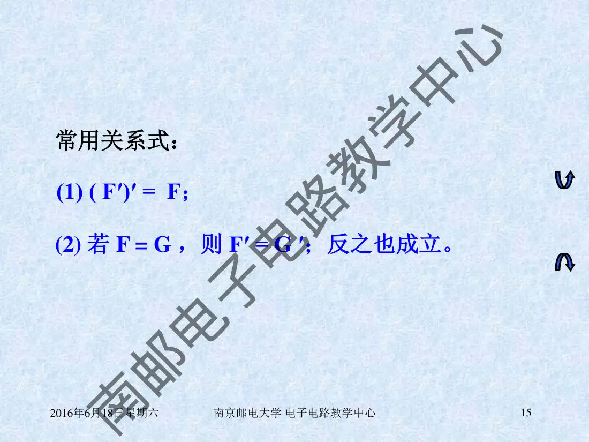

原文：

常用关系式：

(1) $( \mathrm { { F ^ { \prime } } } ) ^ { \prime } = \mathrm { { F } } ;$ ；

(2) 若 F = G ，则 F′ = G ′；反之也成立。

2016年6月18日星期六

南京邮电大学 电子电路教学中心

15

### 2016年6月18日星期六 南京邮电大学 电子电路教学中心

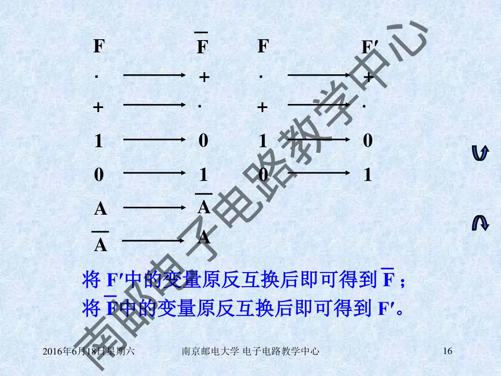

原文：

将 F′中的变量原反互换后即可得到 F ；将 F中的变量原反互换后即可得到 F′。

2016年6月18日星期六 南京邮电大学 电子电路教学中心

16

### 例2：已知 F = A⊕B ，则其反函数可写为：

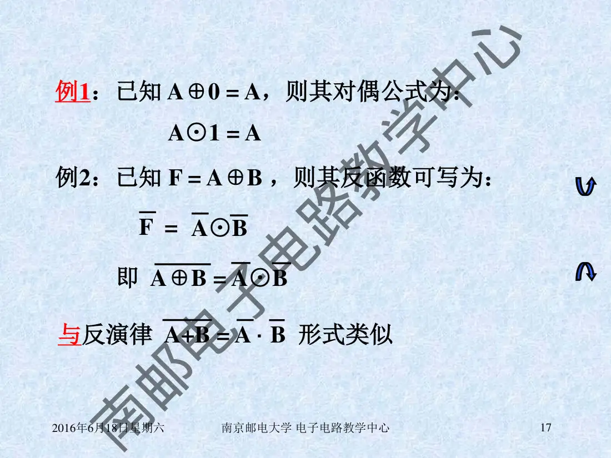

原文：

U

例1：已知 $\mathbf { A } \oplus \mathbf { 0 } = \mathbf { A }$ ，则其对偶公式为：A⊙1 = A

例2：已知 F = A⊕B ，则其反函数可写为：

$$
\overline {{\mathbf {F}}} = \overline {{\mathbf {A}}} \odot \overline {{\mathbf {B}}}
$$

即 $\overline { { \mathbf { A } \oplus \mathbf { B } } } = \overline { { \mathbf { A } } } \textcircled { \cdot } \overline { { \mathbf { B } } }$

与反演律 $\frac { 1 } { A + B } = \frac { 1 } { A } \cdot \frac { 1 } { B }$ 形式类似

2016年6月18日星期六

南京邮电大学 电子电路教学中心

17

### 2016年6月18日星期六

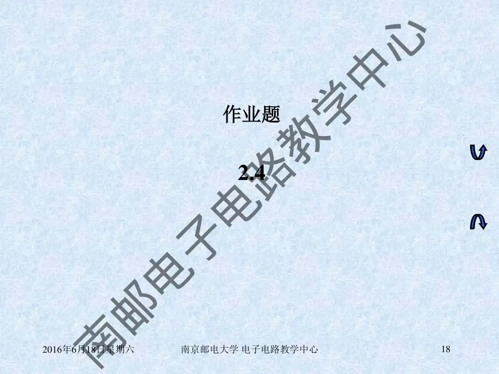

原文：

2016年6月18日星期六

南京邮电大学 电子电路教学中心

18
