# 《数字电路与系统设计》第二章 逻辑代数基础（课件）

原件的每一页，下面附识别出的文字。

### 第二章 逻辑代数基础

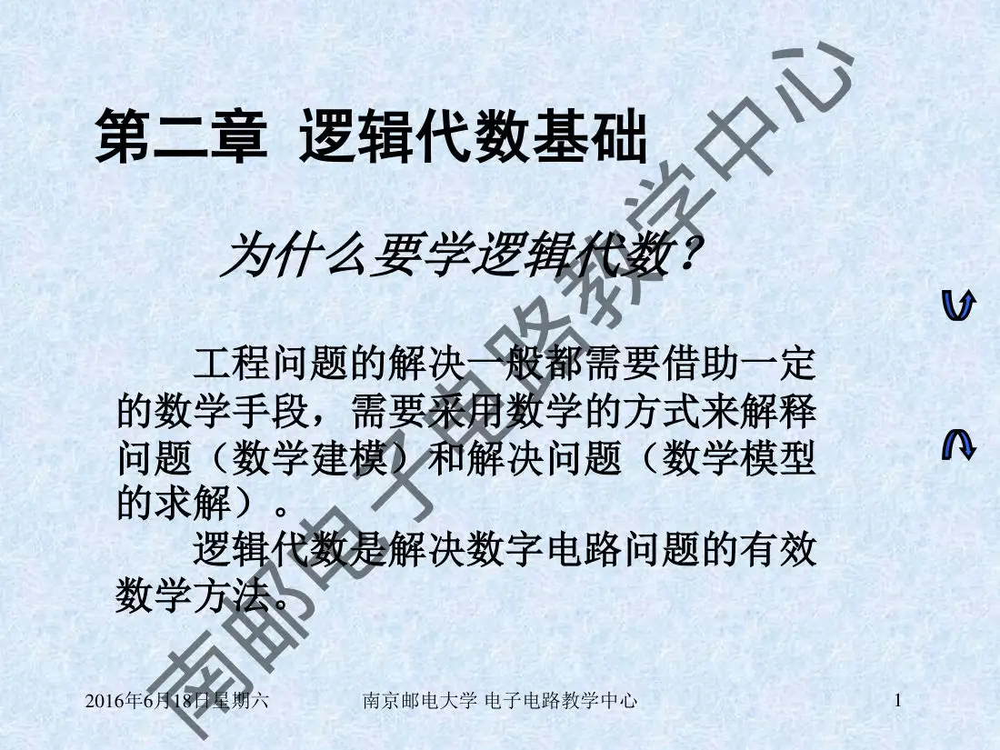

原文：

第二章 逻辑代数基础

为什么要学逻辑代数？

工程问题的解决一般都需要借助一定的数学手段，需要采用数学的方式来解释问题（数学建模）和解决问题（数学模型的求解）。

逻辑代数是解决数字电路问题的有效数学方法。

2016年6月18日星期六

南京邮电大学 电子电路教学中心

1

### 第二章 逻辑代数基础

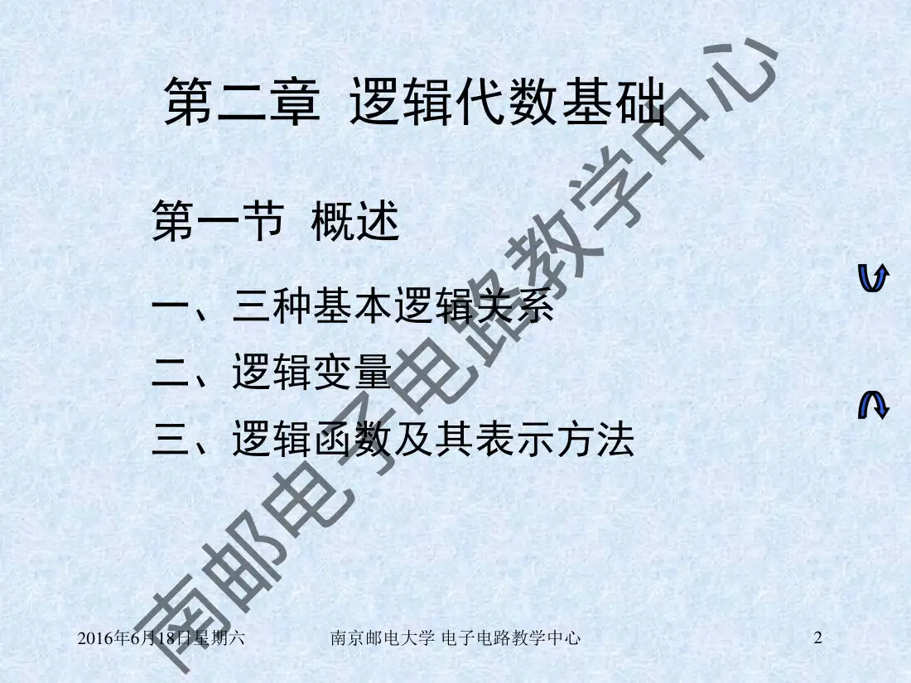

原文：

第二章 逻辑代数基础
第一节 概述
一、三种基本逻辑关系
二、逻辑变量
三、逻辑函数及其表示方法

2016年6月18日星期六 南京邮电大学 电子电路教学中心

2

### 一、三种基本逻辑关系

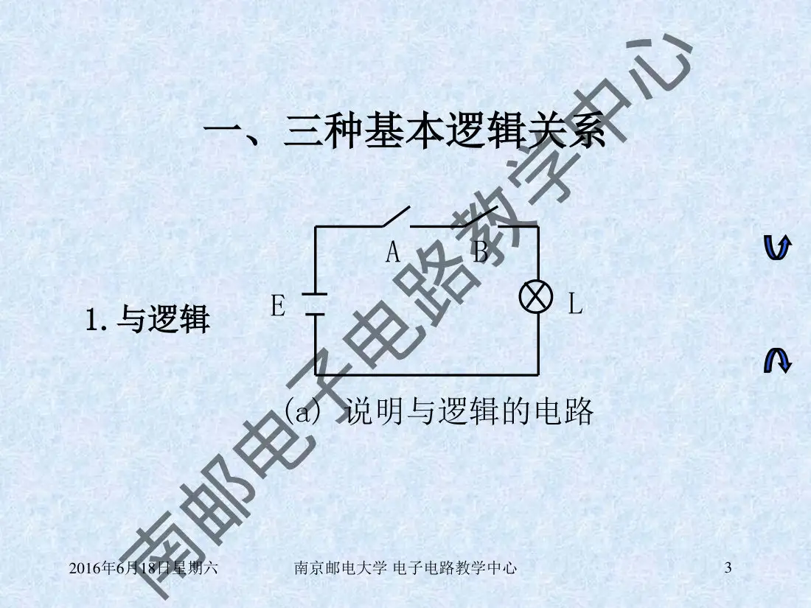

原文：

一、三种基本逻辑关系

1.与逻辑

(a) 说明与逻辑的电路

2016年6月18日星期六

南京邮电大学 电子电路教学中心

3

### 2.或逻辑

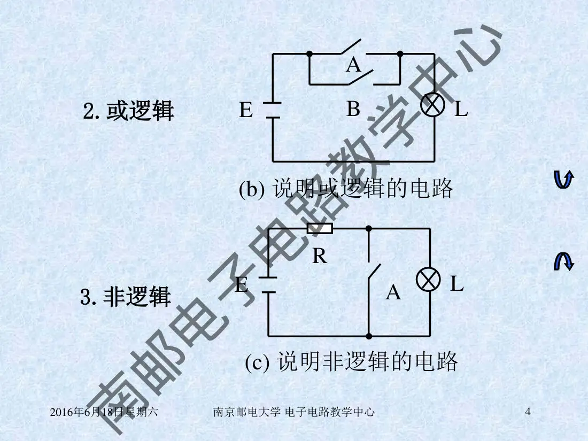

原文：

2.或逻辑

(b) 说明或逻辑的电路

3.非逻辑

(c) 说明非逻辑的电路

2016年6月18日星期六

南京邮电大学 电子电路教学中心

4

### 二、逻辑变量

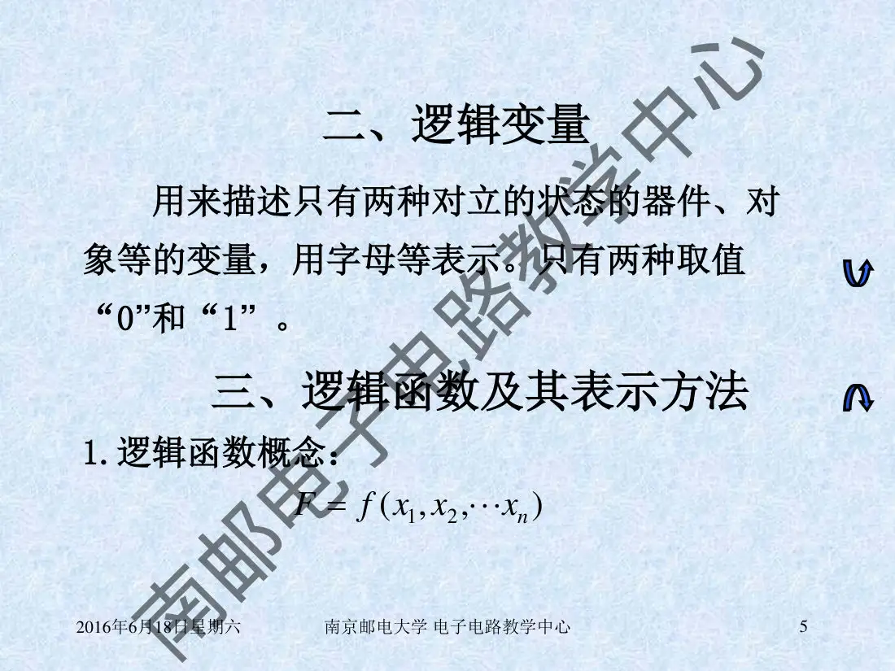

原文：

U

二、逻辑变量

用来描述只有两种对立的状态的器件、对象等的变量，用字母等表示。只有两种取值“0”和“1” 。

三、逻辑函数及其表示方法

1.逻辑函数概念：

$$
F = f (x _ {1}, x _ {2}, \dots x _ {n})
$$

2016年6月18日星期六

南京邮电大学 电子电路教学中心

5

### 2.真值表：

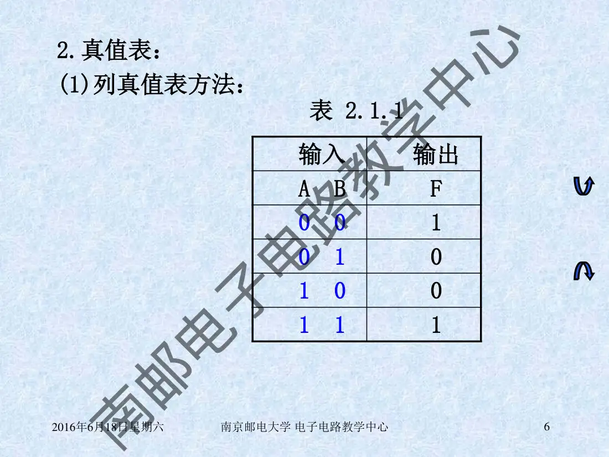

原文：

2.真值表：

(1)列真值表方法：

表 2.1.1

<table><tr><td>输入</td><td>输出</td></tr><tr><td>A B</td><td>F</td></tr><tr><td>0 0</td><td>1</td></tr><tr><td>0 1</td><td>0</td></tr><tr><td>1 0</td><td>0</td></tr><tr><td>1 1</td><td>1</td></tr></table>

2016年6月18日星期六

南京邮电大学 电子电路教学中心

6

### 例：如下图所示，用两个“单刀双掷”开关控制楼道灯，试列出该电路的真值表。

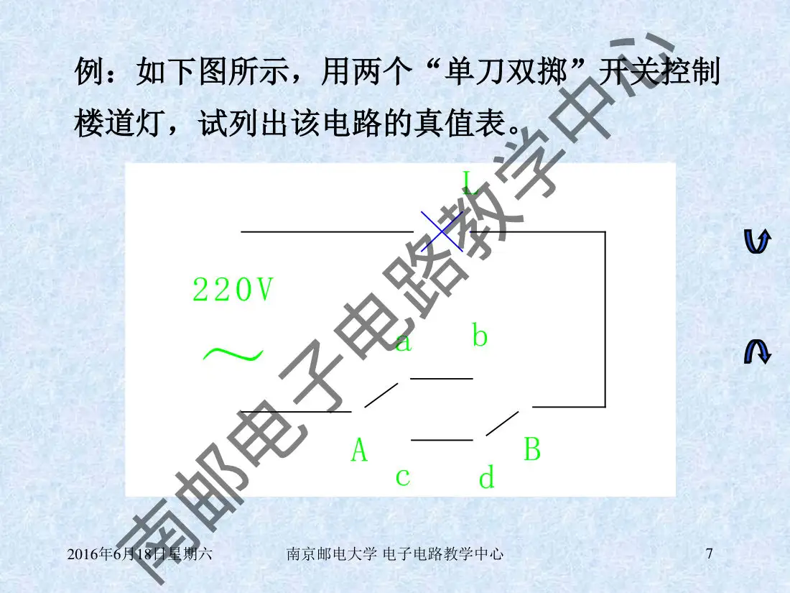

原文：

例：如下图所示，用两个“单刀双掷”开关控制楼道灯，试列出该电路的真值表。

2016年6月18日星期六

南京邮电大学 电子电路教学中心

7

### 输入输出X1x2y001010100111

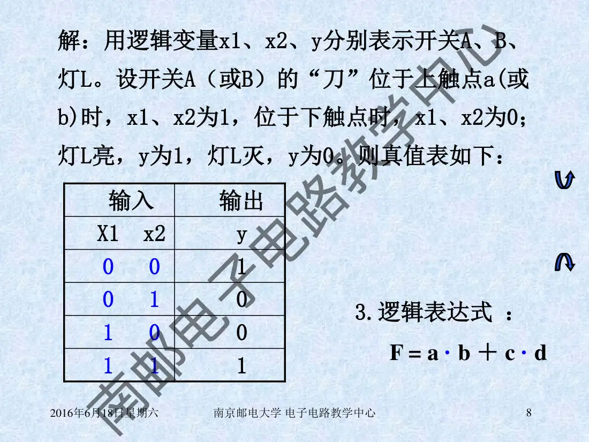

原文：

解：用逻辑变量x1、x2、y分别表示开关A、B、灯L。设开关A（或B）的“刀”位于上触点a(或b)时，x1、x2为1，位于下触点时，x1、x2为0；灯L亮，y为1，灯L灭，y为0。则真值表如下：

<table><tr><td colspan="2">输入</td><td>输出</td></tr><tr><td>X1</td><td>x2</td><td>y</td></tr><tr><td>0</td><td>0</td><td>1</td></tr><tr><td>0</td><td>1</td><td>0</td></tr><tr><td>1</td><td>0</td><td>0</td></tr><tr><td>1</td><td>1</td><td>1</td></tr></table>

U

A

3.逻辑表达式 ：

$$
\mathbf {F} = \mathbf {a} \cdot \mathbf {b} + \mathbf {c} \cdot \mathbf {d}
$$

2016年6月18日星期六

南京邮电大学 电子电路教学中心

8

### 第二章 逻辑代数基础第二节 逻辑代数中的运算一、三种基本逻辑运算二、复合逻辑运算

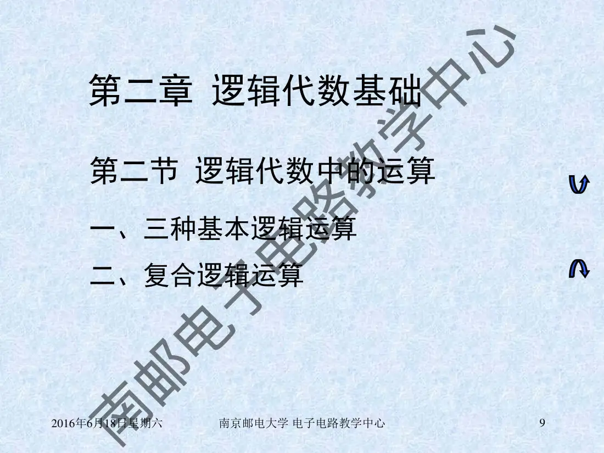

原文：

第二章 逻辑代数基础第二节 逻辑代数中的运算一、三种基本逻辑运算二、复合逻辑运算

2016年6月18日星期六 南京邮电大学 电子电路教学中心

9

### 一、三种基本逻辑运算

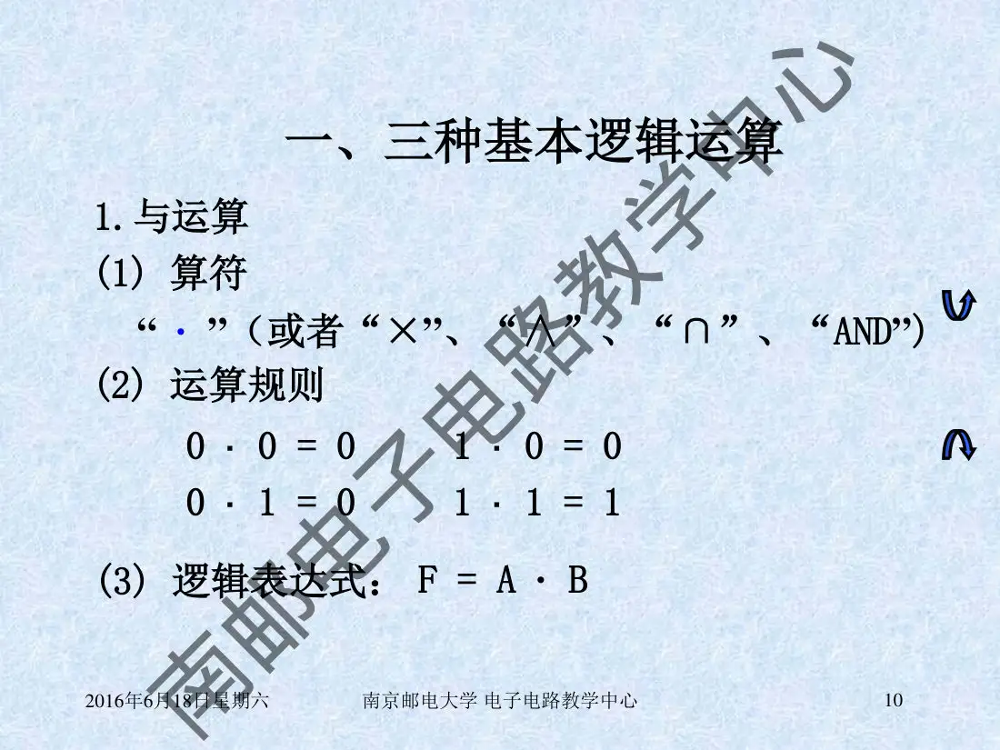

原文：

一、三种基本逻辑运算

1.与运算

(1) 算符

“ · ”（或者 $^ { 6 6 } \times ^ { , 9 9 }$

$$
" \cap " 、" A N D")
$$

(2) 运算规则

$$
0 \cdot 0 = 0
$$

$$
1 \cdot 0 = 0
$$

$$
0 \cdot 1 = 0
$$

$$
1 \cdot 1 = 1
$$

(3) 逻辑表达式： F = A · B

2016年6月18日星期六

南京邮电大学 电子电路教学中心

10

### (4) 逻辑符号

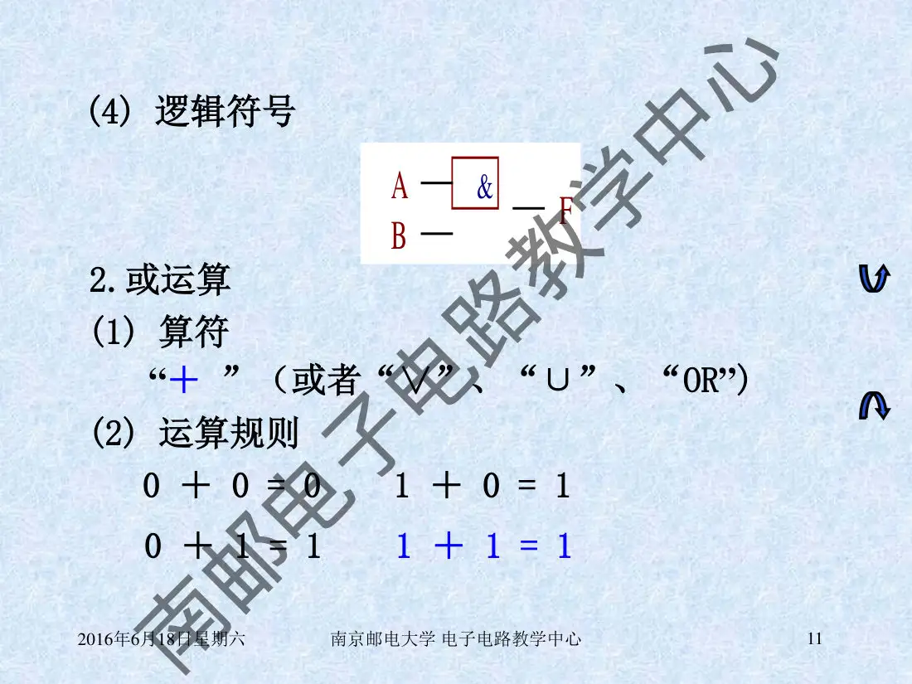

原文：

(4) 逻辑符号

2.或运算

(1) 算符

(2) 运算规则

$$
0 + 0 = 0
$$

$$
0 + 1 = 1
$$

$$
1 + 0 = 1
$$

$$
1 + 1 = 1
$$

2016年6月18日星期六

南京邮电大学 电子电路教学中心

11

### (4) 逻辑符号

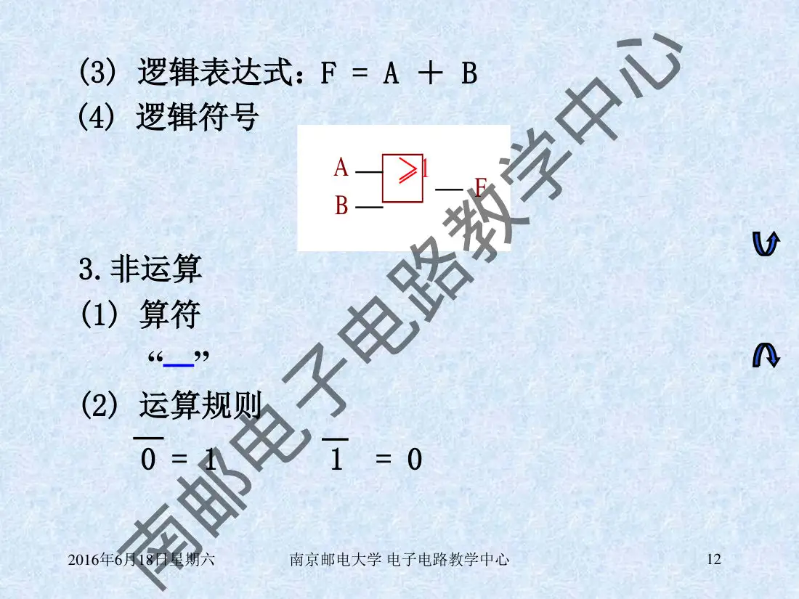

原文：

U

(3) 逻辑表达式： $F = \mathsf { A } + \mathsf { B }$

(4) 逻辑符号

$$
\begin{array}{c} \text { A } \\ \text { B } \end{array} \boxed {>} 1
$$

3.非运算

(1) 算符

“—”

(2) 运算规则

$$
\overline {{0}} = 1
$$

$$
\overline {{1}} = 0
$$

2016年6月18日星期六

南京邮电大学 电子电路教学中心

12

### (3) 逻辑表达式： F = A

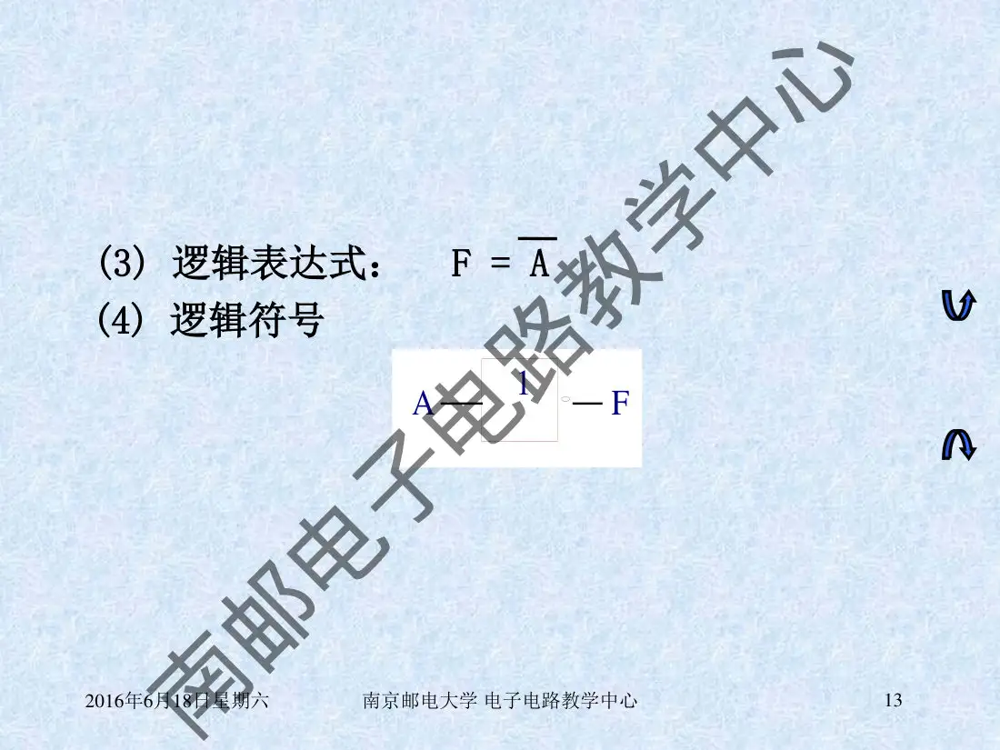

原文：

(3) 逻辑表达式： F = A

(4) 逻辑符号

2016年6月18日星期六

南京邮电大学 电子电路教学中心

13

### 4. 真值表

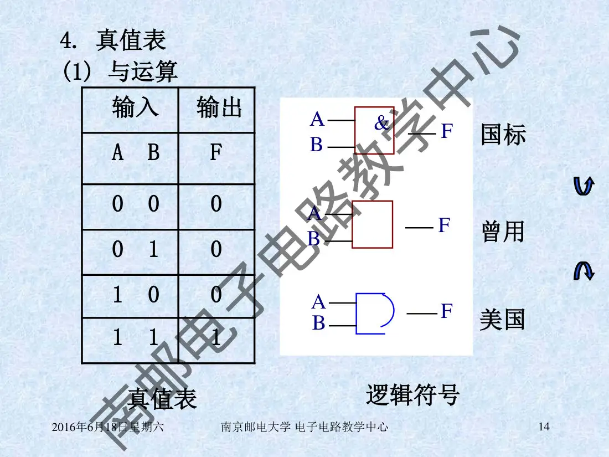

原文：

4. 真值表

(1) 与运算

<table><tr><td colspan="2">输入</td><td>输出</td></tr><tr><td>A</td><td>B</td><td>F</td></tr><tr><td>0</td><td>0</td><td>0</td></tr><tr><td>0</td><td>1</td><td>0</td></tr><tr><td>1</td><td>0</td><td>0</td></tr><tr><td>1</td><td>1</td><td>1</td></tr></table>

真值表

国标

曾用

美国

逻辑符号

2016年6月18日星期六

南京邮电大学 电子电路教学中心

14

### (2) 或运算

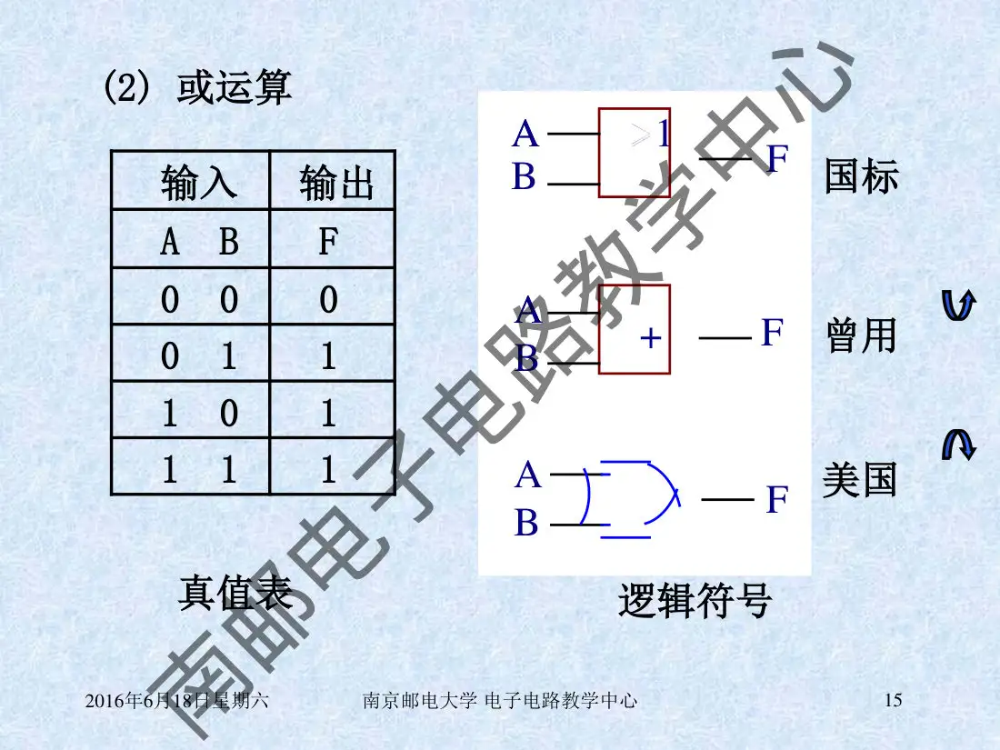

原文：

(2) 或运算

<table><tr><td colspan="2">输入</td><td>输出</td></tr><tr><td>A</td><td>B</td><td>F</td></tr><tr><td>0</td><td>0</td><td>0</td></tr><tr><td>0</td><td>1</td><td>1</td></tr><tr><td>1</td><td>0</td><td>1</td></tr><tr><td>1</td><td>1</td><td>1</td></tr></table>

真值表

A B

逻辑符号

国标

曾用

美国

A

2016年6月18日星期六

南京邮电大学 电子电路教学中心

15

### (3) 非运算

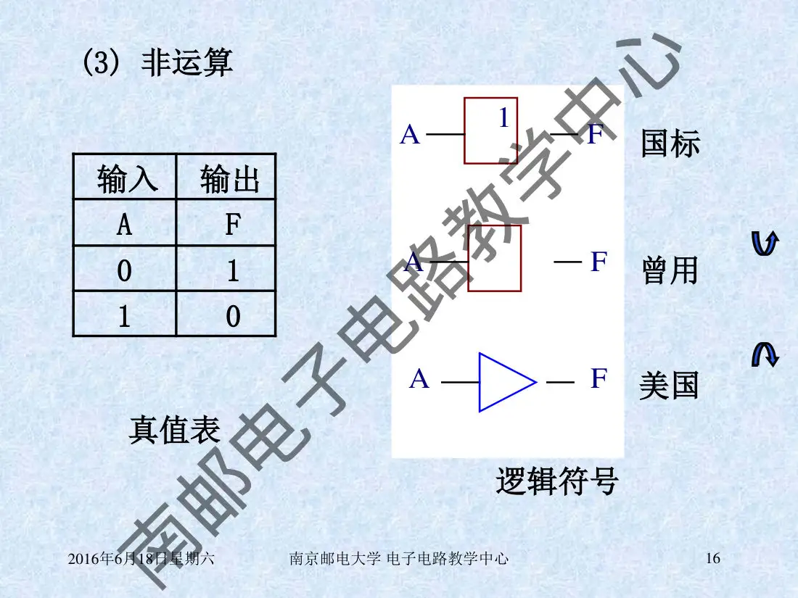

原文：

(3) 非运算

<table><tr><td>输入</td><td>输出</td></tr><tr><td>A</td><td>F</td></tr><tr><td>0</td><td>1</td></tr><tr><td>1</td><td>0</td></tr></table>

真值表

国标

曾用

美国

逻辑符号

2016年6月18日星期六

南京邮电大学 电子电路教学中心

16

### 二、复合逻辑运算

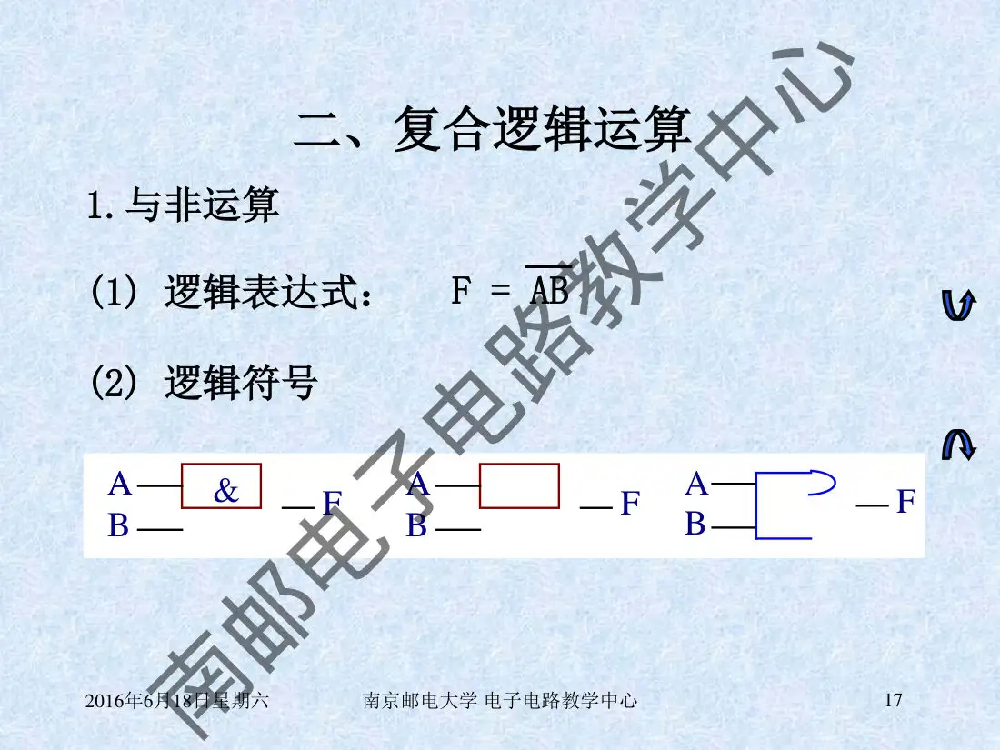

原文：

二、复合逻辑运算

1.与非运算

(1) 逻辑表达式：

(2) 逻辑符号

2016年6月18日星期六

南京邮电大学 电子电路教学中心

17

### 2.或非运算

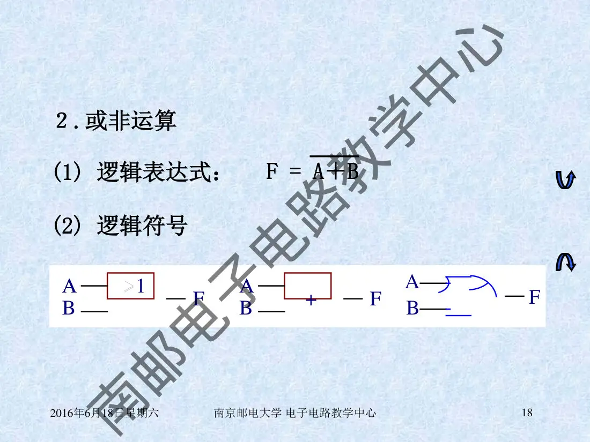

原文：

2.或非运算

(1) 逻辑表达式： F = A＋B

(2) 逻辑符号

2016年6月18日星期六

南京邮电大学 电子电路教学中心

18

### 3.与或非运算

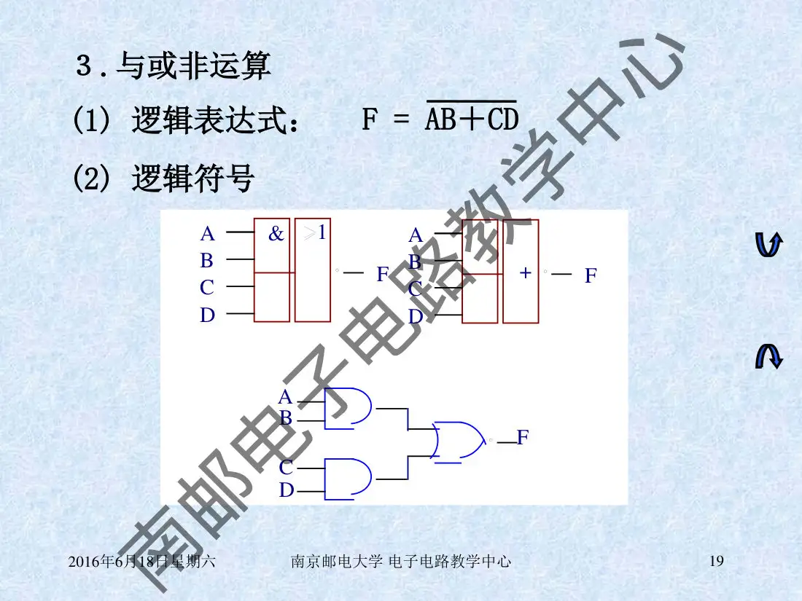

原文：

3.与或非运算

(1) 逻辑表达式： $F = \overline { { \mathbf { A B } + \mathbf { C D } } }$

(2) 逻辑符号

2016年6月18日星期六

南京邮电大学 电子电路教学中心

19

### 4.异或运算

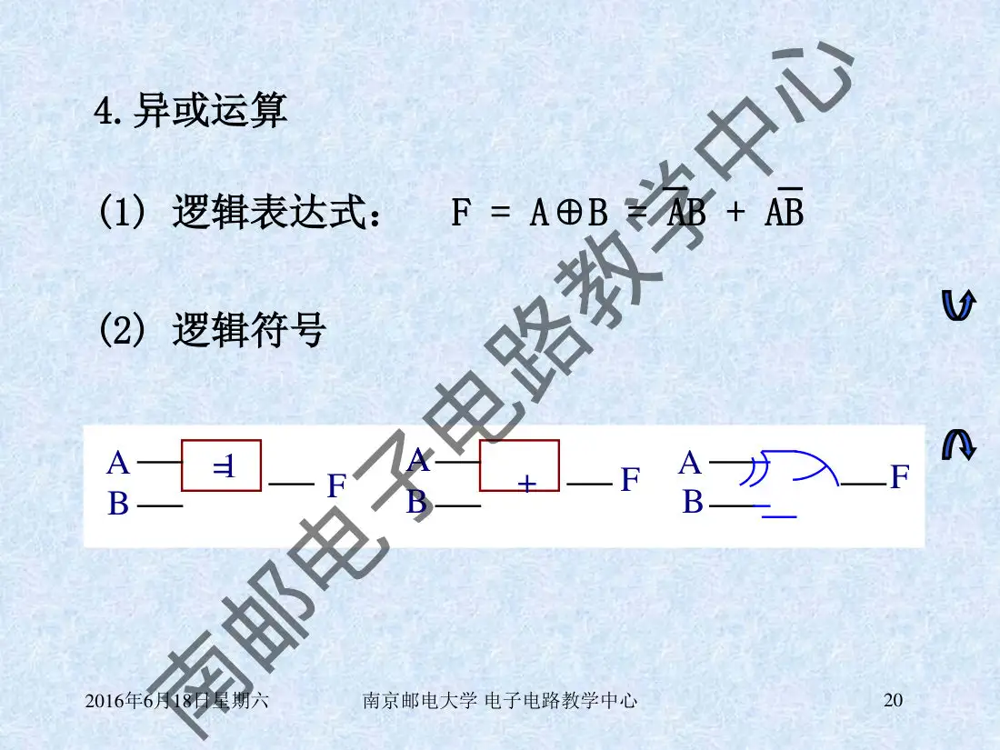

原文：

4.异或运算

(1) 逻辑表达式： $\mathsf { F } = \mathsf { A } \oplus \mathsf { B }$ = AB + AB

(2) 逻辑符号

2016年6月18日星期六

南京邮电大学 电子电路教学中心

20

### 5.同或运算

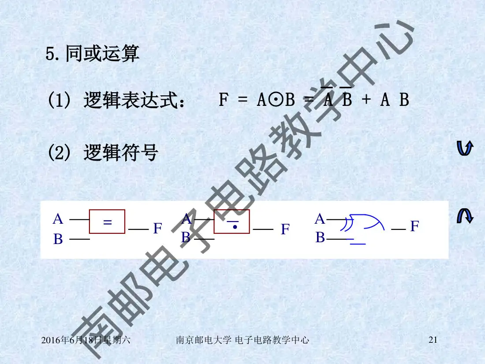

原文：

5.同或运算

(1) 逻辑表达式： $F = \Delta \odot \mathbf { B }  N B + A B$

(2) 逻辑符号

2016年6月18日星期六

南京邮电大学 电子电路教学中心

21

### 2016年6月18日星期六

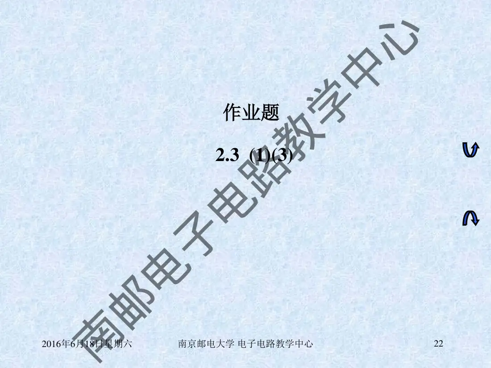

原文：

2016年6月18日星期六

南京邮电大学 电子电路教学中心

22
