# 《数字电路与系统设计》第二章 逻辑函数的公式化简与最小项表达式（课件）

原件的每一页，下面附识别出的文字。

### 第六节 逻辑函数的化简一、化简的意义和最简的标准：

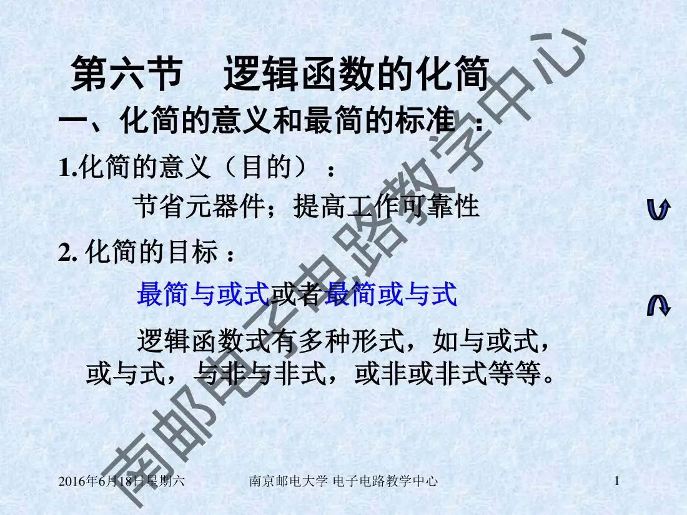

原文：

第六节 逻辑函数的化简一、化简的意义和最简的标准：

1. 化简的意义（目的）：

节省元器件；提高工作可靠性

2. 化简的目标：

最简与或式或者最简或与式

逻辑函数式有多种形式，如与或式，或与式，与非与非式，或非或非式等等。

2016年6月18日星期六

南京邮电大学 电子电路教学中心

1

### $$

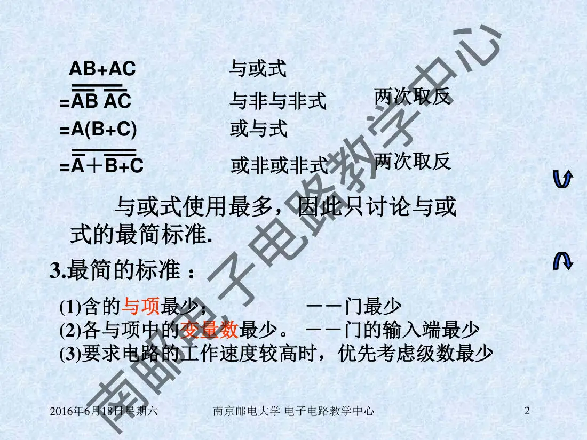

原文：

$$
A B + A C
$$

与或式

$$
= \overline {{\overline {{A B}}}} \overline {{\overline {{A C}}}}
$$

与非与非式

两次取反

$$
= A (B + C)
$$

或与式

$$
= \overline {{\overline {{A}} + \overline {{B + C}}}}
$$

或非或非式

两次取反

与或式使用最多，因此只讨论与或式的最简标准。

3.最简的标准：

(1)含的与项最少；——门最少

(2)各与项中的变量数最少。——门的输入端最少

(3)要求电路的工作速度较高时，优先考虑级数最少

2016年6月18日星期六

南京邮电大学 电子电路教学中心

2

### 二、公式法

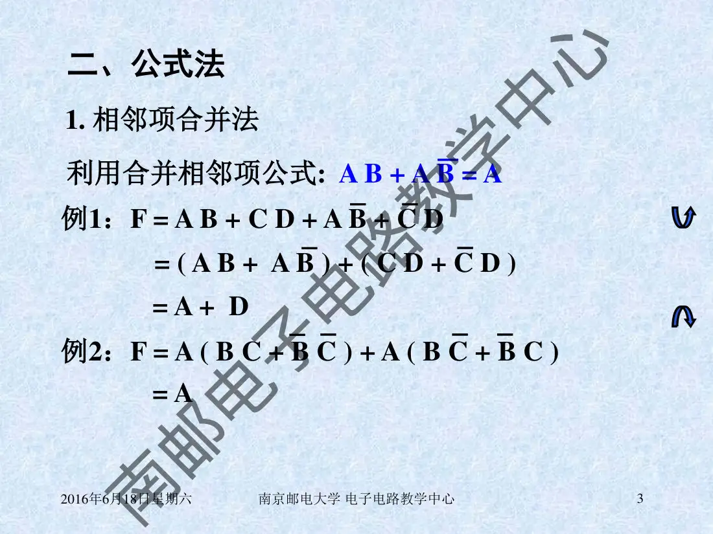

原文：

二、公式法

1. 相邻项合并法

利用合并相邻项公式: $\mathrm{AB} + \mathrm{A}\overline{\mathrm{B}} = \mathrm{A}$

例1: $\mathbf{F} = \mathbf{A}\mathbf{B} + \mathbf{C}\mathbf{D} + \mathbf{A}\overline{\mathbf{B}} +\overline{\mathbf{C}}\mathbf{D}$ $= (\mathbf{A}\mathbf{B} + \mathbf{A}\overline{\mathbf{B}}) + (\mathbf{C}\mathbf{D} + \overline{\mathbf{C}}\mathbf{D})$ $= \mathbf{A} + \mathbf{D}$

例2: $\mathbf{F} = \mathbf{A}(\mathbf{B}\mathbf{C} + \overline{\mathbf{B}}\overline{\mathbf{C}}) + \mathbf{A}(\mathbf{B}\overline{\mathbf{C}} + \overline{\mathbf{B}}\mathbf{C})$ $= \mathbf{A}$

2016年6月18日星期六

南京邮电大学 电子电路教学中心

3

### 练习：用并项法化简下列逻辑函数

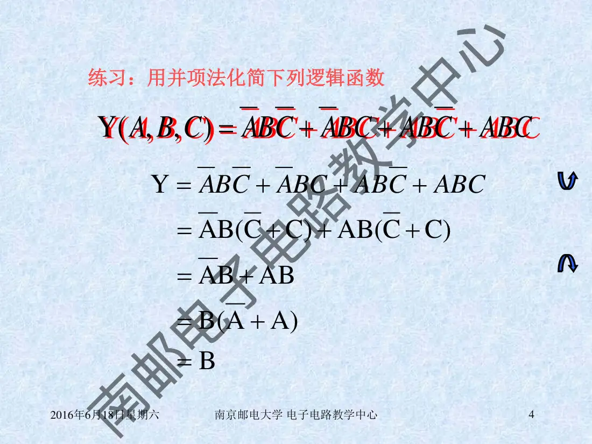

原文：

A

练习：用并项法化简下列逻辑函数

$$
\mathrm{Y} (A, B, C) = \overline {{A}} \overline {{B}} \overline {{C}} + \overline {{A}} \overline {{B}} C + A \overline {{B}} \overline {{C}} + A B C
$$

$$
\begin{array}{r l} \mathrm{Y} & = \overline {{A}} B \overline {{C}} + \overline {{A}} B C + A B \overline {{C}} + A B C \\ & = \overline {{A}} B (\overline {{C}} + C) + A B (\overline {{C}} + C) \\ & = \overline {{A}} B + A B \\ & = B (A + A) \\ & = B \end{array}\tag{U}
$$

2016年6月18日星期六

南京邮电大学 电子电路教学中心

4

### 练习:

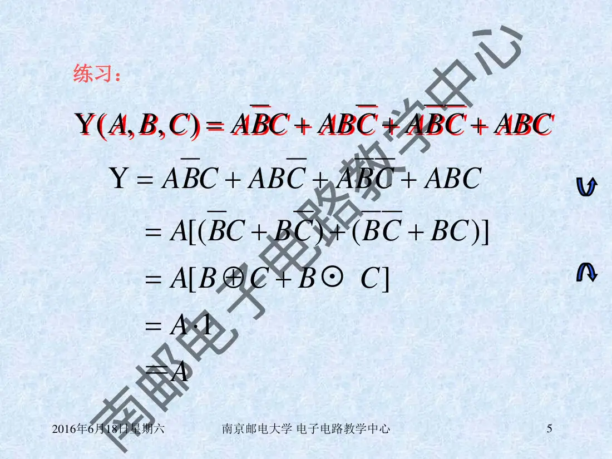

原文：

练习:

$$
\begin{array}{r l} & {\mathbf {Y} (A, B, C) = A \overline {{B}} C + A B \overline {{C}} + A \overline {{B}} \overline {{C}} + A B C} \\ & {\mathbf {Y} = A \overline {{B}} C + A B \overline {{C}} + A \overline {{B}} \overline {{C}} + A B C} \\ & {\qquad = A [ (\overline {{B}} C + B \overline {{C}}) + (\overline {{B}} \overline {{C}} + B C) ]} \\ & {\qquad = A [ B \oplus C + B \odot C ]} \\ & {\qquad = A \cdot 1} \end{array}\tag{U}
$$

2016年6月18日星期六

南京邮电大学 电子电路教学中心

5

### 2. 消项法

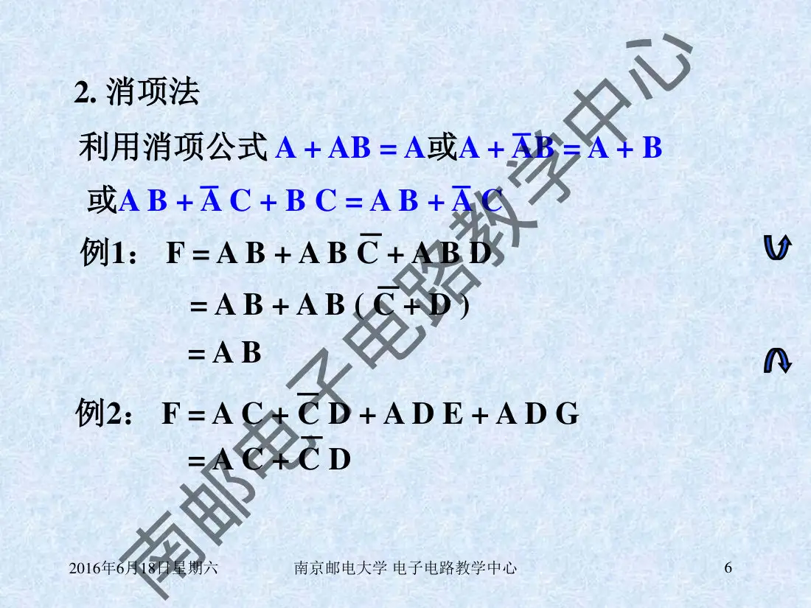

原文：

U

2. 消项法

利用消项公式 $\mathbf{A} + \mathbf{A}\mathbf{B} = \mathbf{A}$ 或 $\mathbf{A} + \overline{\mathbf{A}}\mathbf{B} = \mathbf{A} + \mathbf{B}$

或 $\mathbf{A}\mathbf{B} + \overline{\mathbf{A}}\mathbf{C} + \mathbf{B}\mathbf{C} = \mathbf{A}\mathbf{B} + \overline{\mathbf{A}}\mathbf{C}$

例1: $\mathbf{F} = \mathbf{A}\mathbf{B} + \mathbf{A}\mathbf{B}\overline{\mathbf{C}} +\mathbf{A}\mathbf{B}\mathbf{D}$ $= \mathbf{A}\mathbf{B} + \mathbf{A}\mathbf{B}(\overline{\mathbf{C}} +\mathbf{D})$ $= \mathbf{A}\mathbf{B}$

例2: $\mathbf{F} = \mathbf{A}\mathbf{C} + \overline{\mathbf{C}}\mathbf{D} + \mathbf{A}\mathbf{D}\mathbf{E} + \mathbf{A}\mathbf{D}\mathbf{G}$ $= \mathbf{A}\mathbf{C} + \overline{\mathbf{C}}\mathbf{D}$

2016年6月18日星期六

南京邮电大学 电子电路教学中心

6

### 2016年6月18日星期六

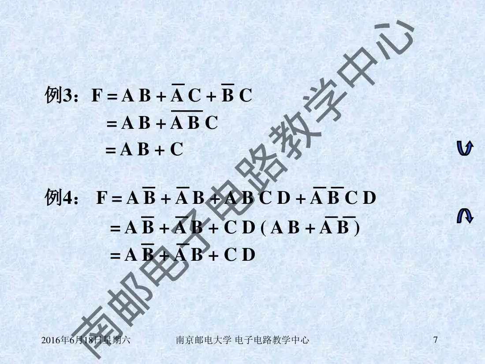

原文：

例3: $\mathbf{F} = \mathbf{A}\mathbf{B} + \overline{\mathbf{A}}\mathbf{C} + \overline{\mathbf{B}}\mathbf{C}$ $= \mathbf{A}\mathbf{B} + \overline{\mathbf{A}}\overline{\mathbf{B}}\mathbf{C}$ $= \mathbf{A}\mathbf{B} + \mathbf{C}$

U

例4: $\mathbf{F} = \mathbf{A}\overline{\mathbf{B}} +\overline{\mathbf{A}}\mathbf{B} + \mathbf{A}\mathbf{B}\mathbf{C}\mathbf{D} + \overline{\mathbf{A}}\overline{\mathbf{B}}\mathbf{C}\mathbf{D}$ $= \mathbf{A}\overline{\mathbf{B}} +\overline{\mathbf{A}}\mathbf{B} + \mathbf{C}\mathbf{D}(\mathbf{A}\mathbf{B} + \overline{\mathbf{A}}\overline{\mathbf{B}})$ $= \mathbf{A}\overline{\mathbf{B}} +\overline{\mathbf{A}}\mathbf{B} + \mathbf{C}\mathbf{D}$

2016年6月18日星期六

南京邮电大学 电子电路教学中心

7

### 练习:

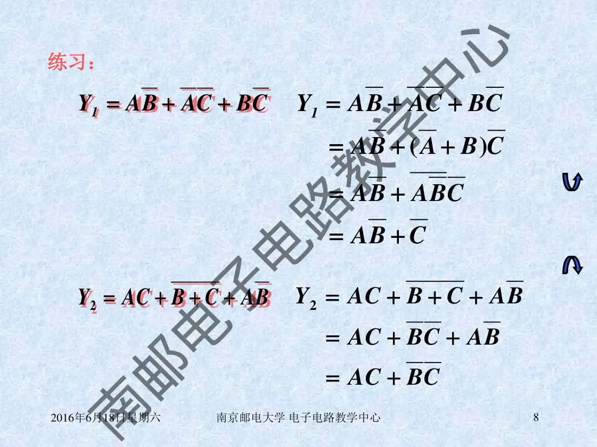

原文：

练习:

$$
\begin{array}{r l} {Y _ {1} = A \overline {{B}} + \overline {{A C}} + B \overline {{C}}} & {Y _ {1} = A \overline {{B}} + \overline {{A C}} + B \overline {{C}}} \\ & {= A \overline {{B}} + (\overline {{A}} + B) \overline {{C}}} \end{array}
$$

$$
= \overline {{A B}} + \overline {{A B C}}\tag{U}
$$

$$
= A B + C\tag{A}
$$

$$
\begin{array}{r l} Y _ {2} = A C + \overline {{B + C}} + A \overline {{B}} & Y _ {2} = A C + \overline {{B + C}} + A \overline {{B}} \\ & = A C + \overline {{B}} \overline {{C}} + A \overline {{B}} \\ & = A C + \overline {{B}} \overline {{C}} \end{array}
$$

2016年6月18日星期六

南京邮电大学 电子电路教学中心

8

### $$

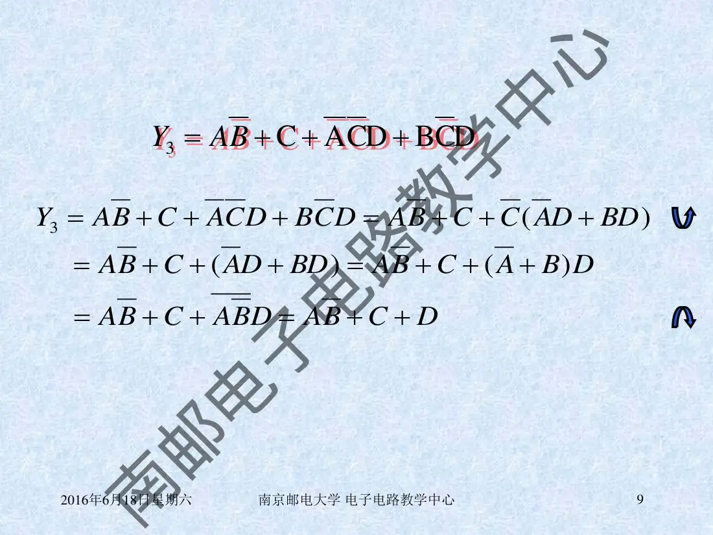

原文：

$$
Y _ {3} \equiv A \overline {{B}} + C + \overline {{A}} \overline {{C}} D + B \overline {{C}} D
$$

$$
\begin{array}{r l} {Y _ {3}} & {= A \overline {{B}} + C + \overline {{A}} \overline {{C}} D + B \overline {{C}} D = A \overline {{B}} + C + \overline {{C}} (\overline {{A}} D + B D)} \\ & {= A \overline {{B}} + C + (\overline {{A}} D + B D) = A \overline {{B}} + C + (\overline {{A}} + B) D} \\ & {= A \overline {{B}} + C + \overline {{A}} \overline {{B}} D = A \overline {{B}} + C + D} \end{array}
$$

2016年6月18日星期六

南京邮电大学 电子电路教学中心

9

### (3) 配项法

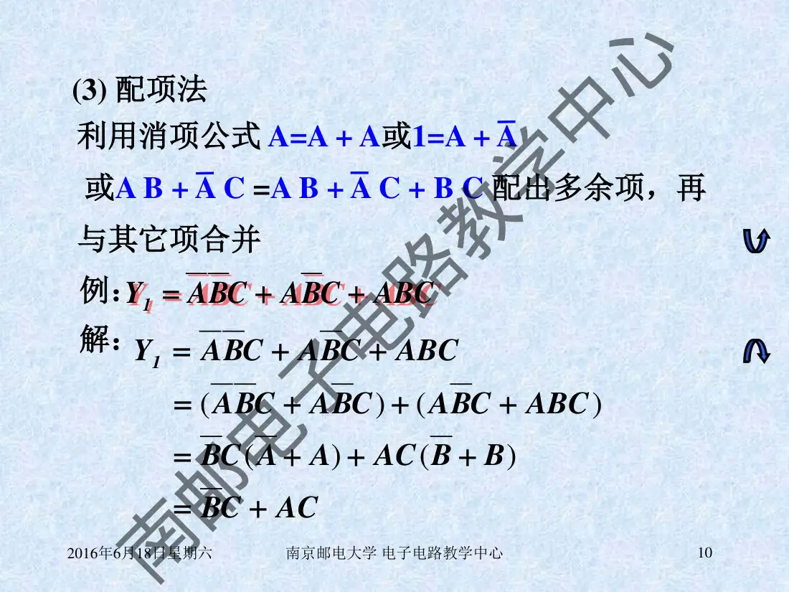

原文：

(3) 配项法

利用消项公式 $\mathbf{A} = \mathbf{A} + \mathbf{A}$ 或 $1 = \mathbf{A} + \overline{\mathbf{A}}$

或 $\mathbf{A} \mathbf{B} + \overline{\mathbf{A}} \mathbf{C} = \mathbf{A} \mathbf{B} + \overline{\mathbf{A}} \mathbf{C} + \mathbf{B} \mathbf{C}$ 配出多余项，再与其它项合并

例: $Y_{1} = \overline{A}\overline{B}C + A\overline{B}C + ABC$

$$
\begin{array}{r l} & Y _ {1} = \overline {{A}} \overline {{B}} C + A \overline {{B}} C + A B C \\ & \quad = (\overline {{A}} \overline {{B}} C + A \overline {{B}} C) + (A \overline {{B}} C + A B C) \\ & \quad = \overline {{B}} C (\overline {{A}} + A) + A C (\overline {{B}} + B) \\ & \quad = \overline {{B}} C + A C \end{array}
$$

2016年6月18日星期六

南京邮电大学 电子电路教学中心

10

### 练习:

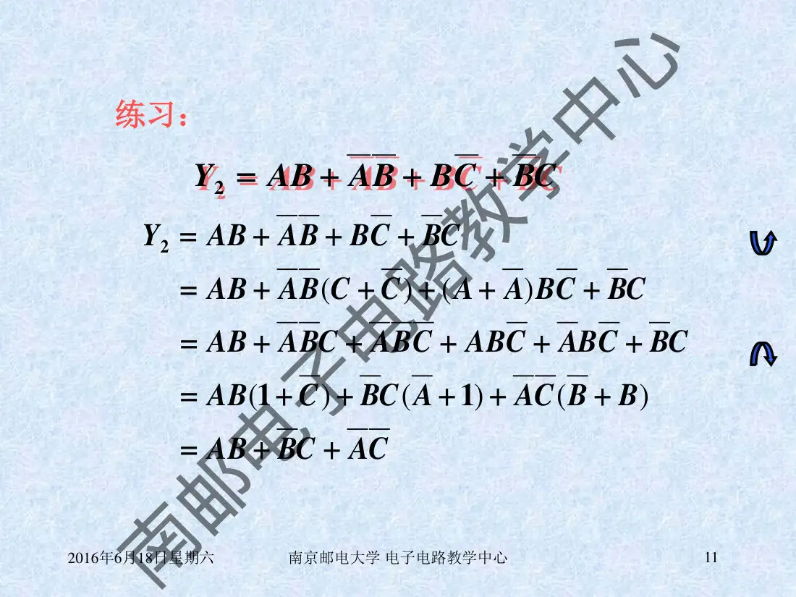

原文：

练习:

$$
Y _ {2} = A B + \overline {{A}} \overline {{B}} + B \overline {{C}} + \overline {{B}} C
$$

$$
\begin{array}{r l} & Y _ {2} = A B + \overline {{A}} \overline {{B}} + B \overline {{C}} + \overline {{B}} C \\ & = A B + \overline {{A}} \overline {{B}} (C + \overline {{C}}) + (A + \overline {{A}}) B \overline {{C}} + \overline {{B}} C \\ & = A B + \overline {{A}} \overline {{B}} C + \overline {{A}} B \overline {{C}} + A B \overline {{C}} + \overline {{A}} B \overline {{C}} + \overline {{B}} C \\ & = A B (1 + \overline {{C}}) + \overline {{B}} C (\overline {{A}} + 1) + \overline {{A}} \overline {{C}} (\overline {{B}} + B) \\ & = A B + \overline {{B}} C + \overline {{A}} \overline {{C}} \end{array}\tag{U}
$$

A

2016年6月18日星期六

南京邮电大学 电子电路教学中心

11

### 练习:

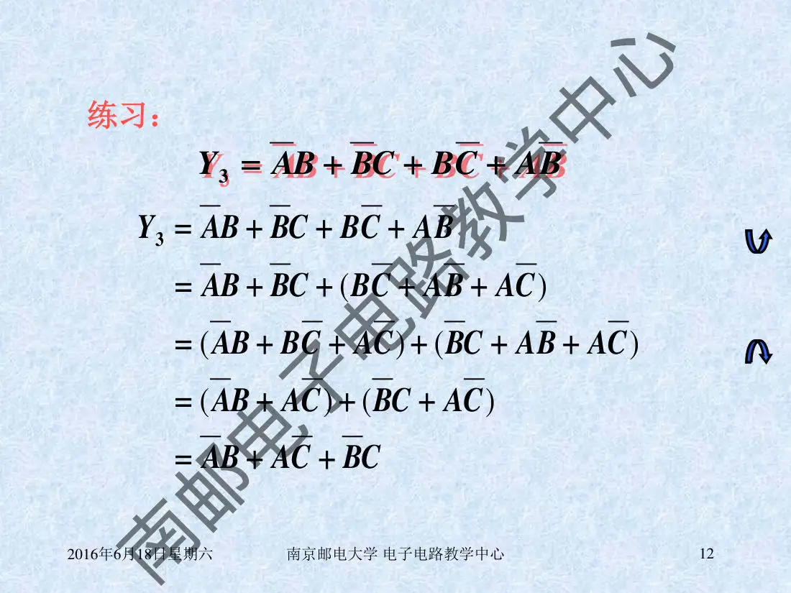

原文：

练习:

$$
\begin{array}{r l} & Y _ {3} = \overline {{A B}} + \overline {{B C}} + B \overline {{C}} + A \overline {{B}} \\ & Y _ {3} = \overline {{A B}} + \overline {{B C}} + B \overline {{C}} + A \overline {{B}} \\ & = \overline {{A B}} + \overline {{B C}} + (B \overline {{C}} + A \overline {{B}} + A \overline {{C}}) \\ & = (\overline {{A B}} + B \overline {{C}} + A \overline {{C}}) + (\overline {{B C}} + A \overline {{B}} + A \overline {{C}}) \\ & = (\overline {{A B}} + A \overline {{C}}) + (\overline {{B C}} + A \overline {{C}}) \\ & = \overline {{A B}} + A \overline {{C}} + \overline {{B C}} \end{array}\tag{U}
$$

2016年6月18日星期六

南京邮电大学 电子电路教学中心

12

### (4) 综合法

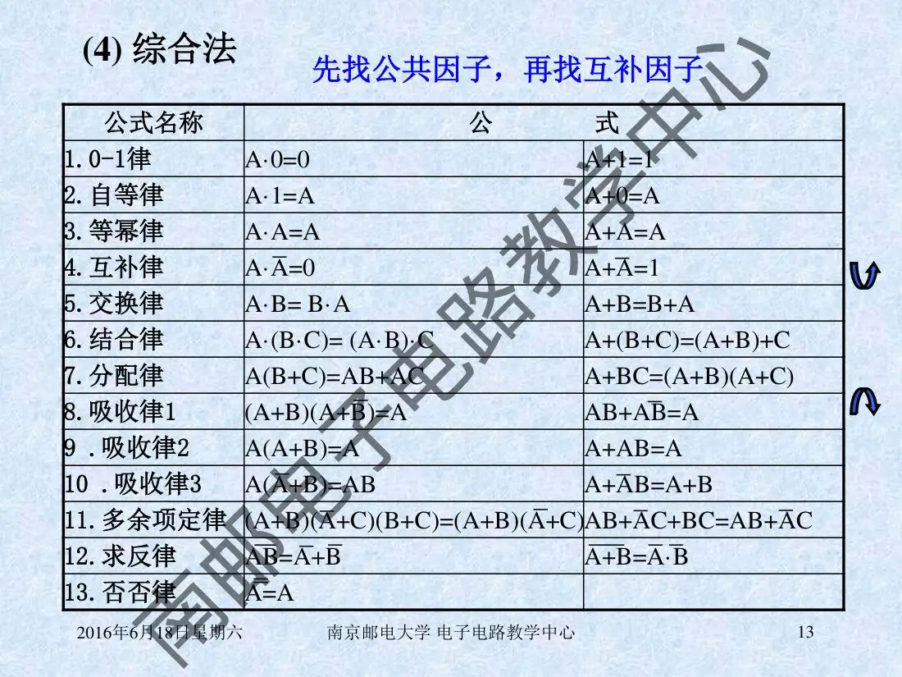

原文：

(4) 综合法

先找公共因子，再找互补因子

<table><tr><td>公式名称</td><td colspan="2">公式</td></tr><tr><td>1.0-1律</td><td>A·0=0</td><td>A+1=1</td></tr><tr><td>2.自等律</td><td>A·1=A</td><td>A+0=A</td></tr><tr><td>3.等幂律</td><td>A·A=A</td><td>A+A=A</td></tr><tr><td>4.互补律</td><td>A· $\overline{A}$ =0</td><td>A+ $\overline{A}$ =1</td></tr><tr><td>5.交换律</td><td>A·B=B·A</td><td>A+B=B+A</td></tr><tr><td>6.结合律</td><td>A·(B·C)=(A·B)·C</td><td>A+(B+C)=(A+B)+C</td></tr><tr><td>7.分配律</td><td>A(B+C)=AB+AC</td><td>A+BC=(A+B)(A+C)</td></tr><tr><td>8.吸收律1</td><td>(A+B)(A+ $\overline{B}$ )=A</td><td>AB+AB=B=A</td></tr><tr><td>9.吸收律2</td><td>A(A+B)=A</td><td>A+AB=A</td></tr><tr><td>10.吸收律3</td><td>A( $\overline{A}$ +B)=AB</td><td>A+ $\overline{A}$ B=A+B</td></tr><tr><td>11.多余项定律</td><td>(A+B)(A+C)(B+C)=(A+B)( $\overline{A}$ +C)</td><td>AB+ $\overline{A}$ C+BC=AB+ $\overline{A}$ C</td></tr><tr><td>12.求反律</td><td> $\overline{AB}$ = $\overline{A}$ + $\overline{B}$ </td><td> $\overline{A}$ + $\overline{B}$ = $\overline{A}$  $\cdot$  $\overline{B}$ </td></tr><tr><td>13.否否律</td><td> $\overline{A}$ =A</td><td></td></tr></table>

2016年6月18日星期六

南京邮电大学 电子电路教学中心

13

### 解法1

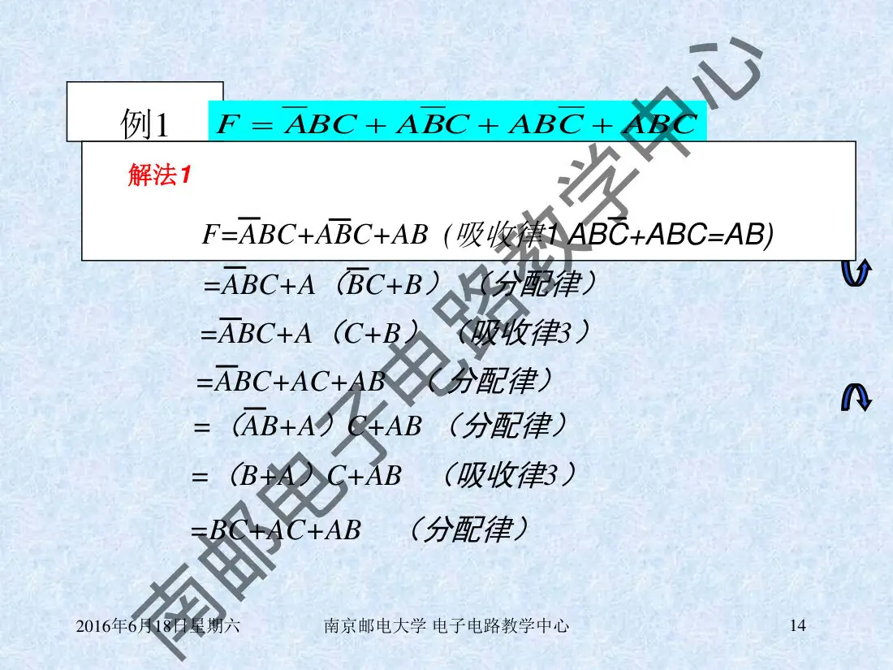

原文：

例1 $F = \overline{A} BC + A\overline{B} C + AB\overline{C} + ABC$

解法1

$F=\overline{A}BC+A\overline{B}C+AB$ （吸收律1 $ABC+\overline{A}BC=AB$ ）

$$
\begin{array}{r l} & = \overline {{A}} B C + A (\overline {{B}} C + B) \\ & = \overline {{A}} B C + A (C + B) \\ & = \overline {{A}} B C + A C + A B \\ & = (\overline {{A}} B + A) C + A B \\ & = (B + A) C + A B \end{array}
$$

(吸收律3)

分配律）

(分配律)

(吸收律3)

$$
= B C + A C + A B
$$

(分配律)

2016年6月18日星期六

南京邮电大学 电子电路教学中心

14

### $$

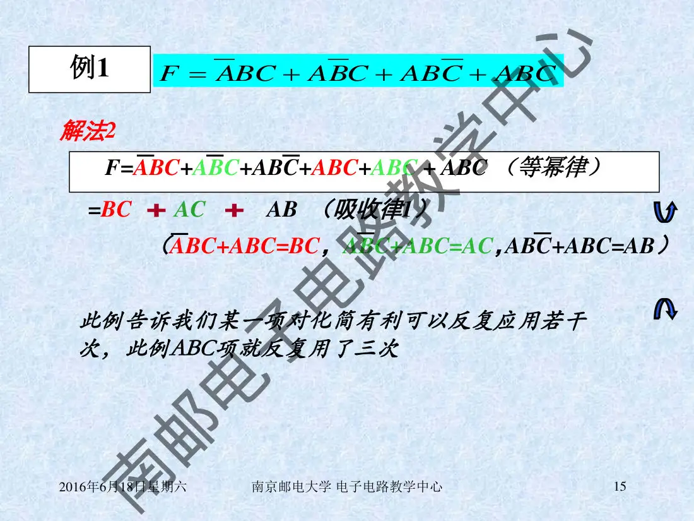

原文：

$$
F = \overline {{A}} B C + A \overline {{B}} C + A B \overline {{C}} + A B C
$$

解法2

$F=\overline{A}BC+AB\overline{B}C+AB\overline{C}+ABC+ABC+ABC$ （等幂律）

=BC + AC + AB （吸收律1）

$$
(A B C + A B C = B C)
$$

$$
+ A B C = A C, A B \overline {{{C}}} + A B C = A B)
$$

此例告诉我们某一项对化简有利可以反复应用若干次，此例ABC项就反复用了三次

2016年6月18日星期六

南京邮电大学 电子电路教学中心

15

### 2016年6月18日星期六

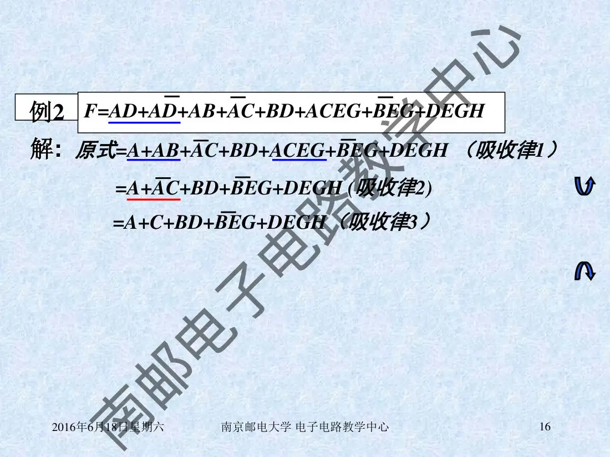

原文：

例2 $F=AD+AD+\overline{A}B+\overline{A}C+BD+ACEG+\overline{B}EG+DEGH$

解: 原式= $A+AB+A\overline{C}+BD+ACEG+\overline{B}EG+DEGH$ （吸收律1） $=A+\overline{A}C+BD+\overline{B}EG+DEGH$ （吸收律2） $=A+C+BD+\overline{B}EG+DEGH$ （吸收律3）

2016年6月18日星期六

南京邮电大学 电子电路教学中心

16

### 例3

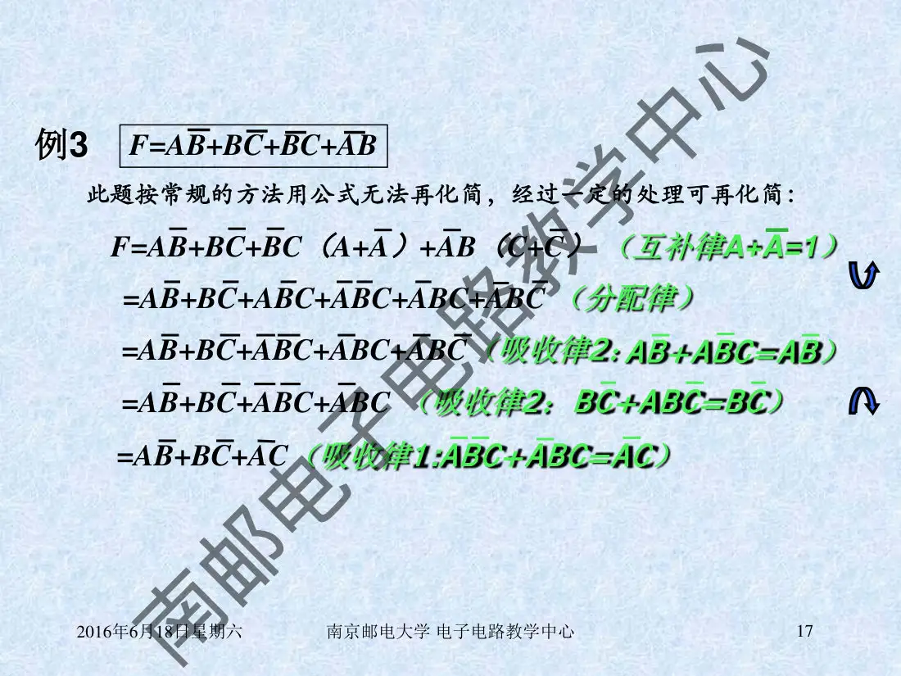

原文：

例3

$$
\boldsymbol {F} = \boldsymbol {A} \overline {{\boldsymbol {B}}} + \boldsymbol {B} \overline {{\boldsymbol {C}}} + \overline {{\boldsymbol {B}}} \boldsymbol {C} + \overline {{\boldsymbol {A}}} \boldsymbol {B}
$$

此题按常规的方法用公式无法再化简，经过一定的处理可再化简：

$$
\begin{array}{r l} & F = A \overline {{B}} + B \overline {{C}} + \overline {{B}} C (A + \overline {{A}}) + \overline {{A}} B (C + \overline {{C}}) (\text {互补律} A + \overline {{A}} = 1) \\ & = A \overline {{B}} + B \overline {{C}} + A \overline {{B}} C + \overline {{A}} \overline {{B}} C + \overline {{A}} B C + \overline {{A}} B \overline {{C}} (\text {分配律}) \\ & = A \overline {{B}} + B \overline {{C}} + \overline {{A}} \overline {{B}} \overline {{C}} + \overline {{A}} B C + \overline {{A}} B \overline {{C}} (\text {吸收律} 2: A \overline {{B}} + A \overline {{B}} C = A \overline {{B}}) \\ & = A \overline {{B}} + B \overline {{C}} + \overline {{A}} \overline {{B}} \overline {{C}} + \overline {{A}} B C (\text {吸收律} 2: B \overline {{C}} + A B \overline {{C}} = B \overline {{C}}) \\ & = A \overline {{B}} + B \overline {{C}} + \overline {{A}} C (\text {吸收律} 1: A \overline {{B}} C + A B C = A C) \end{array}
$$

2016年6月18日星期六

南京邮电大学 电子电路教学中心

17

### 公式化简法

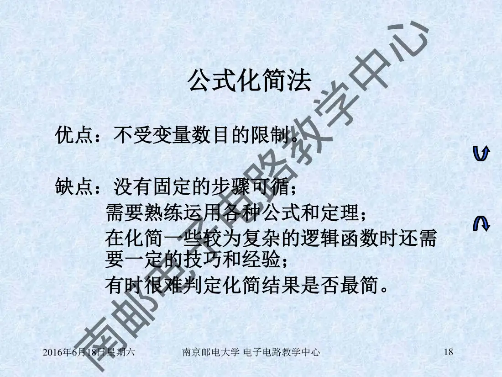

原文：

公式化简法

优点：不受变量数目的限制。

缺点：没有固定的步骤可循；需要熟练运用各种公式和定理；在化简一些较为复杂的逻辑函数时还需要一定的技巧和经验；有时很难判定化简结果是否最简。

2016年6月18日星期六 南京邮电大学 电子电路教学中心

18

### 第五节 逻辑函数的表达式

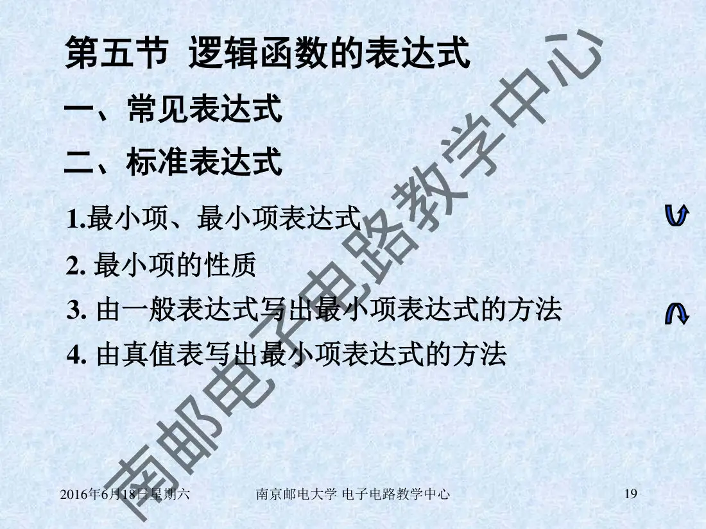

原文：

第五节 逻辑函数的表达式

一、常见表达式

二、标准表达式

1. 最小项、最小项表达式

2. 最小项的性质

3. 由一般表达式写出最小项表达式的方法

4. 由真值表写出最小项表达式的方法

2016年6月18日星期六

南京邮电大学 电子电路教学中心

19

### 一、常见表达式

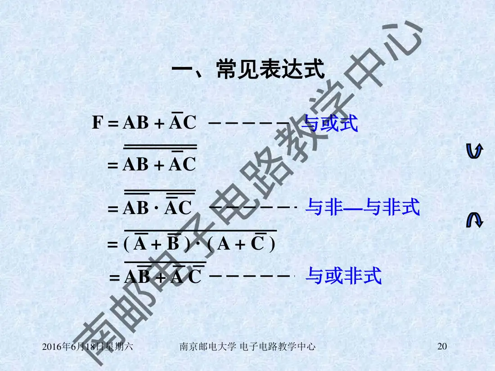

原文：

一、常见表达式

$$
\begin{array}{r l} & {\mathbf {F} = \mathbf {A B} + \overline {{\mathbf {A}}} \mathbf {C} \quad - - - - - - - - - - - - - - - - - - - - - - - - - - - - - - - - - - - - - - - - - - - - - - - - - - - - - - - - - - - - - - - - - - - - - - - - - - - } \\ & {\quad = \overline {{\mathbf {A B}}} + \overline {{\mathbf {A}}} \overline {{\mathbf {C}}}} \\ & {\quad = \overline {{\mathbf {A B}}} \cdot \overline {{\mathbf {A}}} \overline {{\mathbf {C}}}} \\ & {\quad = \overline {{(\overline {{\mathbf {A}}} + \overline {{\mathbf {B}}}) \cdot (\mathbf {A} + \overline {{\mathbf {C}}})}}} \\ & {\quad = \overline {{\mathbf {A}}} \overline {{\mathbf {B}}} + \overline {{\mathbf {A}}} \overline {{\mathbf {C}}} \quad - - - - - - - - - - - - - - - - - - - - - - - - - - - - -} \\ & {\quad = \text {与或非式}} \end{array}
$$

2016年6月18日星期六 南京邮电大学 电子电路教学中心

20

### $$

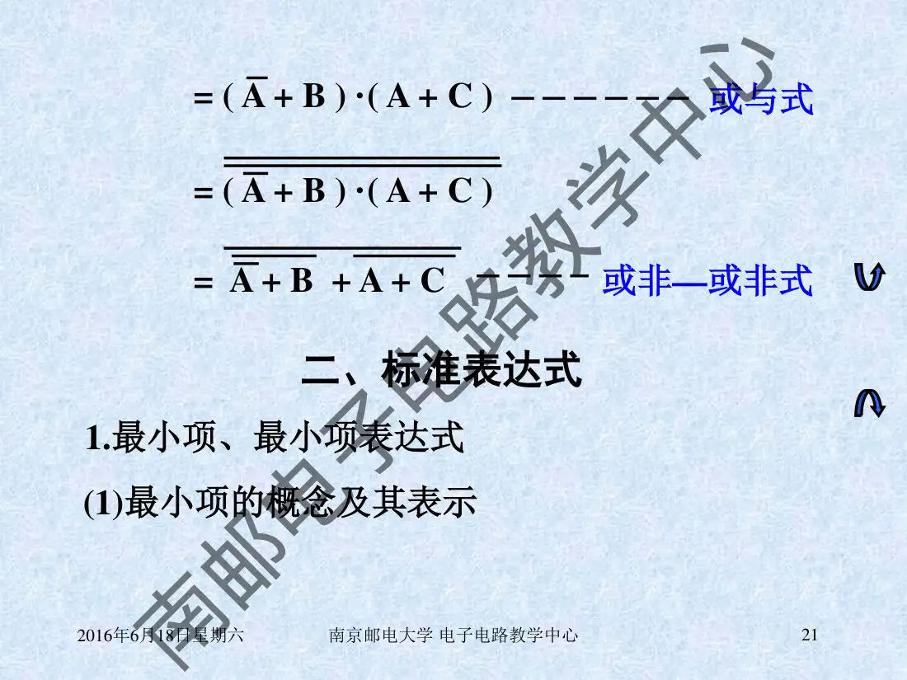

原文：

$$
= (\overline {{\mathbf {A}}} + \mathbf {B}) \cdot (\mathbf {A} + \mathbf {C}) - - - - - x ^ {\lambda}
$$

$$
= \overline {{(\overline {{\mathbf {A}}} + \mathbf {B}) \cdot (\mathbf {A} + \mathbf {C})}}
$$

$= \overline{\overline{A} + B} +\overline{A + C}$ 或非—或非式

二、标准表达式

1. 最小项、最小项表达式

(1)最小项的概念及其表示例1: 已知三变量函数 $F(A, B, C)$ , 则 $\overline{A} \overline{B} C$ 就是一个最小项, 通常写成 $\mathbf{m}_{5}$ 。

2016年6月18日星期六

南京邮电大学 电子电路教学中心

21

### 其中，m 表示最小项，5 表示最小项的编号

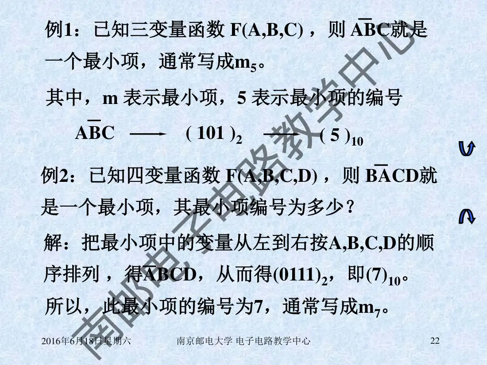

原文：

其中，m 表示最小项，5 表示最小项的编号

$$
\mathrm{ABC} \longrightarrow (1 0 1) _ {2} \xrightarrow {\text {代}} (5) _ {1 0}\tag{U}
$$

例2: 已知四变量函数 $F(A, B, C, D)$ , 则 $\overline{B} \overline{A} C D$ 就是一个最小项, 其最小项编号为多少?

解：把最小项中的变量从左到右按A,B,C,D的顺序排列，得ABCD，从而得(0111) $_{2}$ ，即(7) $_{10}$ 。所以，此最小项的编号为7，通常写成m $_{7}$ 。

2016年6月18日星期六

南京邮电大学 电子电路教学中心

22

### (2)最小项表达式（标准与或式）

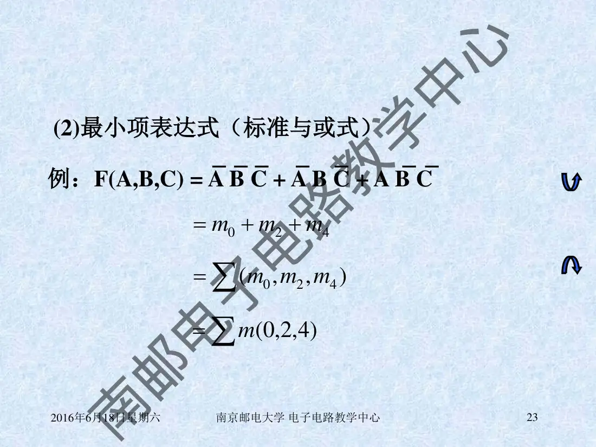

原文：

(2)最小项表达式（标准与或式）

例： $\mathbf{F}(\mathbf{A},\mathbf{B},\mathbf{C}) = \overline{\mathbf{A}}\overline{\mathbf{B}}\overline{\mathbf{C}} + \overline{\mathbf{A}}\mathbf{B}\overline{\mathbf{C}} + \mathbf{A}\overline{\mathbf{B}}\overline{\mathbf{C}}$

U

2016年6月18日星期六

南京邮电大学 电子电路教学中心

23

### 2. 最小项的性质

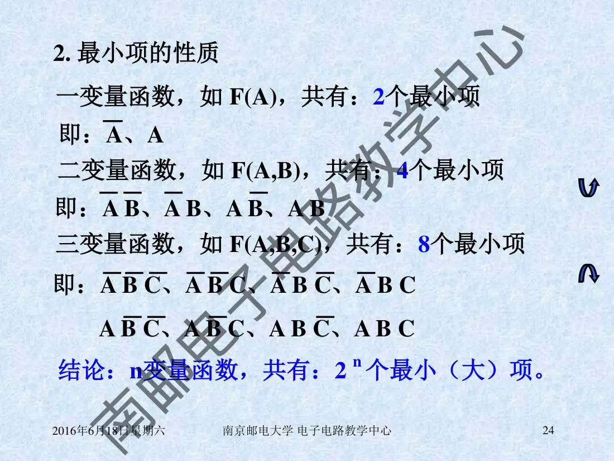

原文：

2. 最小项的性质

一变量函数，如 $\mathbf{F}(\mathbf{A})$ ，共有：2个最小项

二变量函数，如 $\mathrm{F(A,B)}$ ，共有：4个最小项

即: $\overline{\mathrm{A}}\overline{\mathrm{B}}$ 、 $\overline{\mathrm{A}}\mathrm{B}$ 、 $\mathrm{A}\overline{\mathrm{B}}$ 、 $\mathrm{A}\mathrm{B}$

三变量函数，如 $\mathrm{F(A,B,C)}$ ，共有：8个最小项

即： $\overline{A}\overline{B}\overline{C}$ 、 $\overline{A}\overline{B}\overline{C}$ 、 $\overline{A}\overline{B}\overline{C}$ 、 $\overline{A}\overline{B}\overline{C}$

A B C、A B C、A B C、A B C

结论: n变量函数, 共有: $2^{n}$ 个最小 (大) 项。

2016年6月18日星期六 南京邮电大学 电子电路教学中心

24

### (1) 最小项的主要性质

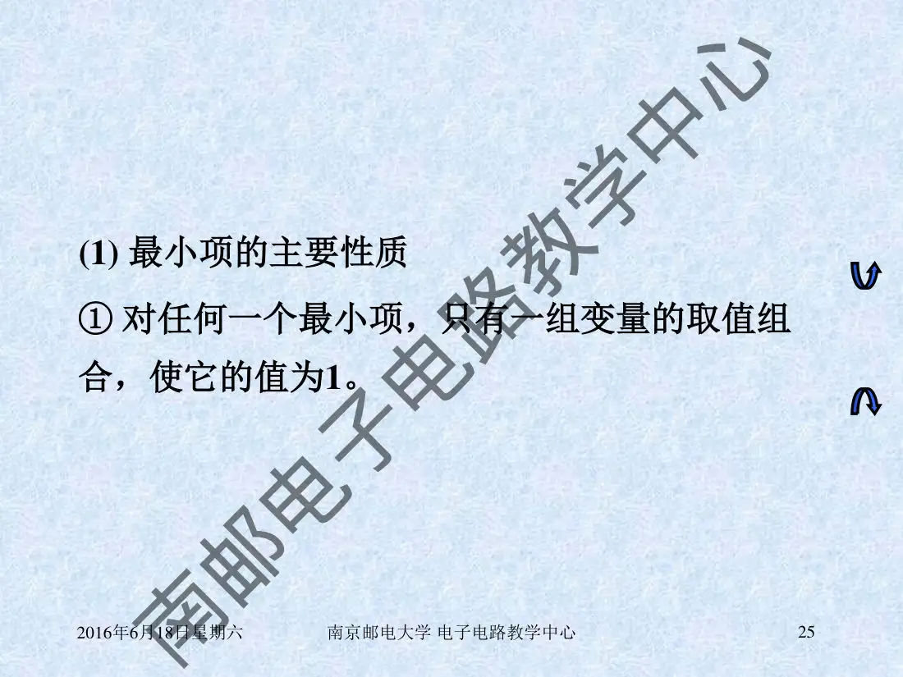

原文：

(1) 最小项的主要性质

① 对任何一个最小项，只有一组变量的取值组合，使它的值为1。

2016年6月18日星期六

南京邮电大学 电子电路教学中心

25

### 能使最小项的值为1的取值组合，称为与该最小项对应的取值组合。

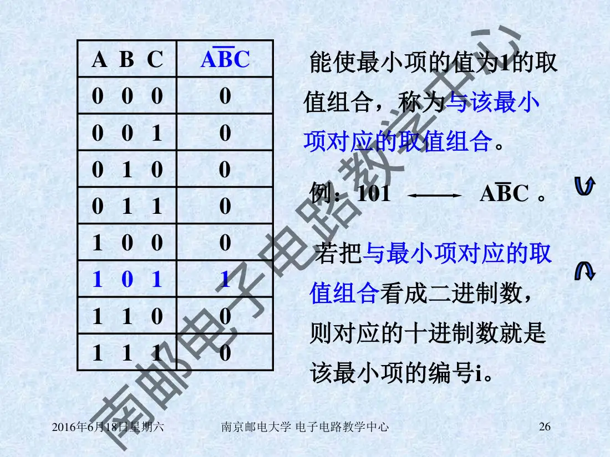

原文：

<table><tr><td>A B C</td><td> $\overline{ABC}$ </td></tr><tr><td>0 0 0</td><td>0</td></tr><tr><td>0 0 1</td><td>0</td></tr><tr><td>0 1 0</td><td>0</td></tr><tr><td>0 1 1</td><td>0</td></tr><tr><td>1 0 0</td><td>0</td></tr><tr><td>1 0 1</td><td>1</td></tr><tr><td>1 1 0</td><td>0</td></tr><tr><td>1 1 1</td><td>0</td></tr></table>

能使最小项的值为1的取值组合，称为与该最小项对应的取值组合。

例：101 $\longleftrightarrow$ A $\overline{\mathrm{B}}$ C。

若把与最小项对应的取值组合看成二进制数，则对应的十进制数就是该最小项的编号i。

2016年6月18日星期六

南京邮电大学 电子电路教学中心

26

### ②全部最小项之和恒等于1。

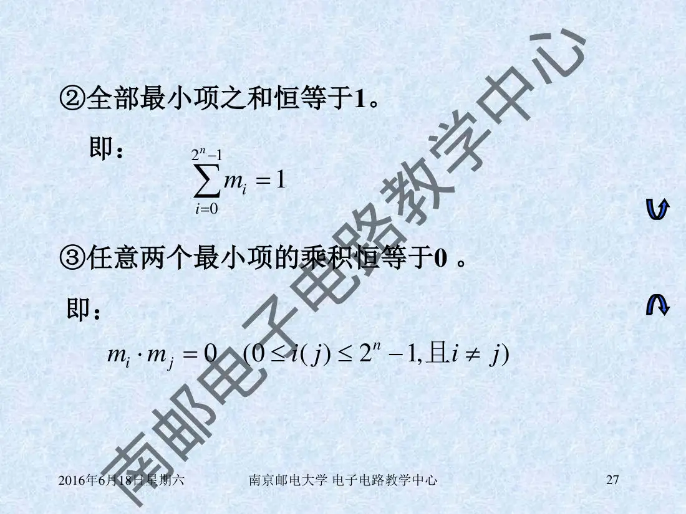

原文：

②全部最小项之和恒等于1。

即：

$$
\sum_ {i = 0} ^ {2 ^ {n} - 1} m _ {i} = 1
$$

U

③任意两个最小项的乘积恒等于0。

即：

$m_{i}\cdot m_{j}=0$ ( $0\leq i(j)\leq2^{n}-1$ ,且 $i\neq j$ )

2016年6月18日星期六

南京邮电大学 电子电路教学中心

27

### ④任一最小项与另一最小项非之积恒等于该最小项。

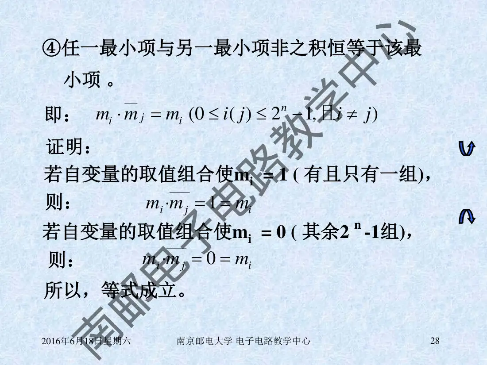

原文：

④任一最小项与另一最小项非之积恒等于该最小项。

即： $m_{i} \cdot \overline{m}_{j} = m_{i} (0 \leq i(j) \leq 2^{n} - 1, \text{且 } i \neq j)$ 证明：

U

若自变量的取值组合使 $m_{i}=1$ （有且只有一组），则： $m_{i}\cdot\overline{m_{j}}=1=m_{i}$ 若自变量的取值组合使 $m_{i}=0$ （其余 $2^{n}-1$ 组），则： $m_{i}\cdot\overline{m_{j}}=0=m_{i}$ 所以，等式成立。

2016年6月18日星期六

南京邮电大学 电子电路教学中心

28

### (k为0 \~ (2 $^{n}$ - 1)中除了j以外的所有正整数)

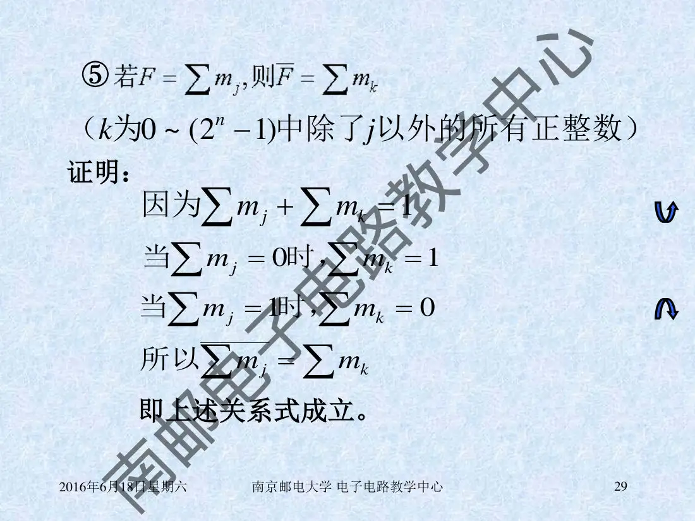

原文：

⑤ 若 $F = \sum m_{j}$ , 则 $\overline{F} = \sum m_{k}$

(k为0 \~ (2 $^{n}$ - 1)中除了j以外的所有正整数)
证明:

因为 $\sum m_{j} + \sum m_{k} = 1$

U

当 $\sum m_{j} = 0$ 时， $\sum m_{k} = 1$

当 $\sum m_{j} = 1$ 时， $\sum m_{k} = 0$

所以 $\sum m_{j} = \sum m_{k}$

即上述关系式成立。

2016年6月18日星期六

南京邮电大学 电子电路教学中心

29

### $$

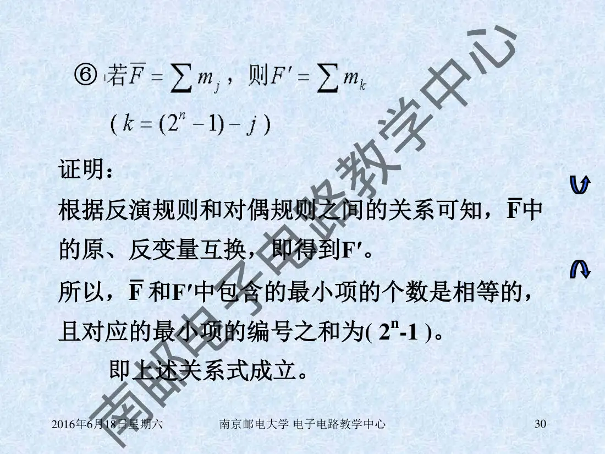

原文：

⑥ 若 $\overline{F} = \sum m_{j}$ ，则 $F' = \sum m_{k}$

$$
(k = (2 ^ {n} - 1) - j)
$$

证明：

根据反演规则和对偶规则之间的关系可知， $\bar{\mathbf{F}}$ 中的原、反变量互换，即得到 $\mathbf{F}'$ 。

所以， $\overline{\mathbf{F}}$ 和 $\mathbf{F}'$ 中包含的最小项的个数是相等的，且对应的最小项的编号之和为 $(2^{n} - 1)$ 。

即上述关系式成立。

2016年6月18日星期六

南京邮电大学 电子电路教学中心

30

### 例2: 若 $F(A,B,C)=\sum m(3,4,6)$

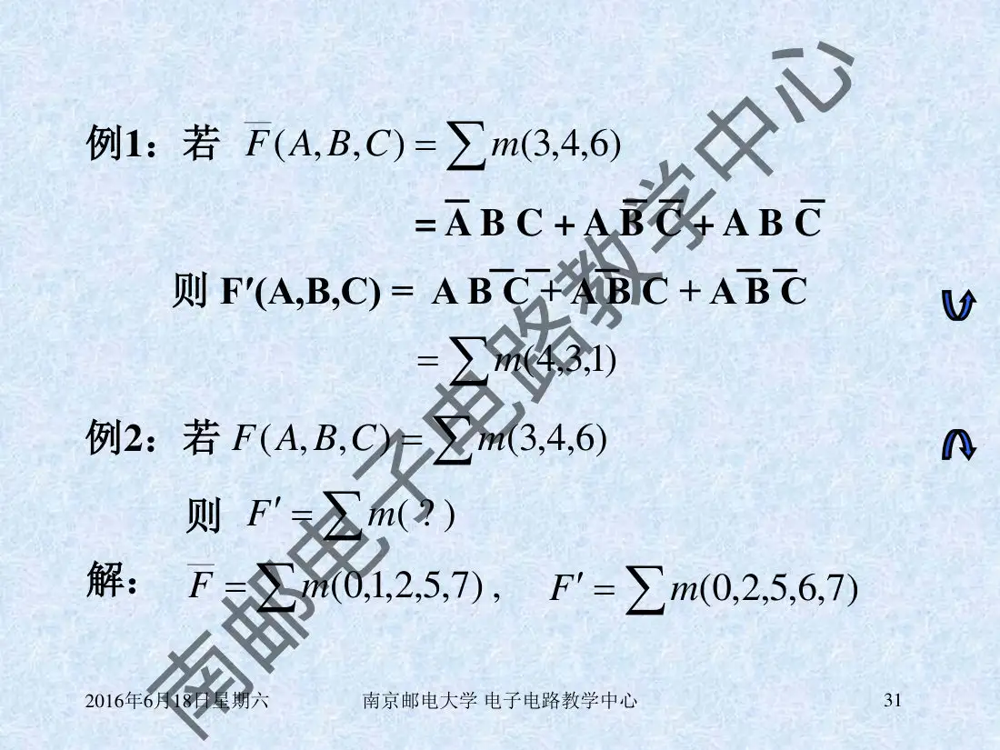

原文：

例1: 若 $\overline{F}(A,B,C)=\sum m(3,4,6)$ $= \overline{\mathbf{A}} \mathbf{B} \mathbf{C}+\mathbf{A} \overline{\mathbf{B}} \overline{\mathbf{C}}+\mathbf{A} \mathbf{B} \overline{\mathbf{C}}$

则 $\mathbf{F}'(\mathbf{A},\mathbf{B},\mathbf{C}) = \mathbf{A}\mathbf{B}\overline{\mathbf{C}} +\mathbf{A}\overline{\mathbf{B}}\mathbf{C} + \mathbf{A}\overline{\mathbf{B}}\overline{\mathbf{C}}$ $= \sum m(4,3,1)$

例2: 若 $F(A,B,C)=\sum m(3,4,6)$

则 $F'=\sum m(\text{?})$

解: $\overline{F} = \sum m(0,1,2,5,7)$ , $F' = \sum m(0,2,5,6,7)$

2016年6月18日星期六

南京邮电大学 电子电路教学中心

31

### 3. 由一般表达式写出最小项表达式的方法:

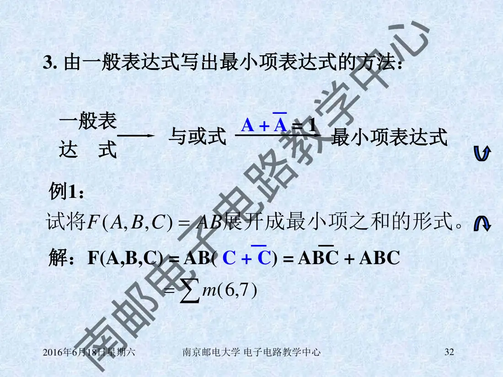

原文：

3. 由一般表达式写出最小项表达式的方法:

一般表达式 $\longrightarrow$ 与或式 $\frac{\mathbf{A} + \overline{\mathbf{A}} = 1}{\text{最小项表达式}}$

例1:

试将 $F(A,B,C)=AB$ 展开成最小项之和的形式。

解: $\mathbf{F}(\mathbf{A},\mathbf{B},\mathbf{C}) = \mathbf{A}\mathbf{B}(\mathbf{C} + \overline{\mathbf{C}}) = \mathbf{A}\overline{\mathbf{B}}\overline{\mathbf{C}} + \mathbf{A}\mathbf{B}\mathbf{C}$

2016年6月18日星期六

南京邮电大学 电子电路教学中心

32

### 例2:

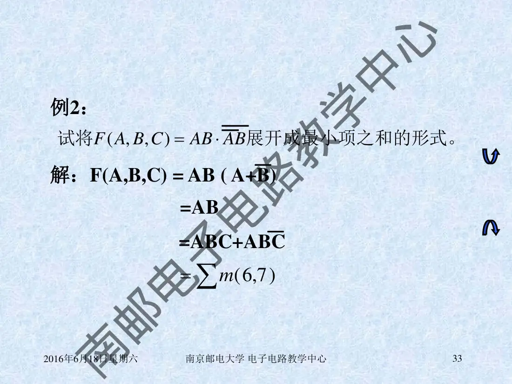

原文：

例2:

试将 $F(A,B,C)=AB\cdot\overline{AB}$ 展开成最小项之和的形式。

解: $\mathbf{F}(\mathbf{A}, \mathbf{B}, \mathbf{C}) = \mathbf{A}\mathbf{B} (\mathbf{A} + \overline{\mathbf{B}})$

2016年6月18日星期六

南京邮电大学 电子电路教学中心

33

### $$

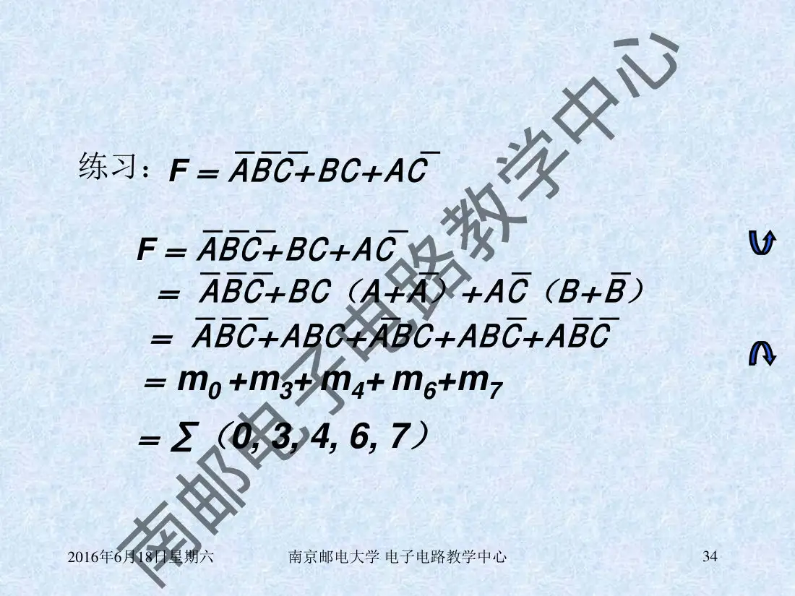

原文：

练习: $F = \overline{A} \overline{B} \overline{C} + B C + A \overline{C}$

$$
\begin{array}{r l} & F = \overline {{A}} \overline {{B}} \overline {{C}} + B C + A \overline {{C}} \\ & = \overline {{A}} \overline {{B}} \overline {{C}} + B C (A + \overline {{A}}) + A \overline {{C}} (B + \overline {{B}}) \\ & = \overline {{A}} \overline {{B}} \overline {{C}} + A B C + A \overline {{B}} C + A B \overline {{C}} + A \overline {{B}} \overline {{C}} \\ & = m _ {0} + m _ {3} + m _ {4} + m _ {6} + m _ {7} \\ & = \sum (0, 3, 4, 6, 7) \end{array}
$$

2016年6月18日星期六

南京邮电大学 电子电路教学中心

34

### 4. 由真值表写出最小项表达式的方法

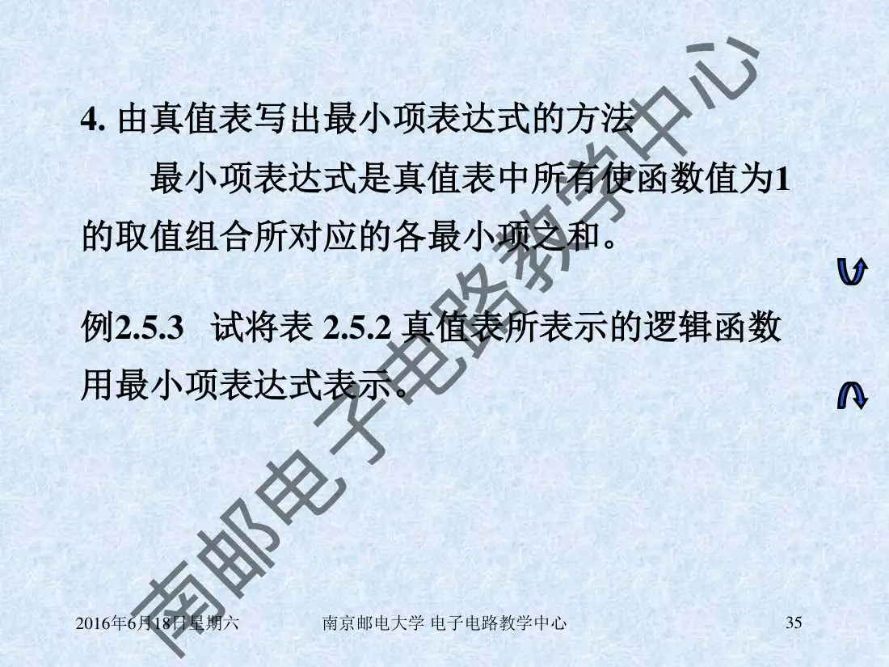

原文：

4. 由真值表写出最小项表达式的方法

最小项表达式是真值表中所有使函数值为1的取值组合所对应的各最小项之和。

例2.5.3 试将表 2.5.2 真值表所表示的逻辑函数用最小项表达式表示。

2016年6月18日星期六

南京邮电大学 电子电路教学中心

35

### 表 2.5.2

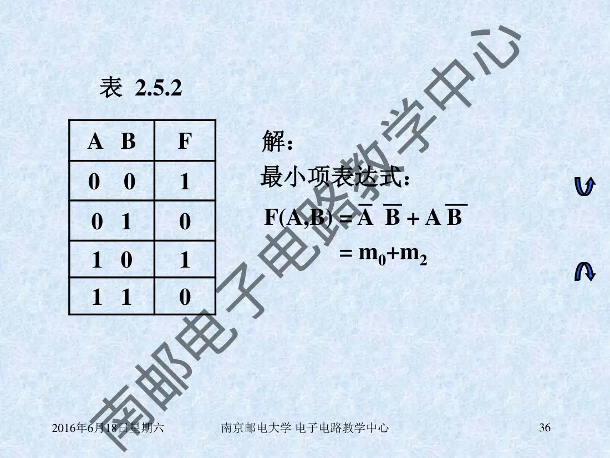

原文：

表 2.5.2
<table><tr><td>A B</td><td>F</td></tr><tr><td>0 0</td><td>1</td></tr><tr><td>0 1</td><td>0</td></tr><tr><td>1 0</td><td>1</td></tr><tr><td>1 1</td><td>0</td></tr></table>

解:

最小项表达式:

$$
\begin{array}{r l} \mathbf {F} (\mathbf {A}, \mathbf {B}) & = \overline {{\mathbf {A}}} \overline {{\mathbf {B}}} + \mathbf {A} \overline {{\mathbf {B}}} \\ & = \mathbf {m _ {0}} + \mathbf {m _ {2}} \end{array}\tag{U}
$$

2016年6月18日星期六

南京邮电大学 电子电路教学中心

36

### $$

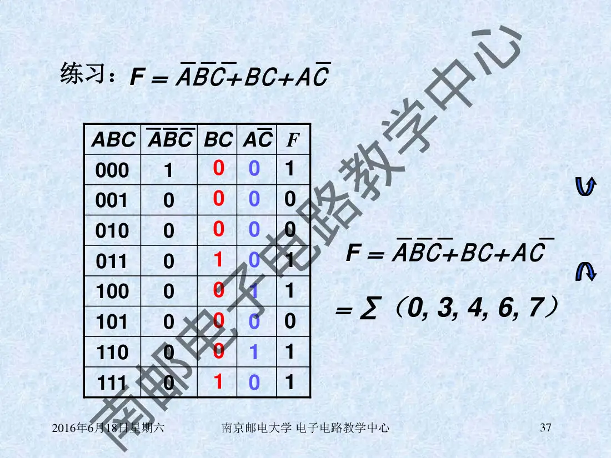

原文：

练习: $F = \overline{A} \overline{B} \overline{C} + B C + A \overline{C}$

<table><tr><td>ABC</td><td> $\overline{A}\overline{B}\overline{C}$ </td><td>BC</td><td> $A\overline{C}$ </td><td>F</td></tr><tr><td>000</td><td>1</td><td>0</td><td>0</td><td>1</td></tr><tr><td>001</td><td>0</td><td>0</td><td>0</td><td>0</td></tr><tr><td>010</td><td>0</td><td>0</td><td>0</td><td>0</td></tr><tr><td>011</td><td>0</td><td>1</td><td>0</td><td>1</td></tr><tr><td>100</td><td>0</td><td>0</td><td>1</td><td>1</td></tr><tr><td>101</td><td>0</td><td>0</td><td>0</td><td>0</td></tr><tr><td>110</td><td>0</td><td>0</td><td>1</td><td>1</td></tr><tr><td>111</td><td>0</td><td>1</td><td>0</td><td>1</td></tr></table>

$$
\boldsymbol {F} = \overline {{\boldsymbol {A}}} \overline {{\boldsymbol {B}}} \overline {{\boldsymbol {C}}} + \boldsymbol {B} \boldsymbol {C} + \boldsymbol {A} \overline {{\boldsymbol {C}}}
$$

$$
= \sum (0, 3, 4, 6, 7)
$$

2016年6月18日星期六

南京邮电大学 电子电路教学中心

37

### 2016年6月18日星期六

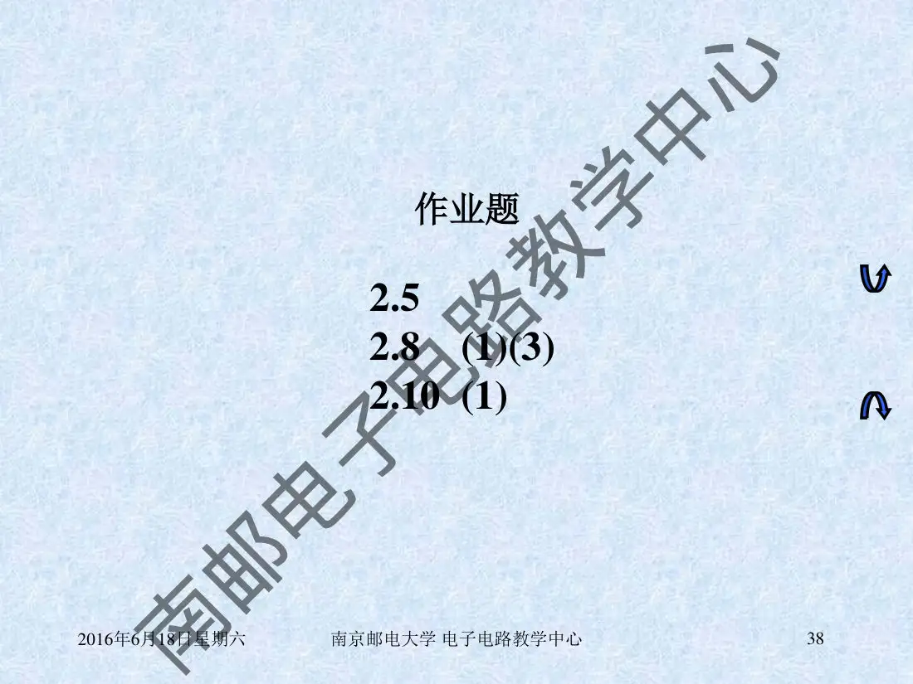

原文：

2016年6月18日星期六

南京邮电大学 电子电路教学中心

38
