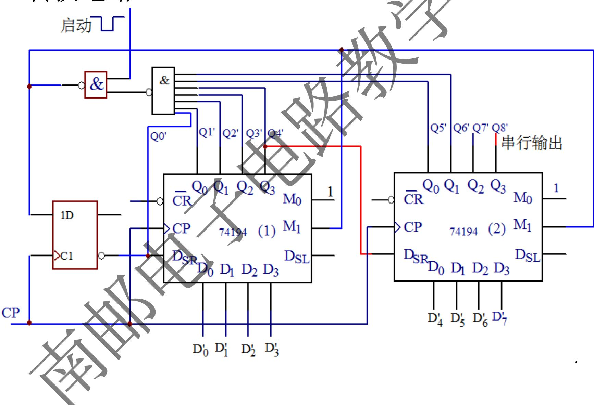
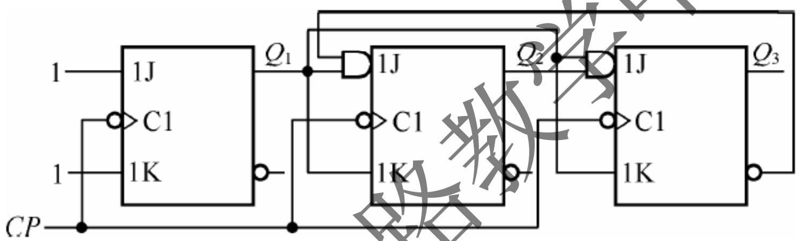
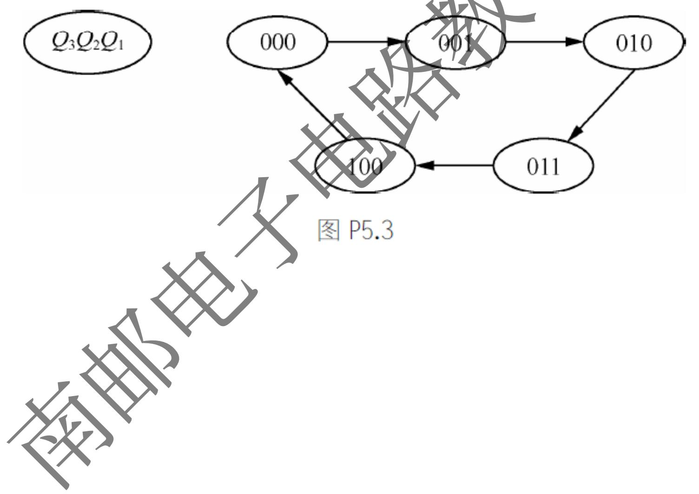
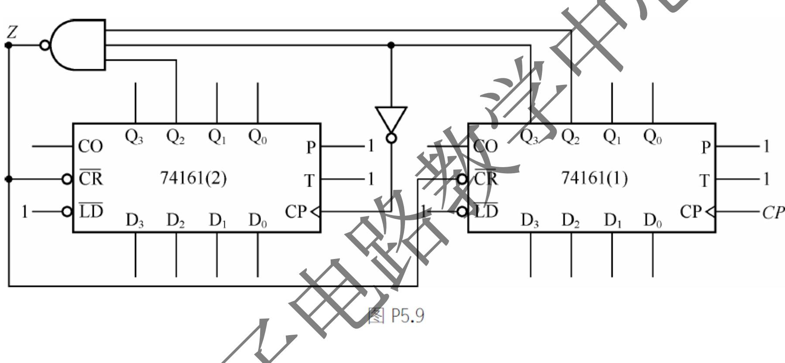
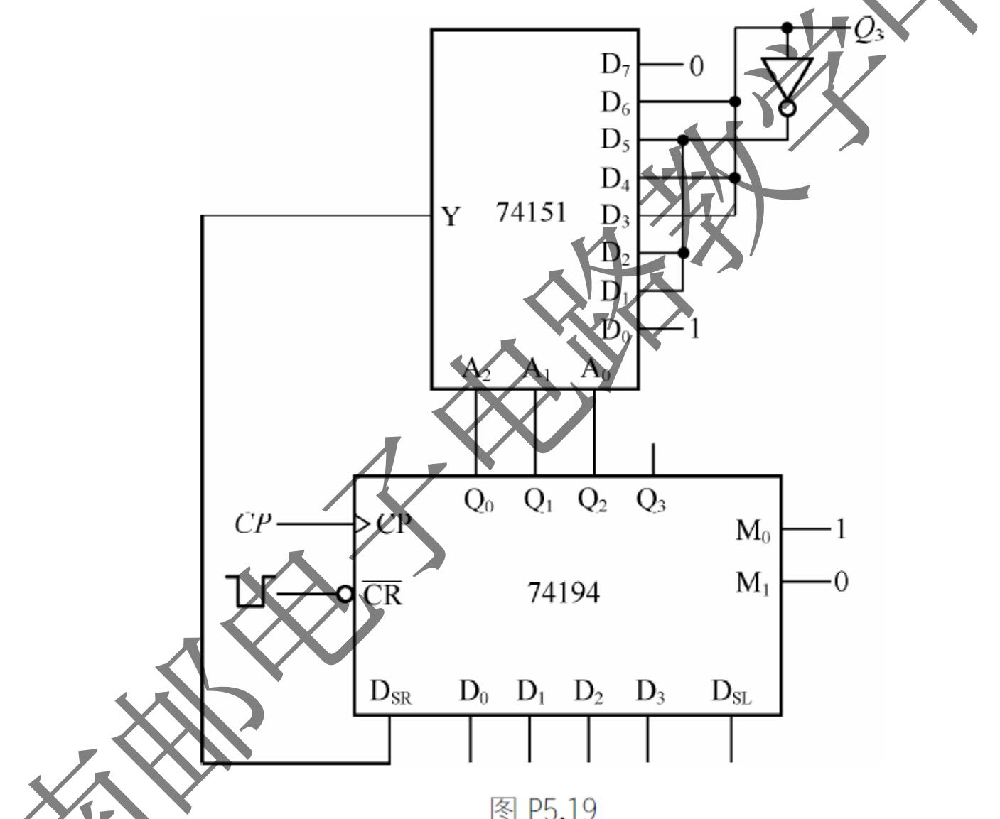
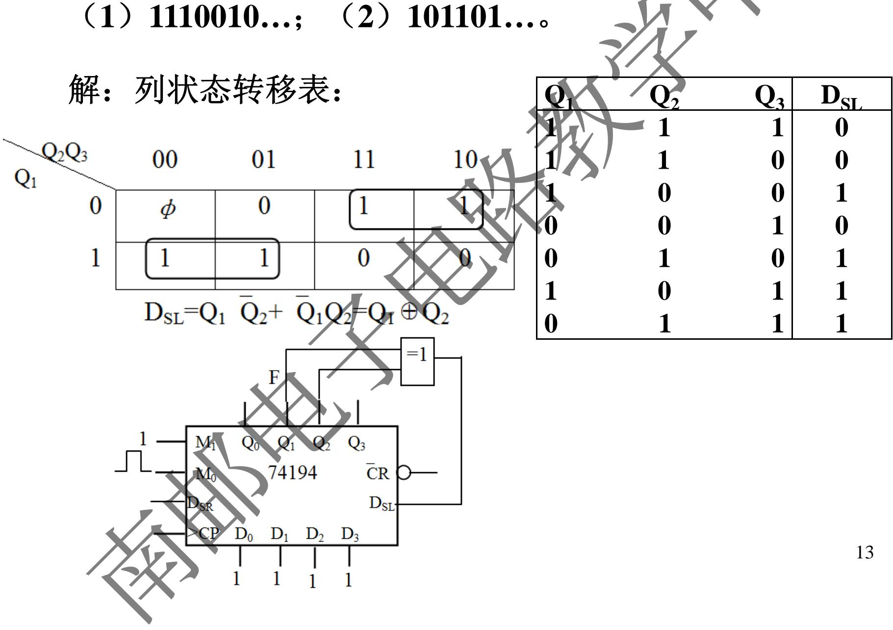
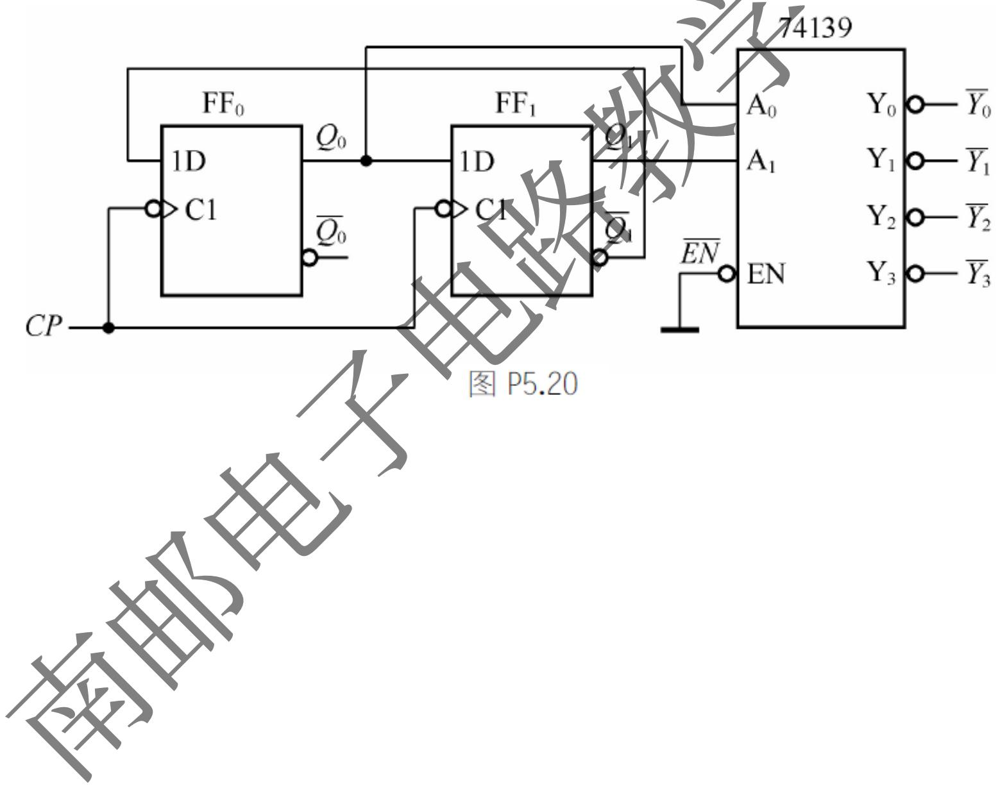

# 《数字电路与系统设计》第五、六、七章习题课课件

原件经识别和整理；“参考解答”是我们补的。

# 《数字电路与系统设计》第五、六、七章习题课课件（第 1 部分）

## 第五章习题

### 5.1 试用2片74194和一个D触发器构成8位串-并转换电路。

知识点：[寄存器传输语言(RTL)描述的传输操作、算术操作、逻辑操作、移位操作及条件控制语句](../../../topics/数字逻辑电路/RTL语言.md)、[完整数字系统设计流程实例（如乘法器、交通灯管理系统的算法规律、处理器设计与控制器实现）](../../../topics/数字逻辑电路/数字系统设计实例.md)

### 5.3 试分析图 P5.1 构成的同步计数器电路，画出状态转移图并说明有无自启动性。

解：激励方程：$J_1=1$；

$$
K_2 = Q_{1}^{n} \bar{Q}_{3}^{n}, \quad J_2 = Q_{1}^{n} Q_{2}^{n}, \quad K_2 = Q_{1}^{n}
$$

*(注：原题此处公式排版混乱且存在重复符号，根据上下文逻辑推测为JK触发器的激励方程，但原文识别结果如此，保留原意结构)*

状态方程：

$$
Q_{1}^{n+1} = \bar{Q}_{1}^{n} \cdot CP\downarrow
$$

$$
Q_{2}^{n+1} = \left[ Q_{1}^{n} \bar{Q}_{3}^{n} \bar{Q}_{2}^{n} + \bar{Q}_{1}^{n} Q_{2}^{n} \right] \cdot CP\downarrow
$$

$$
Q_{3}^{n+1} = \left[ Q_{1}^{n} Q_{2}^{n} \bar{Q}_{3}^{n} + \bar{Q}_{1}^{n} Q_{3}^{n} \right] \cdot CP\downarrow
$$

表 5.3 题 5.3 的状态转移表

| 序号 | $Q_3$ | $Q_2$ | $Q_1$ |
| :--- | :---: | :---: | :---: |
| 0 | 0 | 0 | 0 |
| 1 | 0 | 0 | 1 |
| 2 | 0 | 1 | 0 |
| 3 | 0 | 1 | 1 |
| 4 | 1 | 0 | 0 |
| 5 | 1 | 0 | 1 |
| 偏离状态 | $110 \rightarrow 111, 111 \rightarrow 000$ |

该电路具有自启动性。

知识点：[根据文字描述建立ASM图的原则，以及从ASM图推导处理器明细表和控制器状态转移图](../../../topics/数字逻辑电路/ASM图建立与分析.md)、[完整数字系统设计流程实例（如乘法器、交通灯管理系统的算法规律、处理器设计与控制器实现）](../../../topics/数字逻辑电路/数字系统设计实例.md)

### 5.5 试用 D 触发器设计一个满足图 P5.3 所示的状态转移图的同步计数器，要求写出设计过程。

知识点：[控制器的四种硬件实现方法：每态一触发器法(SSI)、MSI法(MUX+寄存器+译码器)、PLA法(LSI)及对比](../../../topics/数字逻辑电路/控制器实现方法.md)、[算法状态机(ASM)图的状态框、判断框、条件输出框及ASM块的构成规则](../../../topics/数字逻辑电路/ASM图基础.md)、[完整数字系统设计流程实例（如乘法器、交通灯管理系统的算法规律、处理器设计与控制器实现）](../../../topics/数字逻辑电路/数字系统设计实例.md)

### 5.10 试改用 D 触发器实现符合下列条件的同步计数器电路。

（1）当 $X=0$ 时为 $M=5$ 的加法计数器，其状态为 0, 1, 2, 3, 4。

（2）当 $X=1$ 时为 $M=5$ 的减法计数器，其状态为 7, 6, 5, 4, 3。

解：列状态转移表：

| X | $Q_3^n$ | $Q_2^n$ | $Q_1^n$ | $Q_3^{n+1}$ | $Q_2^{n+1}$ | $Q_1^{n+1}$ | Z |
| :---: | :---: | :---: | :---: | :---: | :---: | :---: | :---: |
| 0 | 0 | 0 | 0 | 0 | 0 | 1 | 0 |
| 0 | 0 | 0 | 1 | 0 | 1 | 0 | 0 |
| 0 | 0 | 1 | 0 | 0 | 1 | 1 | 0 |
| 0 | 0 | 1 | 1 | 1 | 0 | 0 | 0 |
| 0 | 1 | 0 | 0 | 0 | 0 | 0 | 1 |
| 1 | 1 | 1 | 1 | 1 | 1 | 0 | 0 |
| 1 | 1 | 1 | 0 | 1 | 0 | 1 | 0 |
| 1 | 1 | 0 | 1 | 1 | 0 | 0 | 0 |
| 1 | 1 | 0 | 0 | 0 | 1 | 1 | 0 |
| 1 | 0 | 1 | 1 | 1 | 1 | 1 | 1 |

偏离态输出按任意项处理求激励方程：

$$
Q_{3}^{n+1} (D_{3})
$$

#### 求激励方程：

$Q_{3}^{n+1} (D_{3})$ 的卡诺图

| $Q_2^n Q_1^n$   $X Q_3^n$ | 00 | 01 | 11 | 10 |
| :--- | :---: | :---: | :---: | :---: |
| 00 | | | 1 | |
| 01 | | $\Phi$ | $\Phi$ | $\Phi$ |
| 11 | | 1 | 1 | 1 |
| 10 | $\Phi$ | $\Phi$ | 1 | $\Phi$ |

| 1 | | | 1 |
| :---: | :---: | :---: | :---: |
| | $\Phi$ | $\Phi$ | $\Phi$ |
| 1 | | | 1 |
| $\Phi$ | $\Phi$ | 1 | $\Phi$ |

$$
D_{3} = Q_{2}^{n} Q_{1}^{n} + X Q_{1}^{n} + X Q_{2}^{n}
$$

$$
D_{2} = \bar{X} \bar{Q}_{2}^{n} Q_{1}^{n} + \bar{X} Q_{2}^{n} \bar{Q}_{1}^{n} + X \bar{Q}_{2}^{n} \bar{Q}_{1}^{n} + X Q_{2}^{n} Q_{1}^{n}
$$

$$
D_{1} = \bar{Q}_{3}^{n} \bar{Q}_{1}^{n} + X \bar{Q}_{1}^{n} + X \bar{Q}_{3}^{n}
$$

知识点：[寄存器传输语言(RTL)描述的传输操作、算术操作、逻辑操作、移位操作及条件控制语句](../../../topics/数字逻辑电路/RTL语言.md)、[完整数字系统设计流程实例（如乘法器、交通灯管理系统的算法规律、处理器设计与控制器实现）](../../../topics/数字逻辑电路/数字系统设计实例.md)

### 5.14 试写出图 P5.7 中各电路的状态转移表。

知识点：[控制器的四种硬件实现方法：每态一触发器法(SSI)、MSI法(MUX+寄存器+译码器)、PLA法(LSI)及对比](../../../topics/数字逻辑电路/控制器实现方法.md)

### 5.16 试分析图 P5.9 能实现 M 为多少的分频。

解：74161（1）的 $\bar{Q}_3$ 接至 74161（2）的 CP，两 74161 为异步级联，反馈状态为 $(4C)_H = 76$，又利用异步清 0 端，所以 $M=76$。

5.28 分析图 P5.16 电路，试写出其编码表及模长。

解：分析两个 74194 级联成 8 位右移寄存器，取第二个 74194 的 $Q_0$ 反馈给第一片 74194 的 $D_{SR}$。$M_1M_0=01$，所以始终处于右移工作状态。其状态编码表为：（其中 $Q_0'$ 为第二个 74194 的 $Q_0$）

因此 $M=10$。

| 序号 | $Q_0$ | $Q_1$ | $Q_2$ | $Q_3$ | $Q_0'$ | $Z$ |
| --- | --- | --- | --- | --- | --- | --- |
| 启动 | 0 | 0 | 0 | 0 | 0 | 0 |
| 1 | 1 | 0 | 0 | 0 | 0 | 0 |
| 2 | 1 | 1 | 0 | 0 | 0 | 0 |
| 3 | 1 | 1 | 1 | 0 | 0 | 0 |
| 4 | 1 | 1 | 1 | 1 | 0 | 0 |
| 5 | 1 | 1 | 1 | 1 | 1 | 1 |
| 6 | 0 | 1 | 1 | 1 | 1 | 1 |
| 7 | 0 | 0 | 1 | 1 | 1 | 1 |
| 8 | 0 | 0 | 0 | 1 | 1 | 1 |
| 9 | 0 | 0 | 0 | 0 | 1 | 1 |

5.31 试写出图 P5.19 中 74194 输出端 $Q_0$ 处的序列信号。

| $Q_0$ | $Q_1$ | $Q_2$ | $Q_3$ | 74151 选择的数据端 | $D_{SR}(Y)$ |
| --- | --- | --- | --- | --- | --- |
| 0 | 0 | 0 | 0 | $D_0$ | 1 |
| 1 | 0 | 0 | 0 | $D_4$ | 0 |
| 0 | 1 | 0 | 0 | $D_2$ | 1 |
| 1 | 0 | 1 | 0 | $D_5$ | 1 |
| 1 | 1 | 0 | 1 | $D_6$ | 1 |
| 1 | 1 | 1 | 0 | $D_7$ | 0 |
| 0 | 1 | 1 | 1 | $D_3$ | 1 |
| 1 | 0 | 1 | 1 | $D_5$ | 0 |
| 0 | 1 | 0 | 1 | $D_2$ | 0 |
| 0 | 0 | 1 | 0 | $D_1$ | 1 |
| 1 | 0 | 0 | 1 | $D_4$ | 1 |
| 1 | 1 | 0 | 0 | $D_6$ | 0 |
| 0 | 1 | 1 | 0 | $D_3$ | 0 |
| 0 | 0 | 1 | 1 | $D_1$ | 0 |
| 0 | 0 | 0 | 1 | $D_0$ | 1 |

5.32 用 74194 设计序列信号发生器，产生如下序列信号。

（1）1110010…；（2）101101…。

解：列状态转移表：

（2）101101…

（2）列状态转移表：

5.35 逻辑电路如图 P5.20 所示，试画出时序电路部分的状态转移图，并画出在 CP 作用下 2-4 线译码器 74139 输出端的波形，设触发器的初态为 0。

5.37 试作出 101 序列检测器的状态图，该同步电路有一根输入线 $X$ 和一根输出线 $Z$，对应于输入序列 101 的最后一个“1”，输出 $Z=1$，其余情况下输出为“0”。

（1）101 序列可以重叠，例如，$X$：010101101，$Z$：000101001。

（2）101 序列不可以重叠，例如，$X$：0101011010，$Z$：0001000010。

解：（1）$S_0$：起始状态，或收到 101 序列后重新检测。

$S_1$：收到序列“1”。

$S_2$：连续收到序列“10”。

5.38 对表 P5.2 和表 P5.3 所示的原始状态转移表进行化简。

表 P5.3

| $S(t)$ | $N(t)$，$X=0$ | $N(t)$，$X=1$ | $Z(t)$，$X=0$ | $Z(t)$，$X=1$ |
| --- | --- | --- | --- | --- |
| A | B | H | 0 | 0 |
| B | E | Q | 0 | 1 |
| C | D | F | 0 | 0 |
| D | G | A | 0 | 1 |
| E | A | H | 0 | 0 |
| F | E | B | 1 | 1 |
| G | C | F | 0 | 0 |
| H | G | D | 1 | 1 |

解：1）画隐含表

|  | B | C | D | E | F | G | H |
| --- | --- | --- | --- | --- | --- | --- | --- |
| B | × |  |  |  |  |  |  |
| C | BD HF | × |  |  |  |  |  |
| D | × | EG CA | × |  |  |  |  |
| E | × | × | AD HF | × |  |  |  |
| F | × | × | × | × |  |  |  |
| G | × | × | × | AC HF | × |  |  |
| H | × | × | × | × | EG BD | × |  |

## 第六章习题

6.3 请选用最小容量的 PROM 完成“NUPT”（使用 ASCII 码）四个字母的存储，并画出内部与门、或门阵列结构示意图。

6.4 请选用最小容量的 PROM 设计一个 3-8 线译码器，并画出内部与门、或门阵列结构示意图。

9.3 试用 ROM 阵列图实现下列一组多输出逻辑函数

解：

## 一、存储器与逻辑设计习题

知识点：[完整数字系统设计流程实例（如乘法器、交通灯管理系统的算法规律、处理器设计与控制器实现）](../../../topics/数字逻辑电路/数字系统设计实例.md)

### 计算 1

有容量为 $256 \times 4$，$64\text{K} \times 1$，$1\text{M} \times 8$，$128\text{K} \times 16$ 的 ROM，试分别回答：

- 这些 ROM 有多少个基本存储单元？
- 这些 ROM 每次访问几个基本存储单元？
- 这些 ROM 各有多少个地址线？

答案：(1) 分别有 $1024$ 个，$64\text{K}$ 个，$1\text{M} \times 8$ 个（注：此处原文识别可能有误，通常指总位元数或字数，结合上下文及标准ROM定义，第一问通常问总存储位数即 $256\times4=1024$, $64\text{K}\times1=64\text{K}$, $1\text{M}\times8=8\text{M}$, $128\text{K}\times16=2\text{M}$；但根据给出的答案格式“1024个...”，推测原题意为求总比特数或特定单位。依据提供的答案文本保留如下）：
分别有 $1024$ 个，$1024 \times 64$ 个（注：此处答案文本识别混乱，$64\text{K}=1024\times64$），$1\text{M} \times 8$ 个，$128\text{K} \times 16$ 个。
(2) 分别为 $4$ 个，$1$ 个，$8$ 个，$16$ 个。
(3) 分别有 $8$，$16$，$20$，$17$ 条地址线。

知识点：[数字系统的基本模型（数据处理器与控制器）及对最小时钟周期、异步信号同步化的约定](../../../topics/数字逻辑电路/数字系统模型.md)、[寄存器传输语言(RTL)描述的传输操作、算术操作、逻辑操作、移位操作及条件控制语句](../../../topics/数字逻辑电路/RTL语言.md)、[算法状态机(ASM)图的状态框、判断框、条件输出框及ASM块的构成规则](../../../topics/数字逻辑电路/ASM图基础.md)

### 简答 1 (题号 7.4)

设电路的输入为 $X$，输出为 $Z$，当 $X$ 在连续的 4 个时钟周期内输入全 “0” 或全 “1” 时，输出为 “1”，否则输出为 “0”。试画出该电路的 ASM 图。

知识点：[算法状态机(ASM)图的状态框、判断框、条件输出框及ASM块的构成规则](../../../topics/数字逻辑电路/ASM图基础.md)、[根据文字描述建立ASM图的原则，以及从ASM图推导处理器明细表和控制器状态转移图](../../../topics/数字逻辑电路/ASM图建立与分析.md)

### 简答 2 (题号 7.8)

根据图 P7.4 所示 ASM 图，写出控制器状态转移图，用每态一个触发器法设计控制器。

图 P7.4

知识点：[根据文字描述建立ASM图的原则，以及从ASM图推导处理器明细表和控制器状态转移图](../../../topics/数字逻辑电路/ASM图建立与分析.md)、[控制器的四种硬件实现方法：每态一触发器法(SSI)、MSI法(MUX+寄存器+译码器)、PLA法(LSI)及对比](../../../topics/数字逻辑电路/控制器实现方法.md)
