# 《数字电路与系统设计》第四章 常用触发器（一）课件

原件的每一页，下面附识别出的文字。

### 第四节常用触发器

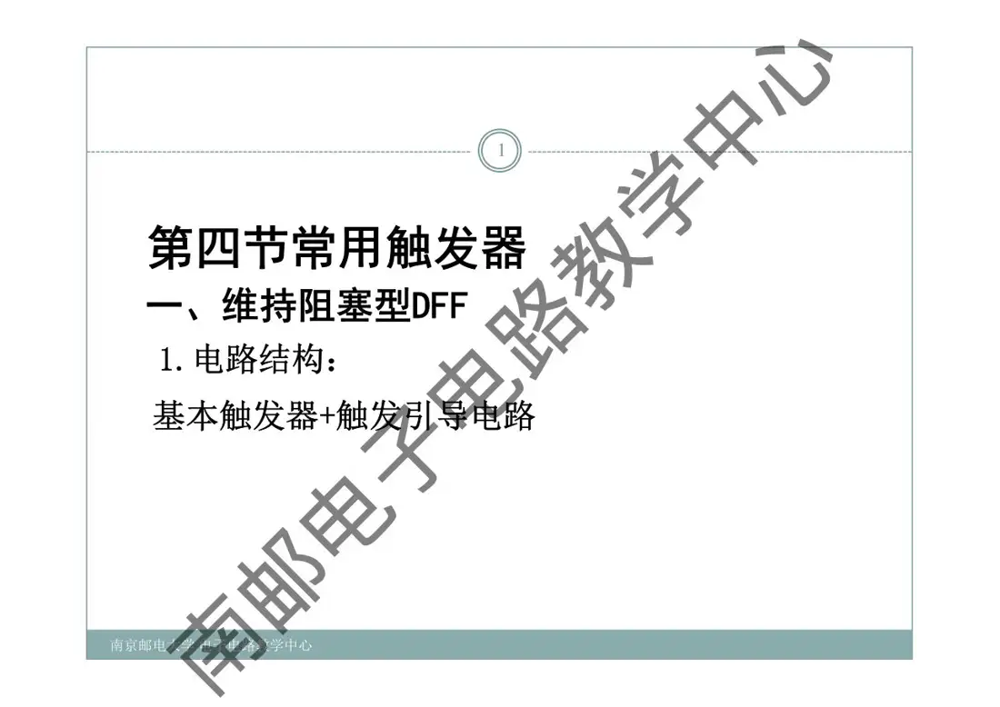

原文：

第四节常用触发器

一、维持阻塞型DFF

1. 电路结构:

基本触发器+触发引导电路

1

南京邮电大学电子电路教学中心

### 南京邮电大学电子电路教学中心

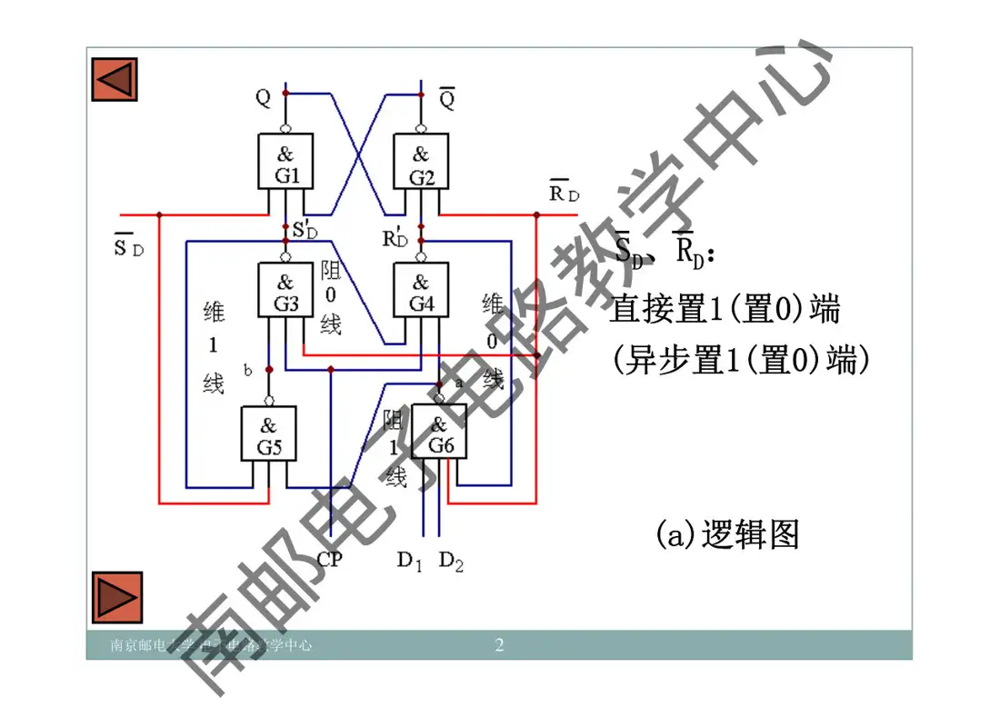

原文：

南京邮电大学电子电路教学中心

2

### 南京邮电大学电子电路教学中心

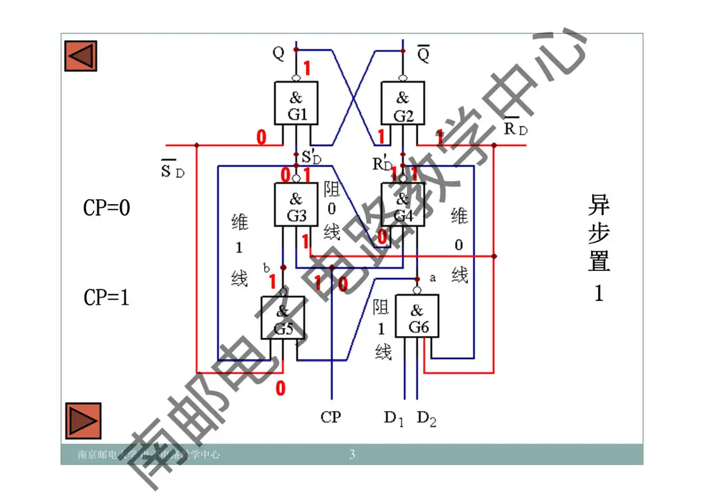

原文：

南京邮电大学电子电路教学中心

3

### 南京邮电大学电子电路教学中心

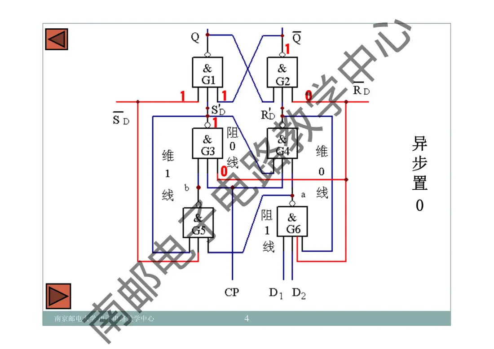

原文：

南京邮电大学电子电路教学中心

4

### $\mathrm{CP} = 0$ 时

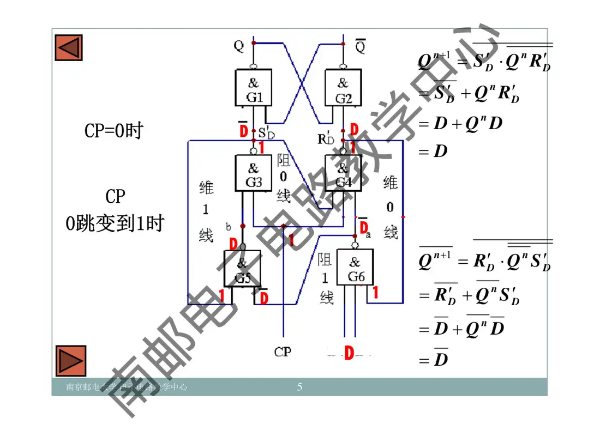

原文：

$\mathrm{CP} = 0$ 时

CP
0跳变到1时$\mathrm{CP} = 1$ 时

南京邮电大学电子电路教学中心

5

### 若CP跳变时

原文：

若CP跳变时

南京邮电大学电子电路教学中心

6

### $\mathrm{CP} = 1$ 时

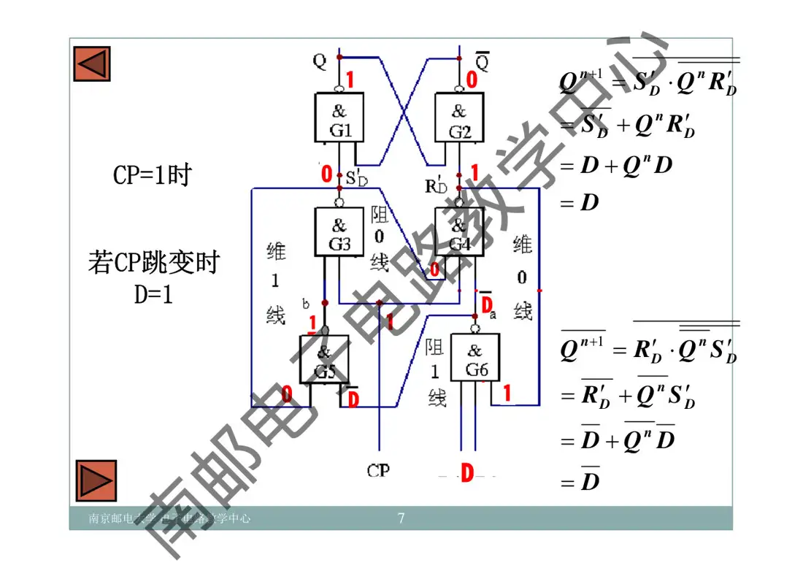

原文：

$\mathrm{CP} = 1$ 时

若CP跳变时
D=1

南京邮电大学电子电路教学中心

7

### 南京邮电大学电子电路教学中心

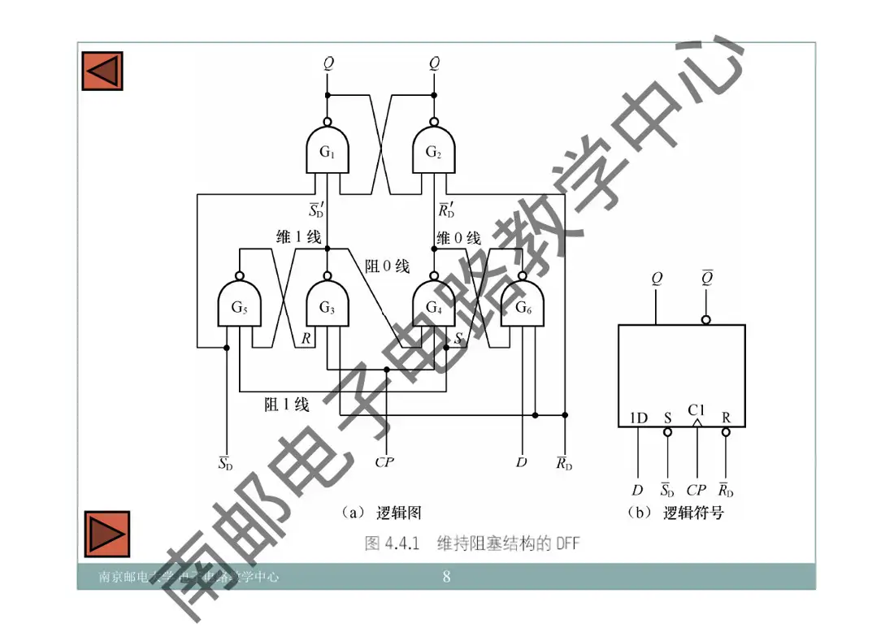

原文：

南京邮电大学电子电路教学中心

8

### 2. 工作原理

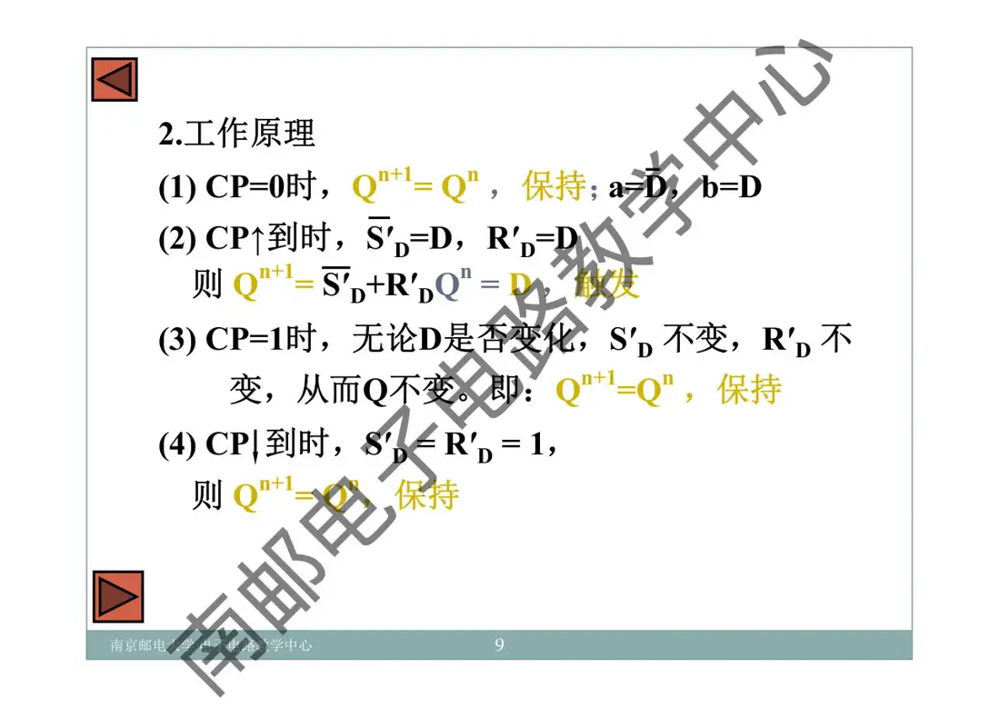

原文：

2. 工作原理

(1) CP=0 时， $Q^{n+1}=Q^{n}$ ，保持；a=D, b=D

(2) CP↑到时， $\overline{S}_{D}^{\prime}=D,\quad R_{D}^{\prime}=D$ 则 $Q^{n+1}=\overline{S}_{D}^{\prime}+R_{D}^{\prime}Q^{n}=D$ ，触发

(3) CP=1时，无论D是否变化， $S'_{D}$ 不变， $R'_{D}$ 不变，从而Q不变。即： $Q^{n+1}=Q^{n}$ ，保持

(4) CP↓到时， $S'_{D}=R'_{D}=1$ ，
则 $Q^{n+1}=Q^{n}$ ，保持

◀

▶

南京邮电大学电子电路教学中心

9

### 3. 功能描述

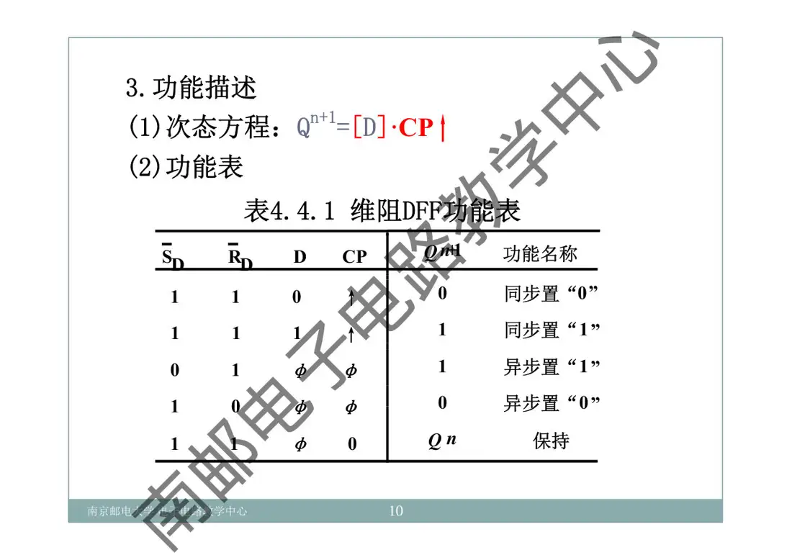

原文：

3. 功能描述

(1) 次态方程: $Q^{n+1} = [D] \cdot CP \uparrow$

(2) 功能表

表4.4.1 维阻DFF功能表
<table><tr><td> $\overline{S}_{D}$ </td><td> $\overline{R}_{D}$ </td><td>D</td><td>CP</td><td>Qn1</td><td>功能名称</td></tr><tr><td>1</td><td>1</td><td>0</td><td>↑</td><td>0</td><td>同步置“0”</td></tr><tr><td>1</td><td>1</td><td>1</td><td>↑</td><td>1</td><td>同步置“1”</td></tr><tr><td>0</td><td>1</td><td>φ</td><td>φ</td><td>1</td><td>异步置“1”</td></tr><tr><td>1</td><td>0</td><td>φ</td><td>φ</td><td>0</td><td>异步置“0”</td></tr><tr><td>1</td><td>1</td><td>φ</td><td>0</td><td>Qn</td><td>保持</td></tr></table>

南京邮电大学电子电路教学中心

10

### (3) 激励表

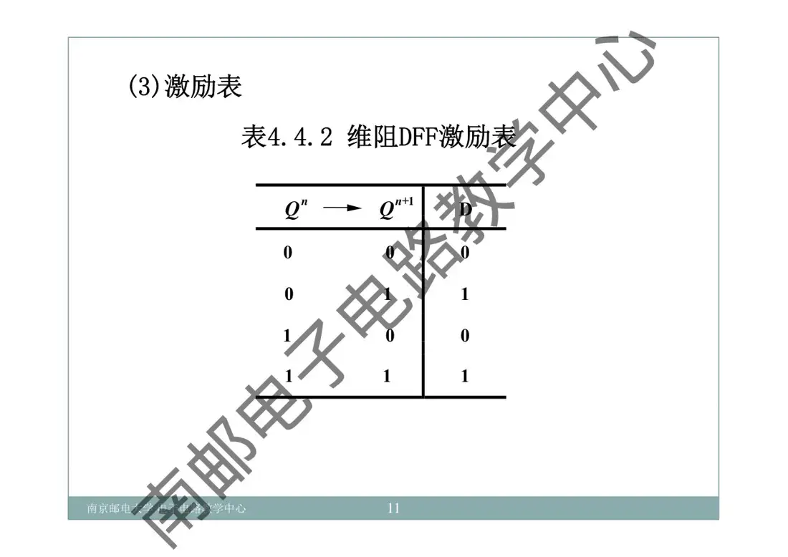

原文：

(3) 激励表

表4.4.2 维阻DFF激励表

$$
Q ^ {n} \longrightarrow Q ^ {n + 1}
$$

南京邮电大学电子电路教学中心

11

### (4) 波形图

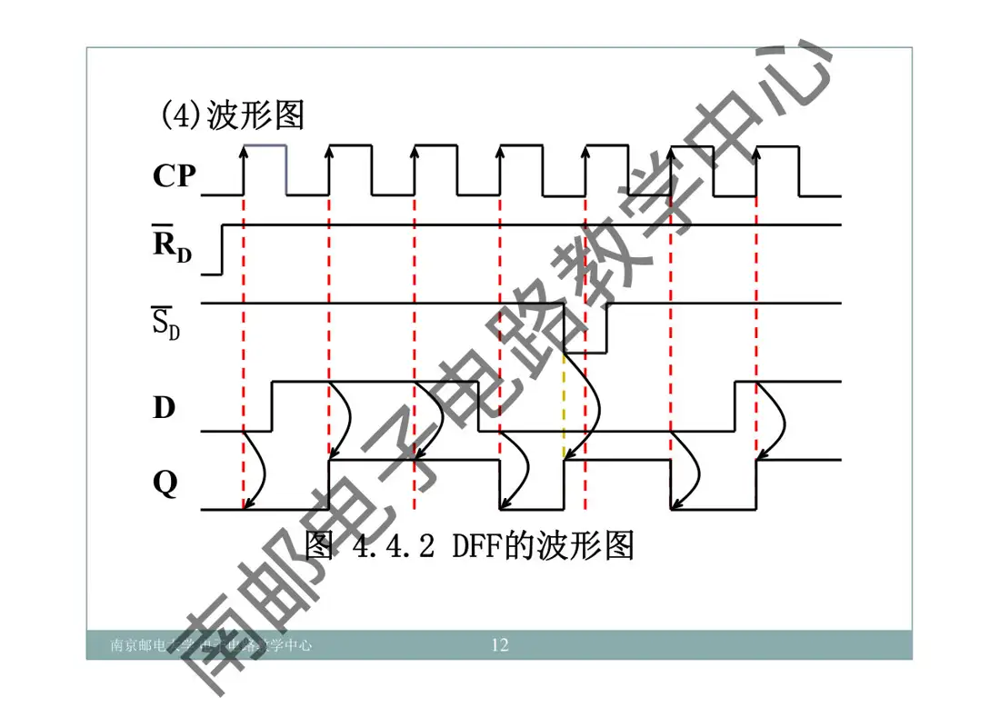

原文：

(4) 波形图

南京邮电大学电子电路教学中心

12

### 3. 动态特性

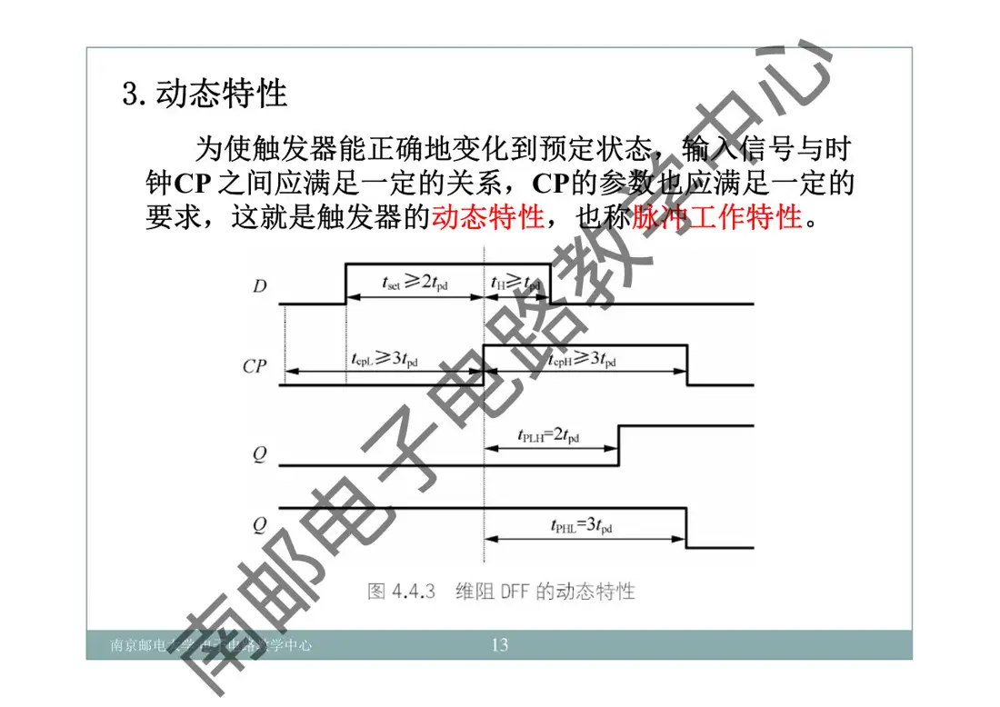

原文：

3. 动态特性

为使触发器能正确地变化到预定状态，输入信号与时钟CP之间应满足一定的关系，CP的参数也应满足一定的要求，这就是触发器的动态特性，也称脉冲工作特性。

南京邮电大学电子电路教学中心

13

### (1) 对信号D 的要求 ( $t_{set}$ , $t_{H}$ )

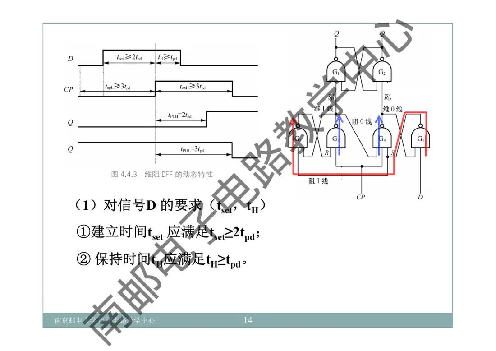

原文：

(1) 对信号D 的要求 ( $t_{set}$ , $t_{H}$ )

①建立时间 $t_{set}$ 应满足 $t_{set}\geq2t_{pd}$ ;

② 保持时间 $t_{H}$ 应满足 $t_{H}\geq t_{pd}$ 。

南京邮电大学电子电路教学中心

14

### (2) 对CP的要求 ( $t_{cpL}$ , $t_{cpH}$ )

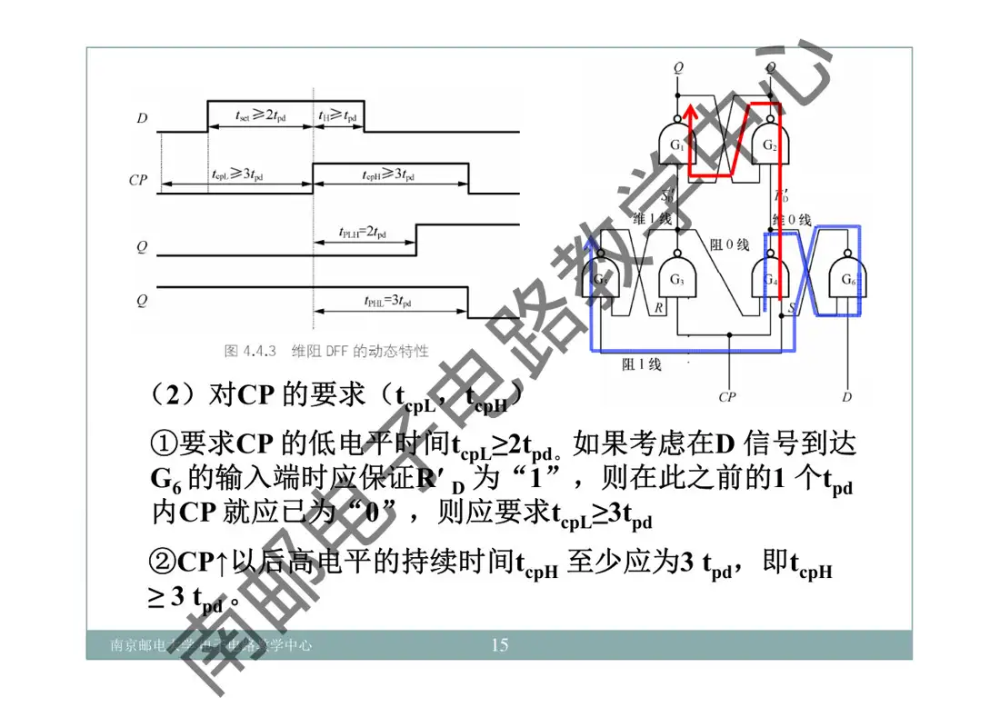

原文：

(2) 对CP的要求 ( $t_{cpL}$ , $t_{cpH}$ )

①要求CP的低电平时间 $t_{cpL}\geq2t_{pd}$ 。如果考虑在D信号到达 $G_{6}$ 的输入端时应保证 $R'_{D}$ 为“1”，则在此之前的1个 $t_{pd}$ 内CP就应已为“0”，则应要求 $t_{cpL}\geq3t_{pd}$

②CP↑以后高电平的持续时间 $t_{cpH}$ 至少应为3 $t_{pd}$ ，即 $t_{cpH} \geq 3t_{pd}$ 。

南京邮电大学电子电路教学中心

15

### (3) 传输延迟时间 ( $t_{PLH}$ , $t_{PHL}$ )

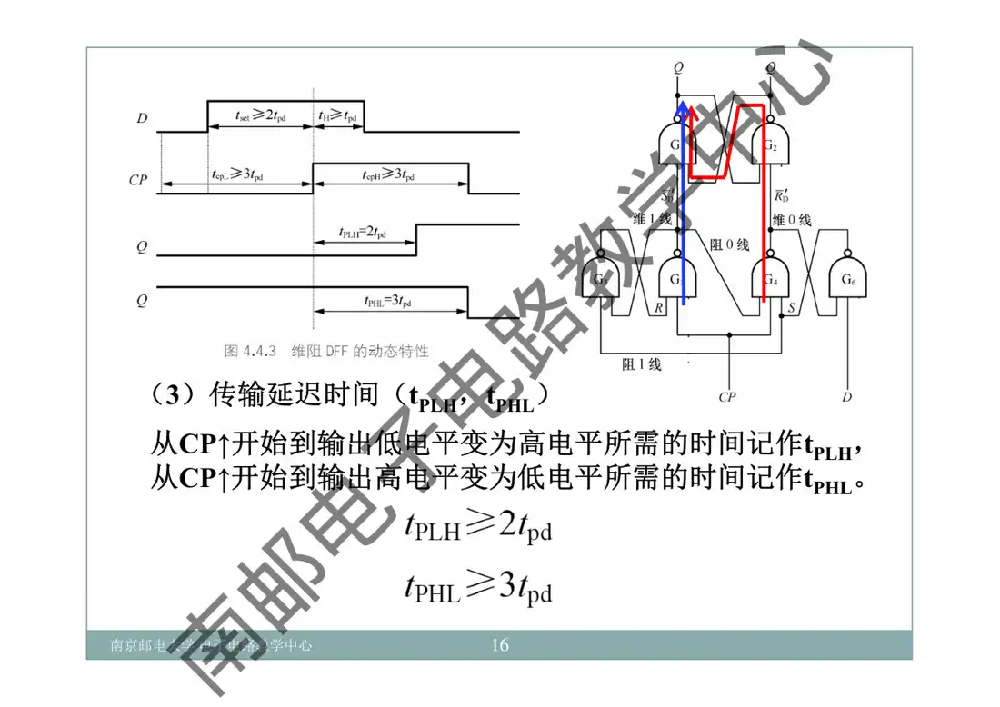

原文：

(3) 传输延迟时间 ( $t_{PLH}$ , $t_{PHL}$ )

从CP↑开始到输出低电平变为高电平所需的时间记作 $t_{PLH}$ ，从CP↑开始到输出高电平变为低电平所需的时间记作 $t_{PHL}$ 。

$$
t _ {\mathrm{PLH}} \geqslant 2 t _ {\mathrm{pd}}
$$

$$
t _ {\mathrm{PHL}} \geqslant 3 t _ {\mathrm{pd}}
$$

南京邮电大学电子电路教学中心

16

### (4) 最高时钟频率

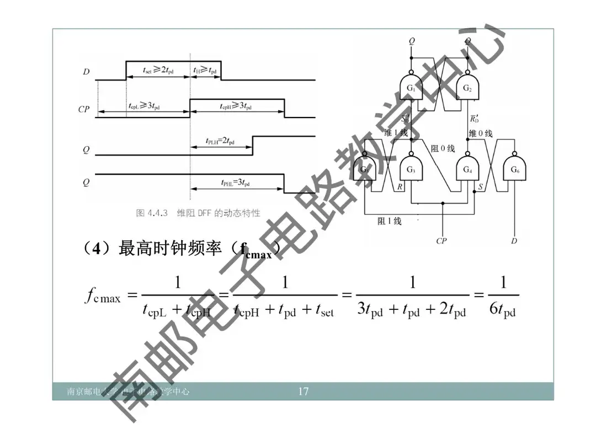

原文：

(4) 最高时钟频率

$$
f _ {\mathrm{cmax}} = \frac {1}{t _ {\mathrm{cpL}} + t _ {\mathrm{cpH}}} = \frac {1}{t _ {\mathrm{cpH}} + t _ {\mathrm{pd}} + t _ {\mathrm{set}}} = \frac {1}{3 t _ {\mathrm{pd}} + t _ {\mathrm{pd}} + 2 t _ {\mathrm{pd}}} = \frac {1}{6 t _ {\mathrm{pd}}}
$$

南京邮电大学电子电路教学中心

17
