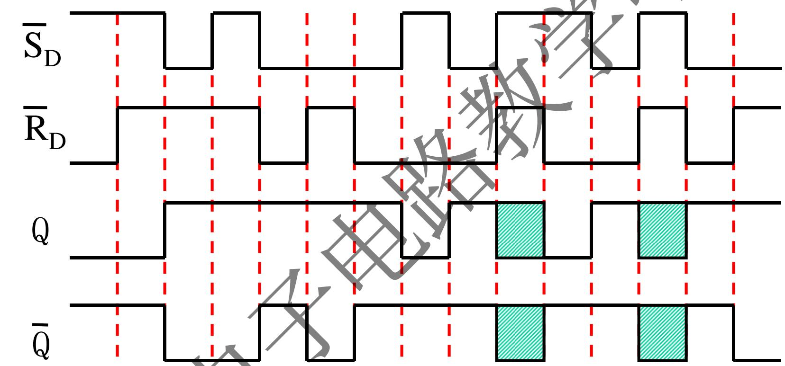

# 《数字电路与系统设计》第四章 触发器习题课

原件经识别和整理；“参考解答”是我们补的。

# 《数字电路与系统设计》第四章 触发器习题课

## 一、习题

### 1. 基本触发器的逻辑符号与输入波形如图 P4.1 所示。试作出 $Q$、$\overline{Q}$ 的波形。

知识点：[数字系统的基本模型（数据处理器与控制器）及对最小时钟周期、异步信号同步化的约定](../../../topics/数字逻辑电路/数字系统模型.md)

### 2. 图 P4.2 电路，在开关 S 由 A 点拨到 B 点，再由 B 点拨回 A 点过程中，A、B 两点电压波形如图中所示。试作出 Q 和 $\overline{Q}$ 端的波形。

知识点：[数字系统的基本模型（数据处理器与控制器）及对最小时钟周期、异步信号同步化的约定](../../../topics/数字逻辑电路/数字系统模型.md)

### 3. 对于图 P4.3 电路，试导出其特征方程并说明对 A、B 的取值有无约束条件。

**解：**
(1) 列真值表如下：

| A | B | $Q^{n+1}$ |
| :---: | :---: | :---: |
| 0 | 0 | 1 |
| 0 | 1 | 1 |
| 1 | 0 | $Q^n$ |
| 1 | 1 | 1 |

(2) 求特征方程：

$$
Q ^ {n + 1} = \overline {{A}} + B + Q ^ {n}
$$

对 A、B 的取值无约束条件。

知识点：[数字系统的基本模型（数据处理器与控制器）及对最小时钟周期、异步信号同步化的约定](../../../topics/数字逻辑电路/数字系统模型.md)、[寄存器传输语言(RTL)描述的传输操作、算术操作、逻辑操作、移位操作及条件控制语句](../../../topics/数字逻辑电路/RTL语言.md)

### 5. 试写出图 P4.5 各触发器的次态方程。

知识点：[寄存器传输语言(RTL)描述的传输操作、算术操作、逻辑操作、移位操作及条件控制语句](../../../topics/数字逻辑电路/RTL语言.md)

### 8. 画出图 P4.8 电路中 Q 端的波形。设初态为“0”。

**解：**
特征方程为：
$$
Q ^ { n + 1 } = D = \overline { { Q } } ^ { n } \oplus A
$$

知识点：[数字系统的基本模型（数据处理器与控制器）及对最小时钟周期、异步信号同步化的约定](../../../topics/数字逻辑电路/数字系统模型.md)、[寄存器传输语言(RTL)描述的传输操作、算术操作、逻辑操作、移位操作及条件控制语句](../../../topics/数字逻辑电路/RTL语言.md)

### 11. 画出图 P4.11 电路中 $Q _ { 1 }$ 和 $Q _ { 2 }$ 的波形。

**解：**
特征方程为：

$Q_1$、$Q_2$ 端波形如下所示。

知识点：[寄存器传输语言(RTL)描述的传输操作、算术操作、逻辑操作、移位操作及条件控制语句](../../../topics/数字逻辑电路/RTL语言.md)

### 12. 试作出图 P4.12 电路中 Q 和 Z 端的波形。设 Q 的初态为“0”。

知识点：[数字系统的基本模型（数据处理器与控制器）及对最小时钟周期、异步信号同步化的约定](../../../topics/数字逻辑电路/数字系统模型.md)、[控制器的四种硬件实现方法：每态一触发器法(SSI)、MSI法(MUX+寄存器+译码器)、PLA法(LSI)及对比](../../../topics/数字逻辑电路/控制器实现方法.md)

### 14. 试作出图 P4.14 电路中 $Q _ { \mathrm { A } }$ 和 $Q _ { \mathrm { B } }$ 端的波形。

$$
[ \mathbf {Q} _ {\mathrm{B}} ^ {\mathrm{n}} ] \cdot \mathbf {A} \uparrow
$$

$$
\mathbf {Q} _ {\mathrm{B}} ^ {\mathrm{n+1}} = [ \overline {{\mathbf {Q}}} _ {\mathrm{A}} ^ {\mathrm{n}} ] \cdot \mathbf {B} \uparrow
$$

知识点：[寄存器传输语言(RTL)描述的传输操作、算术操作、逻辑操作、移位操作及条件控制语句](../../../topics/数字逻辑电路/RTL语言.md)、[完整数字系统设计流程实例（如乘法器、交通灯管理系统的算法规律、处理器设计与控制器实现）](../../../topics/数字逻辑电路/数字系统设计实例.md)、[算法状态机(ASM)图的状态框、判断框、条件输出框及ASM块的构成规则](../../../topics/数字逻辑电路/ASM图基础.md)

### 17. 试作出图 P4.17 电路中 $Q _ { 1 }, Q _ { 2 }$ 的波形。

$$
Q _ {1} ^ {n + 1}
$$

$$
\mathbf {Q} _ {2} ^ {\mathrm{n+1}} = [ \overline {{\mathbf {Q}}} _ {2} ^ {\mathrm{n}} ] \cdot \mathbf {Q} _ {1} \downarrow
$$

知识点：[数字系统的基本模型（数据处理器与控制器）及对最小时钟周期、异步信号同步化的约定](../../../topics/数字逻辑电路/数字系统模型.md)
