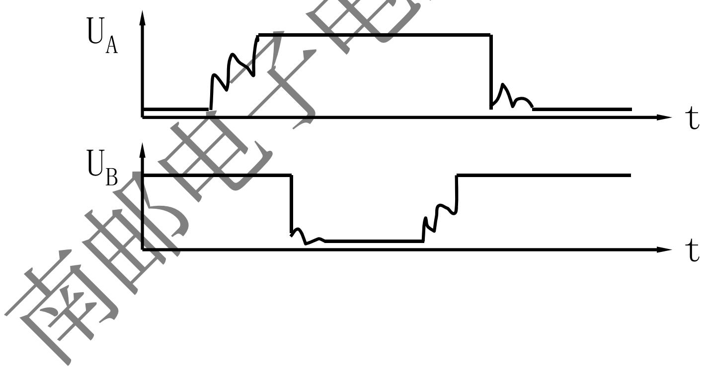
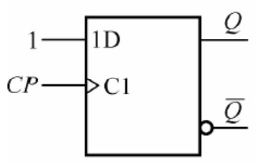
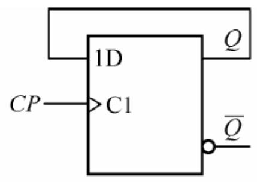
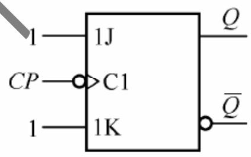
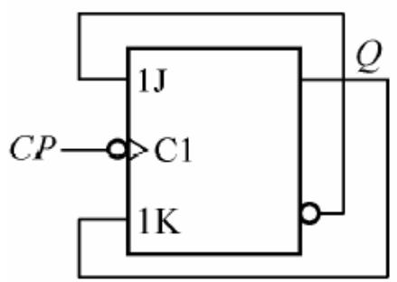
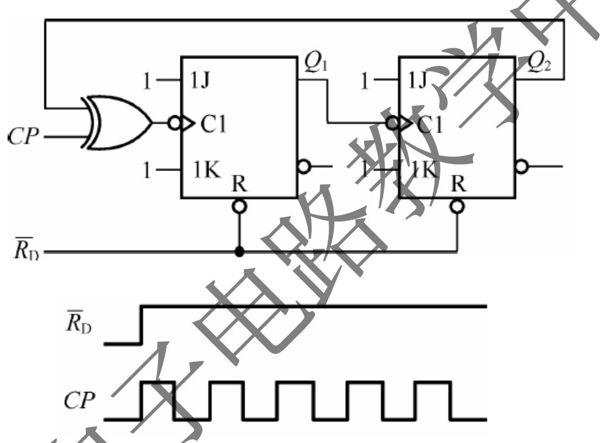

# 《数字电路与系统设计》第四章 触发器习题课

原件经识别和整理；“参考解答”是我们补的。

# 《数字电路与系统设计》第四章 触发器习题课

## 一、习题

### 1. 基本触发器的逻辑符号与输入波形如图 P4.1 所示。试作出 $Q$、$\overline{Q}$ 的波形。


参考解答：由于题目要求作出波形图，我们直接给出每个触发器的输出逻辑表达式，即可确定波形的关键变化点。

**结论**

设触发器初始状态为 $0$。

*   **(a) 基本 $RS$ 触发器 (与非门构成)**
    *   **逻辑特性**：$S_N, R_N$ 低电平有效。$\overline{S_N}=0, \overline{R_N}=1 \Rightarrow Q=1$；$\overline{S_N}=1, \overline{R_N}=0 \Rightarrow Q=0$；$\overline{S_N}=1, \overline{R_N}=1 \Rightarrow Q$ 保持。
    *   **波形推导**：
        1.  起始 $\overline{S_N}=1, \overline{R_N}=1$，保持 $Q=0$。
        2.  $t_1$ 时刻 $\overline{S_N}=0, \overline{R_N}=1$，置 $1$，$Q=1$。
        3.  $t_2$ 时刻 $\overline{S_N}=1, \overline{R_N}=1$，保持 $Q=1$。
        4.  $t_3$ 时刻 $\overline{S_N}=1, \overline{R_N}=0$，置 $0$，$Q=0$。
        5.  $t_4$ 时刻 $\overline{S_N}=0, \overline{R_N}=1$，置 $1$，$Q=1$。
        6.  $t_5$ 时刻 $\overline{S_N}=1, \overline{R_N}=1$，保持 $Q=1$。
        7.  **注意 $t_6$ 时刻**：$\overline{S_N}=0, \overline{R_N}=0$，此时输出 $Q=1, \overline{Q}=1$。
        8.  $t_7$ 时刻 $\overline{S_N}=1, \overline{R_N}=1$，输入同时撤销，状态不定（$Q$ 与 $\overline{Q}$ 均变为高电平）。
        9.  $t_8$ 时刻 $\overline{S_N}=1, \overline{R_N}=0$，置 $0$，$Q=0$。
        10. $t_9$ 时刻 $\overline{S_N}=1, \overline{R_N}=1$，保持 $Q=0$。

*   **(b) 同步 $RS$ 触发器**
    *   **逻辑特性**：$CP=1$ 时，$S=1, R=0 \Rightarrow Q=1$；$S=0, R=1 \Rightarrow Q=0$；$S=0, R=0 \Rightarrow Q$ 保持。
    *   **波形推导**：
        1.  $CP=0$ 期间，$Q$ 保持初始状态 $0$。
        2.  $CP=1$ 期间，跟随 $S, R$ 的变化：
            *   $S=0, R=0 \Rightarrow Q=0$。
            *   $S=1, R=0 \Rightarrow Q=1$。
            *   $S=0, R=1 \Rightarrow Q=0$。
        3.  $CP$ 下降沿之后，$Q$ 保持最后一次确定的状态。

*   **(c) $D$ 触发器 (电平触发)**
    *   **逻辑特性**：$CP=1$ 时，$Q=D$ (跟随)；$CP=0$ 时，$Q$ 保持。
    *   **波形推导**：$CP$ 为高电平的期间，输出波形形状完全复制输入 $D$ 的波形；$CP$ 低电平期间输出平坦。

*   **(d) $JK$ 触发器 (主从型)**
    *   **逻辑特性**：主从结构，状态在 $CP$ 下降沿（$\downarrow$）翻转。$J=1, K=0 \Rightarrow Q=1$；$J=0, K=1 \Rightarrow Q=0$；$J=K=1 \Rightarrow Q$ 翻转（$\overline{Q}$）。
    *   **波形推导**：
        1.  第一个 $\downarrow$：$J=0, K=1 \Rightarrow Q=0$。
        2.  第二个 $\downarrow$：$J=1, K=0 \Rightarrow Q=1$。
        3.  第三个 $\downarrow$：$J=1, K=0 \Rightarrow Q=1$。
        4.  第四个 $\downarrow$：$J=1, K=1 \Rightarrow Q$ 翻转，由 $1$ 变 $0$。
        5.  第五个 $\downarrow$：$J=1, K=1 \Rightarrow Q$ 翻转，由 $0$ 变 $1$。
        6.  第六个 $\downarrow$：$J=1, K=1 \Rightarrow Q$ 翻转，由 $1$ 变 $0$。

知识点：[数字系统的基本模型（数据处理器与控制器）及对最小时钟周期、异步信号同步化的约定](../../../topics/数字逻辑电路/数字系统模型.md)

### 2. 图 P4.2 电路，在开关 S 由 A 点拨到 B 点，再由 B 点拨回 A 点过程中，A、B 两点电压波形如图中所示。试作出 Q 和 $\overline{Q}$ 端的波形。



参考解答：### 结论

该电路为由两个与非门构成的 **基本 $RS$ 锁存器**（低电平有效）：

- 开关在 $A$：$\overline S=0$，$\overline R=1$，触发器置位，$Q=1$，$\overline Q=0$；
- 开关在 $B$：$\overline S=1$，$\overline R=0$，触发器复位，$Q=0$，$\overline Q=1$；
- 开关悬空：$\overline S=1$，$\overline R=1$，触发器保持原状态。

所以，开关从 $A$ 拨到 $B$ 后：

- $Q$：$1 \rightarrow 0$；
- $\overline Q$：$0 \rightarrow 1$；
- 拨回 $A$ 后：
- $Q$：$0 \rightarrow 1$；
- $\overline Q$：$1 \rightarrow 0$。

---

### 波形

```
A端      ────┐             ┌────────
             └─────────────┘

B端      ─────────────┐
                      └────────────

Q        ────┐         ┌──────────
             └─────────┘

Q̄        ──────────────┐         ┌
                       └─────────┘
```

---

### 简要推理

两个交叉耦合的与非门组成基本 $RS$ 锁存器，其功能表为：

| $\overline S$ | $\overline R$ | $Q$ | $\overline Q$ | 状态 |
|---|---|---|---|---|
| 0 | 1 | 1 | 0 | 置位 |
| 1 | 0 | 0 | 1 | 复位 |
| 1 | 1 | 保持 | 保持 | 保持 |

由于开关切换过程中会经历“悬空”状态，此时两个输入都为高电平，锁存器保持原状态。因此波形不会在悬空期间不确定，而是在重新接到 $A$ 或 $B$ 后才翻转。

知识点：[数字系统的基本模型（数据处理器与控制器）及对最小时钟周期、异步信号同步化的约定](../../../topics/数字逻辑电路/数字系统模型.md)

### 3. 对于图 P4.3 电路，试导出其特征方程并说明对 A、B 的取值有无约束条件。

**解：**
(1) 列真值表如下：

| A | B | $Q^{n+1}$ |
| :---: | :---: | :---: |
| 0 | 0 | 1 |
| 0 | 1 | 1 |
| 1 | 0 | $Q^n$ |
| 1 | 1 | 1 |

(2) 求特征方程：

$$
Q ^ {n + 1} = \overline {{A}} + B + Q ^ {n}
$$

对 A、B 的取值无约束条件。

参考解答：**结论**

特征方程为：

$$
Q^{n+1} = \overline{A} + B + Q^n
$$

对 $A$、$B$ 的取值**无约束条件**。

---

**推理过程**

**1. 由真值表求特征方程**

根据题目给出的真值表，列出 $Q^{n+1}$ 关于 $A, B, Q^n$ 的最小项表达式。$Q^{n+1}=1$ 对应的最小项为：

$$
Q^{n+1} = \sum m(0,1,2,3,5,7)
$$

即仅当 $(A,B,Q^n)=(1,0,0)$ 时 $Q^{n+1}=0$，其余情况均为 1。因此唯一使输出为 0 的最大项为 $M_4$（对应 $A=1, B=0, Q^n=0$），故：

$$
Q^{n+1} = \overline{M_4} = \overline{A \cdot \overline{B} \cdot \overline{Q^n}} = \overline{A} + B + Q^n
$$

也可通过卡诺图化简验证：在 3 变量卡诺图中，仅 $A\overline{B}\,\overline{Q^n}$ 一格为 0，其余全为 1，直接圈 1 即可得到上述最简与或式。

**2. 约束条件分析**

- 触发器输入存在约束条件的典型情况是 **基本 RS 锁存器**（要求 $S \cdot R = 0$，即不允许 $S=R=1$）。
- 本题中，将 $A$、$B$ 的所有 4 种组合代入真值表，$Q^{n+1}$ 均有确定的逻辑值（要么恒为 1，要么保持 $Q^n$），**不存在不定态或非法状态**。
- 因此，$A$、$B$ 可以取任意组合，无约束条件。

知识点：[数字系统的基本模型（数据处理器与控制器）及对最小时钟周期、异步信号同步化的约定](../../../topics/数字逻辑电路/数字系统模型.md)、[寄存器传输语言(RTL)描述的传输操作、算术操作、逻辑操作、移位操作及条件控制语句](../../../topics/数字逻辑电路/RTL语言.md)

### 5. 试写出图 P4.5 各触发器的次态方程。










参考解答：先给结论：

(a)  

$$
Q^{n+1}=D=T\oplus Q^n
$$


(b)  

$$
Q^{n+1}=J\overline{Q^n}+\overline K Q^n
$$


(c)  

$$
Q^{n+1}=\overline{K_1\oplus Q^n}
$$


(d)  

$$
Q^{n+1}=\overline{Q^n}
$$


(e)  

$$
Q^{n+1}=Q^n
$$


(h)  

$$
Q^{n+1}=\overline{D_1\oplus Q^n}
$$


---

简明推理：

(a) 图(a)为 D 触发器，输入 $D$ 由异或门给出 $D=T\oplus Q^n$，所以次态为  

$$
Q^{n+1}=D=T\oplus Q^n
$$


(b) 图(b)为 JK 触发器，直接按 JK 特性方程  

$$
Q^{n+1}=J\overline{Q^n}+\overline K Q^n
$$


(c) 图(c)为一个触发器，其激励输入为 $\overline{K_1\oplus Q^n}$，接到 D 端或等效激励端，因此  

$$
Q^{n+1}=\overline{K_1\oplus Q^n}
$$


(d) 图(d)为 T' 触发器（T 固定接 1），满足  

$$
Q^{n+1}=\overline{Q^n}
$$


(e) 图(e)为 T 触发器且 T 固定接 0，状态保持，故  

$$
Q^{n+1}=Q^n
$$


(h) 图(h)类似(c)，输入组合逻辑为 $\overline{D_1\oplus Q^n}$，因此  

$$
Q^{n+1}=\overline{D_1\oplus Q^n}
$$


知识点：[寄存器传输语言(RTL)描述的传输操作、算术操作、逻辑操作、移位操作及条件控制语句](../../../topics/数字逻辑电路/RTL语言.md)

### 8. 画出图 P4.8 电路中 Q 端的波形。设初态为“0”。

**解：**
特征方程为：
$$
Q ^ { n + 1 } = D = \overline { { Q } } ^ { n } \oplus A
$$

参考解答：**结论：** $Q$ 端波形由特征方程 $Q^{n+1} = \overline{Q}^n \oplus A$ 决定，在时钟有效边沿（上升沿或下降沿，视具体触发器类型而定）到来时，根据当前输入 $A$ 和当前状态 $Q^n$ 翻转或保持。

**推理与计算过程：**

1. **分析电路结构**：D 触发器的输入端 $D$ 接的是 $\overline{Q}^n$ 与输入信号 $A$ 的异或结果，因此特征方程为：
   $$Q^{n+1} = D = \overline{Q}^n \oplus A$$

2. **列出状态转移关系**（设初态 $Q^0 = 0$）：
   - 当 $A = 0$ 时：$Q^{n+1} = \overline{Q}^n \oplus 0 = \overline{Q}^n$，即每个时钟有效边沿 $Q$ **翻转**。
   - 当 $A = 1$ 时：$Q^{n+1} = \overline{Q}^n \oplus 1 = Q^n$，即每个时钟有效边沿 $Q$ **保持**不变。

3. **画波形的关键步骤**：
   - 确定触发器的触发边沿（图 P4.8 中若为上升沿触发则在 CP 上升沿采样，若为下降沿则在下降沿采样）。
   - 初态 $Q = 0$。
   - 在每个有效边沿处，查看该时刻 $A$ 的值：
     - 若 $A=0$，则 $Q$ 取反；
     - 若 $A=1$，则 $Q$ 维持前一状态。
   - 两个有效边沿之间 $Q$ 保持不变。

> **绘图要点总结表：**

| 时钟有效边沿 | $A$ | $\overline{Q}^n$ | $Q^{n+1} = \overline{Q}^n \oplus A$ | 动作 |
|:---:|:---:|:---:|:---:|:---:|
| 第 1 个 | 0 | 1 | 1 | 翻转 (0→1) |
| 第 2 个 | 0 | 0 | 0 | 翻转 (1→0) |
| 第 3 个 | 1 | 1 | 1 | 保持 (0→0? 需按实际值) |
| ... | ... | ... | ... | ... |

*注：因无法显示图片，请依据上述规则对照图 P4.8 中的 CP 和 A 波形，逐边沿画出 Q 波形即可。核心记忆口诀：**$A=0$ 翻转，$A=1$ 保持**。*

知识点：[数字系统的基本模型（数据处理器与控制器）及对最小时钟周期、异步信号同步化的约定](../../../topics/数字逻辑电路/数字系统模型.md)、[寄存器传输语言(RTL)描述的传输操作、算术操作、逻辑操作、移位操作及条件控制语句](../../../topics/数字逻辑电路/RTL语言.md)

### 11. 画出图 P4.11 电路中 $Q _ { 1 }$ 和 $Q _ { 2 }$ 的波形。

**解：**
特征方程为：

$Q_1$、$Q_2$ 端波形如下所示。

参考解答：**结论：**  
$Q_1$ 在 $CP$ 的下降沿翻转，$Q_2$ 在 $CP$ 的上升沿翻转，且 $Q_2$ 的状态取决于 $Q_1$ 的当前状态。

**推理过程：**  
1. **特征方程**：  
   - 对于 $Q_1$（JK 触发器）：  
     $Q_1^{n+1} = J \overline{Q_1^n} + \overline{K} Q_1^n = \overline{Q_1^n}$（因为 $J = K = 1$）。  
   - 对于 $Q_2$（D 触发器）：  
     $Q_2^{n+1} = D = Q_1^n$。

2. **波形绘制**：  
   - $Q_1$ 在 $CP$ 的下降沿翻转，形成二分频波形。  
   - $Q_2$ 在 $CP$ 的上升沿跟随 $Q_1$ 的状态，波形与 $Q_1$ 相同，但延迟半个 $CP$ 周期。

**波形图：**  
```
CP:  ┌─┐ ┌─┐ ┌─┐ ┌─┐
     │ │ │ │ │ │ │ │
     └─┘ └─┘ └─┘ └─┘

Q1:  ┌───┐   ┌───┐
     │   │   │   │
     └───┘   └───┘

Q2:    ┌───┐   ┌───┐
       │   │   │   │
       └───┘   └───┘
```

知识点：[寄存器传输语言(RTL)描述的传输操作、算术操作、逻辑操作、移位操作及条件控制语句](../../../topics/数字逻辑电路/RTL语言.md)

### 12. 试作出图 P4.12 电路中 Q 和 Z 端的波形。设 Q 的初态为“0”。

参考解答：由于题目所引用的图 P4.12 未提供，无法确定具体电路结构（如触发器类型、输入信号波形、组合逻辑连接等），因此**无法作出 Q 和 Z 端的准确波形**。

若假设图 P4.12 为典型教材中常见的由 D 触发器构成的时序电路（例如 D 触发器带反馈或简单组合输出），则一般解题步骤如下：  
1. 根据电路图写出触发器的驱动方程（如 $D = f(X, Q^n)$）和输出方程（如 $Z = g(X, Q^n)$）；  
2. 利用 D 触发器特性方程 $Q^{n+1} = D$，结合时钟边沿时刻的输入值，逐拍计算 $Q$ 的次态；  
3. 将每个时钟周期内的 $Q^n$ 代入输出方程，得到对应时刻的 $Z$ 值；  
4. 初态 $Q^0 = 0$，从第一个有效时钟边沿开始绘制波形，注意建立/保持时间及异步复位（若有）。  

但以上仅为通用方法，**实际答案完全依赖于图 P4.12 的具体内容**。建议核对原题附图后重新提问。

知识点：[数字系统的基本模型（数据处理器与控制器）及对最小时钟周期、异步信号同步化的约定](../../../topics/数字逻辑电路/数字系统模型.md)、[控制器的四种硬件实现方法：每态一触发器法(SSI)、MSI法(MUX+寄存器+译码器)、PLA法(LSI)及对比](../../../topics/数字逻辑电路/控制器实现方法.md)

### 14. 试作出图 P4.14 电路中 $Q _ { \mathrm { A } }$ 和 $Q _ { \mathrm { B } }$ 端的波形。

$$
[ \mathbf {Q} _ {\mathrm{B}} ^ {\mathrm{n}} ] \cdot \mathbf {A} \uparrow
$$

$$
\mathbf {Q} _ {\mathrm{B}} ^ {\mathrm{n+1}} = [ \overline {{\mathbf {Q}}} _ {\mathrm{A}} ^ {\mathrm{n}} ] \cdot \mathbf {B} \uparrow
$$

参考解答：先看两个触发器的连接关系和触发条件：

- 第一个触发器由 A 的上升沿触发，其状态方程为  
  
$$
Q_B^{n+1}=\overline{Q_A^n}
$$

- 第二个触发器由 B 的上升沿触发，其状态方程为  
  
$$
Q_A^{n+1}=\overline{Q_B^n}
$$


因此这是两个触发器互相取反的交叉耦合结构，但各自触发时钟不同。

---

**结论**  
$Q_A$ 在 B 的上升沿翻转，$Q_B$ 在 A 的上升沿翻转。若初始 $Q_A=0,Q_B=0$，则两者分别在各自的触发时钟沿依次取反，形成交替变化。

---

**推理过程**

设初始状态 $Q_A=0,Q_B=0$。

- 当 A 上升沿到来时，  
  
$$
Q_B^{n+1}=\overline{Q_A^n}=\overline{0}=1
$$

  此时 $Q_A$ 不变。

- 当 B 上升沿到来时，  
  
$$
Q_A^{n+1}=\overline{Q_B^n}=\overline{1}=0
$$

  此时 $Q_B$ 不变。

- 下一次 A 上升沿：  
  
$$
Q_B^{n+1}=\overline{Q_A^n}=\overline{0}=1
$$

  状态保持不变。

- 下一次 B 上升沿：  
  
$$
Q_A^{n+1}=\overline{Q_B^n}=\overline{1}=0
$$


可以看出：  
如果 A、B 的上升沿交替出现，则 $Q_A$ 与 $Q_B$ 会在各自时钟沿到来时按取反规律变化；但若只有其中一个时钟反复出现，另一个输出会保持或只在一个电平上翻转后维持，具体波形取决于 A、B 的相位关系。

因此输出波形不是自由振荡，而是完全由 A、B 上升沿的先后顺序决定。

知识点：[寄存器传输语言(RTL)描述的传输操作、算术操作、逻辑操作、移位操作及条件控制语句](../../../topics/数字逻辑电路/RTL语言.md)、[完整数字系统设计流程实例（如乘法器、交通灯管理系统的算法规律、处理器设计与控制器实现）](../../../topics/数字逻辑电路/数字系统设计实例.md)、[算法状态机(ASM)图的状态框、判断框、条件输出框及ASM块的构成规则](../../../topics/数字逻辑电路/ASM图基础.md)

### 17. 试作出图 P4.17 电路中 $Q _ { 1 }, Q _ { 2 }$ 的波形。



$$
Q _ {1} ^ {n + 1}
$$

$$
\mathbf {Q} _ {2} ^ {\mathrm{n+1}} = [ \overline {{\mathbf {Q}}} _ {2} ^ {\mathrm{n}} ] \cdot \mathbf {Q} _ {1} \downarrow
$$

参考解答：$Q_1$ 为输入时钟 $CP$ 的二分频波形（下降沿翻转），$Q_2$ 在 $Q_1$ 的每个下降沿时刻翻转，即 $Q_2$ 为 $Q_1$ 的二分频、$CP$ 的四分频波形，且两者初始状态均为 0。

**推理与关键步骤：**

1.  **分析 $FF_1$**：由图及方程 $Q_1^{n+1} = \overline{Q_1^n}$ 可知，$FF_1$ 构成 T' 触发器（或 D=$\overline{Q}$ 的 D 触发器），在 $CP$ 下降沿触发翻转。设初态 $Q_1=0$，则 $Q_1$ 在每个 $CP$ 下降沿取反，周期为 $2T_{CP}$。
2.  **分析 $FF_2$**：由给定方程 $Q_2^{n+1} = [\overline{Q_2^n}] \cdot (Q_1 \downarrow)$ 可知，$FF_2$ 同样构成 T' 触发器，但其时钟信号为 $Q_1$ 的下降沿。仅当 $Q_1$ 产生下降沿时，$Q_2$ 才发生状态翻转。
3.  **波形关系**：$Q_1$ 每经历一个完整周期（两次 $CP$ 下降沿）产生一次自身的下降沿，该下降沿触发 $Q_2$ 翻转一次。因此 $Q_2$ 的变化频率是 $Q_1$ 的一半、$CP$ 的四分之一。若初态均为 0，则 $Q_1$ 在第一个 $CP\downarrow$ 变 1，第二个 $CP\downarrow$ 变 0（此时产生 $Q_1\downarrow$），$Q_2$ 在该时刻由 0 变 1，依此类推。

知识点：[数字系统的基本模型（数据处理器与控制器）及对最小时钟周期、异步信号同步化的约定](../../../topics/数字逻辑电路/数字系统模型.md)
