# 《数字电路与系统设计》第四章 触发器（第一节 概述）

原件的每一页，下面附识别出的文字。

### 第 四 章 触发 器 （ F l i p F l op ）

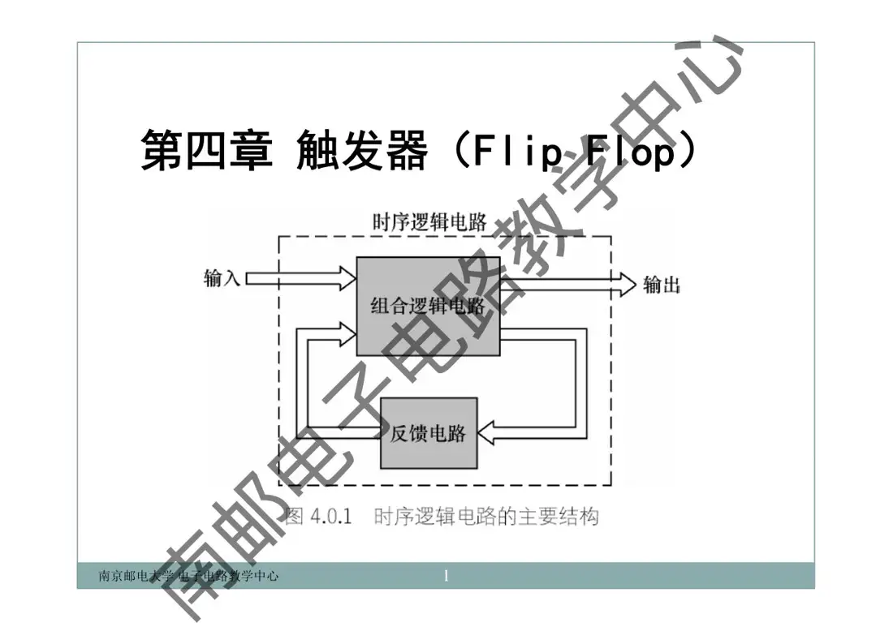

原文：

第 四 章 触发 器 （ F l i p F l op ）

南京邮电大学 电子电路教学中心

1

### 第 四 章 触发 器 （ F l i p F l op ）

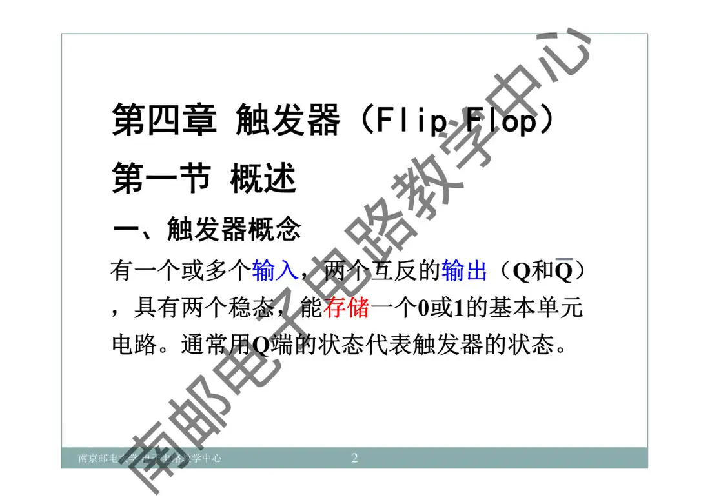

原文：

第 四 章 触发 器 （ F l i p F l op ）

第一节 概述

一、 触发器概念

有一个或多个输入， 两个互反的输出 （Q和Q）， 具有两个稳态， 能存储一个0或1的基本单元电路。 通常用Q端的状态代表触发器的状态。

南京邮电大学 电子电路教学中心

2

### 南京邮电大学 电子电路教学中心

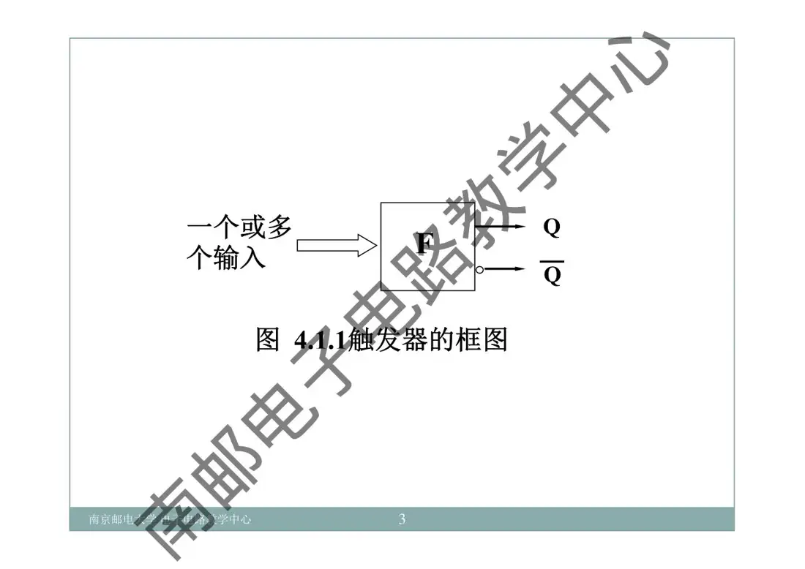

原文：

南京邮电大学 电子电路教学中心

3

### 二、 触发器的分类

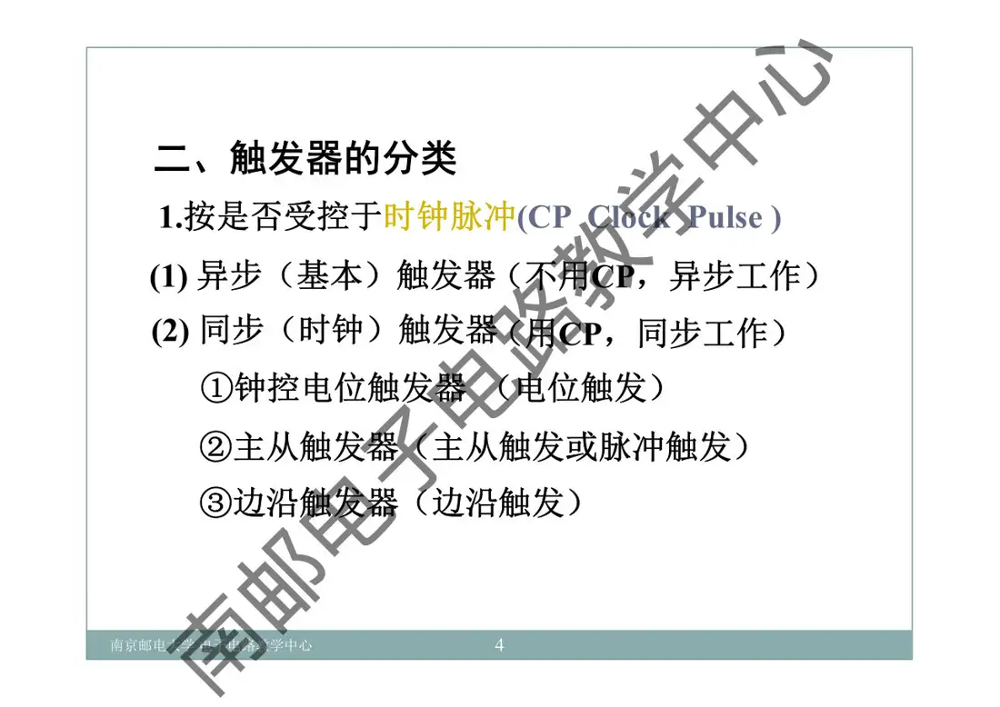

原文：

二、 触发器的分类

1.按是否 受控于 时钟脉冲(CP Clock Pulse )

(1) 异步 （基本） 触发器 （不用CP 异步工作 ），

(2) 同步 （ 时钟 ） 触发器 （ 用CP， 同步工作 ）

①钟控电位触发器 （ 电位触发）

②主从触发器 （主从触发或脉冲触发）

③边沿触发器 （边沿触发）

南京邮电大学 电子电路教学中心

4

### 2. 按实现的逻辑功能

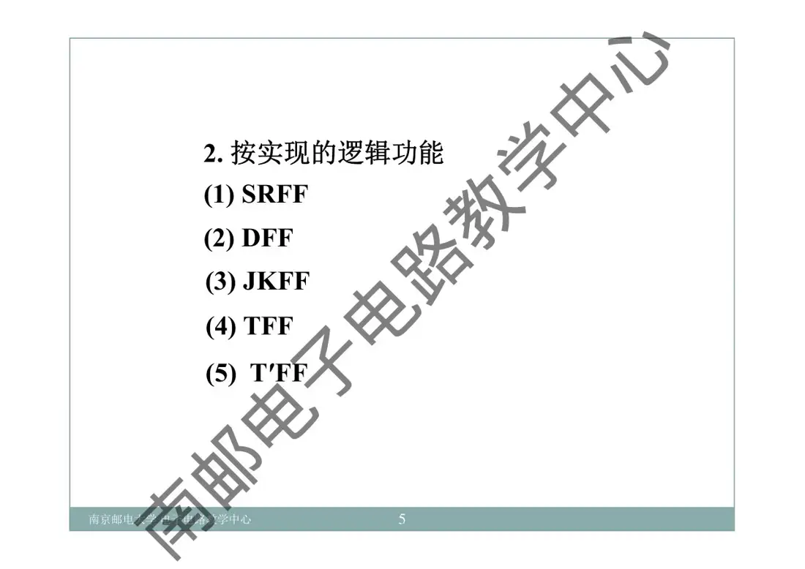

原文：

2. 按实现的逻辑功能

(1) SRFF

(2) DFF

(3) JKFF

(4) TFF

(5) T ′FF

南京邮电大学 电子电路教学中心

5

### 1. 电路构成

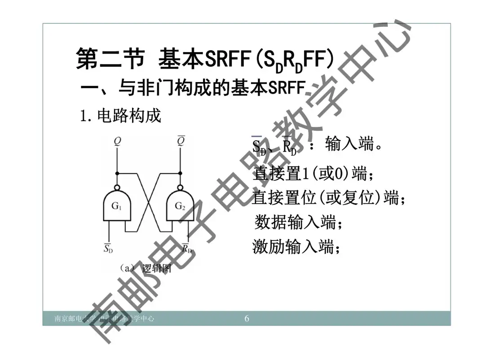

原文：

第二节 基本SRFF $( S _ { \mathrm { \mathfrak { p } } } \mathbb { R } _ { \mathfrak { p } } \mathbb { F } \mathbb { F } )$ 一、 与非门构成的基本SRFF

1. 电路构成

(a逻辑图

： 输入端。

直接置1 (或0) 端 ；

直接置位 (或复位) 端；

数据输入端；

激励输 端入 ；

南京邮电大学 电子电路教学中心

6

### 南京邮电大学 电子电路教学中心

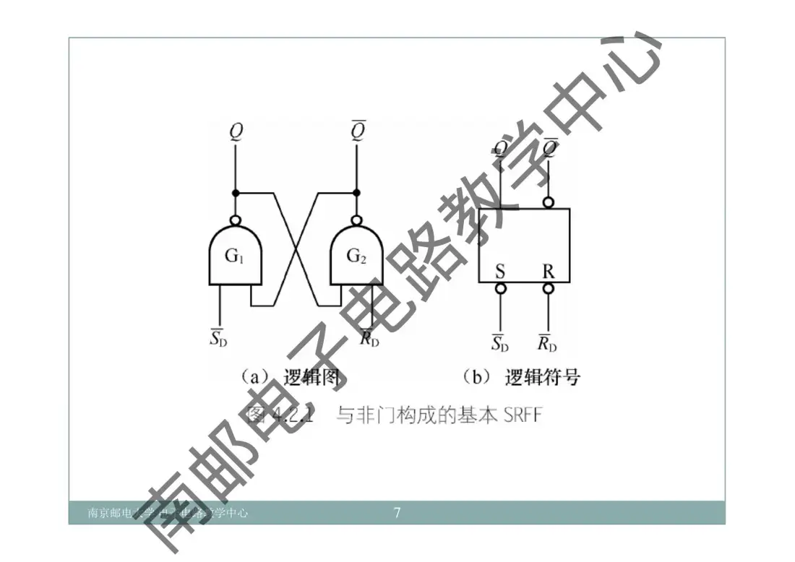

原文：

南京邮电大学 电子电路教学中心

7

### 2. 逻辑功能

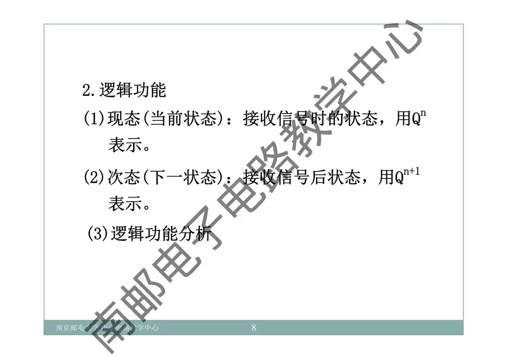

原文：

2. 逻辑功能

(1) 现态 (当前状态) ： 接收信号时的状态， 用 ${ \sf Q } ^ { \mathfrak { n } }$ 表示。 七1X

(2) 次态 (下一状态) ： 接收信号后状态， 用 ${ \boldsymbol { \mathsf { Q } } } ^ { \mathrm { n + 1 } }$ 表示。

(3) 逻辑功能分析

南京邮电大学 电子电路教学中心

8

### $$

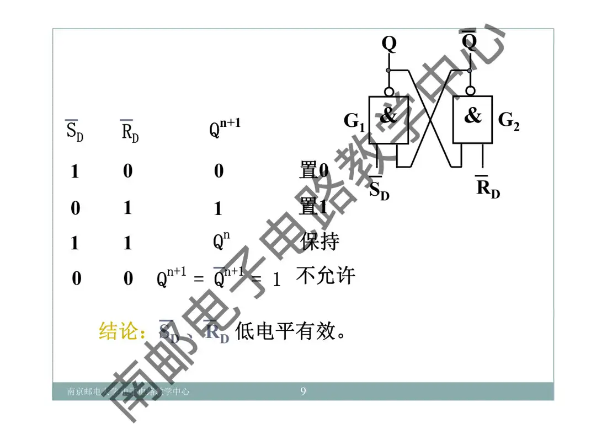

原文：

$$
\overline {{S}} _ {\mathrm{D}}
$$

$$
\overline {{\mathrm{R} _ {\mathrm{D}}}}
$$

$$
Q ^ {n + 1}
$$

$$
Q ^ {n}
$$

$$
Q ^ {n + 1} = \overline {{Q}} ^ {n + 1}
$$

结论： SD 、 RD 低 电平有效。(4)脉冲工作特性触发脉冲 的持续时 间 tw > 2tpd

南京邮电大学 电子电路教学中心

9

### 3. 逻辑功能的表示方法

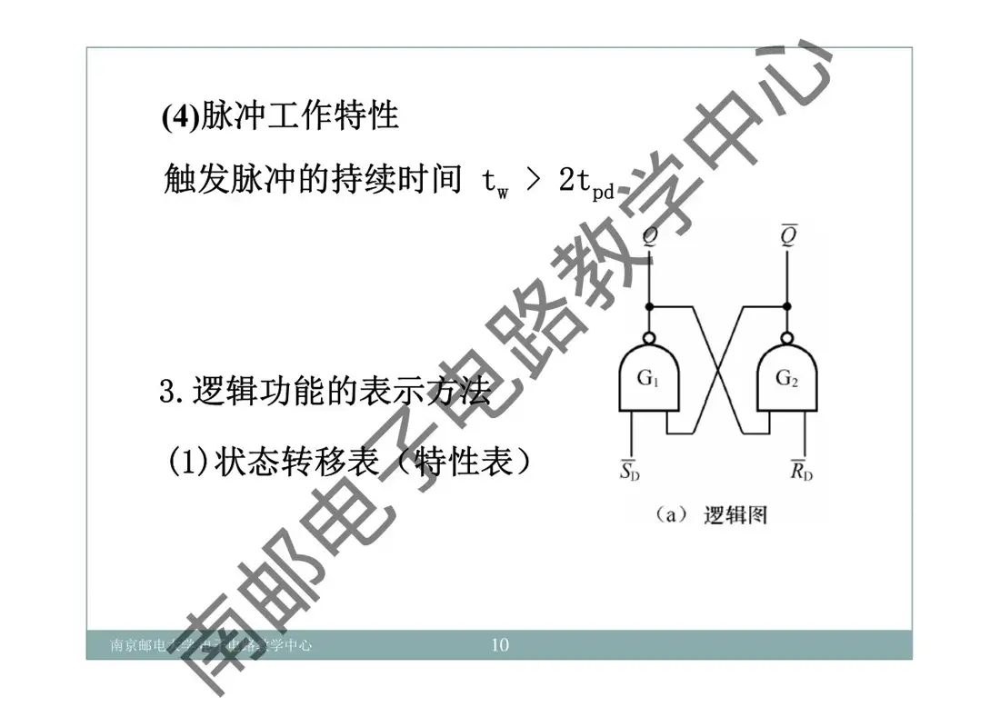

原文：

3. 逻辑功能的表示方法

(1) 状态转移表 （特性表）

(a) 逻辑图

南京邮电大学 电子电路教学中心

1 0

### 表 4. 2. 1 与非门基本触发器的状态转移表

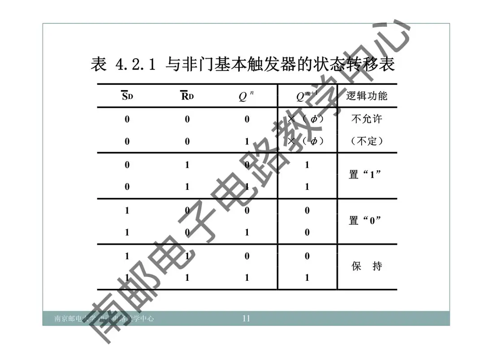

原文：

表 4. 2. 1 与非门基本触发器的状态转移表
<table><tr><td> $\overline{\mathbf{S}}_{\mathrm{D}}$ </td><td> $\overline{\mathbf{R}}_{\mathrm{D}}$ </td><td> $Q^{n}$ </td><td> $Q^{n+1}$ </td><td>逻辑功能</td></tr><tr><td>0</td><td>0</td><td>0</td><td>×(φ)</td><td rowspan="2">不允许(不定)</td></tr><tr><td>0</td><td>0</td><td>1</td><td>×(φ)</td></tr><tr><td>0</td><td>1</td><td>0</td><td>1</td><td rowspan="2">置“1”</td></tr><tr><td>0</td><td>1</td><td>1</td><td>1</td></tr><tr><td>1</td><td>0</td><td>0</td><td>0</td><td rowspan="2">置“0”</td></tr><tr><td>1</td><td>0</td><td>1</td><td>0</td></tr><tr><td>1</td><td>1</td><td>0</td><td>0</td><td rowspan="2">保持</td></tr><tr><td>1</td><td>1</td><td>1</td><td>1</td></tr></table>

南京邮电大学 电子电路教学中心

1 1

### (2) 功能表： 状态转移表简化形式

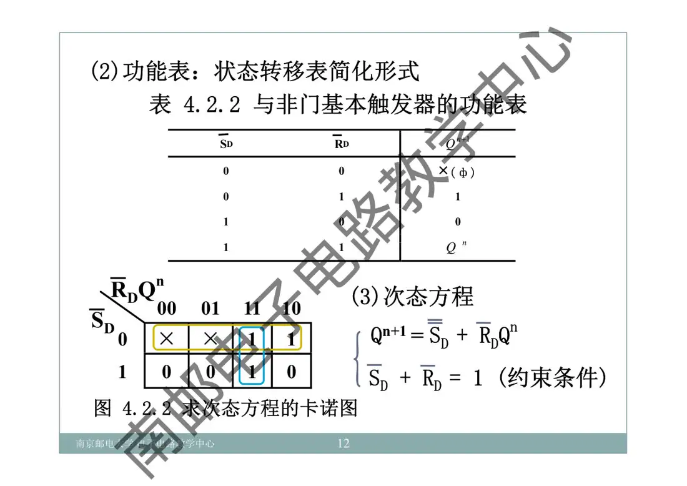

原文：

(2) 功能表： 状态转移表简化形式

南京邮电大学 电子电路教学中心

1 2

### 南京邮电大学 电子电路教学中心

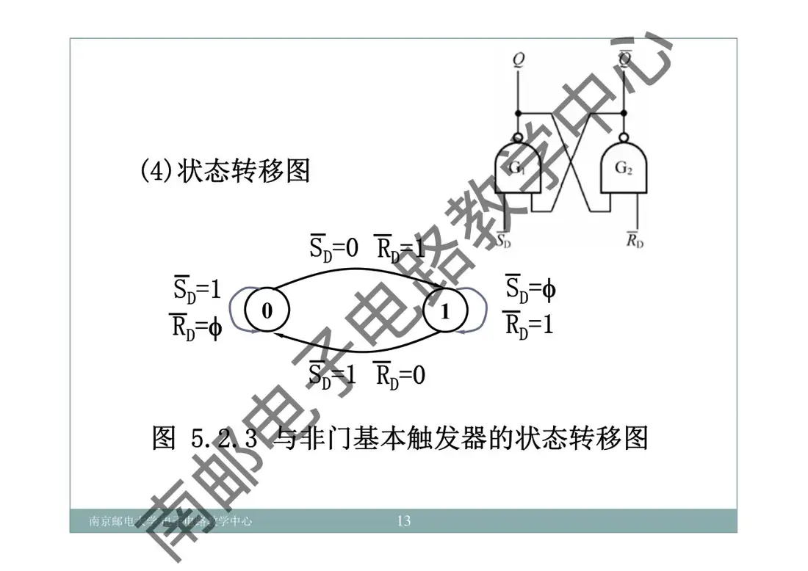

原文：

南京邮电大学 电子电路教学中心

1 3

### (5) 激励表 （驱动表）

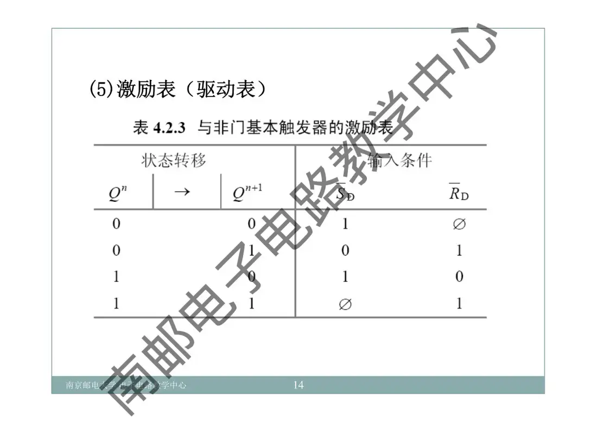

原文：

(5) 激励表 （驱动表）

表 4.2.3 与非门基本触发器的激励表
<table><tr><td colspan="3">状态转移</td><td colspan="2">输入条件</td></tr><tr><td> $Q^n$ </td><td>→</td><td> $Q^{n+1}$ </td><td> $\overline{S}_D$ </td><td> $\overline{R}_D$ </td></tr><tr><td>0</td><td></td><td>0</td><td>1</td><td>∅</td></tr><tr><td>0</td><td></td><td>1</td><td>0</td><td>1</td></tr><tr><td>1</td><td></td><td>0</td><td>1</td><td>0</td></tr><tr><td>1</td><td></td><td>1</td><td>∅</td><td>1</td></tr></table>

南京邮电大学 电子电路教学中心

1 4

### (6) 波形图 （ 时序 图 ）

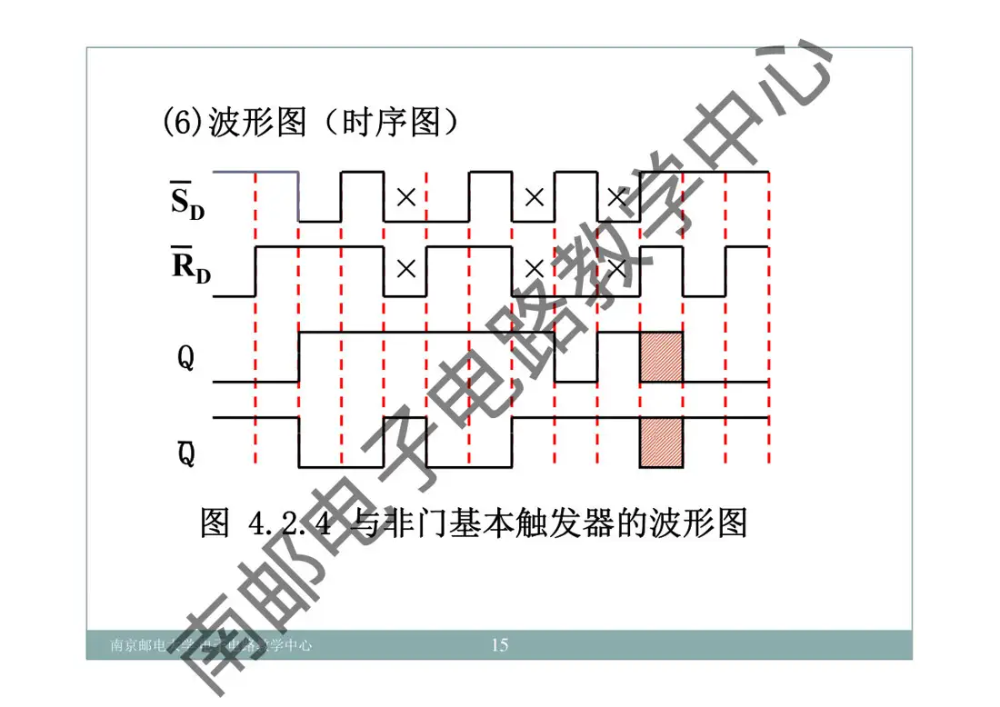

原文：

(6) 波形图 （ 时序 图 ）

南京邮电大学 电子电路教学中心

1 5

### 二、 或非门构成的基本SRFF

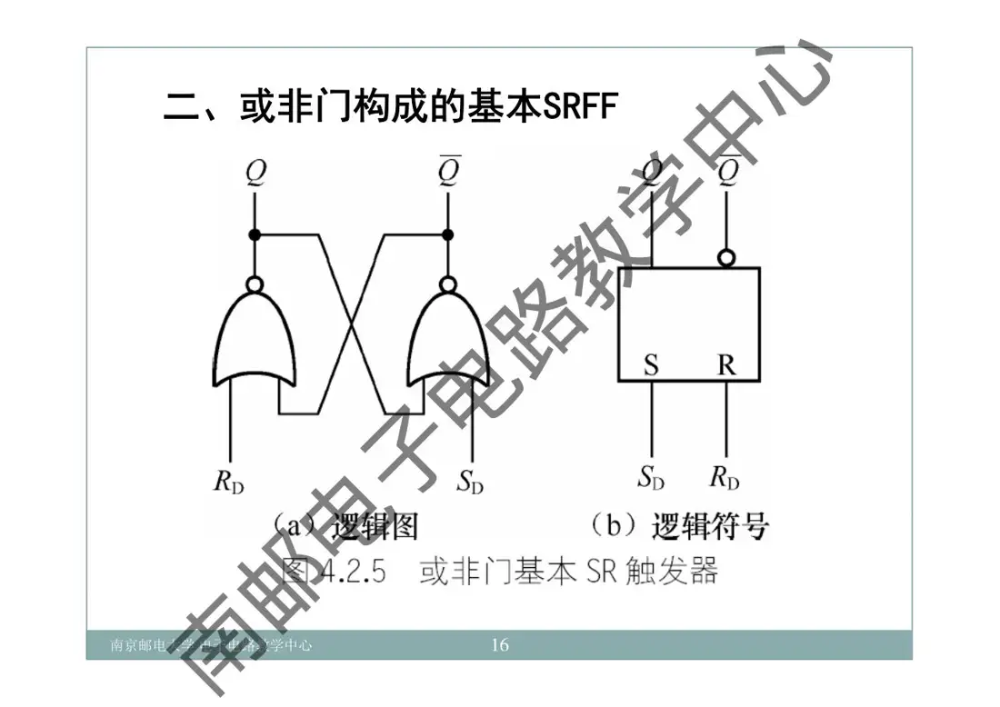

原文：

二、 或非门构成的基本SRFF

(a)逻辑图

(b) 逻辑符号

4.2.5 或非门基本 SR 触发器

南京邮电大学 电子电路教学中心

1 6

### 2. 逻辑功能的表示方法

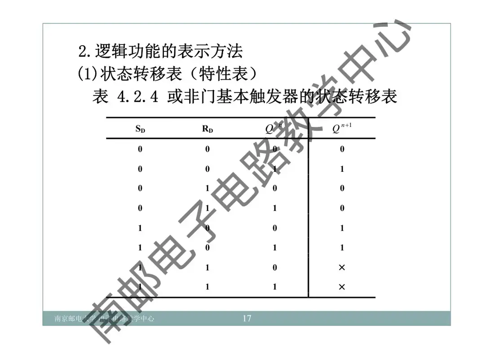

原文：

2. 逻辑功能的表示方法

(1) 状态转移表 （特性表）

表 4 2 4. . 或非门基本触发器的状态转移表
<table><tr><td> $S_D$ </td><td> $R_D$ </td><td> $Q^{n}$ </td><td> $Q^{n+1}$ </td></tr><tr><td>0</td><td>0</td><td>0</td><td>0</td></tr><tr><td>0</td><td>0</td><td>1</td><td>1</td></tr><tr><td>0</td><td>1</td><td>0</td><td>0</td></tr><tr><td>0</td><td>1</td><td>1</td><td>0</td></tr><tr><td>1</td><td>0</td><td>0</td><td>1</td></tr><tr><td>1</td><td>0</td><td>1</td><td>1</td></tr><tr><td>1</td><td>1</td><td>0</td><td>×</td></tr><tr><td>1</td><td>1</td><td>1</td><td>×</td></tr></table>

南京邮电大学 电子电路教学中心

1 7

### (2) 次态方程

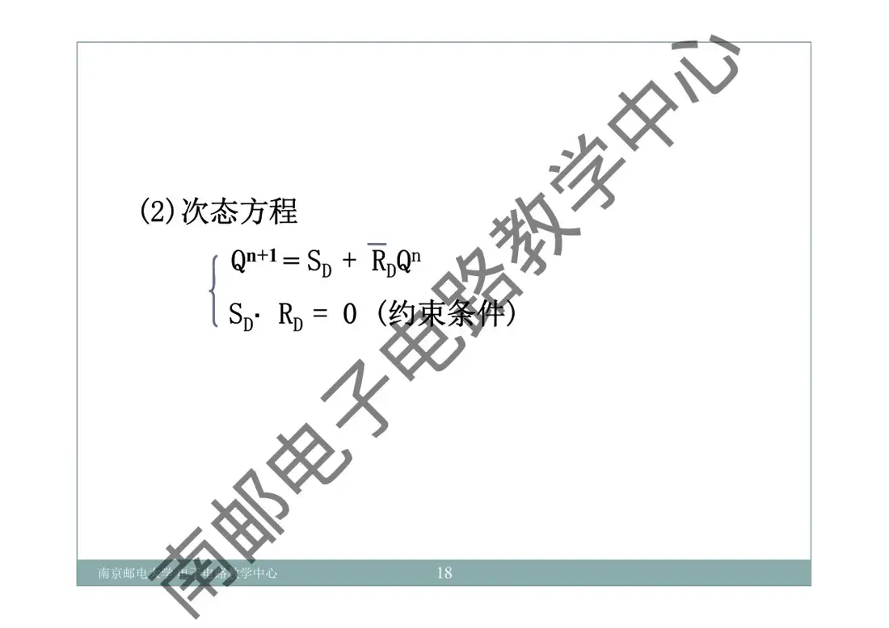

原文：

(2) 次态方程

$$
\left\{ \begin{array}{l} Q ^ {n + 1} = S _ {D} + \overline {{{R}}} _ {D} Q ^ {n} \\ S _ {D} \cdot R _ {D} = 0 (\text {约}) \end{array} \right.
$$

(约束条件)

南京邮电大学 电子电路教学中心

1 8
