# 《数字电路与系统设计》第四章第三节 钟控电位触发器（课件）

原件的每一页，下面附识别出的文字。

### 第 四 章 触发器 （ Flip Flop ）

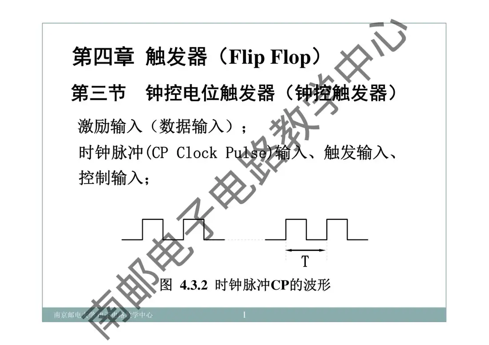

原文：

第 四 章 触发器 （ Flip Flop ）

第三节 钟控电位触发器 （钟控触发器）

激励输入 （数据输入） ；

时钟 脉冲 (CP C l ock Pu l s e) 输入 、 触发输入 、控制输入； XY

南京邮电大学 电子电路教学中心

1

### 一 、 钟 控SRFF (SR锁存器)

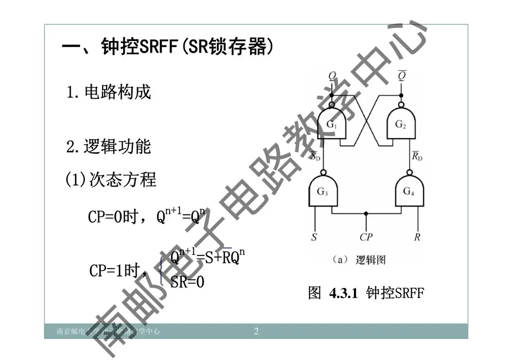

原文：

一 、 钟 控SRFF (SR锁存器)

1. 电路构成

2. 逻辑功能

(1) 次态方程

CP=0 时 ，

$$
Q ^ {n + 1} = Q ^ {n}
$$

时CP= 1 ，

南京邮电大学 电子电路教学中心

2

### (2) 功能表

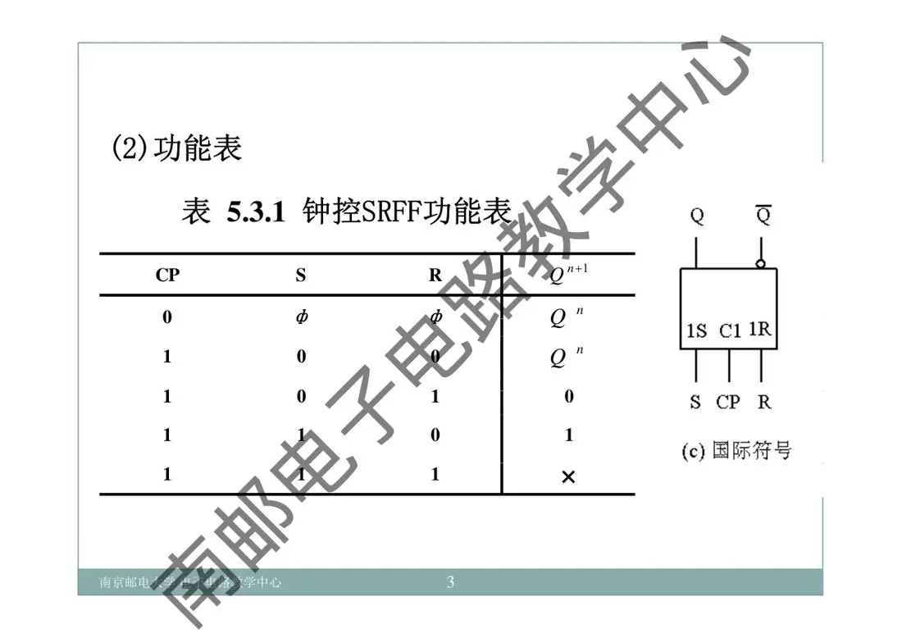

原文：

(2) 功能表

表 5.3.1 钟 控SRFF功 能表
<table><tr><td>CP</td><td>S</td><td>R</td><td> $Q^{n+1}$ </td></tr><tr><td>0</td><td> $\phi$ </td><td> $\phi$ </td><td> $Q^{n}$ </td></tr><tr><td>1</td><td>0</td><td>0</td><td> $Q^{n}$ </td></tr><tr><td>1</td><td>0</td><td>1</td><td>0</td></tr><tr><td>1</td><td>1</td><td>0</td><td>1</td></tr><tr><td>1</td><td>1</td><td>1</td><td>×</td></tr></table>

南京邮电大学 电子电路教学中心

3

### 表 4.3.2 钟 控SRFF激励表

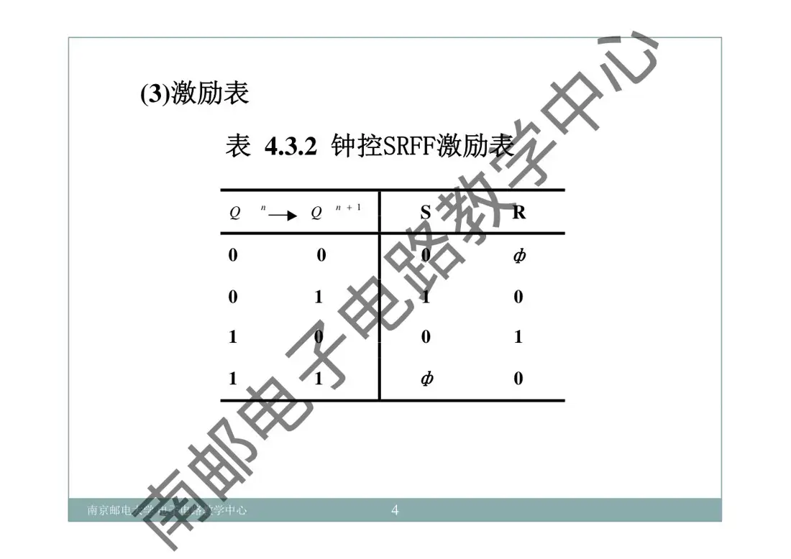

原文：

表 4.3.2 钟 控SRFF激励表
<table><tr><td colspan="2"> $Q$   $^{n} \rightarrow Q$   $^{n+1}$ </td><td>S</td><td>R</td></tr><tr><td>0</td><td>0</td><td>0</td><td> $\phi$ </td></tr><tr><td>0</td><td>1</td><td>1</td><td>0</td></tr><tr><td>1</td><td>0</td><td>0</td><td>1</td></tr><tr><td>1</td><td>1</td><td> $\phi$ </td><td>0</td></tr></table>

(3)激励表

南京邮电大学 电子电路教学中心

4

### (3) 波形 图

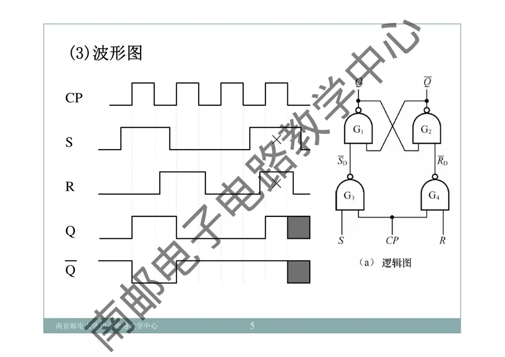

原文：

(3) 波形 图

南京邮电大学 电子电路教学中心

5

### 二 、 钟 控DEF (D锁存器)

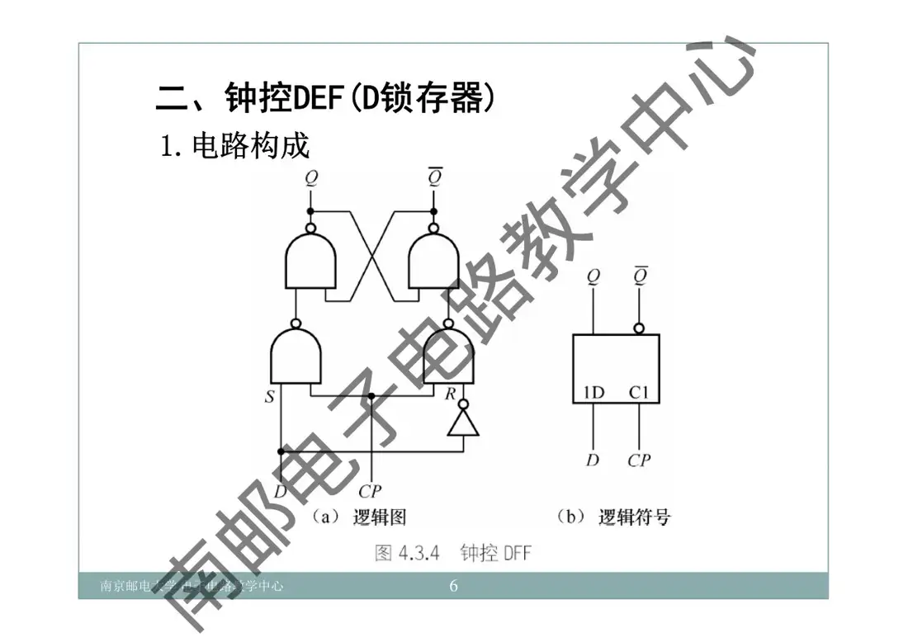

原文：

二 、 钟 控DEF (D锁存器)

1. 电路构成

南京邮电大学 电子电路教学中心

6

### 2 逻辑功能.

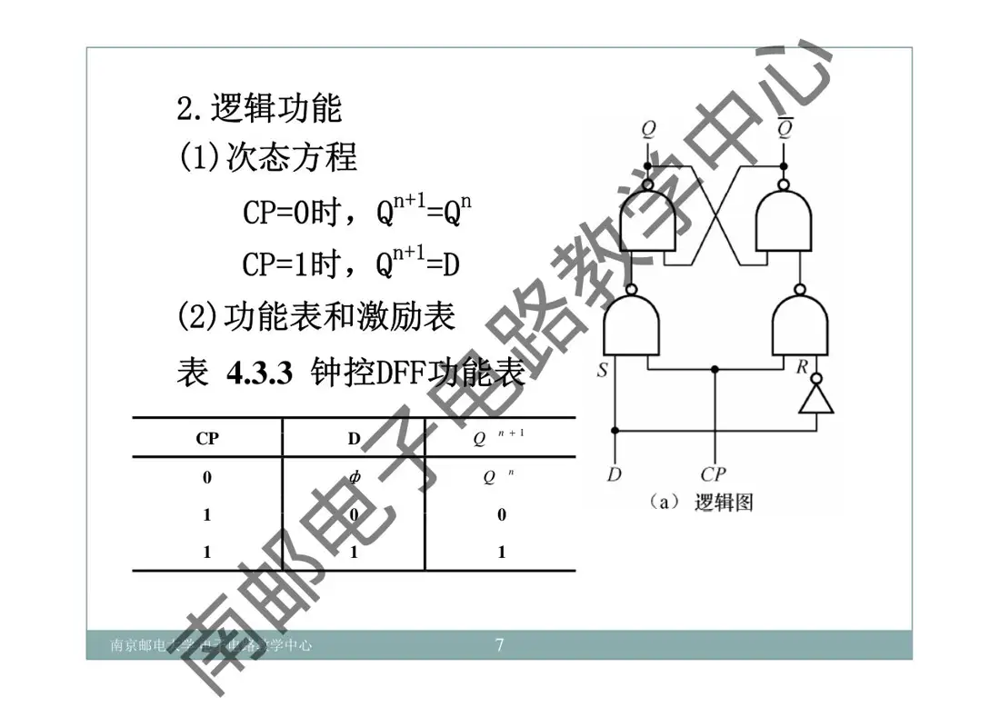

原文：

2 逻辑功能.

(1) 次态方程

CP=0 时 ， ${ \sf { Q } } ^ { \mathrm { { n + 1 } } } = { \sf { Q } } ^ { \mathrm { { n } } }$

CP= 1 时 ， $\boldsymbol { \mathsf { Q } } ^ { \mathrm { n + 1 } } \mathrm { = D }$

(2) 功能表和激励表

表 4.3.3 钟 控DFF功 能表

<table><tr><td>CP</td><td>D</td><td> $Q^{n+1}$ </td></tr><tr><td>0</td><td> $\phi$ </td><td> $Q^{n}$ </td></tr><tr><td>1</td><td>0</td><td>0</td></tr><tr><td>1</td><td>1</td><td>1</td></tr></table>

南京邮电大学 电子电路教学中心

7

### 表 4.3.4 钟 控DFF激励表

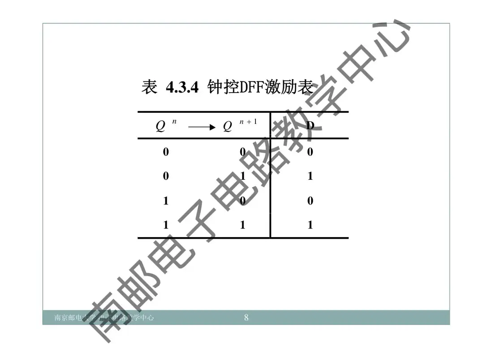

原文：

表 4.3.4 钟 控DFF激励表

南京邮电大学 电子电路教学中心

8

### 三、 钟控触发器的触发方式与空翻

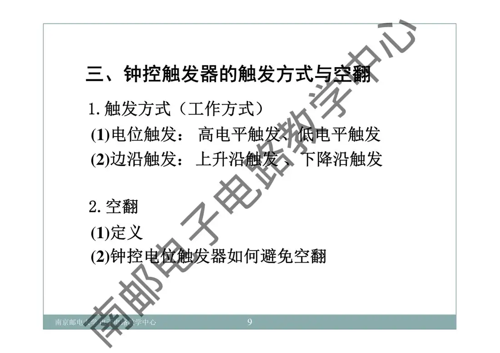

原文：

三、 钟控触发器的触发方式与空翻

1. 触发方式 （工作方式）

(1)电位触发： 高电平触发、 低电平触发

(2)边沿触发： 上升沿触发 、 下降沿触发

2. 空翻

(1) 定 义

(2)钟控电位触发器如何避免空翻

南京邮电大学 电子电路教学中心

9

### 在CP一个周期 内 ， Q只发生 次变化示意图 一

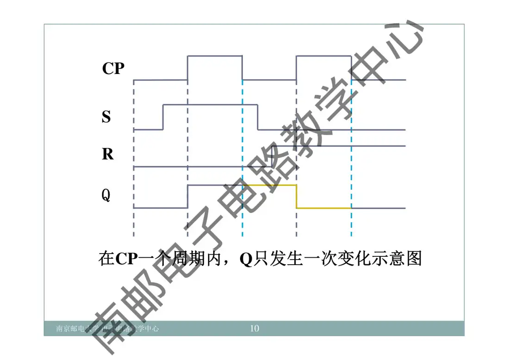

原文：

在CP一个周期 内 ， Q只发生 次变化示意图 一

南京邮电大学 电子电路教学中心

1 0

### 例： 因干扰而引起的误动作， 波形图如下

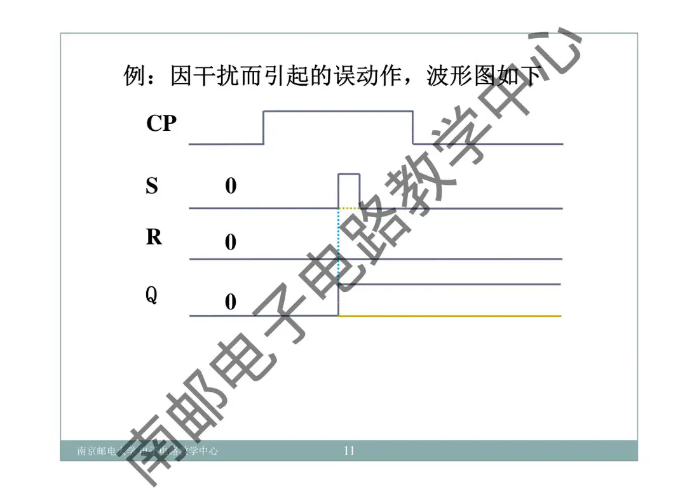

原文：

例： 因干扰而引起的误动作， 波形图如下

南京邮电大学 电子电路教学中心

1 1

### 南京邮电大学 电子电路教学中心

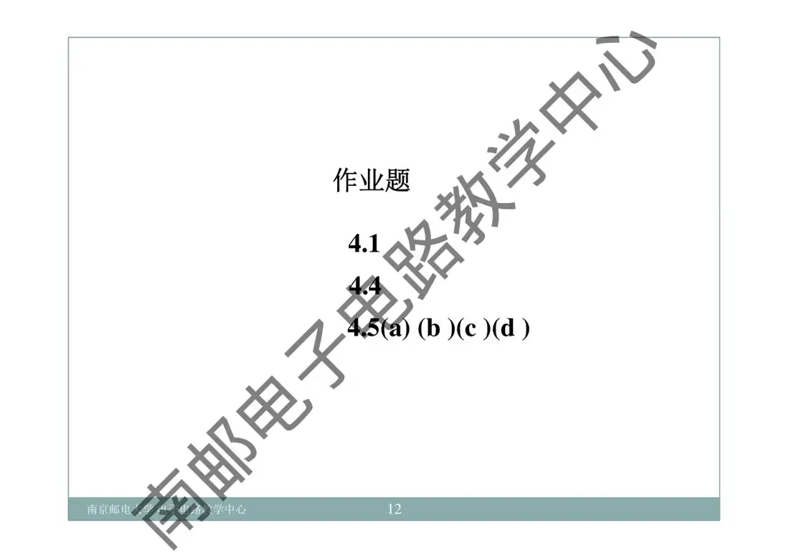

原文：

南京邮电大学 电子电路教学中心

1 2
