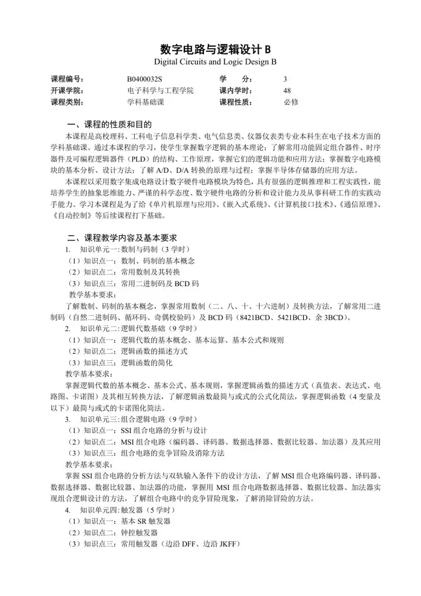
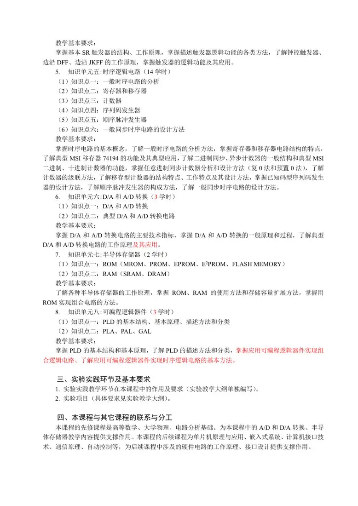
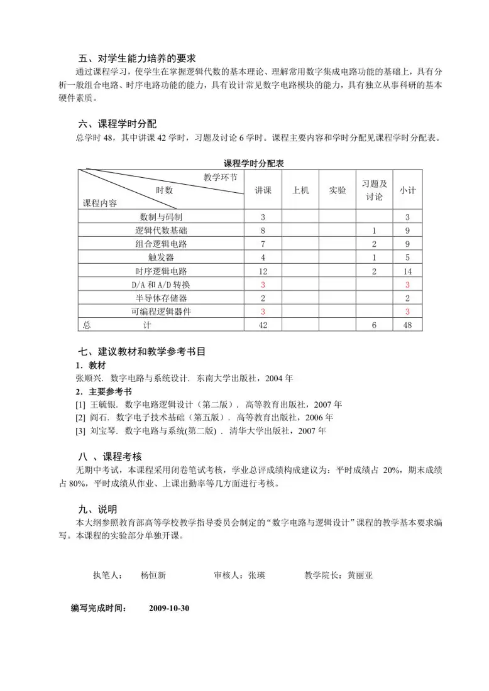

# 《数字电路与逻辑设计 B》教学大纲

原件的每一页，下面附识别出的文字。

### 数字电路与逻辑设计 B

原文：

数字电路与逻辑设计 B

Digital Circuits and Logic Design B

课程编号： B0400032S 学 分： 3

开课学院： 电子科学与工程学院 课内学时： 48

课程类别： 学科基础课 课程性质： 必修

一、课程的性质和目的

本课程是高校理科、工科电子信息科学类、电气信息类、仪器仪表类专业本科生在电子技术方面的学科基础课。通过本课程的学习，使学生掌握数字逻辑的基本理论；了解常用功能固定组合器件、时序器件及可编程逻辑器件（ ）的结构、工作原理，掌握它们的逻辑功能和应用方法；掌握数字电路模块的基本分析、设计方法；了解 、 转换的原理与过程；掌握半导体存储器的应用方法。

本课程以采用数字集成电路设计数字硬件电路模块为特色，具有很强的逻辑推理和工程实践性，能培养学生的抽象思维能力、严谨的科学态度、数字硬件电路的分析和设计能力及从事科研工作的实践动手能力。学习本课程是为了给《单片机原理与应用》、《嵌入式系统》、《计算机接口技术》、《通信原理》、《自动控制》等后续课程打下基础。

二、课程教学内容及基本要求

1. 知识单元一:数制与码制（3学时）

（1）知识点一：数制、码制的基本概念

（2）知识点二：常用数制及其转换

（3）知识点三：常用二进制码及BCD 码

教学基本要求：

了解数制、码制的基本概念，掌握常用数制（二、八、十、十六进制）及转换方法，了解常用二进制码（自然二进制码、循环码、奇偶校验码）及BCD 码（8421BCD、5421BCD、余 3BCD）。

2. 知识单元二:逻辑代数基础（9学时）

（1）知识点一：逻辑代数的基本概念、基本运算、基本公式和规则

（2）知识点二：逻辑函数的描述方式

（3）知识点三：逻辑函数的简化

教学基本要求：

掌握逻辑代数的基本概念、基本公式、基本规则，掌握逻辑函数的描述方式（真值表、表达式、电路图、卡诺图）及其相互转换方法，了解逻辑函数最简与或式的公式化简法，掌握逻辑函数（4变量及以下）最简与或式的卡诺图化简法。

3. 知识单元三:组合逻辑电路（9学时）

（1）知识点一：SSI组合电路的分析与设计

（2）知识点二：MSI组合电路（编码器、译码器、数据选择器、数据比较器、加法器）及其应用

（3）知识点三：组合电路的竞争冒险及消除方法

教学基本要求：

掌握SSI组合电路的分析方法与双轨输入条件下的设计方法，了解MSI组合电路编码器、译码器、数据选择器、数据比较器、加法器的功能，掌握用 MSI 组合电路数据选择器、数据比较器、加法器实现组合逻辑设计的方法，了解组合电路中的竞争冒险现象，了解消除冒险的方法。

4. 知识单元四:触发器（5学时）

（1）知识点一：基本 SR触发器

（2）知识点二：钟控触发器

（3）知识点三：常用触发器（边沿DFF、边沿 JKFF）

### 教学基本要求：

原文：

教学基本要求：

掌握基本SR触发器的结构、工作原理，掌握描述触发器逻辑功能的各类方法，了解钟控触发器、边沿DFF、边沿JKFF 的工作原理，掌握触发器的逻辑功能及其应用。

5. 知识单元五:时序逻辑电路（14学时）

（1）知识点一：一般时序电路的分析

（2）知识点二：寄存器和移存器

（3）知识点三：计数器

（4）知识点四：序列码发生器

（5）知识点五：顺序脉冲发生器

（6）知识点六：一般同步时序电路的设计方法

教学基本要求：

掌握时序电路的基本概念，了解一般时序电路的分析方法，掌握寄存器和移存器电路结构的特点，了解典型MSI移存器74194 的功能及其典型应用，了解二进制同步、异步计数器的一般结构和典型MS二进制、十进制计数器的功能，掌握任意进制同步计数器分析和设计方法（复 0 法和预置0 法），了解计数器的级联方法，了解移存型计数器的结构特点、工作特点及其设计方法，掌握已知码型序列码发生器的设计方法，了解顺序脉冲发生器的构成方法，了解一般同步时序电路的设计方法。

6. 知识单元六:D/A和A/D转换（3学时）

（1）知识点一：D/A和A/D 转换

（2）知识点二：典型D/A和A/D 转换电路

教学基本要求：

掌握 D/A 和 A/D 转换电路的主要技术指标，掌握 D/A 和 A/D 转换的一般原理和过程，了解典型D/A和A/D转换电路的工作原理及其应用。

7. 知识单元七:半导体存储器（2学时）

（1）知识点一：ROM（MROM、PROM、EPROM、E2PROM、FLASH MEMORY）

（2）知识点二：RAM（SRAM、DRAM）

教学基本要求：

了解各种半导体存储器的工作原理，掌握 ROM、RAM 的使用方法和存储容量扩展方法，掌握用ROM实现组合电路的方法。

8. 知识单元八:可编程逻辑器件（3学时）

（1）知识点一：PLD 的基本结构、基本原理、描述方法和分类

（2）知识点二：PLA、PAL、GAL

教学基本要求：

掌握PLD 的基本结构和基本原理，了解PLD的描述方法和分类，掌握应用可编程逻辑器件实现组合逻辑电路、了解应用可编程逻辑器件实现时序逻辑电路的基本方法。

三、实验实践环节及基本要求

1. 实验实践教学环节在本课程中的作用及要求（实验教学大纲单独编写）。

2. 实验项目（具体要求见实验教学大纲）。

四、本课程与其它课程的联系与分工

本课程的先修课程是高等数学、大学物理、电路分析基础。为本课程中的 和 转换、半导体存储器教学内容提供支撑作用。本课程的后续课程为单片机原理与应用、嵌入式系统、计算机接口技术、通信原理、自动控制等，为后续课程中涉及的硬件电路的工作原理、接口设计提供支撑作用。

### 五、对学生能力培养的要求

原文：

五、对学生能力培养的要求

通过课程学习，使学生在掌握逻辑代数的基本理论、理解常用数字集成电路功能的基础上，具有分析一般组合电路、时序电路功能的能力，具有设计常见数字电路模块的能力，具有独立从事科研的基本硬件素质。

六、课程学时分配

总学时48，其中讲课 42学时，习题及讨论6学时。课程主要内容和学时分配见课程学时分配表。

课程学时分配表
<table><tr><td>课程内容\时数\教学环节</td><td>讲课</td><td>上机</td><td>实验</td><td>习题及讨论</td><td>小计</td></tr><tr><td>数制与码制</td><td>3</td><td></td><td></td><td></td><td>3</td></tr><tr><td>逻辑代数基础</td><td>8</td><td></td><td></td><td>1</td><td>9</td></tr><tr><td>组合逻辑电路</td><td>7</td><td></td><td></td><td>2</td><td>9</td></tr><tr><td>触发器</td><td>4</td><td></td><td></td><td>1</td><td>5</td></tr><tr><td>时序逻辑电路</td><td>12</td><td></td><td></td><td>2</td><td>14</td></tr><tr><td>D/A和A/D转换</td><td>3</td><td></td><td></td><td></td><td>3</td></tr><tr><td>半导体存储器</td><td>2</td><td></td><td></td><td></td><td>2</td></tr><tr><td>可编程逻辑器件</td><td>3</td><td></td><td></td><td></td><td>3</td></tr><tr><td>总计</td><td>42</td><td></td><td></td><td>6</td><td>48</td></tr></table>

七、建议教材和教学参考书目

1．教材

张顺兴. 数字电路与系统设计. 东南大学出版社，2004年

2．主要参考书

[1] 王毓银. 数字电路逻辑设计（第二版）. 高等教育出版社，2007年

[2] 阎石. 数字电子技术基础（第五版）. 高等教育出版社，2006年

[3] 刘宝琴. 数字电路与系统(第二版) . 清华大学出版社，2007年

八 、课程考核

无期中考试，本课程采用闭卷笔试考核，学业总评成绩构成建议为：平时成绩占 20%，期末成绩占80%，平时成绩从作业、上课出勤率等几方面进行考核。

九、说明

本大纲参照教育部高等学校教学指导委员会制定的“数字电路与逻辑设计”课程的教学基本要求编写。本课程的实验部分单独开课。

执笔人： 杨恒新

审核人：张瑛

教学院长：黄丽亚

编写完成时间： 2009-10-30
