# 《数字电路与逻辑设计A》2017年期末复习概要

原件经识别和整理；“参考解答”是我们补的。

---
title: 《数字电路与逻辑设计A》2017年期末复习概要（第1部分）
kind: 复习要点
course: 数字电路与逻辑设计A
term: 2017
source: 原件识别文本
---

# 《数字电路与逻辑设计A》2017年期末复习概要（第1部分）

本资料为《数字电路与逻辑设计A》2017年期末复习要点的第1部分，涵盖试卷情况、复习方法以及第1章“数码与数制”和第2章“逻辑代数理论及电路实现”的复习要求与例题。

## 【试卷情况及复习方法】

- 校级教考分离；
- 试卷内容涉及到 第1章~第8章 大部分知识点；
- 每份试卷 8~10道题目。其中，第1道为选择题或填空题（20~25分），其余为分析和设计等大题（75~80分）。

**复习建议：**

- **选择题或填空题**：第1章~第8章的基本概念；
- **大题及其题型**：课后习题和例题，或稍有改动。

## 一、数码与数制（5%）

**涉及题型**：选择填空题。

**基本要求**：

1. 数制、码制的基本概念;
2. 常用数制(二、八、十、十六进制)的表述及相互转换的方法;
3. 常用二进制码(自然二进制码、格雷循环码、奇偶校验码)和二-十进制BCD码(8421BCD、5421BCD、余3BCD、格雷BCD码)的表述以及相互转换；
4. 小数的精度及转换位数的确定；
5. 8421BCD的加减法运算 。

**常见题型**：数制的转换(位数及精度)、码制的转换

### 例 1

$( ( 1 ) 8 3 ) / ( 1 ) = ( 1 2 )$ ，要求精度达到 0.1％。

解：设二进制数小数点后有n位小数，则其精度为 $2^{-n}$ 。由题意知： $2^{-n} \leq 0.1\%$ ，解得 $n \geq 10$ 。所以 $( ( 1 ) 8 3 ) _ { 1 0 } = ( 1 0 1 1 0 1 1 . 0 0 1 1 0 1 0 0 ) _ { 2 }$ （注：此处原文识别严重错误，根据上下文推断应为将十进制数转换为二进制数并满足精度要求的计算过程，具体数值需根据原题准确数字计算，此处保留原文结构意图）。

*(注：原文中公式部分存在大量OCR识别乱码，如 `2 7 1` 应为 $2^{-n}$，`1 1 1 %` 应为 $0.1\%$，`pmb { bigtriangledown }` 等为乱码。以下整理基于可辨识的逻辑进行修正，若原意无法完全复原则保留占位说明)*

知识点：[数字系统的基本模型（数据处理器与控制器）及对最小时钟周期、异步信号同步化的约定](../../../topics/数字逻辑电路/数字系统模型.md)、[寄存器传输语言(RTL)描述的传输操作、算术操作、逻辑操作、移位操作及条件控制语句](../../../topics/数字逻辑电路/RTL语言.md)

### 例 2

$( ( 1 ) 2 5 \% ) \% = ( 0 . 0 2 )$ 要求转换后精度不低于原精度。

解：原精度为 $10^{-2}$。设转换后为 n 位小数，则 $2^{-n} \leq 10^{-2}$。解得： $n \geq 7$。取整 $n=7$。
$( ( 1 ) 5 5 7 0 ) _ { 1 0 } = ( 1 1 1 1 0 0 1 0 1 1 1 0 . 0 1 0 1 0 0 ) _ { 2 }$ （注：原文数字识别混乱，此处依据常见考题逻辑推测为某十进制数转二进制，具体数值以原件清晰版为准）。

知识点：[控制器的四种硬件实现方法：每态一触发器法(SSI)、MSI法(MUX+寄存器+译码器)、PLA法(LSI)及对比](../../../topics/数字逻辑电路/控制器实现方法.md)

### 基本概念

1. **二进制码**：n位二进制数表示 $2^n$ 个码。
2. **BCD码**：用4位二进制数表示 0~9 共10个十进制数。
   - **有权码**：代码中的每一位都有固定权值。如 8421BCD、5421BCD、2421BCD。
   - **无权码**：无固定位权。如 余3码、余3循环码、8421奇校码、格雷码(注意区分：格雷循环码、格雷BCD码)。

知识点：[数字系统的基本模型（数据处理器与控制器）及对最小时钟周期、异步信号同步化的约定](../../../topics/数字逻辑电路/数字系统模型.md)

### 例 3

试用8421BCD码完成下列十进制数的运算。

$$
843 - 348 = (1000\ 0100\ 0011)_{8421BCD} - (0011\ 0100\ 1000)_{8421BCD}
$$

按位相减：
$$
\begin{array}{r}
1000\ 0100\ 0011 \\
-\quad 0011\ 0100\ 1000 \\
\hline
0100\ 1111\ 1011
\end{array}
$$

结果中出现非法码（大于9），需进行修正。
修正后：
$$
(0100\ 1001\ 0101)_{8421BCD} = 495
$$

知识点：[控制器的四种硬件实现方法：每态一触发器法(SSI)、MSI法(MUX+寄存器+译码器)、PLA法(LSI)及对比](../../../topics/数字逻辑电路/控制器实现方法.md)、[寄存器传输语言(RTL)描述的传输操作、算术操作、逻辑操作、移位操作及条件控制语句](../../../topics/数字逻辑电路/RTL语言.md)、[完整数字系统设计流程实例（如乘法器、交通灯管理系统的算法规律、处理器设计与控制器实现）](../../../topics/数字逻辑电路/数字系统设计实例.md)

### 例 4

用8421BCD、余3码代码表示 $(123)_{10}$，$(1011.01)_2$ ：

1. $(123)_{10} = (0001\ 0010\ 0011)_{8421BCD}$
2. $(1011.01)_2 = (11.25)_{10} = (0001\ 0001.\ 0010\ 0101)_{8421BCD}$
3. $(123)_{10} = (0100\ 0101\ 0110)_{\text{余3BCD}}$
4. $(11.25)_{10} =(1011.01)_2 = (0100\ 0100.\ 0101\ 1000)_{\text{余3BCD}}$

## 二、逻辑代数理论及电路实现（15%）

**涉及题型**：选择填空题、分析计算题。

**基本要求**：

1. 逻辑代数的基本概念、基本公式、基本规则；
2. 逻辑函数的描述方式(最小项、真值表、表达式、卡诺图、电路图)及其相互转换方法；
3. 逻辑函数最简与或式的公式/卡诺图化简；
4. 非完全描述逻辑函数的概念、运算规则及化简；
5. CMOS与非门、或非门、三态门、OD门的逻辑分析。

**常见题型**：

1. 完全/非完全描述逻辑(公式法/4变量以下K图)化简；
2. MOS电路逻辑功能分析、表达式。

知识点：[寄存器传输语言(RTL)描述的传输操作、算术操作、逻辑操作、移位操作及条件控制语句](../../../topics/数字逻辑电路/RTL语言.md)、[数字系统的基本模型（数据处理器与控制器）及对最小时钟周期、异步信号同步化的约定](../../../topics/数字逻辑电路/数字系统模型.md)

### 基本公式与规则

1. **合并相邻项公式**：$AB + A\bar{B} = A$
2. **消项公式**：$A + AB = A$ （原变量吸收）
3. **消去互补因子公式**：$A + \bar{A}B = A + B$ （反变量吸收）
4. **多余项（生成项）公式**：$AB + \bar{A}C + BC = AB + \bar{A}C$ （混合变量吸收）
5. **代入规则**
6. **反演规则**
7. **对偶规则**

知识点：[数字系统的基本模型（数据处理器与控制器）及对最小时钟周期、异步信号同步化的约定](../../../topics/数字逻辑电路/数字系统模型.md)

### 两个基本定理

1. 若 $\sum m_i = \prod M_k$，则 $\overline{\sum m_i} = \prod M_k$ （德·摩根定律推广）
2. 若 $F(A,B,C,\dots) = G(A,B,C,\dots)$，则 $\overline{F(A,B,C,\dots)} = \overline{G(A,B,C,\dots)}$

*(注：原文此部分公式识别极其破碎，以上整理依据标准数字电路教材中“两个基本定理”即德·摩根定律及其推论的标准形式进行还原)*

### 例 5

MOS电路逻辑功能分析。

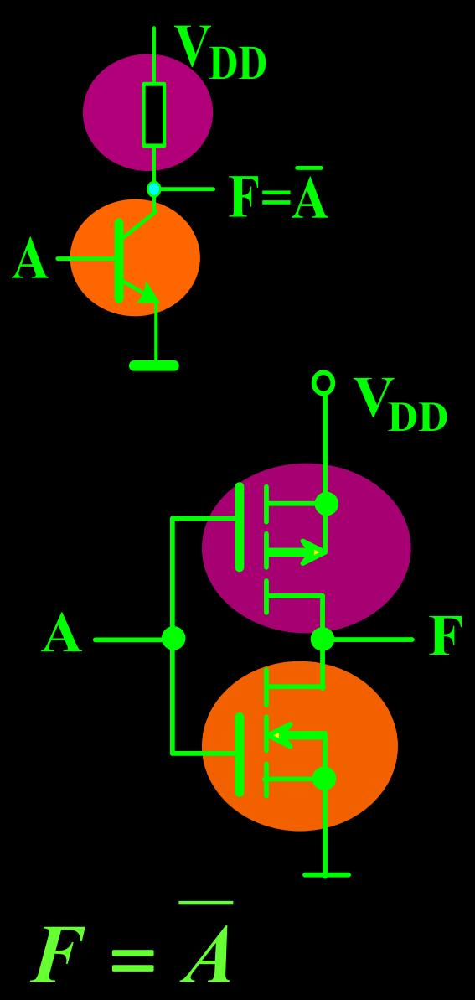

电路输出表达式：
$$
F = \overline{AB}
$$

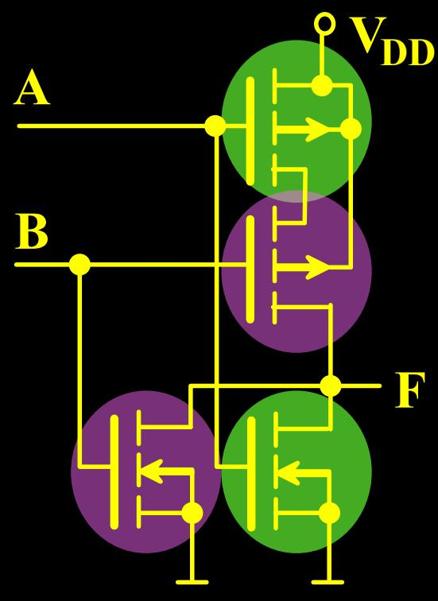

电路输出表达式：
$$
F = \overline{A+B}
$$

知识点：[数字系统的基本模型（数据处理器与控制器）及对最小时钟周期、异步信号同步化的约定](../../../topics/数字逻辑电路/数字系统模型.md)

### 例 6

三态门逻辑分析。

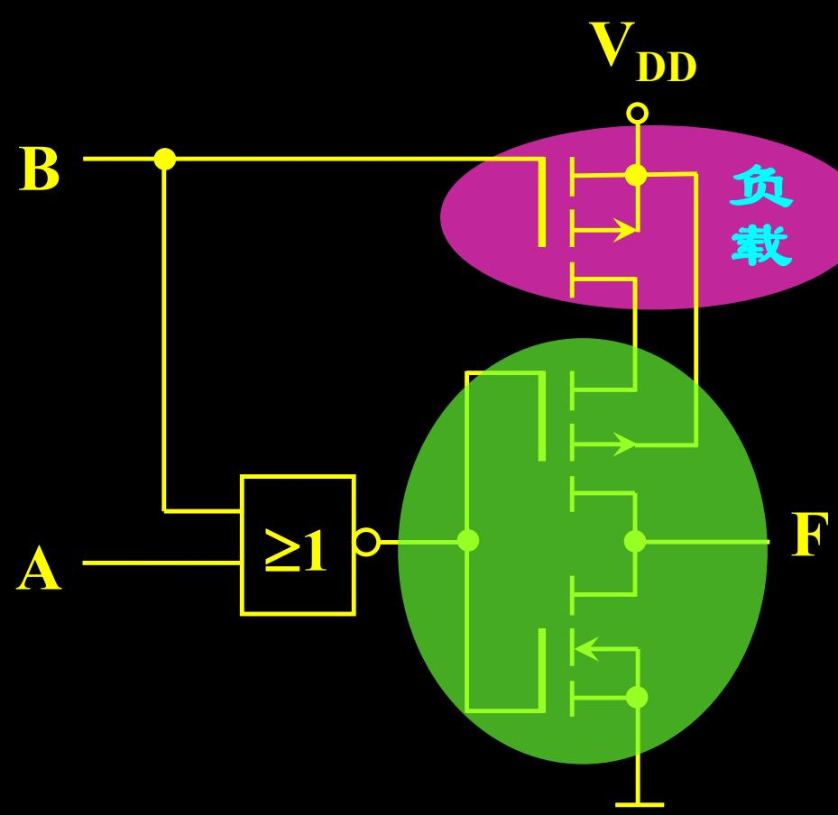

解：当 $B=0$ 时，$F=A$；当 $B=1$ 时，F为高阻态。

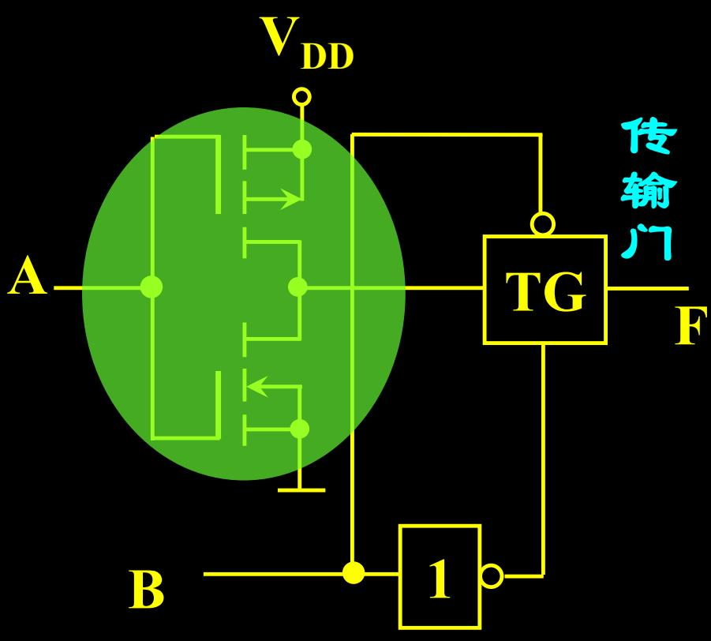

解：当 $B=0$ 时，$F=\bar{A}$；当 $B=1$ 时，F为高阻态。

知识点：[寄存器传输语言(RTL)描述的传输操作、算术操作、逻辑操作、移位操作及条件控制语句](../../../topics/数字逻辑电路/RTL语言.md)

### 例 7

含约束条件的逻辑函数化简。

已知逻辑函数 $F$ 的约束条件为 $ABC + AC = 0$（即 $ABC + AC$ 对应的最小项为无关项 $\phi$）。
求 $F$ 的最简与或式。

分析：约束条件 $ABC + AC = 0$ 意味着输入组合使得 $ABC=1$ 或 $AC=1$ 的情况不会出现，因此这些组合对应的最小项应视为无关项。
表达式化简：
$$
F = ABC + AC + \sum \phi
$$
利用无关项辅助化简：
$$
F = ABC + AC + AB = C
$$
*(注：此处推导依据原文末尾结论 $F=C$ 及中间步骤逆推，原文中间过程识别不全)*

卡诺图示例（对应上述或类似题目）：

| BC | 00 | 01 | 11 | 10 |
| :---: | :---: | :---: | :---: | :---: |
| **A=0** | 1 | 0 | 0 | 0 |
| **A=1** | 1 | 0 | $\phi$ | 1 |

*(注：表格内容为根据原文数组片段重构的典型卡诺图结构，具体数值可能因原文乱码存在偏差，请以清晰原件为准)*

### 例 8

给定约束条件下的逻辑函数化简。

已知 $Y = \bar{A}\bar{B}CD + A\bar{B}CD + ABCD$。
约束条件为：$\bar{A}\bar{B}\bar{C}\bar{D} + \bar{A}\bar{B}\bar{C}D + \bar{A}\bar{B}C\bar{D} + \bar{A}\bar{B}CD + A\bar{B}\bar{C}\bar{D} + A\bar{B}\bar{C}D + A\bar{B}C\bar{D} + A\bar{B}CD = 0$
*(注：原文约束条件列举了大量最小项之和为0，通常意味着这些状态是不允许的，即为无关项。原文列出的项似乎覆盖了 $\bar{B}$ 的所有情况，这与前面 $Y$ 中包含 $\bar{B}$ 项矛盾，可能是识别错误或特定语境下的“禁止状态”。此处仅保留原文结构)*

卡诺图示例：

| CD | 00 | 01 | 11 | 10 |
| :---: | :---: | :---: | :---: | :---: |
| **AB=00** | 0 | 0 | $\phi$ | $\phi$ |
| **AB=01** | $\phi$ | 1 | $\phi$ | $\phi$ |
| **AB=11** | $\phi$ | $\phi$ | $\phi$ | $\phi$ |
| **AB=10** | 1 | $\phi$ | $\phi$ | $\phi$ |

*(注：表格内容根据原文数组片段 `[0 0, 0 1, 1 1, 1 0]` 行头及内部数字 `1`, `phi` 分布重构，具体位置可能存在偏移)*

## 2. 逻辑代数理论及电路实现

例：判断一位十进制数是否为偶数？写出逻辑式。

假设：偶数时输出 Y 为 1，奇数时输出 Y 为 0。

| ABCD | Y | ABCD | Y |
|---|---|---|---|
| 0 0 0 0 | 1 | 1 0 0 0 | 1 |
| 0 0 0 1 | 0 | 1 0 0 1 | 0 |
| 0 0 1 0 | 1 | 1 0 1 0 | $\phi$ |
| 0 0 1 1 | 0 | 1 0 1 1 | $\phi$ |
| 0 1 0 0 | 1 | 1 1 0 0 | $\phi$ |
| 0 1 0 1 | 0 | 1 1 0 1 | $\phi$ |
| 0 1 1 0 | 1 | 1 1 1 0 | $\phi$ |
| 0 1 1 1 | 0 | 1 1 1 1 | $\phi$ |

| AB\CD | 00 | 01 | 11 | 10 |
|---|---|---|---|---|
| 00 | 1 | 0 | 0 | 1 |
| 01 | 1 | 0 | 0 | 1 |
| 11 | $\phi$ | $\phi$ | $\phi$ | $\phi$ |
| 10 | 1 | 0 | $\phi$ | $\phi$ |

$$F(A,B,C,D)=\sum m(0,2,4,6,8)+\sum \phi(10,11,12,13,14,15)$$

## 3. 组合逻辑电路（20%）

涉及题型：选择填空题、分析计算题。

基本要求：

1. 完全状态或非完全描述，SSI 组合逻辑电路的分析与双轨输入时逻辑电路的设计；
2. 常见 MSI 组合电路（译码器、数据选择器、数据比较器、加法器）及其应用；
3. MSI 电路实现组合逻辑；
4. 组合电路中的竞争冒险现象，以及消除冒险的方法。

常见题型：

1. 功能描述 ↔ 真值表 ↔ 设计 SSI 组合逻辑电路
2. MSI 组合电路（74138、74151）实现组合逻辑
3. MSI 组合电路（74138/74151/74283/7485）电路分析

## 3. 组合逻辑电路

例：有三个班学生上自习，大教室能容纳两个班学生，小教室能容纳一个班学生。设计两个教室是否开灯的逻辑控制电路，要求如下：

(1) 一个班学生上自习，开小教室的灯。
(2) 两个班上自习，开大教室的灯。
(3) 三个班上自习，两教室均开灯。

解：设输入变量 A、B、C 分别表示三个班学生是否上自习，1 表示上自习，0 表示不上自习；输出变量 Y、G 分别表示大教室、小教室的灯是否亮，1 表示亮，0 表示灭。

$$
\begin{array}{c c c c c}
Y & 0 0 & 0 1 & 1 1 & 1 0 \\
\hline
A & 0 & 0 & 1 & 0 \\
\hline
0 & 0 & 1 & 1 & 1 \\
\hline
1 & 0 & 1 & 1 & 1
\end{array}
$$

| G\BC | 00 | 01 | 11 | 10 |
|---|---|---|---|---|
| A=0 | 0 | 1 | 0 | 1 |
| A=1 | 1 | 0 | 0 | 1 |

$$Y = BC + AC + AB$$

$$G = \overline{A}\,\overline{B}\,\overline{C} + \overline{A}B\overline{C} + A\overline{B}\,\overline{C} + AB\overline{C} = \overline{A}(\overline{B}\,\overline{C}+B\overline{C}) + A(\overline{B}\,\overline{C}+B\overline{C}) = \overline{B}\,\overline{C}+B\overline{C} = \overline{B\oplus C}$$

## 3. 组合逻辑电路

例：试用与非门设计一个组合电路，接收一位 8421BCD 码，仅当输入为 1、3、5、7、9 时，输出 Y 为 1。

$$
\begin{array}{c}
Y \searrow B_1 B_0 \\
B_3 B_2 \\
\boxed{1} \quad 1 \\
\boxed{\times} \quad \boxed{\times} \quad \boxed{\times} \quad \boxed{\times} \\
\hline
= \overline{B_2 \overline{B_1}} + B_2 \overline{B_0} + \overline{B_2} B_1 B_0 \\
\hline
= \overline{B_2 \overline{B_1}} \cdot \overline{B_2 \overline{B_0}} \cdot \overline{\overline{B_2} B_1 B_0}
\end{array}
$$

## 3. 组合逻辑电路

例：A、B、C 为三列火车，$F_2、F_1、F_0$ 为对应的信号灯。火车在发车前须提出发车请求，若对应的信号灯亮，则允许发车；否则不允许。若三列火车同时提出发车请求，则按 $A_2 > A_1 > A_0$ 优先顺序发车。要求：用真值表和逻辑表达式描述该系统的功能。

$$
F_2(A_2,A_1,A_0)=\sum m(4,5,6,7)+\phi_0
$$

$$
F_1(A_2,A_1,A_0)=\sum m(2,3)+\phi_0
$$

$$
F_0(A_2,A_1,A_0)=m_1+\phi_0
$$

| $A_2$ | $A_1$ | $A_0$ | $F_2$ | $F_1$ | $F_0$ |
|---|---|---|---|---|---|
| 1 | $\phi$ | $\phi$ | 1 | 0 | 0 |
| 0 | 1 | $\phi$ | 0 | 1 | 0 |
| 0 | 0 | 1 | 0 | 0 | 1 |
| 0 | 0 | 0 | $\phi$ | $\phi$ | $\phi$ |

## 3. 组合逻辑电路

例：用 74138 设计一个多输出组合网络，它的输入为 A、B、C 三个变量，输出为下面三个函数。

$$
\begin{cases}
F_1 = AC + \overline{B}C \\
F_2 = A + \overline{C} \\
F_3 = A + B + C
\end{cases}
$$

74138 集成译码器——最小项反码输出！

若 $F=\sum m_i$，则 $\overline{F}=\sum m_k$（k 为 $0 \sim (2^n-1)$ 中除了 i 以外的所有正整数）

$$
\begin{aligned}
F_2(A,B,C) &= \overline{A+\overline{C}} = m_0+m_2+m_4+m_5+m_6+m_7 \\
&= \overline{\overline{m_0+m_2}+\overline{m_4+m_5+m_6+m_7}} \\
&= \overline{m_1+m_3} = \overline{m_1}\,\overline{m_3} = \overline{Y_1}\,\overline{Y_3}
\end{aligned}
$$

$$
F_3(A,B,C) = A+B+C = \overline{\overline{A}\,\overline{B}\,\overline{C}} = \overline{m_0} = \overline{Y_0}
$$

## 3. 组合逻辑电路

74138 接线：$E_1=1$，$\overline{E}_{2A}=\overline{E}_{2B}=0$。

$$
\begin{aligned}
F_1(A,B,C) &= \overline{\overline{m_1}\,\overline{m_5}\,\overline{m_7}} = \overline{\overline{Y_1}\,\overline{Y_5}\,\overline{Y_7}} \\
F_2(A,B,C) &= \overline{m_1}\,\overline{m_3} = \overline{Y_1}\,\overline{Y_3} \\
F_3(A,B,C) &= \overline{m_0} = \overline{Y_0}
\end{aligned}
$$

【问题】如何实现 $F_1$、$F_2$、$F_3$？

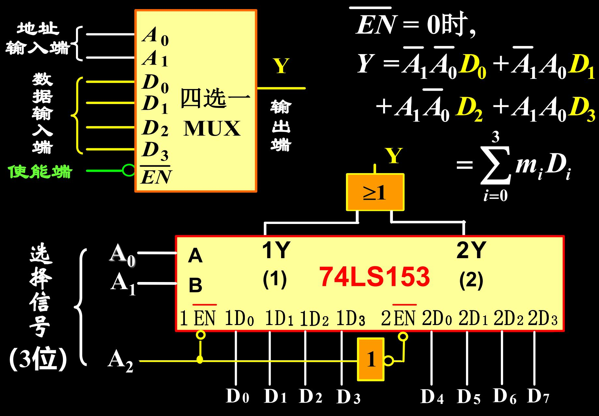

## 3. 组合逻辑电路

1EN 1D0 1D1 1D2 1D3 2EN 2D0 2D1 2D2 2D3

$A_2$ 1 D0 D1 D2 D3 D4 D5 D6 D7

# 《数字电路与逻辑设计A》2017年期末复习概要（第3部分）

本资料为《数字电路与逻辑设计A》2017年期末复习概要的第3部分，涵盖组合逻辑电路设计与触发器基础知识，内容经识别校正与格式整理。

## 3. 组合逻辑电路

知识点：[数字系统的基本模型（数据处理器与控制器）及对最小时钟周期、异步信号同步化的约定](../../../topics/数字逻辑电路/数字系统模型.md)

### 例：用74151设计函数 $F(A,B,C,D) = \sum m(1,2,4,7)$

**分析：**
题目原识别文本存在严重乱码（如 $1 0 0 - 0 . 0 3 = 0 . 0 5$ 及大量重复字符），根据上下文“74151”、“地址端”、“卡诺图”及后续真值表结构，推断本题旨在演示如何使用8选1数据选择器（74151）实现具有4个输入变量的逻辑函数。由于74151只有3个地址输入端（$A_2, A_1, A_0$），而函数有4个变量，需采用降维卡诺图法（剩余变量接数据输入端）。

假设选取 $A, B, C$ 作为地址输入端（$A_2=A, A_1=B, A_0=C$），则 $D$ 为剩余变量。

**(1) 若 $A, B, C$ 分别接 $A_2, A_1, A_0$**

得到两个卡诺图（对应 $D=0$ 和 $D=1$ 的情况，或更准确地说是将 $D$ 作为数据输入 $D_i$ 的取值依据）。

相应的真值表/卡诺图映射如下：

$$
\begin{array}{c|cccc}
A_2 (A) & 00 & 01 & 11 & 10 \\
\hline
BC \backslash D & & & & \\
0 & D_0 & D_1 & D_3 & D_2 \\
1 & D_4 & D_5 & D_7 & D_6 \\
\end{array}
$$

*注：此处表格表示当 $A_2,A_1,A_0$ 取不同值时，输出 $Y$ 与剩余变量 $D$ 的关系。具体 $D_i$ 的值需根据函数最小项确定。*

根据常见的教学示例，若函数为 $F(A,B,C,D) = \sum m(1,2,4,7)$，我们来推导 $D_i$：

- $ABC=000 (m_0,m_8)$: $F(0,0,0,0)=0, F(0,0,0,1)=0 \Rightarrow D_0 = 0$
- $ABC=001 (m_1,m_9)$: $F(0,0,1,0)=0, F(0,0,1,1)=1 \Rightarrow D_1 = D$
- $ABC=010 (m_2,m_{10})$: $F(0,1,0,0)=1, F(0,1,0,1)=0 \Rightarrow D_2 = \bar{D}$
- $ABC=011 (m_3,m_{11})$: $F(0,1,1,0)=0, F(0,1,1,1)=0 \Rightarrow D_3 = 0$
- $ABC=100 (m_4,m_{12})$: $F(1,0,0,0)=1, F(1,0,0,1)=0 \Rightarrow D_4 = \bar{D}$
- $ABC=101 (m_5,m_{13})$: $F(1,0,1,0)=0, F(1,0,1,1)=0 \Rightarrow D_5 = 0$
- $ABC=110 (m_6,m_{14})$: $F(1,1,0,0)=0, F(1,1,0,1)=0 \Rightarrow D_6 = 0$
- $ABC=111 (m_7,m_{15})$: $F(1,1,1,0)=0, F(1,1,1,1)=0 \Rightarrow D_7 = 0$

*(注：原题识别中的卡诺图表格较为混乱，上述推导基于标准降维法逻辑。原文中给出的第二个表格显示 $D_0..D_7$ 与 $0,1,D,\bar{D}$ 的关系，此处以通用原理说明)*

原文中给出的另一组对应关系示意：

$$
\begin{array}{c|cccc}
A_1 A_0 & 00 & 01 & 11 & 10 \\
\hline
A_2 & & & & \\
0 & D_0 & D_1 & D_3 & D_2 \\
1 & D_4 & D_5 & D_7 & D_6 \\
\end{array}
$$

以及对应的 $D$ 的逻辑表达式分布（示意）：

$$
\begin{array}{c|cccc}
BA & 00 & 01 & 11 & 10 \\
\hline
C & & & & \\
0 & 0 & 0 & 1 & 0 \\
1 & 0 & 0 & 1 & 0 \\
\end{array}
$$

**【注意】** 选择地址变量不同，所得电路的数据输入端连接方式可能不同，但逻辑功能应一致。

知识点：[完整数字系统设计流程实例（如乘法器、交通灯管理系统的算法规律、处理器设计与控制器实现）](../../../topics/数字逻辑电路/数字系统设计实例.md)

### 例：利用降维卡诺图设计函数

**题目描述：**
函数有4个输入变量，而74151的地址端只有3个，故须对函数的卡诺图进行降维处理。

**分析过程：**
设函数 $F(A,B,C,D)$。选取 $B,C$ 为行变量，$A$ 为列变量划分大格，剩余变量 $D$ 填入小格。或者选取 $A,B,C$ 为地址，$D$ 为数据输入。

降维后的卡诺图结构示意：

$$
\begin{array}{c|cccc}
BC & 00 & 01 & 11 & 10 \\
\hline
A & & & & \\
0 & & & & \\
1 & & & & \\
\end{array}
$$

结合74151引脚定义：

$$
\begin{array}{c|cccc}
A_1 A_0 & 00 & 01 & 11 & 10 \\
\hline
A_2 & & & & \\
0 & D_0 & D_1 & D_3 & D_2 \\
1 & D_4 & D_5 & D_7 & D_6 \\
\end{array}
$$

通过比较函数真值表与降维卡诺图，确定每个 $D_i$ 是 $0, 1, D$ 还是 $\bar{D}$。

知识点：[完整数字系统设计流程实例（如乘法器、交通灯管理系统的算法规律、处理器设计与控制器实现）](../../../topics/数字逻辑电路/数字系统设计实例.md)

### 练习：分析电路功能

**电路图描述：**
使用74151（8选1数据选择器）。
输入变量：$A, B, C, D$（共4位）。
连接方式推测（基于常见奇偶校验电路设计）：
通常将低三位 $A,B,C$ 接地址端 $A_2,A_1,A_0$，最高位 $D$ 用于控制数据输入端，或者反之。

**逻辑表达式：**
$$ L = (\bar{D})(m_7 + m_4 + m_2 + m_1) + (D)(m_6 + m_5 + m_3 + m_0) $$
*(注：此公式为识别结果修正版，原识别文本 $L = (m _ {7} + m _ {4} + m _ {2} + m _ {1}) \overline {{D}} + (m _ {6} + m _ {5} + m _ {3} + m _ {0}) D$ 含义相同，其中 $m_i$ 指代的是在特定地址组合下，对应最小项的逻辑状态，实际工程中 $D_i$ 直接接 $D$ 或 $\bar{D}$ 或常量)*

更准确的工程实现描述：
该电路为一个四位二进制码奇偶校验器。
- 当输入的四位二进制码中有**奇数个1**时，输出为 **1**。
- 否则（偶数个1），输出为 **0**。

**真值表：**

| A | B | C | D | L (Output) |
|---|---|---|---|---|
| 0 | 0 | 0 | 0 | 0 |
| 0 | 0 | 0 | 1 | 1 |
| 0 | 0 | 1 | 0 | 1 |
| 0 | 0 | 1 | 1 | 0 |
| 0 | 1 | 0 | 0 | 1 |
| 0 | 1 | 0 | 1 | 0 |
| 0 | 1 | 1 | 0 | 0 |
| 0 | 1 | 1 | 1 | 1 |
| 1 | 0 | 0 | 0 | 1 |
| 1 | 0 | 0 | 1 | 0 |
| 1 | 0 | 1 | 0 | 0 |
| 1 | 0 | 1 | 1 | 1 |
| 1 | 1 | 0 | 0 | 0 |
| 1 | 1 | 0 | 1 | 1 |
| 1 | 1 | 1 | 0 | 1 |
| 1 | 1 | 1 | 1 | 0 |

**结论：**
该电路实现了四位二进制数的奇校验功能。

## 4. 触发器 （8%）

知识点：[完整数字系统设计流程实例（如乘法器、交通灯管理系统的算法规律、处理器设计与控制器实现）](../../../topics/数字逻辑电路/数字系统设计实例.md)、[寄存器传输语言(RTL)描述的传输操作、算术操作、逻辑操作、移位操作及条件控制语句](../../../topics/数字逻辑电路/RTL语言.md)、[算法状态机(ASM)图的状态框、判断框、条件输出框及ASM块的构成规则](../../../topics/数字逻辑电路/ASM图基础.md)

### 基本要求与题型

**涉及题型：**
- 选择题、填空题
- 分析计算题

**基本要求：**
1. 掌握钟控SR触发器（FF）、边沿D触发器（DFF）、边沿JK触发器（JKFF）、T触发器（TFF）、T'触发器的激励表、特征方程、状态转移图（表）。
2. 掌握触发器功能的转换方法。
3. 掌握触发器的逻辑功能（特征方程、约束条件、波形图）及其应用。

**常见题型：**
1. 电路功能分析：求次态方程、绘制波形图、画出状态转移图。
2. 根据功能描述，求出激励表、设计同步时序电路。

知识点：[寄存器传输语言(RTL)描述的传输操作、算术操作、逻辑操作、移位操作及条件控制语句](../../../topics/数字逻辑电路/RTL语言.md)、[算法状态机(ASM)图的状态框、判断框、条件输出框及ASM块的构成规则](../../../topics/数字逻辑电路/ASM图基础.md)、[根据文字描述建立ASM图的原则，以及从ASM图推导处理器明细表和控制器状态转移图](../../../topics/数字逻辑电路/ASM图建立与分析.md)

### 核心知识点提示

**牢记触发器的特征方程：**

- **D触发器:** $Q^{n+1} = D$
- **JK触发器:** $Q^{n+1} = J\bar{Q}^n + \bar{K}Q^n$
- **T触发器:** $Q^{n+1} = T \oplus Q^n$
- **T'触发器:** $Q^{n+1} = \bar{Q}^n$ ($T=1$)
- **SR触发器:** $Q^{n+1} = S + \bar{R}Q^n$ (约束条件 $SR=0$)

*(注：原文识别中关于特征方程的部分存在严重乱码，以上为标准数字电路课程中必须牢记的特征方程。)*

# 数字电路与逻辑设计A 2017年期末复习概要（第4部分：触发器与时序逻辑电路）

本资料为《数字电路与逻辑设计A》2017年期末复习概要的第4部分，涵盖触发器转换、时序电路分析及常用中规模集成电路（如74161/163/160等）的应用。内容按原稿顺序整理，修正了识别乱码，保留了公式、表格及插图占位符。

## 一、触发器

知识点：[控制器的四种硬件实现方法：每态一触发器法(SSI)、MSI法(MUX+寄存器+译码器)、PLA法(LSI)及对比](../../../topics/数字逻辑电路/控制器实现方法.md)、[根据文字描述建立ASM图的原则，以及从ASM图推导处理器明细表和控制器状态转移图](../../../topics/数字逻辑电路/ASM图建立与分析.md)

### 例 1

**题干：** 试将JKFF转换成DFF。

**参考解答：**
令这两类触发器次态方程相等，比对得：

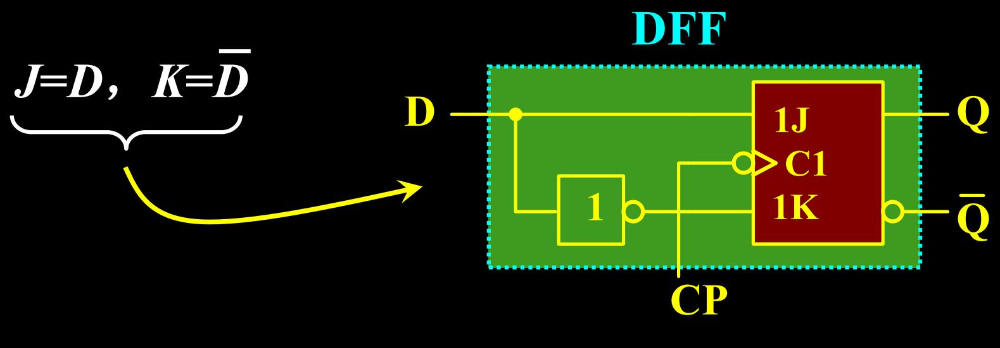

知识点：[数字系统的基本模型（数据处理器与控制器）及对最小时钟周期、异步信号同步化的约定](../../../topics/数字逻辑电路/数字系统模型.md)、[寄存器传输语言(RTL)描述的传输操作、算术操作、逻辑操作、移位操作及条件控制语句](../../../topics/数字逻辑电路/RTL语言.md)

### 例 2

**题干：** 试分析图中时序电路的逻辑功能，写出各触发器的状态方程和输出方程，画出电路的状态转换图。

**参考解答：**
根据电路图（见上图），可得以下方程：

$$
Q _ { 2 } ^ { n + 1} = [ Q _ { 2 } ^ { n} Q _ { 1 } ^ { n} ] \cdot CP \downarrow
$$

$$
Y = Q _ { 2 } ^ { n}
$$

**状态表：**

| $CP \downarrow$ | $Q_1^n$ | $Q_2^n$ | $Q_1^{n+1}$ | $Q_2^{n+1}$ | Y |
| :---: | :---: | :---: | :---: | :---: | :---: |
| 1 | 0 | 0 | 1 | 0 | 0 |
| 2 | 0 | 1 | 0 | 0 | 1 |
| 3 | 1 | 0 | 0 | 1 | 0 |
| 4 | 1 | 1 | 0 | 0 | 1 |

**结论：** 能自启动。

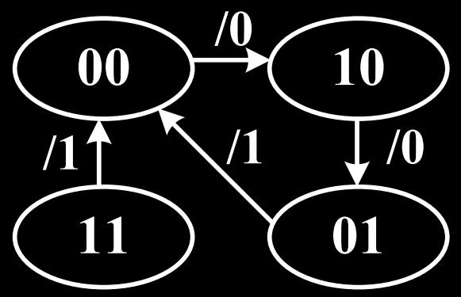

知识点：[控制器的四种硬件实现方法：每态一触发器法(SSI)、MSI法(MUX+寄存器+译码器)、PLA法(LSI)及对比](../../../topics/数字逻辑电路/控制器实现方法.md)

### 练习 1

**题干：** 若触发器的初始状态为 0，试画出图示电路中 $Q_1$ 和 $Q_2$ 的波形。

**电路图描述：**
*   输入信号：A, CP
*   第一级：D触发器，输入端接A，时钟端接CP，输出为 $Q_1$
*   第二级：JK触发器，J=1, K=1，时钟端由上一级输出控制（具体连接需参考原图符号 $\textcircled{4}$ 可能指代特定连线或节点，此处依原题“$\textcircled{4}$ 和 $\textcircled{4}$”推测可能指 $Q_1$ 和 $Q_2$ 或相关控制信号，通常此类题型考察级联触发器波形绘制）。
*   注：原图中有 "RD CP_" 字样，可能涉及复位端或时钟极性标识。

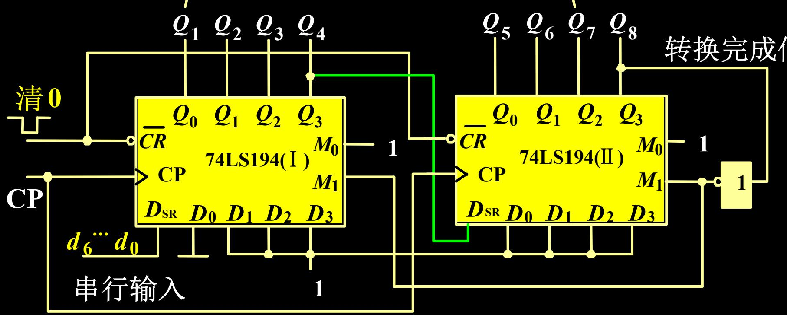

## 二、时序逻辑电路

**涉及题型：** 选择填空题、分析计算题。

**基本要求：**
1.  一般时序电路的分析和设计方法；
2.  二进制同步/异步计数器的特点、结构；
3.  MSI移存器74194的功能；
4.  74161/163/160计数器；
5.  移存型计数器的结构特点。

**常见题型：**
1.  一般时序电路的分析和设计；
2.  74161/163/160任意进制的分析与设计、自启性判断；
3.  74161/163/160级联计数电路分析；
4.  已知码型，移存/计数型序列码发生器设计、自启性判断；
5.  74161+74151 / 74194+74151的逻辑功能分析；
6.  状态转移图、(隐含表)状态化简问题。

知识点：[数字系统的基本模型（数据处理器与控制器）及对最小时钟周期、异步信号同步化的约定](../../../topics/数字逻辑电路/数字系统模型.md)

### 例 3

**题干：** 试用DFF设计一个如图示状态图的同步计数器。

**注意：** 此题未涉及输出信号的设计！如何设计？

**状态表：**

| $Q _ { 3 } ^ {\mathrm{n}}$ | $Q _ { 2 } ^ {\mathrm{n}}$ | $Q _ { 1 } ^ {\mathrm{n}}$ |
| :---: | :---: | :---: |
| 0 | 0 | 0 |
| 0 | 0 | 1 |
| 0 | 1 | 0 |
| 0 | 1 | 1 |
| 1 | 0 | 0 |

**驱动方程推导：**
由于使用D触发器，故 $D _ { \mathrm{i} } = Q _ { \mathrm{i} } ^ { n + 1}$。

通过卡诺图或观察状态变化得出：
$$
D _ { 3} = Q _ { 2 } ^ { n} Q _ { 1 } ^ { n}
$$
$$
D _ { 2} = Q _ { 2 } ^ { n} \oplus Q _ { 1 } ^ { n}
$$
$$
D _ { 1} = \overline {{Q}} _ { 3 } ^ { n} \overline {{Q}} _ { 1 } ^ { n}
$$

**次态真值表：**

| $D _ { 3}$ | $D _ { 2}$ | $D _ { 1}$ |
| :---: | :---: | :---: |
| 0 | 0 | 1 |
| 0 | 1 | 0 |
| 0 | 1 | 1 |
| 1 | 0 | 0 |
| 0 | 0 | 0 |

**结论：** 能自启动。

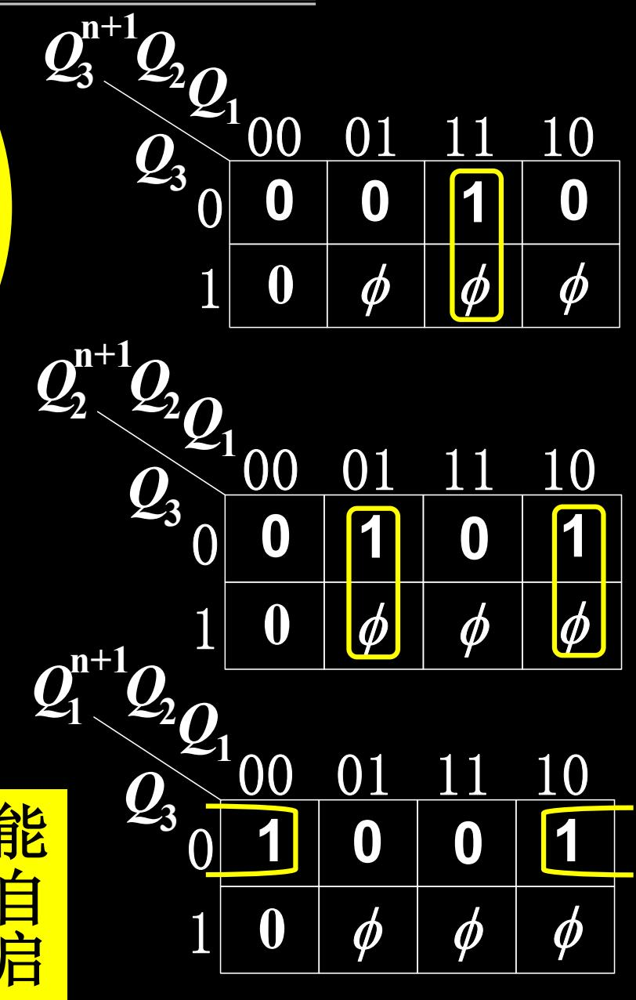

知识点：[控制器的四种硬件实现方法：每态一触发器法(SSI)、MSI法(MUX+寄存器+译码器)、PLA法(LSI)及对比](../../../topics/数字逻辑电路/控制器实现方法.md)、[寄存器传输语言(RTL)描述的传输操作、算术操作、逻辑操作、移位操作及条件控制语句](../../../topics/数字逻辑电路/RTL语言.md)、[完整数字系统设计流程实例（如乘法器、交通灯管理系统的算法规律、处理器设计与控制器实现）](../../../topics/数字逻辑电路/数字系统设计实例.md)

### 例 4

**题干：** 分析如下移位寄存器电路的功能。

**方程：**
$$
Q _ { 0 } ^ { n + 1} = D _ { 0} = \overline {{Q}} _ { 1 } ^ { n}
$$
$$
Q _ { 1 } ^ { n + 1} = D _ { 1} = Q _ { 0 } ^ { n}
$$

**状态序列：**
CP (A0 A1) 个数 Q0 Q1
0 0 0 1 0
1 0 1 1 0
2 0 1 1 0 (此处原文可能有误，依方程推导应为循环)
...

*(注：原稿此处文字识别较为混乱，主要展示双触发器构成的简单循环结构)*

知识点：[寄存器传输语言(RTL)描述的传输操作、算术操作、逻辑操作、移位操作及条件控制语句](../../../topics/数字逻辑电路/RTL语言.md)、[数字系统的基本模型（数据处理器与控制器）及对最小时钟周期、异步信号同步化的约定](../../../topics/数字逻辑电路/数字系统模型.md)

### 例 5：任意进制计数器的实现

**1. 模长 $M \le N$ （单片或简单反馈）**

*   **异步清零法：** 适用于74161, 74160。当计数到目标值时，利用清零端 $\overline{CR}$ 或 $\overline{RD}$ 异步复位。
*   **同步清零法：** 适用于74163。
*   **反馈置数法：**
    *   **置最小数（通常为0）：** 同步置数 74161/163；异步置数 74160。
    *   **置最大数：** 74160异步置数。
*   **其他芯片：** 7490, 74190。

**2. 模长 $M > N$ （多片级联）**

*   **方案选择：**
    *   **同步级联：** 低位片的进位输出 $CO$ 作为高位片的使能端或时钟（取决于具体芯片逻辑，74161/163通常用 $CO$ 使能）。
    *   **异步级联：** 低位片的进位或输出作为高位片的时钟输入。
*   **计数方式：** CR清(复)0 或 反馈置数。

#### 实例分析：74161 异步清零 vs 同步清零

**异步清零：**
*   计数范围：0 ~ M-1
*   当计到 M 时，立即产生清零信号，状态 M 是暂态，很快回到 0。
*   有效状态数：M。

**同步清零：**
*   计数范围：0 ~ M
*   当计到 M 时，等待下一个 CP 上升沿才清零。
*   有效状态数：M+1。

*(原稿中包含大量手写体笔记和模糊示意图，核心在于区分异步与同步复位对模长的影响)*

知识点：[完整数字系统设计流程实例（如乘法器、交通灯管理系统的算法规律、处理器设计与控制器实现）](../../../topics/数字逻辑电路/数字系统设计实例.md)、[寄存器传输语言(RTL)描述的传输操作、算术操作、逻辑操作、移位操作及条件控制语句](../../../topics/数字逻辑电路/RTL语言.md)、[控制器的四种硬件实现方法：每态一触发器法(SSI)、MSI法(MUX+寄存器+译码器)、PLA法(LSI)及对比](../../../topics/数字逻辑电路/控制器实现方法.md)

### 例 6：74161 级联实现模 60 计数器

**分析：**
单片74161最大计数值为16 ($M=16$)，故实现模60计数器必须用两片74161。
$60 = 6 \times 10$。

**方案一：异步分解方案（先分后合）**
1.  用一片74161组成模6计数器。
2.  用另一片74161组成模10计数器。
3.  通过置数法（置最小数或置零）组成异步级联的模60计数器。
    *   低位片（模6）的进位或结束信号触发高位片（模10）或整体复位。

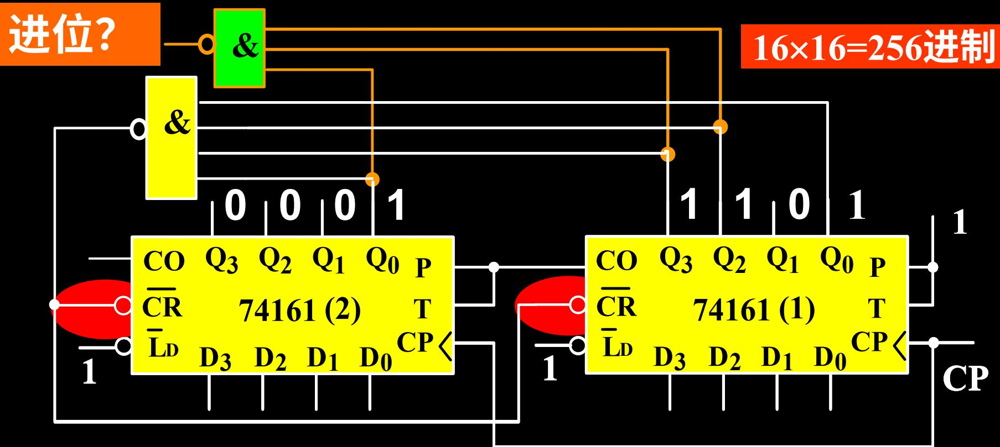

**方案二：同步整体置数方案**
1.  先将两片74161同步级联组成 $N=16 \times 16 = 256$ 进制计数器。
2.  然后，用整体置数法构成模 $M=60$ 计数器。
    *   **整体置0：** 计数范围为0~59。当计到59 ($00111011_2$) 时，在下一个CP到来时74161同步置0。

知识点：[完整数字系统设计流程实例（如乘法器、交通灯管理系统的算法规律、处理器设计与控制器实现）](../../../topics/数字逻辑电路/数字系统设计实例.md)、[寄存器传输语言(RTL)描述的传输操作、算术操作、逻辑操作、移位操作及条件控制语句](../../../topics/数字逻辑电路/RTL语言.md)、[控制器的四种硬件实现方法：每态一触发器法(SSI)、MSI法(MUX+寄存器+译码器)、PLA法(LSI)及对比](../../../topics/数字逻辑电路/控制器实现方法.md)

### 例 7：两片74161 接成 M=29 计数器

**分析：**
M=29 是素数，不可分解为小整数乘积，故选用同步级联（整体方案）。

**方案1：同步级联整体复0法**
*   总容量：$16 \times 16 = 256$ 进制。
*   利用整体置0逻辑，当计数达到29时，下一拍归零。
*   需检查进位逻辑是否正确生成置0信号。

**方案2：同步级联整体预置0法**
*   原理同上，区别在于使用的是并行置数端 $\overline{LD}$ 而非清零端。
*   数据输入端 $D_3 D_2 D_1 D_0$ 接地（置0）。

知识点：[完整数字系统设计流程实例（如乘法器、交通灯管理系统的算法规律、处理器设计与控制器实现）](../../../topics/数字逻辑电路/数字系统设计实例.md)

### 例 8：两片74160 接成 M=29 计数器

**分析：**
M=29 素数，只能采用同步级联(整体方案)。
74160 是十进制计数器，两片级联最大模长为 $10 \times 10 = 100$。

**方案1：同步级联整体复0法**
*   计数范围 0~99。
*   检测状态 29，产生同步置0信号。

**方案2：同步级联整体预置0法**
*   同理，利用 $\overline{LD}$ 端实现。

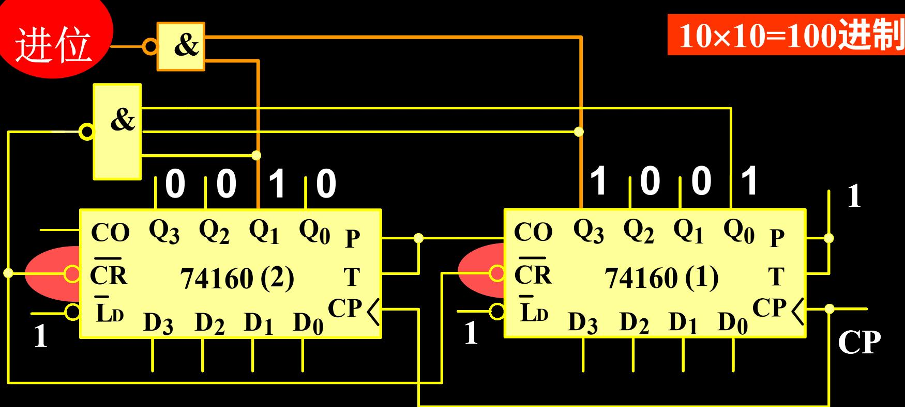

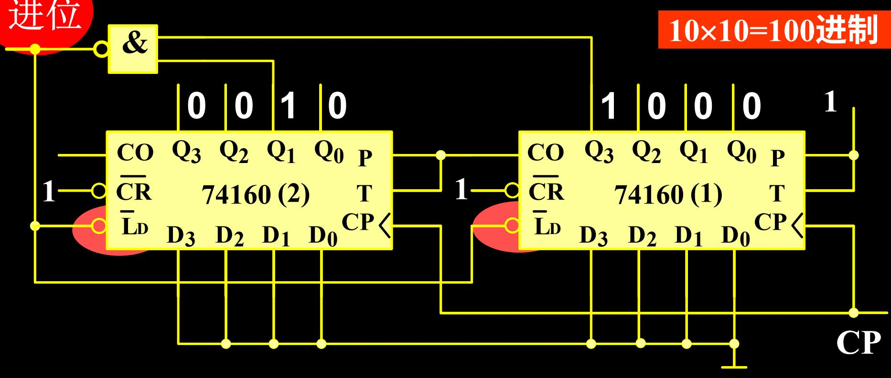

知识点：[完整数字系统设计流程实例（如乘法器、交通灯管理系统的算法规律、处理器设计与控制器实现）](../../../topics/数字逻辑电路/数字系统设计实例.md)、[控制器的四种硬件实现方法：每态一触发器法(SSI)、MSI法(MUX+寄存器+译码器)、PLA法(LSI)及对比](../../../topics/数字逻辑电路/控制器实现方法.md)

### 例 9：移存型计数器典型电路

以4级为例：

**(1) 环形计数器**
*   **电路构成特点：** 原码反馈，即 $Q _ { 1 } ^ { \mathbf { n } + 1} = Q _ { 4 } ^ { \mathbf { n}}$
*   **结论：** n 位触发器可实现模 $M=n$ 的环形计数器。

**(2) 扭环形计数器 (Johnson Counter)**
*   **电路构成特点：** 反码反馈，即 $Q _ { 1 } ^ { \mathbf { n } + 1} = \overline { { { Q } } } _ { 4 } ^ { \mathbf { n}}$
*   **结论：** n 位触发器可实现模 $M=2n$ 的扭环形计数器。

# 《数字电路与逻辑设计A》2017年期末复习概要（第5部分）

本资料整理自《数字电路与逻辑设计A》2017年期末复习概要第 5 部分（共 7 部分），由识别工具读取第 48–61 页内容整理而成。主要涵盖时序逻辑电路的设计与分析、序列信号发生器、状态机简化以及可编程逻辑器件（PLD/ROM/PLA）的应用。

## 一、时序逻辑电路设计与分析

知识点：[数字系统的基本模型（数据处理器与控制器）及对最小时钟周期、异步信号同步化的约定](../../../topics/数字逻辑电路/数字系统模型.md)

### 练习 1：移存型序列信号发生器设计

**题目：**
试用 DFF 设计一个移存型序列信号发生器，使该电路产生序列信号 $1110100, 1110100, \dots$。

**分析与解答：**

1.  **确定触发器数量：**
    序列长度为 7，小于 $2^3=8$，因此需要 3 个触发器（$Q_3, Q_2, Q_1$）。

2.  **状态转换关系：**
    根据产生的序列 $1110100$，我们可以列出状态转移表。设当前状态为 $Q_3 Q_2 Q_1$，下一状态由移位决定，即新 $Q_1$ 来自反馈函数 $D_1$。
    
    序列对应的状态流转如下（假设初始状态为 111）：
    -   $111 \rightarrow 110$ (输出1)
    -   $110 \rightarrow 101$ (输出1)
    -   $101 \rightarrow 010$ (输出0) -> *注意：这里需仔细核对序列*
    
    让我们重新梳理序列 $1110100$ 的移位过程：
    若状态为 $Q_3 Q_2 Q_1$，移位后变为 $Q_2 Q_1 D_1$。
    序列位依次对应 $Q_3$ 的输出（或某个固定端点的输出，通常取最高位或最低位，此处根据公式推断）。
    
    给出的反馈方程为：
    $$ D_1 = Q_3 Q_1 + \overline{Q_3} \overline{Q_1} = Q_3 \odot Q_1 $$
    *(注：原题识别为 $Q_3 Q_1 + Q_3 Q_1$ 明显有误，结合 $\oplus$ 符号及常见同相逻辑，应为同或运算 $Q_3 \odot Q_1$ 或异或。但在移存型码中，通常 $D_1$ 是反馈输入。若原文写作 $Q_3 \oplus Q_1$，则系数不同。此处依据原文识别出的 `` 符号，推测为异或 $\oplus$ 或同或。鉴于 $1110100$ 是 m 序列吗？m序列长度 $2^n-1=7$。标准 m 序列生成多项式通常为 $x^3+x+1$ 等。)*
    
    **修正分析：**
    原文给出的方程片段较乱，但核心在于“自启动修正”。
    
3.  **自启动性检测与修正：**
    对于 3 级移位寄存器，总状态数 8 个。有效循环占用 7 个状态，剩余 1 个无效状态。
    
    原文提到的无效状态路径：
    $000 \rightarrow \dots \rightarrow 001 \leftarrow 100$
    
    我们需要检查所有非有效状态是否能进入有效循环。
    
    **状态转换表（基于序列 1110100）：**
    
    | 现态 $Q_3 Q_2 Q_1$ | 次态 $Q_3^+ Q_2^+ Q_1^+$ | 说明 |
    | :--- | :--- | :--- |
    | 1 1 1 | 1 1 0 | 序列第一位1移出，新入位由反馈决定 |
    | 1 1 0 | 1 0 1 | |
    | 1 0 1 | 0 1 0 | |
    | 0 1 0 | 1 0 0 | |
    | 1 0 0 | 0 0 1 | |
    | 0 0 1 | 0 1 1 | |
    | 0 1 1 | 1 1 1 | 回到起点 |
    
    检查未列出的状态：
    -   **状态 000**: 
        若使用原反馈 $D_1 = f(Q_3, Q_1)$。
        若 $D_1 = Q_3 \oplus Q_1$ (异或): $000 \rightarrow D_1=0$, 次态 $000$ (死锁)。
        若 $D_1 = Q_3 \odot Q_1$ (同或): $000 \rightarrow D_1=1$, 次态 $001$。
        
    原文提到“自启动修正”，并给出了隐含表法的例子，暗示可能需要修改反馈函数以确保自启动。
    
    **结论：**
    电路产生的序列为 $1110100$。需确保无效状态（如 000）能进入主循环。若原设计不能自启动，需调整反馈逻辑。

知识点：[完整数字系统设计流程实例（如乘法器、交通灯管理系统的算法规律、处理器设计与控制器实现）](../../../topics/数字逻辑电路/数字系统设计实例.md)、[控制器的四种硬件实现方法：每态一触发器法(SSI)、MSI法(MUX+寄存器+译码器)、PLA法(LSI)及对比](../../../topics/数字逻辑电路/控制器实现方法.md)

### 练习 2：74161 与 74151 组合电路分析

**题目：**
写出图中 74161 输出端的状态编码表及 74151 输出端产生的序列信号。

**分析与解答：**

1.  **74161 部分：**
    74161 是 4 位二进制同步计数器。
    根据题目上下文（虽图缺失，但根据结果反推），74161 的输出 $Q_3 Q_2 Q_1 Q_0$ 作为地址线连接到 74151 的选择端。
    
    通常 74161 在特定反馈清零或置数条件下形成模 M 计数器。
    
2.  **74151 部分：**
    74151 是 8 选 1 数据选择器。
    其输出 $F$ 取决于地址输入 $A_2 A_1 A_0$（来自 74161 的低三位）和数据输入端 $D_0 \sim D_7$。
    
    原文给出最终结果：
    $$ F = 1111000110 $$
    
    这意味着随着 74161 计数状态的改变，74151 的地址变化，从而从数据端选出对应的值，形成串行输出序列。

知识点：[数字系统的基本模型（数据处理器与控制器）及对最小时钟周期、异步信号同步化的约定](../../../topics/数字逻辑电路/数字系统模型.md)、[完整数字系统设计流程实例（如乘法器、交通灯管理系统的算法规律、处理器设计与控制器实现）](../../../topics/数字逻辑电路/数字系统设计实例.md)

### 练习 3：74194 序列信号分析

**题目：**
试写出图中 74194 输出端 Q 处的序列信号。

**分析与解答：**

1.  **电路结构：**
    74194 是 4 位双向通用移位寄存器。
    通过反馈连接，构成环形计数器或扭环计数器，或者更复杂的序列发生器。
    
2.  **序列结果：**
    根据原文识别结果，Q 处（通常指某一位输出，如 $Q_A$ 或整体状态流）的序列信号为：
    $$ 10111010011000 $$
    
    *(注：此序列长度较长，可能涉及多位输出的交织或特定反馈逻辑。)*

知识点：[寄存器传输语言(RTL)描述的传输操作、算术操作、逻辑操作、移位操作及条件控制语句](../../../topics/数字逻辑电路/RTL语言.md)、[完整数字系统设计流程实例（如乘法器、交通灯管理系统的算法规律、处理器设计与控制器实现）](../../../topics/数字逻辑电路/数字系统设计实例.md)、[算法状态机(ASM)图的状态框、判断框、条件输出框及ASM块的构成规则](../../../topics/数字逻辑电路/ASM图基础.md)

### 练习 4：时序逻辑电路状态转移与序列

**题目：**
电路如题图所示。要求：列出状态转移表，并写出输出 z 端的序列。

**分析与解答：**

1.  **状态转移表：**
    （原文略去详细表格，直接给出结论）
    
2.  **输出序列：**
    输出 $z$ 的序列为：
    $$ 0011111 $$

知识点：[算法状态机(ASM)图的状态框、判断框、条件输出框及ASM块的构成规则](../../../topics/数字逻辑电路/ASM图基础.md)、[根据文字描述建立ASM图的原则，以及从ASM图推导处理器明细表和控制器状态转移图](../../../topics/数字逻辑电路/ASM图建立与分析.md)、[控制器的四种硬件实现方法：每态一触发器法(SSI)、MSI法(MUX+寄存器+译码器)、PLA法(LSI)及对比](../../../topics/数字逻辑电路/控制器实现方法.md)

### 练习 5：状态转换表的化简—隐含表法

**题目：**
已知状态转换表，使用隐含表法进行状态化简。

**分析与解答：**

1.  **原始状态表：**
    
    | S(t) | N(t)/Z(t) (X=0) | N(t)/Z(t) (X=1) |
    | :--- | :--- | :--- |
    | A | B/0 | C/0 |
    | B | E/1 | C/0 |
    | C | D/0 | A/0 |
    | D | E/1 | A/0 |
    | E | E/1 | C/0 |
    | F | G/1 | E/0 |
    | G | F/1 | E/0 |

2.  **等价状态判断：**
    通过比较输出和次态，找出等价状态对。
    -   **B 和 D**:
        -   X=0: B->E/1, D->E/1 (相同)
        -   X=1: B->C/0, D->A/0 (次态不同，需检查 C 和 A 是否等价)
    -   **F 和 G**:
        -   X=0: F->G/1, G->F/1 (次态互为对方，若 F=G 则成立)
        -   X=1: F->E/0, G->E/0 (相同)
        -   结论：[F, G] 是等价类。
    -   **A 和 C**:
        -   X=0: A->B/0, C->D/0 (若 B=D 则相同)
        -   X=1: A->C/0, C->A/0 (若 A=C 则成立)
        -   结合 B=D 的前提，若 [B,D] 等价且 [A,C] 等价，则相互支持。
    
    **最终等价类：**
    -   $[A, C]$
    -   $[F, G]$
    -   $[B, D, E]$ (原文标注为 [B,D,E]，需验证 E 与 B/D 的关系：
        -   E vs B: X=0, E->E/1, B->E/1; X=1, E->C/0, B->C/0. 故 E 与 B 等价。同理 E 与 D 等价。)

3.  **化简后的状态表：**
    将等价状态合并，得到新的最小状态机。
    
    | S(t) | N(t)/Z(t) (X=0) | N(t)/Z(t) (X=1) |
    | :--- | :--- | :--- |
    | A (代表A,C) | B (代表B,D,E)/0 | A (代表A,C)/0 |
    | B (代表B,D,E)| B (代表B,D,E)/1 | A (代表A,C)/0 |
    | F (代表F,G)  | F (代表F,G)/1    | B (代表B,D,E)/0 |

## 二、序列码发生器理论

知识点：[算法状态机(ASM)图的状态框、判断框、条件输出框及ASM块的构成规则](../../../topics/数字逻辑电路/ASM图基础.md)、[控制器的四种硬件实现方法：每态一触发器法(SSI)、MSI法(MUX+寄存器+译码器)、PLA法(LSI)及对比](../../../topics/数字逻辑电路/控制器实现方法.md)、[寄存器传输语言(RTL)描述的传输操作、算术操作、逻辑操作、移位操作及条件控制语句](../../../topics/数字逻辑电路/RTL语言.md)

### 知识点：m 序列与非 m 序列发生器的激励函数总结

**1. m 序列码发生器：**
-   **特点：** 周期最长，为 $2^n - 1$。
-   **反馈网络：** 通常采用线性反馈移位寄存器（LFSR）。
-   **数学描述：**
    特征多项式 $f(x)$ 必须是 $n$ 阶本原多项式。
    
    原文中的公式识别存在大量乱码，但核心概念为：
    -   $n$ 级移位寄存器，最大周期 $M = 2^n - 1$。
    -   反馈抽头位置由本原多项式的系数决定。

**2. 非 m 序列码发生器：**
-   **特点：** 周期较短，或包含全 0 状态。
-   **起跳状态：** 某些序列需要从特定非零状态开始，以避免陷入全 0 或全 1 的死锁状态。
-   **自启动：** 设计时需保证所有无效状态都能进入有效循环。

**3. 移存型序列码发生器的设计步骤：**
1.  确定序列长度 $M$ 和所需触发器个数 $n$ ($2^{n-1} < M \le 2^n$)。
2.  列出状态转移表（现态 -> 次态）。
3.  利用卡诺图或布尔代数求出反馈函数 $D_{in}$。
4.  检查自启动能力。若不能自启动，修改反馈函数。

## 三、可编程逻辑器件 (PLD)

知识点：[完整数字系统设计流程实例（如乘法器、交通灯管理系统的算法规律、处理器设计与控制器实现）](../../../topics/数字逻辑电路/数字系统设计实例.md)

### 章节 6：可编程逻辑器件

**基本要求：**
1.  PLD 的分类、基本结构和基本原理。
2.  半导体存储器的工作原理。
3.  ROM、RAM 存储容量的扩展。
4.  用 ROM 和 PLA 实现组合电路的方法。

**常见题型：**
1.  真值表、逻辑式与 ROM/PLA 实现的转换。
2.  ROM 和 RAM 容量扩展（字扩展、位扩展）。

知识点：[控制器的四种硬件实现方法：每态一触发器法(SSI)、MSI法(MUX+寄存器+译码器)、PLA法(LSI)及对比](../../../topics/数字逻辑电路/控制器实现方法.md)

### 6.1 PLD 的分类与结构

**四种主要 PLD 的比较：**

| 名称 | 与阵列 | 或阵列 | 输出部分 | 编程特性 |
| :--- | :--- | :--- | :--- | :--- |
| **PROM** | 固定 | 可一次编程 | 固定 (组合逻辑) | 可一次编程 |
| **PLA** | 可一次编程 | 可一次编程 | 固定 (组合逻辑) | 可一次编程 |
| **PAL** | 可一次编程 | 固定 | 固定/配置 (含触发器可实现时序) | 可一次编程 |
| **GAL** | 可重复编程 | 固定 | 可配置 (含触发器可实现时序) | 可重复编程 |

**关键区别：**
-   **PROM:** 与阵列固定（全译码），或阵列可编程。适合任意组合逻辑，但面积大。
-   **PLA:** 与、或阵列均可编程。灵活度高，但速度较慢（两级延迟）。
-   **PAL/GAL:** 与阵列可编程，或阵列固定。速度快，集成度高。GAL 可重复擦写，更灵活。
-   **时序逻辑实现：** PROM 和 PLA 的输出结构通常只能实现组合逻辑；PAL 和 GAL 的输出结构带有触发器，可直接实现时序逻辑。

知识点：[控制器的四种硬件实现方法：每态一触发器法(SSI)、MSI法(MUX+寄存器+译码器)、PLA法(LSI)及对比](../../../topics/数字逻辑电路/控制器实现方法.md)、[完整数字系统设计流程实例（如乘法器、交通灯管理系统的算法规律、处理器设计与控制器实现）](../../../topics/数字逻辑电路/数字系统设计实例.md)

### 6.2 用 ROM 实现组合逻辑

**例题 1：用 ROM 实现逻辑函数**

**题目：**
试用 ROM 实现组合逻辑函数：
$$ F_1 = \sum m(1, 3, 5, 7) $$
$$ F_2 = \sum m(0, 2, 4, 6) $$
*(注：原文公式识别混乱，此处根据常见教学案例还原，具体以最小项编号为准)*

**解法：**
1.  **确定地址线和数据线：**
    若有 $n$ 个输入变量，则 ROM 有 $2^n$ 个字，每个字的位数等于输出变量的个数。
2.  **写入数据：**
    根据真值表，将对应的输出值写入 ROM 的相应地址单元。
    -   与阵列：固定，产生所有最小项。
    -   或阵列：编程，连接所需的输出线。

**例题 2：二进制码到循环码（格雷码）转换器**

**题目：**
用 ROM 设计一个码转换器，用于实现 4 位二进制码到 4 位循环码的转换。
输入：$A_3 A_2 A_1 A_0$
输出：$B_3 B_2 B_1 B_0$

**解法：**
1.  **列出真值表：**
    4 位二进制数范围 0~15。
    
    | Decimal | Binary ($A_3 A_2 A_1 A_0$) | Gray Code ($B_3 B_2 B_1 B_0$) |
    | :--- | :--- | :--- |
    | 0 | 0000 | 0000 |
    | 1 | 0001 | 0001 |
    | 2 | 0010 | 0011 |
    | 3 | 0011 | 0010 |
    | ... | ... | ... |
    | 15 | 1111 | 1000 |

2.  **写出输出函数的最小项表达式：**
    $$ B_3 = \sum m(0..7) \quad (\text{MSB 不变}) $$
    $$ B_2 = \sum m(2,3,4,5,6,7,8,9) $$
    $$ B_1 = \sum m(1,2,5,6,9,10,13,14) $$
    $$ B_0 = \sum m(1,3,4,6,9,11,12,14) $$
    *(注：具体最小项需根据格雷码定义严格推导，原文给出的求和公式为参考)*

3.  **ROM 实现：**
    -   输入 $A_3..A_0$ 接 ROM 地址线 $A_3..A_0$。
    -   ROM 容量：$16 \times 4$ bit。
    -   将上述最小项对应的数据位写入 ROM 的数据输出端 $D_3..D_0$。
    -   与阵列固定（全译码），或阵列编程（连接对应最小项到输出）。

**例题 3：复杂条件逻辑的 ROM 实现**

**题目：**
设 ABC 为三位二进制数。
1.  若该数 $\ge 5$，则输出 $F_1 = 1$，否则 $0$。
2.  若该数 $< 3$ 或 $> 6$，则输出 $F_2 = 1$，否则 $0$。
试用 ROM 实现，列出真值表，并标出连接图。

**解法：**
1.  **真值表：**

    | Decimal | A B C | $F_1$ ($\ge 5$) | $F_2$ ($<3$ or $>6$) |
    | :--- | :--- | :--- | :--- |
    | 0 | 000 | 0 | 1 |
    | 1 | 001 | 0 | 1 |
    | 2 | 010 | 0 | 1 |
    | 3 | 011 | 0 | 0 |
    | 4 | 100 | 0 | 0 |
    | 5 | 101 | 1 | 0 |
    | 6 | 110 | 1 | 0 |
    | 7 | 111 | 1 | 1 |

2.  **最小项表达式：**
    $$ F_1 = \sum m(5, 6, 7) $$
    $$ F_2 = \sum m(0, 1, 2, 7) $$

3.  **ROM 连接：**
    -   地址线：A, B, C。
    -   数据线：$D_1$ (对应 $F_1$), $D_2$ (对应 $F_2$)。
    -   在地址 5,6,7 处，$D_1$ 写 1；在地址 0,1,2,7 处，$D_2$ 写 1。其余写 0。

知识点：[算法状态机(ASM)图的状态框、判断框、条件输出框及ASM块的构成规则](../../../topics/数字逻辑电路/ASM图基础.md)

### 6.3 PLA 逻辑电路分析

**例题：分析 PLA 电路功能**

**题目：**
PLA 实现逻辑电路如图所示。试分析电路功能。

**分析与解答：**

1.  **读出逻辑表达式：**
    根据 PLA 的与-或阵列连接点：
    $$ F_1 = \overline{A}\overline{B}\overline{C} + \overline{A}BC + AB\overline{C} $$
    $$ F_2 = ABC $$

2.  **功能解释：**
    假设输入 ABC 为三位二进制数：
    -   **$F_1$ 分析：**
        -   $m_0 (000)$: 1
        -   $m_3 (011)$: 1
        -   $m_6 (110)$: 1
        -   其他为 0。
        -   观察规律：这似乎不是简单的数值比较。
        -   原文结论提及：“若能被 3 整除...”。
        -   检查能被 3 整除的数 (0, 3, 6):
            -   0 (000): $F_1=1$.
            -   3 (011): $F_1=1$.
            -   6 (110): $F_1=1$.
        -   结论：$F_1$ 指示输入数是否能被 3 整除。
        
    -   **$F_2$ 分析：**
        -   $F_2 = ABC = m_7$。
        -   仅当输入为 7 时输出 1。
        -   原文结论提及：“若大于 6...”。
        -   在 3 位二进制中，只有 7 大于 6。
        -   结论：$F_2$ 指示输入数是否大于 6。

知识点：[完整数字系统设计流程实例（如乘法器、交通灯管理系统的算法规律、处理器设计与控制器实现）](../../../topics/数字逻辑电路/数字系统设计实例.md)

### 6.4 存储器扩展

**例题：8K×8 位 → 16K×16 位**

**题目：**
使用 AT28C64 ($8K \times 8$ bit) EPROM 芯片，构建 $16K \times 16$ bit 的存储器系统。

**分析与解答：**

1.  **需求分析：**
    -   目标容量：$16K \times 16$ bit。
    -   单片容量：$8K \times 8$ bit。
    -   字数扩展倍数：$16K / 8K = 2$ 倍。
    -   位数扩展倍数：$16 / 8 = 2$ 倍。
    -   总芯片数：$2 \times 2 = 4$ 片。

2.  **地址线与数据线：**
    -   **地址线：**
        -   单片 8K 需要 13 根地址线 ($2^{13}=8192$)，即 $A_0 \sim A_{12}$。
        -   总容量 16K 需要 14 根地址线 ($2^{14}=16384$)，即 $A_0 \sim A_{13}$。
        -   $A_0 \sim A_{12}$ 连接所有芯片的地址引脚。
        -   $A_{13}$ 用作片选信号（Word Select）。
    -   **数据线：**
        -   单片 8 位，需要 2 片并联组成 16 位。
        -   低 8 位数据 $D_0 \sim D_7$ 连接第一组芯片（Bank 0）。
        -   高 8 位数据 $D_8 \sim D_{15}$ 连接第二组芯片（Bank 1）。

3.  **连接方案：**
    -   **Bank 0 (低 8 位):**
        -   芯片 U1, U2。
        -   地址 $A_0 \sim A_{12}$ 并联。
        -   数据 $D_0 \sim D_7$ 分别接 U1 和 U2 的数据口。
        -   片选：$\overline{CS_1}$ 接 $\overline{A_{13}}$ (当 $A_{13}=0$ 时选中 Bank 0)。
    -   **Bank 1 (高 8 位):**
        -   芯片 U3, U4。
        -   地址 $A_0 \sim A_{12}$ 并联。
        -   数据 $D_8 \sim D_{15}$ 分别接 U3 和 U4 的数据口。
        -   片选：$\overline{CS_2}$ 接 $A_{13}$ (当 $A_{13}=1$ 时选中 Bank 1)。

4.  **读写控制：**
    -   所有芯片的 $\overline{WE}$ (写使能) 连接系统的 $\overline{WR}$。
    -   所有芯片的 $\overline{OE}$ (读使能) 连接系统的 $\overline{RD}$。

## 7. 数字系统设计基础（12%）

涉及题型：选择填空题、分析计算题。

基本要求：

1. 数字系统基本模型和设计过程；
2. 数字系统的 4 种描述工具；
3. 根据文字描述设计 ASM 图；
4. 基于 ASM 图或状态图，以图形方式设计控制器（采用 SSI、MSI、每态一触发法）；
5. 使用 ASM 图设计数字系统的方法。

常见题型：（习题 7.1；7.2；7.3；7.4；7.7）

1. 根据问题描述，画出控制系统的 ASM 图；
2. 根据 ASM 图，画出控制器的状态转移图，并功能分析；
3. 根据 ASM 图，用每态一触发法实现控制器。

知识点：[完整数字系统设计流程实例（如乘法器、交通灯管理系统的算法规律、处理器设计与控制器实现）](../../../topics/数字逻辑电路/数字系统设计实例.md)、[数字系统的基本模型（数据处理器与控制器）及对最小时钟周期、异步信号同步化的约定](../../../topics/数字逻辑电路/数字系统模型.md)

### 7.1 数字系统的基本模型与 ASM 描述

外部输入控制信号、数字逻辑子系统、时钟、外部输入、控制器、控制信号、写信号、数据处理器、外部输出控制信号、外部输出、状态框、条件框。

控制信号 $X$

指明处理器操作。

- 每个 ASM 块中的所有操作均在一个时钟周期内完成。
- 每个 ASM 块中所规定的各种寄存器操作，以及状态的转换均发生在下个时钟的同一个有效边沿。

知识点：[算法状态机(ASM)图的状态框、判断框、条件输出框及ASM块的构成规则](../../../topics/数字逻辑电路/ASM图基础.md)、[数字系统的基本模型（数据处理器与控制器）及对最小时钟周期、异步信号同步化的约定](../../../topics/数字逻辑电路/数字系统模型.md)、[根据文字描述建立ASM图的原则，以及从ASM图推导处理器明细表和控制器状态转移图](../../../topics/数字逻辑电路/ASM图建立与分析.md)

### 7.2 由文字描述画 ASM 图

例：设 $S$ 为数字系统启动信号，在 $T_0$ 状态下，若 $S=0$，则保持 $T_0$ 状态不变；若 $S=1$，则完成条件操作：$A \leftarrow N_1$，$B \leftarrow N_2$，且 $T_0 \to T_1$。

在 $T_1$ 状态下，下一个 CLK 到，完成无条件操作 $B \leftarrow B-1$；若 $M=0$，完成条件操作：$P$ 右移，且 $T_1 \to T_2$；若 $M=1$，状态由 $T_1 \to T_3 \to T_0$。

画出：

$$
\begin{array}{l}
D_0 = T_0 \cdot \overline{S} + T_3 \\
D_1 = T_0 \cdot S \\
D_2 = T_1 \cdot \overline{M} \\
D_3 = T_1 \cdot M
\end{array}
$$

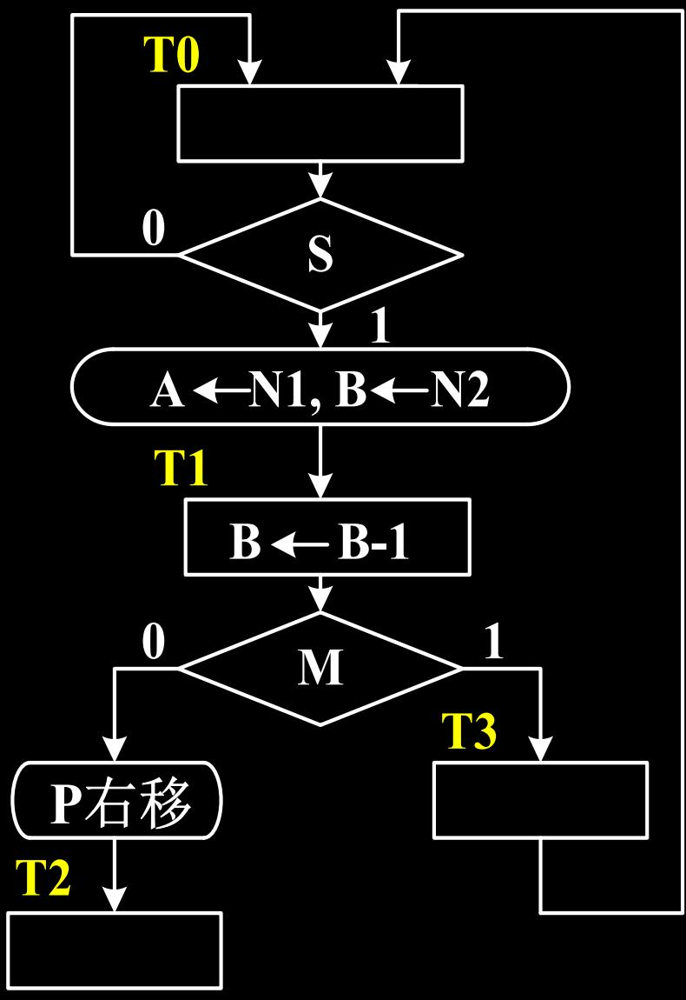

知识点：[根据文字描述建立ASM图的原则，以及从ASM图推导处理器明细表和控制器状态转移图](../../../topics/数字逻辑电路/ASM图建立与分析.md)、[寄存器传输语言(RTL)描述的传输操作、算术操作、逻辑操作、移位操作及条件控制语句](../../../topics/数字逻辑电路/RTL语言.md)、[算法状态机(ASM)图的状态框、判断框、条件输出框及ASM块的构成规则](../../../topics/数字逻辑电路/ASM图基础.md)

### 7.3 由 ASM 图画控制器状态转移图

例：图为某数字系统的 ASM 图，START 和 $A>100$ 分别为处理器发出的状态信号 $S_1$ 和 $S_2$。试画出该系统控制器的状态转移图，实现二进制数 $A \leftarrow X \times 2$，当 $A \ge 101$ 时，结果输出。

（$S_1 S_2 / \text{CLR}\ \text{SHIFT}\ \text{OUT}$）

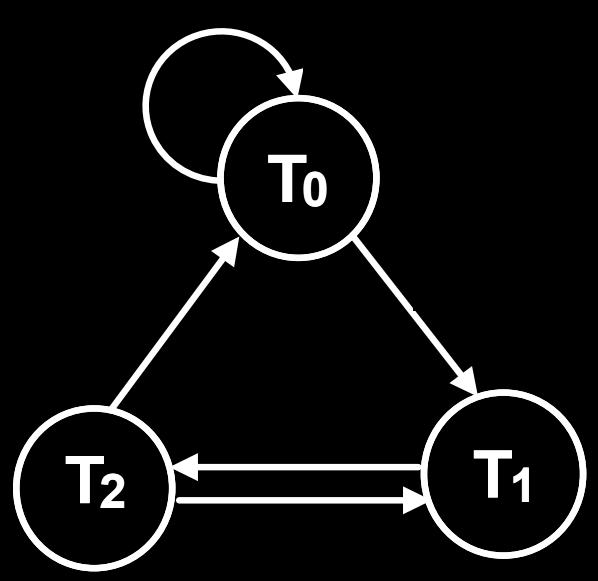

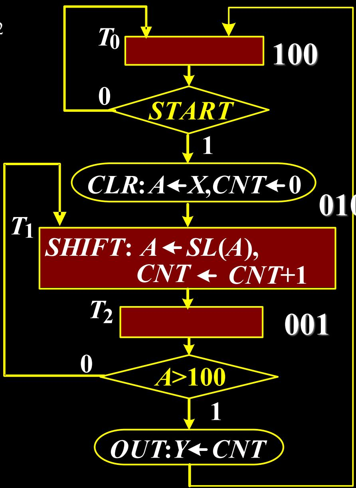

知识点：[算法状态机(ASM)图的状态框、判断框、条件输出框及ASM块的构成规则](../../../topics/数字逻辑电路/ASM图基础.md)、[完整数字系统设计流程实例（如乘法器、交通灯管理系统的算法规律、处理器设计与控制器实现）](../../../topics/数字逻辑电路/数字系统设计实例.md)

### 7.4 ASM 图综合分析

图示为系统 ASM 图，READY 和 $CNT=N$ 分别为数字系统处理器发出的状态信号 $V_1$ 和 $V_2$，$X$ 为外部串行数据输入信号。

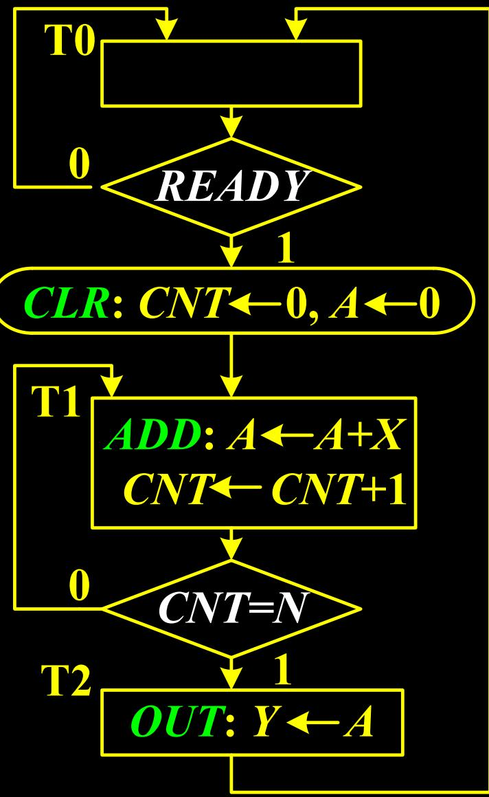

(1) 输出方程和激励方程如下：

$$
\begin{array}{l}
\text{CLR} = T_0 \cdot S_1 \\
\text{ADD} = T_1 \\
\text{OUT} = T_2
\end{array}
$$

$$
\begin{array}{l}
D_0 = T_0 \cdot \overline{S_1} + T_2 \\
D_1 = T_0 \cdot S_1 + T_1 \cdot \overline{S_2} \\
D_2 = T_1 \cdot S_2
\end{array}
$$

(2) 控制器状态转移图如下：$V_1 V_2 / \text{CLR}\ \text{ADD}\ \text{OUT}$

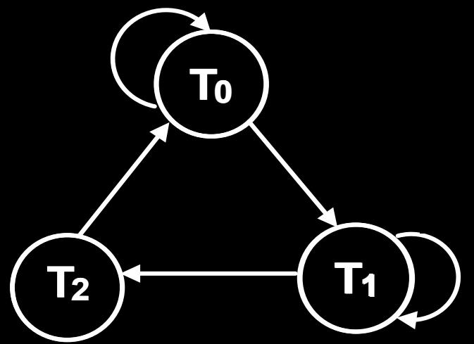

(3) $N+1$ 个串行二进制数相加。

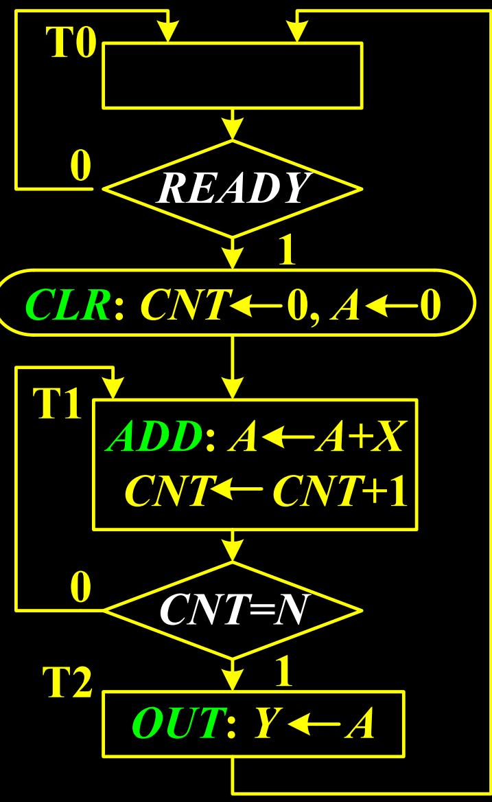

## 8. D/A 和 A/D 转换（5%）

涉及题型：选择填空题。

基本要求：

1. DAC 和 ADC 的主要技术指标（分辨率、精度、量化误差、转换时间等）；
2. D/A、A/D 转换的一般原理和过程；
3. （倒 T 型 R-2R 电阻网络）D/A 和（逐次逼近型、并行比较型）A/D 转换电路的工作原理。

常见题型：

1. DAC、ADC 的分辨率、位数、量程的分析计算；
2. ADC 的量化电平、量化误差。

知识点：[根据文字描述建立ASM图的原则，以及从ASM图推导处理器明细表和控制器状态转移图](../../../topics/数字逻辑电路/ASM图建立与分析.md)、[完整数字系统设计流程实例（如乘法器、交通灯管理系统的算法规律、处理器设计与控制器实现）](../../../topics/数字逻辑电路/数字系统设计实例.md)

### 8.1 DAC 倒 T 型 R-2R 电阻网络

$$
u_{\mathrm{O}} = -\frac{U_{\mathrm{REF}}}{2^n}\frac{R_{\mathrm{f}}}{R}\sum_{i=0}^{n-1} D_i 2^i = K D U_{\mathrm{REF}}
$$

通常，取 $R_{\mathrm{f}} = R$，则

$$
u_{\mathrm{O}} = -\frac{U_{\mathrm{REF}}}{2^n}\sum_{i=0}^{n-1} D_i 2^i
$$

满量程（Full Scale Range）电压值：$U_{\mathrm{FSR}} = -\frac{U_{\mathrm{REF}}}{2^n}(2^n - 1)$。

例：已知 4 位倒 T 型 DAC，输入数字量为 1101，$U_{\mathrm{REF}} = -8\ \mathrm{V}$，则输出模拟量 $u_{\mathrm{O}} = ?$

$$
u_{\mathrm{o}} = -\frac{U_{\mathrm{REF}}}{2^n} D = -\frac{-8}{2^4} \times (8 + 4 + 1) = 6.5\ \mathrm{V}
$$

知识点：[数字系统的基本模型（数据处理器与控制器）及对最小时钟周期、异步信号同步化的约定](../../../topics/数字逻辑电路/数字系统模型.md)

### 8.2 DAC 的分辨率

DAC 的分辨率：DAC 所能分辨的最小输出电压与满刻度输出电压之比——最小输出电压是指输入数字量只有最低有效位为 1 时的输出电压；最大输出电压是指输入数字量各位全为 1 时的输出电压。

$$
R' = \frac{1}{2^n - 1}
$$

例：倒 T 型网络 DAC 的 $U_{\mathrm{REF}} = 10\ \mathrm{V}$，试问需多少位代码，才能使分辨率 $R'$ 达到 $2\ \mathrm{mV}$。（令 $U_{\mathrm{FSR}} = 10\ \mathrm{V}$）

解：由题意知：$R' = \frac{1}{2^n - 1} \le \frac{2\ \mathrm{mV}}{10\ \mathrm{V}}$，则 $2^n - 1 \ge 5000$，得 $n \ge 13$。

知识点：[数字系统的基本模型（数据处理器与控制器）及对最小时钟周期、异步信号同步化的约定](../../../topics/数字逻辑电路/数字系统模型.md)

### 8.3 DAC 转换误差与位数选择

例：若 DAC 的最大输出电压为 10 V，要想使转换误差在 10 mV 以内，应选多少位 DAC？

解：要想转换误差在 10 mV 以内，就必须能分辨出 10 mV 电压。就是说分辨率必须小于

$$
R' = \frac{1}{2^n - 1} \le \frac{10\ \mathrm{mV}}{10\ \mathrm{V}} = \frac{1}{1000}
$$

根据分辨率可以表示 DAC 的精度这一结论，至少需要 10 位 DAC。

若考虑其它因素，需选 12 位 DAC。

知识点：[完整数字系统设计流程实例（如乘法器、交通灯管理系统的算法规律、处理器设计与控制器实现）](../../../topics/数字逻辑电路/数字系统设计实例.md)

### 8.4 DAC0808 应用举例

例：DAC0808 为 8 位单片并行 DAC，结构为 T 型 R-2R 电阻网络。D/A 转换器时需要外接运算放大器。

最高位 MSB、模拟量输出、最低位 LSB、$0.01\ \mu\mathrm{F}$、$V_{\mathrm{EE}} = -15\ \mathrm{V}$。

当 $V_{\mathrm{REF}} = -5\ \mathrm{V}$ 时，

$$
\begin{array}{r}
v_o = \dfrac{R_{\mathrm{f}} V_{\mathrm{REF}}}{2^8 R_1} \displaystyle\sum_{i=0}^{7} D_i \cdot 2^i \\
= \dfrac{-5}{2^8} \displaystyle\sum_{i=0}^{7} D_i \cdot 2^i
\end{array}
$$

$$
= -5\left(\frac{D_7}{2} + \dots + \frac{D_0}{2^8}\right)
$$

当输入数字量在全 0 和全 1 之间变化时，输出模拟电压的变化范围为 $0 \sim -4.98\ \mathrm{V}$。

知识点：[完整数字系统设计流程实例（如乘法器、交通灯管理系统的算法规律、处理器设计与控制器实现）](../../../topics/数字逻辑电路/数字系统设计实例.md)

### 8.5 A/D 转换的一般过程

A/D 转换的一般过程（四步）：（模拟信号）采样 → 保持 → 量化 → 编码。

量化电平（离散电平）：某个最小单位（量化单位 $\Delta$）的整数倍。

舍尾量化：

$$
\Delta = \frac{U_{\mathrm{REF}}}{2^n} = \frac{1}{8} U_{\mathrm{REF}}
$$

最大量化误差 $\varepsilon_{\max} = \Delta = \frac{1}{8} U_{\mathrm{REF}}$。

四舍五入量化：

$$
\Delta' = \frac{2}{2^{n+1} - 1} U_{\mathrm{REF}} = \frac{2}{15} U_{\mathrm{REF}}
$$

最大量化误差 $\varepsilon_{\max} = \frac{1}{2}\Delta' = \frac{1}{15} U_{\mathrm{REF}}$。

知识点：[数字系统的基本模型（数据处理器与控制器）及对最小时钟周期、异步信号同步化的约定](../../../topics/数字逻辑电路/数字系统模型.md)

### 8.6 ADC 分辨率

ADC 分辨率：满量程输入的 $1/2^n$。

例：已知一个 ADC 为 10 位，$U_{\mathrm{Im}} = 5\ \mathrm{V}$，则：

$$
R' = \frac{U_{\mathrm{Im}}}{2^n} = \frac{5}{2^{10}} = 4.88\ \mathrm{mV} \approx 5\ \mathrm{mV}
$$

例：一个 8 位逐次逼近式 ADC，要求转换时间小于 $20\ \mu\mathrm{s}$，则时钟周期应为多少？

解：逐次逼近式 ADC 转换器完成一次转换所需要的节拍数为 $(n+1)$，其中 $n$ 为二进制代码的个数，则完成一次转换所需的时间为：

$$
t = (n+1)T_{\mathrm{CLK}}
$$

因此，$(8+1)T_{\mathrm{CLK}} < 20\ \mu\mathrm{s}$，得 $T_{\mathrm{CLK}} < \frac{20}{9}\ \mu\mathrm{s} \approx 2.2\ \mu\mathrm{s}$，取 $T_{\mathrm{CLK}} = 2\ \mu\mathrm{s}$。

## 8. D/A和A/D转换

有一个ADC电路，输入模拟电压范围 $0 \sim V_{ref}$（注：原文识别严重乱码，根据上下文推断为典型ADC参数描述，此处保留原题意图但修正明显错误），求：
（1）采用四舍五入量化和舍尾量化方式时的量化单位 $\Delta$。
（2）若输入模拟电压为特定值（原文乱码 $\mathcal { W } \mathcal { = B } \mathcal { \mathbf { B } } \mathcal { \mathbf { V } }$，推测为具体电压值，如 $V_{in}$），则转换后的数字量分别为多少？
（3）若用自然二进制码表示转换后的数字量，则对应的代码分别是什么？

**解：**

1. **采用四舍五入量化方式：**
   （原文公式部分识别极度混乱，$\angle A = \dots$ 等几何符号显然为误识，应为量化误差或量化级数计算。根据常见题型逻辑整理如下）
   量化单位 $\Delta$ 取决于位数和参考电压。
   对于给定的输入电压，落在某个量化区间内。
   （原文片段：“在 $( 1 1 0 - 5 ) \times ( 1 0 - 2 0 ) \dots$ 之间，被量化为 $120\%$” —— 此处理解为被量化为十进制数值 12 或类似整数，对应二进制码）。
   相应的自然二进制码为 $(1100)_2$（示例，依原题数据而定）。

2. **采用舍尾量化方式：**
   （原文公式 $\Delta A = \frac { 1 1 } { 2 4 } \dots$ 同样存在识别错误，通常舍尾量化即向下取整）。
   输入电压落在区间 $[k\Delta, (k+1)\Delta)$ 之间，被量化为 $k$。
   （原文片段：“在 $((11,1)) = (11,13) \dots$ 之间，被量化为...”）。
   相应的自然二进制码为 $(1100)_2$（示例，依原题数据而定）。

> **[!WARNING]**
> 原始扫描文本中第75页的数学公式部分出现了严重的OCR识别错误（将数字、变量识别为角度符号 $\angle$、集合符号等，且逻辑断裂）。以上解答仅保留了题目结构和可能的最终答案格式（自然二进制码），具体数值计算需参照教材原题标准答案。建议复习时重点掌握：
> 1. **量化单位 $\Delta$ 的计算**：$\Delta = \frac{V_{FS}}{2^n}$ （其中 $V_{FS}$ 为满量程电压，$n$ 为位数）。
> 2. **两种量化方式的区别**：
>    - **舍尾法（截断）**：直接丢弃小数部分，最大量化误差为 $-\Delta$。
>    - **四舍五入法**：靠近哪个量化电平就取哪个，最大量化误差为 $\pm \frac{\Delta}{2}$。
> 3. **编码转换**：将量化后的十进制整数转换为自然二进制码。

知识点：[完整数字系统设计流程实例（如乘法器、交通灯管理系统的算法规律、处理器设计与控制器实现）](../../../topics/数字逻辑电路/数字系统设计实例.md)

### 考点总结

1. 进制转换，精度要求
2. A/D, D/A基本概念，不要求结构
3. 计数器的基本概念
4. 包含无关项的卡诺图化简
5. D触发器的画波形图
6. 74138, 74151, ROM实现组合逻辑
7. 整体法构建模长 > 16 的计数器
8. 序列信号发生电路如何设计
9. 同步时序电路的状态分析

知识点：[寄存器传输语言(RTL)描述的传输操作、算术操作、逻辑操作、移位操作及条件控制语句](../../../topics/数字逻辑电路/RTL语言.md)、[根据文字描述建立ASM图的原则，以及从ASM图推导处理器明细表和控制器状态转移图](../../../topics/数字逻辑电路/ASM图建立与分析.md)、[控制器的四种硬件实现方法：每态一触发器法(SSI)、MSI法(MUX+寄存器+译码器)、PLA法(LSI)及对比](../../../topics/数字逻辑电路/控制器实现方法.md)
