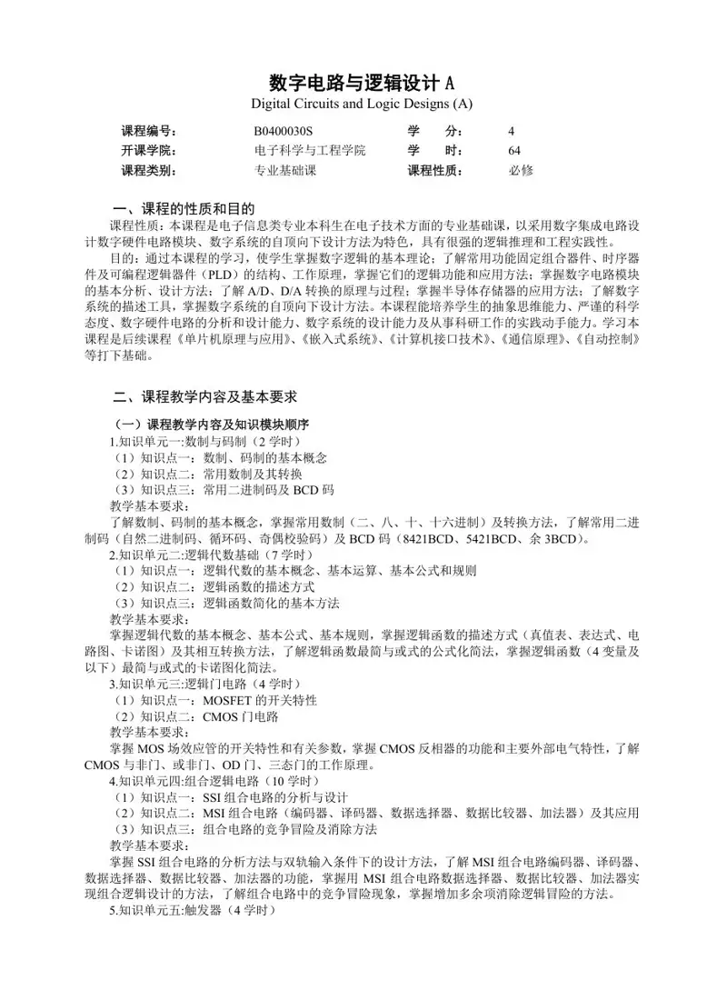
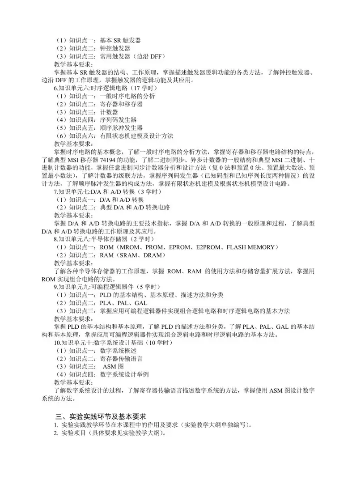
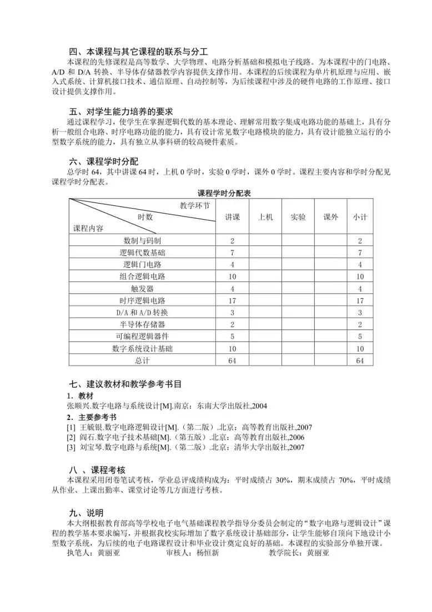

# 《数字电路与逻辑设计A》教学大纲

原件的每一页，下面附识别出的文字。

### 数字电路与逻辑设计 A

原文：

数字电路与逻辑设计 A

Digital Circuits and Logic Designs (A)

课程编号： B0400030S 学 分： 4

开课学院： 电子科学与工程学院 学 时： 64

课程类别： 专业基础课 课程性质： 必修

一、课程的性质和目的

课程性质：本课程是电子信息类专业本科生在电子技术方面的专业基础课，以采用数字集成电路设计数字硬件电路模块、数字系统的自顶向下设计方法为特色，具有很强的逻辑推理和工程实践性。

目的：通过本课程的学习，使学生掌握数字逻辑的基本理论；了解常用功能固定组合器件、时序器件及可编程逻辑器件（PLD）的结构、工作原理，掌握它们的逻辑功能和应用方法；掌握数字电路模块的基本分析、设计方法；了解 、 转换的原理与过程；掌握半导体存储器的应用方法；了解数字系统的描述工具，掌握数字系统的自顶向下设计方法。本课程能培养学生的抽象思维能力、严谨的科学态度、数字硬件电路的分析和设计能力、数字系统的设计能力及从事科研工作的实践动手能力。学习本课程是后续课程《单片机原理与应用》、《嵌入式系统》、《计算机接口技术》、《通信原理》、《自动控制》等打下基础。

二、课程教学内容及基本要求

（一）课程教学内容及知识模块顺序

1.知识单元一:数制与码制（2学时）

（1）知识点一：数制、码制的基本概念

（2）知识点二：常用数制及其转换

（3）知识点三：常用二进制码及 BCD 码

教学基本要求：

了解数制、码制的基本概念，掌握常用数制（二、八、十、十六进制）及转换方法，了解常用二进制码（自然二进制码、循环码、奇偶校验码）及BCD 码（8421BCD、5421BCD、余 3BCD）。

2.知识单元二:逻辑代数基础（7学时）

（1）知识点一：逻辑代数的基本概念、基本运算、基本公式和规则

（2）知识点二：逻辑函数的描述方式

（3）知识点三：逻辑函数简化的基本方法

教学基本要求：

掌握逻辑代数的基本概念、基本公式、基本规则，掌握逻辑函数的描述方式（真值表、表达式、电路图、卡诺图）及其相互转换方法，了解逻辑函数最简与或式的公式化简法，掌握逻辑函数（ 变量及以下）最简与或式的卡诺图化简法。

3.知识单元三:逻辑门电路（4学时）

（1）知识点一：MOSFET的开关特性

（2）知识点二：CMOS 门电路

教学基本要求：

掌握MOS 场效应管的开关特性和有关参数，掌握CMOS反相器的功能和主要外部电气特性，了解CMOS与非门、或非门、OD 门、三态门的工作原理。

4.知识单元四:组合逻辑电路（10学时）

（1）知识点一：SSI组合电路的分析与设计

（2）知识点二：MSI组合电路（编码器、译码器、数据选择器、数据比较器、加法器）及其应用

（3）知识点三：组合电路的竞争冒险及消除方法

教学基本要求：

掌握SSI组合电路的分析方法与双轨输入条件下的设计方法，了解MSI组合电路编码器、译码器、数据选择器、数据比较器、加法器的功能，掌握用 组合电路数据选择器、数据比较器、加法器实现组合逻辑设计的方法，了解组合电路中的竞争冒险现象，掌握增加多余项消除逻辑冒险的方法。

5.知识单元五:触发器（4学时）

### （1）知识点一：基本 SR触发器

原文：

（1）知识点一：基本 SR触发器

（2）知识点二：钟控触发器

（3）知识点三：常用触发器（边沿DFF）

教学基本要求：

掌握基本SR触发器的结构、工作原理，掌握描述触发器逻辑功能的各类方法，了解钟控触发器、边沿DFF 的工作原理，掌握触发器的逻辑功能及其应用。

6.知识单元六:时序逻辑电路（17学时）

（1）知识点一：一般时序电路的分析

（2）知识点二：寄存器和移存器

（3）知识点三：计数器

（4）知识点四：序列码发生器

（5）知识点五：顺序脉冲发生器

（6）知识点六：有限状态机建模及设计方法

教学基本要求：

掌握时序电路的基本概念，了解一般时序电路的分析方法，掌握寄存器和移存器电路结构的特点，了解典型MSI移存器74194 的功能，了解二进制同步、异步计数器的一般结构和典型 MSI二进制、十进制计数器的功能，掌握任意进制同步计数器分析和设计方法（复 0法和预置0 法、预置最大数法、预置最小数法），了解计数器的级联方法，掌握序列码发生器（已知码型和已知序列长度两种情况）的设计方法，了解顺序脉冲发生器的构成方法，掌握有限状态机建模及根据状态机模型设计电路。

7.知识单元七:D/A和 A/D转换（3学时）

（1）知识点一：D/A和A/D 转换

（2）知识点二：典型D/A和A/D 转换电路

教学基本要求：

掌握 D/A 和 A/D 转换电路的主要技术指标，掌握 D/A 和 A/D 转换的一般原理和过程，了解典型D/A和A/D转换电路的工作原理及其应用。

8.知识单元八:半导体存储器（2学时）

（1）知识点一：ROM（MROM、PROM、EPROM、E2PROM、FLASH MEMORY）

（2）知识点二：RAM（SRAM、DRAM）

教学基本要求：

了解各种半导体存储器的工作原理，掌握 ROM、RAM 的使用方法和存储容量扩展方法，掌握用ROM实现组合电路的方法。

9.知识单元九:可编程逻辑器件（5学时）

（1）知识点一：PLD 的基本结构、基本原理、描述方法和分类

（2）知识点二：PLA、PAL、GAL

（3）知识点三：掌握应用可编程逻辑器件实现组合逻辑电路和时序逻辑电路的基本方法

教学基本要求：

掌握PLD 的基本结构和基本原理，了解PLD的描述方法和分类，了解 PLA、PAL、GAL 的基本结构和基本原理，掌握应用可编程逻辑器件实现组合逻辑电路和时序逻辑电路的基本方法。

10.知识单元十:数字系统设计基础（10 学时）

（1）知识点一：数字系统概述

（2）知识点二：寄存器传输语言

（3）知识点三： ASM图

（4）知识点四：数字系统设计举例

教学基本要求：

了解数字系统设计的过程，了解寄存器传输语言描述数字系统的方法，掌握使用 图设计数字系统的方法。

三、实验实践环节及基本要求

1. 实验实践教学环节在本课程中的作用及要求（实验教学大纲单独编写）。

2. 实验项目（具体要求见实验教学大纲）。

### 四、本课程与其它课程的联系与分工

原文：

四、本课程与其它课程的联系与分工

本课程的先修课程是高等数学、大学物理、电路分析基础和模拟电子线路。为本课程中的门电路、A/D 和 D/A 转换、半导体存储器教学内容提供支撑作用。本课程的后续课程为单片机原理与应用、嵌入式系统、计算机接口技术、通信原理、自动控制等，为后续课程中涉及的硬件电路的工作原理、接口设计提供支撑作用。

五、对学生能力培养的要求

通过课程学习，使学生在掌握逻辑代数的基本理论、理解常用数字集成电路功能的基础上，具有分析一般组合电路、时序电路功能的能力，具有设计常见数字电路模块的能力，具有设计能独立运行的小型数字系统的能力，具有独立从事科研的较高硬件素质。

六、课程学时分配

总学时64，其中讲课64时，上机0学时，实验0学时，课外0 学时。课程主要内容和学时分配见课程学时分配表。

课程学时分配表
<table><tr><td>课程内容\时数\教学环节</td><td>讲课</td><td>上机</td><td>实验</td><td>课外</td><td>小计</td></tr><tr><td>数制与码制</td><td>2</td><td></td><td></td><td></td><td>2</td></tr><tr><td>逻辑代数基础</td><td>7</td><td></td><td></td><td></td><td>7</td></tr><tr><td>逻辑门电路</td><td>4</td><td></td><td></td><td></td><td>4</td></tr><tr><td>组合逻辑电路</td><td>10</td><td></td><td></td><td></td><td>10</td></tr><tr><td>触发器</td><td>4</td><td></td><td></td><td></td><td>4</td></tr><tr><td>时序逻辑电路</td><td>17</td><td></td><td></td><td></td><td>17</td></tr><tr><td>D/A和A/D转换</td><td>3</td><td></td><td></td><td></td><td>3</td></tr><tr><td>半导体存储器</td><td>2</td><td></td><td></td><td></td><td>2</td></tr><tr><td>可编程逻辑器件</td><td>5</td><td></td><td></td><td></td><td>5</td></tr><tr><td>数字系统设计基础</td><td>10</td><td></td><td></td><td></td><td>10</td></tr><tr><td>总计</td><td>64</td><td></td><td></td><td></td><td>64</td></tr></table>

七、建议教材和教学参考书目

1．教材

张顺兴.数字电路与系统设计[M].南京：东南大学出版社,2004

2．主要参考书

[1] 王毓银.数字电路逻辑设计[M].（第二版）.北京：高等教育出版社,2007

[2] 阎石.数字电子技术基础[M].（第五版）.北京：高等教育出版社,2006

[3] 刘宝琴.数字电路与系统[M].（第二版）.北京：清华大学出版社,2007

八 、课程考核

本课程采用闭卷笔试考核，学业总评成绩构成为：平时成绩占 30%，期末成绩占 70%，平时成绩从作业、上课出勤率、课堂讨论等几方面进行考核。

九、说明

本大纲根据教育部高等学校电子电气基础课程教学指导分委员会制定的“数字电路与逻辑设计”课程的教学基本要求编写，并根据我校实际增加了数字系统设计基础部分，让学生能够自顶向下地设计小型数字系统，为后续的电子电路课程设计和毕业设计奠定良好的基础。本课程的实验部分单独开课。

执笔人：黄丽亚

审核人：杨恒新

教学院长：黄丽亚
