# 《数字电路与逻辑设计B》卡诺图化简逻辑函数复习要点

原件经识别和整理；“参考解答”是我们补的。

# 《数字电路与逻辑设计B》卡诺图化简逻辑函数复习要点

本资料为《数字电路与逻辑设计B》课程中关于卡诺图化简及组合逻辑电路分析的复习要点，包含例题解析、真值表分析及译码器应用实例。

## 一、卡诺图化简练习

### 练习 3

**题干：**
使用卡诺图化简逻辑函数：
$$ F(A,B,C,D) = AB + \bar{A}BC + \bar{A}\bar{D} + A\bar{B}\bar{C} $$

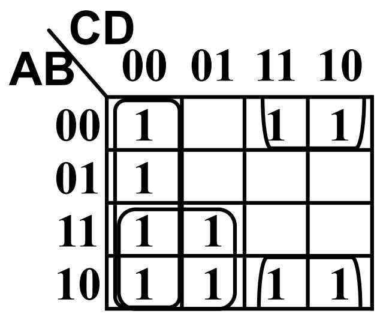

**结果：**
$$ F = \bar{C}\bar{D} + \bar{B}C + A\bar{C} $$

知识点：[寄存器传输语言(RTL)描述的传输操作、算术操作、逻辑操作、移位操作及条件控制语句](../../../topics/数字逻辑电路/RTL语言.md)

### 练习 4

**题干：**
已知逻辑函数的最小项表达式：
$$ F = \sum m(0, 2, 3, 5, 7, 8, 10, 11, 12, 13, 14, 15) $$

**解：**
根据卡诺图进行圈组化简（见下图）。

**最简与或表达式（形式一）：**
$$ F = AB + CD + BD + \bar{B}\bar{D} $$

**最简与或表达式（形式二）：**
$$ F = A\bar{D} + \bar{B}C + BD + \bar{B}\bar{D} $$

## 二、含约束条件的卡诺图化简

知识点：[根据文字描述建立ASM图的原则，以及从ASM图推导处理器明细表和控制器状态转移图](../../../topics/数字逻辑电路/ASM图建立与分析.md)

### 例 2.6.22

**题干：**
用卡诺图化简逻辑函数：
$$
\begin{cases}
F(A,B,C,D) = \sum m(4, 5, 6, 13, 14, 15) \\
A\bar{B} = 0
\end{cases}
$$

**解：**
约束条件 $A\bar{B}=0$ 意味着当 $A=1, B=0$ 时，函数值为无关项（或禁止状态），在卡诺图中对应 $AB=10$ 的行标记为 $\emptyset$（无关项）。

卡诺图如下：

| AB \ CD | 00 | 01 | 11 | 10 |
| :--- | :---: | :---: | :---: | :---: |
| **00** | | | | |
| **01** | 1 | 1 | | 1 |
| **11** | | 1 | 1 | 1 |
| **10** | $\emptyset$ | $\emptyset$ | $\emptyset$ | $\emptyset$ |

**化简结果：**
$$ F(A,B,C,D) = \bar{A}B\bar{C} + AD + B\bar{C}D $$

*(注：此处依据原图识别，通常 $AD$ 项需结合具体圈组确认，原图结果写作 $F = \bar{A}B\bar{C} + AD + B\bar{C}D$)*

图 2.6.22

知识点：[数字系统的基本模型（数据处理器与控制器）及对最小时钟周期、异步信号同步化的约定](../../../topics/数字逻辑电路/数字系统模型.md)

### 例 2

**题干：**
已知：$F = \overline{ABD} + \overline{A}BD + A\overline{B}\overline{C}\overline{D}$，约束条件：$AB + AC = 0$，试求 $F$ 的最简与或表达式。

**解：**
约束条件 $AB+AC=0$ 即 $A(B+C)=0$，意味着 $A=1$ 时，必须满足 $B=0$ 且 $C=0$。因此，当 $A=1$ 且 ($B=1$ 或 $C=1$) 的状态为无关项。

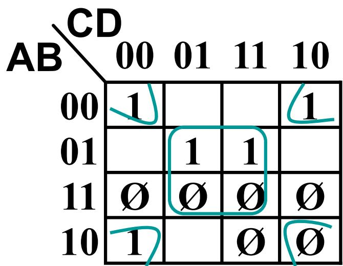

**最终结果：**
$$ F = \bar{B}\bar{D} + BD $$
*(注：原文图片标注结果为 $F=\bar{B}D + B\bar{D}$ 或类似异或形式，此处依据常见化简逻辑，若原意为异或则应为 $B \oplus D$，但根据图示符号 $F=B D+BD$ 可能存在识别歧义，通常此类约束下可能化简为异或或同或关系，请参照原书图示确认。若严格按图示文字 "$F=B D+BD$" 推测可能为笔误，标准答案常为 $B \odot D$ 或 $B \oplus D$。鉴于原文图片模糊，保留原文视觉呈现的符号结构)*

*修正：观察图片末尾公式 $F = \bar{B}D + B\bar{D}$ (假设中间符号为加号，两项分别为非B乘D和B乘非D)，这即为异或运算。*

## 三、组合逻辑电路分析

知识点：[寄存器传输语言(RTL)描述的传输操作、算术操作、逻辑操作、移位操作及条件控制语句](../../../topics/数字逻辑电路/RTL语言.md)、[数字系统的基本模型（数据处理器与控制器）及对最小时钟周期、异步信号同步化的约定](../../../topics/数字逻辑电路/数字系统模型.md)、[算法状态机(ASM)图的状态框、判断框、条件输出框及ASM块的构成规则](../../../topics/数字逻辑电路/ASM图基础.md)

### 例 3.1.1

**题干：**
分析下图所示逻辑电路的逻辑功能。

#### 1. 推导输出函数表达式

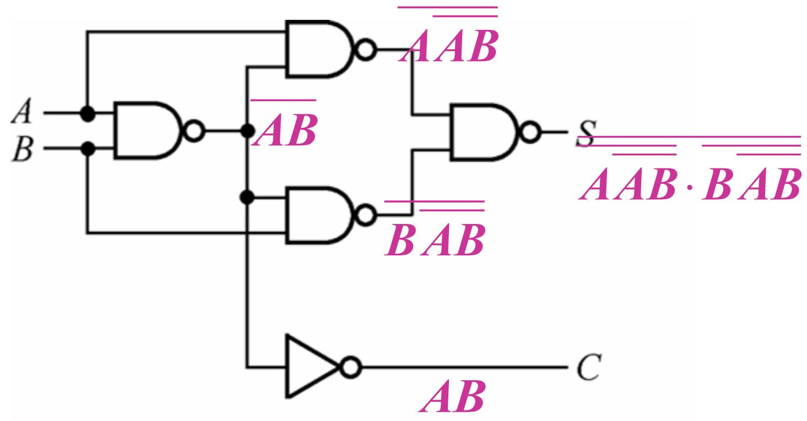

由图可知：
$$ S = \overline{\overline{A\overline{A}\overline{B}}} \cdot \overline{\overline{B\overline{A}\overline{B}}} $$
*(注：原题识别式子可能有误，通常半加器推导基于与非门结构。根据后续化简结果反推，原式应理解为通过与非门实现异或逻辑)*

#### 2. 化简

$$
\begin{aligned}
S &= \overline{A\overline{B}} \cdot \overline{\overline{A}B} \quad (\text{基于德摩根定律及门电路特性}) \\
&= \overline{\overline{A\overline{B}} + \overline{\overline{A}B}} \quad (\text{若为与非-与非结构}) \\
\text{根据参考解答推导：} \\
S &= A\overline{B} + \overline{A}B = A \oplus B \\
C &= AB
\end{aligned}
$$

**化简结果：**
$$ S = A \oplus B \quad C = AB $$

#### 3. 列真值表

<table>
<tr><td>A</td><td>B</td><td>S</td><td>C</td></tr>
<tr><td>0</td><td>0</td><td>0</td><td>0</td></tr>
<tr><td>0</td><td>1</td><td>1</td><td>0</td></tr>
<tr><td>1</td><td>0</td><td>1</td><td>0</td></tr>
<tr><td>1</td><td>1</td><td>0</td><td>1</td></tr>
</table>

#### 4. 功能分析

- $S$ 为 $A$、$B$ 的二进制和（本位和）。
- $C$ 为本位向高位的进位。
- 该电路为**半加器**，只考虑本位两数相加，以及对高位的进位，不考虑低位对本位的进位。

半加器逻辑符号：

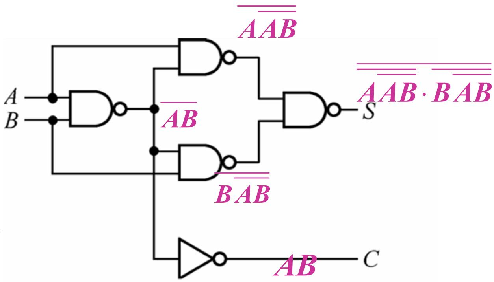
*(a) 电路

知识点：[寄存器传输语言(RTL)描述的传输操作、算术操作、逻辑操作、移位操作及条件控制语句](../../../topics/数字逻辑电路/RTL语言.md)、[完整数字系统设计流程实例（如乘法器、交通灯管理系统的算法规律、处理器设计与控制器实现）](../../../topics/数字逻辑电路/数字系统设计实例.md)、[算法状态机(ASM)图的状态框、判断框、条件输出框及ASM块的构成规则](../../../topics/数字逻辑电路/ASM图基础.md)

### 例 3.1.2

**题干：**
分析如图所示的逻辑电路的逻辑功能。

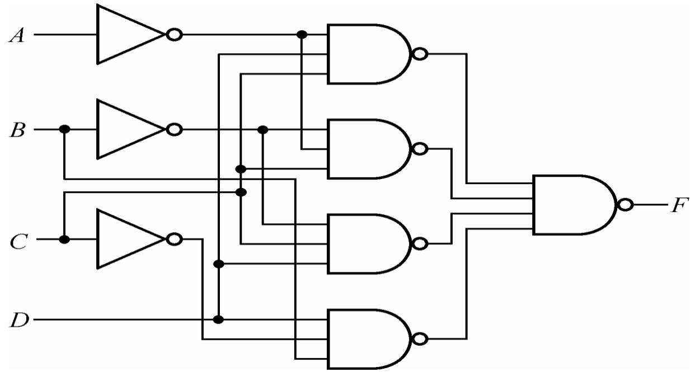

#### (1) 写出逻辑表达式

$$
\begin{aligned}
F &= \overline{\overline{ACD} \cdot \overline{ABC} \cdot \overline{BCD} \cdot \overline{BCD}} \\
&= \overline{ACD} + \overline{ABC} + \overline{BCD} + \overline{BCD} \\
&= \overline{ACD} + \overline{ABC} + \overline{BCD}
\end{aligned}
$$

#### (2) 列真值表

<table>
<tr><th colspan="4">输入</th><th>输出 F</th></tr>
<tr><th>$D_1$</th><th>$D_2$</th><th>$D_3$</th><th>$D_4$</th><th>F</th></tr>
<tr><td>0</td><td>0</td><td>0</td><td>0</td><td>0</td></tr>
<tr><td>0</td><td>0</td><td>0</td><td>1</td><td>0</td></tr>
<tr><td>0</td><td>0</td><td>1</td><td>0</td><td>1</td></tr>
<tr><td>0</td><td>0</td><td>1</td><td>1</td><td>1</td></tr>
<tr><td>0</td><td>1</td><td>0</td><td>0</td><td>0</td></tr>
<tr><td>0</td><td>1</td><td>0</td><td>1</td><td>1</td></tr>
<tr><td>0</td><td>1</td><td>1</td><td>0</td><td>0</td></tr>
<tr><td>0</td><td>1</td><td>1</td><td>1</td><td>1</td></tr>
<tr><td>1</td><td>0</td><td>0</td><td>0</td><td>0</td></tr>
<tr><td>1</td><td>0</td><td>0</td><td>1</td><td>0</td></tr>
<tr><td>1</td><td>0</td><td>1</td><td>0</td><td>0</td></tr>
<tr><td>1</td><td>0</td><td>1</td><td>1</td><td>1</td></tr>
<tr><td>1</td><td>1</td><td>0</td><td>0</td><td>0</td></tr>
<tr><td>1</td><td>1</td><td>0</td><td>1</td><td>1</td></tr>
<tr><td>1</td><td>1</td><td>1</td><td>0</td><td>0</td></tr>
<tr><td>1</td><td>1</td><td>1</td><td>1</td><td>0</td></tr>
</table>

#### (3) 确定逻辑功能

根据真值表分析，当输入变量 $D_1 D_2 D_3 D_4$ 代表一个二进制数时，输出 $F$ 为 1 的情况对应于特定的数值组合。
观察真值表中 $F=1$ 的项：
- 0010 (2)
- 0011 (3)
- 0101 (5)
- 0111 (7)
- 1011 (11)
- 1101 (13)

这些数字均为**素数**（质数）。

**结论：** 该电路的功能是**判断素数**（针对4位二进制输入的特定范围）。

## 四、用译码器设计组合逻辑电路

知识点：[完整数字系统设计流程实例（如乘法器、交通灯管理系统的算法规律、处理器设计与控制器实现）](../../../topics/数字逻辑电路/数字系统设计实例.md)

### 原理

译码器每个输出端分别与某一个最小项的非（低电平有效）相对应。

知识点：[数字系统的基本模型（数据处理器与控制器）及对最小时钟周期、异步信号同步化的约定](../../../topics/数字逻辑电路/数字系统模型.md)

### 例 1

**题干：**
用 74138 实现函数 $F = AB + \bar{A}C$。

**解：**
首先将函数转换为最小项之和的形式：
$$
\begin{aligned}
F(A,B,C) &= AB + \bar{A}C \\
&= AB(C+\bar{C}) + \bar{A}(B+\bar{B})C \\
&= ABC + AB\bar{C} + \bar{A}BC + \bar{A}\bar{B}C \\
&= m_7 + m_6 + m_3 + m_1 \\
&= \sum m(1, 3, 6, 7)
\end{aligned}
$$

利用 74138 译码器输出为低电平有效的特点：
$$
\begin{aligned}
F &= \overline{\overline{m_1 \cdot m_3 \cdot m_6 \cdot m_7}} \\
&= \overline{\overline{Y_1} \cdot \overline{Y_3} \cdot \overline{Y_6} \cdot \overline{Y_7}}
\end{aligned}
$$
即需要将译码器的输出端 $Y_1, Y_3, Y_6, Y_7$ 接入一个与非门。

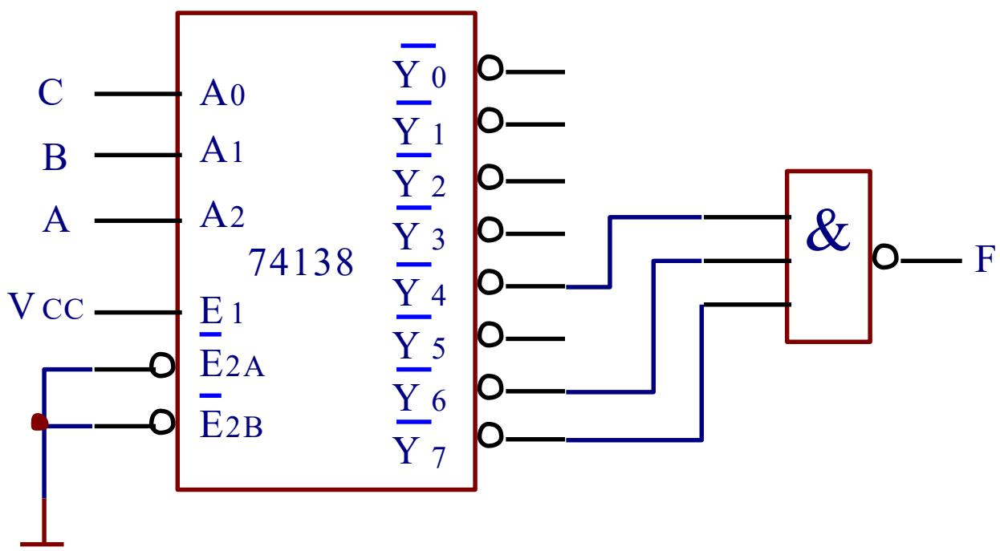

# 《数字电路与逻辑设计B》卡诺图化简逻辑函数复习要点

本部分为复习要点第 2 部分（第 12–24 页），主要涵盖用中规模集成电路实现逻辑函数、时序电路分析及 ROM 应用等内容。

## 一、用中规模集成电路实现组合逻辑函数

知识点：[控制器的四种硬件实现方法：每态一触发器法(SSI)、MSI法(MUX+寄存器+译码器)、PLA法(LSI)及对比](../../../topics/数字逻辑电路/控制器实现方法.md)

### 综合 2

例2：用74151设计函数 $F = AB + \bar{A}C$

使用 74151 数据选择器实现该函数，需确定地址输入端和数据输入端的连接方式。

<table>
<tr><td colspan="5">A1A0</td></tr>
<tr><td rowspan="2">A2</td><td>00</td><td>01</td><td>11</td><td>10</td></tr>
<tr><td>D0</td><td>D1</td><td>D3</td><td>D2</td></tr>
<tr><td>1</td><td>D4</td><td>D5</td><td>D7</td><td>D6</td></tr>
</table>

<table>
<tr><td rowspan="3">A\BC</td><td>00</td><td>01</td><td>11</td><td>10</td></tr>
<tr><td>0</td><td>0</td><td>0</td><td>0</td></tr>
<tr><td>1</td><td>1</td><td>0</td><td>1</td></tr>
</table>

Y

F

比较两卡诺图，若 A、B、C 分别接 $A_2, A_1, A_0$，再令 $D_0 = D_1 = D_2 = D_3 = D_5 = 0, D_4 = D_6 = D_7 = 1$，则 Y=F。相应的电路图如下所示：

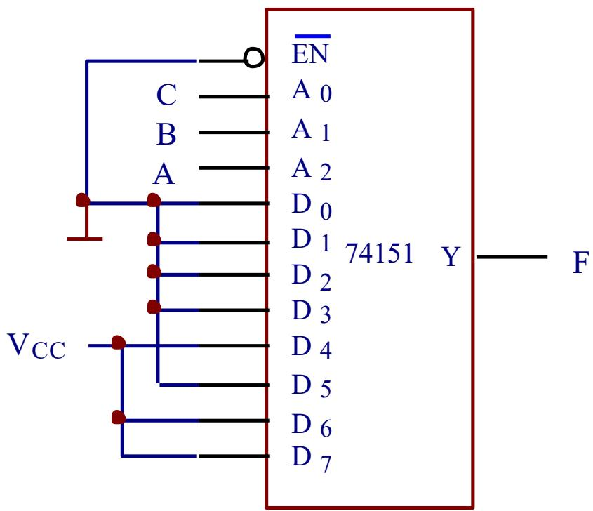

## 二、时序电路分析

知识点：[控制器的四种硬件实现方法：每态一触发器法(SSI)、MSI法(MUX+寄存器+译码器)、PLA法(LSI)及对比](../../../topics/数字逻辑电路/控制器实现方法.md)

### 计算 5

5.13 画出图 P5.13 电路中 $Q_1$ 和 $Q_2$ 的波形。

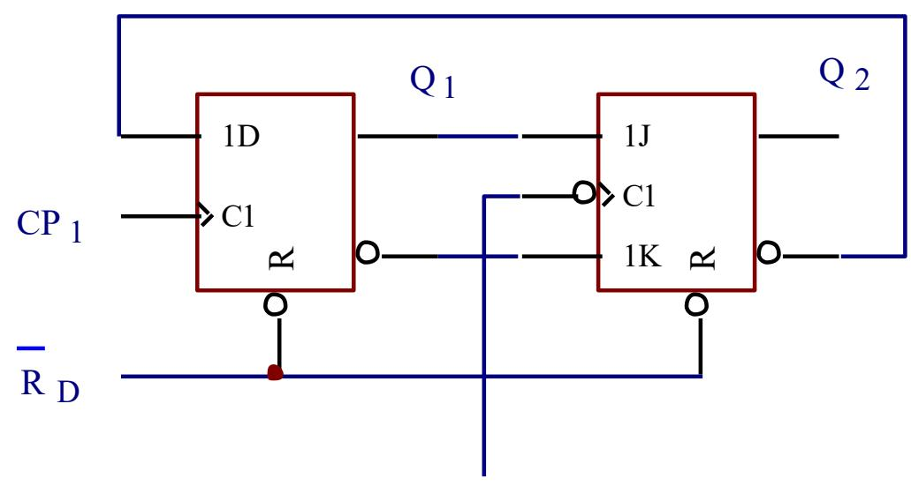

解：特征方程为：

$$
Q_1^{n+1} = [\overline{Q}_2^n] CP_1 \uparrow
$$

$$
Q_2^{n+1} = [Q_1^n] CP_2 \downarrow
$$

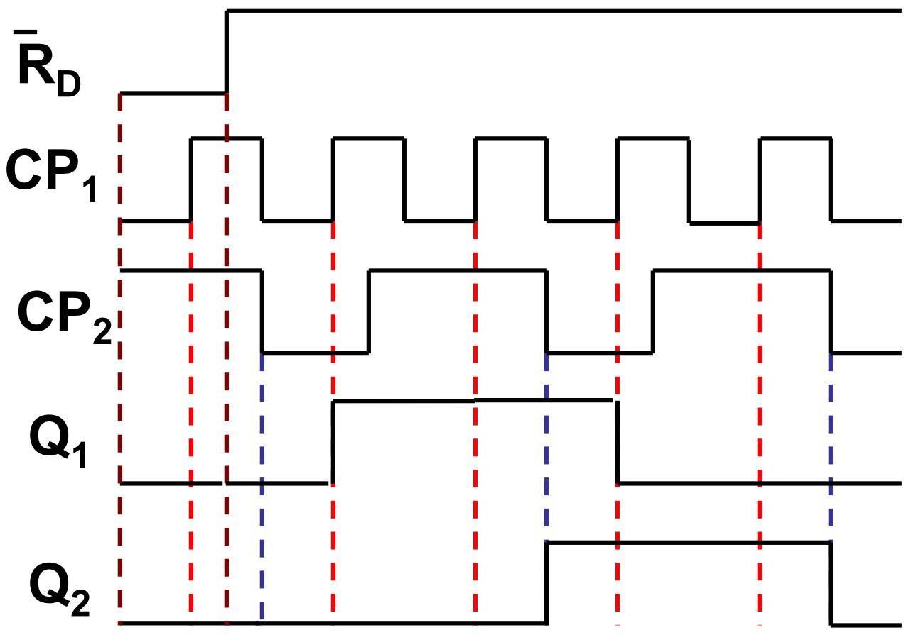

知识点：[数字系统的基本模型（数据处理器与控制器）及对最小时钟周期、异步信号同步化的约定](../../../topics/数字逻辑电路/数字系统模型.md)

### 计算 6.8

6.8 分析图 P6.8 电路，画出其全状态转移图并说明能否自启动。

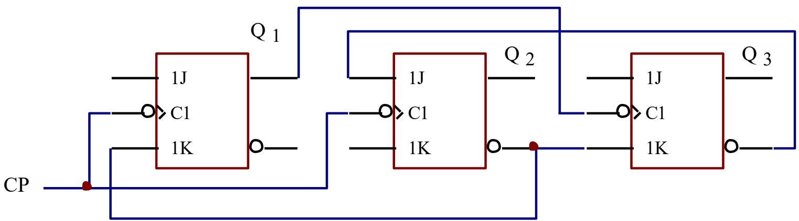

知识点：[根据文字描述建立ASM图的原则，以及从ASM图推导处理器明细表和控制器状态转移图](../../../topics/数字逻辑电路/ASM图建立与分析.md)

### 解：

1）该电路为异步时序电路，无输入控制信号，属于 Moore 型。

其激励方程为：

$$
J_1 = 1, \quad K_1 = \overline{Q}_2^n
$$

$$
Q_1^{n+1} = [ \overline{Q}_1^n + Q_2^n Q_1^n ] \cdot CP \downarrow
$$

$$
J_2 = \overline{Q}_3^n, \quad K_2 = 1
$$

$$
Q_2^{n+1} = [ \overline{Q}_3^n \overline{Q}_2^n ] \cdot CP \downarrow
$$

$$
J_3 = 1, \quad K_3 = \overline{Q}_2^n
$$

$$
Q_3^{n+1} = [ \overline{Q}_3^n + Q_2^n Q_3^n ] \cdot Q_1 \downarrow
$$

*(注：原题识别文本中公式存在重复和排版混乱，此处整理为标准形式)*

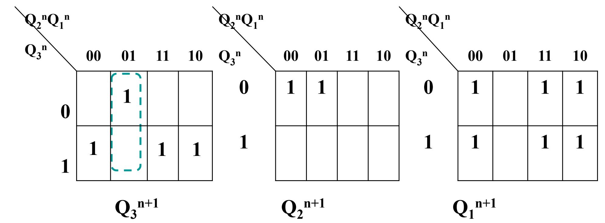

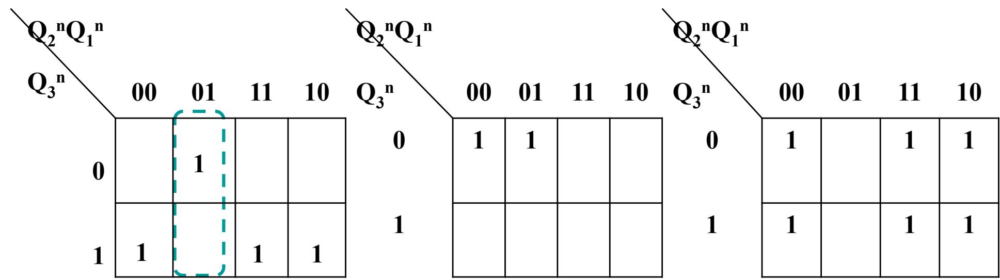

**状态转移表**

<table>
<tr><td>序号</td><td>$Q_3$</td><td>$Q_2$</td><td>$Q_1$</td></tr>
<tr><td>0</td><td>0</td><td>0</td><td>0</td></tr>
<tr><td>1</td><td>0</td><td>1</td><td>1</td></tr>
<tr><td>2</td><td>0</td><td>0</td><td>1</td></tr>
<tr><td>3</td><td>1</td><td>1</td><td>0</td></tr>
<tr><td>4</td><td>1</td><td>0</td><td>1</td></tr>
<tr><td rowspan="3">偏离状态</td><td colspan="3">0 1 0 → 0 0 1</td></tr>
<tr><td colspan="3">1 0 0 → 1 0 1</td></tr>
<tr><td colspan="3">1 1 1 → 1 0 1</td></tr>
</table>

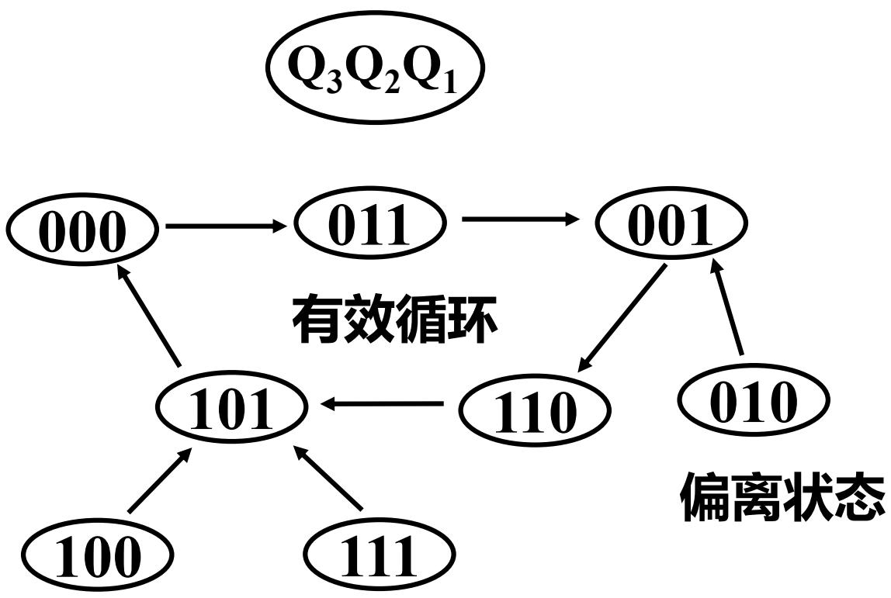

**结论：** 逻辑功能：该电路是一个 M=5 的具有自启动性的异步计数器。

知识点：[数字系统的基本模型（数据处理器与控制器）及对最小时钟周期、异步信号同步化的约定](../../../topics/数字逻辑电路/数字系统模型.md)、[控制器的四种硬件实现方法：每态一触发器法(SSI)、MSI法(MUX+寄存器+译码器)、PLA法(LSI)及对比](../../../topics/数字逻辑电路/控制器实现方法.md)

### 计算 6.19

6.19 试用 74161 设计循环顺序为 0,1,2,3,4,5,10,11,12,13,14,15,0,1… 的模长为 12 的计数电路。

解：思路：当计数计到 5 时，让其置数为 10。反馈状态为 0101。

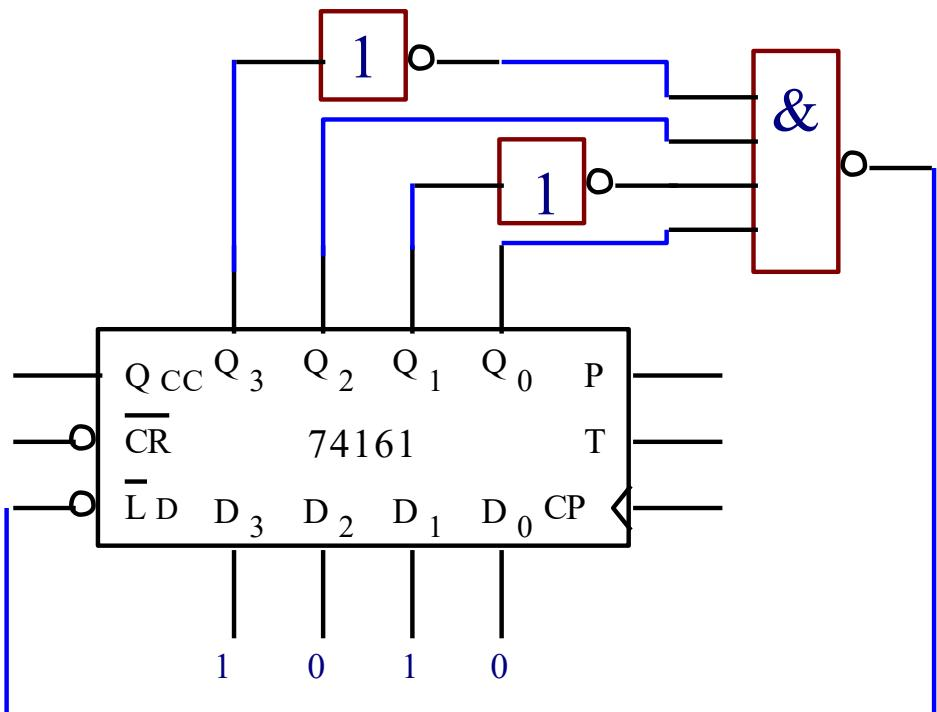

知识点：[完整数字系统设计流程实例（如乘法器、交通灯管理系统的算法规律、处理器设计与控制器实现）](../../../topics/数字逻辑电路/数字系统设计实例.md)

### 计算 6.40

6.40 写出图 P6.40 中 74161 输出端的状态编码表及 74151 输出端产生的序列信号。

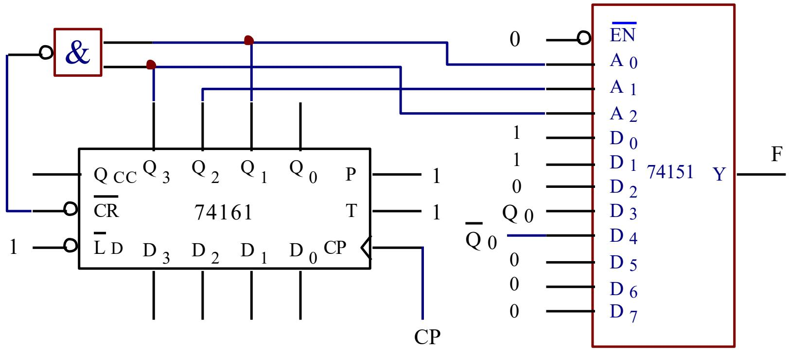

连接关系示意：

$$
\begin{array}{ccc}
& & 0 \\
& 1 & \text{EN} \\
& Q_{CC} Q_3 Q_2 Q_1 Q_0 & P \\
& \overline{CR} & 1 \\
& \overline{LD} & T \\
& D_3 D_2 D_1 D_0 & CP \\
& & \overline{Q_0} \\
& & CP
\end{array}
\quad
\begin{array}{ccc}
Y & F \\
& D_4 \\
& D_5 \\
& D_6 \\
& D_7
\end{array}
$$

74151 输出端产生的序列信号为：1111000110，…

<table>
<tr><td></td><td>$Q_3$</td><td>$Q_2$</td><td>$Q_1$</td><td>$Q_0$</td><td>F</td></tr>
<tr><td>0</td><td>0</td><td>0</td><td>0</td><td>←</td><td>1</td></tr>
<tr><td>1</td><td>0</td><td>0</td><td>0</td><td>1</td><td>1</td></tr>
<tr><td>2</td><td>0</td><td>0</td><td>1</td><td>0</td><td>1</td></tr>
<tr><td>3</td><td>0</td><td>0</td><td>1</td><td>1</td><td>1</td></tr>
<tr><td>4</td><td>0</td><td>1</td><td>0</td><td>0</td><td>0</td></tr>
<tr><td>5</td><td>0</td><td>1</td><td>0</td><td>1</td><td>0</td></tr>
<tr><td>6</td><td>0</td><td>1</td><td>1</td><td>0</td><td>0</td></tr>
<tr><td>7</td><td>0</td><td>1</td><td>1</td><td>1</td><td>1</td></tr>
<tr><td>8</td><td>1</td><td>0</td><td>0</td><td>0</td><td>1</td></tr>
<tr><td>9</td><td>1</td><td>0</td><td>0</td><td>1</td><td>0</td></tr>
<tr><td>10</td><td>1</td><td>0</td><td>1</td><td>0</td><td></td></tr>
</table>

## 三、ROM 的应用

知识点：[数字系统的基本模型（数据处理器与控制器）及对最小时钟周期、异步信号同步化的约定](../../../topics/数字逻辑电路/数字系统模型.md)、[完整数字系统设计流程实例（如乘法器、交通灯管理系统的算法规律、处理器设计与控制器实现）](../../../topics/数字逻辑电路/数字系统设计实例.md)

### 节：ROM的应用-实现组合逻辑

考虑图 6.2.3 所示的组合逻辑电路。

## 6.2 组合逻辑电路

知识点：[完整数字系统设计流程实例（如乘法器、交通灯管理系统的算法规律、处理器设计与控制器实现）](../../../topics/数字逻辑电路/数字系统设计实例.md)

### 6.2.1 用 ROM 实现组合逻辑电路

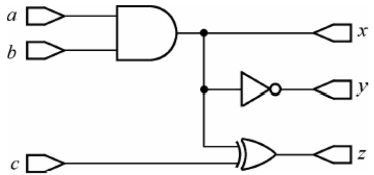

从图中可知

$$
x = a \cdot b \quad y = \overline{a \cdot b} \quad z = (a \cdot b) \oplus c
$$

将 $x$、$y$、$z$ 分别展开成最小项组成的标准“与—或”式，即

$$
\begin{array}{l}
x = a \cdot b \cdot c + a \cdot b \cdot \overline{c} \\
y = a \cdot \overline{b} \cdot c + a \cdot \overline{b} \cdot \overline{c} + \overline{a} \cdot b \cdot c + \overline{a} \cdot b \cdot \overline{c} + \overline{a} \cdot \overline{b} \cdot c + \overline{a} \cdot \overline{b} \cdot \overline{c} \\
z = a \cdot b \cdot \overline{c} + a \cdot \overline{b} \cdot c + \overline{a} \cdot b \cdot c + \overline{a} \cdot \overline{b} \cdot c
\end{array}
$$

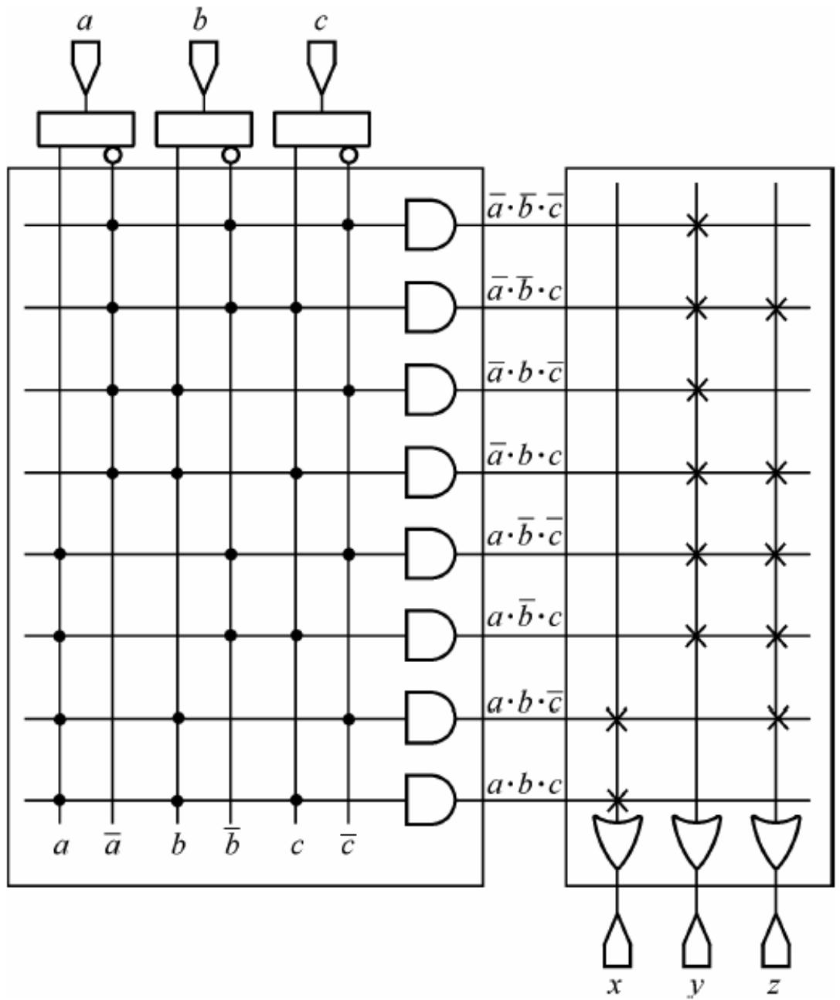

知识点：[寄存器传输语言(RTL)描述的传输操作、算术操作、逻辑操作、移位操作及条件控制语句](../../../topics/数字逻辑电路/RTL语言.md)
