# 《数字电路与逻辑设计B》第10章 可编程逻辑器件（课件）

原件的每一页，下面附识别出的文字。

### 第10章 可编程逻辑器件

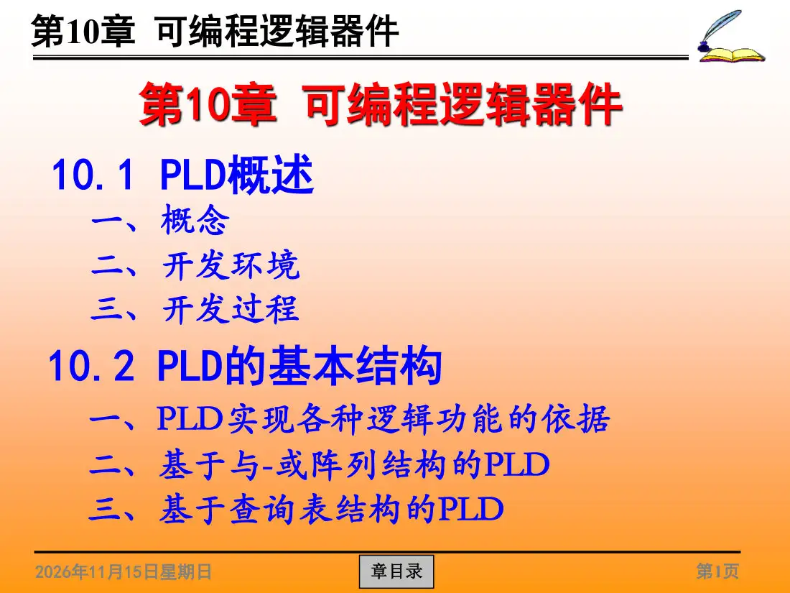

原文：

第10章 可编程逻辑器件
10.1 PLD概述
一、概念
二、开发环境
三、开发过程
10.2 PLD的基本结构
一、PLD实现各种逻辑功能的依据
二、基于与-或阵列结构的PLD
三、基于查询表结构的PLD

第10章 可编程逻辑器件

2026年11月15日星期日

章目录

第1页

### 10.3 PLD的表示方法

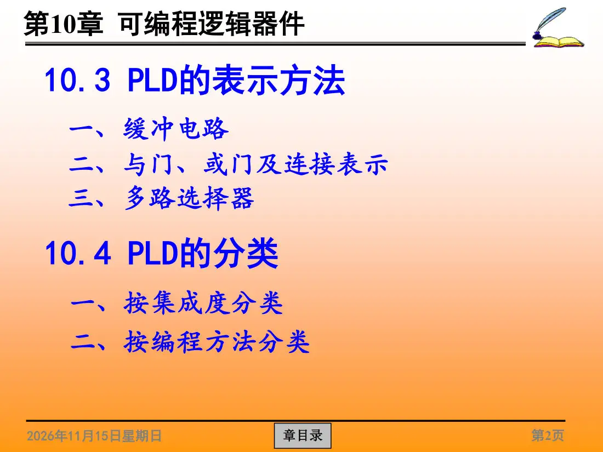

原文：

10.3 PLD的表示方法
一、缓冲电路
二、与门、或门及连接表示
三、多路选择器
10.4 PLD的分类
一、按集成度分类
二、按编程方法分类

第10章 可编程逻辑器件

2026年11月15日星期日

章目录

第2页

### 10.7 通用阵列逻辑(GAL)

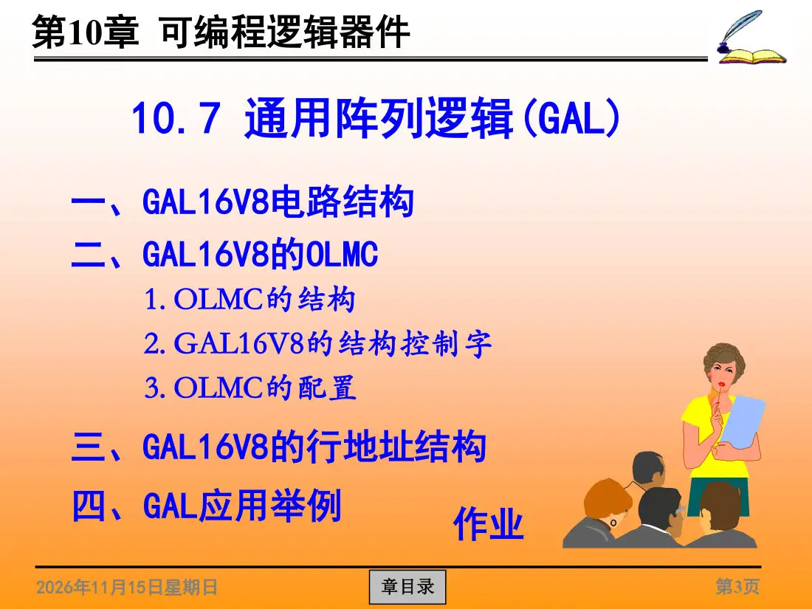

原文：

10.7 通用阵列逻辑(GAL)

一、GAL16V8电路结构

二、GAL16V8的OLMC

1. OLMC的结构

2. GAL16V8的结构控制字

3. OLMC的配置

三、GAL16V8的行地址结构

四、GAL应用举例

作业

第10章 可编程逻辑器件

2026年11月15日星期日

章目录

第3页

### 第10章 可编程逻辑器件

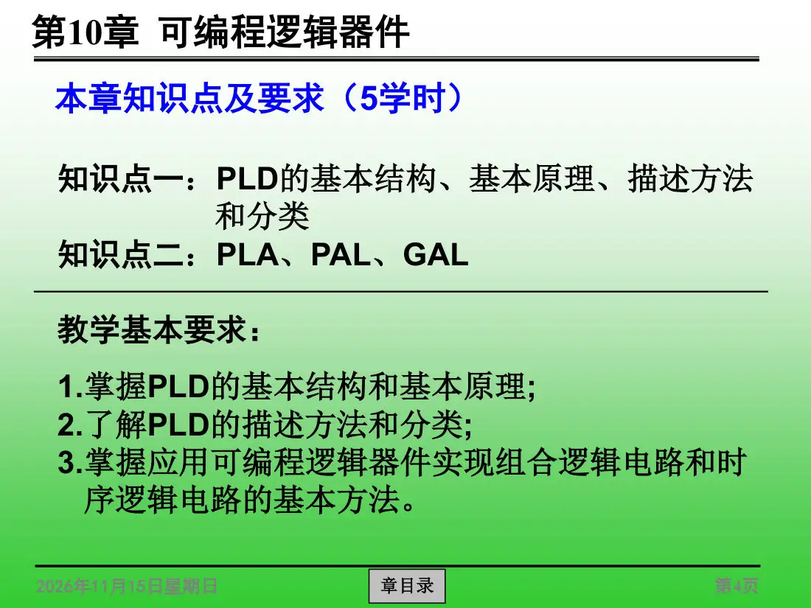

原文：

第10章 可编程逻辑器件

本章知识点及要求（5学时）

知识点一：PLD的基本结构、基本原理、描述方法和分类

知识点二：PLA、PAL、GAL

教学基本要求：

1.掌握PLD的基本结构和基本原理;

2.了解PLD的描述方法和分类;

3.掌握应用可编程逻辑器件实现组合逻辑电路和时序逻辑电路的基本方法。

2026年11月15日星期日

章目录

第4页

### 10.1 PLD概述

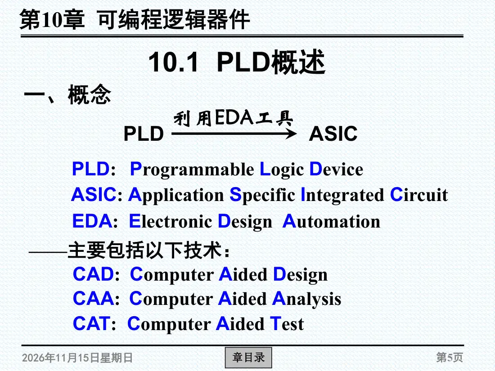

原文：

10.1 PLD概述

概念

利用EDA工具PLD ASIC

PLD: Programmable Logic Device

ASIC: Application Specific Integrated Circuit

EDA: Electronic Design Automation

主要包括以下技术：

CAD: Computer Aided Design

CAA: Computer Aided Analysis

CAT: Computer Aided Test

第10章 可编程逻辑器件

2026年11月15日星期日

章目录

第5页

### 第10章 可编程逻辑器件

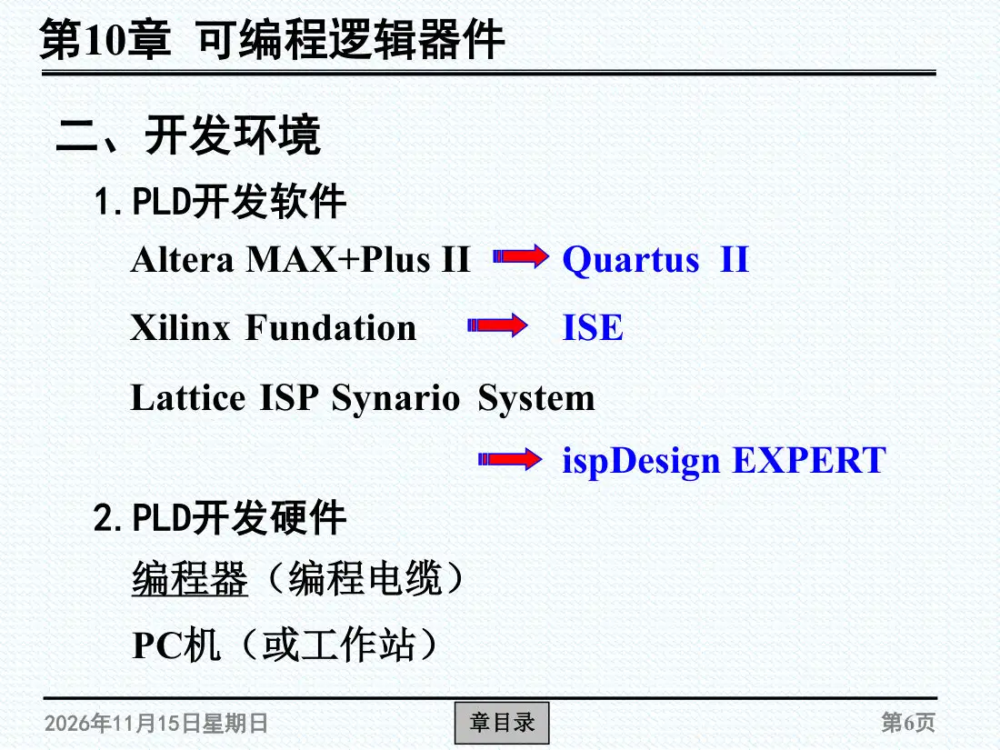

原文：

第10章 可编程逻辑器件

二、开发环境

1.PLD开发软件

Lattice ISP Synario System

ispDesign EXPERT

2.PLD开发硬件

编程器（编程电缆）

PC机（或工作站）

2026年11月15日星期日

章目录

第6页

### 第10章 可编程逻辑器件

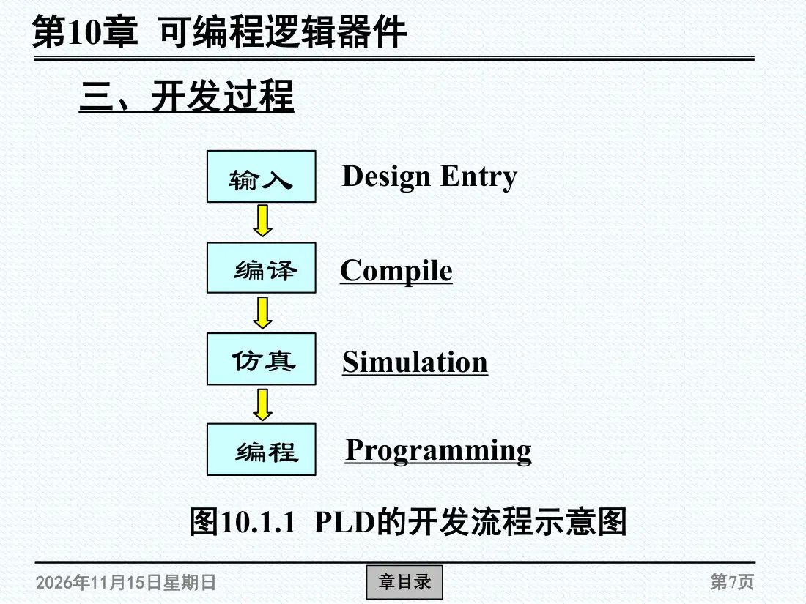

原文：

第10章 可编程逻辑器件

三、开发过程

2026年11月15日星期日

章目录

第7页

### 第10章 可编程逻辑器件

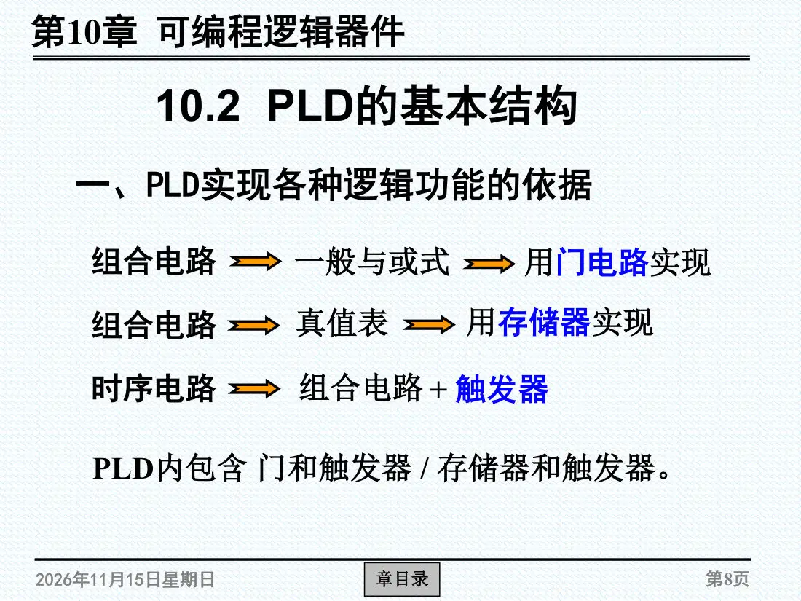

原文：

第10章 可编程逻辑器件

10.2 PLD的基本结构

一、PLD实现各种逻辑功能的依据

组合电路 一般与或式 用门电路实现

组合电路 真值表 用存储器实现

时序电路 组合电路 + 触发器

PLD内包含 门和触发器 / 存储器和触发器。

2026年11月15日星期日

章目录

第8页

### 第10章 可编程逻辑器件

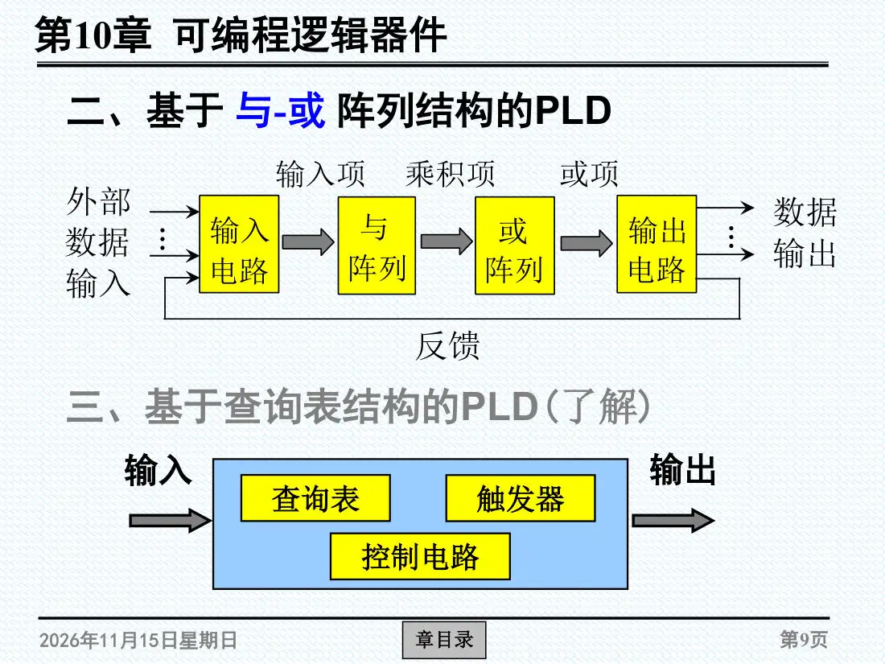

原文：

第10章 可编程逻辑器件

二、基于 与-或 阵列结构的PLD

输入项 乘积项或项

输电入路

与列

或列

输电出路数据输出

反馈

三、基于查询表结构的PLD(了解)

输入

查询表

触发器

输出

控制电路

2026年11月15日星期日

章目录

第9页

### 第10章 可编程逻辑器件

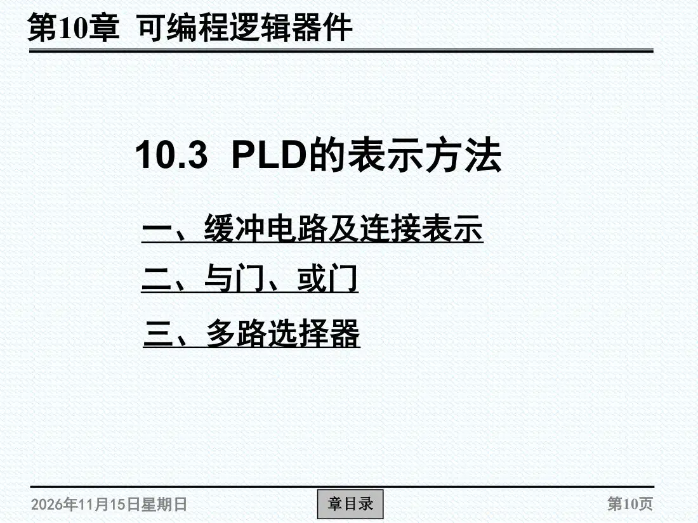

原文：

第10章 可编程逻辑器件

10.3 PLD的表示方法
一、缓冲电路及连接表示
二、与门、或门
三、多路选择器

2026年11月15日星期日

章目录

第10页

### 第10章 可编程逻辑器件

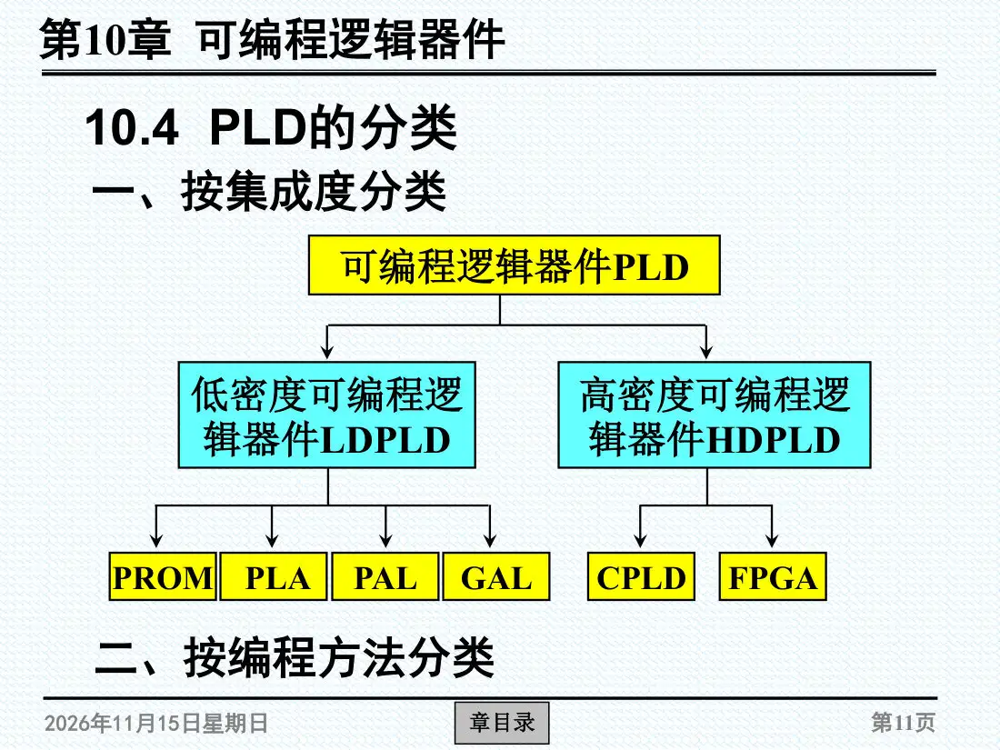

原文：

第10章 可编程逻辑器件

10.4 PLD的分类按集成度分类

二、按编程方法分类

2026年11月15日星期日

章目录

第11页

### 第10章 可编程逻辑器件

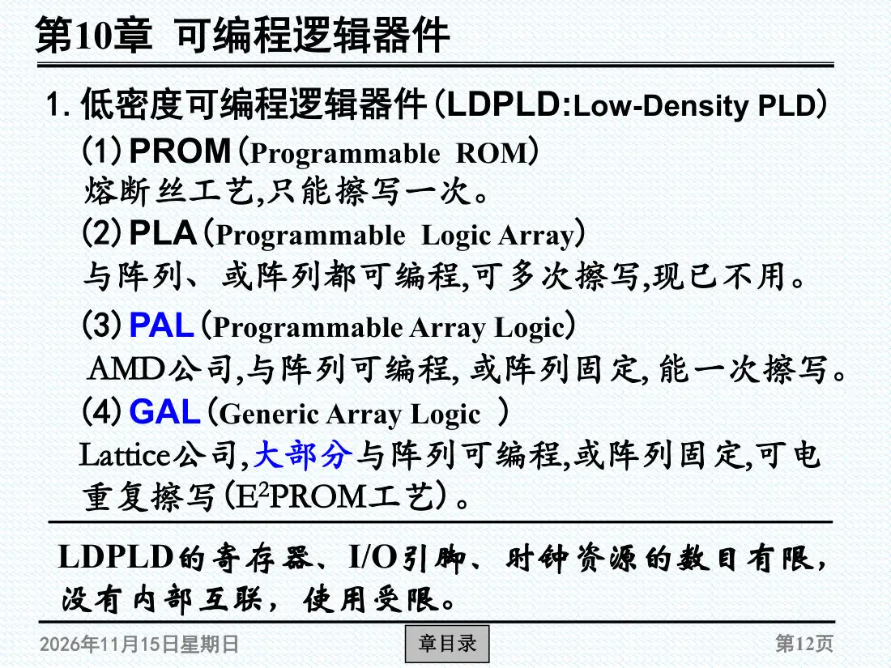

原文：

第10章 可编程逻辑器件

1.低密度可编程逻辑器件(LDPLD:Low-Density PLD)

(1)PROM(Programmable ROM)熔断丝工艺,只能擦写一次。

(2)PLA(Programmable Logic Array) 与阵列、或阵列都可编程,可多次擦写,现已不用。

(3)PAL(Programmable Array Logic)AMD公司,与阵列可编程, 或阵列固定, 能一次擦写。

(4)GAL(Generic Array Logic )

Lattice公司,大部分与阵列可编程,或阵列固定,可电重复擦写(E2PROM工艺)。

LDPLD的寄存器、I/O引脚、时钟资源的数目有限，没有内部互联，使用受限。

2026年11月15日星期日

章目录

第12页

### 第10章 可编程逻辑器件

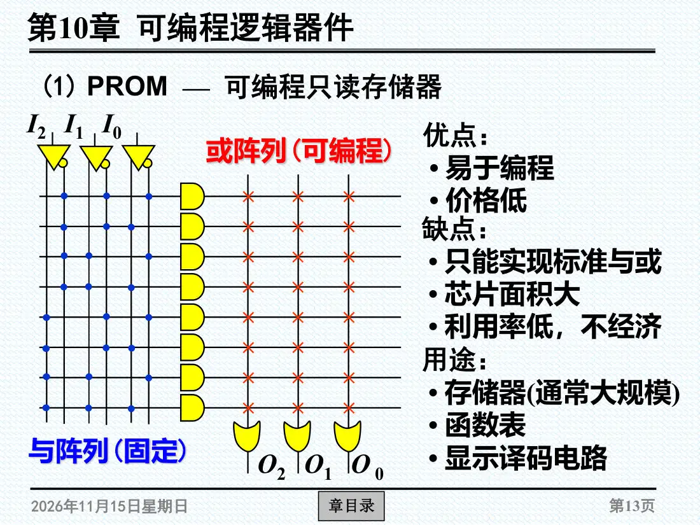

原文：

第10章 可编程逻辑器件

(1) PROM — 可编程只读存储器

或阵列(可编程)

与阵列(固定)

优点：

易于编程

• 价格低

缺点：

只能实现标准与或

芯片面积大

利用率低，不经济用途：

存储器(通常大规模)

• 函数表

显示译码电路

2026年11月15日星期日

章目录

第13页

### 第10章 可编程逻辑器件

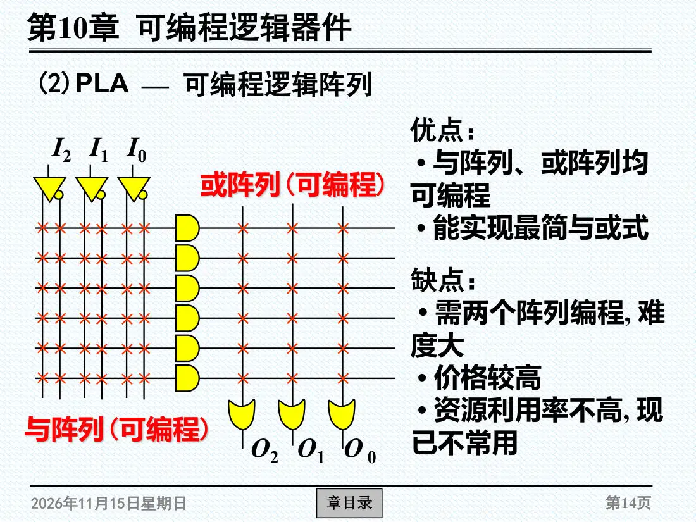

原文：

第10章 可编程逻辑器件

(2)PLA — 可编程逻辑阵列

与阵列(可编程)

或阵列(可编程)

优点：

• 与阵列、或阵列均可编程

能实现最简与或式

缺点：

需两个阵列编程, 难度大

价格较高

资源利用率不高, 现已不常用

2026年11月15日星期日

章目录

第14页

### 第10章 可编程逻辑器件

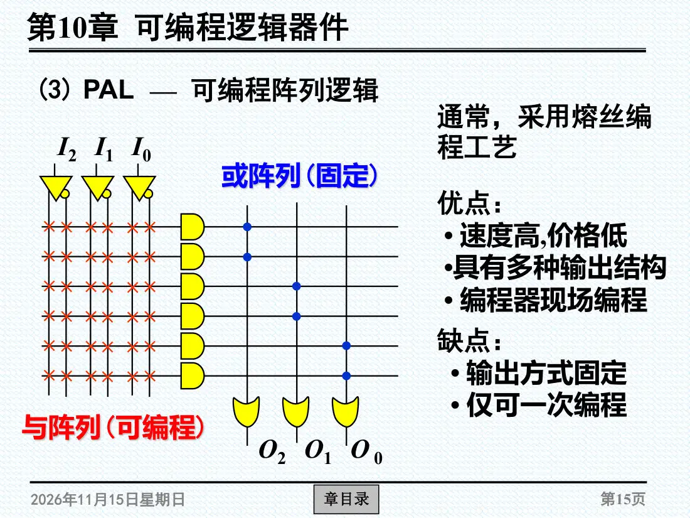

原文：

第10章 可编程逻辑器件

(3) PAL — 可编程阵列逻辑

与阵列(可编程)

或阵列(固定)

通常，采用熔丝编程工艺

优点：

速度高,价格低

具有多种输出结构

编程器现场编程

缺点：

输出方式固定

仅可一次编程

2026年11月15日星期日

章目录

第15页

### 第10章 可编程逻辑器件

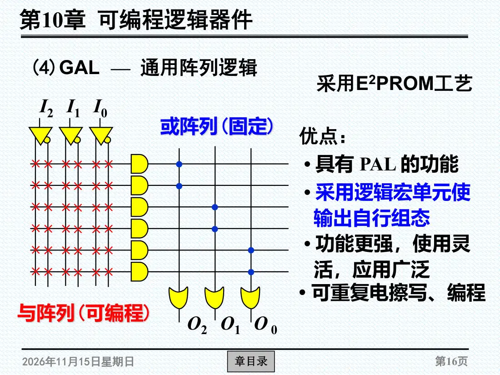

原文：

第10章 可编程逻辑器件

(4)GAL — 通用阵列逻辑

采用E2PROM工艺

优点：

具有 PAL 的功能

采用逻辑宏单元使 输出自行组态

功能更强，使用灵活，应用广泛

• 可重复电擦写、编程

2026年11月15日星期日

章目录

第16页

### 第10章 可编程逻辑器件

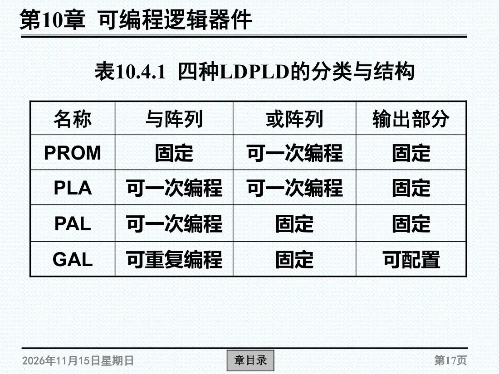

原文：

第10章 可编程逻辑器件

表10.4.1 四种LDPLD的分类与结构
<table><tr><td>名称</td><td>与阵列</td><td>或阵列</td><td>输出部分</td></tr><tr><td>PROM</td><td>固定</td><td>可一次编程</td><td>固定</td></tr><tr><td>PLA</td><td>可一次编程</td><td>可一次编程</td><td>固定</td></tr><tr><td>PAL</td><td>可一次编程</td><td>固定</td><td>固定</td></tr><tr><td>GAL</td><td>可重复编程</td><td>固定</td><td>可配置</td></tr></table>

2026年11月15日星期日

章目录

第17页

### 2.高密度可编程逻辑器件(HDPLD:High-Density PLD)

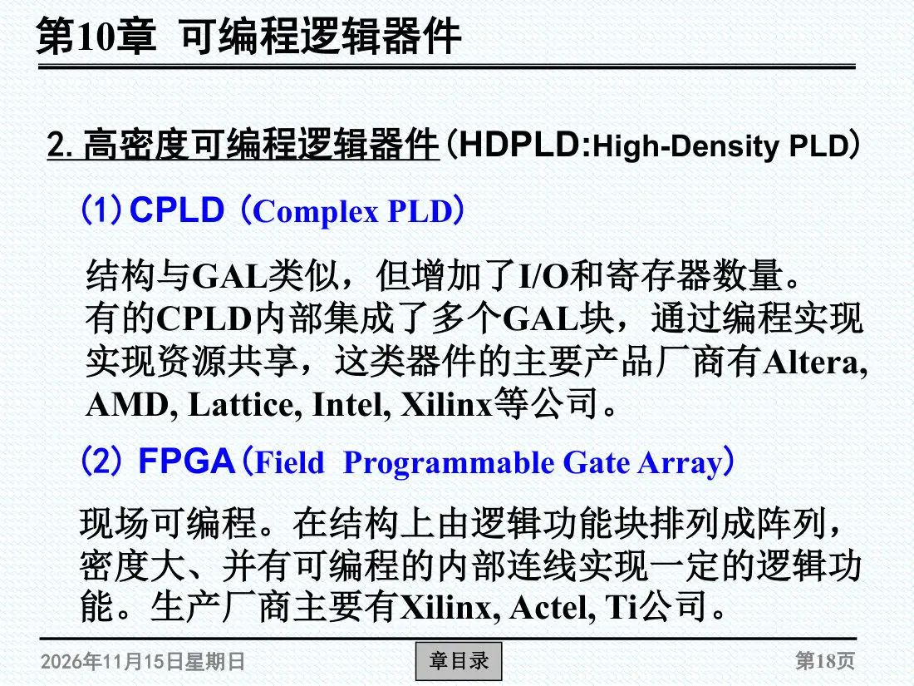

原文：

2.高密度可编程逻辑器件(HDPLD:High-Density PLD)

(1)CPLD (Complex PLD)

结构与GAL类似，但增加了I/O和寄存器数量。

有的CPLD内部集成了多个GAL块，通过编程实现实现资源共享，这类器件的主要产品厂商有Altera,AMD, Lattice, Intel, Xilinx等公司。

(2) FPGA(Field Programmable Gate Array)

现场可编程。在结构上由逻辑功能块排列成阵列，密度大、并有可编程的内部连线实现一定的逻辑功能。生产厂商主要有Xilinx, Actel, Ti公司。

第10章 可编程逻辑器件

2026年11月15日星期日

章目录

第18页

### 第10章 可编程逻辑器件

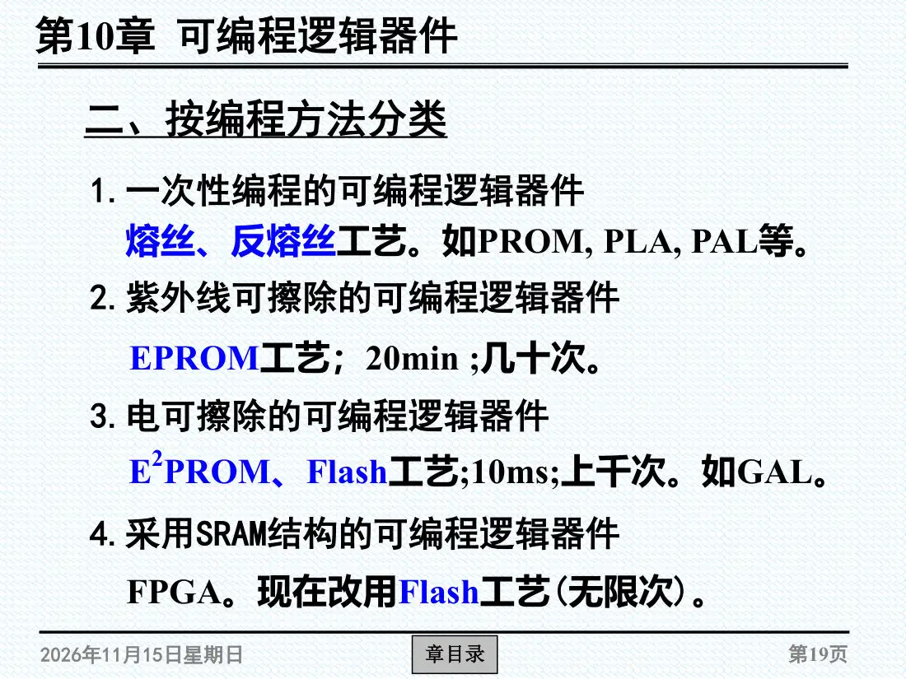

原文：

第10章 可编程逻辑器件

二、按编程方法分类

1.一次性编程的可编程逻辑器件熔丝、反熔丝工艺。如PROM, PLA, PAL等。

2.紫外线可擦除的可编程逻辑器件 EPROM工艺；20min ;几十次。

3.电可擦除的可编程逻辑器件 E2PROM、Flash工艺;10ms;上千次。如GAL。

4.采用SRAM结构的可编程逻辑器件FPGA。现在改用Flash工艺(无限次)。

2026年11月15日星期日

章目录

第19页

### 第10章 可编程逻辑器件

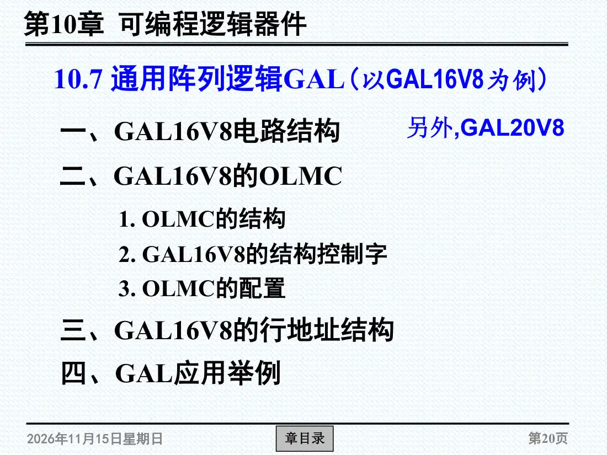

原文：

第10章 可编程逻辑器件

10.7 通用阵列逻辑GAL(以GAL16V8为例)
一、GAL16V8电路结构 另外,GAL20V8
二、GAL16V8的OLMC
1. OLMC的结构
2. GAL16V8的结构控制字
3. OLMC的配置
三、GAL16V8的行地址结构
四、GAL应用举例

2026年11月15日星期日

章目录

第20页

### 第10章 可编程逻辑器件 GAL16V8

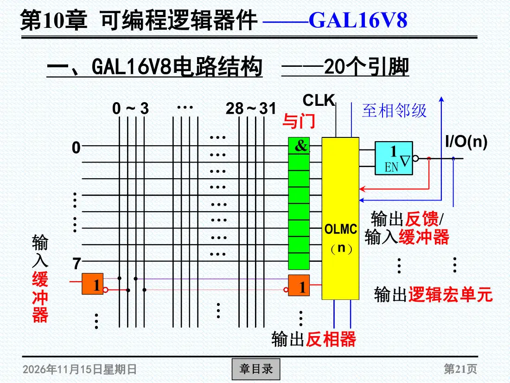

原文：

第10章 可编程逻辑器件 GAL16V8

GAL16V8电路结构 ——20个引脚

至相邻级

输出逻辑宏单元

输出反相器

2026年11月15日星期日

章目录

第21页

### 第10章 可编程逻辑器件 GAL16V8

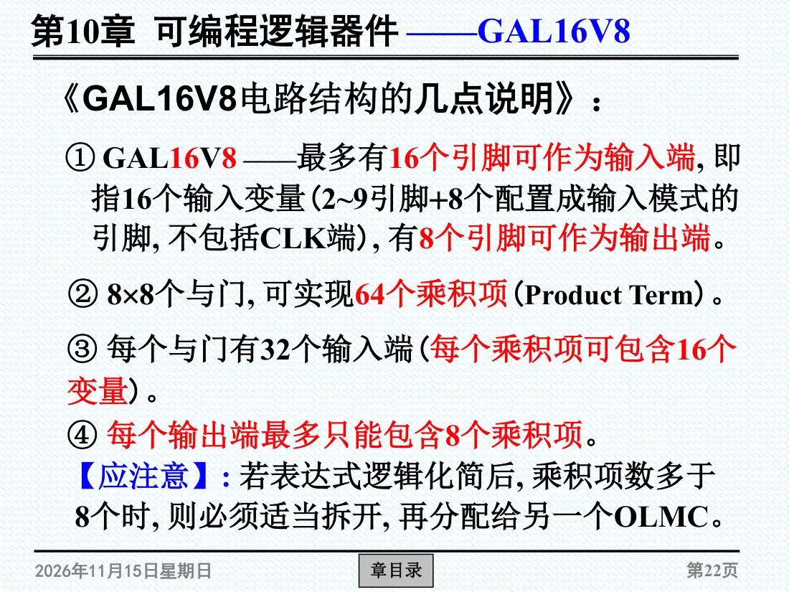

原文：

第10章 可编程逻辑器件 GAL16V8

《GAL16V8电路结构的几点说明》：

① GAL16V8 最多有16个引脚可作为输入端, 即指16个输入变量(2\~9引脚+8个配置成输入模式的引脚, 不包括CLK端), 有8个引脚可作为输出端。

② 88个与门, 可实现64个乘积项(Product Term)。

③ 每个与门有32个输入端(每个乘积项可包含16个变量)。

④ 每个输出端最多只能包含8个乘积项。

【应注意】: 若表达式逻辑化简后, 乘积项数多于8个时, 则必须适当拆开, 再分配给另一个OLMC。

2026年11月15日星期日

章目录

第22页

### 第10章 可编程逻辑器件 GAL16V8

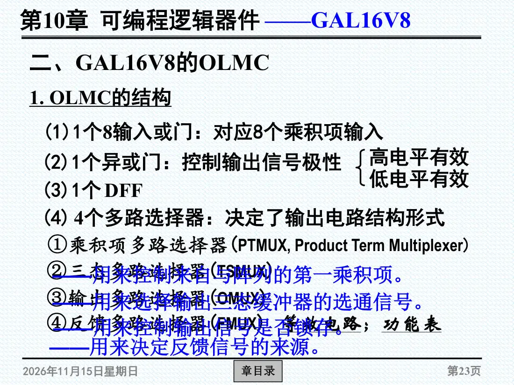

原文：

第10章 可编程逻辑器件 GAL16V8

二、GAL16V8的OLMC

1. OLMC的结构

(1)1个8输入或门：对应8个乘积项输入

(2)1个异或门：控制输出信号极性

(3)1个 DFF

高电平有效

低电平有效

(4)4个多路选择器：决定了输出电路结构形式

①乘积项多路选择器(PTMUX, Product Term Multiplexer)

②三态多路选择器(TSMUX)——用来控制来自与阵列的第一乘积项。

③输出多路选择器(OMUX)等效电路 ； 功能表——用来选择输出三态缓冲器的选通信号。

④反馈多路选择器(FMUX) 等效电路；功能表——用来控制输出信号是否锁存。用来决定反馈信号的来源。

2026年11月15日星期日

章目录

第23页

### 第10章 可编程逻辑器件 GAL16V8

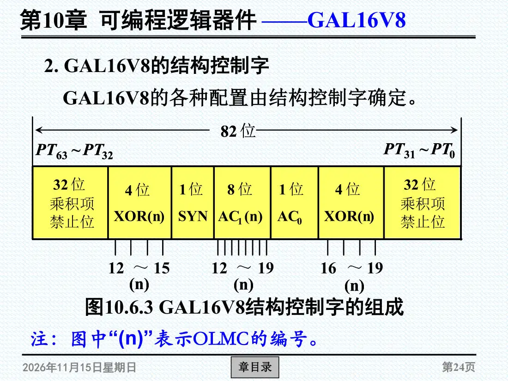

原文：

第10章 可编程逻辑器件 GAL16V8

2. GAL16V8的结构控制字

GAL16V8的各种配置由结构控制字确定。

图10.6.3 GAL16V8结构控制字的组成
<table><tr><td colspan="7">82位</td></tr><tr><td colspan="5">PT63~PT32</td><td colspan="2">PT31~PT0</td></tr><tr><td>32位乘积项禁止位</td><td>4位XOR(n)</td><td>1位SYN</td><td>8位AC1(n)</td><td>1位AC0</td><td>4位XOR(n)</td><td>32位乘积项禁止位</td></tr><tr><td colspan="3">12~15(n)</td><td colspan="2">12~19(n)</td><td colspan="2">16~19(n)</td></tr></table>

注：图中 $\cos ( n ) ^ { 3 }$ 表示OLMC的编号。

2026年11月15日星期日

章目录

第24页

### 第10章 可编程逻辑器件 GAL16V8

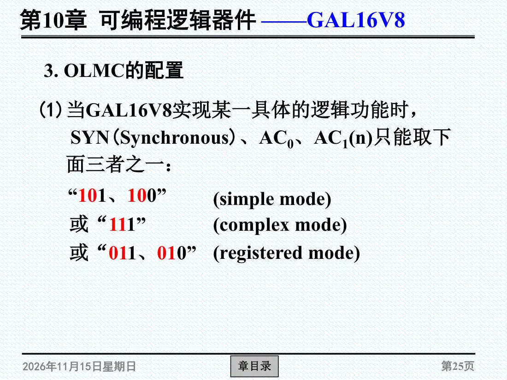

原文：

第10章 可编程逻辑器件 GAL16V8

3. OLMC的配置

(1)当GAL16V8实现某一具体的逻辑功能时，SYN(Synchronous)、 $\mathbf { A C _ { 0 } } \setminus \mathbf { A C } _ { 1 } ( \mathbf { n } )$ 只能取下面三者之一：“101、100” (simple mode)或“111” (complex mode)或“011、010” (registered mode)

2026年11月15日星期日

章目录

第25页

### 第10章 可编程逻辑器件 GAL16V8

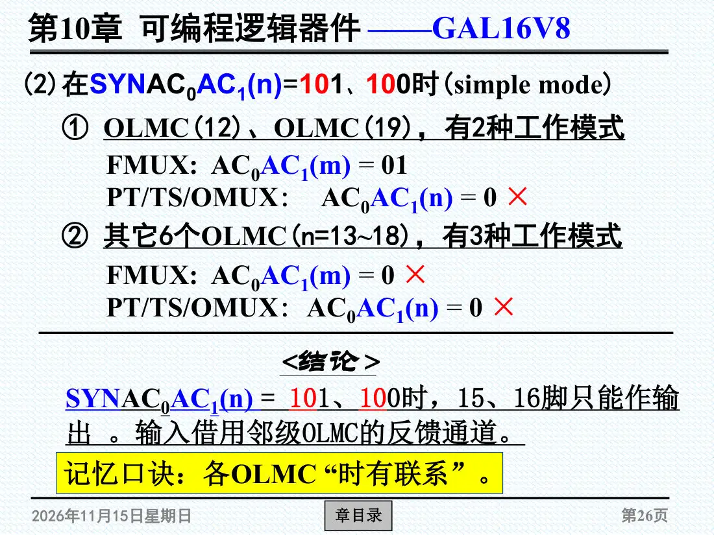

原文：

第10章 可编程逻辑器件 GAL16V8

(2)在 $\mathsf { S Y N A C } _ { 0 } \mathsf { A C } _ { 1 } ( \mathsf { n } ) = 1 0 1$ 100时(simple mode)

OLMC(12)、OLMC(19)，有2种工作模式FMUX: $\mathbf { A C _ { 0 } A C _ { 1 } ( m ) } = 0 1$ PT/TS/OMUX: $\mathbf { A C _ { 0 } A C _ { 1 } ( n ) } = \mathbf { 0 } \times \mathbf { \partial }$

② 其它 $6 \operatorname { \sim } 1 0 \mathrm { { L M C } } \ ( \mathsf { n } = 1 3 \mathrm { { - } } 1 8 )$ 有3种工作模式FMUX: $\mathbf { A C _ { 0 } A C _ { 1 } ( m ) = 0 \times }$ PT/TS/OMUX: $\mathbf { A C _ { 0 } A C _ { 1 } ( n ) = 0 \times }$

<结论>

$\mathbf { S Y N A C _ { 0 } A C _ { 1 } ( n ) } = \mathbf { \Gamma } ] 0 1$ 、100时，15、16脚只能作输出 。输入借用邻级OLMC的反馈通道。

记忆口诀：各 $\mathbf { \left. O L M C \ ^ { 6 6 } \right. }$ 时有联系”。

2026年11月15日星期日

章目录

第26页

### 第10章 可编程逻辑器件 GAL16V8

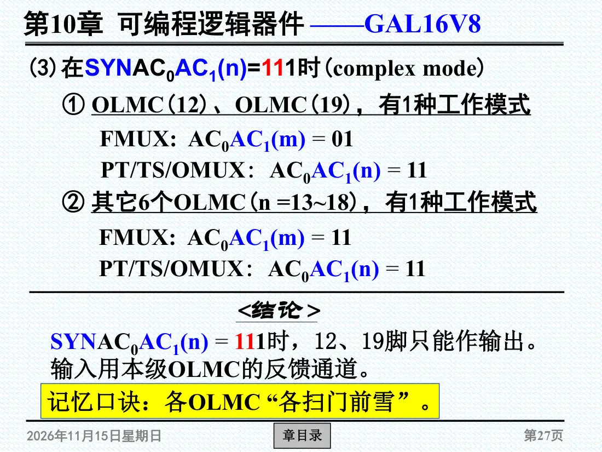

原文：

第10章 可编程逻辑器件 GAL16V8

(3)在 $\mathsf { S Y N A C } _ { 0 } \mathsf { A C } _ { 1 } ( \mathsf { n } ) = 1 1 1$ 时(complex mode)① OLMC(12)、OLMC(19)，有1种工作模式FMUX: $\mathbf { A C _ { 0 } A C _ { 1 } ( m ) } = 0 1$ PT/TS/OMUX: $\mathbf { A C _ { 0 } A C _ { 1 } ( n ) } = 1 1$ ② 其它6个OLMC(n =13\~18)，有1种工作模式FMUX: $\mathbf { A C _ { 0 } A C _ { 1 } ( m ) } = 1 1$ PT/TS/OMUX: $\mathbf { A C _ { 0 } A C _ { 1 } ( n ) } = 1 1$

<结论>

$\mathrm { S Y N A C _ { 0 } A C _ { 1 } ( n ) = 1 1 1 }$ 时，12、19脚只能作输出。输入用本级OLMC的反馈通道。

记忆口诀：各 $\mathbf { \cdot O L M C } ^ { 6 6 }$ 各扫门前雪”。

2026年11月15日星期日

章目录

第27页

### 第10章 可编程逻辑器件 GAL16V8

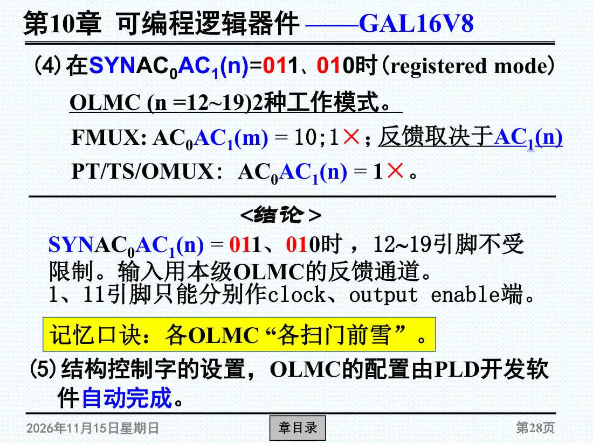

原文：

第10章 可编程逻辑器件 GAL16V8

(4)在 $\mathsf { S Y N A C } _ { 0 } \mathsf { A C } _ { 1 } ( \mathsf { n } ) { = } 0 . 1 1$ 010时(registered mode)OLMC (n =12\~19)2种工作模式。FMUX: $\mathbf { A C _ { 0 } A C _ { 1 } ( m ) } = 1 0 ; 1 \times$ ；反馈取决于 $\mathbf { A C _ { 1 } ( n ) }$ PT/TS/OMUX: $\mathbf { A C _ { 0 } A C _ { 1 } ( n ) } = 1 \times$

<结论>$\mathrm { S Y N A C _ { 0 } A C _ { 1 } ( n ) = 0 1 1 }$ 010时 ，1219引脚不受限制。输入用本级OLMC的反馈通道。1、11引脚只能分别作clock、output enable端。记忆口诀：各 $\mathbf { O L M C } ^ { 6 6 }$ 各扫门前雪”。

(5)结构控制字的设置，OLMC的配置由PLD开发软件自动完成。

2026年11月15日星期日

章目录

第28页

### 第10章 可编程逻辑器件 GAL16V8

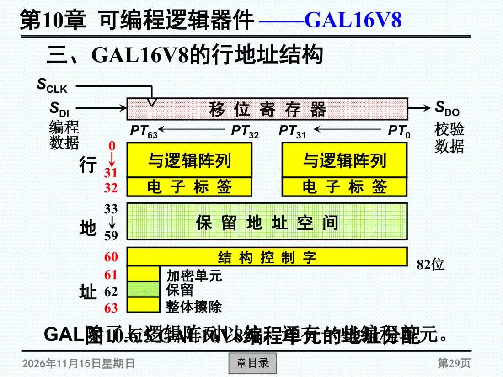

原文：

第10章 可编程逻辑器件 GAL16V8

三、GAL16V8的行地址结构

图10.6.5GAL16V8编程单元的地址分配GAL除了与逻辑阵列以外，还有一些编程单元。

2026年11月15日星期日

章目录

第29页

### 第10章 可编程逻辑器件 GAL16V8

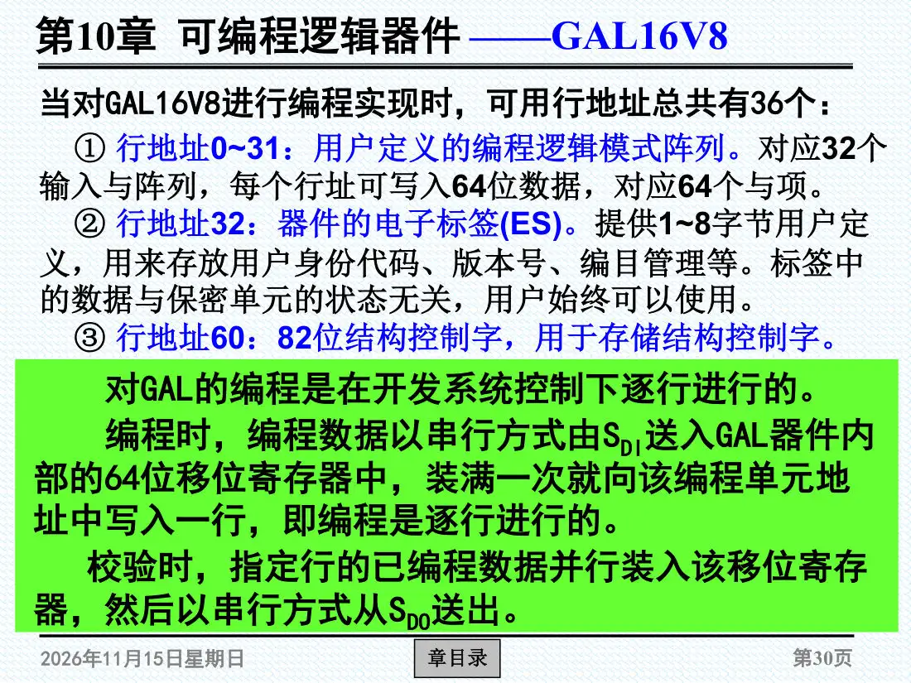

原文：

第10章 可编程逻辑器件 GAL16V8

当对GAL16V8进行编程实现时，可用行地址总共有36个：

① 行地址0\~31：用户定义的编程逻辑模式阵列。对应32个输入与阵列，每个行址可写入64位数据，对应64个与项。

② 行地址32：器件的电子标签(ES)。提供1\~8字节用户定义，用来存放用户身份代码、版本号、编目管理等。标签中的数据与保密单元的状态无关，用户始终可以使用。

③ 行地址60：82位结构控制字，用于存储结构控制字。

行地址61：1位保密位。该位一旦被编程，存取阵对GAL的编程是在开发系统控制下逐行进行的。

编程时，编程数据以串行方式由 $S _ { \mathsf { D } \mathsf { I } }$ 送入GAL器件内签除外)。该位只能在整体擦除时一起被擦除。部的64位移位寄存器中，装满一次就向该编程单元地⑤ 行地址63：1位器件整体擦除。在编址中写入一行，即编程是逐行进行的。

就执行清除功能，整个与阵列、结构控制字、电子标签以及 校验时，指定行的已编程数据并行装入该移位寄存保密单元统统被擦除，使器，然后以串行方式从 $s _ { \infty }$ 程器件送出。

2026年11月15日星期日

章目录

第30页

### 第10章 可编程逻辑器件 GAL16V8

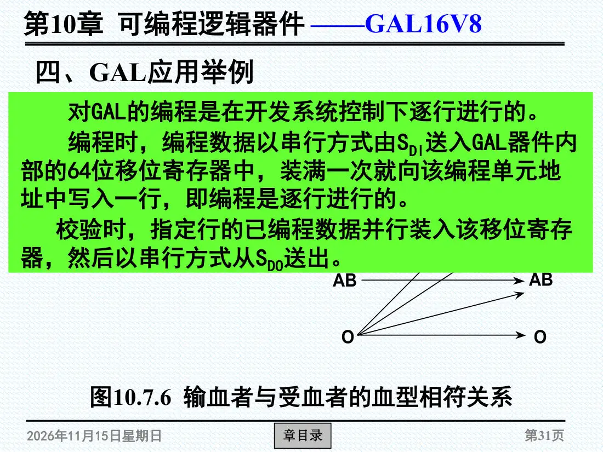

原文：

第10章 可编程逻辑器件 GAL16V8

四、GAL应用举例

对GAL的编程是在开发系统控制下逐行进行的。

输血者血编程时，编程数据以串行方式由 $S _ { \mathsf { D } \mathsf { I } }$ 受血者血型 送入GAL器件内A部的64位移位寄存器中，装满一次就向该编程单元地者的血型必须符合图所示址中写入一行，即编程是逐行进行的。

的关系。 校验时，指定行的已编程数据并行装入该移位寄存试用1片GAL16V器，然后以串行方式从 $s _ { \infty }$ 送出。

2026年11月15日星期日

章目录

第31页

### 第10章 可编程逻辑器件 GAL16V8

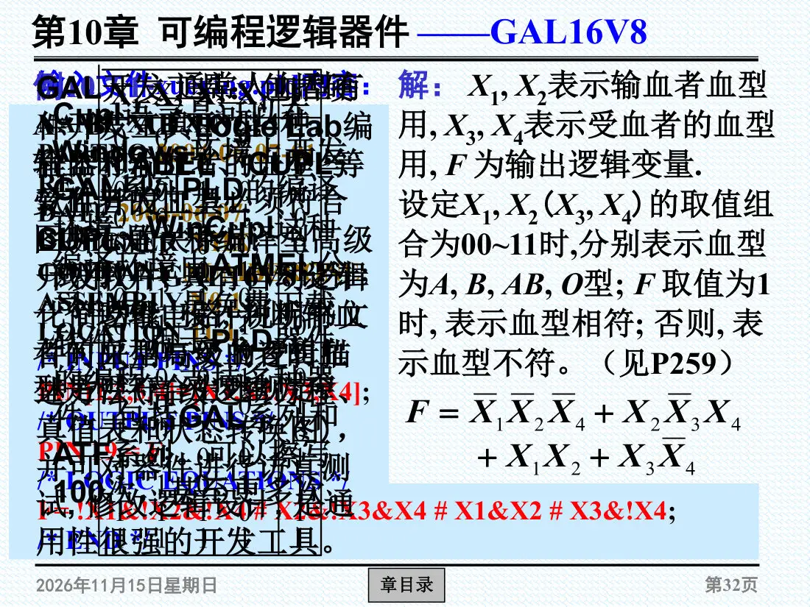

原文：

第10章 可编程逻辑器件 GAL16V8

解：用, $X _ { 1 } , X _ { 2 }$ 表示输血者血型$X _ { _ 3 } , X _ { _ 4 }$ 表示受血者的血型用, F 为输出逻辑变量.

设定 $X _ { 1 } , X _ { 2 } \left( X _ { 3 } , X _ { 4 } \right)$ 的取值组合为00\~11时,分别表示血型为A, B, AB, O型; F 取值为1时, 表示血型相符; 否则, 表示血型不符。 （见P259）

$$
\begin{array}{r} F = \overline {{X}} _ {1} \overline {{X}} _ {2} \overline {{X}} _ {4} + X _ {2} \overline {{X}} _ {3} X _ {4} \\ + X _ {1} X _ {2} + X _ {3} \overline {{X}} _ {4} \end{array}
$$

F= !X1&!X2&!X4 # X2&!X3&X4 # X1&X2 # X3&!X4;试, 修改逻辑设计, 是通100次，甚至更多次。/\* END \*/用性很强的开发工具。

2026年11月15日星期日

章目录

第32页

### 第10章 可编程逻辑器件 GAL16V8

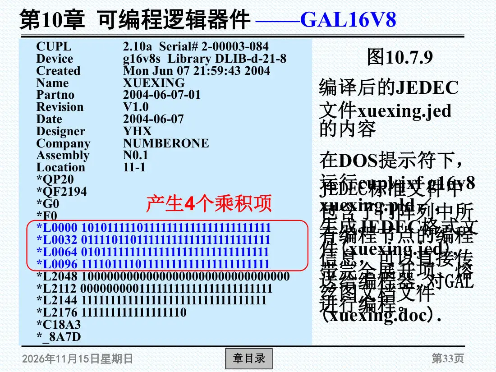

原文：

第10章 可编程逻辑器件 GAL16V8

<table><tr><td>CUPL</td><td>2.10a Serial# 2-00003-084</td></tr><tr><td>Device</td><td>g16v8s Library DLIB-d-21-8</td></tr><tr><td>Created</td><td>Mon Jun 07 21:59:43 2004</td></tr><tr><td>Name</td><td>XUEXING</td></tr><tr><td>Partno</td><td>2004-06-07-01</td></tr><tr><td>Revision</td><td>V1.0</td></tr><tr><td>Date</td><td>2004-06-07</td></tr><tr><td>Designer</td><td>YHX</td></tr><tr><td>Company</td><td>NUMBERONE</td></tr><tr><td>Assembly</td><td>N0.1</td></tr><tr><td>Location</td><td>11-1</td></tr><tr><td>*QP20</td><td></td></tr><tr><td>*QF2194</td><td></td></tr><tr><td>*G0</td><td>产生4个乘积项</td></tr><tr><td>*F0</td><td></td></tr><tr><td colspan="2">*L0000 10101111101111111111111111111111111111111111111111111111111111111111111111111111111111111111111111111111111111</td></tr><tr><td colspan="2">*L0032 011110110111111111111111111111111111111111111111111111111111111111111111111111111111111111111111111111111</td></tr></table>

2026年11月15日星期日

章目录

第33页

### 第10章 可编程逻辑器件 GAL16V8

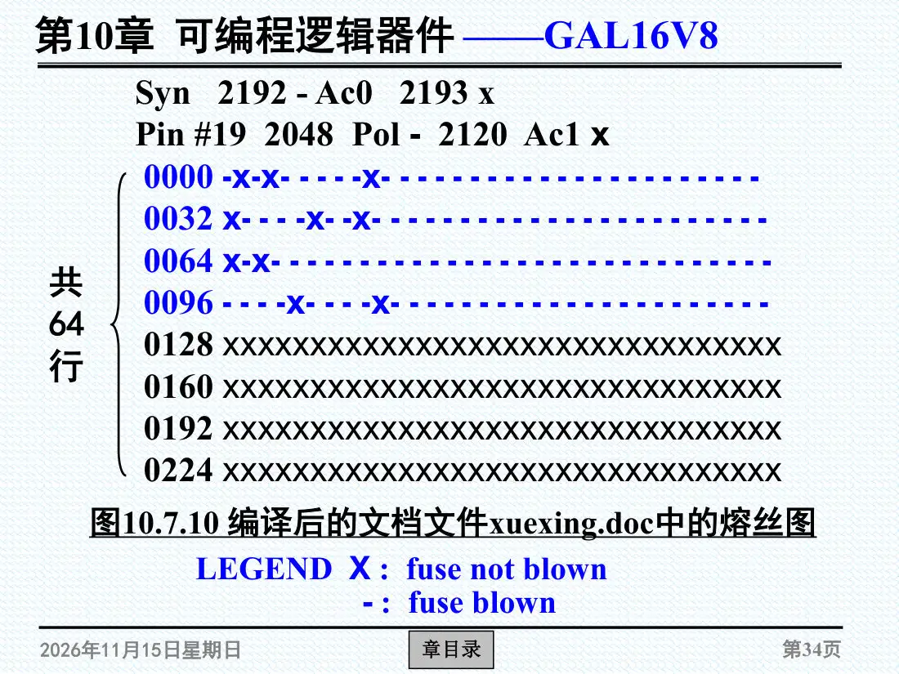

原文：

第10章 可编程逻辑器件 GAL16V8

图10.7.10 编译后的文档文件xuexing.doc中的熔丝图

LEGEND X : fuse not blown fuse blown

共64行

2026年11月15日星期日

章目录

第34页

### 第10章 可编程逻辑器件 GAL16V8

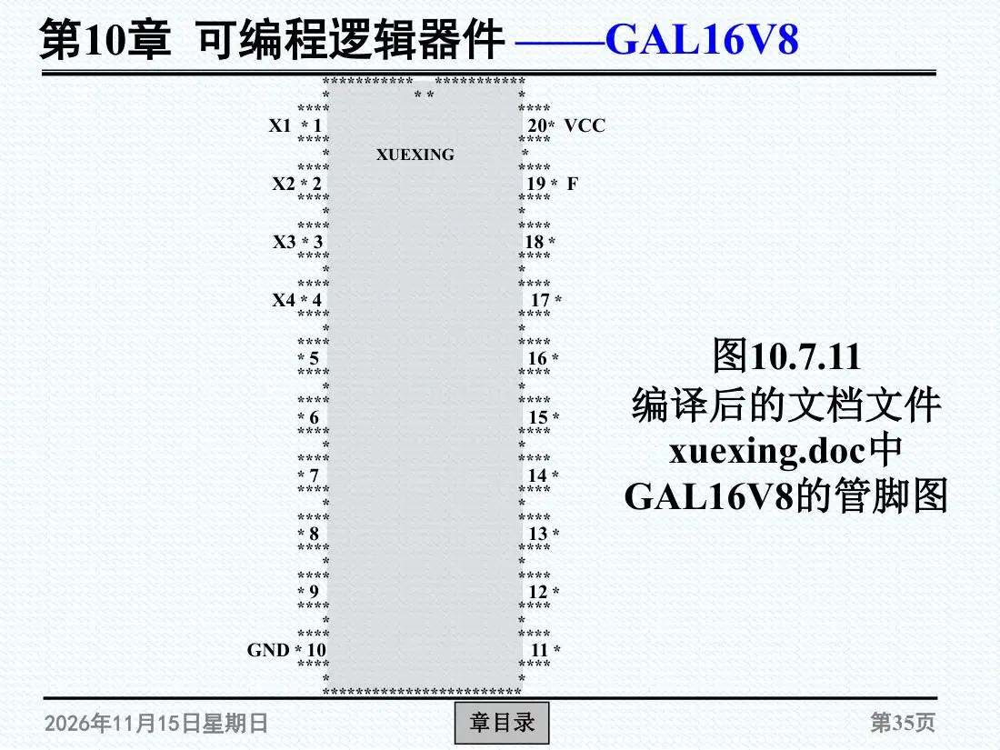

原文：

第10章 可编程逻辑器件 GAL16V8

<table><tr><td></td><td>**********</td><td>**********</td></tr><tr><td></td><td>*</td><td>*</td></tr><tr><td></td><td>****</td><td>****</td></tr><tr><td>X1 * 1</td><td>XUEXING</td><td>20* VCC</td></tr><tr><td></td><td>****</td><td>****</td></tr><tr><td></td><td rowspan="2">****</td><td>****</td></tr><tr><td>X2 * 2</td><td>19* F</td></tr><tr><td></td><td>****</td><td>****</td></tr><tr><td></td><td rowspan="2">****</td><td>****</td></tr><tr><td>X3 * 3</td><td>18*</td></tr><tr><td></td><td>****</td><td>****</td></tr><tr><td></td><td rowspan="2">****</td><td>****</td></tr><tr><td>X4 * 4</td><td>17*</td></tr><tr><td></td><td>****</td><td>****</td></tr><tr><td></td><td>****</td><td>****</td></tr><tr><td></td><td>****</td><td>16*</td></tr><tr><td></td><td>****</td><td>****</td></tr><tr><td></td><td>****</td><td>****</td></tr><tr><td></td><td>****</td><td>15*</td></tr><tr><td></td><td>****</td><td>****</td></tr><tr><td></td><td>****</td><td>****</td></tr><tr><td></td><td>****</td><td>14*</td></tr><tr><td></td><td>****</td><td>****</td></tr><tr><td></td><td>****</td><td>****</td></tr><tr><td></td><td>****</td><td>13*</td></tr><tr><td></td><td>****</td><td>****</td></tr><tr><td></td><td>****</td><td>****</td></tr><tr><td></td><td>****</td><td>****</td></tr><tr><td></td><td>****</td><td>12*</td></tr><tr><td></td><td>****</td><td>****</td></tr><tr><td></td><td>****</td><td>****</td></tr><tr><td></td><td rowspan="2">****</td><td>****</td></tr><tr><td>GND * 10</td><td>11*</td></tr><tr><td></td><td>****</td><td>****</td></tr><tr><td></td><td>****</td><td>****</td></tr></table>

2026年11月15日星期日

章目录

第35页

### 第10章 可编程逻辑器件

原文：

第10章 可编程逻辑器件

SUPPER／L 编程器:

采用下拉式菜单技术和多窗口技术，人机界面良好，操作使用简单。此处，将以该编程器为例，进行编程介绍。

2026年11月15日星期日

章目录

第36页

### 第10章 可编程逻辑器件

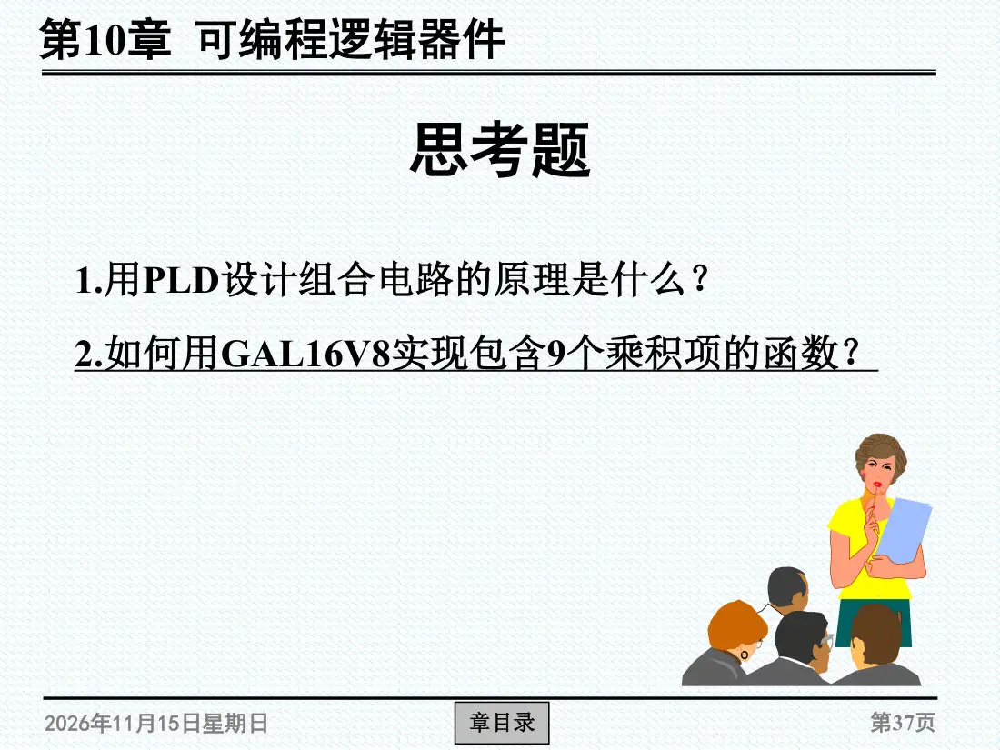

原文：

第10章 可编程逻辑器件

思考题

1.用PLD设计组合电路的原理是什么？

2.如何用GAL16V8实现包含9个乘积项的函数？

2026年11月15日星期日

章目录

第37页

### 第10章 可编程逻辑器件

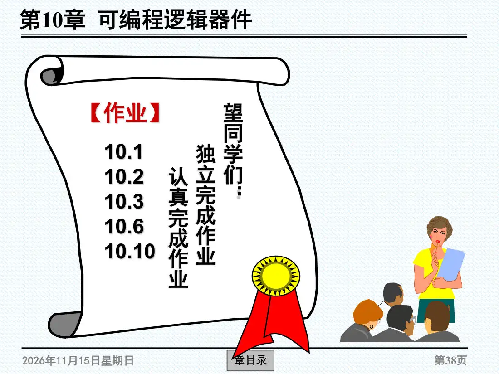

原文：

第10章 可编程逻辑器件

望
同
学
们
：

独
立
完
成
作
业

【作业】

认
真
完
成
作
业

10.1 10.2 10.3 10.6 10.10

2026年11月15日星期日

章目录

第38页

### 第 39 页

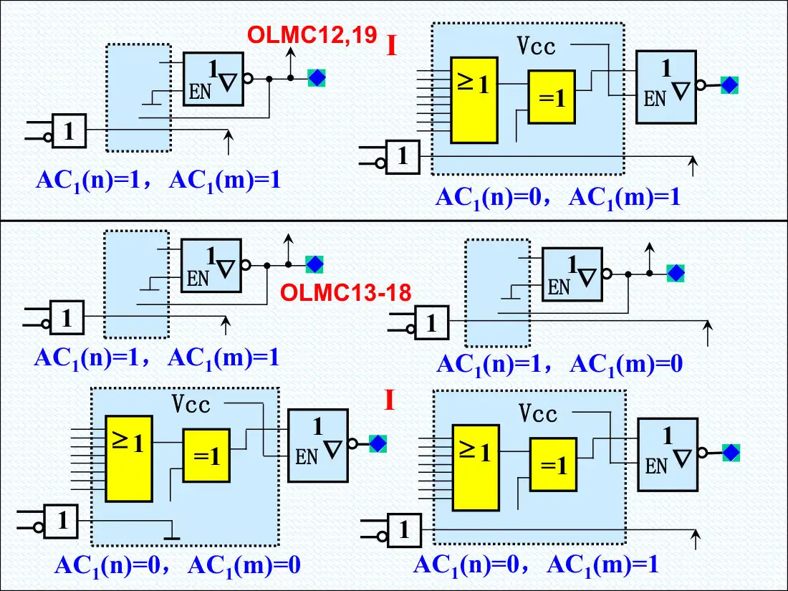

### 第10章 可编程逻辑器件

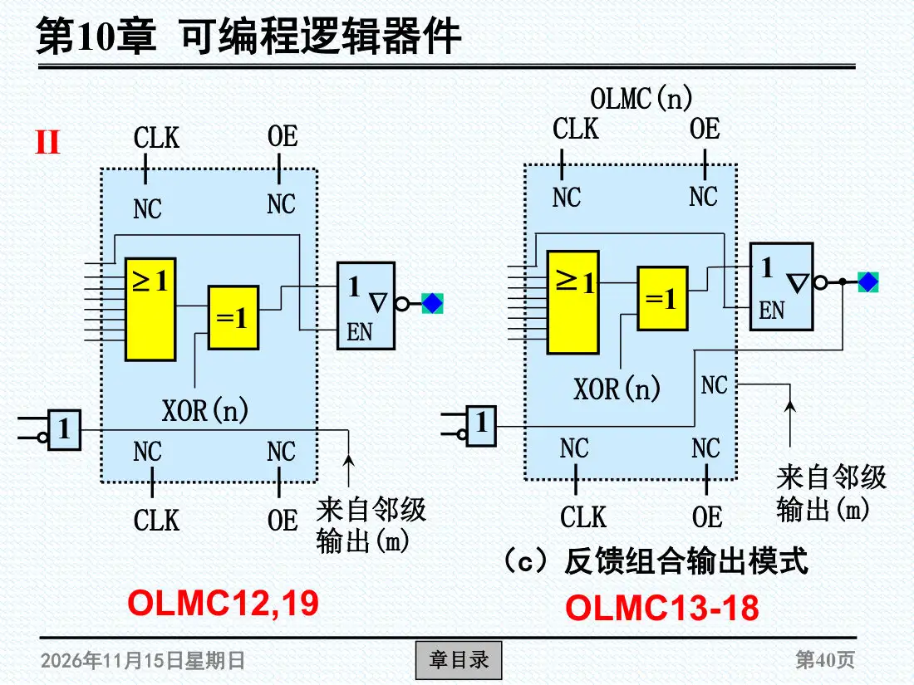

原文：

第10章 可编程逻辑器件

2026年11月15日星期日

章目录

第40页

### 更改器件类型

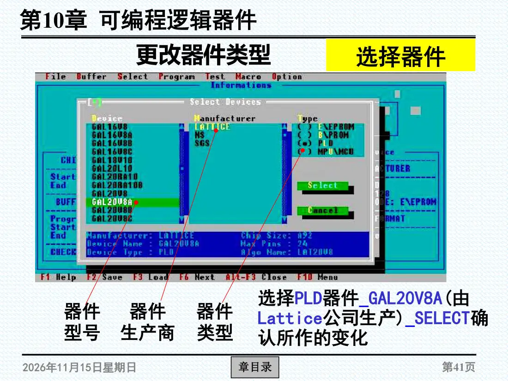

原文：

更改器件类型

第10章 可编程逻辑器件

选择器件

器件 器件 器件型号 生产商 类型选择PLD器件\_GAL20V8A(由Lattice公司生产)\_SELECT确认所作的变化

2026年11月15日星期日

章目录

第41页

### 第10章 可编程逻辑器件

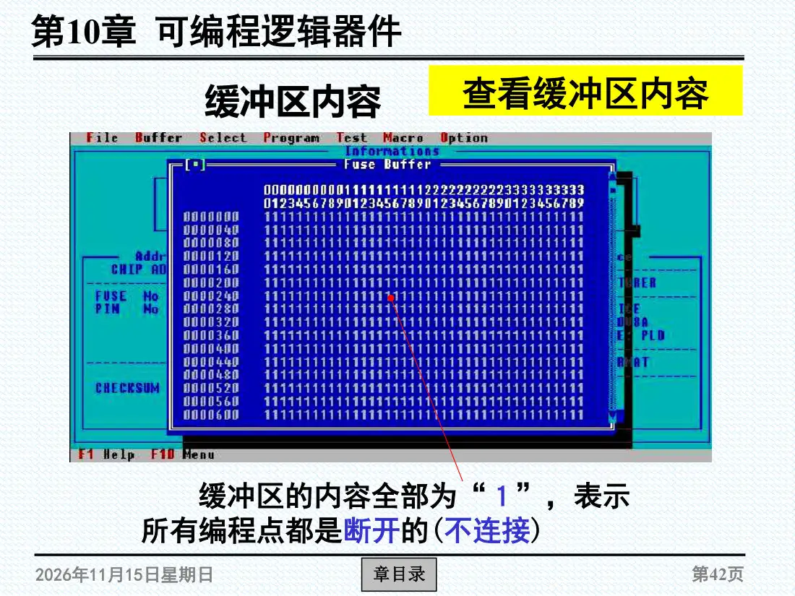

原文：

第10章 可编程逻辑器件

缓冲区内容

查看缓冲区内容

缓冲区的内容全部为 ，表示所有编程点都是断开的(不连接)

2026年11月15日星期日

章目录

第42页

### 第10章 可编程逻辑器件载入 JED文件

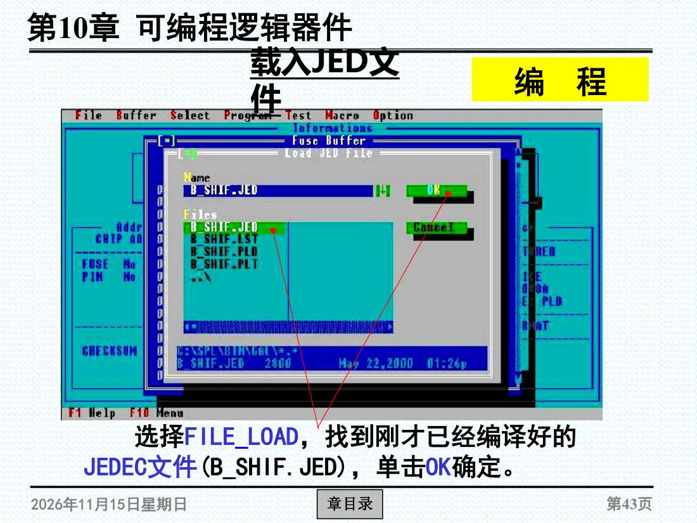

原文：

第10章 可编程逻辑器件载入 JED文件

载入JED文

编 程

选择FILE\_LOAD，找到刚才已经编译好的JEDEC文件(B\_SHIF.JED)，单击OK确定。

2026年11月15日星期日

章目录

第43页

### 第10章 可编程逻辑器件

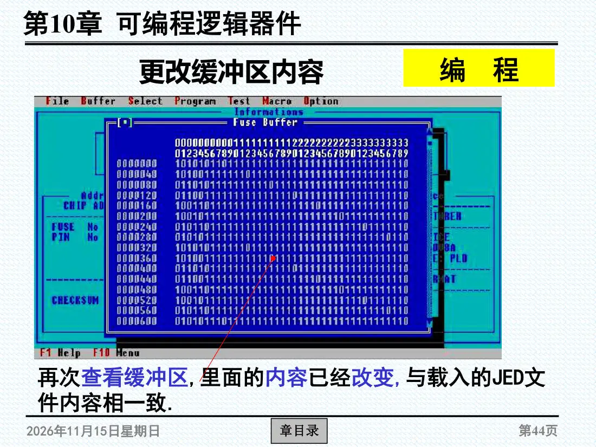

原文：

第10章 可编程逻辑器件

更改缓冲区内容

编 程

再次查看缓冲区,里面的内容已经改变,与载入的JED文件内容相一致.

2026年11月15日星期日

章目录

第44页

### 第10章 可编程逻辑器件

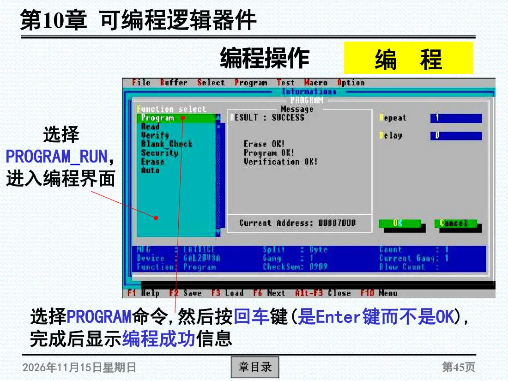

原文：

第10章 可编程逻辑器件

选择 PROGRAM\_RUN， 进入编程界面

选择PROGRAM命令,然后按回车键(是Enter键而不是OK)完成后显示编程成功信息

2026年11月15日星期日

章目录

第45页

### 第10章 可编程逻辑器件

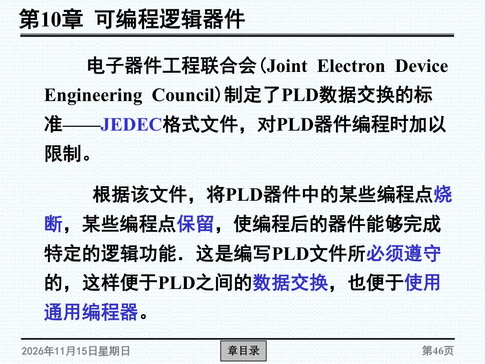

原文：

第10章 可编程逻辑器件

电子器件工程联合会(Joint Electron DeviceEngineering Council)制定了PLD数据交换的标准— —JEDEC格式文件，对PLD器件编程时加以限制。

根据该文件，将PLD器件中的某些编程点烧断，某些编程点保留，使编程后的器件能够完成特定的逻辑功能．这是编写PLD文件所必须遵守的，这样便于PLD之间的数据交换，也便于使用通用编程器。

2026年11月15日星期日

章目录

第46页

### 第10章 可编程逻辑器件

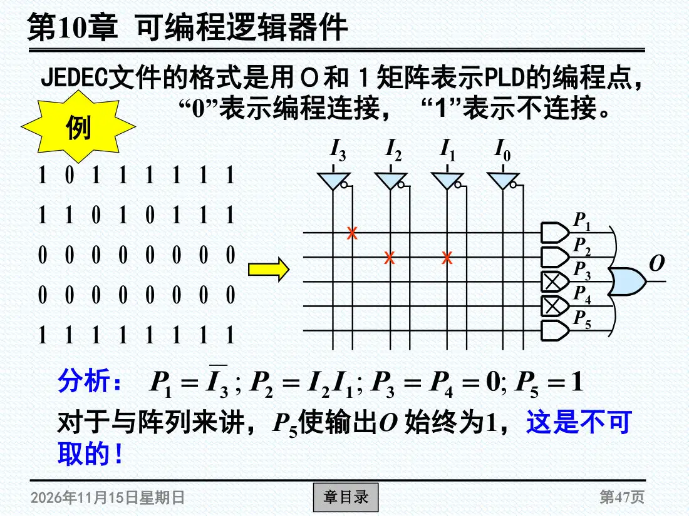

原文：

第10章 可编程逻辑器件

JEDEC文件的格式是用0和1矩阵表示PLD的编程点，“0”表示编程连接， “1”表示不连接。

例

$$
\begin{array}{c c c c c c c c} 1 & 0 & 1 & 1 & 1 & 1 & 1 & 1 \\ 1 & 1 & 0 & 1 & 0 & 1 & 1 & 1 \\ 0 & 0 & 0 & 0 & 0 & 0 & 0 & 0 \\ 0 & 0 & 0 & 0 & 0 & 0 & 0 & 0 \\ 1 & 1 & 1 & 1 & 1 & 1 & 1 & 1 \end{array}
$$

分析： $P _ { 1 } = \bar { I _ { 3 } } ; P _ { 2 } = I _ { 2 } I _ { 1 } ; P _ { 3 } = P _ { 4 } = 0 ; P _ { 5 } = 1$ 对于与阵列来讲， $P _ { 5 }$ 使输出O 始终为1，这是不可取的！

2026年11月15日星期日

章目录

第47页

### 第10章 可编程逻辑器件

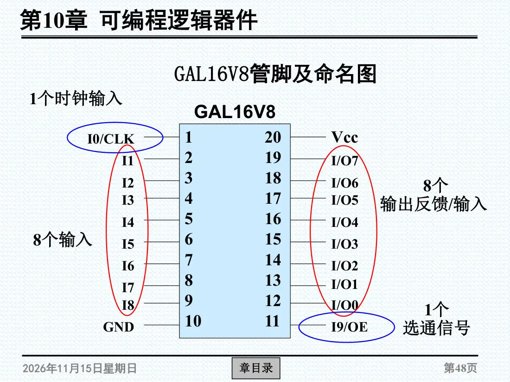

原文：

第10章 可编程逻辑器件

GAL16V8管脚及命名图 1个时钟输入
<table><tr><td colspan="3">GAL16V8</td></tr><tr><td rowspan="2">I0/CLK</td><td>1</td><td>20</td></tr><tr><td>2</td><td>19</td></tr><tr><td>I1</td><td>3</td><td>18</td></tr><tr><td>I2</td><td>4</td><td>17</td></tr><tr><td>I3</td><td>5</td><td>16</td></tr><tr><td>I4</td><td>6</td><td>15</td></tr><tr><td>I5</td><td>7</td><td>14</td></tr><tr><td>I6</td><td>8</td><td>13</td></tr><tr><td>I7</td><td>9</td><td>12</td></tr><tr><td>I8</td><td>10</td><td>11</td></tr></table>

2026年11月15日星期日

章目录

第48页

### 10 1个时钟输入缓冲器

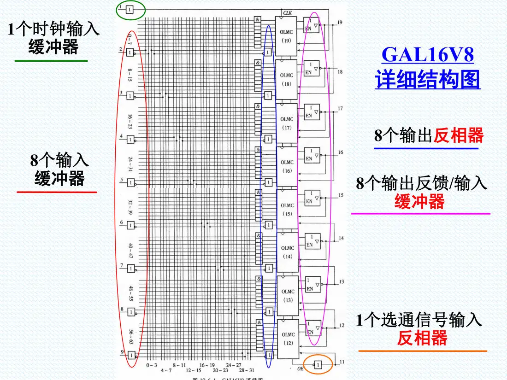

原文：

10 1个时钟输入缓冲器

8个输入缓冲器

GAL16V8详细结构图

8个输出反相器

8个输出反馈/输入缓冲器

1个选通信号输入反相器

### 第10章 可编程逻辑器件

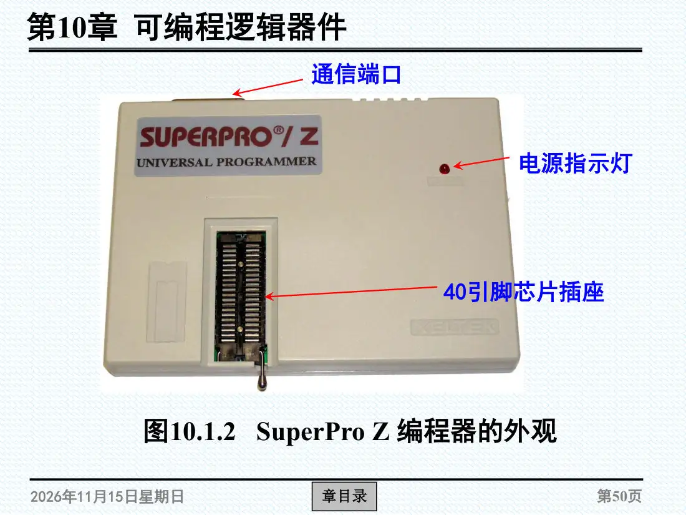

原文：

第10章 可编程逻辑器件

2026年11月15日星期日

章目录

第50页

### 第10章 可编程逻辑器件

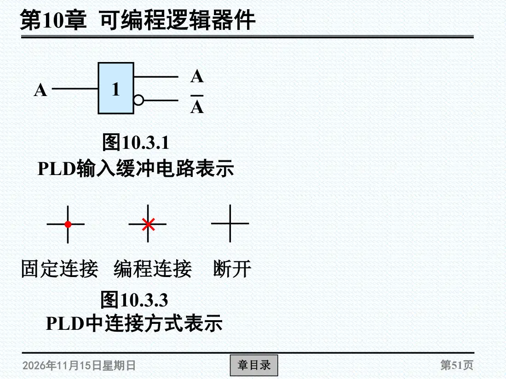

原文：

第10章 可编程逻辑器件

PLD输入缓冲电路表示

固定连接 编程连接 断开

图10.3.3

PLD中连接方式表示

2026年11月15日星期日

章目录

第51页

### 第10章 可编程逻辑器件

原文：

第10章 可编程逻辑器件

2026年11月15日星期日

章目录

第52页

### 第10章 可编程逻辑器件

原文：

第10章 可编程逻辑器件

2026年11月15日星期日

章目录

第53页

### 第10章 可编程逻辑器件

原文：

第10章 可编程逻辑器件

FMUX等效为个8选1多路选择器

注意：

12、19号OLMC中的FMUX：$\bar { \mathsf { A C } } _ { 0 }$ 为SYN, AC (m)为SYN。

2026年11月15日星期日

章目录

第54页

### 第10章 可编程逻辑器件

原文：

第10章 可编程逻辑器件

表10.6.1 FMUX的控制功能表
<table><tr><td> $AC_0^*$ </td><td> $AC_1(n)$ </td><td> $AC_1(m)^*$ </td><td>反馈信号来源</td></tr><tr><td>1</td><td>0</td><td>×</td><td>本单元触发器 $\overline{Q}$ 端</td></tr><tr><td>1</td><td>1</td><td>×</td><td>本单元I/0端</td></tr><tr><td>0</td><td>×</td><td>1</td><td>邻级(m)输出</td></tr><tr><td>0</td><td>0</td><td>0</td><td>低电平“0”(地)</td></tr><tr><td>0</td><td>1</td><td>0</td><td>邻级(m)输出#</td></tr></table>
\*在OLMC(12)和OLMC(19)中SYN代替 $\mathsf { A C } _ { 0 }$ SYN代替 $\mathrm { A C _ { 1 } ( m ) }$ 。 详情见参考文献

2026年11月15日星期日

章目录

第55页

### simple mode下OLMC(12 , 19) 2种工作模式之一

原文：

simple mode下OLMC(12 , 19) 2种工作模式之一

### 10 simple mode下OLMC(12, 19) 2种工作模式之二

原文：

10 simple mode下OLMC(12, 19) 2种工作模式之二

$\mathbf { A C _ { 1 } ( n ) { = } 0 }$ ，即 $\mathbf { A C } _ { 1 } ( 1 2 ) { = } \mathbf { A C } _ { 1 } ( 1 9 ) { = } \mathbf { 0 }$ 输出使能有效的组合输入、输出模式

### simple mode下OLMC(n=13\~18) 3种工作模式之一

原文：

simple mode下OLMC(n=13\~18) 3种工作模式之一

$$
\mathrm{AC} _ {1} (\mathrm{n}) = 1, \quad \mathrm{AC} _ {1} (\mathrm{m}) = 1
$$

$$
\underline {{\mathrm{AC} _ {1} (\mathrm{n})}} = 1, \quad \mathrm{AC} _ {1} (\mathrm{m}) = 0
$$

( Dedicated Input Configuration for Simple Mode )

### simple mode下OLMC(n=13\~18) 3种工作模式之二

原文：

simple mode下OLMC(n=13\~18) 3种工作模式之二

### simple mode下OLMC(n=13\~18) 3种工作模式之三

原文：

simple mode下OLMC(n=13\~18) 3种工作模式之三

$$
\mathrm{AC} _ {1} (\mathrm{n}) = 0, \quad \mathrm{AC} _ {1} (\mathrm{m}) = 1
$$

输出使能有效的组合输入、输出模式

### 10 complex mode下OLMC(12,19) 1种工作模式

原文：

10 complex mode下OLMC(12,19) 1种工作模式

对FUMUX：$\scriptstyle \mathbf { A } \mathbf { C } _ { 0 } = \mathbf { 0 } , \mathbf { A } \mathbf { C } _ { 1 } ( \mathbf { m } ) = 1 ;$ 对其它3个MUX：AC0=1$\mathbf { A C } _ { 1 } ( 1 2 ) { = } \mathbf { A C } _ { 1 } ( 1 9 ) { = } 1$

Pin 1、pin 11 只能作输入端，且占用OLMC19、 OLMC12的反馈通道

### 第 62 页

原文：

0章 可编程逻辑器件complex mode下OLMC(n=13\~18) 1种工作模式

### 第 63 页

原文：

10 registered mode下OLMC(n=12\~19) 2种工作模式之一

### 第 64 页

原文：

10 registered mode下OLMC(n=12\~19) 2种工作模式之二

### 第10章 可编程逻辑器件

原文：

第10章 可编程逻辑器件

PLD开发过程图解 1.设计流程界面

2026年11月15日星期日

章目录

第65页

### 第10章 可编程逻辑器件

原文：

第10章 可编程逻辑器件

PLD开发过程图解

2.仿真界面

### 第10章 可编程逻辑器件

原文：

第10章 可编程逻辑器件

PLD开发过程图解 3.下载

下载电缆

试验板

2026年11月15日星期日

章目录

第67页

### 第10章 可编程逻辑器件

原文：

第10章 可编程逻辑器件

PLD开发过程图解 4.独立运行

2026年11月15日星期日

第68页

### $$

原文：

$$
F = \overline {{X}} _ {1} \overline {{X}} _ {2} \overline {{X}} _ {4} + X _ {2} \overline {{X}} _ {3} X _ {4} + X _ {1} X _ {2} + X _ {3} \overline {{X}} _ {4}
$$

### 第 70 页

### 第10章 可编程逻辑器件

原文：

第10章 可编程逻辑器件

逻辑综合(Logic Synthesis )

选择合适的逻辑化简法，使逻辑简化并除去 冗余逻辑，保证尽可能有效地使用指定器件的逻辑资源， 逻辑综合选项可让设计者指定一种综合方式，特定的器件系列可采用特定的综合选项来充分利用其结构特点。

适配(Fitting)

运用试探规则，在一个或多个器件(即多器件划分(Multi-device Partitioning),一个设计太大，无法用单个器件来实现，可将一个设计分成同系列的多个器件，在使器件间通信的引脚数最少的同时，尽可能把一个设计用最小数量的器件来实现）中选择最好的实现方案。这种自动试配将设计者从繁琐的布局布线中解脱出来。

2026年11月15日星期日

章目录

第71页

### 第10章 可编程逻辑器件

原文：

第10章 可编程逻辑器件

逻辑特性(功能)仿真(Functional Simulation)

使用网表文件，对一个设计进行功能仿真。

延时特性仿真(Timing Simulation)

使用网表文件，对一个设计进行延时特性仿真 。

定时分析(Timing Analysis)

详细查看延时情况。能计算设计中点到点的延时，由此确定器件引脚所要求的上升和保持时间，估计最大时钟频率等。

网表文件(Net list File)

包含综合后的功能信息和定时信息。

编程文件

有编程器目标文件(.POF)、SRAM目标文件(.SOF)、JEDEC文件(.JED)、十六进制(Intel格式)文件(.HEX)、Tabular文本文件(.TTF)、串行位流文件(.SBF)等。

2026年11月15日星期日

章目录

第72页

### 第10章 可编程逻辑器件

原文：

第10章 可编程逻辑器件

两者的区别：

(2)逻辑单元间的互连

①CPLD：集总式,其特点是总线上任意一对输入端与输出端之间的延时相等,且是可预测的。

②FPGA：分布式,其特点是互连方式较多,有通用互连直接互连/长线等方式。实现同一个功能可能有不同的方案,其延时是不等的,而且一般情况下比CPLD大。

2026年11月15日星期日

章目录

第73页

### 第10章 可编程逻辑器件

原文：

第10章 可编程逻辑器件

(3)编程工艺

①CPLD：通常采用EPROM、E2PROM、Flash工艺。

②FPGA：通常采用SRAM、反熔丝(Actel 公司)工艺。

图10.4.2 连接点采用熔丝

图10.4.3 连接点采用SIMOS场效应管

图10.4.4 连接点采用Flotox场效应管

2026年11月15日星期日

章目录

第74页

### 第 75 页

原文：

章 可编程逻辑器件simple mode下 OLMC(12 \~ 15) 工作模式1/4

### 第 76 页

原文：

章 可编程逻辑器件simple mode下 OLMC(12 \~ 15) 工作模式2/4

### 第 77 页

原文：

章 可编程逻辑器件simple mode下 OLMC(12 \~ 15) 工作模式3/4

### 第 78 页

原文：

章 可编程逻辑器件simple mode下 OLMC(12 \~ 15) 工作模式4/4

### 第10章 可编程逻辑器件

原文：

第10章 可编程逻辑器件

参考文献

[1]武安河,张瑾.关于GAL中OLMC的结构探索[J]信息工程学院学报,1996,Vol.15(No.4):23-27

2026年11月15日星期日

章目录

第79页
