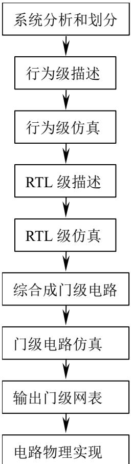
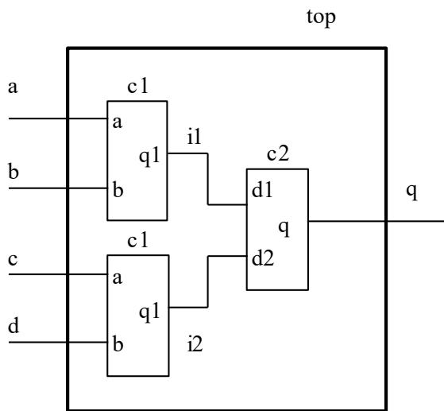
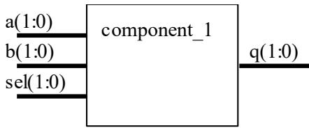

# 《数字电路与逻辑设计B》第11章习题答案

原件经识别和整理；“参考解答”是我们补的。

# 数字电路与逻辑设计B 第11章习题答案

## 一、简答题

### 选择 1（对应原题 11.1）

题干：什么是硬件描述语言？与其它 HDL 语言相比，用 VHDL 语言设计电子线路有什么优点？

可以描述硬件电路的功能，信号连接关系及定时关系的一种语言，称为硬件描述语言。和其它HDL 语言相比，VHDL语言的优点如下：

1．易于共享和交流。易于将VHDL代码在不同的工作平台（如工作站和PC 机）和开发工具之间交换。

2．设计结果与工艺无关。设计者可以专心致力于其功能，即需求规范的实现，而不需要对不影响功能的与工艺有关的因素花费过多的时间和精力。

3． 设计方法灵活、支持广泛。VHDL 语言可以支持自上而下（Top Down）和基于库（Library-Based）的设计方法，支持同步电路、异步电路、FPGA 以及其它随机电路的设计。

4．系统硬件描述能力强。VHDL语言具有多层次描述系统硬件功能的能力，可以从系统的数学模型直至门级电路。另外，高层次的行为描述可以与低层次的 RTL 描述和结构描述混合使用。

答案：见上文四点优点。

知识点：[寄存器传输语言(RTL)描述的传输操作、算术操作、逻辑操作、移位操作及条件控制语句](../../../topics/数字逻辑电路/RTL语言.md)

### 选择 2（对应原题 11.2）

题干：试简述用VHDL语言设计电子线路的一般流程。

所谓用VHDL 设计是指由设计者编写代码，然后用模拟器验证其功能，再把这些代码综合成一个与工艺无关的网络表，即翻译成由门和触发器等基本逻辑元件组成的原理图（门级电路），最后完成硬件设计。VHDL 的一般设计流程如下图 P11.2所示，分5步进行。



第 1步：系统分析和划分。

第 2步：行为级描述和仿真。

第 3步：RTL级描述和仿真。

第 4步：逻辑综合。

第 5步：电路物理实现。

答案：见上文五步流程。

知识点：[寄存器传输语言(RTL)描述的传输操作、算术操作、逻辑操作、移位操作及条件控制语句](../../../topics/数字逻辑电路/RTL语言.md)

### 选择 3（对应原题 11.3）

题干：VHDL 语言由几个设计单元组成？分别是什么？哪些部分是可以单独编译的源设计单元？

VHDL 语言由实体（entity）、结构体（architecture）、配置（configuration）、包集合（package）和库（library）5个部分组成。前 4种是可分别编译的源设计单元。

答案：由实体、结构体、配置、包集合和库5部分组成；前4种是可分别编译的源设计单元。

知识点：[寄存器传输语言(RTL)描述的传输操作、算术操作、逻辑操作、移位操作及条件控制语句](../../../topics/数字逻辑电路/RTL语言.md)

### 选择 4（对应原题 11.4）

题干：对下面的功能写一个实体(component_a)和一个结构体(rtl)

$$
\mathrm {d\_out} \quad <   = \quad (\mathrm {a\_in} \quad \text { and } \quad \mathrm {b\_in}) \quad \text { and } \quad \mathrm {c\_in};
$$

类型指定为 std_logic。

```vhdl
component_a.vhd

entity component_a is
    port (
        a_in, b_in, c_in : in std_logic;
        d_out            : out std_logic
    );
end entity component_a;

architecture rtl of component_a is
begin
    d_out <= (a_in and b_in) and c_in;
end architecture rtl;
```

答案：见上述代码。

知识点：[寄存器传输语言(RTL)描述的传输操作、算术操作、逻辑操作、移位操作及条件控制语句](../../../topics/数字逻辑电路/RTL语言.md)

### 选择 5（对应原题 11.5）

题干：一个程序包由哪两部分组成？包体通常包含哪些内容？

一个程序包由下面两部分组成：包头部分和包体部分。

包体(body)由包头中指定的函数和过程的程序体组成，描述包头中所说明的子程序（即函数和过程）的行为，包体可以与元件的一个architecture 类比。

答案：由包头和包体组成；包体包含包头中指定的函数和过程的程序体。

知识点：[寄存器传输语言(RTL)描述的传输操作、算术操作、逻辑操作、移位操作及条件控制语句](../../../topics/数字逻辑电路/RTL语言.md)

### 选择 6（对应原题 11.6）

题干：数据类型bit在哪个库中定义？哪个（哪些）库和程序包总是可见的？

数据类型bit在标准库 std中定义。VHDL标准中规定工作库work、标准库 std及 std库中的standard程序包总是可见的。

答案：bit在std库定义；work库、std库及std库中的standard程序包总是可见。

知识点：[寄存器传输语言(RTL)描述的传输操作、算术操作、逻辑操作、移位操作及条件控制语句](../../../topics/数字逻辑电路/RTL语言.md)

### 选择 7（对应原题 11.7）

题干：VHDL 语言中，3类数据对象——常数、变量、信号的实际物理含义是什么？

常数是一个恒定不变的值，在数字电路设计中常用来表示电源和地等。

变量是一个局部量，用来暂时保存信息，与硬件之间没有对应关系。

信号是电子电路内部硬件连接的抽象，是一个全局量，它对应地代表物理设计中的某一条硬件连接线。

答案：
常数：恒定不变的值，表示电源、地等。
变量：局部量，暂存信息，无硬件对应关系。
信号：全局量，硬件连接线的抽象。

知识点：[数字系统的基本模型（数据处理器与控制器）及对最小时钟周期、异步信号同步化的约定](../../../topics/数字逻辑电路/数字系统模型.md)、[寄存器传输语言(RTL)描述的传输操作、算术操作、逻辑操作、移位操作及条件控制语句](../../../topics/数字逻辑电路/RTL语言.md)

### 选择 8（对应原题 11.8）

题干：变量和信号在描述和使用时有哪些主要区别？

变量只能在进程（process）和子程序（包括函数（function）和过程（procedure）两种）中说明和使用；是一个局部量，不能将信息带出对它做出定义的当前设计单元；用来暂时保存信息，与硬件之间没有对应关系；对变量的赋值是立即生效的，不存在任何的延时行为；赋值符号为“:=”。

信号只能在VHDL 的并行部分说明，在顺序部分和并行部分都可以使用；是一个全局量，用来进行进程之间的通信；是电子电路内部硬件连接的抽象，它对应地代表物理设计中的某一条硬件连接线；对信号的赋值不是立即进行的，即需要经过一段延时，信号才能得到新值，明显地体现了硬件系统的特征；赋值符号为“<=”。

答案：
变量：局部量，进程/子程序内使用，立即赋值(:=)，无硬件对应。
信号：全局量，并行/顺序部分使用，延时赋值(<=)，对应硬件连线。

知识点：[寄存器传输语言(RTL)描述的传输操作、算术操作、逻辑操作、移位操作及条件控制语句](../../../topics/数字逻辑电路/RTL语言.md)

### 选择 9（对应原题 11.9）

题干：bit 和 std_logic 两种数据类型有什么区别？

数据类型 bit 只有两种取值‘0’和 ‘1’；

数据类型 std_logic 有 9 种取值，分别是‘U’,‘X’,‘0’,‘1’,‘Z’,‘W’,‘L’,‘H’,‘-’；

答案：bit仅含'0','1'；std_logic含9种状态(U,X,0,1,Z,W,L,H,-)。

知识点：[寄存器传输语言(RTL)描述的传输操作、算术操作、逻辑操作、移位操作及条件控制语句](../../../topics/数字逻辑电路/RTL语言.md)

### 选择 10（对应原题 11.10）

题干：VHDL 语言中，以下 3个表达式是否等效？为什么？

这 3 个表达式不等效，因为逻辑运算符 not、and、or 具有运算优先顺序，从左到右，优先权依次降低。以上 3个表达式用逻辑表达式表，分别如下：

$$
a = \bar {b} (c + d)
$$

$$
a = \overline {{b}} c + d
$$

$$
a = \overline {{b c}} + d
$$

答案：不等效。原因：逻辑运算符优先级不同，not > and > or。

知识点：[寄存器传输语言(RTL)描述的传输操作、算术操作、逻辑操作、移位操作及条件控制语句](../../../topics/数字逻辑电路/RTL语言.md)

### 选择 11（对应原题 11.11）

题干：进程（process）的启动条件是什么？

为启动进程，在进程结构中必须包含一个显式的敏感信号表或包含一个 wait 语句，即只有敏感信号表中或 wait语句后的敏感信号发生变化，进程才被启动。

答案：包含敏感信号表或wait语句，当敏感信号变化时启动。

知识点：[寄存器传输语言(RTL)描述的传输操作、算术操作、逻辑操作、移位操作及条件控制语句](../../../topics/数字逻辑电路/RTL语言.md)

### 选择 12（对应原题 11.12）

题干：什么是层次化设计？

在一个大型设计中，通常一个实体（称顶层实体）中包含若干个元件（实体），并将其相互连接起来。元件可以嵌套，即低层元件又可以包含更低一层的元件。这种设计方法称为层次化设计。利用层次化描述方法可以将已有的设计成果方便地用到新的设计中，大大提高设计效率。

答案：顶层实体包含并连接多个元件，元件可嵌套，便于复用和提高效率。

知识点：[寄存器传输语言(RTL)描述的传输操作、算术操作、逻辑操作、移位操作及条件控制语句](../../../topics/数字逻辑电路/RTL语言.md)

### 选择 13（对应原题 11.13）

题干：用 VHDL 描述图 p11.13 所示的方框图，即在元件 top 中例化元件 c1（2 次）和元件c2。



根据题目描述及常见结构推断，假设图p11.13为一个组合逻辑结构，top实体包含两个c1实例和一个c2实例。由于原图缺失具体连线细节，以下提供基于题目文字描述的框架代码示例：

```vhdl
entity top is
    port (
        a, b, c, d : in std_logic;
        q          : out std_logic
    );
end entity top;

architecture hierarchy_top of top is
    -- 假设 c1 和 c2 的端口声明已在包中定义或此处补充
    component c1
        port (
            ... : in std_logic;
            ... : out std_logic
        );
    end component c1;

    component c2
        port (
            ... : in std_logic;
            ... : out std_logic
        );
    end component c2;

    signal sig1, sig2, sig3 : std_logic;

begin
    -- 例化第一个 c1
    u_c1_1 : c1 port map (...);
    
    -- 例化第二个 c1
    u_c1_2 : c1 port map (...);
    
    -- 例化 c2
    u_c2   : c2 port map (...);

end architecture hierarchy_top;
```
*(注：由于原题图片缺失具体内部连线，无法给出精确完整的端口映射代码，此处展示例化结构。)*

答案：见上述例化结构代码。

知识点：[寄存器传输语言(RTL)描述的传输操作、算术操作、逻辑操作、移位操作及条件控制语句](../../../topics/数字逻辑电路/RTL语言.md)

### 选择 14（对应原题 11.14）

题干：题目原文缺失，但根据上下文推测可能涉及进程结束或架构结束相关的语法检查。

*(注：原文中第11.14题的具体题干未清晰显示，仅在末尾出现 `end process;` 和 `end rtl;`，这可能是上一题或本题的代码片段结尾。若此为独立题目，通常考察进程或架构的结束关键字。)*

答案：进程结束用 `end process;`，架构结束用 `end architecture <名>;`。

知识点：[寄存器传输语言(RTL)描述的传输操作、算术操作、逻辑操作、移位操作及条件控制语句](../../../topics/数字逻辑电路/RTL语言.md)

### 选择 15（对应原题 11.15）

题干：设计一个元件，其输入和输出如图p11.15所示，该元件具有下面的行为：



<table><tr><td>sel</td><td>q</td></tr><tr><td>00</td><td>a nand b</td></tr><tr><td>01</td><td>a or b</td></tr><tr><td>10</td><td>a nor b</td></tr><tr><td>11</td><td>a and b</td></tr><tr><td>others</td><td>“XX”</td></tr></table>

```vhdl
entity mux_logic is
    port (
        a, b   : in std_logic;
        sel    : in std_logic_vector(1 downto 0);
        q      : out std_logic
    );
end entity mux_logic;

architecture rtl of mux_logic is
begin
    process(a, b, sel)
    begin
        case sel is
            when "00" => q <= a nand b;
            when "01" => q <= a or b;
            when "10" => q <= a nor b;
            when "11" => q <= a and b;
            when others => q <= 'X'; -- 或者根据具体需求处理，原文为"XX"通常指不定态或特定错误码，VHDL中常用'X'表示不确定
        end case;
    end process;
end architecture rtl;
```

答案：见上述代码。

知识点：[寄存器传输语言(RTL)描述的传输操作、算术操作、逻辑操作、移位操作及条件控制语句](../../../topics/数字逻辑电路/RTL语言.md)、[数字系统的基本模型（数据处理器与控制器）及对最小时钟周期、异步信号同步化的约定](../../../topics/数字逻辑电路/数字系统模型.md)
