# 《数字电路与逻辑设计B》第12章 数字系统设计基础（A）（课件）

原件的每一页，下面附识别出的文字。

### 第12章 数字系统设计基础

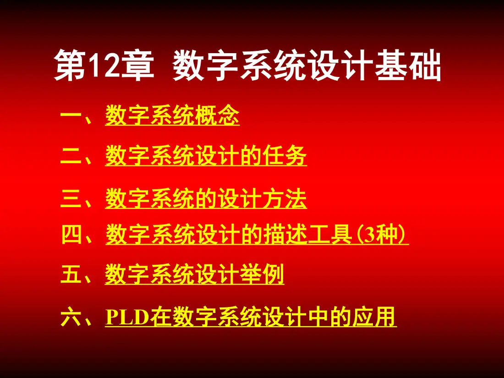

原文：

第12章 数字系统设计基础

一、数字系统概念

二、数字系统设计的任务

三、数字系统的设计方法

四、数字系统设计的描述工具(3种)

五、数字系统设计举例

六、PLD在数字系统设计中的应用

### 本章知识点及要求（8学时）

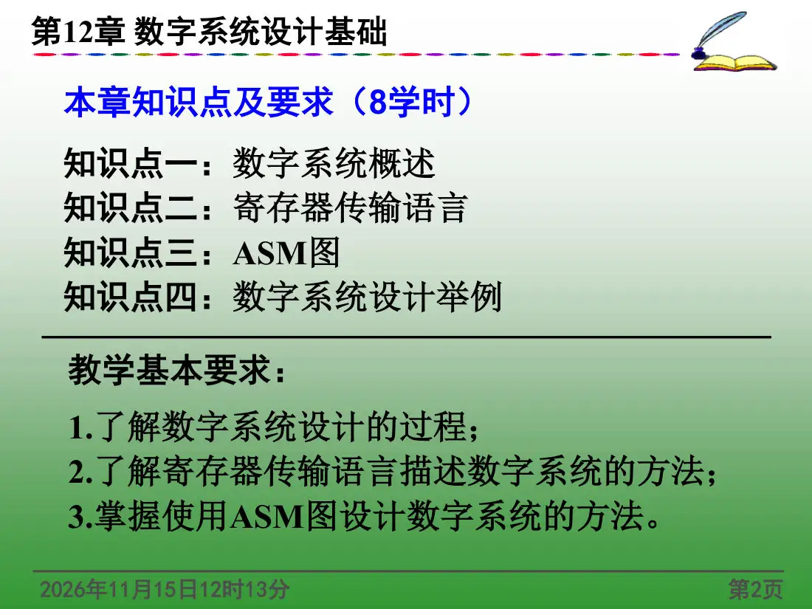

原文：

本章知识点及要求（8学时）

知识点一：数字系统概述

知识点二：寄存器传输语言

知识点三：ASM图

知识点四：数字系统设计举例

教学基本要求：

1.了解数字系统设计的过程；

2.了解寄存器传输语言描述数字系统的方法；

3.掌握使用ASM图设计数字系统的方法。

第12章 数字系统设计基础

く

2026年11月15日12时13分

第2页

### 12.1 概 述

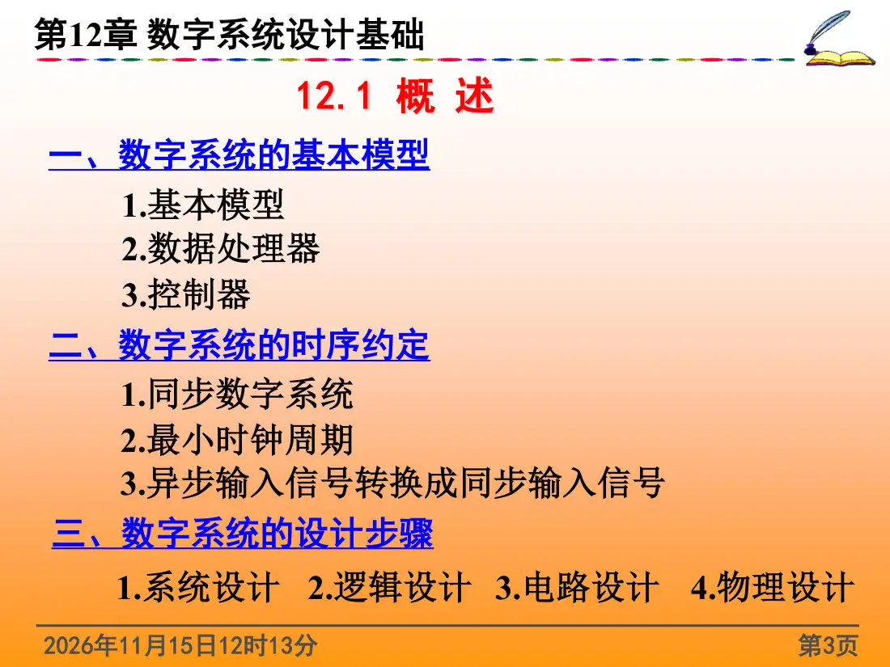

原文：

12.1 概 述

一、数字系统的基本模型

1.基本模型

2.数据处理器

3.控制器

二、数字系统的时序约定

1.同步数字系统

2.最小时钟周期

3.异步输入信号转换成同步输入信号

三、数字系统的设计步骤

2.逻辑设计 3.电路设计1.系统设计 4.物理设计

第12章 数字系统设计基础

2026年11月15日12时13分

第3页

### 12.2 寄存器传输语句RTL

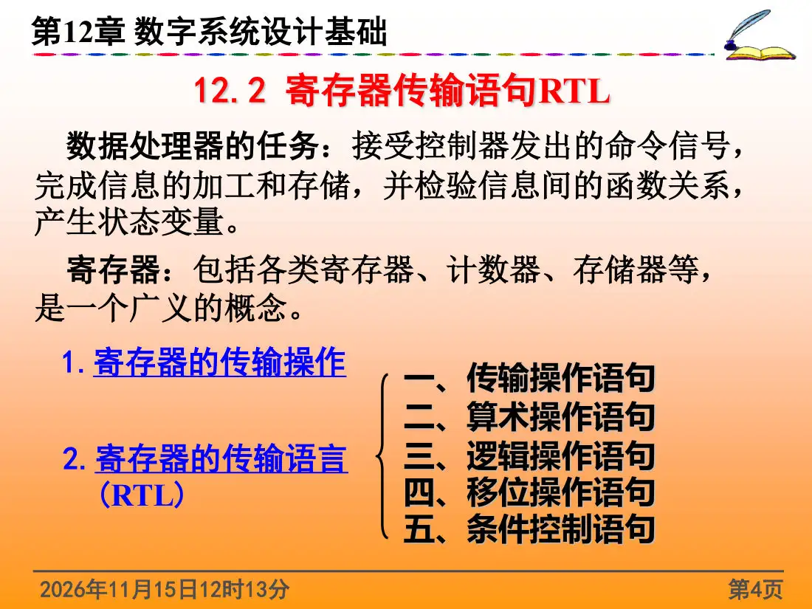

原文：

12.2 寄存器传输语句RTL

数据处理器的任务：接受控制器发出的命令信号，完成信息的加工和存储，并检验信息间的函数关系，产生状态变量。

寄存器：包括各类寄存器、计数器、存储器等，是一个广义的概念。

1.寄存器的传输操作

2.寄存器的传输语言(RTL)

一、传输操作语句

二、算术操作语句

三、逻辑操作语句

四、移位操作语句

五、条件控制语句

第12章 数字系统设计基础

く

2026年11月15日12时13分

第4页

### 12.3 数字系统的描述工具

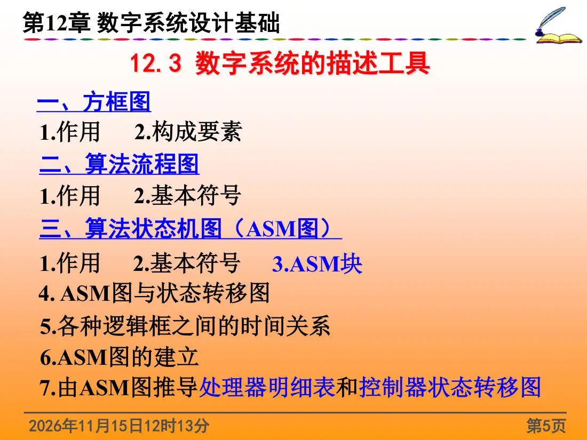

原文：

12.3 数字系统的描述工具

一、方框图

1.作用 2.构成要素

二、算法流程图

1.作用 2.基本符号

三、算法状态机图（ASM图）

1.作用 2.基本符号 3.ASM块

4. ASM图与状态转移图

5.各种逻辑框之间的时间关系

6.ASM图的建立

7.由ASM图推导处理器明细表和控制器状态转移图

第12章 数字系统设计基础

2026年11月15日12时13分

第5页

### 12.4 数字系统的设计举例

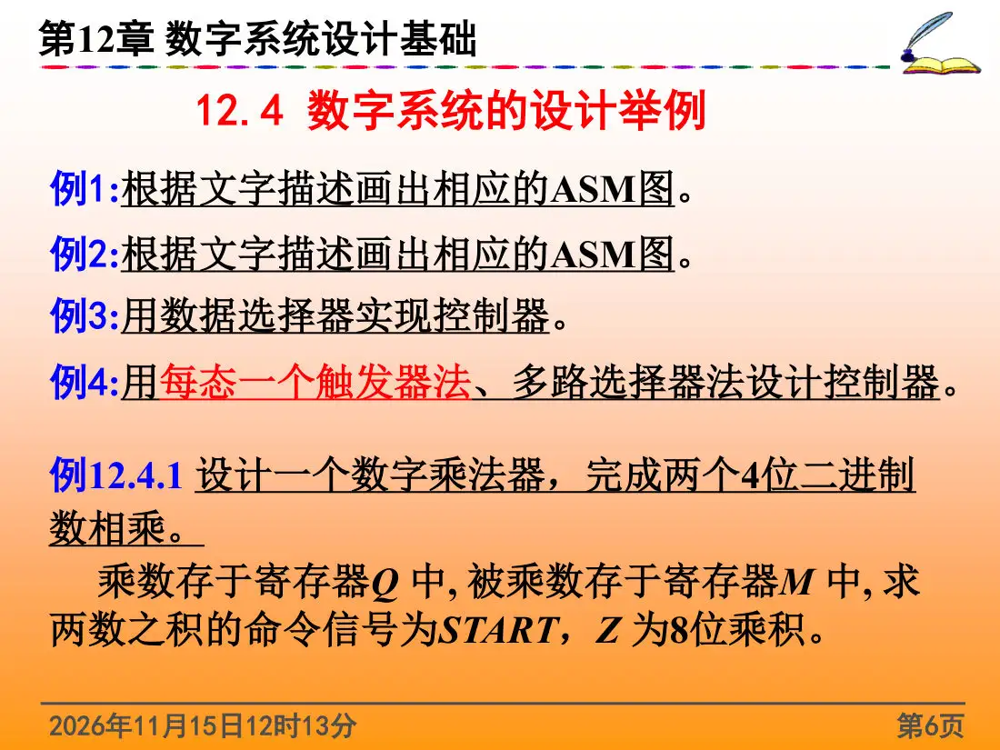

原文：

12.4 数字系统的设计举例

例1:根据文字描述画出相应的ASM图。

例2:根据文字描述画出相应的ASM图。

例3:用数据选择器实现控制器。

例4:用每态一个触发器法、多路选择器法设计控制器。

例12.4.1 设计一个数字乘法器，完成两个4位二进制数相乘。

乘数存于寄存器Q 中, 被乘数存于寄存器M 中, 求两数之积的命令信号为START，Z 为8位乘积。

第12章 数字系统设计基础

2026年11月15日12时13分

第6页

### 12.5 PLD在数字系统设计中的应用

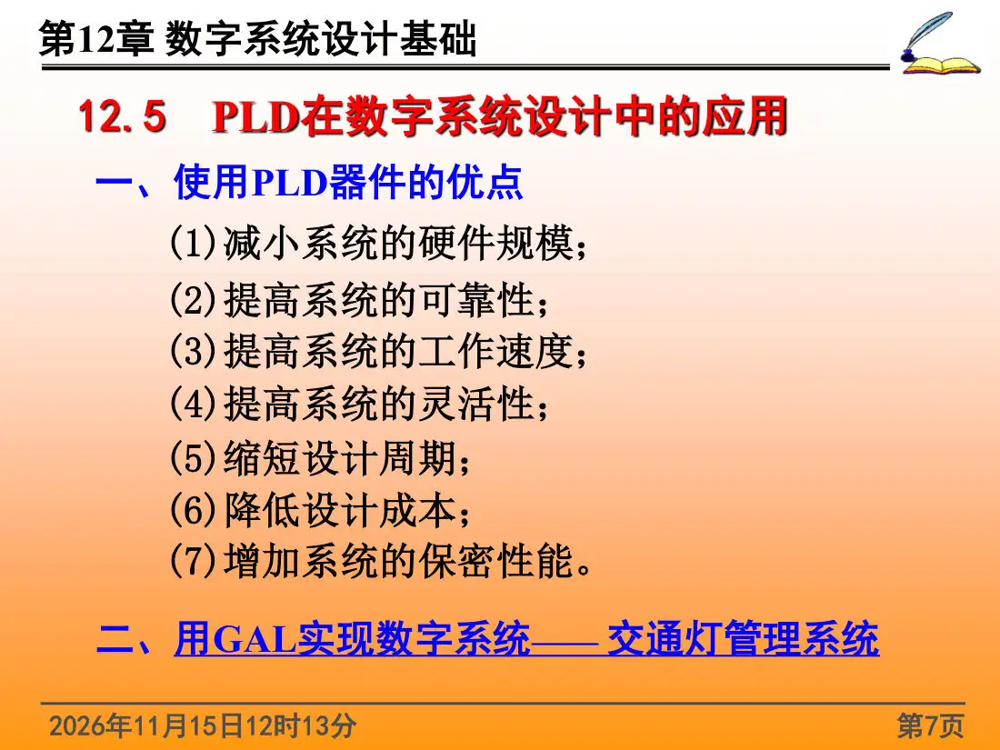

原文：

12.5 PLD在数字系统设计中的应用

一、使用PLD器件的优点

(1)减小系统的硬件规模；

(2)提高系统的可靠性；

(3)提高系统的工作速度；

(4)提高系统的灵活性；

(5)缩短设计周期；

(6)降低设计成本；

(7)增加系统的保密性能。

二、用GAL实现数字系统——交通灯管理系统

第12章 数字系统设计基础

2026年11月15日12时13分

第7页

### 12.6 VHDL实现数字系统举例

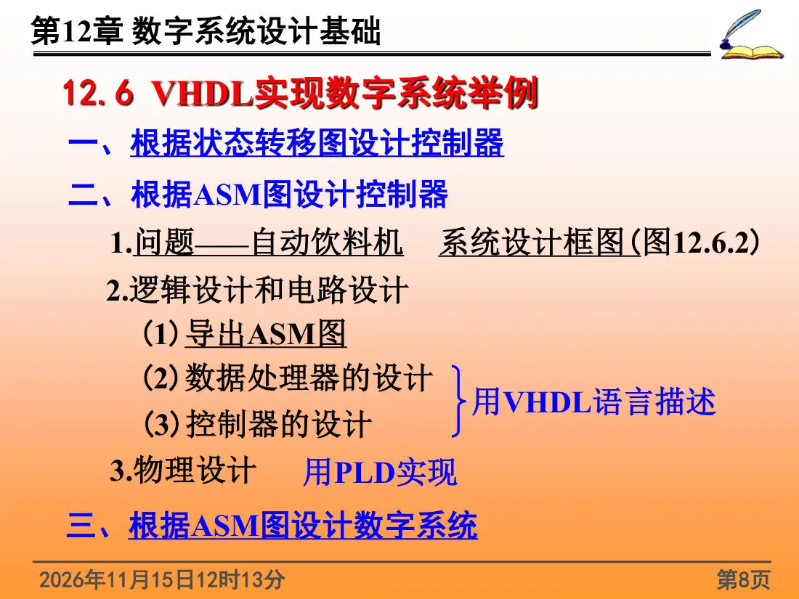

原文：

12.6 VHDL实现数字系统举例
一、根据状态转移图设计控制器
二、根据ASM图设计控制器
1. 问题——自动饮料机 系统设计框图(图12.6.2)
2. 逻辑设计和电路设计
(1) 导出ASM图
(2) 数据处理器的设计
(3) 控制器的设计
}用VHDL语言描述
3. 物理设计 用PLD实现
三、根据ASM图设计数字系统

第12章 数字系统设计基础

2026年11月15日12时13分

第8页

### 【作业】

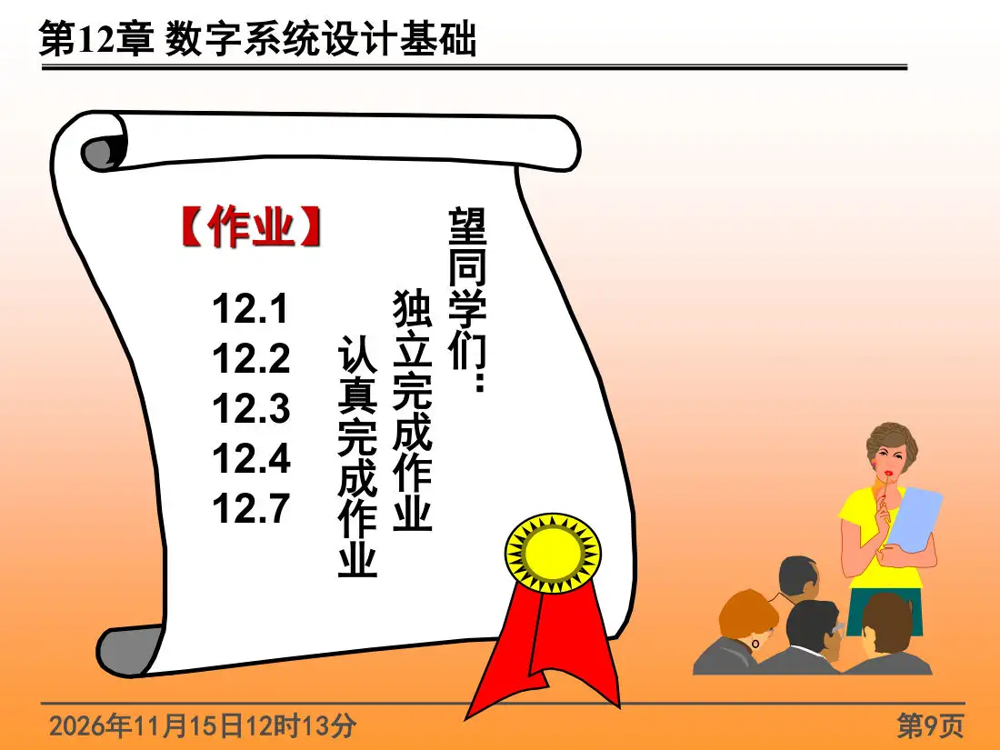

原文：

【作业】

望同学们：

独立完成作业

认真完成作业

第12章 数字系统设计基础

2026年11月15日12时13分

第9页

### 第12章 数字系统设计基础

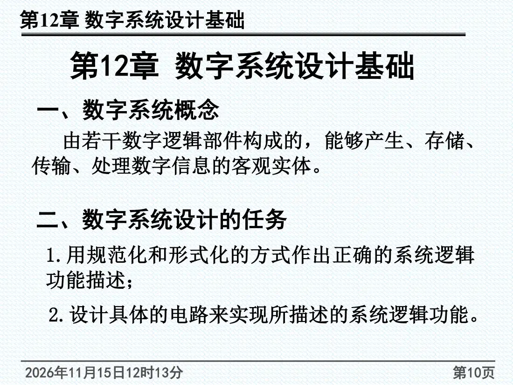

原文：

第12章 数字系统设计基础

数字系统概念

由若干数字逻辑部件构成的，能够产生、存储、传输、处理数字信息的客观实体。

二、数字系统设计的任务

1.用规范化和形式化的方式作出正确的系统逻辑功能描述；

2.设计具体的电路来实现所描述的系统逻辑功能。

第12章数字系统设计基础

2026年11月15日12时13分

第10页

### 三、数字系统的设计方法

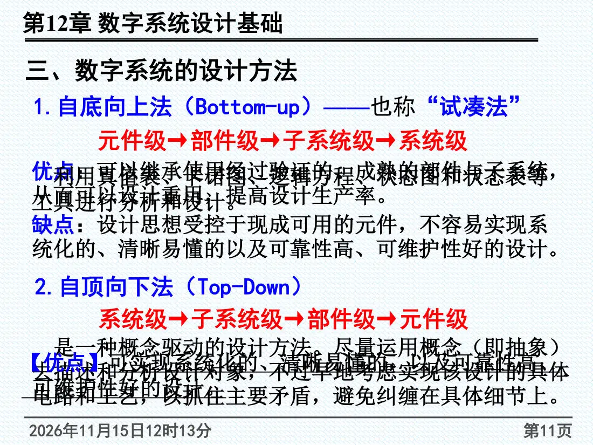

原文：

三、数字系统的设计方法

1.自底向上法（Bottom-up）——也称“试凑法”

元件级→部件级→子系统级→系统级

优点：可以继承使用经过验证的、成熟的部件与子系统，利用真值表、卡诺图、逻辑方程、状态图和状态表等从而可以设计重用，提高设计生产率。工具进行分析和设计。

缺点：设计思想受控于现成可用的元件，不容易实现系统化的、清晰易懂的以及可靠性高、可维护性好的设计。

2.自顶向下法（Top-Down）

系统级→子系统级→部件级→元件级

是一种概念驱动的设计方法。尽量运用概念（即抽象）去描述和分析设计对象，不过早地考虑实现该设计的具体【优点】可实现系统化的、清晰易懂的，以及可靠性高、电路和工艺，以抓住主要矛盾，避免纠缠在具体细节上。可维护性好的设计。

第12章数字系统设计基础

2026年11月15日12时13分

第11页

### 三、数字系统的设计方法

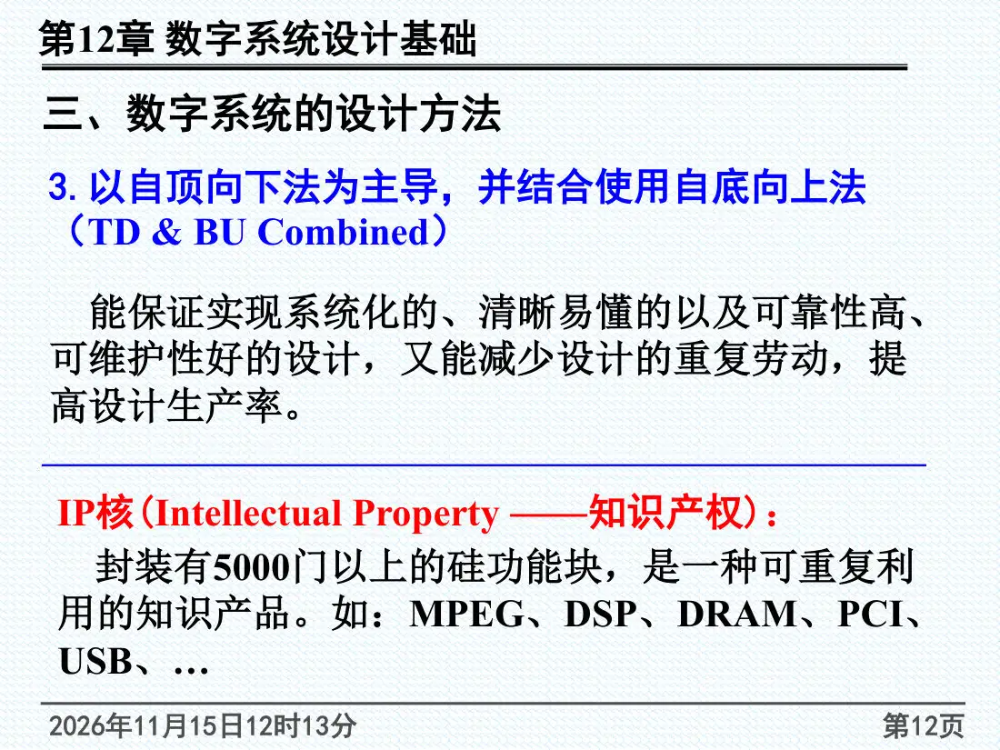

原文：

三、数字系统的设计方法

3.以自顶向下法为主导，并结合使用自底向上法（TD & BU Combined）

能保证实现系统化的、清晰易懂的以及可靠性高、可维护性好的设计，又能减少设计的重复劳动，提高设计生产率。

IP核(Intellectual Property 知识产权)：

封装有5000门以上的硅功能块，是一种可重复利用的知识产品。如：MPEG、DSP、DRAM、PCI、USB、

第12章数字系统设计基础

2026年11月15日12时13分

第12页

### 第12章数字系统设计基础 ——12.1 概述

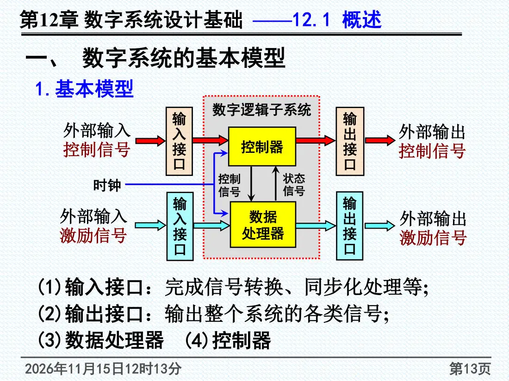

原文：

第12章数字系统设计基础 ——12.1 概述

一、 数字系统的基本模型

1.基本模型

(1)输入接口：完成信号转换、同步化处理等;

(2)输出接口：输出整个系统的各类信号;

(3)数据处理器 (4)控制器

2026年11月15日12时13分

第13页

### 2.数据处理器 ——按不同的次序执行相应的操作。

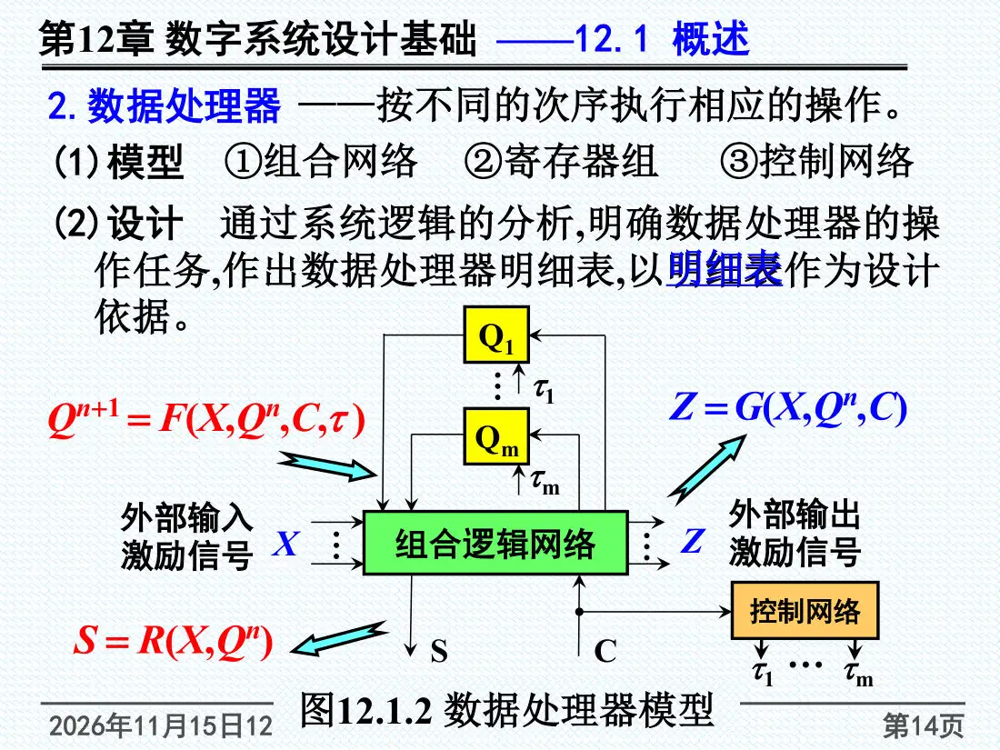

原文：

2.数据处理器 ——按不同的次序执行相应的操作。

(1)模型 ①组合网络 ②寄存器组 ③控制网络

(2)设计 通过系统逻辑的分析,明确数据处理器的操明细表作任务,作出数据处理器明细表,以明细表作为设计明细表

依据。

第12章 数字系统设计基础 ——12.1 概述

第14页

### 3.控制器 生成和发送控制信号序列， 以便控制数据处理器完成特定的操作。

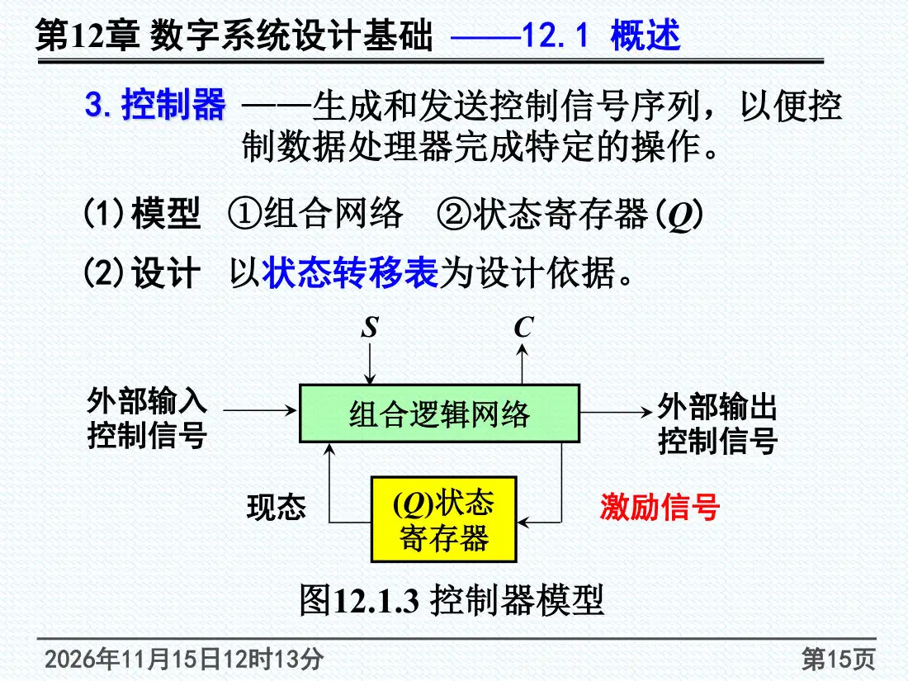

原文：

3.控制器 生成和发送控制信号序列， 以便控制数据处理器完成特定的操作。

(1)模型 ①组合网络 ②状态寄存器(Q)

(2)设计 以状态转移表为设计依据。

第12章 数字系统设计基础 ——12.1 概述

2026年11月15日12时13分

第15页

### 二、数字系统的时序约定

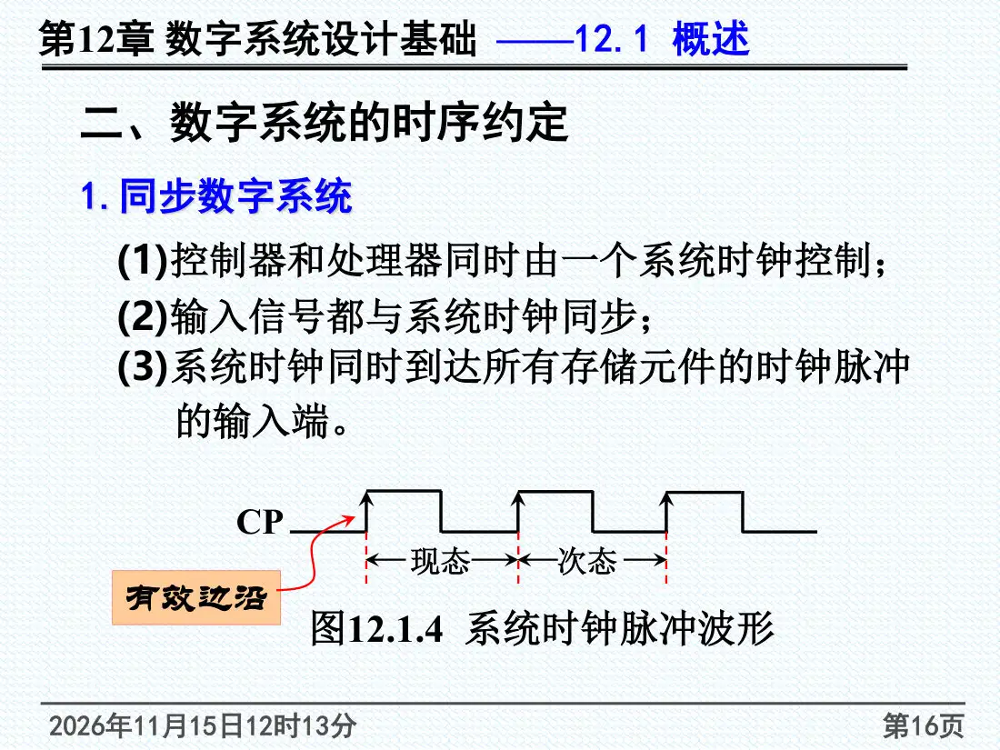

原文：

二、数字系统的时序约定

1.同步数字系统

(1)控制器和处理器同时由一个系统时钟控制；

(2)输入信号都与系统时钟同步；

(3)系统时钟同时到达所有存储元件的时钟脉冲的输入端。

第12章数字系统设计基础 ——12.1 概述

2026年11月15日12时13分

第16页

### 第12章 数字系统设计基础 ——12.1 概述

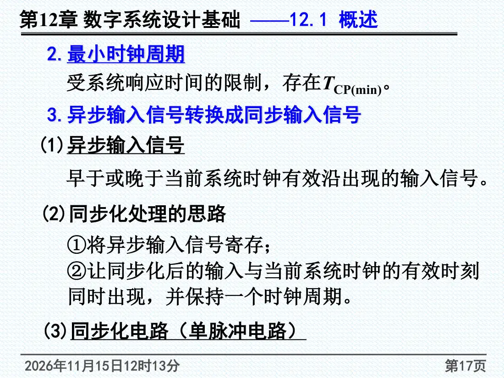

原文：

第12章 数字系统设计基础 ——12.1 概述

2.最小时钟周期

受系统响应时间的限制，存在 $T _ { \mathrm { C P ( m i n ) } ^ { \circ } }$

3.异步输入信号转换成同步输入信号

(1)异步输入信号

早于或晚于当前系统时钟有效沿出现的输入信号。

(2)同步化处理的思路

①将异步输入信号寄存；

②让同步化后的输入与当前系统时钟的有效时刻同时出现，并保持一个时钟周期。

(3)同步化电路（单脉冲电路）

2026年11月15日12时13分

第17页

### 第12章数字系统设计基础 ——12.1 概述

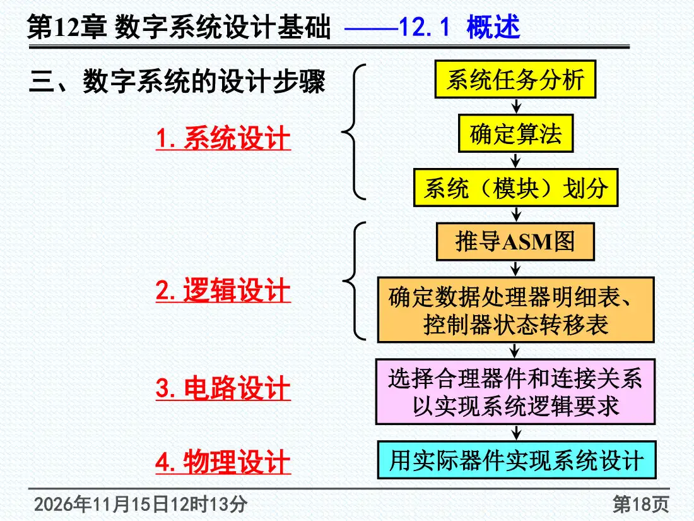

原文：

第12章数字系统设计基础 ——12.1 概述

三、数字系统的设计步骤

1.系统设计

2.逻辑设计

3.电路设计

4.物理设计

2026年11月15日12时13分

第18页

### 第12章数字系统设计基础

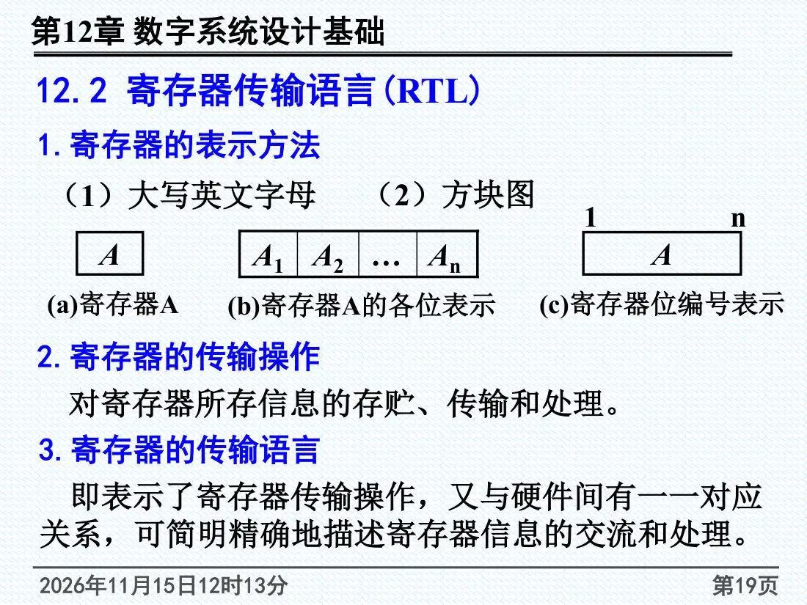

原文：

第12章数字系统设计基础

12.2 寄存器传输语言(RTL)

1.寄存器的表示方法

（1）大写英文字母 （2）方块图

(a)寄存器A

(b)寄存器A的各位表示

2.寄存器的传输操作

对寄存器所存信息的存贮、传输和处理。

3.寄存器的传输语言

即表示了寄存器传输操作，又与硬件间有一一对应关系，可简明精确地描述寄存器信息的交流和处理。

2026年11月15日12时13分

第19页

### 传输操作语句

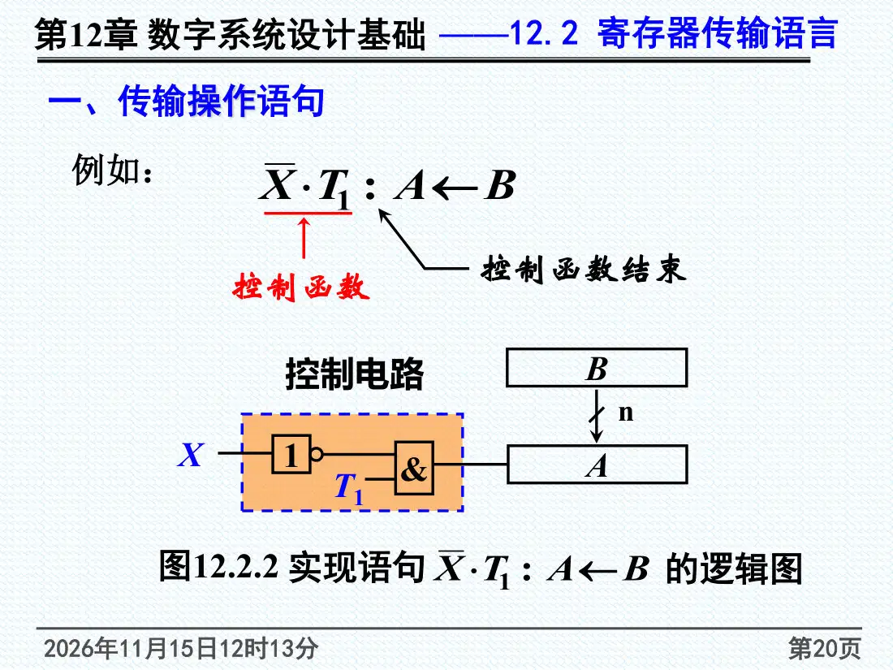

原文：

传输操作语句

例如：

控制电路

图12.2.2 实现语句 $\overline { { X } } \cdot T _ { 1 } : A  B$ 的逻辑图

第12章数字系统设计基础 ——12.2 寄存器传输语言

2026年11月15日12时13分

第20页

### 第12章数字系统设计基础 ——12.2 寄存器传输语言

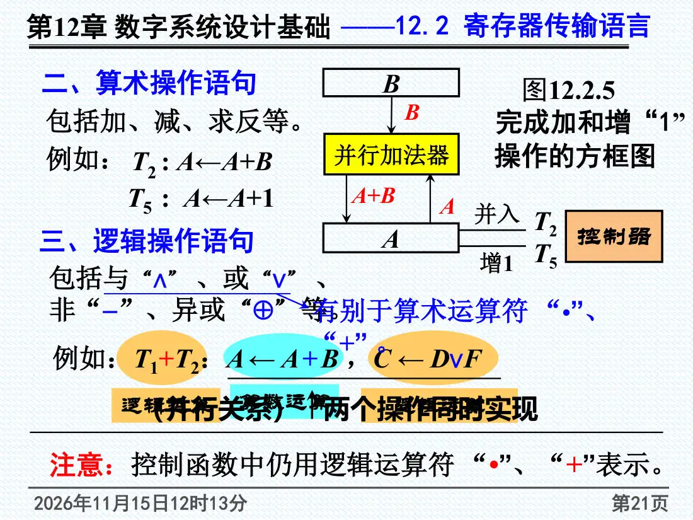

原文：

第12章数字系统设计基础 ——12.2 寄存器传输语言

二、算术操作语句

包括加、减、求反等。

例如： $T _ { 2 } \colon A \gets A + B$

$$
T _ {5}: A \leftarrow A + 1
$$

三、逻辑操作语句

包括与 $^ { \prime \prime } { } _ { \Lambda } ^ { \prime \prime }$ $^ { \prime \prime } \nabla ^ { \prime \prime }$

并行加法器

图12.2.5

完成加和增 $^ { 6 6 } 1 ^ { , 9 9 }$ 操作的方框图

$$
\begin{array}{c} A + B \\ \text {并入} \\ A \\ \text {增1} \end{array} T _ {2} \\ \text {控制器}
$$

非“−”、异或“”等。有别于算术运算符 “•”、

例如： $T _ { 1 } + T _ { 2 } \colon A \gets A + B ^ { + } , \ C \gets D \vee F$

逻辑运算 算数运算 逻辑运算（并行关系） 两个操作同时实现

注意：控制函数中仍用逻辑运算符 “•”、“+”表示。

2026年11月15日12时13分

第21页

### 第12章数字系统设计基础 ——12.2 寄存器传输语言

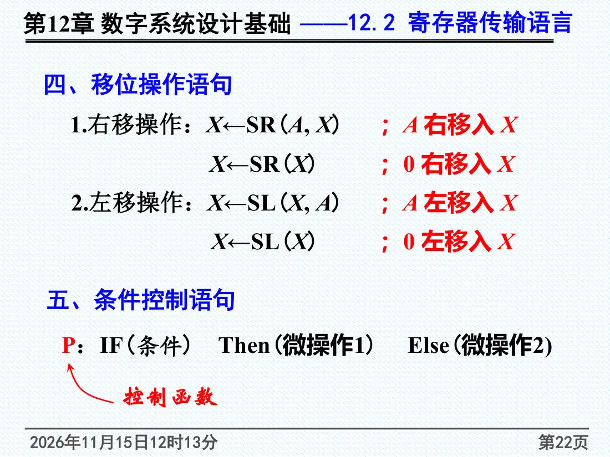

原文：

第12章数字系统设计基础 ——12.2 寄存器传输语言

四、移位操作语句

1.右移操作： $X  \operatorname { S R } ( A , X )$ ；A 右移入 X

X←SR(X) ；0 右移入X

2.左移操作： $X  \operatorname { S L } ( X , A )$ ；A 左移入 X

X←SL(X) ；0 左移入X

五、条件控制语句

P：IF(条件) Then(微操作1) Else(微操作2)

控制函数

2026年11月15日12时13分

第22页

### 第12章数字系统设计基础 ——12.3 描述工具

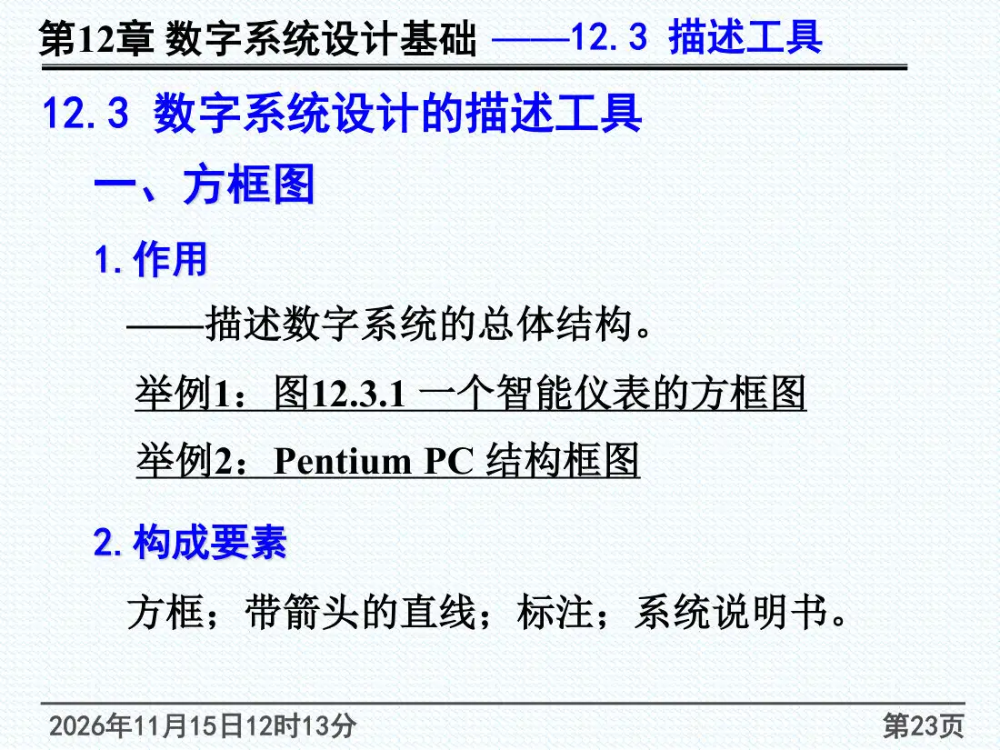

原文：

第12章数字系统设计基础 ——12.3 描述工具

12.3 数字系统设计的描述工具

方框图

1.作用

—— 描述数字系统的总体结构。

举例1：图12.3.1 一个智能仪表的方框图

举例2：Pentium PC 结构框图

2.构成要素

方框；带箭头的直线；标注；系统说明书。

2026年11月15日12时13分

第23页

### 二、算法流程图

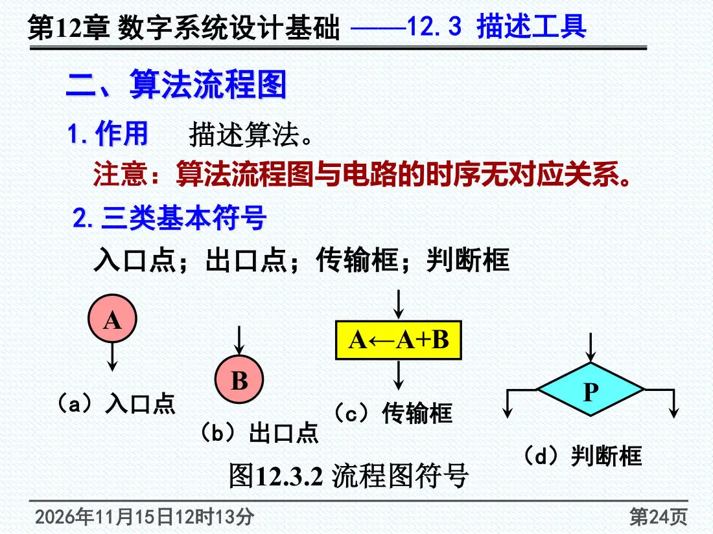

原文：

二、算法流程图

1.作用 描述算法。

注意：算法流程图与电路的时序无对应关系。

2.三类基本符号

入口点；出口点；传输框；判断框

（a）入口点

（b）出口点

（c）传输框

第12章数字系统设计基础 ——12.3 描述工具

2026年11月15日12时13分

第24页

### 第12章数字系统设计基础 ——12.3 描述工具

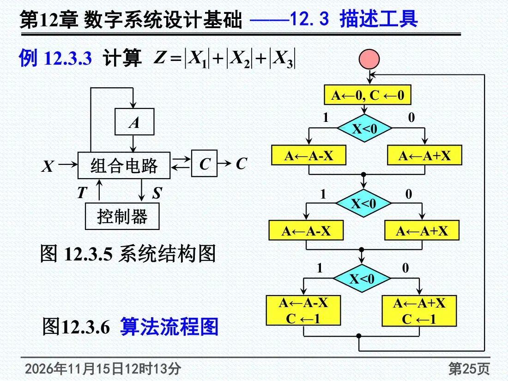

原文：

第12章数字系统设计基础 ——12.3 描述工具

例 12.3.3 计算 $Z = | X _ { 1 } + | X _ { 2 } | + | X _ { 3 } |$

2026年11月15日12时13分

第25页

### 三、算法状态机图（ASM图）

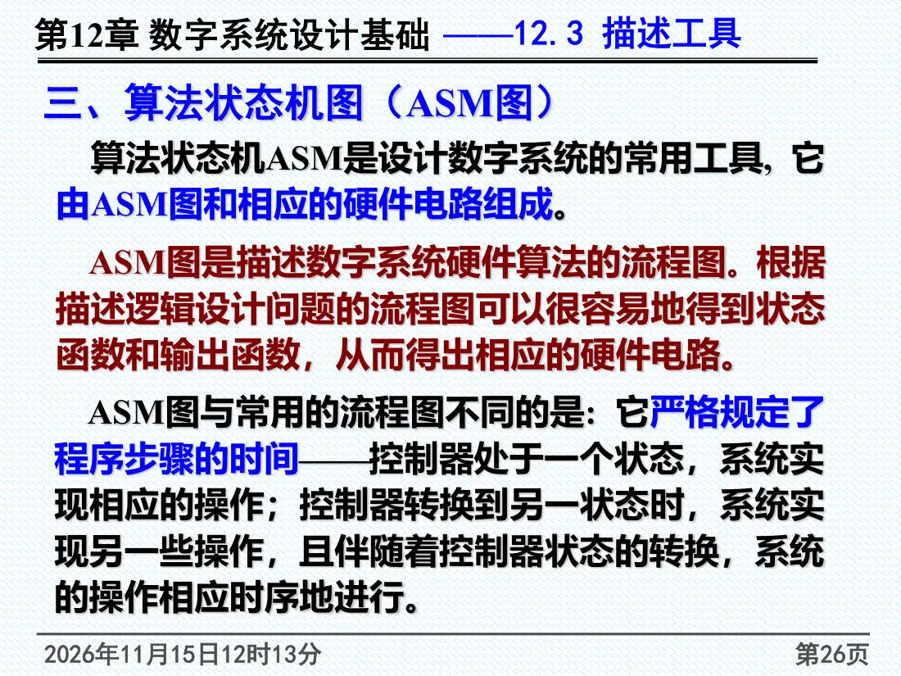

原文：

三、算法状态机图（ASM图）

算法状态机ASM是设计数字系统的常用工具, 它由ASM图和相应的硬件电路组成。

ASM图是描述数字系统硬件算法的流程图。根据描述逻辑设计问题的流程图可以很容易地得到状态函数和输出函数，从而得出相应的硬件电路。

ASM图与常用的流程图不同的是: 它严格规定了程序步骤的时间— 控制器处于一个状态，系统实现相应的操作；控制器转换到另一状态时，系统实现另一些操作，且伴随着控制器状态的转换，系统的操作相应时序地进行。

第12章数字系统设计基础 ——12.3 描述工具

2026年11月15日12时13分

第26页

### 第12章数字系统设计基础 ——12.3 描述工具

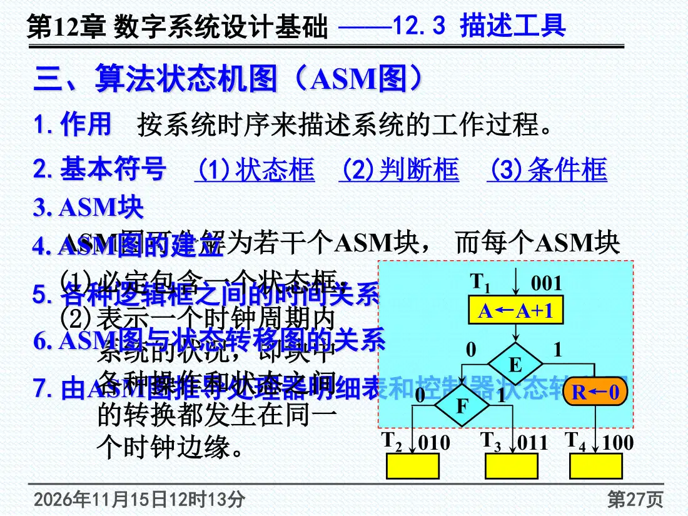

原文：

第12章数字系统设计基础 ——12.3 描述工具

三、算法状态机图（ASM图）

1.作用 按系统时序来描述系统的工作过程。

2.基本符号 (1)状态框 (2)判断框 (3)条件框

3. ASM块

ASM图可分解为若干个ASM块， 而每个ASM块4. ASM图的建立

5.各种逻辑框之间的时间关系(1)必定包含一个状态框；

(2)表示一个时钟周期内

系统的状况，即块中6. ASM图与状态转移图的关系 尔

7.由ASM图推导处理器明细表和 各种操作和状态之间 的转换都发生在同 个时钟边缘。 T2

2026年11月15日12时13分

第27页

### 第12章数字系统设计基础 ——12.3 描述工具

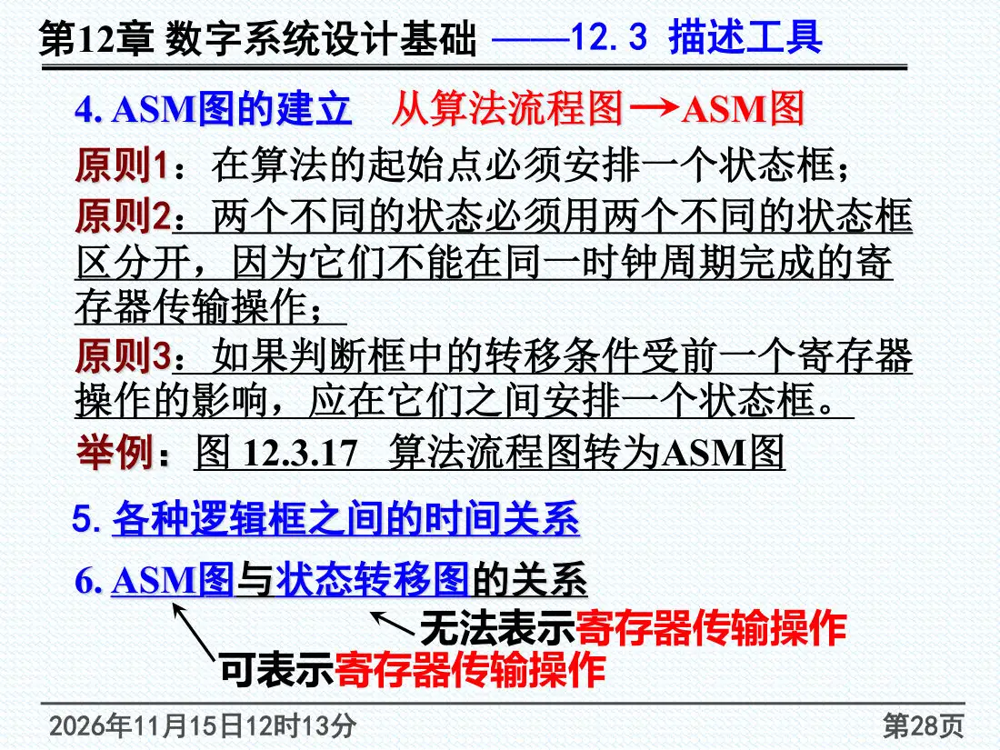

原文：

第12章数字系统设计基础 ——12.3 描述工具

4. ASM图的建立 从算法流程图 ASM图

原则1：在算法的起始点必须安排一个状态框；

原则2：两个不同的状态必须用两个不同的状态框区分开，因为它们不能在同一时钟周期完成的寄存器传输操作；

原则3：如果判断框中的转移条件受前一个寄存器操作的影响，应在它们之间安排一个状态框。

举例：图12.3.17 算法流程图转为ASM图

5.各种逻辑框之间的时间关系

6. ASM图与状态转移图的关系

无法表示寄存器传输操作可表示寄存器传输操作

2026年11月15日12时13分

第28页

### 第12章数字系统设计基础 ——12.3 描述工具

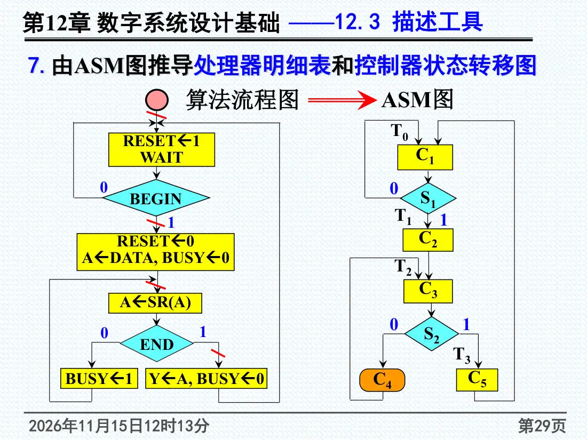

原文：

第12章数字系统设计基础 ——12.3 描述工具

7.由ASM图推导处理器明细表和控制器状态转移图

算法流程图 一 ASM图

2026年11月15日12时13分

第29页

### 第12章数字系统设计基础 ——12.3 描述工具

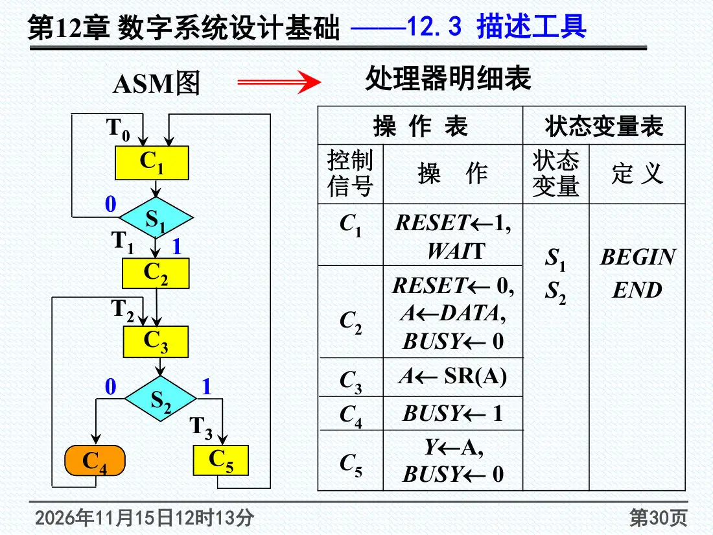

原文：

第12章数字系统设计基础 ——12.3 描述工具

处理器明细表
<table><tr><td colspan="2">操作表</td><td colspan="2">状态变量表</td></tr><tr><td>控制信号</td><td>操作</td><td>状态变量</td><td>定义</td></tr><tr><td> $C_1$ </td><td>RESET←1,WAIT</td><td rowspan="5"> $S_1$  $S_2$ </td><td rowspan="5">BEGINEND</td></tr><tr><td> $C_2$ </td><td>RESET←0, $A←DATA,BUSY←0$ </td></tr><tr><td> $C_3$ </td><td> $A←SR(A)$ </td></tr><tr><td> $C_4$ </td><td>BUSY←1</td></tr><tr><td> $C_5$ </td><td> $Y←A,BUSY←0$ </td></tr></table>

2026年11月15日12时13分

第30页

### 第12章数字系统设计基础 ——12.3 描述工具

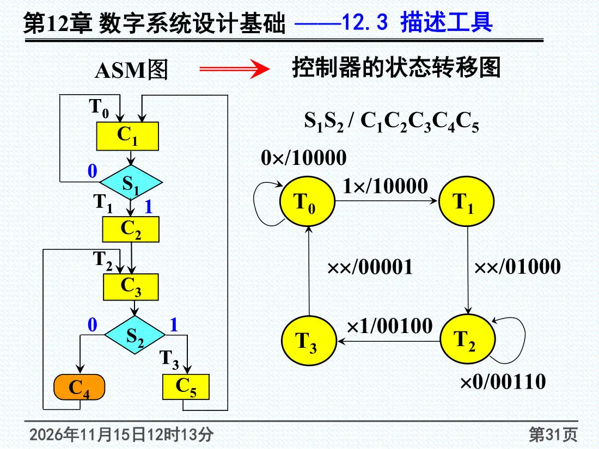

原文：

第12章数字系统设计基础 ——12.3 描述工具

ASM图

控制器的状态转移图

$$
\mathrm{S} _ {1} \mathrm{S} _ {2} / \mathrm{C} _ {1} \mathrm{C} _ {2} \mathrm{C} _ {3} \mathrm{C} _ {4} \mathrm{C} _ {5}
$$

0×/10000

2026年11月15日12时13分

第31页

### 12.4 数字系统设计举例

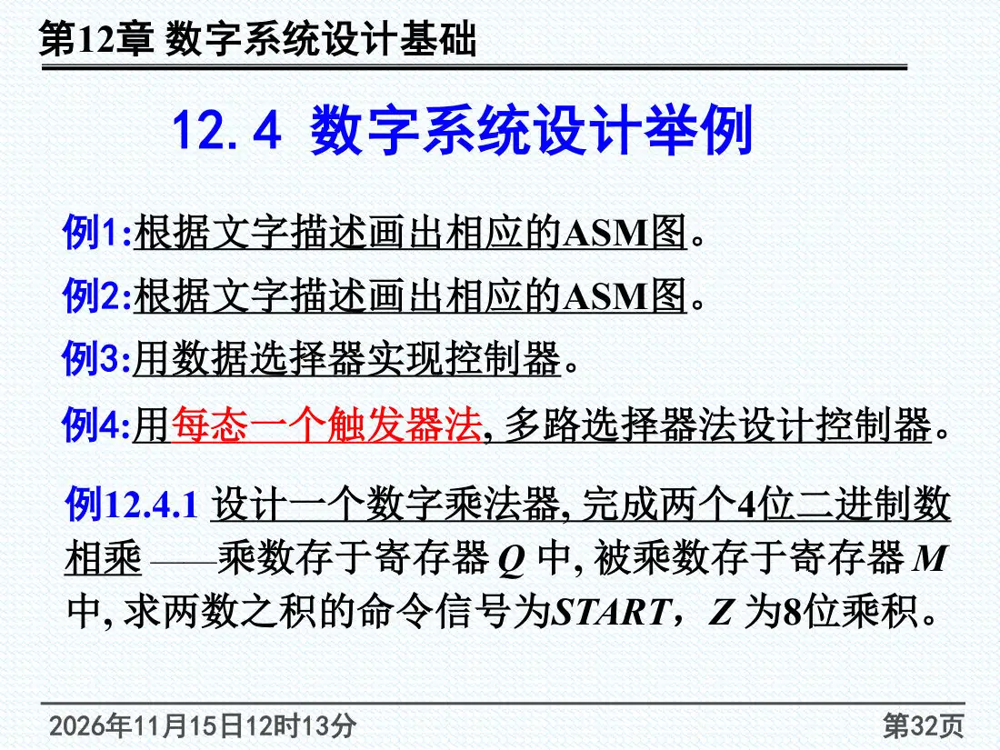

原文：

12.4 数字系统设计举例

例1:根据文字描述画出相应的ASM图。

例2:根据文字描述画出相应的ASM图。

例3:用数据选择器实现控制器。

例4:用每态一个触发器法, 多路选择器法设计控制器。

例12.4.1 设计一个数字乘法器, 完成两个4位二进制数相乘 乘数存于寄存器Q 中, 被乘数存于寄存器M中, 求两数之积的命令信号为START，Z 为8位乘积。

第12章数字系统设计基础

2026年11月15日12时13分

第32页

### 第12章数字系统设计基础 ——12.4数字系统设计举例

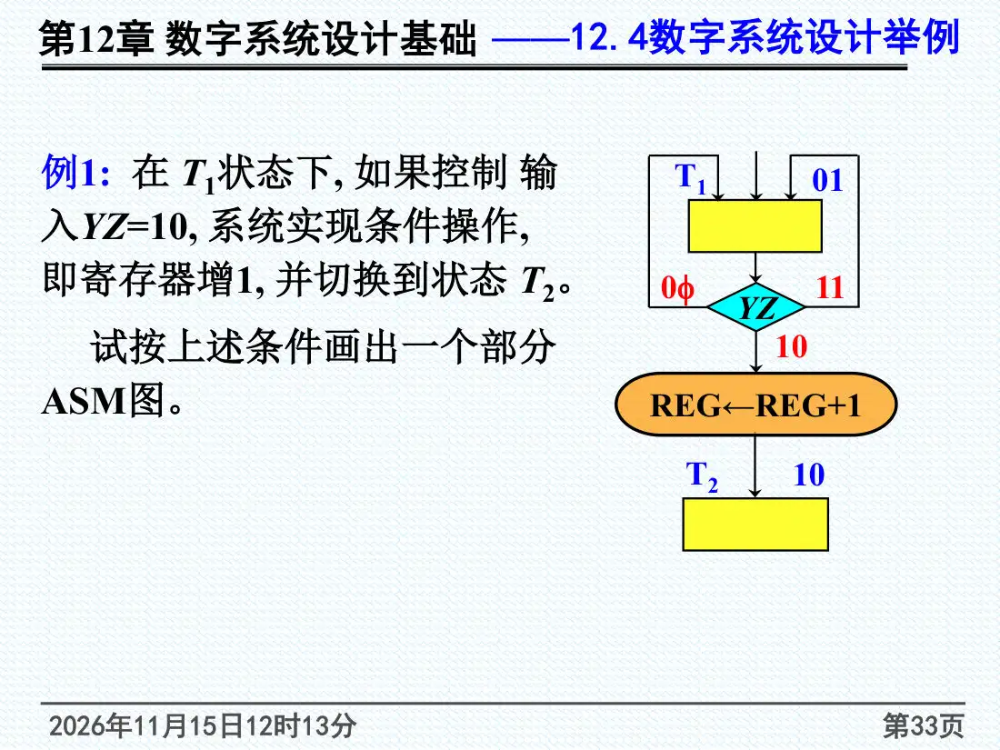

原文：

第12章数字系统设计基础 ——12.4数字系统设计举例

例1: 在 $T _ { 1 }$ 状态下, 如果控制 输$\lambda Y Z = 1 0$ 系统实现条件操作,即寄存器增1, 并切换到状态 $T _ { 2 }$

试按上述条件画出一个部分ASM图。

2026年11月15日12时13分

第33页

### 第12章数字系统设计基础 ——12.4数字系统设计举例

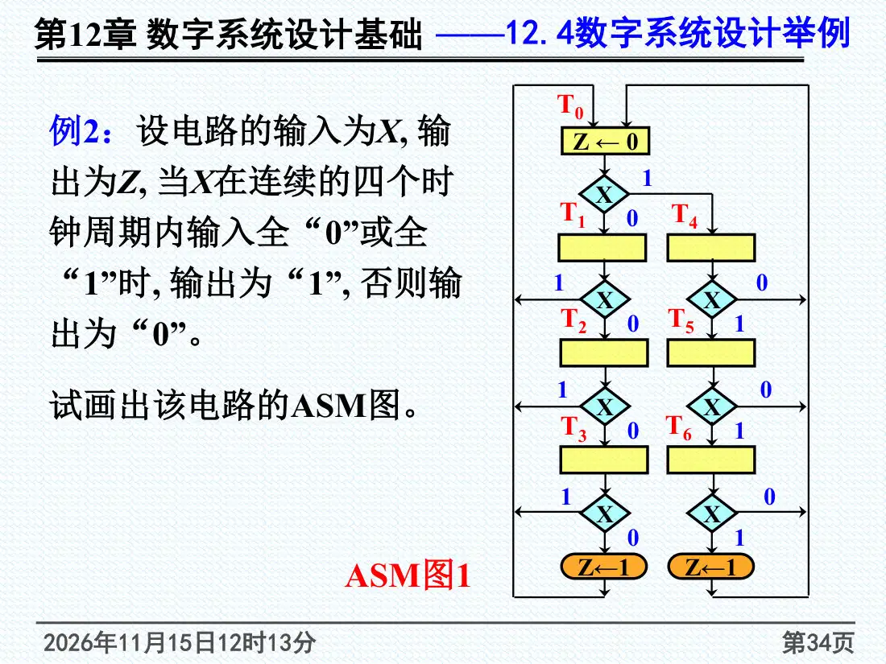

原文：

第12章数字系统设计基础 ——12.4数字系统设计举例

例2：设电路的输入为X, 输出为Z, 当X在连续的四个时钟周期内输入全“0”或全“1”时, 输出为“1”, 否则输出为“0”。

试画出该电路的ASM图。

ASM图1

2026年11月15日12时13分

第34页

### 第12章 数字系统设计基础 ——12.4数字系统设计举例 接上例

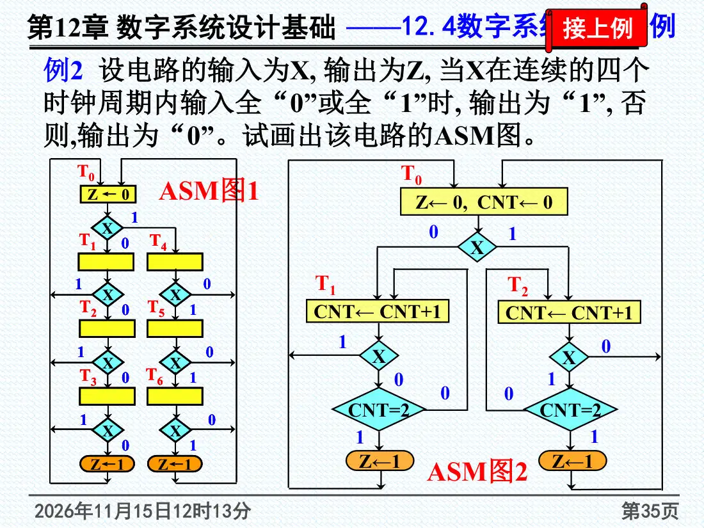

原文：

第12章 数字系统设计基础 ——12.4数字系统设计举例 接上例

例2 设电路的输入为X, 输出为Z, 当X在连续的四个时钟周期内输入全“0”或全“1”时, 输出为“1”, 否则,输出为“0”。试画出该电路的ASM图。

第35页

### 第12章数字系统设计基础 ——12.4数字系统设计举例

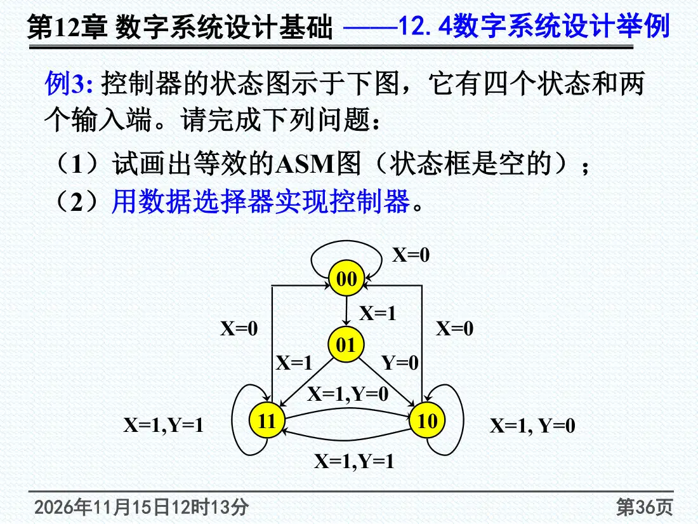

原文：

第12章数字系统设计基础 ——12.4数字系统设计举例

例3: 控制器的状态图示于下图，它有四个状态和两个输入端。请完成下列问题：

（1）试画出等效的ASM图（状态框是空的）；

（2）用数据选择器实现控制器

2026年11月15日12时13分

第36页

### 第12章 数字系统设计基础 ——12.4数字系统设计举例接上例

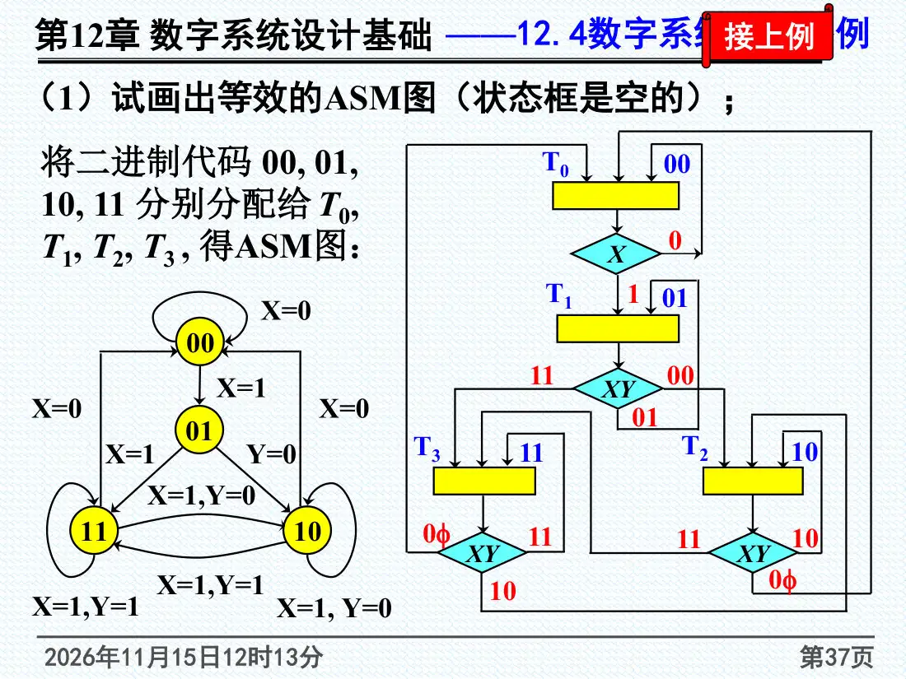

原文：

第12章 数字系统设计基础 ——12.4数字系统设计举例接上例

（1）试画出等效的ASM图（状态框是空的）；

将二进制代码 00, 01,10, 11 分别分配给 $T _ { 0 } ,$ $T _ { 1 } , T _ { 2 } , T _ { 3 }$ , 得 $\mathbf { A S M }$ 图：

2026年11月15日12时13分

第37页

### 第12章 数字系统设计基础 ——12.4数字系统设计举例接上例

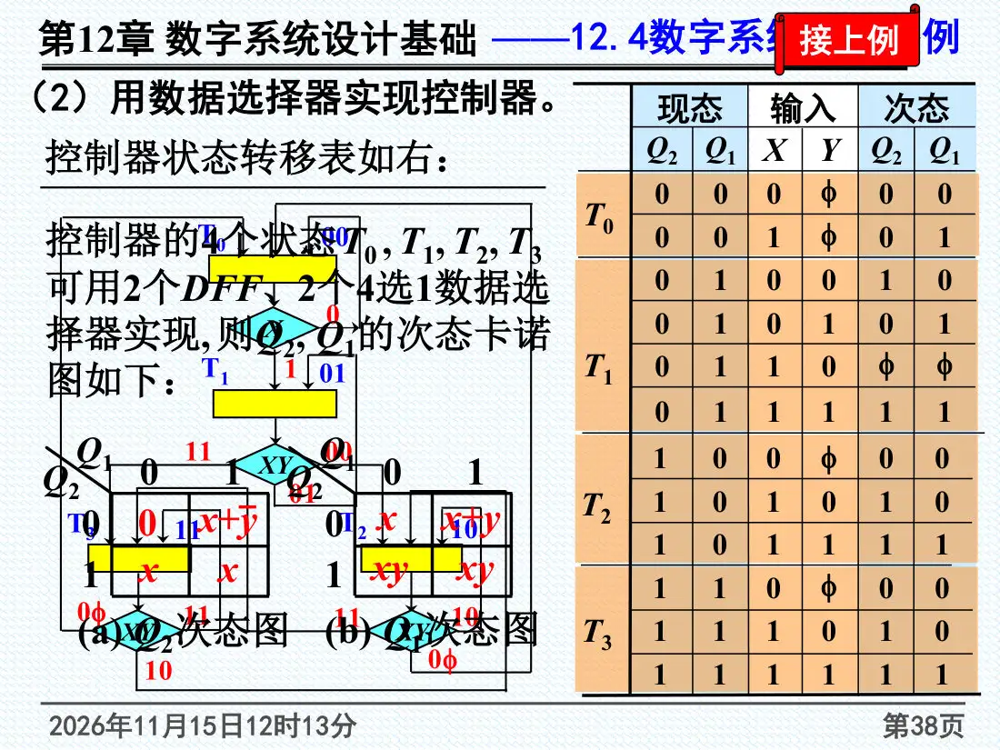

原文：

第12章 数字系统设计基础 ——12.4数字系统设计举例接上例

（2）用数据选择器实现控制器。控制器状态转移表如右：

<table><tr><td rowspan="2"></td><td colspan="2">现态</td><td colspan="2">输入</td><td colspan="2">次态</td></tr><tr><td> $Q_2$ </td><td> $Q_1$ </td><td>X</td><td>Y</td><td> $Q_2$ </td><td> $Q_1$ </td></tr><tr><td rowspan="2"> $T_0$ </td><td>0</td><td>0</td><td>0</td><td> $\phi$ </td><td>0</td><td>0</td></tr><tr><td>0</td><td>0</td><td>1</td><td> $\phi$ </td><td>0</td><td>1</td></tr><tr><td rowspan="4"> $T_1$ </td><td>0</td><td>1</td><td>0</td><td>0</td><td>1</td><td>0</td></tr><tr><td>0</td><td>1</td><td>0</td><td>1</td><td>0</td><td>1</td></tr><tr><td>0</td><td>1</td><td>1</td><td>0</td><td> $\phi$ </td><td> $\phi$ </td></tr><tr><td>0</td><td>1</td><td>1</td><td>1</td><td>1</td><td>1</td></tr><tr><td rowspan="3"> $T_2$ </td><td>1</td><td>0</td><td>0</td><td> $\phi$ </td><td>0</td><td>0</td></tr><tr><td>1</td><td>0</td><td>1</td><td>0</td><td>1</td><td>0</td></tr><tr><td>1</td><td>0</td><td>1</td><td>1</td><td>1</td><td>1</td></tr><tr><td rowspan="3"> $T_3$ </td><td>1</td><td>1</td><td>0</td><td> $\phi$ </td><td>0</td><td>0</td></tr><tr><td>1</td><td>1</td><td>1</td><td>0</td><td>1</td><td>0</td></tr><tr><td>1</td><td>1</td><td>1</td><td>1</td><td>1</td><td>1</td></tr></table>

2026年11月15日12时13分

第38页

### 第12章 数字系统设计基础 ——12.4数字系统设计举例接上例

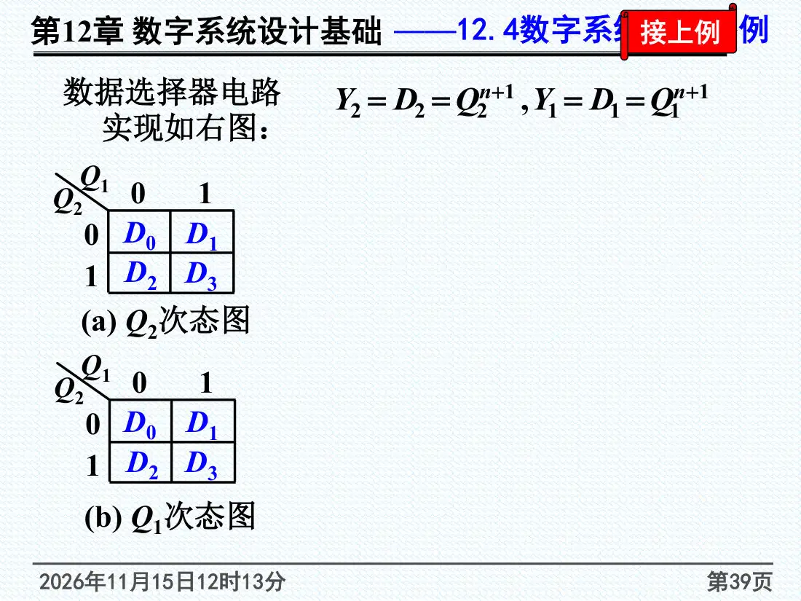

原文：

第12章 数字系统设计基础 ——12.4数字系统设计举例接上例

数据选择器电路实现如右图：

$$
Y _ {2} = D _ {2} = Q _ {2} ^ {n + 1}, Y _ {1} = D _ {1} = Q _ {1} ^ {n + 1}
$$

$$
\begin{array}{c c c} Q _ {1} & 0 & 1 \\ \hline Q _ {2} & 0 & D _ {0} \\ 0 & D _ {0} & D _ {1} \\ 1 & D _ {2} & D _ {3} \end{array}
$$

(a) $Q _ { 2 }$ 次态图

$$
\begin{array}{c c c} Q _ {1} & 0 & 1 \\ Q _ {2} & \hline 0 & D _ {0} & D _ {1} \\ 1 & \hline D _ {2} & D _ {3} \end{array}
$$

(b) $Q _ { 1 }$ 次态图

2026年11月15日12时13分

第39页

### 第12章数字系统设计基础 ——12.4数字系统设计举例

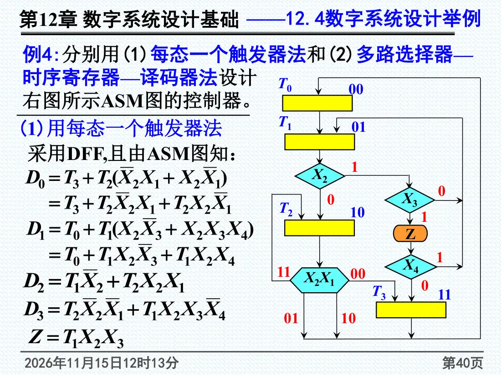

原文：

第12章数字系统设计基础 ——12.4数字系统设计举例

例4:分别用(1)每态一个触发器法和(2)多路选择器—

时序寄存器—译码器法设计右图所示ASM图的控制器。

(1)用每态一个触发器法

采用DFF,且由ASM图知：

$$
\begin{array}{r l} & D _ {0} = T _ {3} + T _ {2} (\overline {{X}} _ {2} X _ {1} + X _ {2} \overline {{X}} _ {1}) \\ & \qquad = T _ {3} + T _ {2} \overline {{X}} _ {2} X _ {1} + T _ {2} X _ {2} \overline {{X}} _ {1} \\ & D _ {1} = T _ {0} + T _ {1} (X _ {2} \overline {{X}} _ {3} + X _ {2} X _ {3} X _ {4}) \\ & \qquad = T _ {0} + T _ {1} X _ {2} \overline {{X}} _ {3} + T _ {1} X _ {2} X _ {4} \\ & D _ {2} = T _ {1} \overline {{X}} _ {2} + T _ {2} X _ {2} X _ {1} \\ & D _ {3} = T _ {2} \overline {{X}} _ {2} \overline {{X}} _ {1} + T _ {1} X _ {2} X _ {3} \overline {{X}} _ {4} \\ & Z = T _ {1} X _ {2} X _ {3} \end{array}
$$

2026年11月15日12时13分

第40页

### 第12章 数字系统设计基础 ——12.4数字系统设计举例接上例

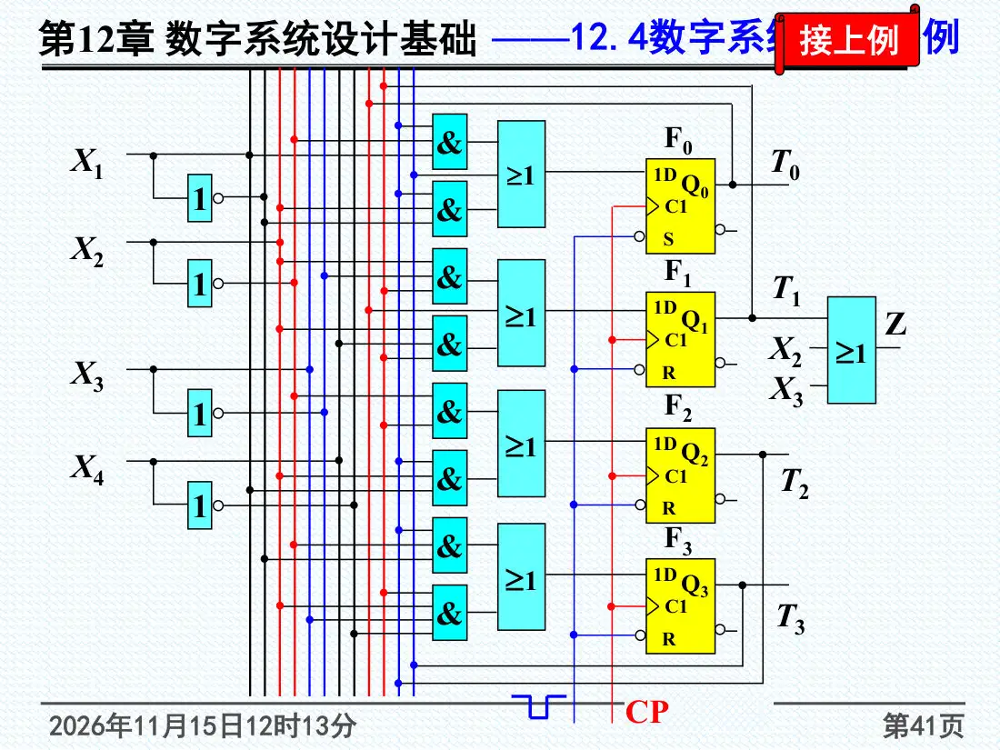

原文：

第12章 数字系统设计基础 ——12.4数字系统设计举例接上例

第41页

### 第12章 数字系统设计基础 ——12.4数字系统设计举例接上例

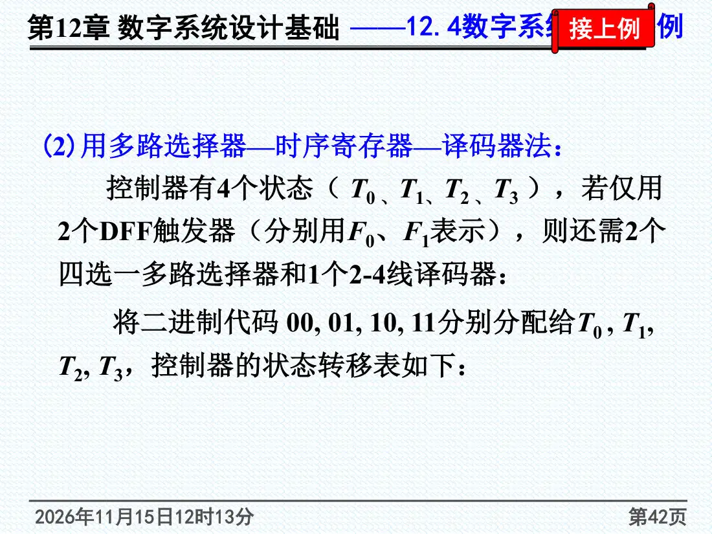

原文：

第12章 数字系统设计基础 ——12.4数字系统设计举例接上例

(2)用多路选择器—时序寄存器—译码器法：

控制器有4个状态 $\left( \begin{array} { l l l l } { T _ { 0 } } & { T _ { 1 } , } & { T _ { 2 } , } & { T _ { 3 } } \end{array} \right)$ 若仅用2个DFF触发器（分别用 $F _ { \mathbf { 0 } } . F _ { 1 }$ 表示），则还需2个四选一多路选择器和1个2-4线译码器：

将二进制代码 00, 01, 10, 11分别分配给 $T _ { 0 } , T _ { 1 } ,$ $T _ { 2 } , T _ { 3 } ,$ 控制器的状态转移表如下：

2026年11月15日12时13分

第42页

### 第12章 数字系统设计基础 ——12.4数字系统设计举例接上例

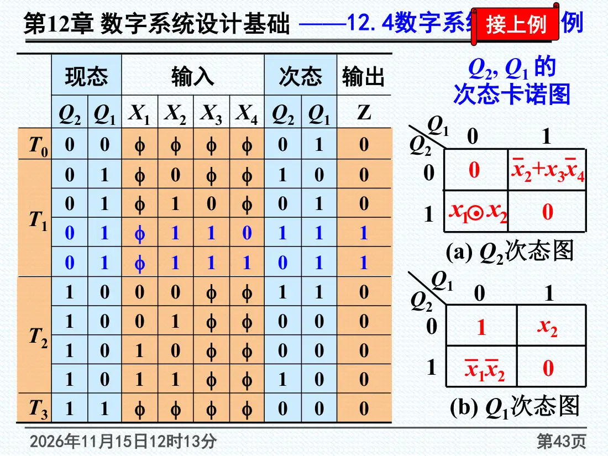

原文：

第12章 数字系统设计基础 ——12.4数字系统设计举例接上例

<table><tr><td rowspan="2"></td><td colspan="2">现态</td><td colspan="4">输入</td><td colspan="2">次态</td><td>输出</td></tr><tr><td> $Q_2$ </td><td> $Q_1$ </td><td> $X_1$ </td><td> $X_2$ </td><td> $X_3$ </td><td> $X_4$ </td><td> $Q_2$ </td><td> $Q_1$ </td><td>Z</td></tr><tr><td> $T_0$ </td><td>0</td><td>0</td><td>φ</td><td>φ</td><td>φ</td><td>φ</td><td>0</td><td>1</td><td>0</td></tr><tr><td rowspan="4"> $T_1$ </td><td>0</td><td>1</td><td>φ</td><td>0</td><td>φ</td><td>φ</td><td>1</td><td>0</td><td>0</td></tr><tr><td>0</td><td>1</td><td>φ</td><td>1</td><td>0</td><td>φ</td><td>0</td><td>1</td><td>0</td></tr><tr><td>0</td><td>1</td><td>φ</td><td>1</td><td>1</td><td>0</td><td>1</td><td>1</td><td>1</td></tr><tr><td>0</td><td>1</td><td>φ</td><td>1</td><td>1</td><td>1</td><td>0</td><td>1</td><td>1</td></tr><tr><td rowspan="4"> $T_2$ </td><td>1</td><td>0</td><td>0</td><td>0</td><td>φ</td><td>φ</td><td>1</td><td>1</td><td>0</td></tr><tr><td>1</td><td>0</td><td>0</td><td>1</td><td>φ</td><td>φ</td><td>0</td><td>0</td><td>0</td></tr><tr><td>1</td><td>0</td><td>1</td><td>0</td><td>φ</td><td>φ</td><td>0</td><td>0</td><td>0</td></tr><tr><td>1</td><td>0</td><td>1</td><td>1</td><td>φ</td><td>φ</td><td>1</td><td>0</td><td>0</td></tr><tr><td> $T_3$ </td><td>1</td><td>1</td><td>φ</td><td>φ</td><td>φ</td><td>φ</td><td>0</td><td>0</td><td>0</td></tr></table>

$\mathcal { Q } _ { 2 } , \mathcal { Q } _ { 1 }$ 的次态卡诺图

(a) $Q _ { 2 }$ 次态图

2026年11月15日12时13分

第43页

### 第12章 数字系统设计基础 ——12.4数字系统设计举例接上例

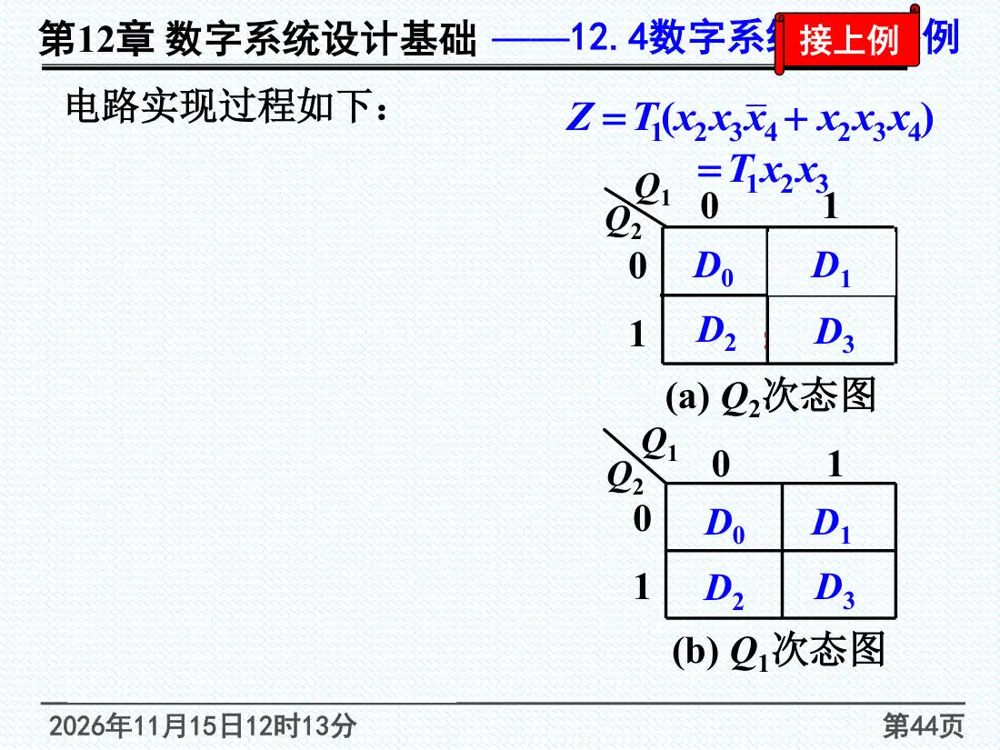

原文：

第12章 数字系统设计基础 ——12.4数字系统设计举例接上例

电路实现过程如下：

$$
\begin{array}{c c c} Z = T _ {1} (x _ {2} x _ {3} \bar {x} _ {4} + x _ {2} x _ {3} x _ {4}) \\ = T _ {1} x _ {2} x _ {3} \\ \hline Q _ {1} & 0 & 1 \\ \hline Q _ {2} & 0 & D _ {0} \\ 0 & D _ {0} & D _ {1} \\ 1 & D _ {2} & D _ {3} \\ \hline \end{array}
$$

Y 1(a) $Q _ { 2 }$ 次态图

$$
\begin{array}{c c c} \hline Q _ {1} & 0 & 1 \\ Q _ {2} & 0 & D _ {0} \\ 0 & D _ {0} & D _ {1} \\ 1 & D _ {2} & D _ {3} \\ \hline \end{array}
$$

R(b) $Q _ { 1 }$ 次态图

2026年11月15日12时13分

第44页

### 第12章数字系统设计基础 ——12.4数字系统设计举例

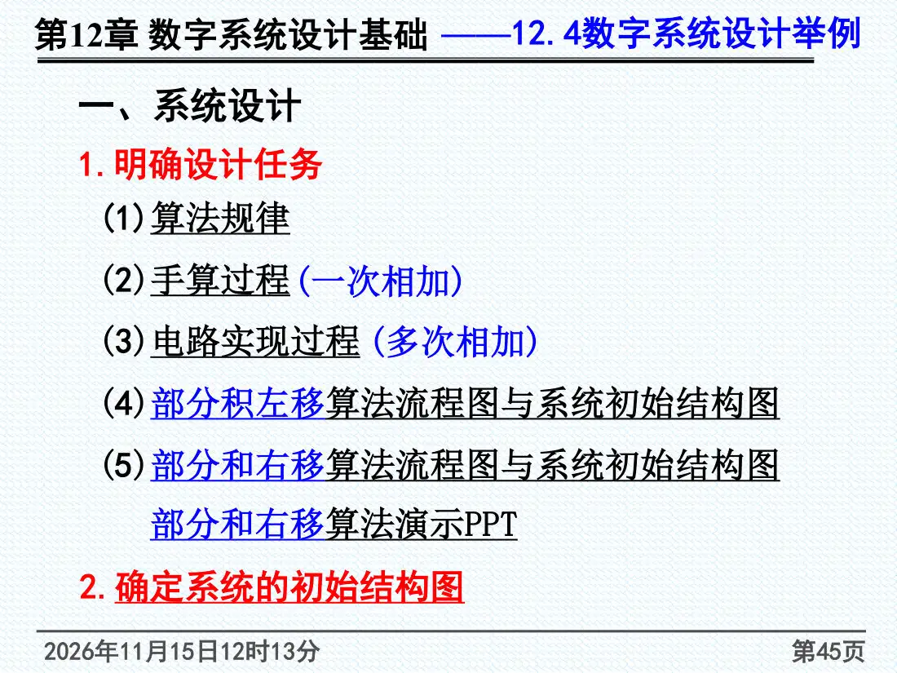

原文：

第12章数字系统设计基础 ——12.4数字系统设计举例

系统设计

1.明确设计任务

(1)算法规律

(2)手算过程(一次相加)

(3)电路实现过程(多次相加)

(4)部分积左移算法流程图与系统初始结构图

(5)部分和右移算法流程图与系统初始结构图部分和右移算法演示PPT

2.确定系统的初始结构图

2026年11月15日12时13分

第45页

### 第12章数字系统设计基础 ——12.4数字系统设计举例

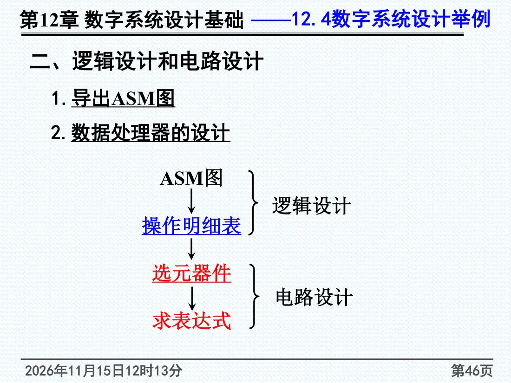

原文：

第12章数字系统设计基础 ——12.4数字系统设计举例

二、逻辑设计和电路设计

1.导出ASM图

2.数据处理器的设计

2026年11月15日12时13分

第46页

### 第12章数字系统设计基础 ——12.4数字系统设计举例

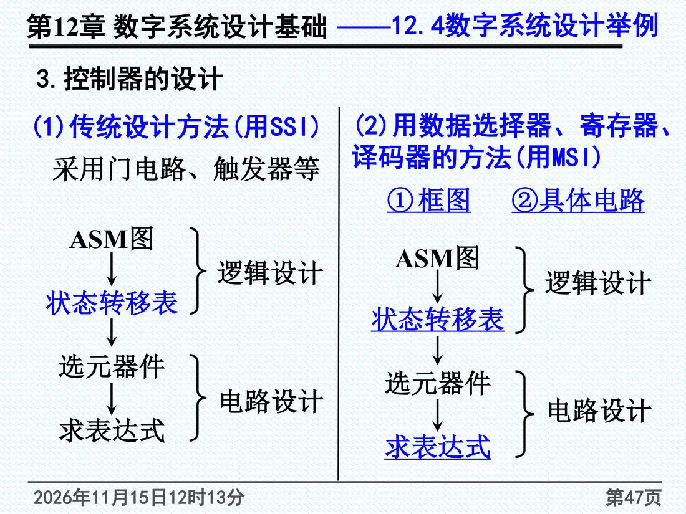

原文：

第12章数字系统设计基础 ——12.4数字系统设计举例

3.控制器的设计

(1)传统设计方法(用SSI)采用门电路、触发器等

ASM图

状态转移表

逻辑设计

(2)用数据选择器、寄存器、译码器的方法(用MSI)

求表达式

选元器件

电路设计

①框图 ②具体电路

ASM图

逻辑设计

状态转移表

选元器件

求表达式

电路设计

2026年11月15日12时13分

第47页

### 第12章数字系统设计基础 ——12.4数字系统设计举例

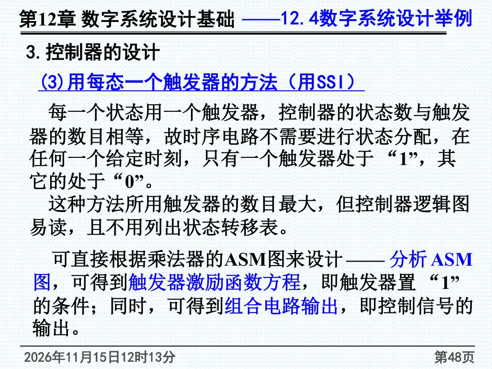

原文：

第12章数字系统设计基础 ——12.4数字系统设计举例

3.控制器的设计

(3)用每态一个触发器的方法（用SSI）

每一个状态用一个触发器，控制器的状态数与触发器的数目相等，故时序电路不需要进行状态分配，在任何一个给定时刻，只有一个触发器处于 “1”，其它的处于“0”。

这种方法所用触发器的数目最大，但控制器逻辑图易读，且不用列出状态转移表。

可直接根据乘法器的ASM图来设计 分析ASM图，可得到触发器激励函数方程，即触发器置 “1”的条件；同时，可得到组合电路输出，即控制信号的输出。

2026年11月15日12时13分

第48页

### 第12章数字系统设计基础

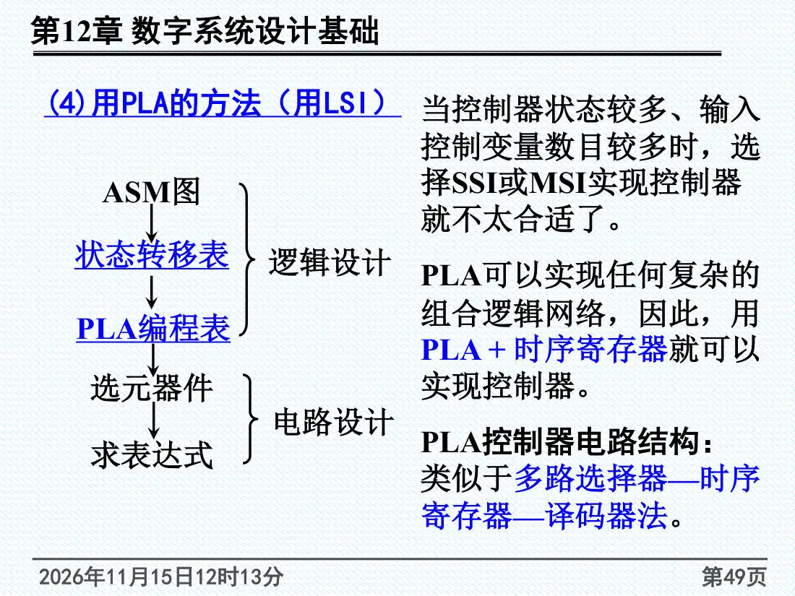

原文：

第12章数字系统设计基础

(4)用PLA的方法（用LSI）

ASM图状态转移表 逻辑设计PLA编程表选元器件电路设计求表达式

当控制器状态较多、输入控制变量数目较多时，选择SSI或MSI实现控制器就不太合适了。

PLA可以实现任何复杂的组合逻辑网络，因此，用PLA + 时序寄存器就可以实现控制器。

PLA控制器电路结构：类似于多路选择器—时序寄存器—译码器法。

2026年11月15日12时13分

第49页

### 第12章数字系统设计基础 ——数字系统的设计思路

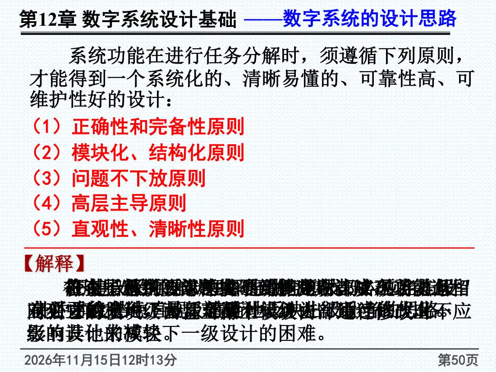

原文：

第12章数字系统设计基础 ——数字系统的设计思路

系统功能在进行任务分解时，须遵循下列原则，才能得到一个系统化的、清晰易懂的、可靠性高、可维护性好的设计：

（1）正确性和完备性原则

（2）模块化、结构化原则

（3）问题不下放原则

（4）高层主导原则

（5）直观性、清晰性原则

【解释】

检查指标所要求的各项功能是否都实现了，且留每个子系统、部件或子部件应设计成在功能上相在某一级的设计中如遇到问题时，必须将其解在底层遇到的问题找不到解决办法时，必须退不建议采用难以理解的诀窍和技巧，应当在设有必要的余地，最后还要对设计进行适当的优化。对独立的模块，而且对某个模块内部进行修改时不应决了才能进行下一级的设计。回到它的上一级去甚至再上一级去，通过修改上一计中和文档中直观、清晰地反映出设计者的思路。影响其他的模块。级的设计来减轻下一级设计的困难。

2026年11月15日12时13分

第50页

### 第12章数字系统设计基础

原文：

第12章数字系统设计基础

第51页

### 第12章数字系统设计基础

原文：

<table><tr><td></td><td>1010</td><td>M</td></tr><tr><td>×</td><td>1101</td><td>Q</td></tr><tr><td>A</td><td>00000</td><td>1101</td></tr><tr><td>+</td><td>1010</td><td></td></tr><tr><td>相加结果</td><td>01010</td><td>1101</td></tr><tr><td>右移一位</td><td>00101</td><td>0110</td></tr><tr><td>+</td><td>0000</td><td></td></tr><tr><td>相加结果</td><td>00101</td><td>0110</td></tr><tr><td>右移一位</td><td>00010</td><td>1011</td></tr></table>

第12章数字系统设计基础

2026年11月15日12时13分

第52页

### 第12章数字系统设计基础

原文：

第12章数字系统设计基础
<table><tr><td rowspan="7">A</td><td>运算过程</td><td>算式说明</td></tr><tr><td>1 0 1 0× 1 1 0 1</td><td>被乘数M乘数Q累加器A初始内容</td></tr><tr><td>0 0 0 0 0 0 0 0+ 1 0 1 0</td><td>第一部分积</td></tr><tr><td>0 0 0 0 1 0 1 0+ 0 0 0 0 0</td><td>第一部分和第二部分积</td></tr><tr><td>0 0 0 0 1 0 1 0+ 1 0 1 0 0 0</td><td>第二部分和第三部分积</td></tr><tr><td>0 0 1 1 0 0 1 0+ 1 0 1 0 0 0 0</td><td>第三部分和第四部分积</td></tr><tr><td>1 0 0 0 0 0 1 0</td><td>乘积=第四部分和</td></tr></table>

2026年11月15日12时13分

第53页

### 参考教材

原文：

参考教材

1.侯伯亨,周端 ,张慧娟, 顾新 .数字系统设计基础[M]，西安：西安电子科技大学出版社，2000.11。

第12章数字系统设计基础

2026年11月15日12时13分

第54页

### 表12.1.1 数据处理器明细表

原文：

表12.1.1 数据处理器明细表
<table><tr><td colspan="2">操作表</td><td colspan="2">状态变量表</td></tr><tr><td>控制信号</td><td>操作</td><td>状态变量</td><td>定义</td></tr><tr><td>NOP</td><td>无操作</td><td> $S_1$ </td><td>X&gt;0</td></tr><tr><td>ADDA</td><td>A←A+X</td><td> $S_2$ </td><td>X&lt;0</td></tr><tr><td>ADDB</td><td>B←B+X</td><td rowspan="2" colspan="2">输出Z=A</td></tr><tr><td>CLAB</td><td>A←0,B←0</td></tr></table>

注：状态变量表起说明作用，不作任何操作。

第12章数字系统设计基础

2026年11月15日12时13分

第55页

### 第12章数字系统设计基础

原文：

第12章数字系统设计基础

当前系统时钟有效沿

异步输入 a

异步输入 b

同步化后的输入 A

同步化后的输入 B

2026年11月15日12时13分

第56页

### 第12章数字系统设计基础

原文：

第12章数字系统设计基础

(b)波形图

2026年11月15日12时13分

第57页

### 例：一种同步化电路。

原文：

例：一种同步化电路。

第12章数字系统设计基础

2026年11月15日12时13分

第58页

### 第12章数字系统设计基础

原文：

第12章数字系统设计基础

图12.3.1 个智能仪表的方框图

（a） 般方框图

（b）系统分解图（d）数据处理模块的细化

2026年11月15日12时13分

第59页

### 图12.3.1 一个智能仪表的方框图

原文：

图12.3.1 一个智能仪表的方框图

第12章数字系统设计基础

接上例

2026年11月15日12时13分

第60页

### 第12章数字系统设计基础

原文：

第12章数字系统设计基础

2026年11月15日12时13分

第61页

### 第12章数字系统设计基础

原文：

第12章数字系统设计基础

（a）真值表图解分支表示

（b）变量优先级分支表示

2026年11月15日12时13分

第62页

### 第12章数字系统设计基础

原文：

第12章数字系统设计基础

2026年11月15日12时13分

第63页

### 第12章数字系统设计基础

原文：

第12章数字系统设计基础

注意：每个ASM块必须包含一个状态框， 可能还有几个与它相连的判断框和条件框。

2026年11月15日12时13分

第64页

### 每个ASM块中的操作都在一个时钟周期内完成。

原文：

每个ASM块中的操作都在一个时钟周期内完成。

例12.3.4 一个数字系统的数据处理器有2个触发器E和 F 及1个二进制计数器A，计数器的各个位分别用$A _ { 4 } \setminus A _ { 3 } \setminus A _ { 2 } \setminus A _ { 1 }$ 标记， $A _ { 4 }$ 为最高位， $A _ { 1 }$ 为最低位。

启动信号S 使计数器A 和触发器F 清“0”，从下一个时钟脉冲开始，计数器增1，一直到系统停止工作为止。系统的操作序列由 $A _ { 3 }$ 和 $A _ { 4 }$ 之值决定，即：

① $A _ { 3 } { = } \mathbf { 0 }$ , 触发器E清 $^ { 6 6 } \mathbf { 0 } ^ { 9 }$ ，并继续计数。

② $A _ { 3 } { = } 1$ , 触发器E置“1”，并检验 $A _ { 4 }$ 若 $A _ { 4 } = \mathbf { 0 }$ 继续计数; 若 $A _ { 4 } { = } 1$ , 触发器F置“1”, 且计数器增1,然后, 系统停止计数。

第12章数字系统设计基础

2026年11月15日12时13分

第65页

### 系统的操作序列由 $A _ { 3 }$ 和 $A _ { 4 }$ 之值决定:

原文：

系统的操作序列由 $A _ { 3 }$ 和 $A _ { 4 }$ 之值决定:

① $A _ { 3 } { = } 0$ , 触发器E清 ${ } ^ { 6 6 } \mathbf { 0 } ^ { 9 9 }$ 并继续计数。

② $A _ { 3 } { = } 1$ 触发器E置$^ { 6 6 } 1 ^ { 9 9 }$ ,并检验 $A _ { 4 } ;$ 若若 $A _ { 4 } { = } \mathbf { 0 }$ 继续计数；$A _ { 4 } { = } 1$ 触发器F置$^ { 6 6 } 1 ^ { 9 9 }$ 且计数器增1, 然后, 系统停止计数。

第12章数字系统设计基础

2026年11月15日12时13分

第66页

### 表12.3.1 ASM图的操作序列

原文：

表12.3.1 ASM图的操作序列

<table><tr><td> $A_4A_3A_2A_1$ </td><td> $EF$ </td><td>条件</td><td>状态</td></tr><tr><td>0 0 0 00 0 0 0 10 0 1 00 0 1 1</td><td>1 00 000 00</td><td> $A_3=0$  $A_4=0$ </td><td> $T_1$ </td></tr><tr><td>0 1 0 00 1 0 10 1 1 00 1 1 1</td><td>0 01 01 01 01 0</td><td> $A_3=1$  $A_4=0$ </td><td> $T_1$ </td></tr><tr><td>1 0 0 01 0 0 11 0 1 01 0 1 1</td><td>1 00 000 00</td><td> $A_3=0$  $A_4=1$ </td><td> $T_1$ </td></tr><tr><td>1 0 0 01 1 0 1</td><td>0 01 1</td><td> $A_3=1$  $A_4=1$ </td><td> $T_1$  $T_0$ </td></tr></table>

第12章数字系统设计基础

2026年11月15日12时13分

第67页

### 第12章数字系统设计基础

原文：

第12章数字系统设计基础

两个不同的状态必须用两个不同的状态框区分开，因为它们不能在同一时钟周期内同时完成两个寄存器传输操作；

2026年11月15日12时13分

第68页

### 第12章数字系统设计基础

原文：

第12章数字系统设计基础

如果判断框中的转移条件受前一个寄存器操作的影响，应在它们之间安排一个状态框。

2026年11月15日12时13分

第69页

### 第12章数字系统设计基础

原文：

第12章数字系统设计基础

例12.3.4 某数字系统的数据处理器有2个触发器E和F及 1 个二进制计数器A,计数器的各个位分别用 $A _ { 4 } , A _ { 3 } , A _ { 2 } , A _ { 1 }$ 标记, $A _ { 4 }$ 为最高位, $A _ { 1 }$ 为最低位。

2026年11月15日12时13分

第70页

### 第12章数字系统设计基础

原文：

第12章数字系统设计基础

2026年11月15日12时13分

第71页

### （1）两个 r 位的二进制数相乘，乘积为 2r 位。

原文：

<算法规律>

（1）两个 r 位的二进制数相乘，乘积为 2r 位。

（2）乘数的第 i 位为 0时，第 i 位的部分积为0；乘数的第 i位为 1时，第 i位的部分积是被乘数。

（3）第 i 位的部分积相对于第 i-1 位的部分积求和时左移1位。

$$
\frac {2 ^ {r - 1} 2 ^ {r - 1}}{2 r - 1 \text {位}} <   \frac {(2 ^ {r} - 1) (2 ^ {r} - 1)}{2 r \text {位}} <   \frac {2 ^ {r} 2 ^ {r}}{2 r + 1 \text {位}}
$$

第12章数字系统设计基础

2026年11月15日12时13分

第72页

### 表12.4.1 乘法的手算过程

原文：

表12.4.1 乘法的手算过程
<table><tr><td colspan="2">运算过程</td><td>算式说明</td></tr><tr><td rowspan="2">×</td><td>1010</td><td>被乘数</td></tr><tr><td>1101</td><td>乘数</td></tr><tr><td rowspan="4">+</td><td>1010</td><td>第一部分积</td></tr><tr><td>00000</td><td>第二部分积</td></tr><tr><td>101000</td><td>第三部分积</td></tr><tr><td>1010000</td><td>第四部分积</td></tr><tr><td colspan="2">10000010</td><td>乘积=部分积之和</td></tr></table>

第12章数字系统设计基础

2026年11月15日12时13分

第73页

### 表12.4.2 累计部分积的乘法过程

原文：

表12.4.2 累计部分积的乘法过程
<table><tr><td colspan="2">运算过程</td><td>算式说明</td></tr><tr><td></td><td>1 0 1 0</td><td>被乘数</td></tr><tr><td></td><td>× 1 1 0 1</td><td>乘数</td></tr><tr><td rowspan="2">+</td><td>0 0 0 0 0 0 0 0</td><td>累加器初始内容</td></tr><tr><td>1 0 1 0</td><td>第一部分积</td></tr><tr><td rowspan="2">+</td><td>0 0 0 0 1 0 1 0</td><td>第一部分和</td></tr><tr><td>0 0 0 0 0 0</td><td>第二部分积</td></tr><tr><td rowspan="2">+</td><td>0 0 0 0 1 0 1 0</td><td>第二部分和</td></tr><tr><td>1 0 1 0 0 0 0</td><td>第三部分积</td></tr><tr><td rowspan="2">+</td><td>0 0 1 1 0 0 1 0</td><td>第三部分和</td></tr><tr><td>1 0 1 0 0 0 0</td><td>第四部分积</td></tr><tr><td colspan="2">1 0 0 0 0 0 1 0</td><td>乘积 = 第四部分和</td></tr></table>

第12章数字系统设计基础

2026年11月15日12时13分

第74页

### 第12章数字系统设计基础

原文：

第12章数字系统设计基础

(a)算法流程图

2026年11月15日12时13分

第75页

### 第12章数字系统设计基础

原文：

第12章数字系统设计基础

2026年11月15日12时13分

第76页

### 第12章数字系统设计基础

原文：

第12章数字系统设计基础

2026年11月15日12时13分

第77页

### 第12章数字系统设计基础

原文：

第12章数字系统设计基础

图12.4.2乘法器的算法与结构

(b)算法流程图

2026年11月15日12时13分

第78页

### (a)控制器

原文：

(a)控制器

第12章数字系统设计基础

2026年11月15日12时13分

第79页

### 第12章数字系统设计基础

原文：

第12章数字系统设计基础

### 表 12.4.3 乘法器明细表

原文：

表 12.4.3 乘法器明细表

<table><tr><td colspan="2">操作表</td><td colspan="2">状态变量表</td></tr><tr><td>控制信号</td><td>操作</td><td>状态变量</td><td>定义</td></tr><tr><td>CLR</td><td>A←0,CNT←0</td><td rowspan="2"> $S_1$ </td><td rowspan="2">START</td></tr><tr><td>ADD</td><td>A←A+M</td></tr><tr><td rowspan="2">SHIFT</td><td rowspan="2">A←SR(A),Q←SR(Ar,Q),CNT←CNT+1</td><td> $S_2$ </td><td> $Q_r$ </td></tr><tr><td> $S_3$ </td><td>CNT=3</td></tr></table>

第12章数字系统设计基础

2026年11月15日12时13分

第81页

### 第12章数字系统设计基础

原文：

第12章数字系统设计基础

<table><tr><td> $M_1$ </td><td> $M_0$ </td><td>功能</td></tr><tr><td>0</td><td>0</td><td>保持</td></tr><tr><td>0</td><td>1</td><td>右移</td></tr><tr><td>1</td><td>0</td><td>左移</td></tr><tr><td>1</td><td>1</td><td>置数</td></tr></table>

74194功能表

<table><tr><td colspan="2">操作表</td></tr><tr><td>控制信号</td><td>操作</td></tr><tr><td>CLR</td><td> $A \leftarrow 0, CNT \leftarrow 0$ </td></tr><tr><td>ADD</td><td> $A \leftarrow A + M$ </td></tr><tr><td>SHIFT</td><td> $A \leftarrow SR(A)$  $Q \leftarrow SR(A_r, Q)$  $CNT \leftarrow CNT + 1$ </td></tr></table>
2026年11月15日12时13分

<table><tr><td>控制信号</td><td> $M_1$ </td><td> $M_0$ </td></tr><tr><td>CLR</td><td>1</td><td>1</td></tr><tr><td>ADD</td><td>1</td><td>1</td></tr><tr><td>SHIFT</td><td>0</td><td>1</td></tr></table>

$$
\mathbf {M _ {1}}, \mathbf {M _ {0}}
$$

<table><tr><td colspan="3">CLR ADD SHIFT</td><td colspan="2"> $M_{1}$   $M_{0}$ </td></tr><tr><td>0</td><td>0</td><td>0</td><td>0</td><td>0</td></tr><tr><td>1</td><td> $\phi$ </td><td> $\phi$ </td><td>1</td><td>1</td></tr><tr><td> $\phi$ </td><td>1</td><td> $\phi$ </td><td>1</td><td>1</td></tr><tr><td> $\phi$ </td><td> $\phi$ </td><td>1</td><td>0</td><td>1</td></tr></table>

$M _ { 1 } = C L R + A D D$ $M _ { 0 } = C L R + A D D + S H I F T$ 寄存器A控制端设计

第82页

### 第12章数字系统设计基础

原文：

第12章数字系统设计基础

表 12.4.6 74163功能表

<table><tr><td> $\overline{CR}$ </td><td> $\overline{L}_{D}$ </td><td>P</td><td>T</td><td>CP</td><td>功能</td></tr><tr><td>0</td><td> $\phi$ </td><td> $\phi$ </td><td> $\phi$ </td><td>↑</td><td>清0</td></tr><tr><td>1</td><td>0</td><td> $\phi$ </td><td> $\phi$ </td><td>↑</td><td>并入</td></tr><tr><td>1</td><td>1</td><td>0</td><td> $\phi$ </td><td> $\phi$ </td><td>保持</td></tr><tr><td>1</td><td>1</td><td> $\phi$ </td><td>0</td><td> $\phi$ </td><td>保持</td></tr><tr><td>1</td><td>1</td><td>1</td><td>1</td><td>↑</td><td>计数</td></tr></table>

<table><tr><td>控制信号</td><td>P</td><td>T</td></tr><tr><td>CLR</td><td>0</td><td>0</td></tr><tr><td>ADD</td><td>0</td><td>0</td></tr><tr><td>SHIFT</td><td>1</td><td>1</td></tr></table>

<table><tr><td colspan="2">操作表</td></tr><tr><td>控制信号</td><td>操作</td></tr><tr><td>CLR</td><td>A←0, CNT←0</td></tr><tr><td>ADD</td><td>A←A+M</td></tr><tr><td>SHIFT</td><td>A←SR(A)Q←SR(Ar,Q)CNT←CNT+1</td></tr></table>

<table><tr><td>控制信号</td><td> $\overline{CLR}$ </td></tr><tr><td>CLR</td><td>0</td></tr><tr><td>ADD</td><td>1</td></tr><tr><td>SHIFT</td><td>1</td></tr></table>

2026年11月15日12时13分

第83页

### 第12章数字系统设计基础

原文：

第12章数字系统设计基础

2026年11月15日12时13分

第84页

### 第12章数字系统设计基础

原文：

第12章数字系统设计基础

表12.4.7 乘法器状态转移表

$$
C L R = \overline {{Q}} _ {2} ^ {n} \overline {{Q}} _ {1} ^ {n} S _ {1}
$$

$$
A D D = \overline {{Q}} _ {2} ^ {n} Q _ {1} ^ {n} S _ {2}
$$

$$
S H I F T = Q _ {2} ^ {n} \overline {{Q}} _ {1} ^ {n}
$$

2026年11月15日12时13分

第85页

### 第12章数字系统设计基础

原文：

第12章数字系统设计基础

2026年11月15日12时13分

第86页

### 第12章数字系统设计基础

原文：

第12章数字系统设计基础

$$
\begin{array}{c c c} Q _ {1} & 0 & 1 \\ Q _ {2} & \hline 0 & \\ 1 & \end{array}
$$

$$
\begin{array}{c c c} Q _ {1} & 0 & 1 \\ Q _ {2} & 0 & \\ 0 & & \\ 1 & & \end{array}
$$

(a) $Q _ { 2 }$ 次态图

$Q _ { 1 }$ 次态图

$$
D _ {2} = Q _ {2} ^ {n + 1} = Q _ {1} ^ {n}
$$

$$
D _ {1} = Q _ {1} ^ {n + 1} = \overline {{Q}} _ {2} ^ {n} \overline {{Q}} _ {1} ^ {n} S _ {1} + Q _ {2} ^ {n} \overline {{S}} _ {3}
$$

2026年11月15日12时13分

第87页

### 第12章数字系统设计基础

原文：

第12章数字系统设计基础

2026年11月15日12时13分

第88页

### 第12章数字系统设计基础

原文：

第12章数字系统设计基础

CLRASM图中有3个状态 T ,T ,T , 可分S Q0& &别用3个D触发器来实现, 哪个触发T01DC1F01&器输出“1”则表示进入那个状态,即3个状态可分别编码为100, 010,

2026年11月15日12时13分

第89页

### 第12章数字系统设计基础

原文：

第12章数字系统设计基础

2026年11月15日12时13分

第90页

### 第12章数字系统设计基础

原文：

第12章数字系统设计基础

表 12.4.8 乘法器状态转移表
<table><tr><td rowspan="2"></td><td colspan="2">现态</td><td colspan="3">输入</td><td colspan="2">次态</td><td colspan="5">输出</td></tr><tr><td> $Q_2$ </td><td> $Q_1$ </td><td> $S_1$ </td><td> $S_2$ </td><td> $S_3$ </td><td> $Q_2$ </td><td> $Q_1$ </td><td> $T_0$ </td><td> $T_1$ </td><td> $T_2$ (SHIFT)</td><td>CLR</td><td>ADD</td></tr><tr><td rowspan="2"> $T_0$ </td><td>0</td><td>0</td><td>0</td><td>φ</td><td>φ</td><td>0</td><td>0</td><td>1</td><td>0</td><td>0</td><td>0</td><td>0</td></tr><tr><td>0</td><td>0</td><td>1</td><td>φ</td><td>φ</td><td>0</td><td>1</td><td>1</td><td>0</td><td>0</td><td>1</td><td>0</td></tr><tr><td rowspan="2"> $T_1$ </td><td>0</td><td>1</td><td>φ</td><td>0</td><td>φ</td><td>1</td><td>0</td><td>0</td><td>1</td><td>0</td><td>0</td><td>0</td></tr><tr><td>0</td><td>1</td><td>φ</td><td>1</td><td>φ</td><td>1</td><td>0</td><td>0</td><td>1</td><td>0</td><td>0</td><td>1</td></tr><tr><td rowspan="2"> $T_2$ </td><td>1</td><td>0</td><td>φ</td><td>φ</td><td>0</td><td>0</td><td>1</td><td>0</td><td>0</td><td>1</td><td>0</td><td>0</td></tr><tr><td>1</td><td>0</td><td>φ</td><td>φ</td><td>1</td><td>0</td><td>0</td><td>0</td><td>0</td><td>1</td><td>0</td><td>0</td></tr></table>

2026年11月15日12时13分

第91页

### 表 12.4.9 PLA编码表

原文：

表 12.4.9 PLA编码表
<table><tr><td rowspan="2">乘积项</td><td colspan="5">输入</td><td colspan="7">输出</td></tr><tr><td> $Q_2$ </td><td> $Q_1$ </td><td> $S_1$ </td><td> $S_2$ </td><td> $S_3$ </td><td> $D_2$ </td><td> $D_1$ </td><td> $T_0$ </td><td> $T_1$ </td><td> $T_2$ (SHIFT)</td><td>CLR</td><td>ADD</td></tr><tr><td> $P_1$ </td><td>0</td><td>0</td><td>0</td><td>-</td><td>-</td><td>-</td><td>-</td><td>1</td><td>-</td><td>-</td><td>-</td><td>-</td></tr><tr><td> $P_2$ </td><td>0</td><td>0</td><td>1</td><td>-</td><td>-</td><td>-</td><td>1</td><td>1</td><td>-</td><td>-</td><td>1</td><td>-</td></tr><tr><td> $P_3$ </td><td>0</td><td>1</td><td>-</td><td>0</td><td>-</td><td>1</td><td>-</td><td>-</td><td>1</td><td>-</td><td>-</td><td>-</td></tr><tr><td> $P_4$ </td><td>0</td><td>1</td><td>-</td><td>1</td><td>-</td><td>1</td><td>-</td><td>-</td><td>1</td><td>-</td><td>-</td><td>1</td></tr><tr><td> $P_5$ </td><td>1</td><td>0</td><td>-</td><td>-</td><td>0</td><td>-</td><td>1</td><td>-</td><td>-</td><td>1</td><td>-</td><td>-</td></tr><tr><td> $P_6$ </td><td>1</td><td>0</td><td>-</td><td>-</td><td>1</td><td>-</td><td>-</td><td>-</td><td>-</td><td>1</td><td>-</td><td>-</td></tr></table>

第12章数字系统设计基础

2026年11月15日12时13分

第92页

### 第12章数字系统设计基础

原文：

第12章数字系统设计基础

CP↑→S 稳定→C 稳定→τ, Z, W等稳定→下一个CP↑

2026年11月15日12时13分

第93页

### 第12章数字系统设计基础

原文：

第12章数字系统设计基础

<table><tr><td>M</td><td>1</td><td>0</td><td>1</td><td>0</td><td>运算过程</td><td>算式说明</td></tr><tr><td></td><td></td><td></td><td></td><td></td><td>1 0 1 0</td><td>被乘数M</td></tr><tr><td></td><td></td><td></td><td></td><td></td><td>× 1 1 0 1</td><td>乘数Q</td></tr><tr><td></td><td></td><td></td><td></td><td></td><td>0 0 0 0 0 0 0 0</td><td>累加器初始内容</td></tr><tr><td></td><td>+</td><td></td><td></td><td></td><td>1 0 1 0</td><td>第一部分积</td></tr><tr><td></td><td></td><td></td><td></td><td></td><td>0 0 0 0 1 0 1 0</td><td>第一部分和</td></tr><tr><td></td><td>+</td><td></td><td></td><td></td><td>0 0 0 0 0</td><td>第二部分积</td></tr><tr><td></td><td></td><td></td><td></td><td></td><td>0 0 0 0 1 0 1 0</td><td>第二部分和</td></tr><tr><td></td><td>+</td><td></td><td></td><td></td><td>1 0 1 0 0 0</td><td>第三部分积</td></tr><tr><td></td><td></td><td></td><td></td><td></td><td>0 0 1 1 0 0 1 0</td><td>第三部分和</td></tr><tr><td></td><td>+</td><td></td><td></td><td></td><td>1 0 1 0 0 0 0</td><td>第四部分积</td></tr><tr><td></td><td></td><td></td><td></td><td></td><td>1 0 0 0 0 0 1 0</td><td>乘积=第四部分和</td></tr></table>

2026年11月15日12时13分

第94页

### 第12章数字系统设计基础

原文：

第12章数字系统设计基础

1.系统设计

明确设计任务 设计算法 确定初始结构确定输出和输入之间的关系，找到实现数字系统的设计原理和方法，有时还要考虑设计者的习惯和要遵循的规则、技术规范;

建立算法流程图，表示解决问题的步骤;

划分系统的控制单元和受控单元，确定初始结构框图。

2.逻辑设计

采用比较规范的形式来描述系统的逻辑功能。

(1)数据处理器设计 导出ASM图，建立明细表。

(2)控制器设计 导出ASM图，建立状态转移表。

2026年11月15日12时13分

第95页

### 第12章数字系统设计基础

原文：

第12章数字系统设计基础

3.电路设计

选择合理的器件和连接关系，实现系统逻辑要求。电路设计的结果常采用两种方式来表达：电路图方式、硬件描述语言方式 。

4.物理设计

(1)用通用集成电路和印刷电路板实现；

(2)用掩模ASIC实现(即在硅片上制作专用集成电路)；

(3)用MCM实现（Multichip Module ：多芯片模块，即用多片未封装的硅电路片，在陶瓷片经二次集成后的模块。）；

(4)用PLD实现；

2026年11月15日12时13分

第96页

### 第12章 数字系统设计基础——用GAL实现数字系统

原文：

第12章 数字系统设计基础——用GAL实现数字系统

例12.5.1 设计一个交通灯管理系统。其功能如下：

(1)公路上无车时, 主干道绿灯亮,公路红灯亮；

(2)公路上有车时,传感器输出C=1 , 且主干道通车时间超过最短时间, 主干道交通灯由绿→黄→红, 公路交通灯由红→绿；

(3)公路上无车或有车,且公路通车时间超过最长时间,则主干道交通灯由红→绿,公路交通灯由绿→黄→红；

(4)假设公路绿灯亮的最长时间等于主干道绿灯亮的最短时间, 都为16秒, 若计时到E=1; 黄灯亮的时间设为4秒, 若计时到F=1。当启动信号S=1时, 下一时钟有效沿到, 定时器清零，重新开始计时。

2026年11月15日12时13分

第97页

### 第12章 数字系统设计基础 ——用GAL实现数字系统

原文：

第12章 数字系统设计基础 ——用GAL实现数字系统

一、系统设计 系统初始结构图
二、逻辑设计和电路设计
1. 导出ASM图
2. 数据处理器的设计
(1) 指示灯驱动电路的设计
(2) 定时电路的设计
3. 控制器的设计
(1) 用每态一个触发器的方法(用SSI)
(2) 用数据选择器、寄存器、译码器的方法(MSI)
三、物理设计 用GAL16V8实现的电路图

2026年11月15日12时13分 第98页

### 第12章 数字系统设计基础——用GAL实现数字系统

原文：

第12章 数字系统设计基础——用GAL实现数字系统

2026年11月15日12时13分

第99页

### 第12章 数字系统设计基础——用GAL实现数字系统

原文：

第12章 数字系统设计基础——用GAL实现数字系统

2026年11月15日12时13分

第100页

### 第12章 数字系统设计基础——用GAL实现数字系统

原文：

第12章 数字系统设计基础——用GAL实现数字系统

图12.5.3交通灯管理系统ASM图

2026年11月15日12时13分

第101页

### 第12章 数字系统设计基础——用GAL实现数字系统

原文：

第12章 数字系统设计基础——用GAL实现数字系统

表 12.5.1数据处理器明细表
<table><tr><td colspan="2">操作表</td><td colspan="2">状态变量表</td></tr><tr><td>控制信号</td><td>操作</td><td>状态变量</td><td>定义</td></tr><tr><td> $CS_0$ </td><td>HG=1, FR=1</td><td rowspan="2">E</td><td rowspan="2">CNT=15</td></tr><tr><td> $CS_1$ </td><td>HY=1, FR=1</td></tr><tr><td> $CS_2$ </td><td>HR=1, FG=1</td><td rowspan="3">F</td><td rowspan="3">CNT=3</td></tr><tr><td> $CS_3$ </td><td>HR=1, FY=1</td></tr><tr><td>S</td><td>CNT←0</td></tr></table>

2026年11月15日12时13分

第102页

### 第12章 数字系统设计基础——用GAL实现数字系统

原文：

第12章 数字系统设计基础——用GAL实现数字系统

图 12.5.2 指示灯驱动电路真值表
<table><tr><td>状态</td><td colspan="6">指示灯状态</td></tr><tr><td></td><td>HG</td><td>HY</td><td>HR</td><td>FG</td><td>FY</td><td>FR</td></tr><tr><td> $T_0$ </td><td>1</td><td>0</td><td>0</td><td>0</td><td>0</td><td>1</td></tr><tr><td> $T_1$ </td><td>0</td><td>1</td><td>0</td><td>0</td><td>0</td><td>1</td></tr><tr><td> $T_2$ </td><td>0</td><td>0</td><td>1</td><td>1</td><td>0</td><td>0</td></tr><tr><td> $T_3$ </td><td>0</td><td>0</td><td>1</td><td>0</td><td>1</td><td>0</td></tr></table>

2026年11月15日12时13分

第103页

### 第12章 数字系统设计基础——用GAL实现数字系统

原文：

第12章 数字系统设计基础——用GAL实现数字系统

2026年11月15日12时13分

第104页

### 第12章 数字系统设计基础——用GAL实现数字系统

原文：

第12章 数字系统设计基础——用GAL实现数字系统

由于E 和 F 的定时长度分别为16s和4s。因此，设计定时器时可采用74161芯片实现。

2026年11月15日12时13分

第105页

### 第12章 数字系统设计基础——用GAL实现数字系统

原文：

第12章 数字系统设计基础——用GAL实现数字系统

2026年11月15日12时13分

第106页

### 第12章数字系统设计基础

原文：

第12章数字系统设计基础

2026年11月15日12时13分

第107页

### 第12章数字系统设计基础

原文：

第12章数字系统设计基础

用数据选择器、寄存器、译码器的方法(用MSI)

控制器状态转移表
<table><tr><td rowspan="2"></td><td colspan="2">现态</td><td colspan="2">次态</td><td rowspan="2">转换条件</td></tr><tr><td> $Q_2$ </td><td> $Q_1$ </td><td> $Q_2$ </td><td> $Q_1$ </td></tr><tr><td rowspan="2"> $T_0$ </td><td>0</td><td>0</td><td>0</td><td>0</td><td> $\overline{C} \cdot \overline{E}$ </td></tr><tr><td>0</td><td>0</td><td>0</td><td>1</td><td> $C \cdot E$ </td></tr><tr><td rowspan="2"> $T_1$ </td><td>0</td><td>1</td><td>0</td><td>1</td><td> $\overline{F}$ </td></tr><tr><td>0</td><td>1</td><td>1</td><td>0</td><td> $F$ </td></tr><tr><td rowspan="2"> $T_2$ </td><td>1</td><td>0</td><td>1</td><td>0</td><td> $\overline{E} \cdot C$ </td></tr><tr><td>1</td><td>0</td><td>1</td><td>1</td><td> $E + \overline{C}$ </td></tr><tr><td rowspan="2"> $T_3$ </td><td>1</td><td>1</td><td>1</td><td>1</td><td> $\overline{F}$ </td></tr><tr><td>1</td><td>1</td><td>0</td><td>0</td><td> $F$ </td></tr></table>

<table><tr><td> $Q_{1}$   $Q_{2}$ </td><td>0</td><td>1</td></tr><tr><td>0</td><td>0</td><td>F</td></tr><tr><td>1</td><td>1</td><td> $\overline{F}$ </td></tr></table>

2026年11月15日12时13分

第108页

### 第12章数字系统设计基础

原文：

第12章数字系统设计基础

2026年11月15日12时13分

第109页

### 根据 $\mathbf { A S M }$ 图，产生 S 信号的条件为：

原文：

根据 $\mathbf { A S M }$ 图，产生 S 信号的条件为：

$$
S = E C T _ {0} + F T _ {1} + (E + \overline {{C}}) T _ {2} + F T _ {3}
$$

第12章数字系统设计基础

2026年11月15日12时13分

第110页

### 第12章数字系统设计基础

原文：

第12章数字系统设计基础

2026年11月15日12时13分

第111页

### 用GAL实现数字系统

原文：

用GAL实现数字系统

E: 触发器输出16s到指示信号;

ASYE: 组合输出15s到指示信号, 与E 相差一个时钟周期。

F: 触发器输出4s到指示信号;

ASYF: 组合输出3s到指示信号,与F 相差一个时钟周期。

$$
\begin{array}{r l} & E ^ {n + 1} = T _ {0} \cdot C \cdot \overline {{E ^ {n}}} \cdot A S Y E \\ & \quad + T _ {2} \cdot C \cdot \overline {{E ^ {n}}} \cdot A S Y E \\ & \quad = (T _ {0} + T _ {2}) \cdot C \cdot A S Y E \cdot \overline {{E ^ {n}}} \end{array}
$$

$$
\begin{array}{r l} & F ^ {n + 1} = T _ {1} \cdot \overline {{F ^ {n}}} \cdot A S Y F + T _ {3} \cdot \overline {{F ^ {n}}} \cdot A S Y F \\ & = (T _ {1} + T _ {3}) \cdot A S Y F \cdot \overline {{F ^ {n}}} \end{array}
$$

第112页

### 第12章数字系统设计基础

原文：

第12章数字系统设计基础

2026年11月15日12时13分

第113页

### 状态图是实现控制器的重要依据相应的VHDL描述程序见教材P358。

原文：

状态图是实现控制器的重要依据相应的VHDL描述程序见教材P358。

第12章数字系统设计基础

2026年11月15日12时13分

第114页

### 第12章数字系统设计基础

原文：

第12章数字系统设计基础

例12.6.2 自动售饮料机

假设某饮料机出售的某种饮料价格为2元，机器只能接收1元和5角的硬币（其他类型的硬币将被饮料机拒绝）。

旦机器接受的钱币共计2元，则售出该饮料。若收到的硬币超过2元，则退回所有钱币。

饮料机有两个指示灯：一个灯只是等待下一次交易操作，另一个灯提示等待接收剩下的钱币。

2026年11月15日12时13分

第115页

### 第12章数字系统设计基础

原文：

第12章数字系统设计基础

2026年11月15日12时13分

第116页

### 1.导出饮料机的ASM图

原文：

1.导出饮料机的ASM图

图12.6.3 饮料机ASM图，及图12.6.4 隐含表图12.6.3-1 状态简化后饮料机ASM图表12.6.1 控制器原始状态转移表表12.6.2 控制器简化的状态转移表

第12章数字系统设计基础

2026年11月15日12时13分

第117页

### 第12章数字系统设计基础

原文：

第12章数字系统设计基础

假设某饮料机出售的某种饮料价格为2元, 机器只能接收1元和5角的硬图12.6.4 隐含表币（其他类型的硬币将B被饮料机拒绝）

一旦机器接受的钱币共计2元, 则售出该饮料。若收到的硬币超过2元,则退回所有钱币。饮料机有两个指示灯:一个灯只是等待下一次交易操作, 另一个灯提示等待接收剩下的钱币。

图12.6.3 饮料机ASM图

2026年11月15日12时13分

第118页

### 第12章数字系统设计基础

原文：

第12章数字系统设计基础

<table><tr><td>B</td><td>×</td><td></td><td></td><td></td><td></td><td></td><td></td><td></td></tr><tr><td>C</td><td>×</td><td>×</td><td></td><td></td><td></td><td></td><td></td><td></td></tr><tr><td>D</td><td>×</td><td>×</td><td>×</td><td></td><td></td><td></td><td></td><td></td></tr><tr><td>E</td><td>×</td><td>×</td><td>×</td><td>√</td><td></td><td></td><td></td><td></td></tr><tr><td>F</td><td>×</td><td>×</td><td>×</td><td>×</td><td>×</td><td></td><td></td><td></td></tr><tr><td>G</td><td>×</td><td>×</td><td>×</td><td>×</td><td>×</td><td>√</td><td></td><td></td></tr><tr><td>H</td><td>×</td><td>×</td><td>×</td><td>×</td><td>×</td><td>√</td><td>√</td><td></td></tr><tr><td>I</td><td>×</td><td>×</td><td>×</td><td>×</td><td>×</td><td>×</td><td>×</td><td>×</td></tr></table>

2026年11月15日12时13分

第119页

### 表12.6.1 控制器原始状态转移表

原文：

表12.6.1 控制器原始状态转移表
<table><tr><td rowspan="2">现态</td><td colspan="3">次态</td><td colspan="4">输出</td></tr><tr><td>1c</td><td>0.5c</td><td>other</td><td>Ready</td><td>Dispense</td><td>Return</td><td>Coin</td></tr><tr><td>A</td><td>D</td><td>C</td><td>A</td><td>1</td><td>0</td><td>0</td><td>0</td></tr><tr><td>B</td><td>A</td><td>A</td><td>A</td><td>0</td><td>1</td><td>0</td><td>0</td></tr><tr><td>C</td><td>H</td><td>E</td><td>C</td><td>0</td><td>0</td><td>0</td><td>1</td></tr><tr><td>D</td><td>B</td><td>F</td><td>D</td><td>0</td><td>0</td><td>0</td><td>1</td></tr><tr><td>E</td><td>B</td><td>G</td><td>E</td><td>0</td><td>0</td><td>0</td><td>1</td></tr><tr><td>F</td><td>I</td><td>B</td><td>F</td><td>0</td><td>0</td><td>0</td><td>1</td></tr><tr><td>G</td><td>I</td><td>B</td><td>G</td><td>0</td><td>0</td><td>0</td><td>1</td></tr><tr><td>H</td><td>I</td><td>B</td><td>H</td><td>0</td><td>0</td><td>0</td><td>1</td></tr><tr><td>I</td><td>A</td><td>A</td><td>A</td><td>0</td><td>0</td><td>1</td><td>0</td></tr></table>
2026年11月15日12时13分

第12章数字系统设计基础

第120页

### 第12章数字系统设计基础

原文：

第12章数字系统设计基础

表12.6.2 控制器简化的状态转移表
<table><tr><td rowspan="2">现态</td><td colspan="3">次态</td><td colspan="4">输出</td></tr><tr><td>1c</td><td>0.5c</td><td>other</td><td>Ready</td><td>Dispense</td><td>Return</td><td>Coin</td></tr><tr><td>a</td><td>d</td><td>c</td><td>a</td><td>1</td><td>0</td><td>0</td><td>0</td></tr><tr><td>b</td><td>a</td><td>a</td><td>a</td><td>0</td><td>1</td><td>0</td><td>0</td></tr><tr><td>c</td><td>f</td><td>d</td><td>c</td><td>0</td><td>0</td><td>0</td><td>1</td></tr><tr><td>d</td><td>b</td><td>f</td><td>d</td><td>0</td><td>0</td><td>0</td><td>1</td></tr><tr><td>f</td><td>i</td><td>b</td><td>f</td><td>0</td><td>0</td><td>0</td><td>1</td></tr><tr><td>i</td><td>a</td><td>a</td><td>a</td><td>0</td><td>0</td><td>1</td><td>0</td></tr></table>

2026年11月15日12时13分

第121页

### 第12章数字系统设计基础

原文：

第12章数字系统设计基础

三、根据ASM图设计数字系统

交通灯VHDL源程序

$\mathbf { M A X + p l u s I I }$ 仿真结果

2026年11月15日12时13分

第122页

### 第12章数字系统设计基础

原文：

第12章数字系统设计基础

2026年11月15日12时13分

第123页

### 第12章数字系统设计基础

原文：

第12章数字系统设计基础

2026年11月15日12时13分

第124页

### 第12章数字系统设计基础

原文：

第12章数字系统设计基础

architecture traffic\_top\_rtl of trafficcontrol\_top is

2026年11月15日12时13分

第125页

### 第12章数字系统设计基础

原文：

第12章数字系统设计基础

2026年11月15日12时13分

第126页

### 第12章数字系统设计基础

原文：

第12章数字系统设计基础

2026年11月15日12时13分

第127页

### 第 128 页

### 第 129 页

### 第12章数字系统设计基础

原文：

第12章数字系统设计基础

--驱动信号输出及控制器状态指示信号输出

2026年11月15日12时13分

第130页

### 第12章数字系统设计基础

原文：

第12章数字系统设计基础

--模4计数器模块源程序

library ieee;

use ieee.std\_logic\_1164.all;

use ieee.std\_logic\_arith.all;

entity count4 is

port (ck:in std\_logic; s:in std\_logic; clr:in std\_logic; f:out std\_logic); end count4;

2026年11月15日12时13分

第131页

### 第12章数字系统设计基础

原文：

第12章数字系统设计基础

2026年11月15日12时13分

第132页

### 模16计数器模块源程序

原文：

模16计数器模块源程序

第12章数字系统设计基础

2026年11月15日12时13分

第133页

### 第12章数字系统设计基础

原文：

第12章数字系统设计基础

2026年11月15日12时13分

第134页

### 第 135 页

