# 《数字电路与逻辑设计B》第1章 数制与码制（课件）

原件的每一页，下面附识别出的文字。

### 第1章 数制与码制

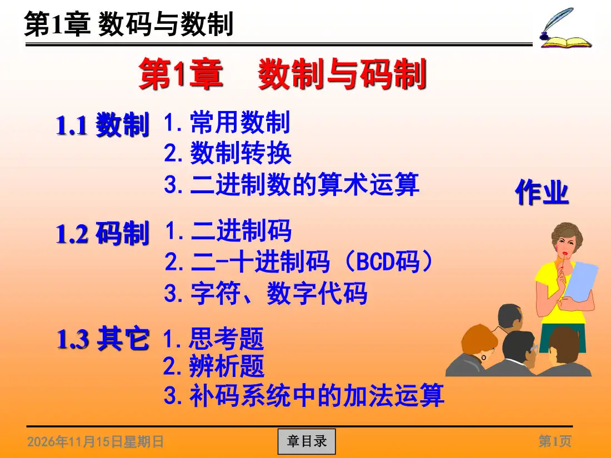

原文：

第1章 数制与码制

1.1 数制2. 数制转换 1.常用数制

2.数制转换

3.二进制数的算术运算

1.2 码制2. 二-十进制 码 BCD 码 ） （ 1.二进制码

2.二-十进制码（BCD码）

3.字符、数字代码

2. 辨析题 1.思考题1.3 其它

2.辨析题

3.补码系统中的加法运算

作业

第1章 数码与数制

く

2026年11月15日星期日

章目录

第1页

### 第1章 数码与数制

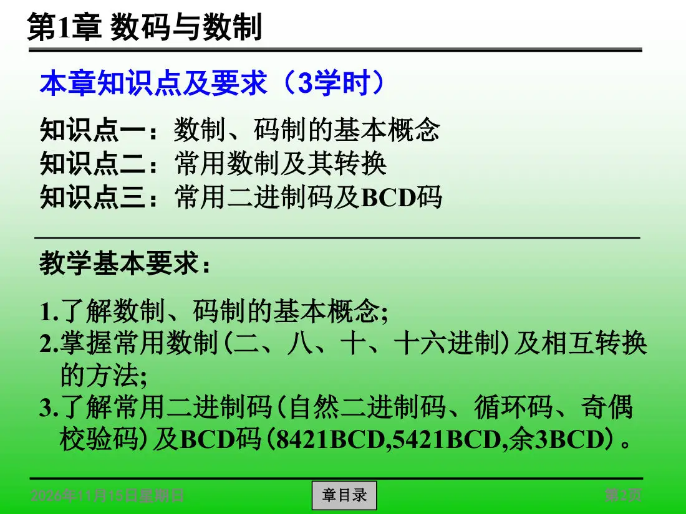

原文：

第1章 数码与数制

本章知识点及要求（3学时）

知识点一：数制、码制的基本概念

知识点二：常用数制及其转换

知识点三：常用二进制码及BCD码

教学基本要求：

1.了解数制、码制的基本概念;

2.掌握常用数制(二、八、十、十六进制)及相互转换的方法;

3.了解常用二进制码(自然二进制码、循环码、奇偶校验码)及BCD码(8421BCD,5421BCD,余3BCD)。

2026年11月15日星期日

章目录

第2页

### 第1章 数码与数制

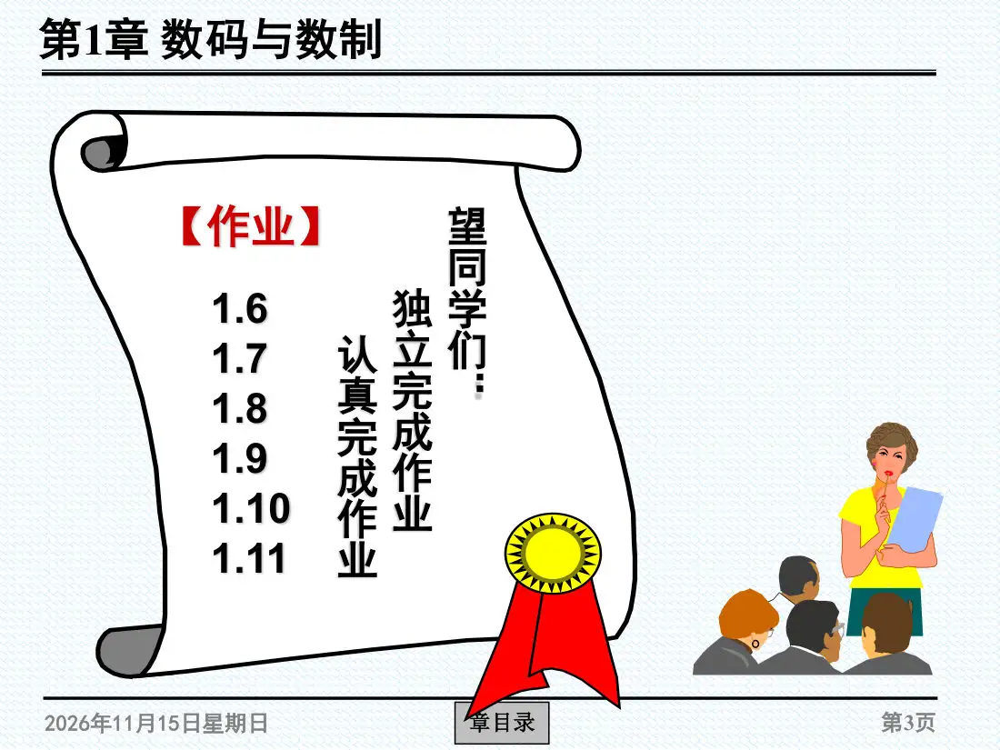

原文：

第1章 数码与数制

望同学们：

独立完成作业

【作业】

认真完成作业

1.6 1.7 1.8 1.9 1.10 1.11

2026年11月15日星期日

章目录

第3页

### 第1章数码与数制 数制（计数体制）

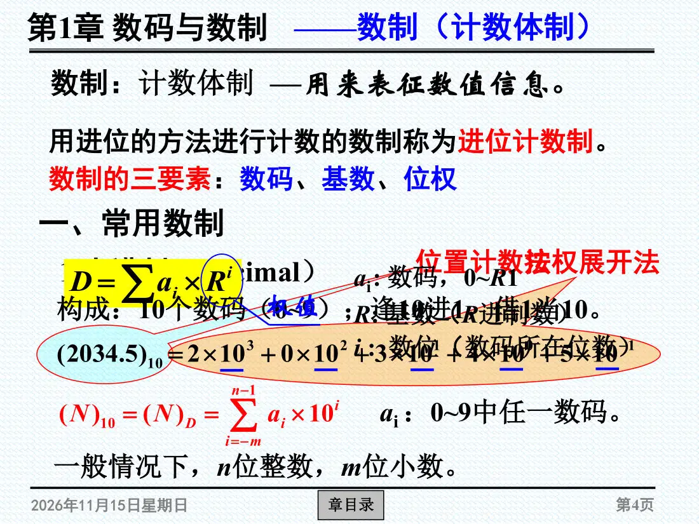

原文：

第1章数码与数制 数制（计数体制）

—用来表征数值信息。数制：计数体制

用进位的方法进行计数的数制称为进位计数制。

数制的三要素：数码、基数、位权

常用数制

$\begin{array} { r } { D = \sum _ { \alpha _ { i } \times \big ( R ^ { i } \big ) } \mathrm { i m a l } ) } \end{array}$ 数码， 位置计数法按权展开法构成：10个数码（0\~9）权值 R: 基数（R进制数）；逢10进1，借1当10。

$( 2 0 3 4 . 5 ) _ { 1 0 } = 2 \times 1 0 ^ { 3 } + 0 \times 1 0 ^ { 2 } 4 : 3$ 数位（数码所在位数）

$( N ) _ { 1 0 } - ( N ) _ { D } = \sum _ { i = - m } ^ { n - 1 } a _ { i } \times 1 0 ^ { i }$ $\pmb { a _ { \mathrm { i } } }$ 0\~9中任一数码。

一 般情况下，n位整数，m位小数。

2026年11月15日星期日

章目录

第4页

### 第1章 数码与数制 数制（计数体制）

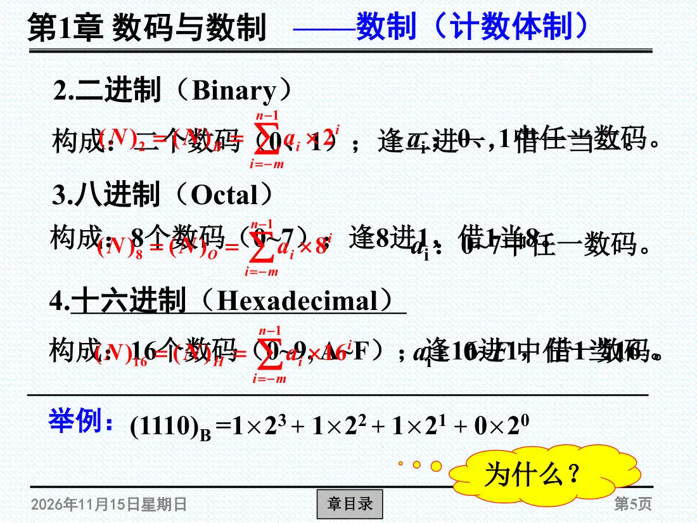

原文：

第1章 数码与数制 数制（计数体制）

2.二进制（Binary）

构成 $\binom { N } { 2 } =$ 个数码 $\sum _ { i = - m } ^ { n - 1 } q _ { i } \cdot \boldsymbol { \mathbf { \hat { \rho } } } _ { 1 } ^ { i }$ ；逢 $\underline { { \mathbf { \Pi } } }$ 进一，借一当二。：0、1中任一数码。

3.八进制（Octal）

构成 $: ( N ) _ { 8 } ^ { 8 } =$ 数码 $( \frac { n - 1 } { 1 7 } - 7 ) \times 8 ^ { 3 }$ 逢8进1，借1当8。a ：0\~7中任一数码。 $\partial _ { \mathbf { i } } ^ { 1 }$

4.十六进制（Hexadecimal）

构成 $\operatorname { \mathrm { W } } \operatorname { 1 } _ { 6 } 6$ 个数码 $\mathbf { \Delta } ( \mathbf { D } _ { t = 0 } ^ { n - 1 } , \mathbf { \Delta } ) \mathbf { \Delta } ( \mathbf { D } _ { t } ^ { ( 1 ) } ( \mathbf { F } )$ ；逢16进1，借1当16 。a ：0\~F 中任一数码。

举例： $\left( 1 1 1 0 \right) _ { \mathrm { B } } = 1 \times 2 ^ { 3 } + 1 \times 2 ^ { 2 } + 1 \times 2 ^ { 1 } + 0 \times 2 ^ { 0 }$

为什么？

第5页

2026年11月15日星期日

章目录

### 第1章数码与数制 数制（计数体制）

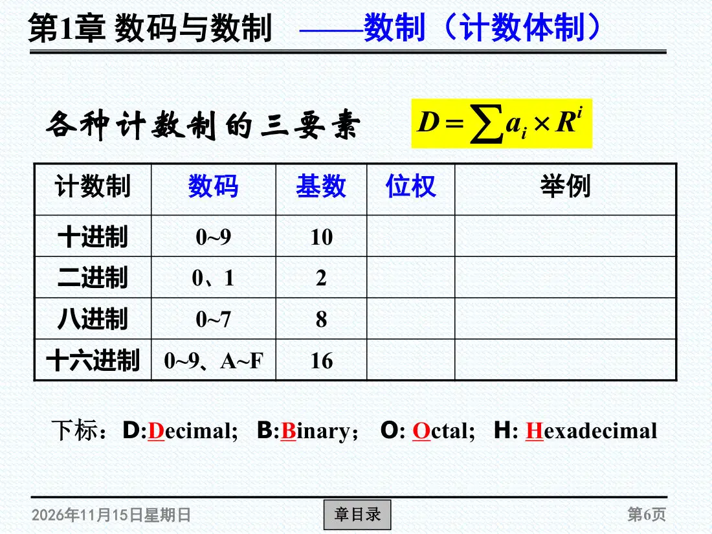

原文：

第1章数码与数制 数制（计数体制）

各种计数制的三要素

$$
D = \sum a _ {i} \times R ^ {i}
$$

<table><tr><td>计数制</td><td>数码</td><td>基数</td><td>位权</td><td>举例</td></tr><tr><td>十进制</td><td>0~9</td><td>10</td><td></td><td></td></tr><tr><td>二进制</td><td>0、1</td><td>2</td><td></td><td></td></tr><tr><td>八进制</td><td>0~7</td><td>8</td><td></td><td></td></tr><tr><td>十六进制</td><td>0~9、A~F</td><td>16</td><td></td><td></td></tr></table>

下标：D:Decimal; B:Binary； O: Octal; H: Hexadecimal

2026年11月15日星期日

章目录

第6页

### 第1章 数码与数制

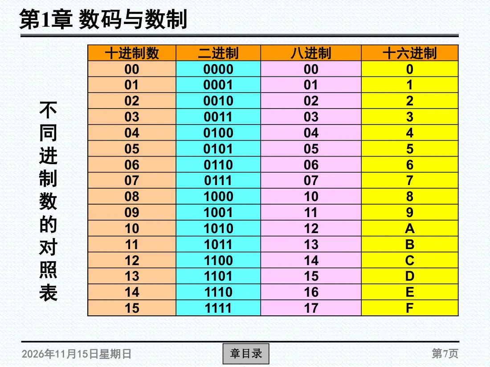

原文：

第1章 数码与数制

<table><tr><td>十进制数</td><td>二进制</td><td>八进制</td><td>十六进制</td></tr><tr><td>00</td><td>0000</td><td>00</td><td>0</td></tr><tr><td>01</td><td>0001</td><td>01</td><td>1</td></tr><tr><td>02</td><td>0010</td><td>02</td><td>2</td></tr><tr><td>03</td><td>0011</td><td>03</td><td>3</td></tr><tr><td>04</td><td>0100</td><td>04</td><td>4</td></tr><tr><td>05</td><td>0101</td><td>05</td><td>5</td></tr><tr><td>06</td><td>0110</td><td>06</td><td>6</td></tr><tr><td>07</td><td>0111</td><td>07</td><td>7</td></tr><tr><td>08</td><td>1000</td><td>10</td><td>8</td></tr><tr><td>09</td><td>1001</td><td>11</td><td>9</td></tr><tr><td>10</td><td>1010</td><td>12</td><td>A</td></tr><tr><td>11</td><td>1011</td><td>13</td><td>B</td></tr><tr><td>12</td><td>1100</td><td>14</td><td>C</td></tr><tr><td>13</td><td>1101</td><td>15</td><td>D</td></tr><tr><td>14</td><td>1110</td><td>16</td><td>E</td></tr><tr><td>15</td><td>1111</td><td>17</td><td>F</td></tr></table>

2026年11月15日星期日

章目录

第7页

### 第1章数码与数制 数制（计数体制）

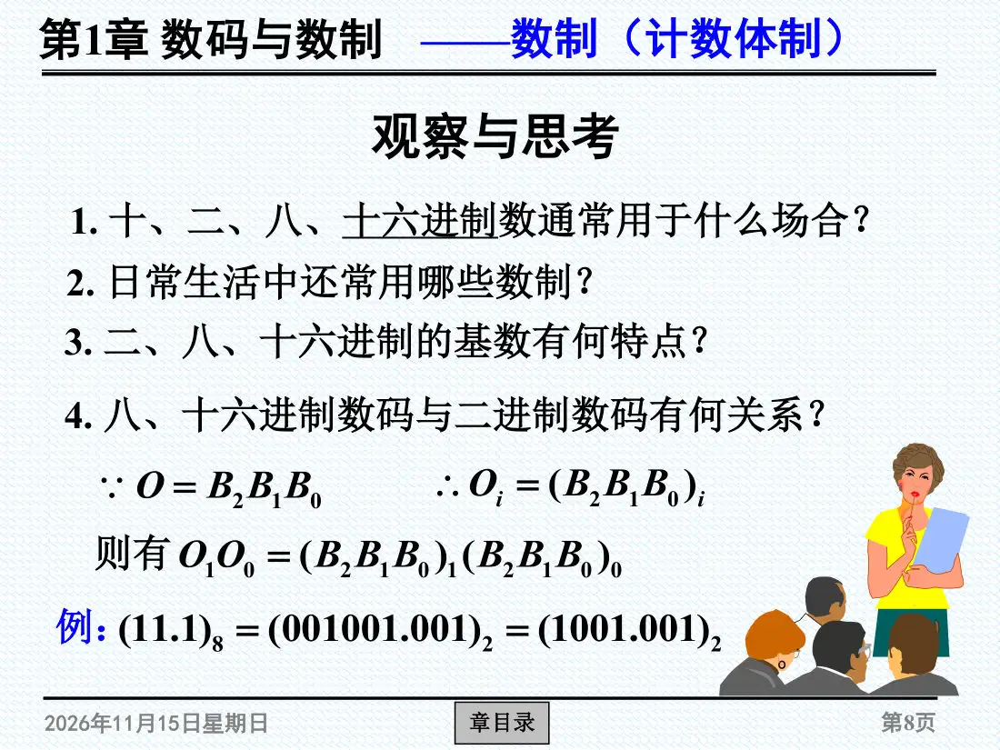

原文：

第1章数码与数制 数制（计数体制）

观察与思考

1. 十、二、八、十六进制数通常用于什么场合？

2. 日常生活中还常用哪些数制？

3. 二、八、十六进制的基数有何特点？

4. 八、十六进制数码与二进制数码有何关系？

$$
\because O = B _ {2} B _ {1} B _ {0}
$$

$$
\therefore O _ {i} = (B _ {2} B _ {1} B _ {0}) _ {i}
$$

则有 $O _ { 1 } O _ { 0 } = ( B _ { 2 } B _ { 1 } B _ { 0 } ) _ { 1 } ( B _ { 2 } B _ { 1 } B _ { 0 } ) _ { 0 }$

例： $\mathbf { ( 1 1 . 1 ) } _ { 8 } = ( \mathbf { 0 0 1 0 0 1 . 0 0 1 } ) _ { 2 } = ( 1 0 0 1 . 0 0 1 ) _ { 2 }$

2026年11月15日星期日

章目录

第8页

### 第1章 数码与数制 数制（计数体制）

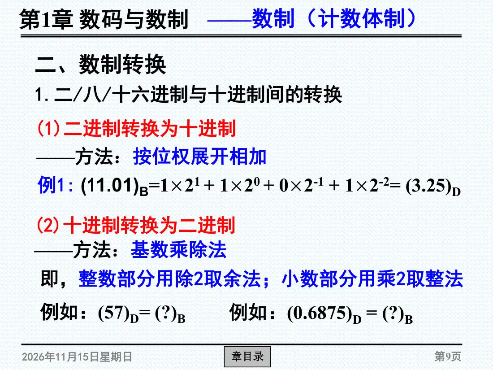

原文：

第1章 数码与数制 数制（计数体制）

二、数制转换

1.二/八/十六进制与十进制间的转换

(1)二进制转换为十进制

方法：按位权展开相加

例1: $( 1 1 . 0 1 ) _ { \mathrm { B } } { = } 1 { \times } 2 ^ { 1 } + 1 { \times } 2 ^ { 0 } + 0 { \times } 2 ^ { { - } 1 } + 1 { \times } 2 ^ { { - } 2 } { = } ( 3 . 2 5 ) _ { \mathrm { D } }$

(2)十进制转换为二进制

方法：基数乘除法

即，整数部分用除2取余法；小数部分用乘2取整法

例如： $( 5 7 ) _ { \mathrm { D } } { = } ( ? ) _ { \mathrm { B } }$

例如： $( 0 . 6 8 7 5 ) _ { \mathrm { D } } = ( \mathrm { ? ) _ { B } }$

2026年11月15日星期日

章目录

第9页

### 第1章 数码与数制 数制（计数体制）

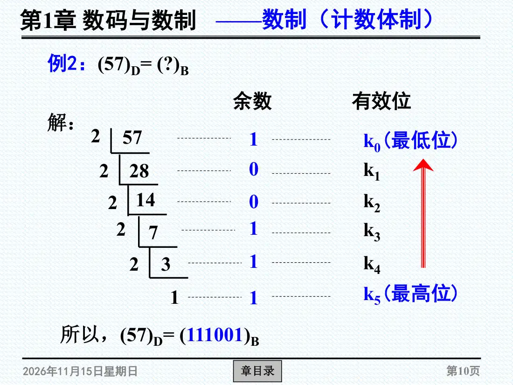

原文：

第1章 数码与数制 数制（计数体制）

例2： $( 5 7 ) _ { \mathrm { D } } { = } ( ? ) _ { \mathrm { B } }$

<table><tr><td></td><td>余数</td><td>有效位</td></tr><tr><td>解: 257</td><td>1</td><td>k0(最低位)</td></tr><tr><td>228</td><td>0</td><td>k1</td></tr><tr><td>214</td><td>0</td><td>k2</td></tr><tr><td>27</td><td>1</td><td>k3</td></tr><tr><td>23</td><td>1</td><td>k4</td></tr><tr><td>1</td><td>1</td><td>k5(最高位)</td></tr></table>

所以， $( 5 7 ) _ { \mathrm { D } } { = } \left( 1 1 1 0 0 1 \right) _ { \mathrm { B } }$

2026年11月15日星期日

章目录

第10页

### 第1章 数码与数制 数制（计数体制）

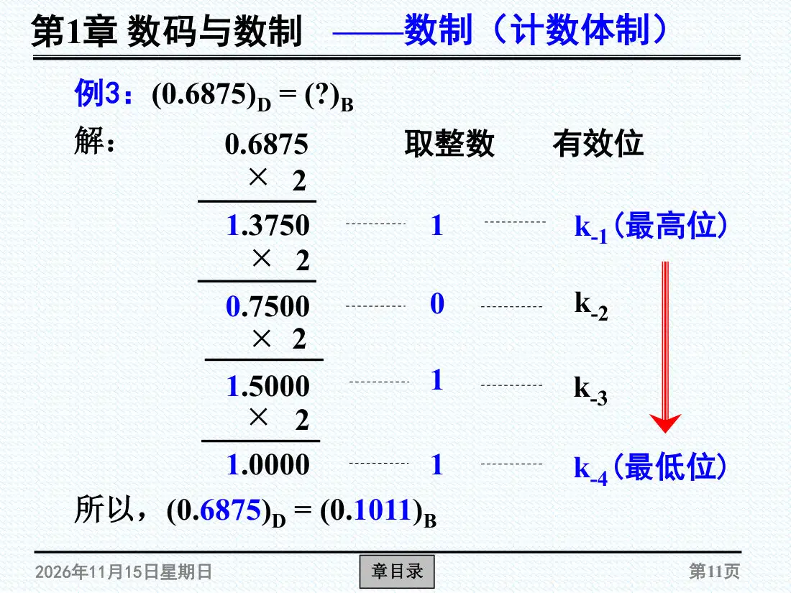

原文：

第1章 数码与数制 数制（计数体制）

例3： $( 0 . 6 8 7 5 ) _ { \mathrm { { D } } } = ( \mathrm { { ? } ) _ { B } }$

$$
\begin{array}{r l r} {\text {解:}} & {0. 6 8 7 5} & {\text {取整数}} \\ & {\times 2} \\ & {\hline 1. 3 7 5 0} & {- - - - 1} \\ & {\times 2} \\ & {\hline 0. 7 5 0 0} & {- - - - 0} \\ & {\times 2} \\ & {\hline 1. 5 0 0 0} & {- - - - 1} \\ & {\times 2} \\ & {\hline 1. 0 0 0 0} & {- - - - 1} \end{array}
$$

所以， $( 0 . 6 8 7 5 ) _ { \bf D } = ( 0 . 1 0 1 1 ) _ { \bf B }$

2026年11月15日星期日

章目录

第11页

### 第1章数码与数制

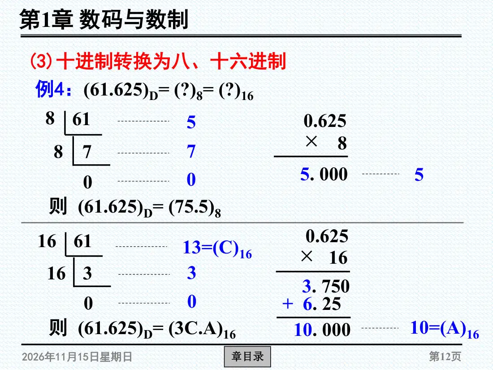

原文：

第1章数码与数制

(3)十进制转换为八、十六进制

例4： $( 6 1 . 6 2 5 ) _ { \mathrm { D } } { = } ( ? ) _ { 8 } { = } ( ? ) _ { 1 6 }$

$$
\begin{array}{c c c} 8 & 6 1 & 5 \\ \hline 8 & 7 & 7 \\ \hline & 0 & 0 \end{array} \qquad \begin{array}{c c c} 0. 6 2 5 \\ \times & 8 \\ \hline 5. 0 0 0 & - & 5 \end{array}
$$

则 $( 6 1 . 6 2 5 ) _ { \mathrm { D } } = ( 7 5 . 5 ) _ { 8 }$

$$
\begin{array}{r l} & 1 6 \boxed {6 1} \\ & 1 6 \boxed {3} \\ & 0 \\ & \text {则} (6 1. 6 2 5) _ {\mathrm{D}} = (3 \mathrm{C.A}) _ {1 6} \end{array} \quad \begin{array}{r l} & 1 3 = (\mathrm{C}) _ {1 6} \\ & \frac {0 . 6 2 5}{3 . 7 5 0} \\ & + 6. 2 5 \\ & \frac {1 0 . 0 0 0}{1 0 . 0 0 0} \end{array} \quad \begin{array}{r l} & 1 0 = (\mathrm{A}) _ {1 6} \\ & \times 1 6 \\ & + 6. 2 5 \\ & \frac {1 0 . 0 0 0}{1 0 . 0 0 0} \end{array}
$$

2026年11月15日星期日

章目录

第12页

### 第1章数码与数制 数制（计数体制）

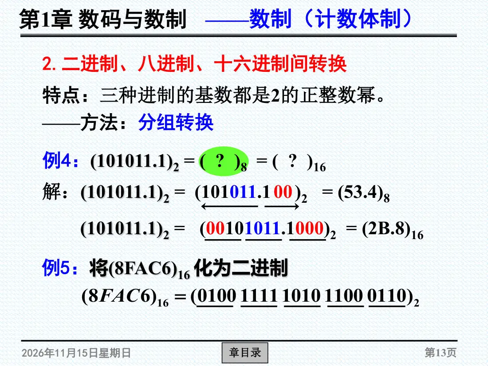

原文：

第1章数码与数制 数制（计数体制）

2.二进制、八进制、十六进制间转换

特点：三种进制的基数都是2的正整数幂。

方法：分组转换

例4： $\mathrm { ( 1 0 1 0 1 1 . 1 ) _ { 2 } = ( \{ \begin{array} { c } { { ? } } \end{array} \} _ { 8 } = ( \{ \begin{array} { c } { { ? } } \end{array} \} _ { 1 6 } }$

解： $( 1 0 1 0 1 1 . 1 ) _ { 2 } = ( \underline { { { 1 0 1 0 1 1 . 1 0 0 } } } ) _ { 2 } = ( 5 3 . 4 ) _ { 8 }$

$$
(1 0 1 0 1 1. 1) _ {2} = (\underline {{0 0 1 0}} \underline {{1 0 1 1 . 1 0 0 0}}) _ {2} = (2 B. 8) _ {1 6}
$$

例5：将 $( \mathbf { 8  F A C 6 } ) _ { 1 6 }$ 化为二进制

$$
(8 F A C 6) _ {1 6} = (\underline {{0 1 0 0}} \underline {{1 1 1 1}} \underline {{1 0 1 0}} \underline {{1 1 0 0}} \underline {{0 1 1 0}}) _ {2}
$$

2026年11月15日星期日

章目录

第13页

### 第1章数码与数制 数制（计数体制）

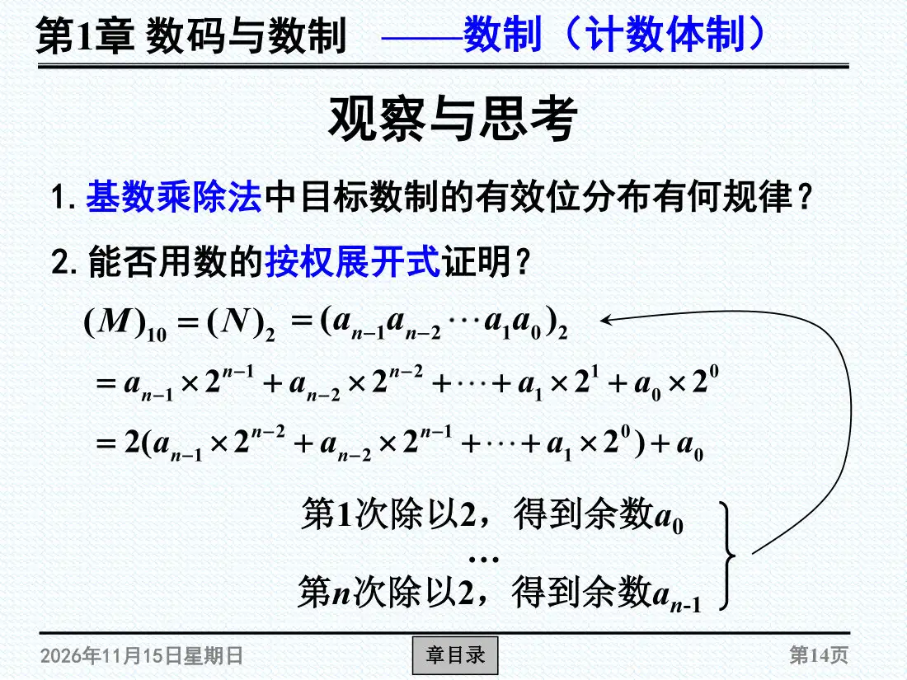

原文：

第1章数码与数制 数制（计数体制）

观察与思考

1.基数乘除法中目标数制的有效位分布有何规律？

2.能否用数的按权展开式证明？

$$
\begin{array}{r l} & {(M) _ {1 0} = (N) _ {2} = (a _ {n - 1} a _ {n - 2} \dots a _ {1} a _ {0}) _ {2}} \\ & {\qquad = a _ {n - 1} \times 2 ^ {n - 1} + a _ {n - 2} \times 2 ^ {n - 2} + \dots + a _ {1} \times 2 ^ {1} + a _ {0} \times 2 ^ {0}} \\ & {\qquad = 2 (a _ {n - 1} \times 2 ^ {n - 2} + a _ {n - 2} \times 2 ^ {n - 1} + \dots + a _ {1} \times 2 ^ {0}) + a _ {0}} \end{array}
$$

第1次除以2，得到余数… $\mathbf { \Delta } \mathbf { a _ { 0 } }$ 第n次除以2，得到余数 $\pmb { a _ { n - 1 } }$

2026年11月15日星期日

章目录

第14页

### 第1章数码与数制 数制（计数体制）

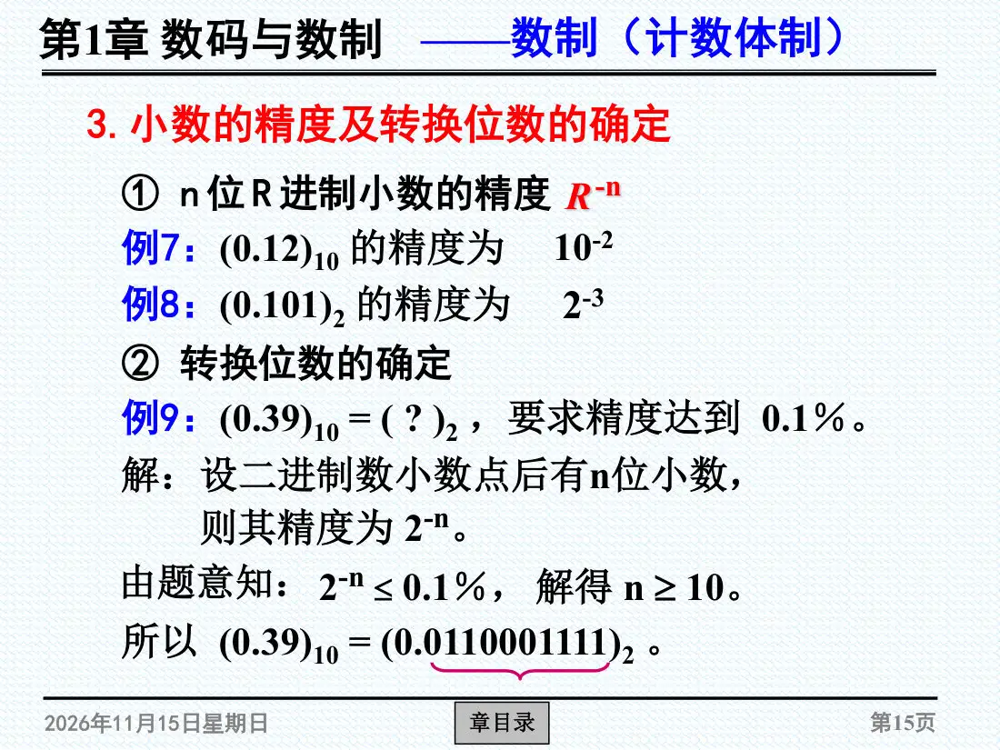

原文：

第1章数码与数制 数制（计数体制）

3.小数的精度及转换位数的确定

① n位 R进制小数的精度 $R ^ { - \mathrm { n } }$

例7： $( 0 . 1 2 ) _ { 1 0 }$ 的精度为 $1 0 ^ { - 2 }$

例8： $( 0 . 1 0 1 ) _ { 2 }$ 的精度为 $2 ^ { - 3 }$

② 转换位数的确定

例9： $( 0 . 3 9 ) _ { 1 0 } = ( ? ) _ { 2 }$ 要求精度达到 0.1％。

解：设二进制数小数点后有n位小数，则其精度为 $2 ^ { - \mathbf { n } }$

由题意知： $2 ^ { - \mathrm { n } } \leq 0 . 1 \%$ 解得 $\mathbf { n } \geq 1 \mathbf { 0 }$ 。

所以 $( 0 . 3 9 ) _ { 1 0 } = ( 0 . 0 1 1 0 0 0 1 1 1 1 ) _ { 2 }$

2026年11月15日星期日

章目录

第15页

### 第1章数码与数制 数制（计数体制）

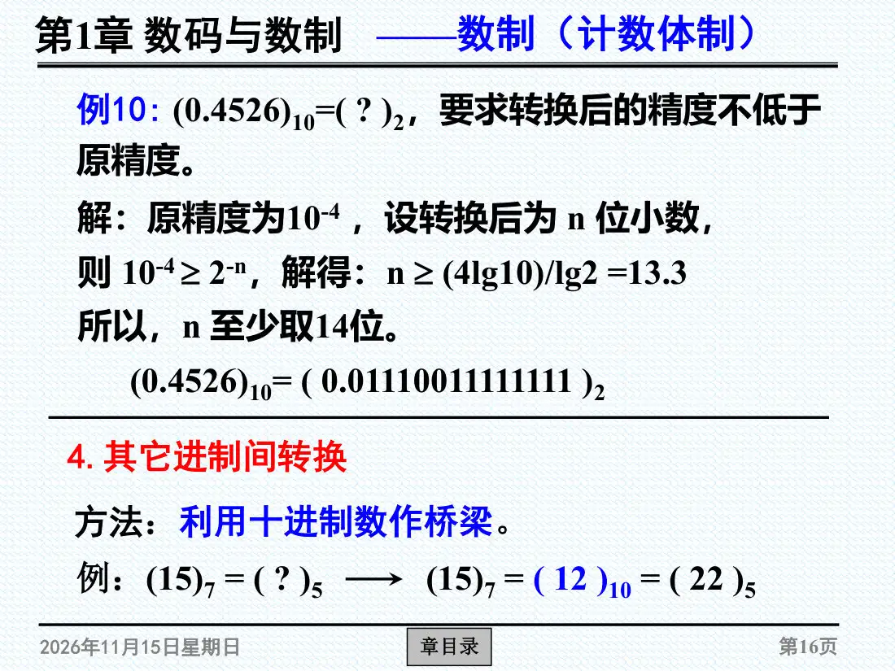

原文：

第1章数码与数制 数制（计数体制）

例 $1 0 : ( 0 . 4 5 2 6 ) _ { 1 0 } = ( ? ) _ { 2 }$ 要求转换后的精度不低于原精度。

解：原精度为 $1 0 ^ { - 4 }$ 设转换后为 n 位小数，则 $1 0 ^ { - 4 } \geq 2 ^ { - n }$ 解得： $\mathrm { ~ n ~ } \geq ( 4 \log 1 0 ) / \log 2 - 1 3 . 3$ 所以，n 至少取14位。

$$
(0. 4 5 2 6) _ {1 0} = (0. 0 1 1 1 0 0 1 1 1 1 1 1 1 1) _ {2}
$$

4.其它进制间转换

方法：利用十进制数作桥梁。

例： $( 1 5 ) _ { 7 } = ( { \small \begin{array} { l l l } { ? } \end{array} } ) _ { 5 } \longrightarrow ( 1 5 ) _ { 7 } = ( 1 2 { \it \Delta \phi } ) _ { 1 0 } = ( 2 2 { \it \Delta \phi } ) _ { 5 }$

2026年11月15日星期日

章目录

第16页

### 第1章 数码与数制 数制（计数体制）

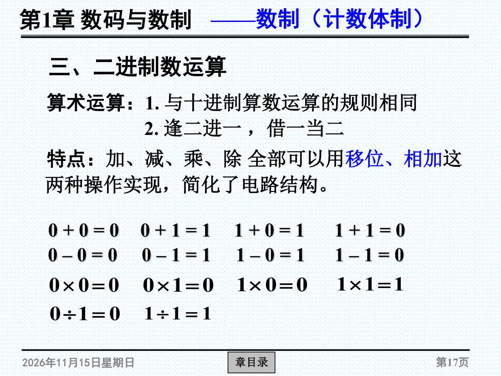

原文：

第1章 数码与数制 数制（计数体制）

三、二进制数运算

算术运算：1. 与十进制算数运算的规则相同

2. 逢二进一 ，借一当二

特点：加、减、乘、除 全部可以用移位、相加这两种操作实现，简化了电路结构。

$$
\mathbf {0} + \mathbf {0} = \mathbf {0}
$$

$$
0 + 1 = 1
$$

$$
1 + 0 = 1
$$

$$
1 + 1 = 0
$$

$$
\mathbf {0} - \mathbf {0} = \mathbf {0}
$$

$$
0 - 1 = 1
$$

$$
1 - 0 = 1
$$

$$
1 - 1 = 0
$$

$$
\mathbf {0} \times \mathbf {0} = \mathbf {0}
$$

$$
\mathbf {0} \times \mathbf {1} = \mathbf {0}
$$

$$
\mathbf {1} \times \mathbf {0} = \mathbf {0}
$$

$$
1 \times 1 = 1
$$

$$
0 \div 1 = 0
$$

$$
1 \div 1 = 1
$$

2026年11月15日星期日

章目录

第17页

### 第1章数码与数制 数制（计数体制）

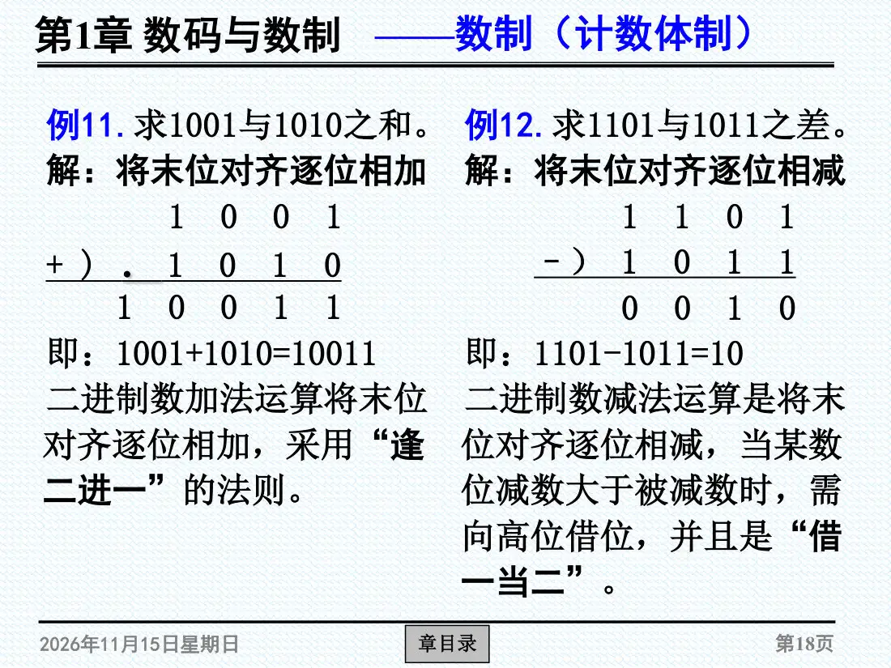

原文：

第1章数码与数制 数制（计数体制）

例11.求1001与1010之和。

解：将末位对齐逐位相加

$$
\begin{array}{r} {1 0 0 1} \\ {+ \textbf {\text {) .}} 1 0 1 0} \\ \hline {1 0 0 1 1} \end{array}
$$

即：1001+1010=10011二进制数加法运算将末位对齐逐位相加，采用“逢二进一”的法则。

例12.求1101与1011之差。

解：将末位对齐逐位相减

$$
\begin{array}{r} {1 1 0 1} \\ {-) 1 0 1 1} \\ \hline {0 0 1 0} \end{array}
$$

即：1101-1011=10二进制数减法运算是将末位对齐逐位相减，当某数位减数大于被减数时，需向高位借位，并且是“借一当二” C

2026年11月15日星期日

章目录

第18页

### 第1章 数码与数制 数制（计数体制）

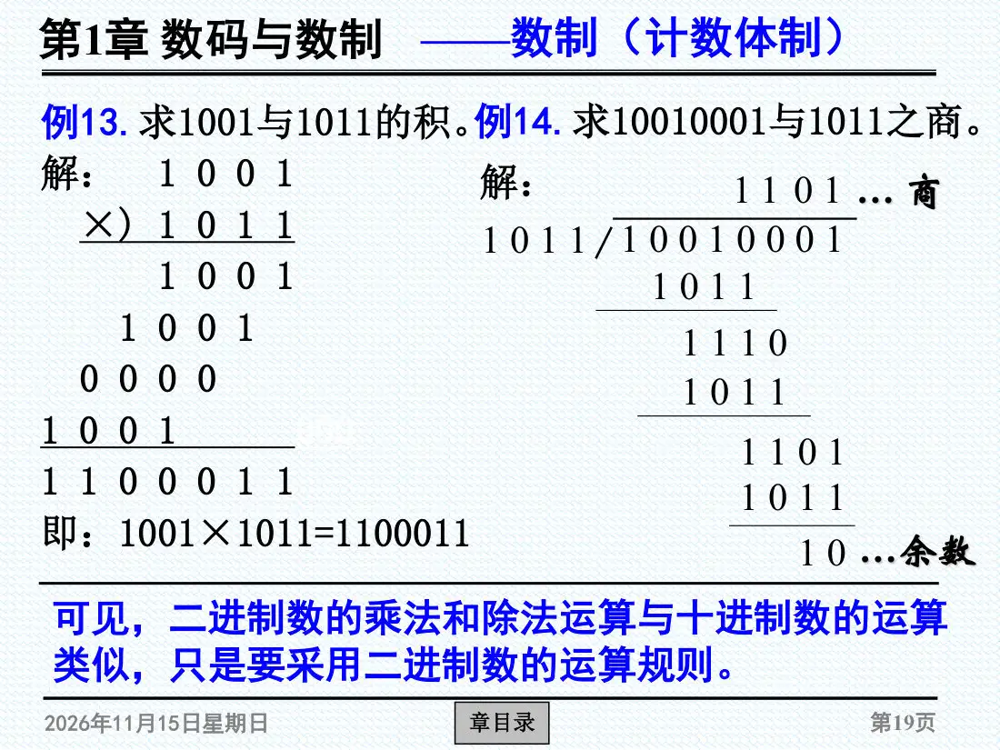

原文：

第1章 数码与数制 数制（计数体制）

例13.求1001与1011的积。例14.求10010001与1011之商。

$$
\begin{array}{r l} & {\text {解:} \quad 1 0 0 1} \\ & {\times) 1 0 1 1} \\ & {\hline \qquad 1 0 0 1} \\ & {\qquad 1 0 0 1} \\ & {\qquad 0 0 0 0} \\ & {\qquad 1 0 0 1} \\ & {\hline 1 1 0 0 0 1 1} \end{array}
$$

即：1001×1011=1100011

$$
\begin{array}{r l} {\text {解:}} & {1 1 0 1 \dots \text {商}} \\ {1 0 1 1 / 1 0 0 1 0 0 0 1} \\ & {\underline {{1 0 1 1}}} \\ & {1 1 1 0} \\ & {\underline {{1 0 1 1}}} \\ & {1 1 0 1} \\ & {\underline {{1 0 1 1}}} \\ & {1 0 \dots \text {余数}} \end{array}
$$

可见，二进制数的乘法和除法运算与十进制数的运算类似，只是要采用二进制数的运算规则。

2026年11月15日星期日

章目录

第19页

### 第1章数码与数制

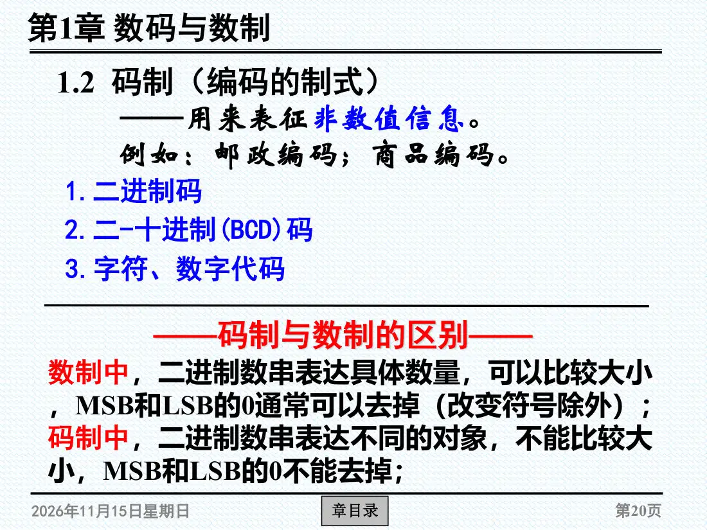

原文：

第1章数码与数制

1.2 码制（编码的制式）

用来表征非数值信息。

例如：邮政编码；商品编码。

1.二进制码

2.二-十进制(BCD)码

3.字符、数字代码

——码制与数制的区别——

数制中，二进制数串表达具体数量，可以比较大小MSB和LSB的0通常可以去掉（改变符号除外）码制中，二进制数串表达不同的对象，不能比较大小，MSB和LSB的0不能去掉；

2026年11月15日星期日

章目录

第20页

### 第1章数码与数制 码制（编码的制式）

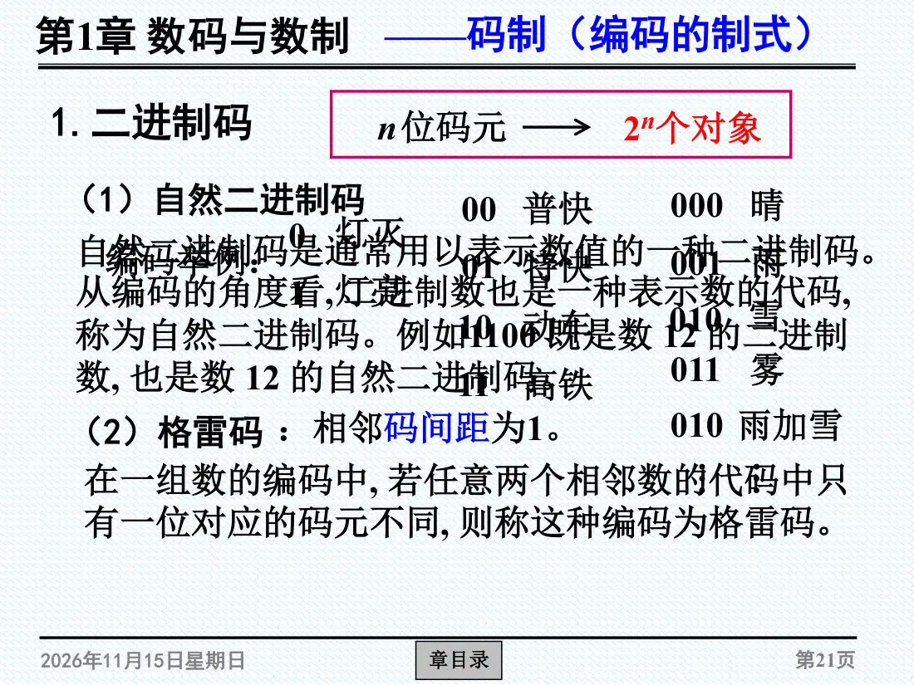

原文：

第1章数码与数制 码制（编码的制式）

1.二进制码

n位码元 2n个对象

（1）自然二进制码 00 普快 000 晴0 灯灭 特快编码举例： 001 雨自然二进制码是通常用以表示数值的一种二进制码。1 灯亮从编码的角度看, 二进制数也是一种表示数的代码,10 动车 010 称为自然二进制码。例如1100 既是数 12 的二进制11 高铁数, 也是数 12 的自然二进制码。 011 雾

（2）格雷码 ：相邻码间距为1。 010 雨加雪… …在一组数的编码中, 若任意两个相邻数的代码中只有一位对应的码元不同, 则称这种编码为格雷码。

2026年11月15日星期日

章目录

第21页

### 第1章数码与数制 码制（编码的制式）

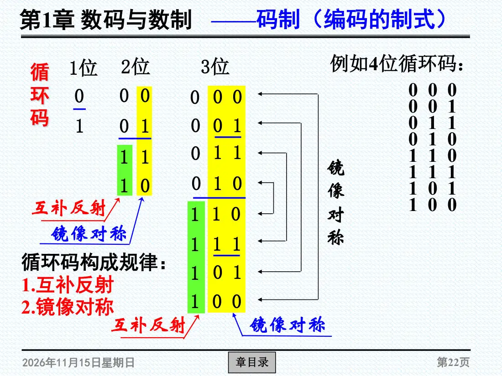

原文：

第1章数码与数制 码制（编码的制式）

2位

循
环
码

$$
\begin{array}{c} 0 \\ \hline 1 \end{array}
$$

$$
\begin{array}{c c} 0 & 0 \\ 0 & 1 \\ \hline 1 & 1 \\ 1 & 0 \end{array}
$$

互补反射镜像对称

镜
像
对

循环码构成规律：

1.互补反射

2.镜像对称

3位

$$
\begin{array}{c c c} 0 & 0 & 0 \\ 0 & \underline {{0}} & 1 \\ 0 & 1 & 1 \\ 0 & 1 & 0 \\ \hline 1 & 1 & 0 \\ 1 & \underline {{1}} & 1 \\ 1 & 0 & 1 \\ 1 & 0 & 0 \end{array}
$$

互补反射

例如4位循环码：

$$
\begin{array}{c c c} \mathbf {0} & \mathbf {0} & \mathbf {0} \\ \mathbf {0} & \mathbf {0} & \mathbf {1} \\ \mathbf {0} & \mathbf {1} & \mathbf {1} \\ \mathbf {0} & \mathbf {1} & \mathbf {0} \\ \mathbf {1} & \mathbf {1} & \mathbf {0} \\ \mathbf {1} & \mathbf {1} & \mathbf {1} \\ \mathbf {1} & \mathbf {0} & \mathbf {1} \\ \mathbf {1} & \mathbf {0} & \mathbf {0} \end{array}
$$

镜像对称

2026年11月15日星期日

章目录

第22页

### 第1章数码与数制 码制（编码的制式）

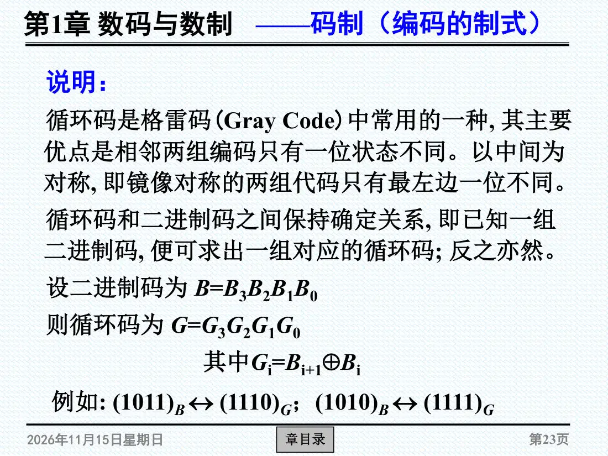

原文：

第1章数码与数制 码制（编码的制式）

说明：

循环码是格雷码(Gray Code)中常用的一种, 其主要优点是相邻两组编码只有一位状态不同。以中间为对称, 即镜像对称的两组代码只有最左边一位不同。

循环码和二进制码之间保持确定关系, 即已知一组二进制码, 便可求出一组对应的循环码; 反之亦然。

设二进制码为 $B { = } B _ { 3 } B _ { 2 } B _ { 1 } B _ { 0 }$

则循环码为 $G { = } G _ { 3 } G _ { 2 } G _ { 1 } G _ { 0 }$

$$
\text { 其中 } G _ {\mathrm{i}} = B _ {\mathrm{i+1}} \oplus B _ {\mathrm{i}}
$$

例如: $( 1 0 1 1 ) _ { B }  ( 1 1 1 0 ) _ { G } ; ( 1 0 1 0 ) _ { B }  ( 1 1 1 1 ) _ { G }$

2026年11月15日星期日

章目录

第23页

### 第1章数码与数制 码制（编码的制式）

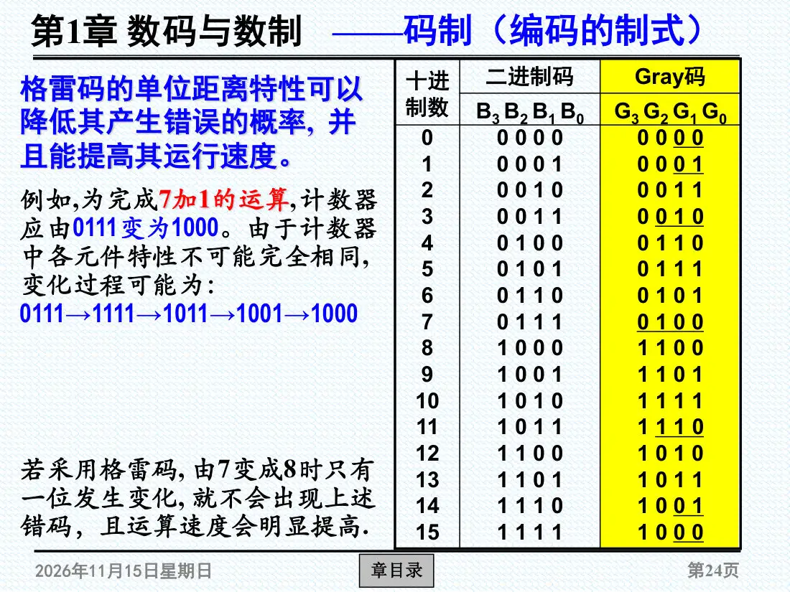

原文：

第1章数码与数制 码制（编码的制式）

<table><tr><td rowspan="18">格雷码的单位距离特性可以降低其产生错误的概率,并且能提高其运行速度。例如,为完成7加1的运算,计数器应由0111变为1000。由于计数器中各元件特性不可能完全相同,变化过程可能为:0111→1111→1011→1001→1000若采用格雷码,由7变成8时只有一位发生变化,就不会出现上述错码,且运算速度会明显提高.</td><td rowspan="2">十进制数</td><td>二进制码</td><td>Gray码</td></tr><tr><td> $B_3B_2B_1B_0$ </td><td> $G_3G_2G_1G_0$ </td></tr><tr><td>0</td><td>0 0 0 0</td><td>0 0 0 0</td></tr><tr><td>1</td><td>0 0 0 1</td><td>0 0 0 1</td></tr><tr><td>2</td><td>0 0 1 0</td><td>0 0 1 1</td></tr><tr><td>3</td><td>0 0 1 1</td><td>0 0 1 0</td></tr><tr><td>4</td><td>0 1 0 0</td><td>0 1 1 0</td></tr><tr><td>5</td><td>0 1 0 1</td><td>0 1 1 1</td></tr><tr><td>6</td><td>0 1 1 0</td><td>0 1 0 1</td></tr><tr><td>7</td><td>0 1 1 1</td><td>0 1 0 0</td></tr><tr><td>8</td><td>1 0 0 0</td><td>1 1 0 0</td></tr><tr><td>9</td><td>1 0 0 1</td><td>1 1 0 1</td></tr><tr><td>10</td><td>1 0 1 0</td><td>1 1 1 1</td></tr><tr><td>11</td><td>1 0 1 1</td><td>1 1 1 0</td></tr><tr><td>12</td><td>1 1 0 0</td><td>1 0 1 0</td></tr><tr><td>13</td><td>1 1 0 1</td><td>1 0 1 1</td></tr><tr><td>14</td><td>1 1 1 0</td><td>1 0 0 1</td></tr><tr><td>15</td><td>1 1 1 1</td><td>1 0 0 0</td></tr></table>

2026年11月15日星期日

章目录

第24页

### 第1章数码与数制 码制（编码的制式）

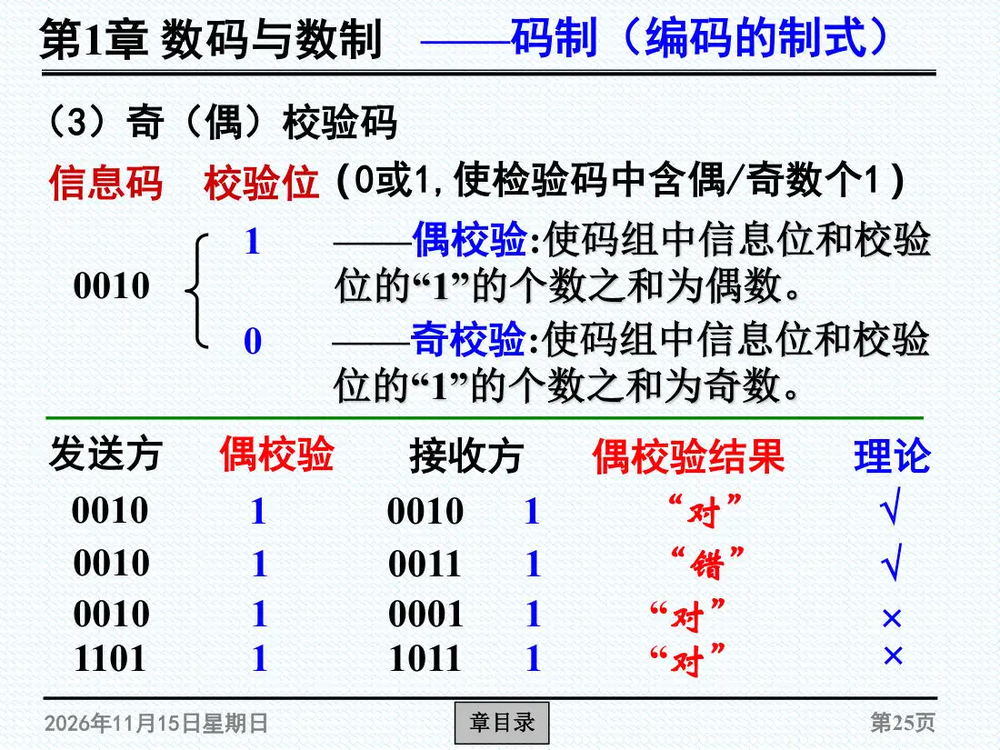

原文：

第1章数码与数制 码制（编码的制式）

（3）奇（偶）校验码

信息码 校验位 ( 0或1,使检验码中含偶/奇数个1 )

0010

偶校验:使码组中信息位和校验位的“1”的个数之和为偶数。

奇校验:使码组中信息位和校验位的“1”的个数之和为奇数。

<table><tr><td>发送方</td><td>偶校验</td><td colspan="2">接收方</td><td>偶校验结果</td><td>理论</td></tr><tr><td>0010</td><td>1</td><td>0010</td><td>1</td><td>“对”</td><td>√</td></tr><tr><td>0010</td><td>1</td><td>0011</td><td>1</td><td>“错”</td><td>√</td></tr><tr><td>0010</td><td>1</td><td>0001</td><td>1</td><td>“对”</td><td>×</td></tr><tr><td>1101</td><td>1</td><td>1011</td><td>1</td><td>“对”</td><td>×</td></tr></table>

2026年11月15日星期日

章目录

第25页

### 第1章数码与数制 码制（编码的制式）

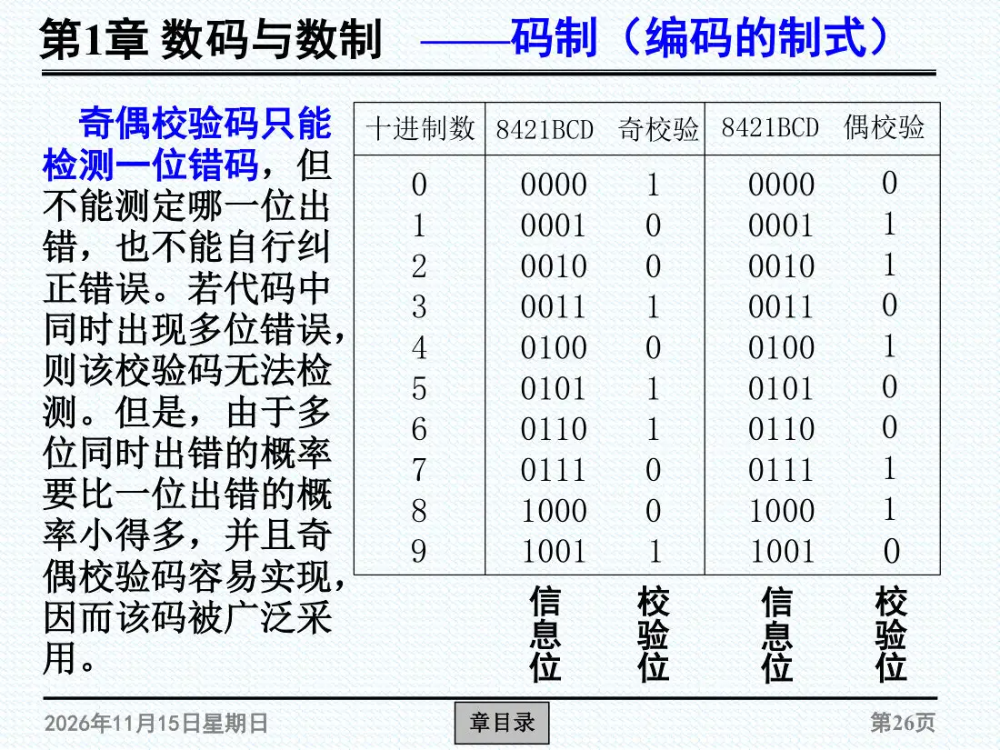

原文：

第1章数码与数制 码制（编码的制式）

奇偶校验码只能检测一位错码，但不能测定哪一位出错，也不能自行纠正错误。若代码中同时出现多位错误，则该校验码无法检测。但是，由于多位同时出错的概率要比一位出错的概率小得多，并且奇偶校验码容易实现，因而该码被广泛采用。

<table><tr><td>十进制数</td><td>8421BCD</td><td>奇校验</td><td>8421BCD</td><td>偶校验</td></tr><tr><td>0</td><td>0000</td><td>1</td><td>0000</td><td>0</td></tr><tr><td>1</td><td>0001</td><td>0</td><td>0001</td><td>1</td></tr><tr><td>2</td><td>0010</td><td>0</td><td>0010</td><td>1</td></tr><tr><td>3</td><td>0011</td><td>1</td><td>0011</td><td>0</td></tr><tr><td>4</td><td>0100</td><td>0</td><td>0100</td><td>1</td></tr><tr><td>5</td><td>0101</td><td>1</td><td>0101</td><td>0</td></tr><tr><td>6</td><td>0110</td><td>1</td><td>0110</td><td>0</td></tr><tr><td>7</td><td>0111</td><td>0</td><td>0111</td><td>1</td></tr><tr><td>8</td><td>1000</td><td>0</td><td>1000</td><td>1</td></tr><tr><td>9</td><td>1001</td><td>1</td><td>1001</td><td>0</td></tr></table>

2026年11月15日星期日

章目录

第26页

### 第1章数码与数制 码制（编码的制式）

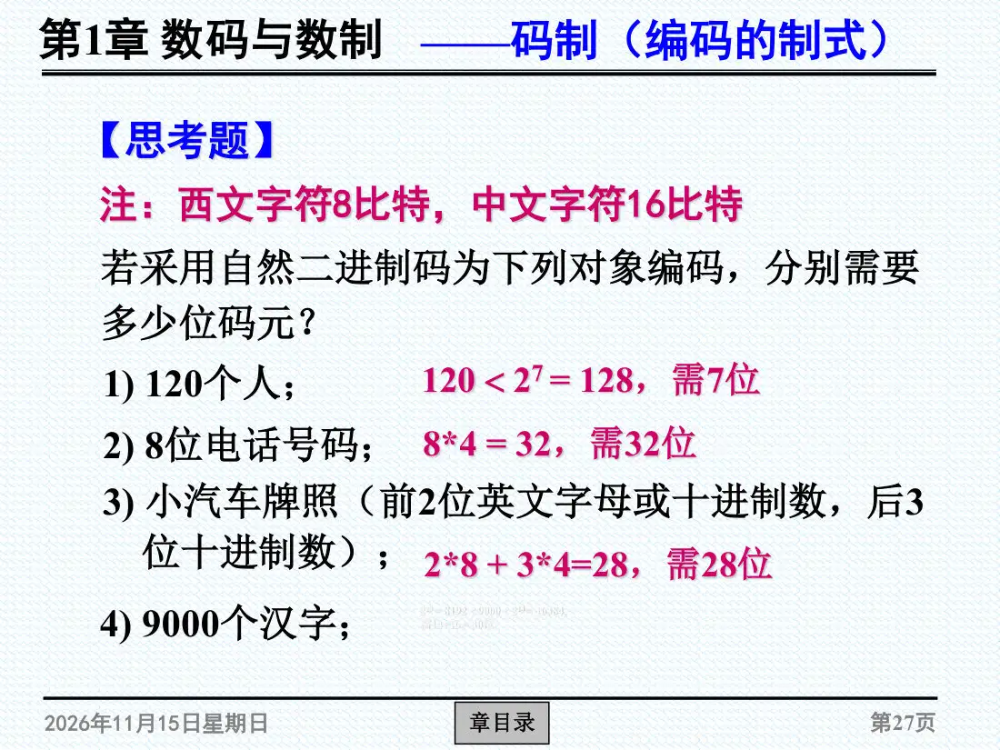

原文：

第1章数码与数制 码制（编码的制式）

【思考题】

注：西文字符8比特，中文字符16比特

若采用自然二进制码为下列对象编码，分别需要多少位码元？

1) 120 $1 2 0 < 2 ^ { 7 } = 1 2 8$ 需7位

2) 8位电话号码； 8\*4 = 32，需32位

3) 小汽车牌照（前2位英文字母或十进制数，后3位十进制数） $2 ^ { * } 8 + 3 ^ { * } 4 = 2 8$ 需28位

4) 9000个汉字；

2026年11月15日星期日

章目录

第27页

### 第1章数码与数制 码制（编码的制式）

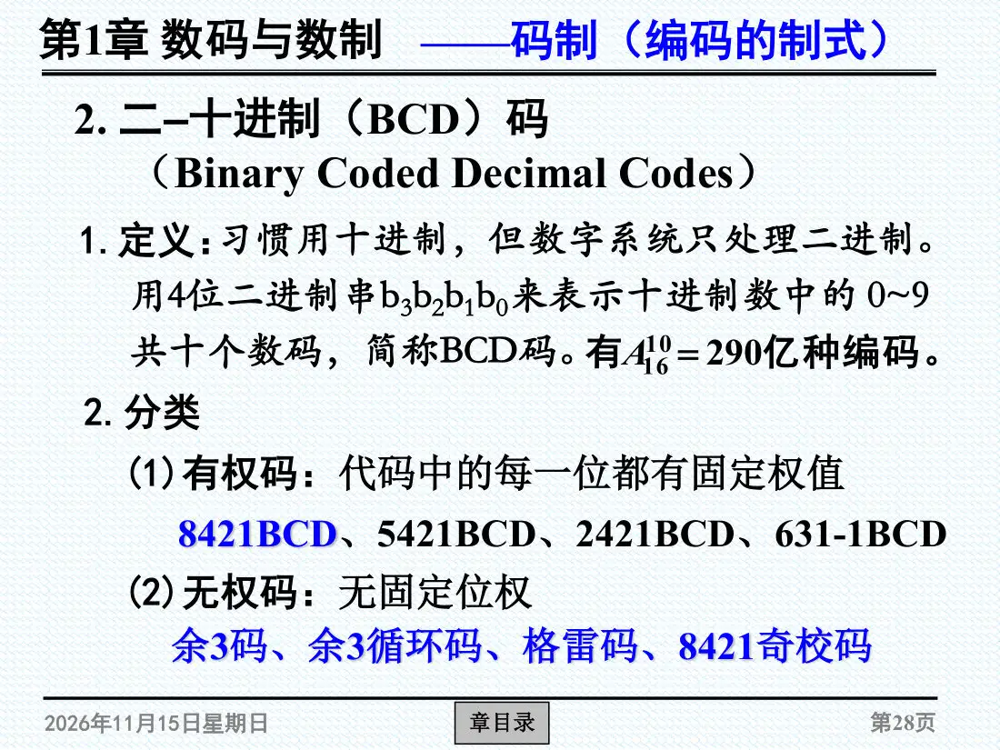

原文：

第1章数码与数制 码制（编码的制式）

2. 二–十进制（BCD）码（Binary Coded Decimal Codes）

习惯用十进制，但数字系统只处理二进制。1.定义：用4位二进制串 $\mathsf { b } _ { 3 } \mathsf { b } _ { 2 } \mathsf { b } _ { 1 } \mathsf { b } _ { 0 }$ 来表示十进制数中的 0\~9共十个数码，简称BCD码。 $4 _ { 1 6 } ^ { 1 0 } = 2 9 0 \cdot$ 亿种编码。

2.分类

(1)有权码：代码中的每一位都有固定权值8421BCD、5421BCD、2421BCD、631-1BCD

(2)无权码：无固定位权余3码、余3循环码、格雷码、8421奇校码

2026年11月15日星期日

章目录

第28页

### 第1章数码与数制 码制（编码的制式）

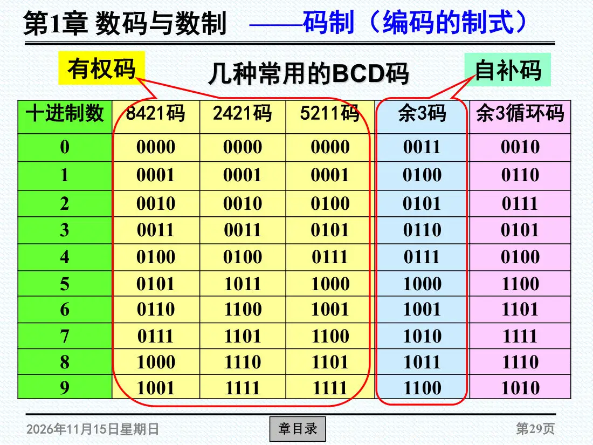

原文：

第1章数码与数制 码制（编码的制式）

<table><tr><td>十进制数</td><td>8421码</td><td>2421码</td><td>5211码</td><td>余3码</td><td>余3循环码</td></tr><tr><td>0</td><td>0000</td><td>0000</td><td>0000</td><td>0011</td><td>0010</td></tr><tr><td>1</td><td>0001</td><td>0001</td><td>0001</td><td>0100</td><td>0110</td></tr><tr><td>2</td><td>0010</td><td>0010</td><td>0100</td><td>0101</td><td>0111</td></tr><tr><td>3</td><td>0011</td><td>0011</td><td>0101</td><td>0110</td><td>0101</td></tr><tr><td>4</td><td>0100</td><td>0100</td><td>0111</td><td>0111</td><td>0100</td></tr><tr><td>5</td><td>0101</td><td>1011</td><td>1000</td><td>1000</td><td>1100</td></tr><tr><td>6</td><td>0110</td><td>1100</td><td>1001</td><td>1001</td><td>1101</td></tr><tr><td>7</td><td>0111</td><td>1101</td><td>1100</td><td>1010</td><td>1111</td></tr><tr><td>8</td><td>1000</td><td>1110</td><td>1101</td><td>1011</td><td>1110</td></tr><tr><td>9</td><td>1001</td><td>1111</td><td>1111</td><td>1100</td><td>1010</td></tr></table>

2026年11月15日星期日

章目录

第29页

### 第1章数码与数制 码制（编码的制式）

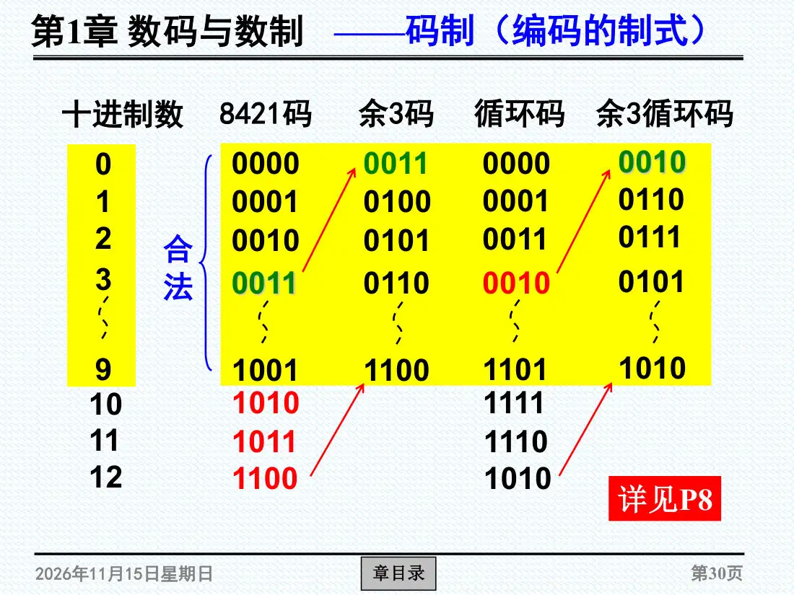

原文：

第1章数码与数制 码制（编码的制式）

<table><tr><td>十进制数</td><td>8421码</td><td>余3码</td><td>循环码</td><td>余3循环码</td></tr><tr><td>0</td><td>0000</td><td>0011</td><td>0000</td><td>0010</td></tr><tr><td>1</td><td>0001</td><td>0100</td><td>0001</td><td>0110</td></tr><tr><td>2</td><td>0010</td><td>0101</td><td>0011</td><td>0111</td></tr><tr><td>3</td><td>0011</td><td>0110</td><td>0010</td><td>0101</td></tr><tr><td>9</td><td>1001</td><td>1100</td><td>1101</td><td>1010</td></tr><tr><td>10</td><td>1010</td><td></td><td>1111</td><td></td></tr><tr><td>11</td><td>1011</td><td></td><td>1110</td><td></td></tr><tr><td>12</td><td>1100</td><td></td><td>1010</td><td></td></tr></table>

2026年11月15日星期日

章目录

第30页

### 第1章数码与数制 码制（编码的制式）

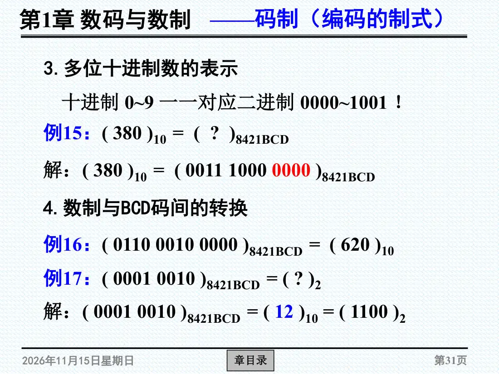

原文：

第1章数码与数制 码制（编码的制式）

3.多位十进制数的表示

十进制 0\~9 一一对应二进制 0000\~1001 ！

例15： $( 3 8 0 ) _ { 1 0 } = ( ? ) _ { 8 4 2 1 \mathrm { B C D } }$

解： $( \mathrm { 3 8 0 ~ ) _ { 1 0 } = \ ( \ 0 0 1 1 ~ 1 0 0 0 ~ 0 0 0 0 ~ ) _ { 8 4 2 1 \mathrm { B C D } } }$

4.数制与BCD码间的转换

例16： $\mathrm { ( 0 1 1 0 0 0 0 1 0 0 0 0 0 ) _ { 8 4 2 1 B C D } = ( 6 2 0 ) _ { 1 0 } }$

例17： $( \mathbf { 0 0 0 1 0 0 1 0 } 0 0 1 \mathbf { 0 } ) _ { 8 4 2 1 \mathbf { B C D } } = ( \mathbf { \xi } ? \mathbf { \xi } ) _ { 2 }$

解： $\mathrm { ( 0 0 0 1 ~ 0 0 1 0 ~ ) } _ { 8 4 2 1 8 \mathrm { C D } } = \mathrm { ( ~ 1 2 ~ ) } _ { 1 0 } = \mathrm { ( ~ 1 1 0 0 ~ ) } _ { 2 }$

2026年11月15日星期日

章目录

第31页

### 第1章数码与数制 码制（编码的制式）

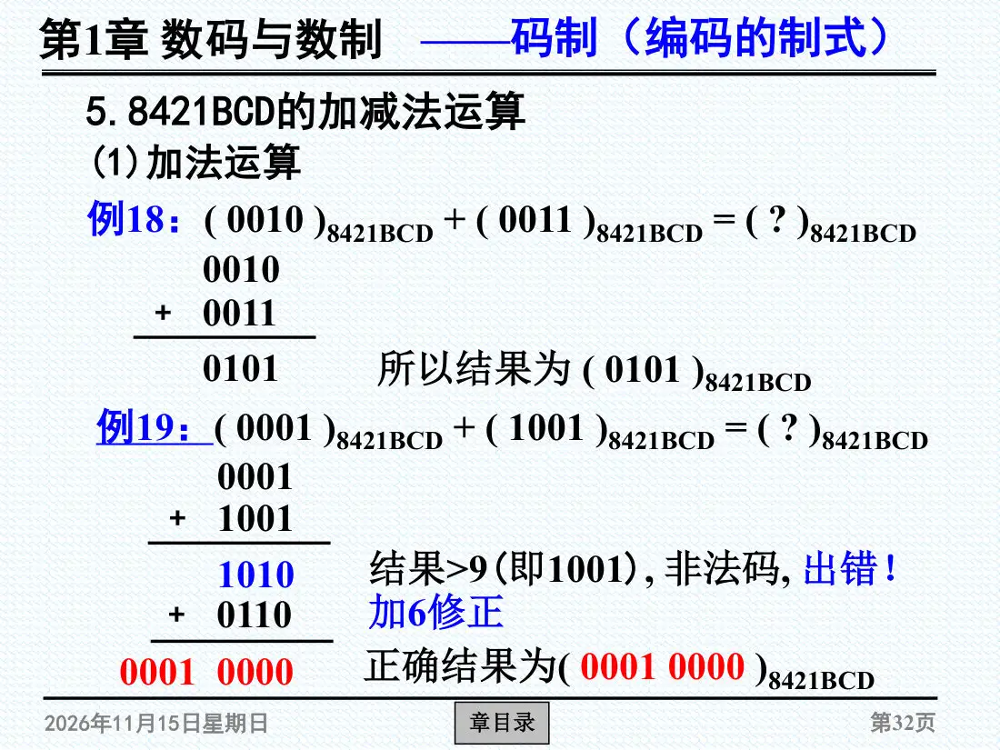

原文：

第1章数码与数制 码制（编码的制式）

5.8421BCD的加减法运算

(1)加法运算

例18：( 0010 )8421BCD + ( 0011 )8421BCD = ( ? )8421BCD 0010 ﹢ 0011 0101 所以结果为 ( 0101 )8421BCD

例19： $\mathrm { ( 0 0 0 1 ) _ { 8 4 2 1 B C D } + ( 1 0 0 1 ) _ { 8 4 2 1 B C D } = ( \Omega ^ { 2 } ) _ { 8 4 2 1 B C D } }$ 0001﹢ 10011010 结果>9(即1001), 非法码, 出错！﹢ 0110 加6修正0001 0000 正确结果为 $( 0 0 0 1 0 0 0 0 ) _ { 8 4 2 1 \mathrm { B C D } }$

2026年11月15日星期日

章目录

第32页

### 第1章数码与数制 码制（编码的制式）

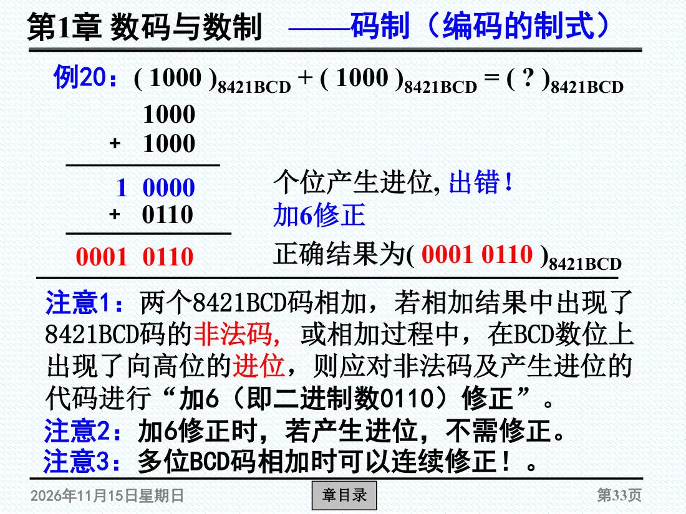

原文：

第1章数码与数制 码制（编码的制式）

<table><tr><td colspan="2">例20: (1000)8421BCD + (1000)8421BCD = (?)8421BCD</td></tr><tr><td>1000</td><td></td></tr><tr><td>+ 1000</td><td></td></tr><tr><td>1 0000</td><td>个位产生进位,出错!</td></tr><tr><td>+ 0110</td><td>加6修正</td></tr><tr><td>0001 0110</td><td>正确结果为(0001 0110)8421BCD</td></tr></table>

注意1：两个8421BCD码相加，若相加结果中出现了8421BCD码的非法码, 或相加过程中，在BCD数位上出现了向高位的进位，则应对非法码及产生进位的代码进行“加6（即二进制数0110）修正”。

注意2：加6修正时，若产生进位，不需修正。

注意3：多位BCD码相加时可以连续修正！。

2026年11月15日星期日

章目录

第33页

### 第1章 数码与数制

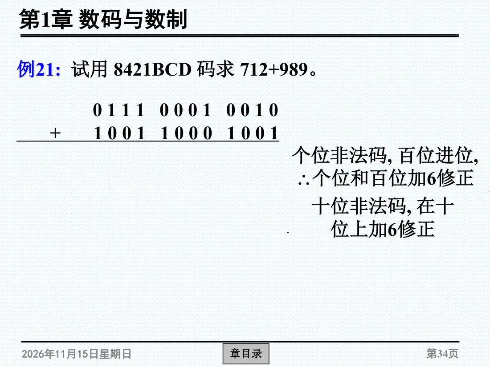

原文：

第1章 数码与数制

例21: 试用 8421BCD 码求 712+989。

0 1 1 1 0 0 0 1 0 0 1 0 1 0 0 1 1 0 0 0 1 0 0 1

个位非法码, 百位进位,个位和百位加6修正十位非法码, 在十位上加6修正

2026年11月15日星期日

章目录

第34页

### 第1章数码与数制 码制（编码的制式）

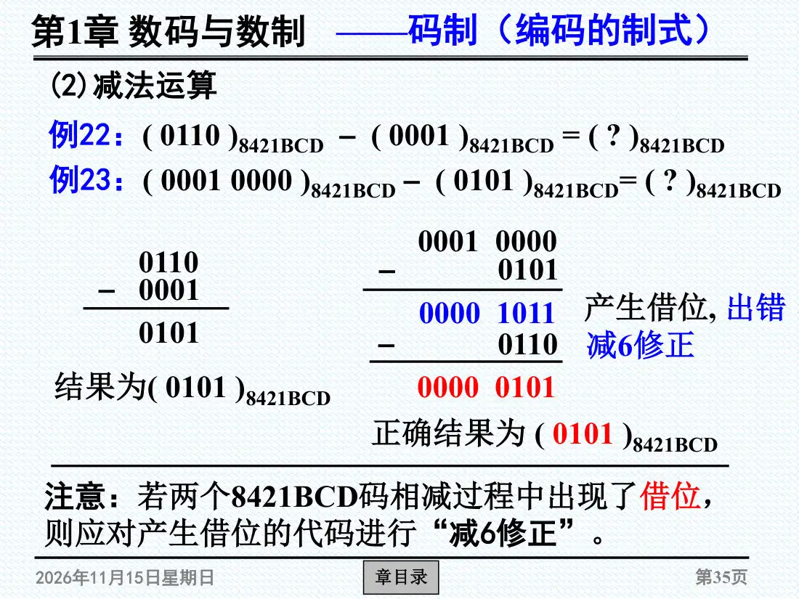

原文：

第1章数码与数制 码制（编码的制式）

(2)减法运算

例22：( 0110 )8421BCD － ( 0001 )8421BCD = ( ? )8421BCD

$$
\begin{array}{r l} & {\text {例23: (0001 0000) _ {8421BCD} - (0101) _ {8421BCD} = (?) _ {8421BCD}}} \\ & {\frac {0 1 1 0}{- 0 0 0 1}} \\ & {\frac {}{0 1 0 1}} \\ & {\text {结果为(0101) _ {8421BCD}}} \end{array} \quad \begin{array}{r l} & {\frac {- 0 0 0 1 0 0 0 0}{- 0 1 0 1}} \\ & {\frac {0 0 0 0 1 0 1 1}{- 0 1 1 0}} \\ & {\frac {0 0 0 0 0 1 0 1}{0 0 0 0}} \end{array} \text {产生借位,出错减6修正}
$$

正确结果为 ( 0101 8421BCD

注意：若两个8421BCD码相减过程中出现了借位，则应对产生借位的代码进行“减6修正”

2026年11月15日星期日

章目录

第35页

### 第1章数码与数制 码制（编码的制式）

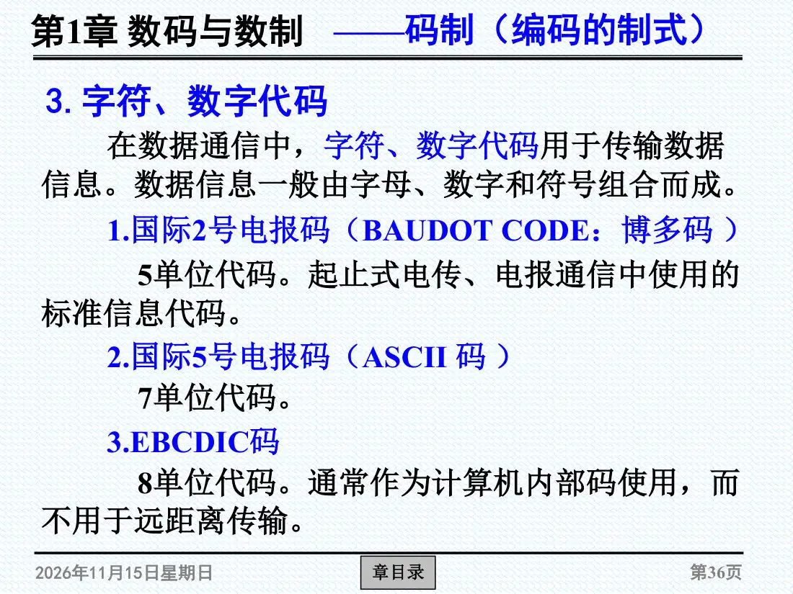

原文：

第1章数码与数制 码制（编码的制式）

3.字符、数字代码

在数据通信中，字符、数字代码用于传输数据信息。数据信息一般由字母、数字和符号组合而成。

1.国际2号电报码（BAUDOT CODE：博多码 ）

5单位代码。起止式电传、电报通信中使用的标准信息代码。

2.国际5号电报码（ASCII 码

7单位代码。

3.EBCDIC码

8单位代码。通常作为计算机内部码使用，而不用于远距离传输。

2026年11月15日星期日

章目录

第36页

### 第1章数码与数制 ——ASCII码

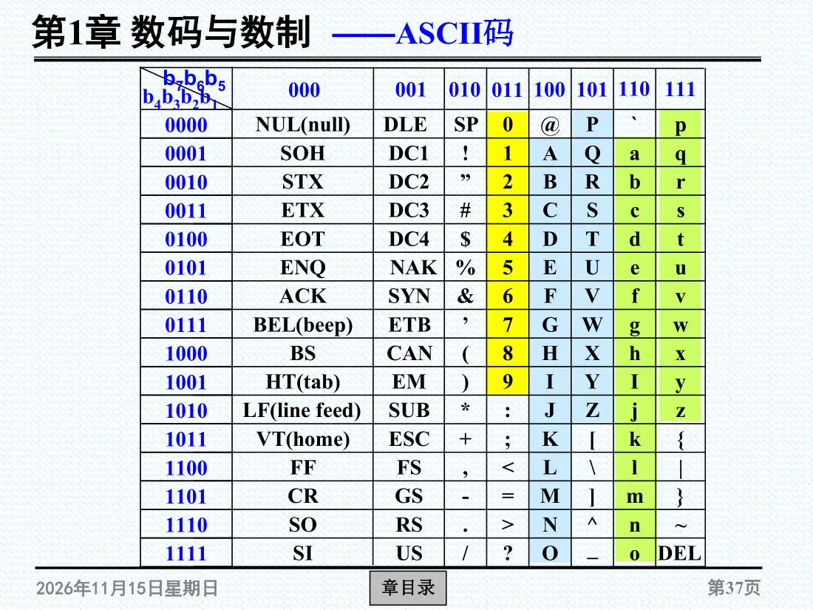

原文：

第1章数码与数制 ——ASCII码

<table><tr><td> $b_{7}b_{6}b_{5}$  $b_{4}b_{3}b_{2}b_{1}$ </td><td>000</td><td>001</td><td>010</td><td>011</td><td>100</td><td>101</td><td>110</td><td>111</td></tr><tr><td>0000</td><td>NUL(null)</td><td>DLE</td><td>SP</td><td>0</td><td>@</td><td>P</td><td>`</td><td>p</td></tr><tr><td>0001</td><td>SOH</td><td>DC1</td><td>!</td><td>1</td><td>A</td><td>Q</td><td>a</td><td>q</td></tr><tr><td>0010</td><td>STX</td><td>DC2</td><td>”</td><td>2</td><td>B</td><td>R</td><td>b</td><td>r</td></tr><tr><td>0011</td><td>ETX</td><td>DC3</td><td>#</td><td>3</td><td>C</td><td>S</td><td>c</td><td>s</td></tr><tr><td>0100</td><td>EOT</td><td>DC4</td><td>$</td><td>4</td><td>D</td><td>T</td><td>d</td><td>t</td></tr><tr><td>0101</td><td>ENQ</td><td>NAK</td><td>%</td><td>5</td><td>E</td><td>U</td><td>e</td><td>u</td></tr><tr><td>0110</td><td>ACK</td><td>SYN</td><td>&amp;</td><td>6</td><td>F</td><td>V</td><td>f</td><td>v</td></tr><tr><td>0111</td><td>BEL(beep)</td><td>ETB</td><td>’</td><td>7</td><td>G</td><td>W</td><td>g</td><td>w</td></tr><tr><td>1000</td><td>BS</td><td>CAN</td><td>(</td><td>8</td><td>H</td><td>X</td><td>h</td><td>x</td></tr><tr><td>1001</td><td>HT(tab)</td><td>EM</td><td>)</td><td>9</td><td>I</td><td>Y</td><td>I</td><td>y</td></tr><tr><td>1010</td><td>LF(line feed)</td><td>SUB</td><td>*</td><td>:</td><td>J</td><td>Z</td><td>j</td><td>z</td></tr><tr><td>1011</td><td>VT(home)</td><td>ESC</td><td>+</td><td>;</td><td>K</td><td>[</td><td>k</td><td>{</td></tr><tr><td>1100</td><td>FF</td><td>FS</td><td>,</td><td>&lt;</td><td>L</td><td>\</td><td>l</td><td>|</td></tr><tr><td>1101</td><td>CR</td><td>GS</td><td>-</td><td>=</td><td>M</td><td>]</td><td>m</td><td>}</td></tr><tr><td>1110</td><td>SO</td><td>RS</td><td>.</td><td>&gt;</td><td>N</td><td>^</td><td>n</td><td>~</td></tr><tr><td>1111</td><td>SI</td><td>US</td><td>/</td><td>?</td><td>O</td><td>_</td><td>o</td><td>DEL</td></tr></table>

2026年11月15日星期日

章目录

第37页

### 第1章数码与数制

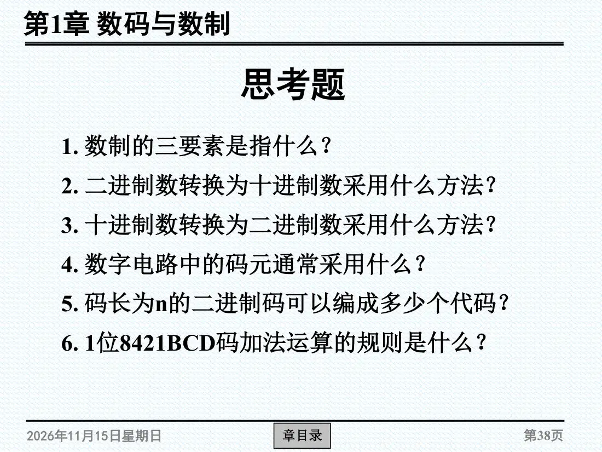

原文：

第1章数码与数制

思考题

1. 数制的三要素是指什么？

2. 二进制数转换为十进制数采用什么方法？

3. 十进制数转换为二进制数采用什么方法？

4. 数字电路中的码元通常采用什么？

5. 码长为n的二进制码可以编成多少个代码？

6. 1位8421BCD码加法运算的规则是什么？

2026年11月15日星期日

章目录

第38页

### 第1章数码与数制

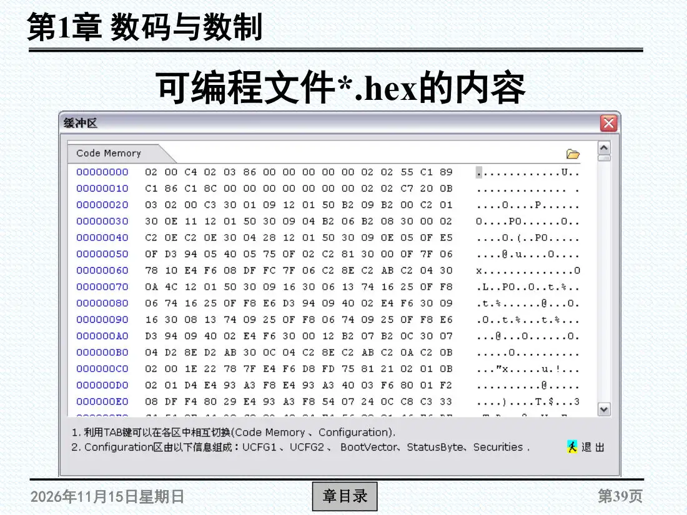

原文：

第1章数码与数制

可编程文件\*.hex的内容

<table><tr><td colspan="18">Code Memory</td></tr><tr><td>00000000</td><td>02</td><td>00</td><td>C4</td><td>02</td><td>03</td><td>86</td><td>00</td><td>00</td><td>00</td><td>00</td><td>00</td><td>02</td><td>02</td><td>55</td><td>C1</td><td>89</td><td>......U..</td></tr><tr><td>00000010</td><td>C1</td><td>86</td><td>C1</td><td>8C</td><td>00</td><td>00</td><td>00</td><td>00</td><td>00</td><td>00</td><td>00</td><td>02</td><td>02</td><td>C7</td><td>20</td><td>OB</td><td>......</td></tr><tr><td>00000020</td><td>03</td><td>02</td><td>00</td><td>C3</td><td>30</td><td>01</td><td>09</td><td>12</td><td>01</td><td>50</td><td>B2</td><td>09</td><td>B2</td><td>00</td><td>C2</td><td>01</td><td>....0....P......</td></tr><tr><td>00000030</td><td>30</td><td>OE</td><td>11</td><td>12</td><td>01</td><td>50</td><td>30</td><td>09</td><td>04</td><td>B2</td><td>06</td><td>B2</td><td>08</td><td>30</td><td>00</td><td>02</td><td>0....PO......0..</td></tr><tr><td>00000040</td><td>C2</td><td>OE</td><td>C2</td><td>OE</td><td>30</td><td>04</td><td>28</td><td>12</td><td>01</td><td>50</td><td>30</td><td>09</td><td>OE</td><td>05</td><td>OF</td><td>E5</td><td>....0.(..PO....</td></tr><tr><td>00000050</td><td>OF</td><td>D3</td><td>94</td><td>05</td><td>40</td><td>05</td><td>75</td><td>OF</td><td>02</td><td>C2</td><td>81</td><td>30</td><td>00</td><td>OF</td><td>7F</td><td>06</td><td>...@.u....0....</td></tr><tr><td>00000060</td><td>78</td><td>10</td><td>E4</td><td>F6</td><td>08</td><td>DF</td><td>FC</td><td>7F</td><td>06</td><td>C2</td><td>8E</td><td>C2</td><td>AB</td><td>C2</td><td>04</td><td>30</td><td>x......0</td></tr><tr><td>00000070</td><td>OA</td><td>4C</td><td>12</td><td>01</td><td>50</td><td>30</td><td>09</td><td>16</td><td>30</td><td>06</td><td>13</td><td>74</td><td>16</td><td>25</td><td>OF</td><td>F8</td><td>.L..PO..0..t.%..</td></tr><tr><td>00000080</td><td>06</td><td>74</td><td>16</td><td>25</td><td>OF</td><td>F8</td><td>E6</td><td>D3</td><td>94</td><td>09</td><td>40</td><td>02</td><td>E4</td><td>F6</td><td>30</td><td>09</td><td>.t.%......@...0.</td></tr><tr><td>00000090</td><td>16</td><td>30</td><td>08</td><td>13</td><td>74</td><td>09</td><td>25</td><td>OF</td><td>F8</td><td>06</td><td>74</td><td>09</td><td>25</td><td>OF</td><td>F8</td><td>E6</td><td>.0..t.%...t.%...</td></tr><tr><td>000000A0</td><td>D3</td><td>94</td><td>09</td><td>40</td><td>02</td><td>E4</td><td>F6</td><td>30</td><td>00</td><td>12</td><td>B2</td><td>07</td><td>B2</td><td>OC</td><td>30</td><td>07</td><td>...@...0......0.</td></tr><tr><td>000000B0</td><td>04</td><td>D2</td><td>8E</td><td>D2</td><td>AB</td><td>30</td><td>OC</td><td>04</td><td>C2</td><td>8E</td><td>C2</td><td>AB</td><td>C2</td><td>OA</td><td>C2</td><td>OB</td><td>....0......</td></tr><tr><td>000000C0</td><td>02</td><td>00</td><td>1E</td><td>22</td><td>78</td><td>7F</td><td>E4</td><td>F6</td><td>D8</td><td>FD</td><td>75</td><td>81</td><td>21</td><td>02</td><td>01</td><td>OB</td><td>...&quot;x......u!...</td></tr><tr><td>000000D0</td><td>02</td><td>01</td><td>D4</td><td>E4</td><td>93</td><td>A3</td><td>F8</td><td>E4</td><td>93</td><td>A3</td><td>40</td><td>03</td><td>F6</td><td>80</td><td>01</td><td>F2</td><td>......@......</td></tr><tr><td>000000E0</td><td>08</td><td>DF</td><td>F4</td><td>80</td><td>29</td><td>E4</td><td>93</td><td>A3</td><td>F8</td><td>54</td><td>07</td><td>24</td><td>OC</td><td>C8</td><td>C3</td><td>33</td><td>...)....T.$...3</td></tr></table>
1. 利用TAB键可以在各区中相互切换(Code Memory、Configuration). 2. Configuration区由以下信息组成：UCFG1、UCFG2、BootVector、StatusByte、Securities.

2026年11月15日星期日

章目录

第39页

### 第1章 数码与数制

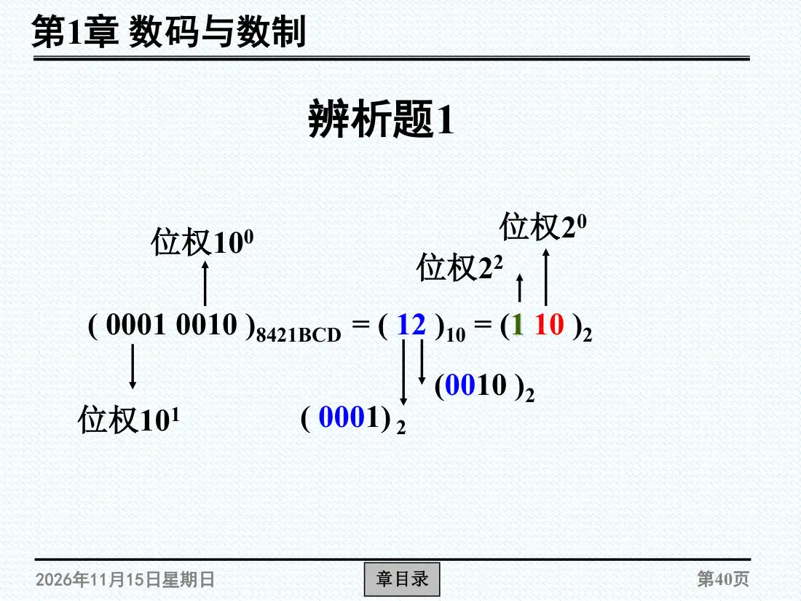

原文：

第1章 数码与数制

辨析题1

位权 $1 0 ^ { 0 }$

( 0001 0010

位权101

位权 $2 ^ { 0 }$

位权22

0001) 2

2026年11月15日星期日

章目录

第40页

### 第1章数码与数制

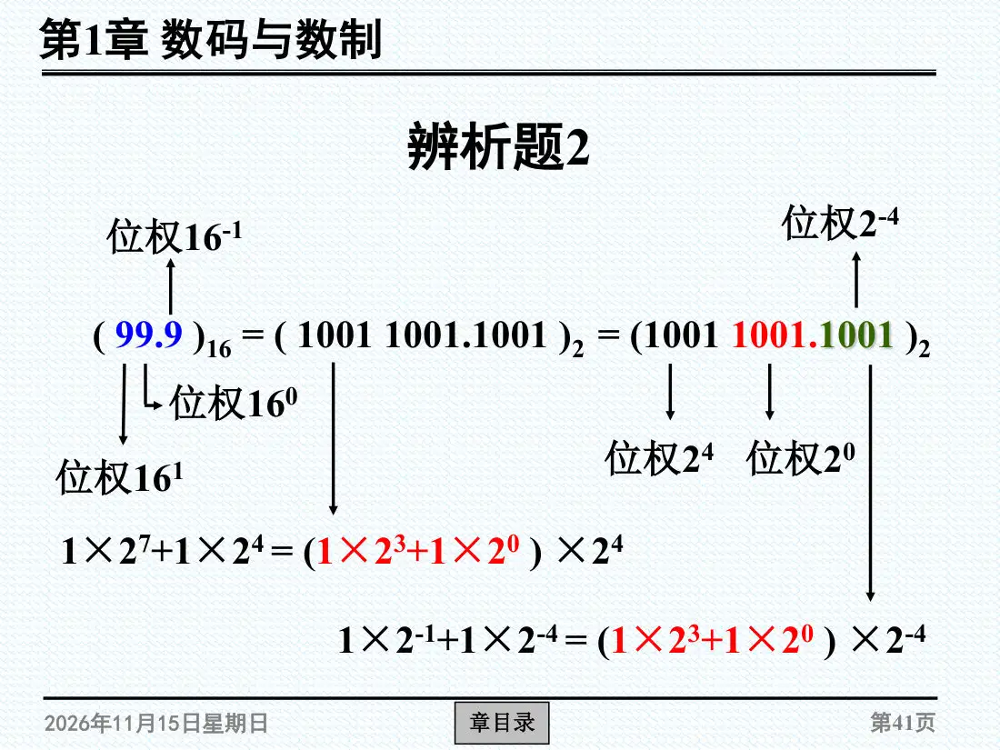

原文：

第1章数码与数制

辨析题2

位权 $1 6 ^ { - 1 }$

位权2-4

( 99.9 )16 = ( 1001 1001.1001 )2 = (1001 1001.1001 )2

位权 $1 6 ^ { 0 }$

位权 $1 6 ^ { 1 }$

位权 $2 ^ { 4 }$ 位权 $2 ^ { \mathbf { 0 } }$

$$
1 \times 2 ^ {7} + 1 \times 2 ^ {4} = (1 \times 2 ^ {3} + 1 \times 2 ^ {0}) \times 2 ^ {4}
$$

$$
1 \times 2 ^ {- 1} + 1 \times 2 ^ {- 4} = (1 \times 2 ^ {3} + 1 \times 2 ^ {0}) \times 2 ^ {- 4}
$$

2026年11月15日星期日

章目录

第41页

### 第1章 数码与数制

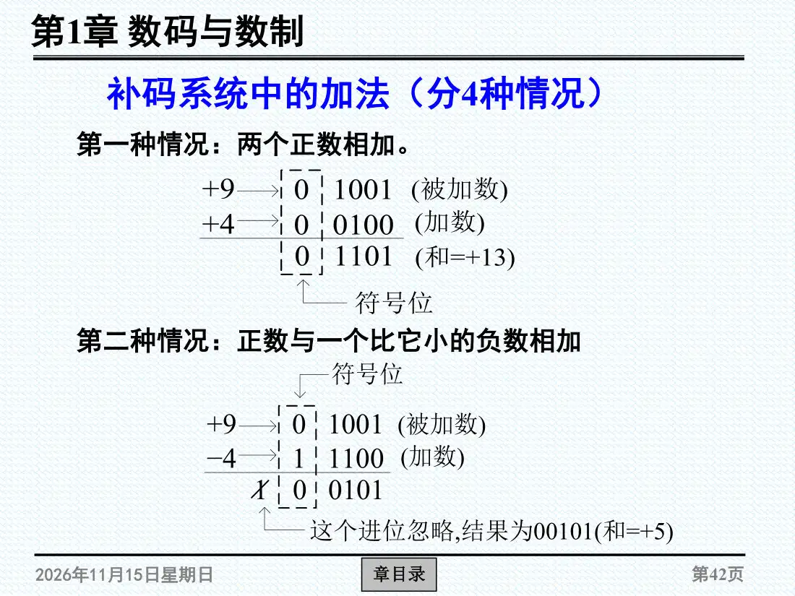

原文：

第1章 数码与数制

补码系统中的加法（分4种情况）

第一种情况：两个正数相加。

$$
\begin{array}{r l} & {+ 9 \longrightarrow \boxed {0} \boxed {1 0 0 1} (\text {被加数})} \\ & {+ 4 \longrightarrow \boxed {0} \boxed {0 1 0 0} (\text {加数})} \\ & {\quad \boxed {0} \boxed {1 1 0 1} (\text {和} = + 1 3)} \\ & {\quad \uparrow_ {\text {符号位}}} \end{array}
$$

第二种情况：正数与一个比它小的负数相加符号位+9→0±1001（被加数)1|1100 (加数)x ± 00101

这个进位忽略,结果为00101(和=+5)

2026年11月15日星期日

章目录

第42页

### 第1章 数码与数制

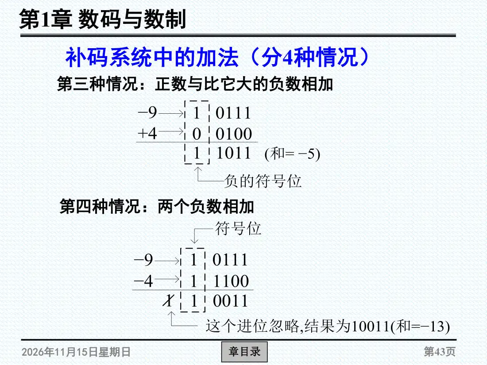

原文：

第1章 数码与数制

补码系统中的加法（分4种情况）

第三种情况：正数与比它大的负数相加

$$
\begin{array}{r l} & {- 9 \longrightarrow \boxed {1} \boxed {0 1 1 1}} \\ & {+ 4 \longrightarrow \boxed {0} \boxed {0 1 0 0}} \\ & {\hline \boxed {1} \boxed {1 0 1 1} (\text {和} = - 5)} \\ & {\quad \text {负的符号位}} \end{array}
$$

第四种情况：两个负数相加

这个进位忽略,结果为10011(和=-13)

2026年11月15日星期日

章目录

第43页
