# 《数字电路与逻辑设计B》第20讲 时序电路的分析与设计（课件）

原件的每一页，下面附识别出的文字。

### 5.6 一般时序逻辑电路的分析

原文：

5.6 一般时序逻辑电路的分析

一、 分析步骤

① 电路分析。 根据 电路结构， 确定是同步还是异 步 电 路 ， 是Moore 型 ， 还是M l ea y 型 ； 确 定输入信号和输出信号， 哪些部分是组合逻辑 电路， 哪些部分是存储电路。

② 列各触发器的驱动方程、 次态方程 （包含时钟表达式） 和时序电路的输出方程。

③ 根据状态方程和输出方程列状态转移表、 状态转移图或波形图 。

④ 描述给定时序逻辑电路的逻辑功能。

南京邮电大学 电子电路教学中心

### 例5.6.1 分析 图5.6.1 所示 电路 的逻辑功能 。

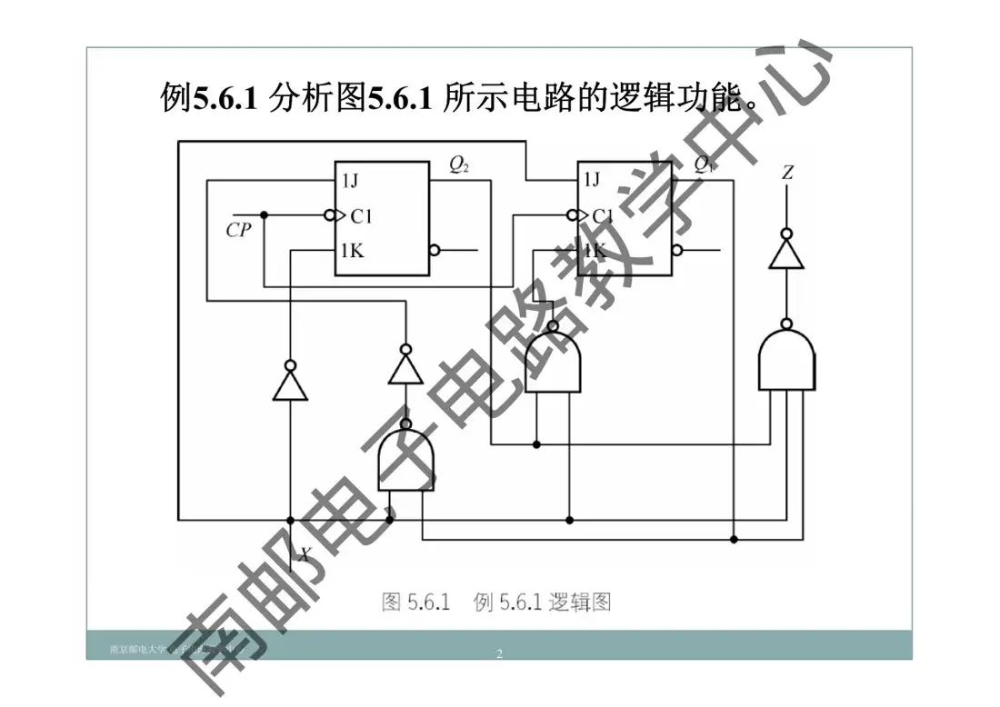

原文：

例5.6.1 分析 图5.6.1 所示 电路 的逻辑功能 。

南京邮电大学 电子电路教学中心

2

### 解： (1) 分析电路结构

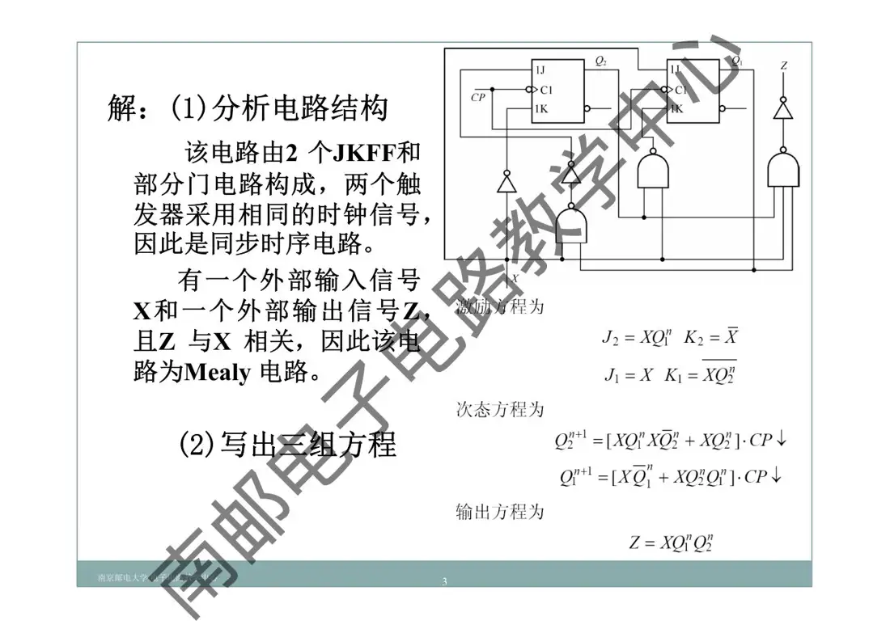

原文：

解： (1) 分析电路结构

该 电路 由2 个JKFF和部分 门 电路构成， 两个触发器采用相 同 的时钟信号，因此是同步时序 电路。

有一个外部输入信号X和 个外部输 出 信 号一 Z，且Z 与X 相关， 因此该 电路为Mealy 电路 。

(2) 写出三组方程

激励方程为

$$
J _ {2} = X Q _ {1} ^ {n} K _ {2} = \bar {X}
$$

$$
J _ {1} = X K _ {1} = \overline {{X Q _ {2} ^ {n}}}
$$

次态方程为

$$
Q _ {2} ^ {n + 1} = [ X Q _ {1} ^ {n} X \overline {{Q}} _ {2} ^ {n} + X Q _ {2} ^ {n} ] \cdot C P \downarrow
$$

$$
Q _ {1} ^ {n + 1} = [ X \overline {{Q}} _ {1} ^ {n} + X Q _ {2} ^ {n} Q _ {1} ^ {n} ] \cdot C P \downarrow
$$

输出方程为

$$
Z = X Q _ {1} ^ {n} Q _ {2} ^ {n}
$$

南京邮电大学

### （3） 列状态转移表和状态转移图

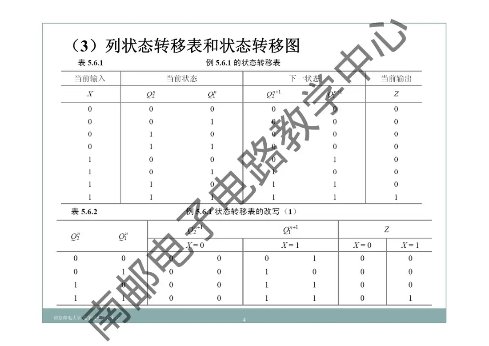

原文：

（3） 列状态转移表和状态转移图

表 5.6.1 例 5.6.1 的状态转移表
<table><tr><td>当前输入</td><td colspan="2">当前状态</td><td colspan="2">下一状态</td><td colspan="2">当前输出</td></tr><tr><td>X</td><td> $Q_2^n$ </td><td> $Q_1^n$ </td><td> $Q_2^{n+1}$ </td><td> $Q_1^{n+1}$ </td><td colspan="2">Z</td></tr><tr><td>0</td><td>0</td><td>0</td><td>0</td><td>0</td><td colspan="2">0</td></tr><tr><td>0</td><td>0</td><td>1</td><td>0</td><td>0</td><td colspan="2">0</td></tr><tr><td>0</td><td>1</td><td>0</td><td>0</td><td>0</td><td colspan="2">0</td></tr><tr><td>0</td><td>1</td><td>1</td><td>0</td><td>0</td><td colspan="2">0</td></tr><tr><td>1</td><td>0</td><td>0</td><td>0</td><td>1</td><td colspan="2">0</td></tr><tr><td>1</td><td>0</td><td>1</td><td>1</td><td>0</td><td colspan="2">0</td></tr><tr><td>1</td><td>1</td><td>0</td><td>1</td><td>1</td><td colspan="2">0</td></tr><tr><td>1</td><td>1</td><td>1</td><td>1</td><td>1</td><td colspan="2">1</td></tr><tr><td colspan="7">表5.6.2 例5.6.1状态转移表的改写(1)</td></tr><tr><td rowspan="2"> $Q_2^n$ </td><td rowspan="2"> $Q_1^n$ </td><td> $Q_2^{n+1}$ </td><td colspan="2"> $Q_1^{n+1}$ </td><td colspan="2">Z</td></tr><tr><td>X=0</td><td colspan="2">X=1</td><td>X=0</td><td>X=1</td></tr><tr><td>0</td><td>0</td><td>0</td><td>0</td><td>1</td><td>0</td><td>0</td></tr><tr><td>0</td><td>1</td><td>0</td><td>0</td><td>1</td><td>0</td><td>0</td></tr><tr><td>1</td><td>0</td><td>0</td><td>0</td><td>1</td><td>0</td><td>0</td></tr><tr><td>1</td><td>1</td><td>0</td><td>0</td><td>1</td><td>0</td><td>1</td></tr></table>

南京邮电大学 电子电路教学中心

### 表 5.6.3 例 5.6.1 状态转移表的改写（2）

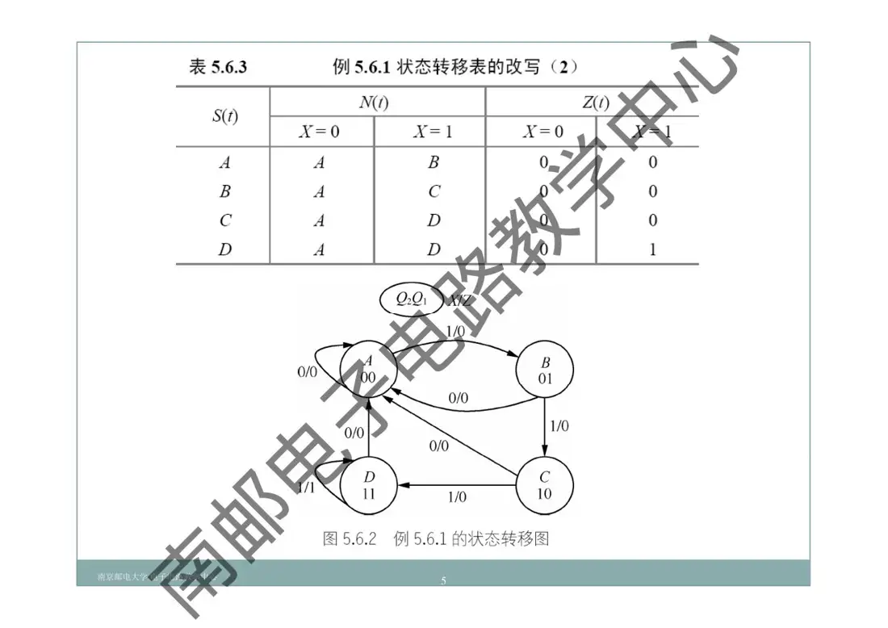

原文：

表 5.6.3 例 5.6.1 状态转移表的改写（2）
<table><tr><td rowspan="2">S(t)</td><td colspan="2">N(t)</td><td colspan="2">Z(t)</td></tr><tr><td>X=0</td><td>X=1</td><td>X=0</td><td>X=1</td></tr><tr><td>A</td><td>A</td><td>B</td><td>0</td><td>0</td></tr><tr><td>B</td><td>A</td><td>C</td><td>0</td><td>0</td></tr><tr><td>C</td><td>A</td><td>D</td><td>0</td><td>0</td></tr><tr><td>D</td><td>A</td><td>D</td><td>0</td><td>1</td></tr></table>

5

南京邮电大学 电子电路教学中心

### （4） 功能分析

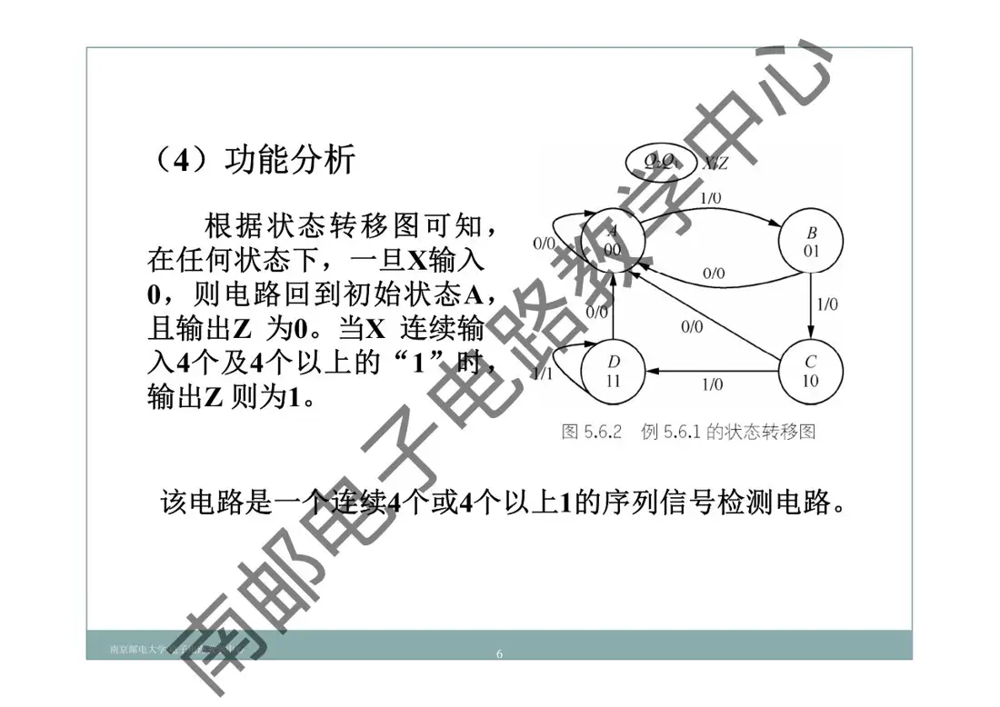

原文：

（4） 功能分析

根据状态转移 图 可知 ，在任何状态下， 一旦X输入0， 则 电路 回 到初始状态A，且输出Z 为0。 当X 连续输入4个及4个 以上的 “ 1 ”输出Z 则为1 。

该电路是 个连续 一 4个或4个以上1的序列信号检测 电路。

### 例5.6.2 分析 图5.6.3 所示 电路 的功能 。

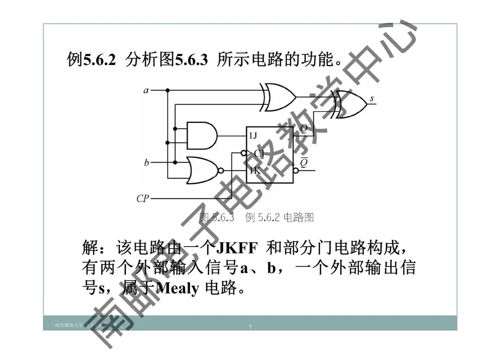

原文：

例5.6.2 分析 图5.6.3 所示 电路 的功能 。

解： 该电路由一个JKFF 和部分门 电路构成，有两个外部输入信号a、 b， 一个外部输出信号s ， 属 于Mealy 电路 。

南京邮电大学

### 根据电路得到 JKFF的次态方程为

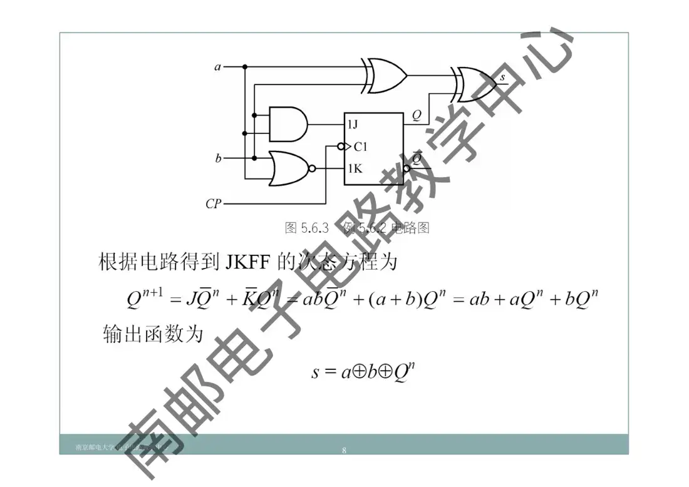

原文：

根据电路得到 JKFF的次态方程为

$$
Q ^ {n + 1} = J \overline {{Q}} ^ {n} + \overline {{K}} Q ^ {n} = a b \overline {{Q}} ^ {n} + (a + b) Q ^ {n} = a b + a Q ^ {n} + b Q ^ {n}
$$

输出函数为

$$
s = a \oplus b \oplus Q ^ {n}
$$

南京邮电大学

8

### 南京邮电大学 电子电路教

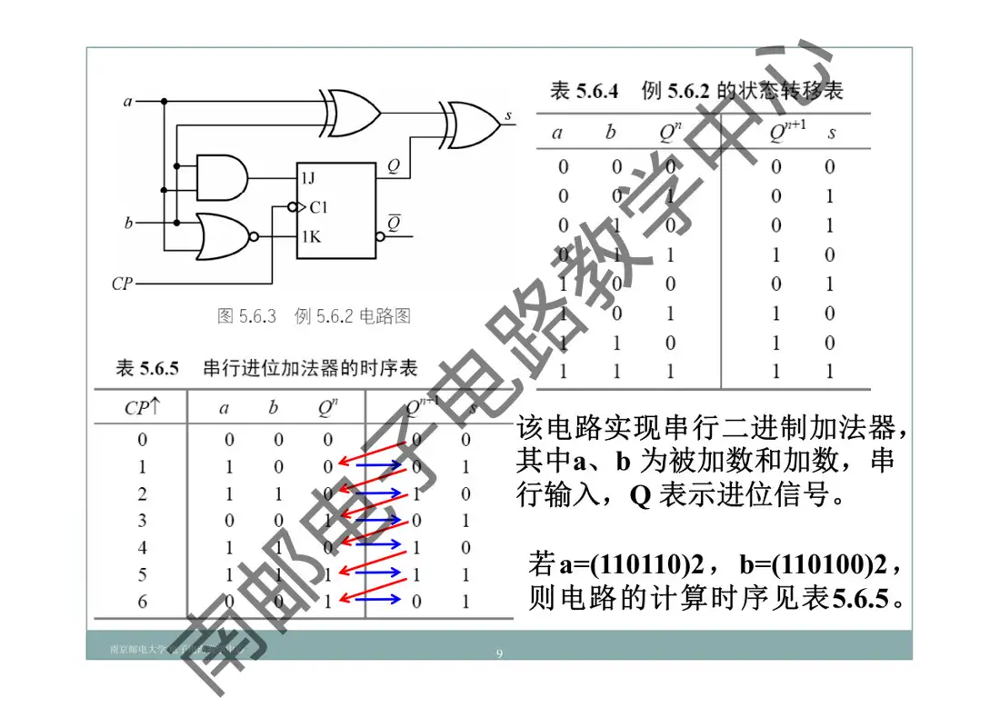

原文：

该 电路实现串 行二进制加法器，其中a、 b 为被加数和加数， 串行输入， Q 表示进位信号。

若 a=(11 0 11 0)2 ， b=(11 0 1 00)2 ，则 电路 的计算时序见表5 6 5. . 。

南京邮电大学 电子电路教

9

### 5.7 一般同步时序 电路的设计

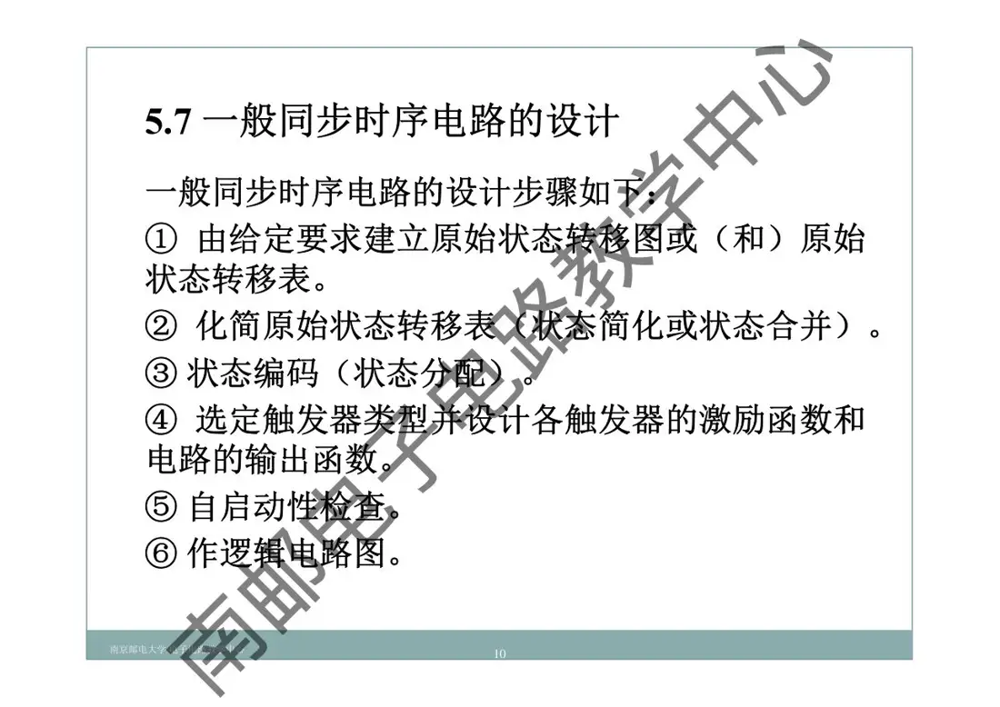

原文：

5.7 一般同步时序 电路的设计

一般同步时序电路的设计步骤如下：

① 由给定要求建立原始状态转移图或 （和 ） 原始状态转移表。

② 化简原始状态转移表 （状态简化或状态合并） 。

③ 状态编码 （状态分配）

④ 选定触发器类 并设计各触发器的激励函数和型电路的输出 函数。

⑤ 自 启动性检查。

⑥ 作逻辑电路图 。

南京邮电大学

1 0

### 南京邮电大学 电子电路教 中

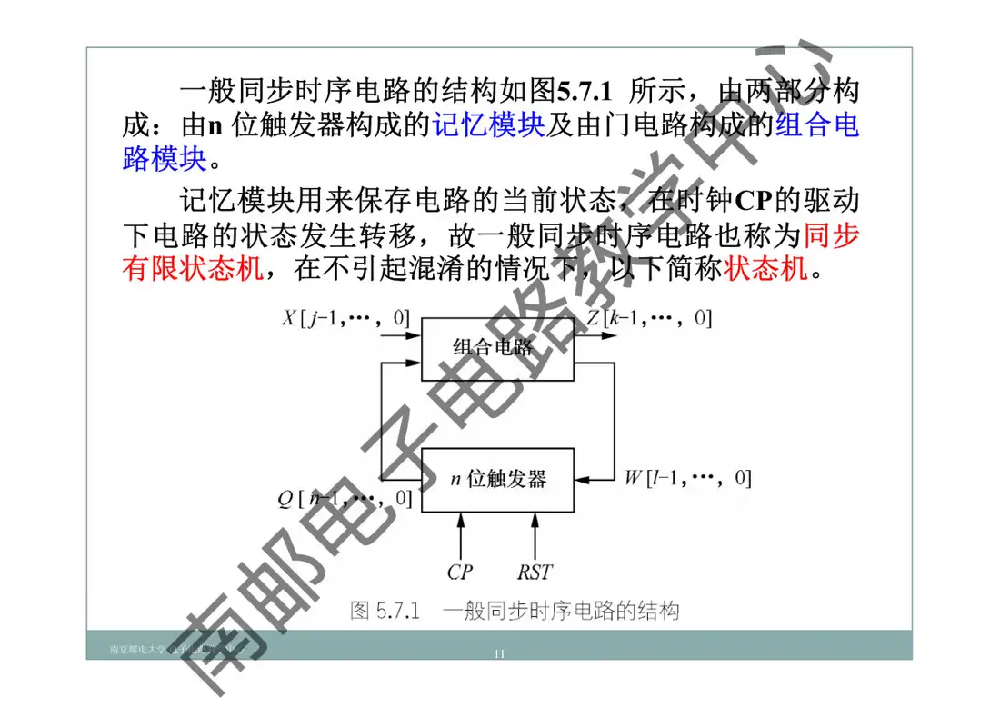

原文：

一般同步时序 电路的结构如 图5.7.1 所示， 由两部分构成： 由n 位触发器构成的记忆模块及由 门 电路构成的组合电路模块。

记忆模块用来保存 电路的当前状态， 在时钟CP的驱动下 电路的状态发生转移， 故一般同步时序 电路也称为 同步有限状态机， 在不引起混淆的情况下 ， 以下简称状态机。

南京邮电大学 电子电路教 中

1 1

### 状态机可分为Mealy 型和Moore型。

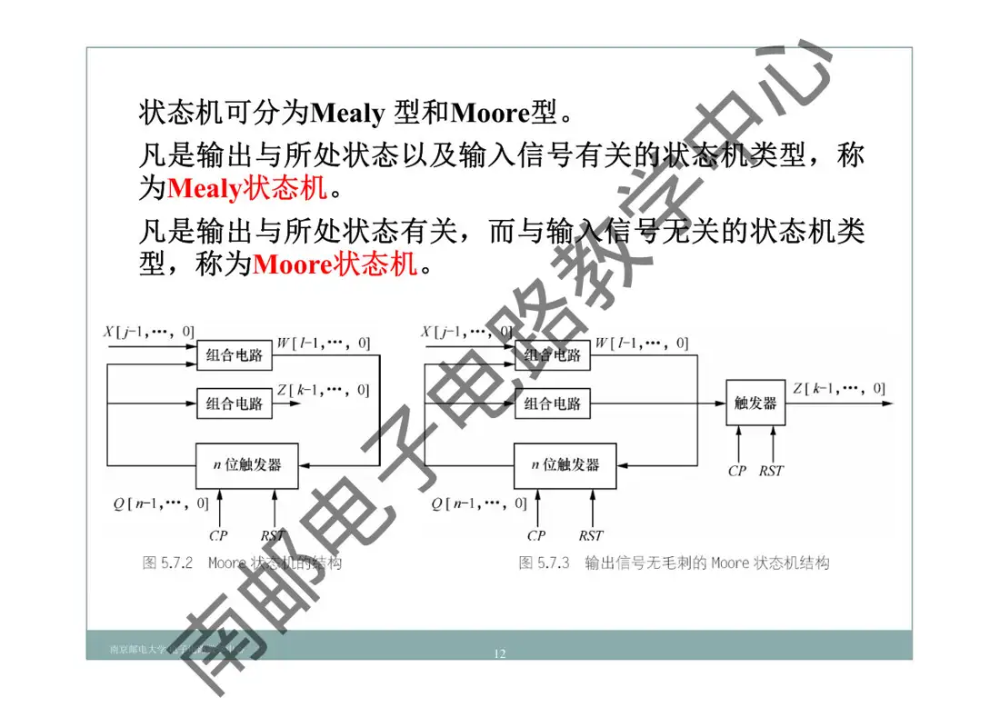

原文：

状态机可分为Mealy 型和Moore型。

凡是输出与所处状态以及输入信号有关的状态机类型， 称为Mealy状态机 。 W

凡是输出与所处状态有关， 而与输入信号无关的状态机类 型， 称为Moore状态机。

南京邮电大学 电子电路教学中心

1 2

### 解 ：

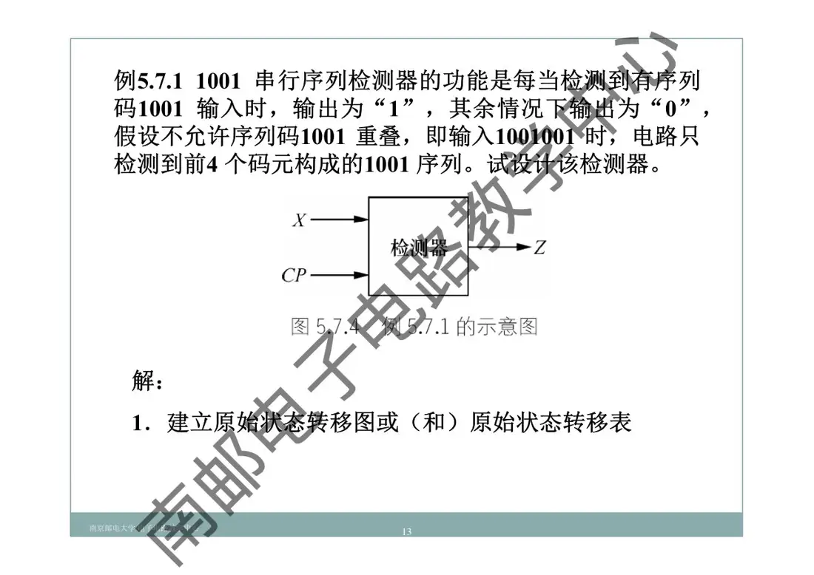

原文：

例5.7.1 1001 串行序列检测器的功能是每当检测到有序列码1001 输入时 ， 输 出 为 “ 1 ” ， 其余情况下输 出 为 “ 0 ” ，假设不允许序列码1001 重叠， 即输入1001001 时， 电路只检测到前4 个码元构成的1001 序列 。 试设计该检测器 。

解 ：

1． 建立原始状态转移图或 （和 ） 原始状态转移表

南京邮电大学 电子 中

1 3

### 1001 串行序列检测器 (不允许序列码1001 重叠)

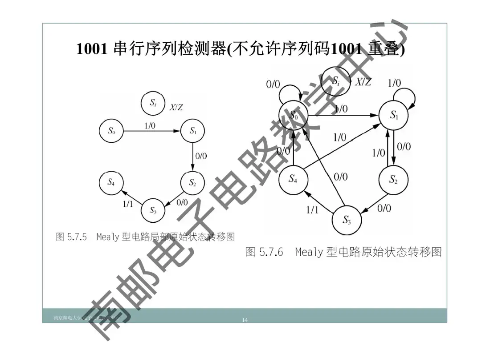

原文：

1001 串行序列检测器 (不允许序列码1001 重叠)

南京邮电大学

1 4

### 表 5.7.1 图 5.7.6 的原始状态转移表

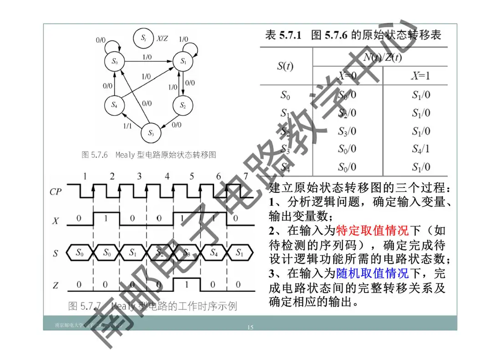

原文：

表 5.7.1 图 5.7.6 的原始状态转移表
<table><tr><td rowspan="2">S(t)</td><td colspan="2">N(t)/Z(t)</td></tr><tr><td>X=0</td><td>X=1</td></tr><tr><td> $S_0$ </td><td> $S_0/0$ </td><td> $S_1/0$ </td></tr><tr><td> $S_1$ </td><td> $S_2/0$ </td><td> $S_1/0$ </td></tr><tr><td> $S_2$ </td><td> $S_3/0$ </td><td> $S_1/0$ </td></tr><tr><td> $S_3$ </td><td> $S_0/0$ </td><td> $S_4/1$ </td></tr><tr><td> $S_4$ </td><td> $S_0/0$ </td><td> $S_1/0$ </td></tr></table>

建立原始状态转移 图 的三个过程：1、 分析逻辑问题， 确定输入变量、输出变量数；

2 在输入为特定取值情况下 （ 如待检测 的序列码 ） ， 确定完成待设计逻辑功能所需 的 电路状态数 ；3、 在输入为随机取值情况下， 完成 电路状态 间 的完整转移关系及确定相应的输出 。

南京邮电大学 电子电路教学中心

1 5

### 南京邮电大学 电子电路教学中心

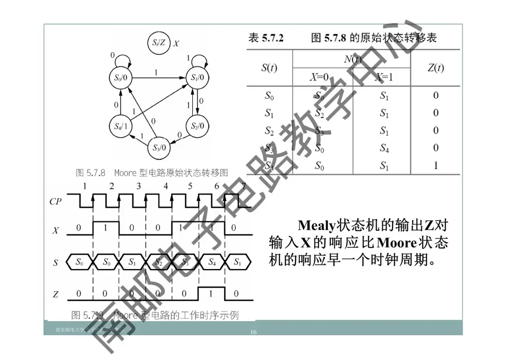

原文：

<table><tr><td rowspan="2"> $S(t)$ </td><td colspan="2"> $N(t)$ </td><td rowspan="2"> $Z(t)$ </td></tr><tr><td> $X=0$ </td><td> $X=1$ </td></tr><tr><td> $S_0$ </td><td> $S_0$ </td><td> $S_1$ </td><td>0</td></tr><tr><td> $S_1$ </td><td> $S_2$ </td><td> $S_1$ </td><td>0</td></tr><tr><td> $S_2$ </td><td> $S_3$ </td><td> $S_1$ </td><td>0</td></tr><tr><td> $S_3$ </td><td> $S_0$ </td><td> $S_4$ </td><td>0</td></tr><tr><td> $S_4$ </td><td> $S_0$ </td><td> $S_1$ </td><td>1</td></tr></table>

Mealy状态机的输出Z对输入X 的 响 应 比Moore状态机的响应早 个时钟周期一 。

南京邮电大学 电子电路教学中心

1 6

### 2． 化简 始状 转移表原 态

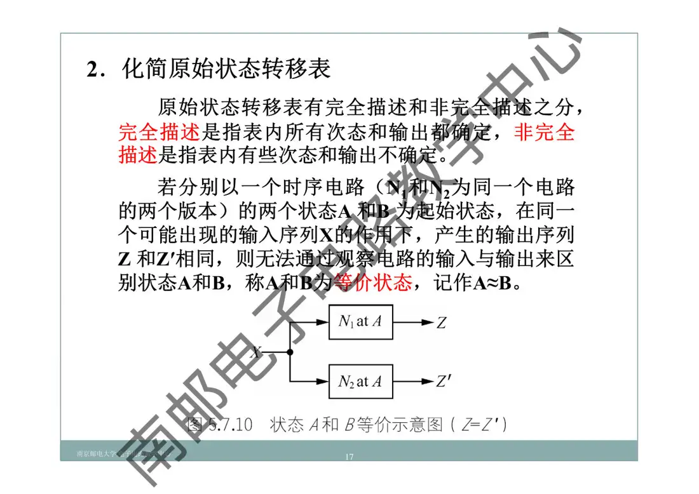

原文：

2． 化简 始状 转移表原 态

原始状态转移表有完全描述和非完全描述之分，完全描述是指表 内所有次态和输出都确定， 非完全描述是指表内有些次态和输出不确定。

若分别 以 个时序 电路一 （N 和 $\sqrt { 2 }$ 为 同 个 电路一的两个版本） 的两个状态A 和B 为起始状态， 在同一个可能出现的输入序列X的作用下， 产生的输出序列Z 和Z′相 同， 则无法通过观察电路的输入与输出来区别状态A和B， 称A和B为等价状态， 记作A≈B。

南京邮电大学 电子电路教学中心

1 7

### 等价状态判定的步骤：

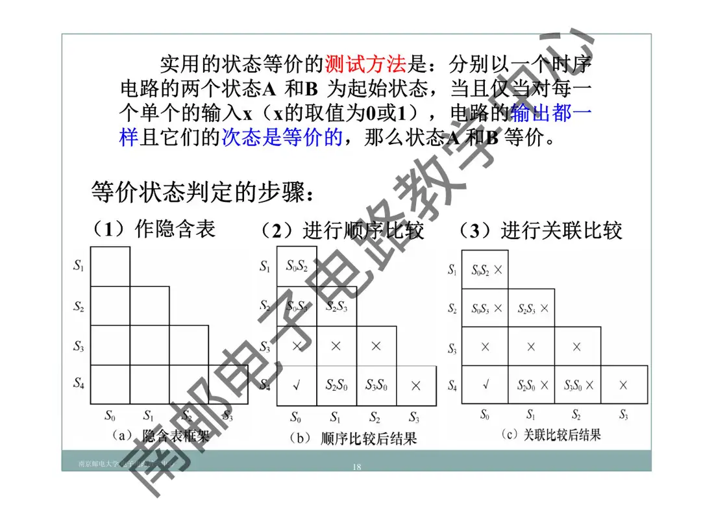

原文：

实用 的状态等价的测试方法是： 分别 以一个时序电路的两个状态A 和B 为起始状态， 当且仅当对每一个单个的输入x （x的取值为0或1 ） ， 电路的输出都一样且它们的次态是等价的 那么状态A 和B 等价， 。

等价状态判定的步骤：

（ 1 ） 作隐含表

（2） 进行顺序 比较

(b) 顺序比较后结果
<table><tr><td> $S_{1}$ </td><td> $S_{0}S_{2}$ </td><td></td><td></td></tr><tr><td> $S_{2}$ </td><td> $S_{0}S_{3}$ </td><td> $S_{2}S_{3}$ </td><td></td></tr><tr><td> $S_{3}$ </td><td>×</td><td>×</td><td>×</td></tr><tr><td> $S_{4}$ </td><td>√</td><td> $S_{2}S_{0}$ </td><td> $S_{3}S_{0}$ </td></tr><tr><td></td><td> $S_{0}$ </td><td> $S_{1}$ </td><td> $S_{2}$ </td></tr></table>

（3） 进行关联比较

(c) 关联比较后结果
<table><tr><td> $S_1$ </td><td> $S_0S_2 \times$ </td><td></td><td></td><td></td></tr><tr><td> $S_2$ </td><td> $S_0S_3 \times$ </td><td> $S_2S_3 \times$ </td><td></td><td></td></tr><tr><td> $S_3$ </td><td>×</td><td>×</td><td>×</td><td></td></tr><tr><td> $S_4$ </td><td>√</td><td> $S_2S_0 \times$ </td><td> $S_3S_0 \times$ </td><td>×</td></tr></table>

南京邮电大学 电子电路教学中心

1 8

### 化简的步骤：

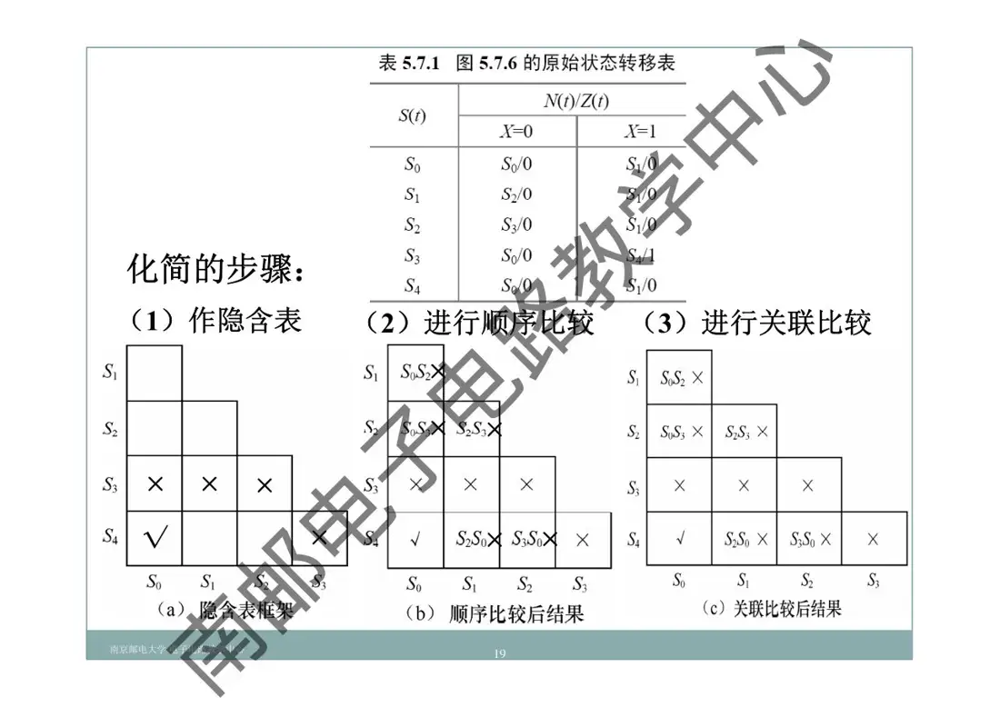

原文：

<table><tr><td rowspan="2"> $S(t)$ </td><td colspan="2"> $N(t)/Z(t)$ </td></tr><tr><td> $X=0$ </td><td> $X=1$ </td></tr><tr><td> $S_0$ </td><td> $S_0/0$ </td><td> $S_1/0$ </td></tr><tr><td> $S_1$ </td><td> $S_2/0$ </td><td> $S_1/0$ </td></tr><tr><td> $S_2$ </td><td> $S_3/0$ </td><td> $S_1/0$ </td></tr><tr><td> $S_3$ </td><td> $S_0/0$ </td><td> $S_4/1$ </td></tr><tr><td> $S_4$ </td><td> $S_0/0$ </td><td> $S_1/0$ </td></tr></table>

化简的步骤：

（ 1 ） 作隐含表

（2） 进行顺序 比较

（3） 进行关联比较

南京邮电大学 电子 中

1 9

### 化简的步骤：

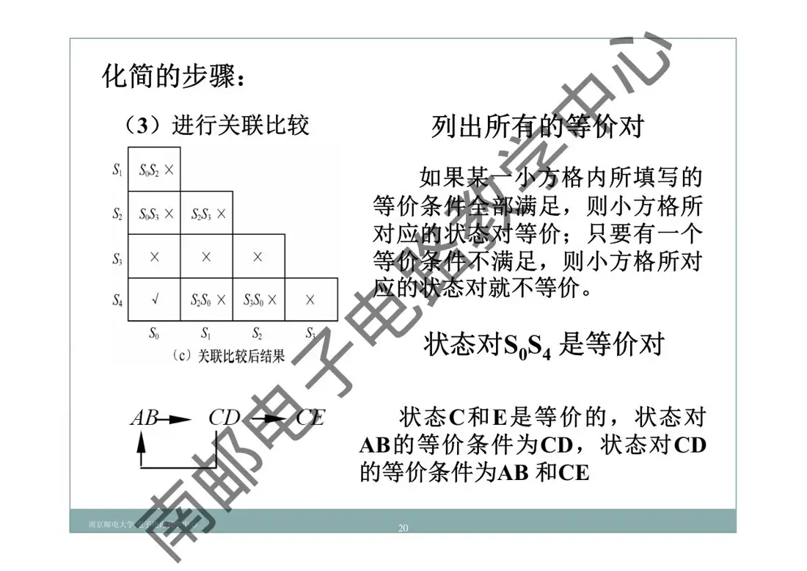

原文：

化简的步骤：

（3） 进行关联比较

(c) 关联比较后结果
<table><tr><td> $S_1$ </td><td> $S_0S_2 \times$ </td><td></td><td></td><td></td></tr><tr><td> $S_2$ </td><td> $S_0S_3 \times$ </td><td> $S_2S_3 \times$ </td><td></td><td></td></tr><tr><td> $S_3$ </td><td>×</td><td>×</td><td>×</td><td></td></tr><tr><td> $S_4$ </td><td>√</td><td> $S_2S_0 \times$ </td><td> $S_3S_0 \times$ </td><td>×</td></tr></table>

列出所有的等价对

如果某一小方格 内所填写 的等价条件全部满足， 则小方格所对应的状态对等价； 只要有一个等价条件不满足， 则小方格所对应的状态对就不等价。

状态对 $\bf { S _ { 0 } S _ { 4 } }$ 是等价对

状态C和E是等价 的 ， 状态对AB 的等价条件为CD ， 状态对CD的等价条件为AB 和CE

南京邮电大学

20

### 化简的步骤：

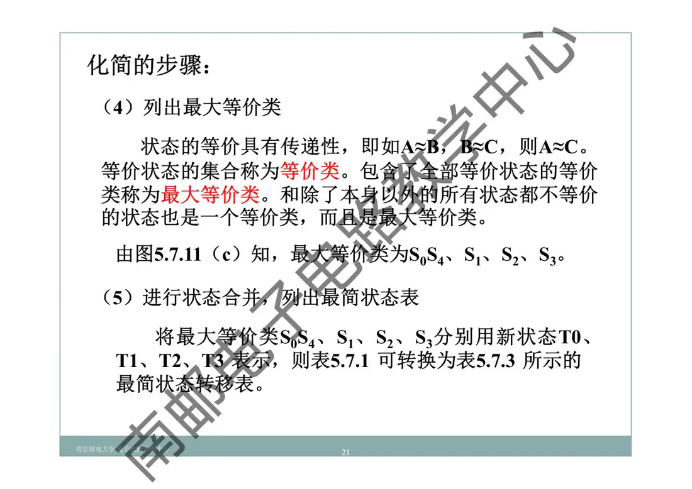

原文：

化简的步骤：

（4） 列出最大等价类

状态的等价具有传递性， 即如A≈B， B≈C， 则 $\mathbf { A } { \approx } \mathbf { C }$ 等价状态的集合称为等价类。 包含了全部等价状态的等价类称为最大等价类。 和除了本身 以外的所有状态都不等价的状态也是一个等价类， 而且是最大等价类。

由 图 5.7. 11 （ c ） 知 ， 最 大等 为 价类 $\mathbf { S _ { 0 } S _ { 4 } } \setminus \mathbf { S _ { 1 } } \setminus \mathbf { S _ { 2 } } \setminus \mathbf { S _ { 3 } }$ 。

（5） 进行状态合并， 列出最简状态表

将最大等价类 $\mathrm { S } _ { 0 } \mathrm { S } _ { 4 } \setminus \mathrm { S } _ { 1 } \setminus \mathrm { S } _ { 2 } \setminus \mathrm { S } _ { 3 }$ 分别用 新状态T0、T1 、 T2 、 T3 表示 ， 则 表5.7. 1 可转换为表5.7.3 所示 的最简状态转移表。

南京邮电大学

2 1

### 表 5.7.3 图 5.7.6 的最简状态转移表

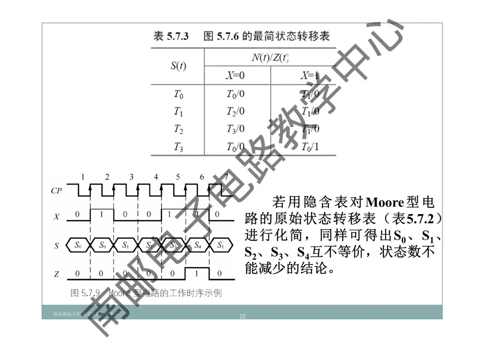

原文：

表 5.7.3 图 5.7.6 的最简状态转移表
<table><tr><td rowspan="2"> $S(t)$ </td><td colspan="2"> $N(t)/Z(t)$ </td></tr><tr><td> $X=0$ </td><td> $X=1$ </td></tr><tr><td> $T_0$ </td><td> $T_0/0$ </td><td> $T_1/0$ </td></tr><tr><td> $T_1$ </td><td> $T_2/0$ </td><td> $T_1/0$ </td></tr><tr><td> $T_2$ </td><td> $T_3/0$ </td><td> $T_1/0$ </td></tr><tr><td> $T_3$ </td><td> $T_0/0$ </td><td> $T_0/1$ </td></tr></table>

若 用 隐含表对Moore 型 电路 的原始状态转移表 （ 表5.7.2 ）进行化简 ， 同样可得 出 $\bf { S _ { 0 } } \setminus \sigma { S _ { 1 } }$ $\mathrm { S } _ { 2 } \setminus \mathrm { S } _ { 3 } \setminus \mathrm { S } _ { 4 }$ 互不等价， 状态数不能减少的结论。

南京邮电大学 电子电路教学中心

22

### 3． 状态编码 （状态分配）

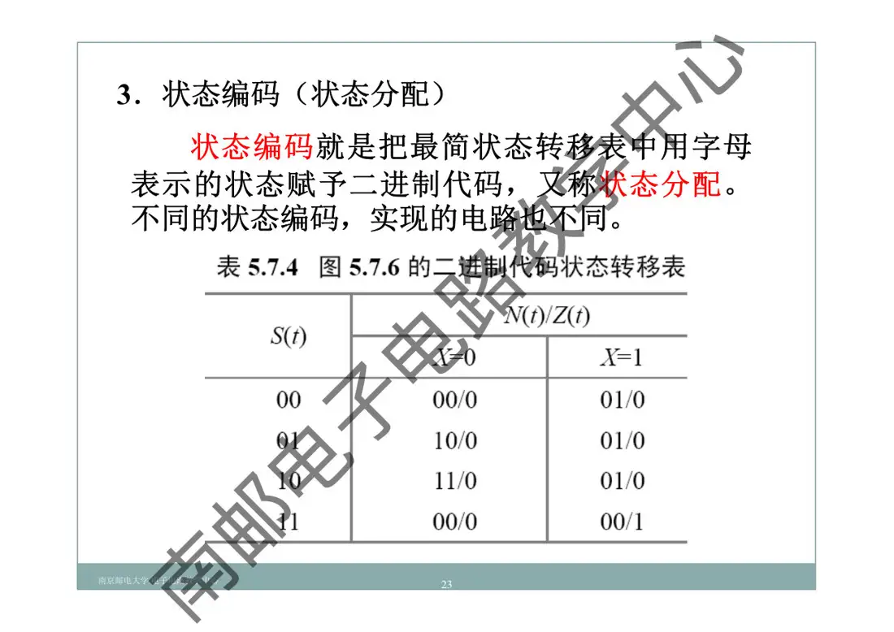

原文：

3． 状态编码 （状态分配）

状态编码就是把最简状态转移表 中用字母表示的状态赋予 进制代码二 ， 又称状态分配。不同的状态编码， 实现的 电路也不同 。

表 5.7.4 图 5.7.6 的二进制代码状态转移表
<table><tr><td rowspan="2">S(t)</td><td colspan="2">N(t)/Z(t)</td></tr><tr><td>X=0</td><td>X=1</td></tr><tr><td>00</td><td>00/0</td><td>01/0</td></tr><tr><td>01</td><td>10/0</td><td>01/0</td></tr><tr><td>10</td><td>11/0</td><td>01/0</td></tr><tr><td>11</td><td>00/0</td><td>00/1</td></tr></table>

### 4． 确定触发器类型， 求激励函数和输出 函数

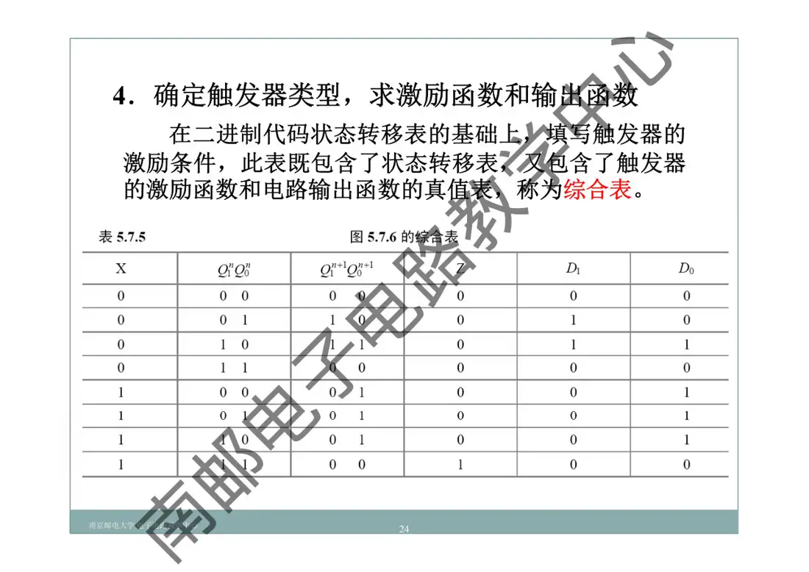

原文：

4． 确定触发器类型， 求激励函数和输出 函数

在二进制代码状态转移表的基础上， 填写触发器的激励条件， 此表既包含了状态转移表， 又包含了触发器的激励函数和 电路输出 函数的真值表， 称为综合表。

表 5.7.5 图 5.7.6 的综合表1
<table><tr><td>X</td><td> $Q_1^nQ_0^n$ </td><td> $Q_1^{n+1}Q_0^{n+1}$ </td><td>Z</td><td> $D_1$ </td><td> $D_0$ </td></tr><tr><td>0</td><td>0 0</td><td>0 0</td><td>0</td><td>0</td><td>0</td></tr><tr><td>0</td><td>0 1</td><td>1 0</td><td>0</td><td>1</td><td>0</td></tr><tr><td>0</td><td>1 0</td><td>1 1</td><td>0</td><td>1</td><td>1</td></tr><tr><td>0</td><td>1 1</td><td>0 0</td><td>0</td><td>0</td><td>0</td></tr><tr><td>1</td><td>0 0</td><td>0 1</td><td>0</td><td>0</td><td>1</td></tr><tr><td>1</td><td>0 1</td><td>0 1</td><td>0</td><td>0</td><td>1</td></tr><tr><td>1</td><td>1 0</td><td>0 1</td><td>0</td><td>0</td><td>1</td></tr><tr><td>1</td><td>1 1</td><td>0 0</td><td>1</td><td>0</td><td>0</td></tr></table>

南京邮电大学 电子电路教学中心

24

### 表 5.7.5 图 5.7.6 的综合表

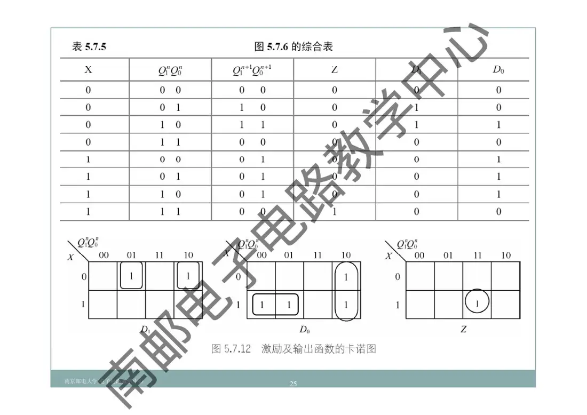

原文：

表 5.7.5 图 5.7.6 的综合表
<table><tr><td>X</td><td> $Q_1^nQ_0^n$ </td><td> $Q_1^{n+1}Q_0^{n+1}$ </td><td>Z</td><td> $D_1$ </td><td> $D_0$ </td></tr><tr><td>0</td><td>0 0</td><td>0 0</td><td>0</td><td>0</td><td>0</td></tr><tr><td>0</td><td>0 1</td><td>1 0</td><td>0</td><td>1</td><td>0</td></tr><tr><td>0</td><td>1 0</td><td>1 1</td><td>0</td><td>1</td><td>1</td></tr><tr><td>0</td><td>1 1</td><td>0 0</td><td>0</td><td>0</td><td>0</td></tr><tr><td>1</td><td>0 0</td><td>0 1</td><td>0</td><td>0</td><td>1</td></tr><tr><td>1</td><td>0 1</td><td>0 1</td><td>0</td><td>0</td><td>1</td></tr><tr><td>1</td><td>1 0</td><td>0 1</td><td>0</td><td>0</td><td>1</td></tr><tr><td>1</td><td>1 1</td><td>0 0</td><td>1</td><td>0</td><td>0</td></tr></table>

南京邮电大学 电子电路教学中心

25

### $$

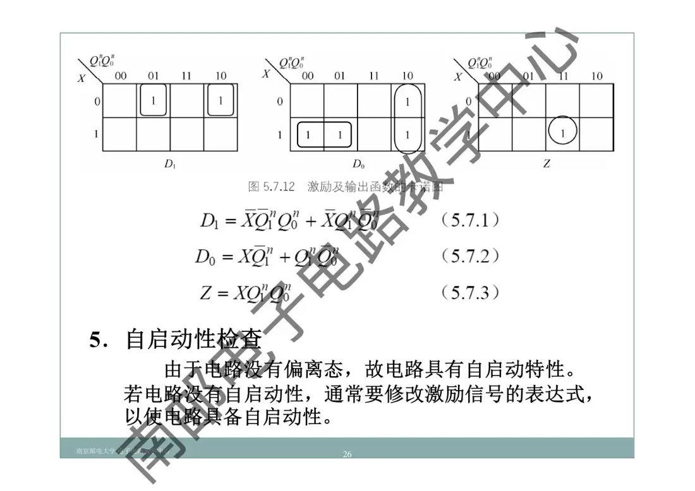

原文：

$$
D _ {1} = \bar {X} \bar {Q} _ {1} ^ {n} Q _ {0} ^ {n} + \bar {X} Q _ {1} ^ {n} \bar {Q} _ {0} ^ {n}\tag{5.7.1}
$$

$$
D _ {0} = X \bar {Q} _ {1} ^ {n} + Q _ {1} ^ {n} \bar {Q} _ {0} ^ {n}\tag{5.7.2}
$$

$$
Z = X Q _ {1} ^ {n} Q _ {0} ^ {n}\tag{5.7.3}
$$

5． 自 启动性检查

由于 电路没有偏离态， 故电路具有 自 启动特性。若电路没有 自 启动性， 通常要修改激励信号的表达式，以使电路具备 自 启动性。

南京邮电大学 电子电路教学中心

26

### 6． 作逻辑电路图

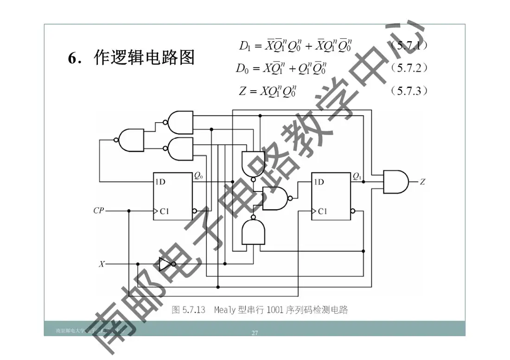

原文：

6． 作逻辑电路图

$$
D _ {1} = \bar {X} \bar {Q} _ {1} ^ {n} Q _ {0} ^ {n} + \bar {X} Q _ {1} ^ {n} \bar {Q} _ {0} ^ {n}
$$

$$
D _ {0} = X \overline {{Q}} _ {1} ^ {n} + Q _ {1} ^ {n} \overline {{Q}} _ {0} ^ {n}\tag{5.7.2}
$$

$$
Z = X Q _ {1} ^ {n} Q _ {0} ^ {n}\tag{5.7.3}
$$

南京邮电大学 电子电路教

27

### 28

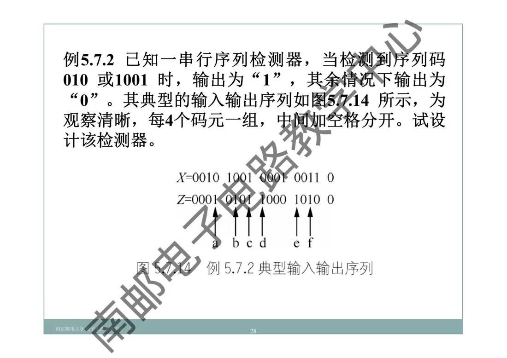

原文：

例5 7 2 已知 串 行序列检测器一 ， 当检测到序列码010 或1001 时 ， 输 出 为 “ 1 ” ， 其余情况下输 出 为“0” 。 其典型 的输入输出序列如 图5.7.14 所示， 为观察清晰， 每4个码元一组， 中 间加空格分开。 试设计该检测器。

28

### 南京邮电大学 电子电路教

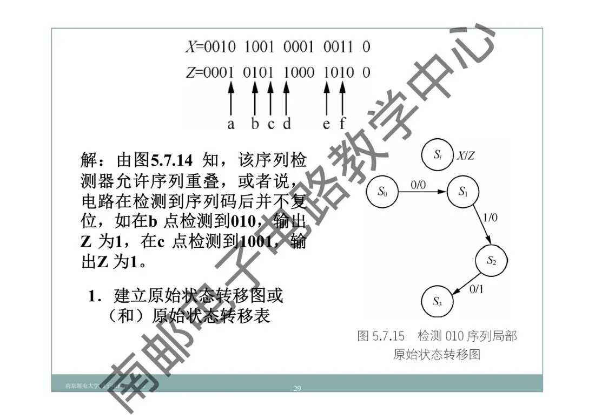

原文：

解 ： 由 图 5.7.14 知 ， 该序 列 检测器允许序列重叠， 或者说，电路在检测到序列码后并不复位， 如在b 点检测到010， 输出Z 为1 ， 在c 点检测 到 1001 ， 输出Z 为1 。

1． 建立原始状态转移图或（和 ） 原始状态转移表无等价状态， 已是最简状态转移表。

南京邮电大学 电子电路教

29

### 表 5.7.6 各状态的含义

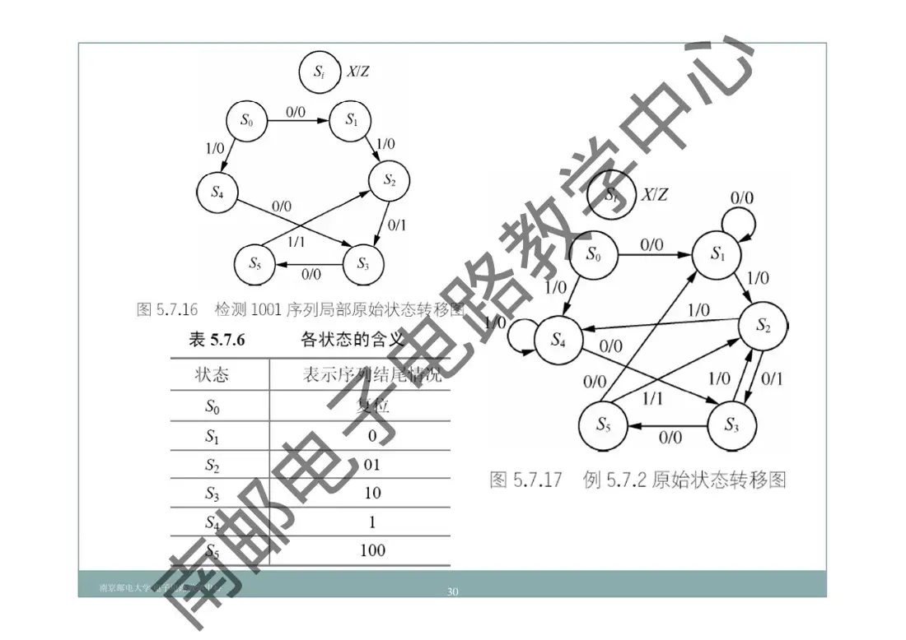

原文：

表 5.7.6 各状态的含义
<table><tr><td>状态</td><td>表示序列结尾情况</td></tr><tr><td> $S_0$ </td><td>复位</td></tr><tr><td> $S_1$ </td><td>0</td></tr><tr><td> $S_2$ </td><td>01</td></tr><tr><td> $S_3$ </td><td>10</td></tr><tr><td> $S_4$ </td><td>1</td></tr><tr><td> $S_5$ </td><td>100</td></tr></table>

南京邮电大学 电子电路教学中心

30

### 表 5.7.7 例 5.7.2 原始状态转移表

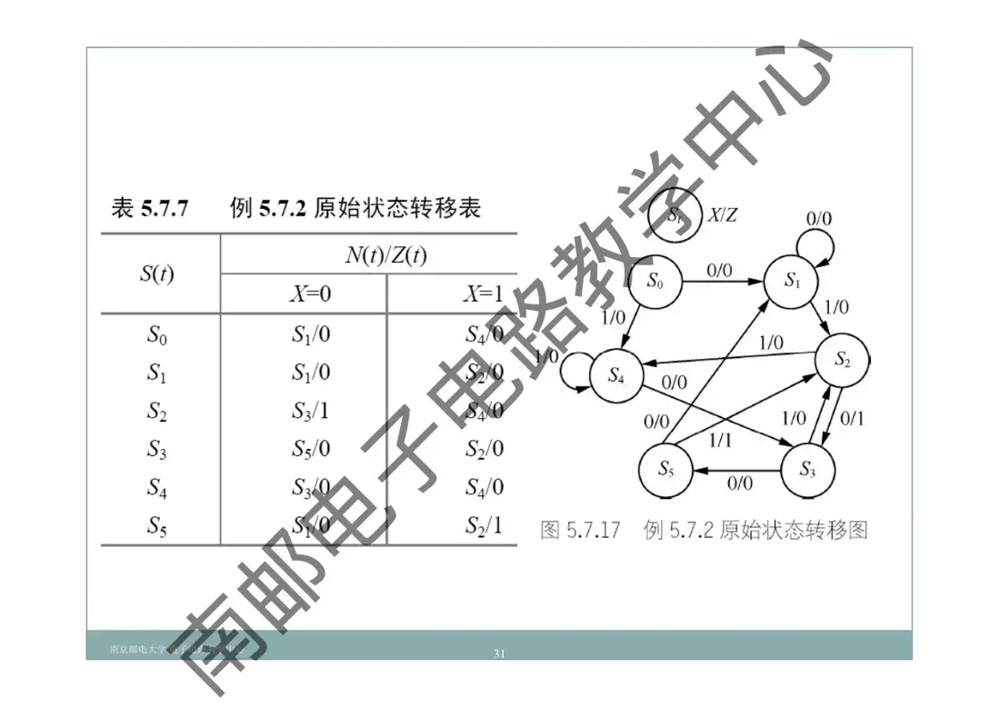

原文：

表 5.7.7 例 5.7.2 原始状态转移表
<table><tr><td rowspan="2">S(t)</td><td colspan="2">N(t)/Z(t)</td></tr><tr><td>X=0</td><td>X=1</td></tr><tr><td> $S_0$ </td><td> $S_1/0$ </td><td> $S_4/0$ </td></tr><tr><td> $S_1$ </td><td> $S_1/0$ </td><td> $S_2/0$ </td></tr><tr><td> $S_2$ </td><td> $S_3/1$ </td><td> $S_4/0$ </td></tr><tr><td> $S_3$ </td><td> $S_5/0$ </td><td> $S_2/0$ </td></tr><tr><td> $S_4$ </td><td> $S_3/0$ </td><td> $S_4/0$ </td></tr><tr><td> $S_5$ </td><td> $S_1/0$ </td><td> $S_2/1$ </td></tr></table>

南京邮电大学 电子电路教

3 1

### 南京邮电大学 电子电路教学中心

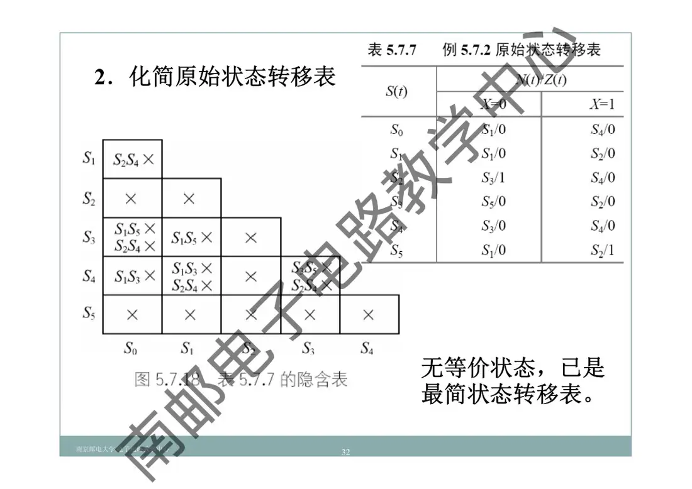

原文：

表 5.7.7 例 5.7.2 原始状态转移表 图 5.7.18 表 5.7.7 的隐含表
<table><tr><td rowspan="2" colspan="2">S(t)</td><td colspan="2">N(t)/Z(t)</td></tr><tr><td>X=0</td><td>X=1</td></tr><tr><td colspan="2">S0</td><td>S1/0</td><td>S4/0</td></tr><tr><td colspan="2">S1</td><td>S1/0</td><td>S2/0</td></tr><tr><td colspan="2">S2</td><td>S3/1</td><td>S4/0</td></tr><tr><td colspan="2">S3</td><td>S5/0</td><td>S2/0</td></tr><tr><td colspan="2">S4</td><td>S3/0</td><td>S4/0</td></tr><tr><td colspan="2">S5</td><td>S1/0</td><td>S2/1</td></tr></table>

南京邮电大学 电子电路教学中心

32

### 3 状态编码．

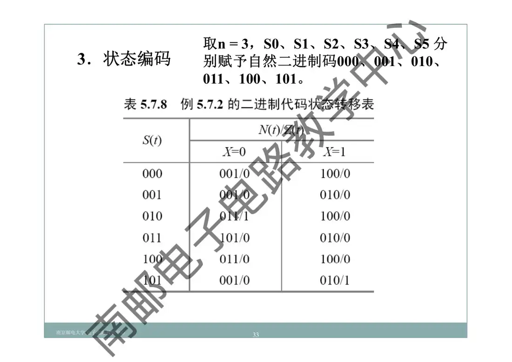

原文：

3 状态编码．

取n = 3 ， S0 、 S 1 、 S2 、 S3 、 S4 、 S5 分别 赋 予 自 然 二 进制 码000 、 001 、 01 0 、0 11 、 1 00 、 1 0 1 。

表 5.7.8 例 5.7.2 的二进制代码状态转移表
<table><tr><td rowspan="2">S(t)</td><td colspan="2">N(t)/Z(t)</td></tr><tr><td>X=0</td><td>X=1</td></tr><tr><td>000</td><td>001/0</td><td>100/0</td></tr><tr><td>001</td><td>001/0</td><td>010/0</td></tr><tr><td>010</td><td>011/1</td><td>100/0</td></tr><tr><td>011</td><td>101/0</td><td>010/0</td></tr><tr><td>100</td><td>011/0</td><td>100/0</td></tr><tr><td>101</td><td>001/0</td><td>010/1</td></tr></table>

南京邮电大学 电子电路教学中心

3 3

### 4 选定触发器类型并设计各触发器的激励函数和电路的输出 函数 u

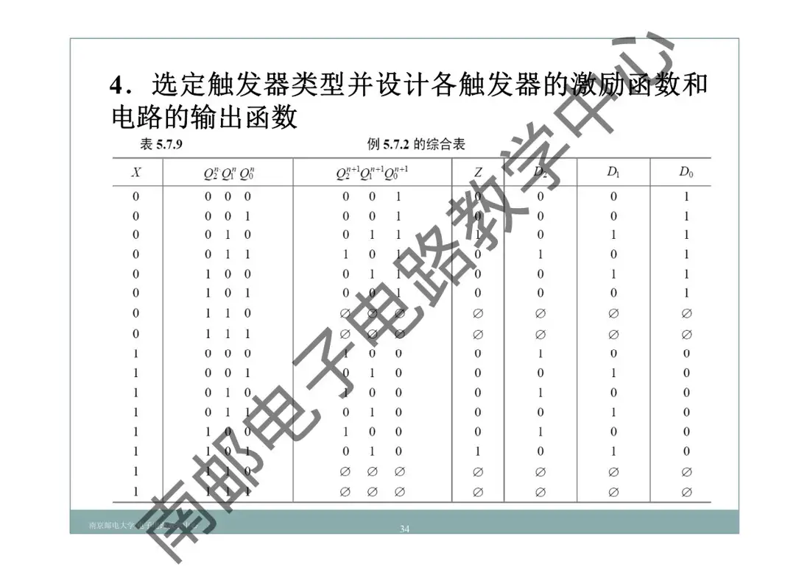

原文：

4 选定触发器类型并设计各触发器的激励函数和电路的输出 函数 u

表 5.7.9 例 5.7.2 的综合表
<table><tr><td>X</td><td> $Q_{2}^{n}$   $Q_{1}^{n}$   $Q_{0}^{n}$ </td><td> $Q_{2}^{n+1}$   $Q_{1}^{n+1}$   $Q_{0}^{n+1}$ </td><td>Z</td><td> $D_{2}$ </td><td> $D_{1}$ </td><td> $D_{0}$ </td></tr><tr><td>0</td><td>0 0 0</td><td>0 0 1</td><td>0</td><td>0</td><td>0</td><td>1</td></tr><tr><td>0</td><td>0 0 1</td><td>0 0 1</td><td>0</td><td>0</td><td>0</td><td>1</td></tr><tr><td>0</td><td>0 1 0</td><td>0 1 1</td><td>1</td><td>0</td><td>1</td><td>1</td></tr><tr><td>0</td><td>0 1 1</td><td>1 0 1</td><td>0</td><td>1</td><td>0</td><td>1</td></tr><tr><td>0</td><td>1 0 0</td><td>0 1 1</td><td>0</td><td>0</td><td>1</td><td>1</td></tr><tr><td>0</td><td>1 0 1</td><td>0 0 1</td><td>0</td><td>0</td><td>0</td><td>1</td></tr><tr><td>0</td><td>1 1 0</td><td>∅ ∅ ∅</td><td>∅</td><td>∅</td><td>∅</td><td>∅</td></tr><tr><td>0</td><td>1 1 1</td><td>∅ ∅ ∅</td><td>∅</td><td>∅</td><td>∅</td><td>∅</td></tr><tr><td>1</td><td>0 0 0</td><td>1 0 0</td><td>0</td><td>1</td><td>0</td><td>0</td></tr><tr><td>1</td><td>0 0 1</td><td>0 1 0</td><td>0</td><td>0</td><td>1</td><td>0</td></tr><tr><td>1</td><td>0 1 0</td><td>1 0 0</td><td>0</td><td>1</td><td>0</td><td>0</td></tr><tr><td>1</td><td>0 1 1</td><td>0 1 0</td><td>0</td><td>0</td><td>1</td><td>0</td></tr><tr><td>1</td><td>1 0 0</td><td>1 0 0</td><td>0</td><td>1</td><td>0</td><td>0</td></tr><tr><td>1</td><td>1 0 1</td><td>0 1 0</td><td>1</td><td>0</td><td>1</td><td>0</td></tr><tr><td>1</td><td>1 1 0</td><td>∅ ∅ ∅</td><td>∅</td><td>∅</td><td>∅</td><td>∅</td></tr><tr><td>1</td><td>1 1 1</td><td>∅ ∅ ∅</td><td>∅</td><td>∅</td><td>∅</td><td>∅</td></tr></table>

南京邮电大学 电子电路教学中心

34

### 南京邮电大学 电子电路教学中心

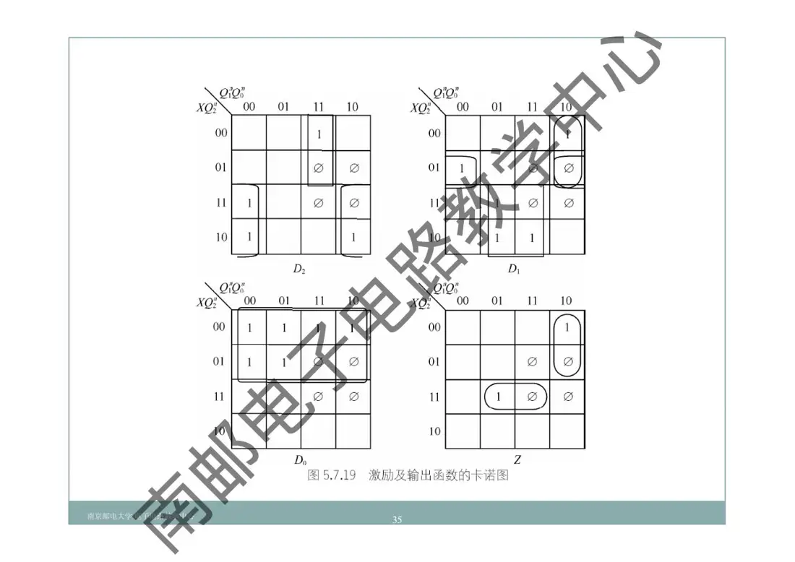

原文：

南京邮电大学 电子电路教学中心

3 5

### $$

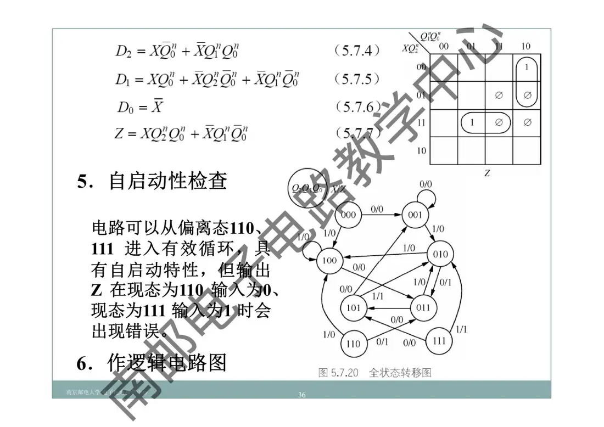

原文：

$$
D _ {2} = X \overline {{Q}} _ {0} ^ {n} + \overline {{X}} Q _ {1} ^ {n} Q _ {0} ^ {n}
$$

$$
D _ {1} = X Q _ {0} ^ {n} + \bar {X} Q _ {2} ^ {n} \bar {Q} _ {0} ^ {n} + \bar {X} Q _ {1} ^ {n} \bar {Q} _ {0} ^ {n}
$$

$$
D _ {0} = \overline {{X}}
$$

$$
Z = X Q _ {2} ^ {n} Q _ {0} ^ {n} + \bar {X} Q _ {1} ^ {n} \bar {Q} _ {0} ^ {n}
$$

5． 自 启动性检查

电路可以从偏离态110、111 进入有效循环 ， 具有 自 启 动特性， 但输出Z 在现态为110 输入为0、现态为111 输入为1 时会出现错误。

6 作逻辑 电路图．

(5.7.4)

(5.7.5)

(5.7.6)

南京邮电大学 电子 中

3 6

### 南京邮电大学 电子电路教学中心

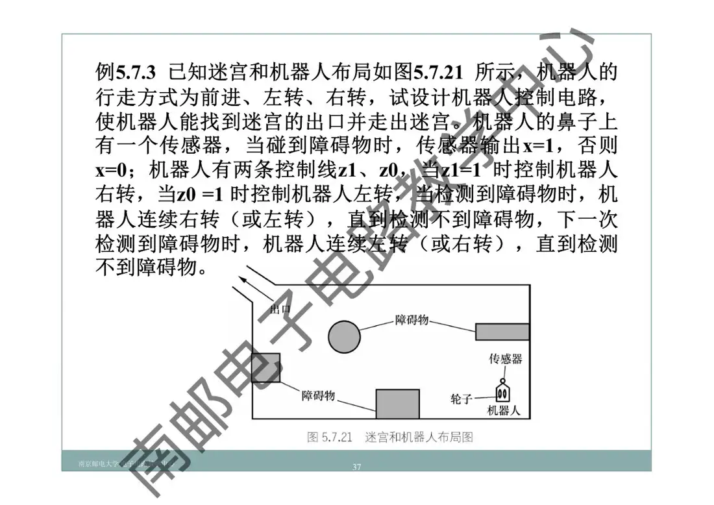

原文：

例5 7 3 已知 宫和机 人布局如 图迷 器 5 7 21 所示， 机 人的器行走方式为前进、 左转、 右转， 试设计机器人控制 电路，使机器人能找到迷宫的 出 口 并走出迷宫 。 机器人的鼻子上有 个传感器一 ， 当碰到障碍物时， 传感器输出 $\mathbf { x } { = } 1$ ， 否则$\mathbf { \delta X = 0 }$ ； 机器人有两条控制线z1、 $\mathbf { z 0 } _ { 0 } , \parallel$ $\mathbf { z 1 } \mathbf { \equiv } \mathbf { 1 } ^ { \mathcal { A } }$ 时控制机器人右转， 当 $\mathbf { z 0 } = \mathbf { 1 }$ 时控制机器人左转， 当检测到障碍物时， 机器人连续右转 （ 或左转） ， 直到检测不到障碍物， 下一次检测到障碍物时， 机器人 续 转连 左 （ 或右转） ， 直到检测不到障碍物。

南京邮电大学 电子电路教学中心

37

### 解： 由题意知， 该控制 电路有 个输入和两个输出 一 。

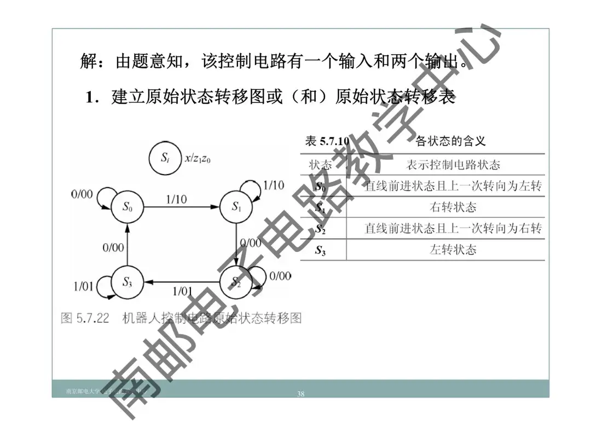

原文：

解： 由题意知， 该控制 电路有 个输入和两个输出 一 。

1． 建立原始状态转移图或 （和 ） 原始状态转移表

南京邮电大学

3 8

### 表 5.7.11 例 5.7.3 的原始状态转移表

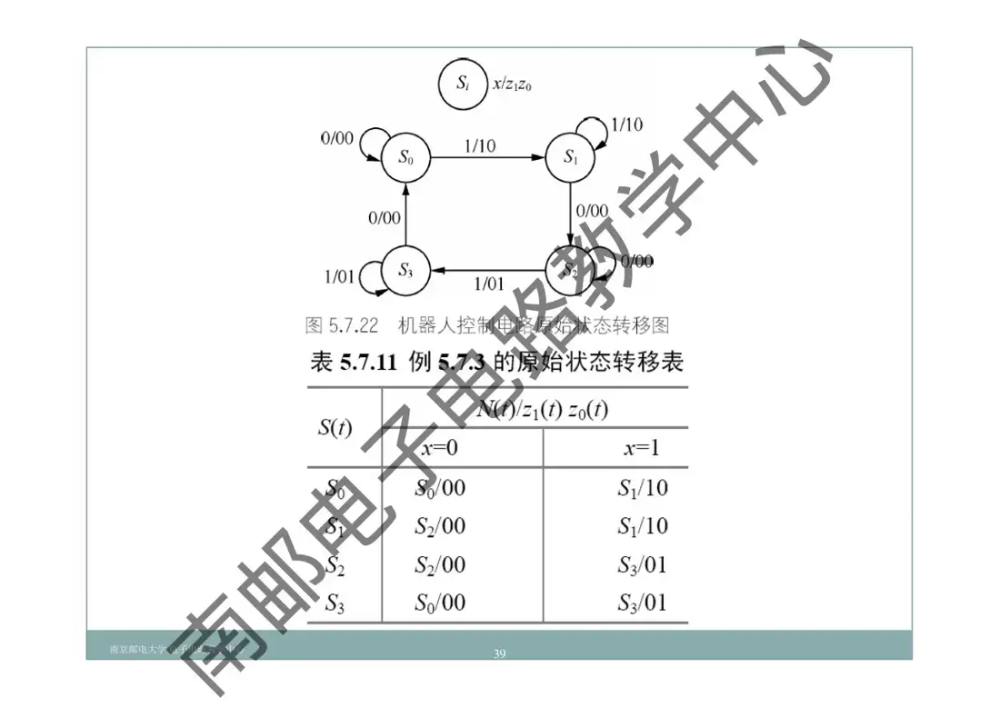

原文：

表 5.7.11 例 5.7.3 的原始状态转移表
<table><tr><td rowspan="2"> $S(t)$ </td><td colspan="2"> $N(t)/z_1(t) z_0(t)$ </td></tr><tr><td>x=0</td><td>x=1</td></tr><tr><td> $S_0$ </td><td> $S_0/00$ </td><td> $S_1/10$ </td></tr><tr><td> $S_1$ </td><td> $S_2/00$ </td><td> $S_1/10$ </td></tr><tr><td> $S_2$ </td><td> $S_2/00$ </td><td> $S_3/01$ </td></tr><tr><td> $S_3$ </td><td> $S_0/00$ </td><td> $S_3/01$ </td></tr></table>

南京邮电大学 电子电路教学中心

39

### 2． 化简原始状态转移表

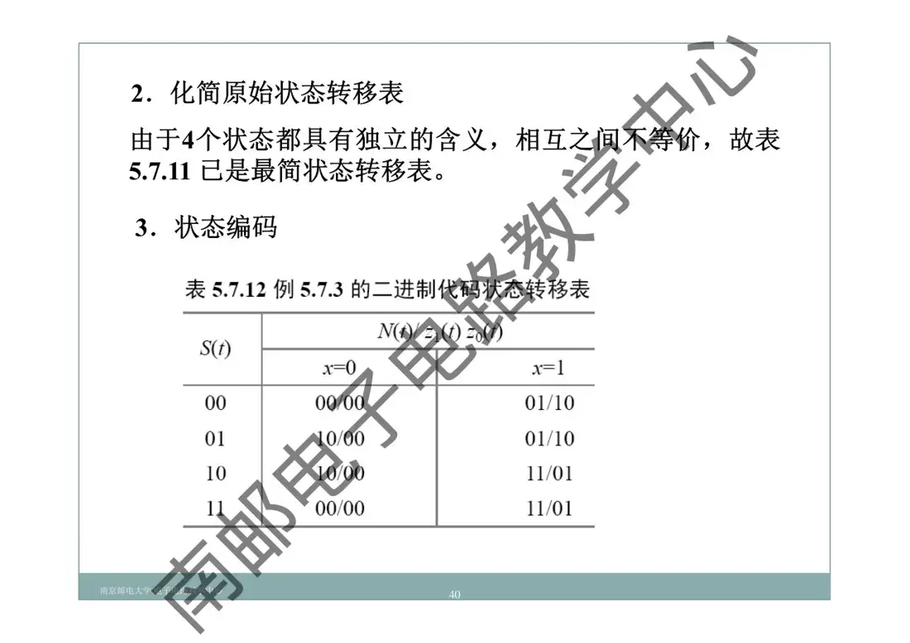

原文：

2． 化简原始状态转移表

由于4个状态都具有独立的含义， 相互之间不等价， 故表5.7.11 已是最简状态转移表。 W

3． 状态编码

表 5.7.12 例 5.7.3 的二进制代码状态转移表
<table><tr><td rowspan="2">S(t)</td><td colspan="2"> $N(t)/z_{1}(t)z_{0}(t)$ </td></tr><tr><td>x=0</td><td>x=1</td></tr><tr><td>00</td><td>00/00</td><td>01/10</td></tr><tr><td>01</td><td>10/00</td><td>01/10</td></tr><tr><td>10</td><td>10/00</td><td>11/01</td></tr><tr><td>11</td><td>00/00</td><td>11/01</td></tr></table>

南京邮电大学 电子电路教学中心

40

### 4． 选定触发器类型并设计各触发器的激励函数和 电路的输出 函数 X

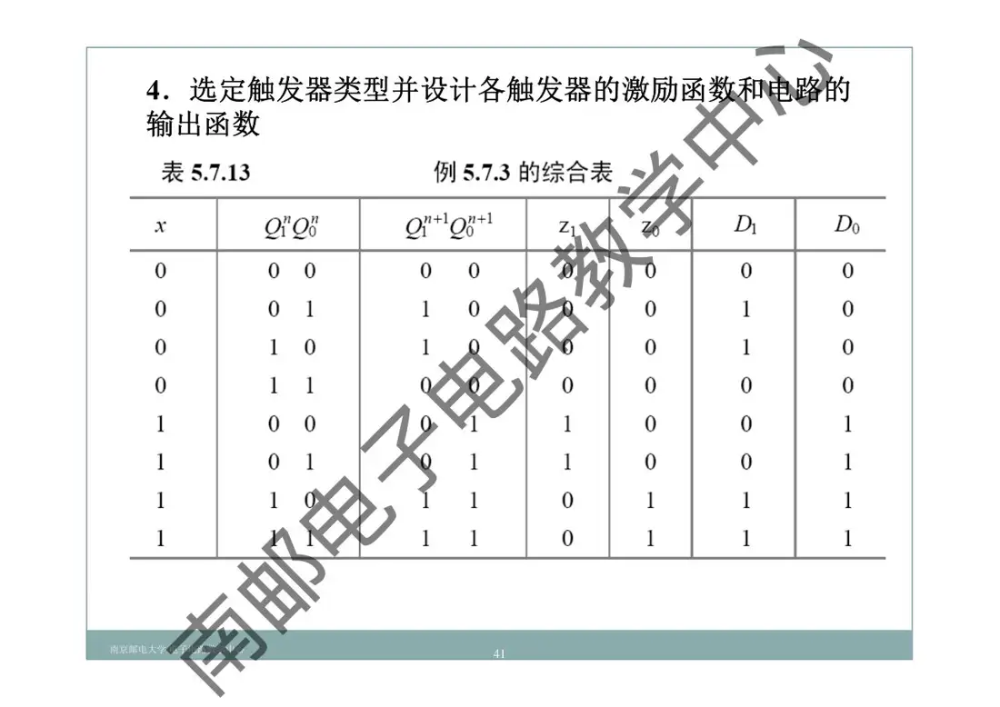

原文：

4． 选定触发器类型并设计各触发器的激励函数和 电路的输出 函数 X

表 5.7.13 例 5.7.3 的综合表
<table><tr><td>x</td><td> $Q_1^nQ_0^n$ </td><td> $Q_1^{n+1}Q_0^{n+1}$ </td><td> $z_1$ </td><td> $z_0$ </td><td> $D_1$ </td><td> $D_0$ </td></tr><tr><td>0</td><td>0 0</td><td>0 0</td><td>0</td><td>0</td><td>0</td><td>0</td></tr><tr><td>0</td><td>0 1</td><td>1 0</td><td>0</td><td>0</td><td>1</td><td>0</td></tr><tr><td>0</td><td>1 0</td><td>1 0</td><td>0</td><td>0</td><td>1</td><td>0</td></tr><tr><td>0</td><td>1 1</td><td>0 0</td><td>0</td><td>0</td><td>0</td><td>0</td></tr><tr><td>1</td><td>0 0</td><td>0 1</td><td>1</td><td>0</td><td>0</td><td>1</td></tr><tr><td>1</td><td>0 1</td><td>0 1</td><td>1</td><td>0</td><td>0</td><td>1</td></tr><tr><td>1</td><td>1 0</td><td>1 1</td><td>0</td><td>1</td><td>1</td><td>1</td></tr><tr><td>1</td><td>1 1</td><td>1 1</td><td>0</td><td>1</td><td>1</td><td>1</td></tr></table>

南京邮电大学 电子电路教学中心

4 1

### 图 5723 激励及输出函数的卡诺图

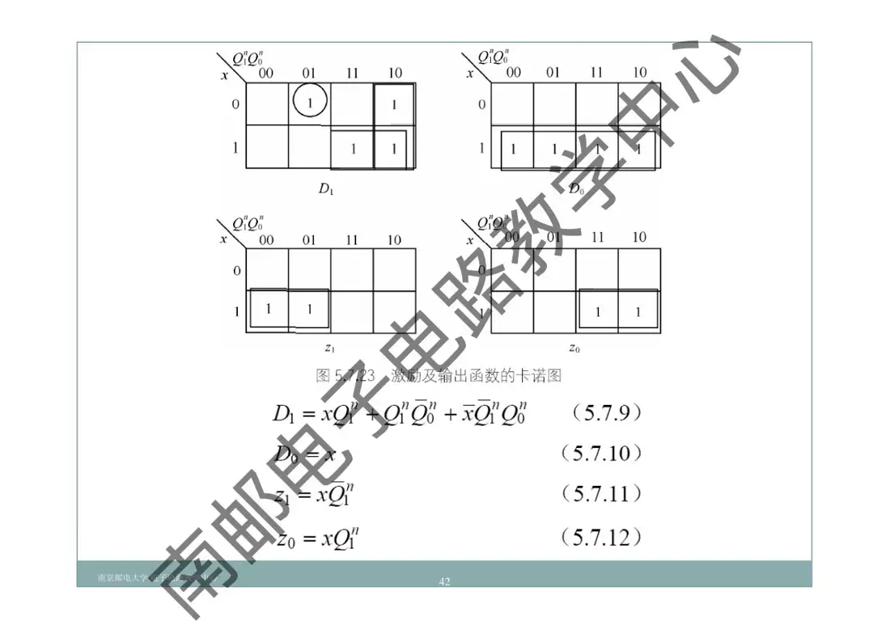

原文：

图 5723 激励及输出函数的卡诺图

$$
D _ {1} = x Q _ {1} ^ {n} + Q _ {1} ^ {n} \overline {{Q}} _ {0} ^ {n} + \overline {{x}} \overline {{Q}} _ {1} ^ {n} Q _ {0} ^ {n}\tag{5.7.9}
$$

(5.7.10)

$$
z _ {1} = x \overline {{Q}} _ {1} ^ {n}\tag{5.7.11}
$$

$$
z _ {0} = x Q _ {1} ^ {n}\tag{5.7.12}
$$

南京邮电大学 电子电路教学中心

42

### 5． 自 启动性检查

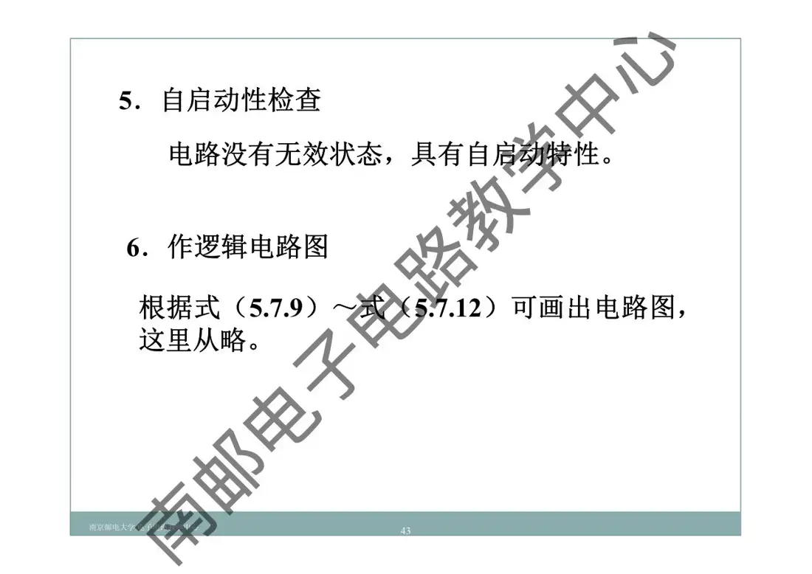

原文：

5． 自 启动性检查

电路没有无效状态， 具有 自 启动特性。

6． 作逻辑电路图

根据 式 （ 5.7.9 ） ～ 式 （ 5.7. 12 ） 可 画 出 电 路 图 ，这里从略。

43

### 南京邮电大学 电子电路教学中心44

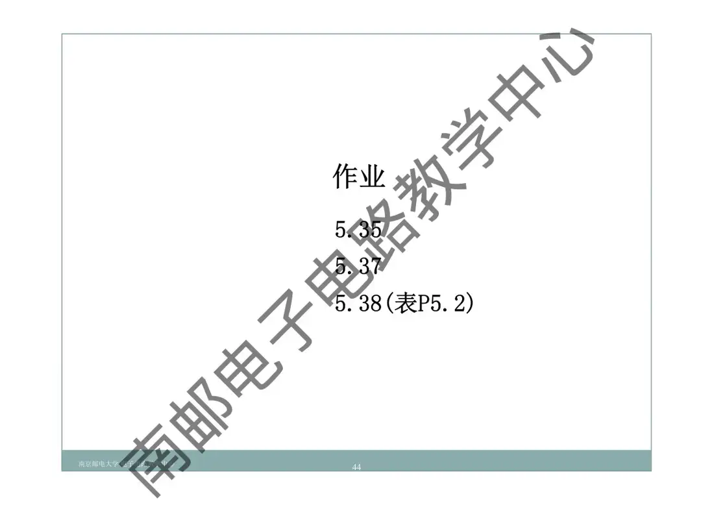

原文：

<table><tr><td>南京邮电大学 电子电路教学中心</td><td>44</td></tr></table>
