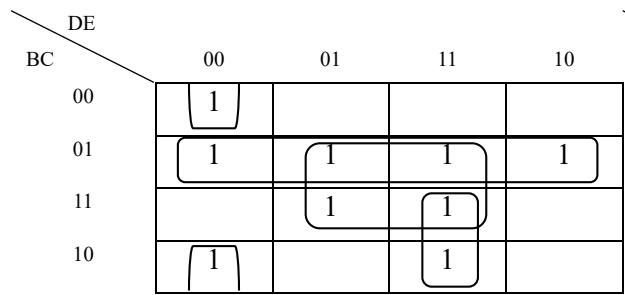
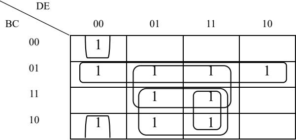
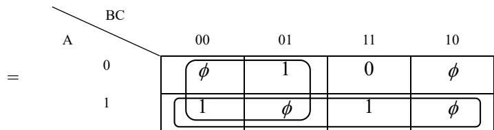

# 《数字电路与逻辑设计B》第2章 习题答案

原件经识别和整理；“参考解答”是我们补的。

本部分为《数字电路与逻辑设计B》第2章习题答案的第1部分，涵盖习题2.1至2.5。

## 一、习题解答

### 选择 1

有 A、B、C 三个输入信号，试列出下列问题的真值表，并写出最小项表达式 $\Sigma_{m}$ （）。

（1）如果 A、B、C 均为 0 或其中一个信号为 1 时。输出 F=1，其余情况下 F=0。
(2) 若 A、B、C 出现奇数个 0 时输出为 1，其余情况输出为 0。
（3）若 A、B、C 有两个或两个以上为 1 时，输出为 1，其余情况下，输出为 0。

答案：
解：（1）

| A | B | C | F |
| :---: | :---: | :---: | :---: |
| 0 | 0 | 0 | 1 |
| 0 | 0 | 1 | 1 |
| 0 | 1 | 0 | 1 |
| 0 | 1 | 1 | 0 |
| 1 | 0 | 0 | 1 |
| 1 | 0 | 1 | 0 |
| 1 | 1 | 0 | 0 |
| 1 | 1 | 1 | 0 |

$F_{1}(A,B,C)=\Sigma_{m}(0,1,2,4)$

(2)

| A | B | C | F |
| :---: | :---: | :---: | :---: |
| 0 | 0 | 0 | 1 |
| 0 | 0 | 1 | 0 |
| 0 | 1 | 0 | 0 |
| 0 | 1 | 1 | 1 |
| 1 | 0 | 0 | 0 |
| 1 | 0 | 1 | 1 |
| 1 | 1 | 0 | 1 |
| 1 | 1 | 1 | 0 |

$F_{2}(A,B,C)=\Sigma_{m}(0,3,5,6)$

(3)

| A | B | C | F |
| :---: | :---: | :---: | :---: |
| 0 | 0 | 0 | 0 |
| 0 | 0 | 1 | 0 |
| 0 | 1 | 0 | 0 |
| 0 | 1 | 1 | 1 |
| 1 | 0 | 0 | 0 |
| 1 | 0 | 1 | 1 |
| 1 | 1 | 0 | 1 |
| 1 | 1 | 1 | 1 |

$F_{3}(A,B,C)=\Sigma_{m}(3,5,6,7)$

知识点：[数字系统的基本模型（数据处理器与控制器）及对最小时钟周期、异步信号同步化的约定](../../../topics/数字逻辑电路/数字系统模型.md)

### 选择 2

试用真值表证明下列等式:

(1) $\overline{A\ B+B\ C+A\ C}=ABC+\overline{A}\ \overline{B}\ \overline{C}$

(2) $\overline{A} \overline{B} + \overline{B} \overline{C} + \overline{A} \overline{C} = \overline{AB} \overline{BC} \overline{AC}$

答案：
证明：（1）

| A | B | C | $\overline{A\ \overline{B}+B\ \overline{C}+A\ \overline{C}}$ |
| :---: | :---: | :---: | :---: |
| 0 | 0 | 0 | 1 |
| 0 | 0 | 1 | 0 |
| 0 | 1 | 0 | 0 |
| 0 | 1 | 1 | 0 |
| 1 | 0 | 0 | 0 |
| 1 | 0 | 1 | 0 |
| 1 | 1 | 0 | 0 |
| 1 | 1 | 1 | 1 |

| A | B | C | $ABC+ \overline{A} \overline{B} \overline{C}$ |
| :---: | :---: | :---: | :---: |
| 0 | 0 | 0 | 1 |
| 0 | 0 | 1 | 0 |
| 0 | 1 | 0 | 0 |
| 0 | 1 | 1 | 0 |
| 1 | 0 | 0 | 0 |
| 1 | 0 | 1 | 0 |
| 1 | 1 | 0 | 0 |
| 1 | 1 | 1 | 1 |

真值表相同，所以等式成立。

(2)

| A | B | C | $\overline{A} \overline{B}+ \overline{B} \overline{C}+ \overline{A} \overline{C}$ |
| :---: | :---: | :---: | :---: |
| 0 | 0 | 0 | 1 |
| 0 | 0 | 1 | 1 |
| 0 | 1 | 0 | 1 |
| 0 | 1 | 1 | 0 |
| 1 | 0 | 0 | 1 |
| 1 | 0 | 1 | 0 |
| 1 | 1 | 0 | 0 |
| 1 | 1 | 1 | 0 |

| A | B | C | $\overline{AB} \overline{BC} \overline{AC}$ |
| :---: | :---: | :---: | :---: |
| 0 | 0 | 0 | 1 |
| 0 | 0 | 1 | 1 |
| 0 | 1 | 0 | 1 |
| 0 | 1 | 1 | 0 |
| 1 | 0 | 0 | 1 |
| 1 | 0 | 1 | 0 |
| 1 | 1 | 0 | 0 |
| 1 | 1 | 1 | 0 |

真值表相同，所以等式成立。

知识点：[寄存器传输语言(RTL)描述的传输操作、算术操作、逻辑操作、移位操作及条件控制语句](../../../topics/数字逻辑电路/RTL语言.md)

### 选择 3

对下列函数，说明对输入变量的哪些取值组合其输出为 1?

(1) F (A,B,C) = AB + BC + AC

(2) F (A,B,C) = (A+B+C)( $\bar{A}+\bar{B}+\bar{C}$ )

(3) F (A,B,C) = ( $\overline{A}B+ \overline{B}C+A \overline{C}$ )AC

答案：
解：本题可用真值表、化成最小项表达式、卡诺图等多种方法求解。

（1）F 输出 1 的取值组合为：011、101、110、111。

(2) F 输出 1 的取值组合为: 001、010、011、100、101、110。

（3）F 输出 1 的取值组合为：101。

知识点：[数字系统的基本模型（数据处理器与控制器）及对最小时钟周期、异步信号同步化的约定](../../../topics/数字逻辑电路/数字系统模型.md)、[寄存器传输语言(RTL)描述的传输操作、算术操作、逻辑操作、移位操作及条件控制语句](../../../topics/数字逻辑电路/RTL语言.md)

### 选择 4

试直接写出下列各式的反演式和对偶式。

(1) F(A,B,C,D,E)=[(A $\bar{B}$ +C) $\cdot$ D+E] $\cdot$ B

(2) F(A,B,C,D,E)=AB+ $\overline{C}$ $\overline{D}$ +BC+ $\overline{D}$ + $\overline{CE}$ + $\overline{B+E}$

(3) F(A,B,C)= $\overline{\overline{A}\overline{B}+C}\overline{\overline{\overline{AB}}C}$

答案：
解：(1) 
$\overline{\mathrm{F}}=[(\overline{\mathrm{A}}+\mathrm{B})\cdot\overline{\mathrm{C}}+\overline{\mathrm{D}}]\cdot\overline{\mathrm{E}}+\overline{\mathrm{B}}$ 
$\mathrm{F}^{\prime}=[(\mathrm{A}+\overline{\mathrm{B}})\cdot\mathrm{C}+\mathrm{D}]\cdot\mathrm{E}+\mathrm{B}$

(2) 
$\overline{\mathrm{F}}=(\overline{\mathrm{A}}+\overline{\mathrm{B}})(\mathrm{C}+\mathrm{D})\cdot(\overline{\mathrm{B}}+\overline{\mathrm{C}})\cdot\mathrm{D}\cdot(\mathrm{C}+\overline{\mathrm{E}})\cdot\overline{\overline{\mathrm{B}}}\cdot\overline{\mathrm{E}}$ 
$\mathrm{F}'=(\mathrm{A}+\mathrm{B})(\overline{\mathrm{C}}+\overline{\mathrm{D}})\cdot\overline{(\mathrm{B}+\mathrm{C})}\cdot\overline{\mathrm{D}}\cdot(\overline{\mathrm{C}}+\mathrm{E})\cdot\overline{\mathrm{B}\cdot\mathrm{E}}$

(3) 
$\overline{\mathrm{F}}=(\mathrm{A}+\mathrm{B})\cdot\overline{\mathrm{C}}+\mathrm{A}+\overline{\mathrm{B}}+\mathrm{C}$

$$
\mathrm{F} ^ {\prime} = \overline {{(\bar {\mathrm{A}} + \bar {\mathrm{B}}) \cdot \mathrm{C} + \overline {{\bar {\mathrm{A}} + \mathrm{B}}} + \bar {\mathrm{C}}}}
$$

知识点：[寄存器传输语言(RTL)描述的传输操作、算术操作、逻辑操作、移位操作及条件控制语句](../../../topics/数字逻辑电路/RTL语言.md)、[数字系统的基本模型（数据处理器与控制器）及对最小时钟周期、异步信号同步化的约定](../../../topics/数字逻辑电路/数字系统模型.md)、[算法状态机(ASM)图的状态框、判断框、条件输出框及ASM块的构成规则](../../../topics/数字逻辑电路/ASM图基础.md)

### 选择 5

用公式证明下列等式:

(1) $\overline{A}$ $\overline{C}+$ $\overline{A}$ $\overline{B}+BC+$ $\overline{A}$ $\overline{C}$ $\overline{D}=$ $\overline{A}+BC$

(2) AB+ $\overline{A}C+( \overline{B}+\overline{C})D=AB+ \overline{A}C+D$

(3) $\overline{\mathrm{BC}}\overline{\mathrm{D}} +\mathrm{B}\overline{\mathrm{CD}} +\mathrm{ACD}+\overline{\mathrm{AB}}\overline{\mathrm{C}}\overline{\mathrm{D}} +\overline{\mathrm{A}}\overline{\mathrm{BCD}} +\mathrm{B}\overline{\mathrm{C}}\overline{\mathrm{D}} +\mathrm{BCD} = \overline{\mathrm{BC}} +\mathrm{B}\overline{\mathrm{C}} +\mathrm{BD}$

(4) $\overline{\mathrm{A}\overline{\mathrm{B}}\overline{\mathrm{C}}} +\overline{\overline{\mathrm{BC}} + \mathrm{BC}}\overline{\mathrm{D}} +\overline{\mathrm{A}\overline{\mathrm{BD}}} = \overline{\mathrm{A}} +\mathrm{B} + \overline{\mathrm{C}} +\overline{\mathrm{D}}$

## 2.6

已知 $\overline{ab} + a\overline{b} = a \oplus b$，$\overline{a}\overline{b} + ab = a \odot b$，证明：

(1) $a \oplus b \oplus c = a \odot b \odot c$

(2) $\overline{a \oplus b \oplus c} = \overline{a} \odot \overline{b} \odot \overline{c}$

证明：(1) $a \oplus b \oplus c = (a \oplus b) \oplus c = \overline{a \oplus b} \cdot c + (a \oplus b) \cdot \overline{c} = (a \odot b) \cdot c + \overline{a \odot b} \cdot \overline{c} = a \odot b \odot c$

(2) $\overline{(a \oplus b) \oplus c} = (a \oplus b) \odot c = \overline{a \odot b} \odot c = a \odot b \odot \overline{c} = \overline{a} \odot \overline{b} \odot \overline{c}$

## 2.7

试证明：

(1) 若 $\overline{a}\overline{b} + ab = 0$，则 $\overline{ax + by} = a\overline{x} + b\overline{y}$

证明：$\overline{a}\overline{b} + ab = 0$，即 $a \odot b = 0$，$\therefore a = \overline{b}$

$$
\overline{ax + by} = \overline{\overline{b}x + by} = \overline{\overline{b}x} \cdot \overline{by} = (b + \overline{x})(\overline{b} + \overline{y}) = b\overline{y} + \overline{b}\overline{x} + \overline{x}\overline{y} = a\overline{x} + b\overline{y}
$$

(2) 若 $\overline{a}b + a\overline{b} = c$，则 $\overline{a}c + a\overline{c} = b$

证明：$a \oplus b = c \Rightarrow a \oplus b \oplus c = c \oplus c \Rightarrow a \oplus b \oplus c = 0 \Rightarrow a \oplus b \oplus c \oplus b = 0 \oplus b \Rightarrow a \oplus c = b$

## 2.8

将下列函数展开成最小项之和：

(1) $F(ABC) = A + BC$

(2) $F(ABCD) = (B + \overline{C})D + (\overline{A} + B)C$

(3) $F(ABC) = \overline{A + B + C} + \overline{A + \overline{B} + C}$

解：(1) $F(ABC) = A + BC = A(B + \overline{B})(C + \overline{C}) + (A + \overline{A})BC = \overline{A}BC + A\overline{B}\overline{C} + A\overline{B}C + AB\overline{C} = \sum_m(3,4,5,6,7)$

(2) $F(ABCD) = (B + \overline{C})D + (\overline{A} + B)C = BD + \overline{C}D + \overline{A}C + BC = \sum_m(1,3,5,6,7,9,13,14,15)$

(3) $F(ABC) = \overline{A + B + C} + \overline{\overline{A} + B + C} = \sum_m(0,2,6)$

## 2.9

将题 2.8 中各题写成最大项表达式，并将结果与 2.8 题结果进行比较。

解：(1) $F(ABC) = \prod_M(0,1,2)$

(2) $F(ABCD) = \prod_M(2,4,8,10,11,12)$

(3) $F(ABC) = \prod_M(1,3,4,5,7)$

## 2.10

试写出下列各函数表达式 $F$ 的 $\overline{F}$ 和 $F'$ 的最小项表达式。

(1) $F = ABCD + ACD + B\overline{C}\overline{D}$

(2) $F = A\overline{B} + \overline{A}B + BC$

解：(1) $F = ABCD + ACD + B\overline{C}\overline{D} = \sum_m(4,11,12,15)$

所以：$\overline{F} = \sum_m(0,1,2,3,5,6,7,8,9,10,13,14)$

(2) $F = A\overline{B} + \overline{A}B + BC = \sum_m(4,5,6,7,8,9,10,11,14,15)$

所以：$\overline{F} = \sum_m(0,1,2,3,12,13)$，$F' = \sum_m(2,3,12,13,14,15)$

## 2.11

试用公式法把下列各表达式化简为最简与或式。

(1) $F = A + AB\overline{C} + ABC + BC + B$

解：$F = A + AB(\overline{C} + C) + B = A + AB + B = A + B$

(2) $F = (A + B)(A + B + C)(\overline{A} + C)(B + C + D)$

解：$F' = AB + ABC + \overline{AC} + BCD = AB + \overline{AC} + BCD = AB + \overline{AC}$

(3) $F = AB + \overline{A}\overline{B} \cdot \overline{BC} + \overline{B}\overline{C}$

解：$F = AB + \overline{A}\overline{B} + BC + \overline{B}\overline{C} = AB + \overline{A}\overline{B}(C + \overline{C}) + BC(A + \overline{A}) + \overline{B}\overline{C} = AB + \overline{A}\overline{B}C + \overline{A}\overline{B}\overline{C} + ABC + \overline{A}BC + \overline{B}\overline{C} = AB + \overline{B}\overline{C} + \overline{A}C$

或：$F = \overline{A}\overline{B} + A\overline{C} + BC$

(4) $F = A\overline{C}\overline{D} + BC + \overline{B}D + A\overline{B} + \overline{A}C + \overline{B}\overline{C}$

解：$F = A\overline{C}\overline{D} + BC + \overline{B}D + A\overline{B} + \overline{A}C + \overline{B}\overline{C} + AC$（添项法增加 $AC$）
$= A\overline{C}\overline{D} + BC + \overline{B}D + A\overline{B} + C + \overline{B}\overline{C}$
$= A\overline{C}\overline{D} + BC + \overline{B}D + A\overline{B} + C + \overline{B}$
$= A\overline{C}\overline{D} + BC + C + \overline{B}$
$= A\overline{C}\overline{D} + C + \overline{B}$
$= A\overline{D} + C + \overline{B}$

(5) $F = AC + \overline{BC} + B(A\overline{C} + \overline{AC})$

解：$F = (AC + \overline{BC}) \cdot B(A\overline{C} + \overline{AC})$
$= (AC + \overline{BC}) \cdot [B + (A\overline{C} + \overline{AC})]$
$= (AC + \overline{BC}) \cdot (B + A\overline{C} + AC)$
$= ABC + AC + B\overline{C} + AB\overline{C}$
$= AC + B\overline{C}$

## 2.12

用卡诺图把下列函数化简为最简与或式。

(1) $F(A,B,C) = \sum_m(0,1,2,4,5,7)$

解：$F = \overline{B} + \overline{A}\overline{C} + AC$

| $A \backslash BC$ | 00 | 01 | 11 | 10 |
| --- | --- | --- | --- | --- |
| 0 | 1 | 1 |  | 1 |
| 1 | 1 | 1 | 1 |  |

(2) $F(A,B,C,D) = \sum_m(0,2,5,6,7,9,10,14,15)$

解：$F = A\overline{B}\overline{C}D + \overline{A}\overline{B}\overline{D} + \overline{A}BD + BC + C\overline{D}$

(3) $F(A,B,C,D) = \sum_m(0,1,4,7,9,10,13) + \sum_\phi(2,5,8,12,15)$

# 2021—2022 学年第二学期《数字电路与逻辑设计 B》第 2 章 习题答案（部分）

本资料为《数字电路与逻辑设计 B》第 2 章习题答案的第 3 部分（第 6–8 页），由识别工具读取并整理，包含卡诺图化简函数及异或运算相关习题。

## 一、卡诺图化简函数

知识点：[数字系统的基本模型（数据处理器与控制器）及对最小时钟周期、异步信号同步化的约定](../../../topics/数字逻辑电路/数字系统模型.md)

### 计算 4
题干：$F(A,B,C,D) = \sum_{m}(7,13,15)$ 且 $\overline{A} \overline{B} \overline{C} = 0, \overline{A} B \overline{C} = 0, \overline{A} \overline{B} C = 0$

<table>
<tr><td>AB\CD</td><td>00</td><td>01</td><td>11</td><td>10</td></tr>
<tr><td>00</td><td>$\phi$</td><td>$\phi$</td><td>$\phi$</td><td>$\phi$</td></tr>
<tr><td>01</td><td>$\phi$</td><td>$\phi$</td><td>1</td><td></td></tr>
<tr><td>11</td><td></td><td>1</td><td>1</td><td></td></tr>
<tr><td>10</td><td></td><td></td><td></td><td></td></tr>
</table>

答案：$F(A,B,C,D)=BD$

知识点：[完整数字系统设计流程实例（如乘法器、交通灯管理系统的算法规律、处理器设计与控制器实现）](../../../topics/数字逻辑电路/数字系统设计实例.md)

### 计算 5
题干：$F(A,B,C,D)=AB \overline{C}+A\overline{B}\overline{C}+\overline{A}\overline{B}C\overline{D}+A\overline{B}C\overline{D}$ 且 ABCD 不可同时为 1 或同时为 0

<table>
<tr><td>AB\CD</td><td>00</td><td>01</td><td>11</td><td>10</td></tr>
<tr><td>00</td><td>$\phi$</td><td></td><td></td><td>1</td></tr>
<tr><td>01</td><td></td><td></td><td></td><td></td></tr>
<tr><td>11</td><td>1</td><td>1</td><td>$\phi$</td><td></td></tr>
<tr><td>10</td><td>1</td><td>1</td><td></td><td>1</td></tr>
</table>

答案：$F(A,B,C,D)= \overline{B}\overline{D}+A\overline{C}$

知识点：[数字系统的基本模型（数据处理器与控制器）及对最小时钟周期、异步信号同步化的约定](../../../topics/数字逻辑电路/数字系统模型.md)

### 计算 6
题干：$\mathrm{F}(\mathrm{A},\mathrm{B},\mathrm{C},\mathrm{D})=\prod_{M}(5,7,13,15)$

答案：$F=\overline{B}+\overline{D}$

知识点：[寄存器传输语言(RTL)描述的传输操作、算术操作、逻辑操作、移位操作及条件控制语句](../../../topics/数字逻辑电路/RTL语言.md)、[数字系统的基本模型（数据处理器与控制器）及对最小时钟周期、异步信号同步化的约定](../../../topics/数字逻辑电路/数字系统模型.md)

### 计算 7
题干：$\mathrm{F}(\mathrm{A},\mathrm{B},\mathrm{C},\mathrm{D})=\prod_{M}(1,3,9,10,14,15)$

答案：$F=\overline{A}\overline{D}+\overline{A}B+\overline{C}\overline{D}+B\overline{C}+A\overline{B}CD$

知识点：[根据文字描述建立ASM图的原则，以及从ASM图推导处理器明细表和控制器状态转移图](../../../topics/数字逻辑电路/ASM图建立与分析.md)

### 计算 8
题干：$F(A,B,C,D,E)= \sum_{m}(0,4,5,6,7,8,11,13,15,16,20,21,22,23,24,25,27,29,31)$

答案：$F=\overline{C}\overline{D}\overline{E}+\overline{B}C+CE+BDE+ABE$

## 二、化为最简或与式

知识点：[算法状态机(ASM)图的状态框、判断框、条件输出框及ASM块的构成规则](../../../topics/数字逻辑电路/ASM图基础.md)

### 计算 1
题干：用卡诺图将下列函数化为最简或与式。$\mathrm{F}(\mathrm{A},\mathrm{B},\mathrm{C})=\sum_{m}(0,1,2,4,5,7)$

<table>
<tr><td>A\BC</td><td>00</td><td>01</td><td>11</td><td>10</td></tr>
<tr><td>0</td><td>1</td><td>1</td><td>0</td><td>1</td></tr>
<tr><td>1</td><td>1</td><td>1</td><td>1</td><td>0</td></tr>
</table>

答案：$\mathrm{F} = (\mathrm{A} + \overline{\mathrm{B}} + \overline{\mathrm{C}})(\overline{\mathrm{A}} + \overline{\mathrm{B}} + \mathrm{C})$

知识点：[数字系统的基本模型（数据处理器与控制器）及对最小时钟周期、异步信号同步化的约定](../../../topics/数字逻辑电路/数字系统模型.md)

### 计算 2
题干：$\mathrm{F}(\mathrm{A},\mathrm{B},\mathrm{C})=\prod_{M}(5,7,13,15)$

<table>
<tr><td>AB\CD</td><td>00</td><td>01</td><td>11</td><td>10</td></tr>
<tr><td>00</td><td></td><td></td><td></td><td></td></tr>
<tr><td>01</td><td></td><td>0</td><td>0</td><td></td></tr>
<tr><td>11</td><td></td><td>0</td><td>0</td><td></td></tr>
<tr><td>10</td><td></td><td></td><td></td><td></td></tr>
</table>

答案：$\mathrm{F} = (\bar{\mathrm{B}} + \bar{\mathrm{D}})$

## 三、复合函数化简

知识点：[数字系统的基本模型（数据处理器与控制器）及对最小时钟周期、异步信号同步化的约定](../../../topics/数字逻辑电路/数字系统模型.md)

### 计算 3
题干：已知 $F_{1}(A,B,C)=\sum_{m}(1,2,3,5,7)+\sum_{\phi}(0,6)$ ， $F_{2}(A,B,C)=\sum_{m}(0,3,4,6)+\sum_{\phi}(2,5)$ ，求 $F=F_{1}\oplus F_{2}$ 的最简与或式

<table>
<tr><td>A\BC</td><td>00</td><td>01</td><td>11</td><td>10</td><td>A\BC</td><td>00</td><td>01</td><td>11</td><td>10</td></tr>
<tr><td>0</td><td>$\phi$</td><td>1</td><td>1</td><td>1</td><td>0</td><td>1</td><td></td><td>1</td><td>$\phi$</td></tr>
<tr><td>1</td><td></td><td>1</td><td>1</td><td>$\phi$</td><td>$\oplus$ 1</td><td>1</td><td>$\phi$</td><td></td><td>1</td></tr>
</table>

答案：$F=A+\bar{B}$

知识点：[数字系统的基本模型（数据处理器与控制器）及对最小时钟周期、异步信号同步化的约定](../../../topics/数字逻辑电路/数字系统模型.md)
