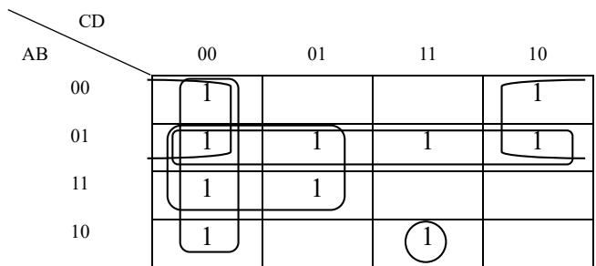

# 《数字电路与逻辑设计B》第2章 习题答案

原件经识别和整理；“参考解答”是我们补的。

本部分为《数字电路与逻辑设计B》第2章习题答案的第1部分，涵盖习题2.1至2.5。

## 一、习题解答

### 选择 1

有 A、B、C 三个输入信号，试列出下列问题的真值表，并写出最小项表达式 $\Sigma_{m}$ （）。

（1）如果 A、B、C 均为 0 或其中一个信号为 1 时。输出 F=1，其余情况下 F=0。
(2) 若 A、B、C 出现奇数个 0 时输出为 1，其余情况输出为 0。
（3）若 A、B、C 有两个或两个以上为 1 时，输出为 1，其余情况下，输出为 0。

答案：
解：（1）

| A | B | C | F |
| :---: | :---: | :---: | :---: |
| 0 | 0 | 0 | 1 |
| 0 | 0 | 1 | 1 |
| 0 | 1 | 0 | 1 |
| 0 | 1 | 1 | 0 |
| 1 | 0 | 0 | 1 |
| 1 | 0 | 1 | 0 |
| 1 | 1 | 0 | 0 |
| 1 | 1 | 1 | 0 |

$F_{1}(A,B,C)=\Sigma_{m}(0,1,2,4)$

(2)

| A | B | C | F |
| :---: | :---: | :---: | :---: |
| 0 | 0 | 0 | 1 |
| 0 | 0 | 1 | 0 |
| 0 | 1 | 0 | 0 |
| 0 | 1 | 1 | 1 |
| 1 | 0 | 0 | 0 |
| 1 | 0 | 1 | 1 |
| 1 | 1 | 0 | 1 |
| 1 | 1 | 1 | 0 |

$F_{2}(A,B,C)=\Sigma_{m}(0,3,5,6)$

(3)

| A | B | C | F |
| :---: | :---: | :---: | :---: |
| 0 | 0 | 0 | 0 |
| 0 | 0 | 1 | 0 |
| 0 | 1 | 0 | 0 |
| 0 | 1 | 1 | 1 |
| 1 | 0 | 0 | 0 |
| 1 | 0 | 1 | 1 |
| 1 | 1 | 0 | 1 |
| 1 | 1 | 1 | 1 |

$F_{3}(A,B,C)=\Sigma_{m}(3,5,6,7)$

知识点：[数字系统的基本模型（数据处理器与控制器）及对最小时钟周期、异步信号同步化的约定](../../../topics/数字逻辑电路/数字系统模型.md)

### 选择 2

试用真值表证明下列等式:

(1) $\overline{A\ B+B\ C+A\ C}=ABC+\overline{A}\ \overline{B}\ \overline{C}$

(2) $\overline{A} \overline{B} + \overline{B} \overline{C} + \overline{A} \overline{C} = \overline{AB} \overline{BC} \overline{AC}$

答案：
证明：（1）

| A | B | C | $\overline{A\ \overline{B}+B\ \overline{C}+A\ \overline{C}}$ |
| :---: | :---: | :---: | :---: |
| 0 | 0 | 0 | 1 |
| 0 | 0 | 1 | 0 |
| 0 | 1 | 0 | 0 |
| 0 | 1 | 1 | 0 |
| 1 | 0 | 0 | 0 |
| 1 | 0 | 1 | 0 |
| 1 | 1 | 0 | 0 |
| 1 | 1 | 1 | 1 |

| A | B | C | $ABC+ \overline{A} \overline{B} \overline{C}$ |
| :---: | :---: | :---: | :---: |
| 0 | 0 | 0 | 1 |
| 0 | 0 | 1 | 0 |
| 0 | 1 | 0 | 0 |
| 0 | 1 | 1 | 0 |
| 1 | 0 | 0 | 0 |
| 1 | 0 | 1 | 0 |
| 1 | 1 | 0 | 0 |
| 1 | 1 | 1 | 1 |

真值表相同，所以等式成立。

(2)

| A | B | C | $\overline{A} \overline{B}+ \overline{B} \overline{C}+ \overline{A} \overline{C}$ |
| :---: | :---: | :---: | :---: |
| 0 | 0 | 0 | 1 |
| 0 | 0 | 1 | 1 |
| 0 | 1 | 0 | 1 |
| 0 | 1 | 1 | 0 |
| 1 | 0 | 0 | 1 |
| 1 | 0 | 1 | 0 |
| 1 | 1 | 0 | 0 |
| 1 | 1 | 1 | 0 |

| A | B | C | $\overline{AB} \overline{BC} \overline{AC}$ |
| :---: | :---: | :---: | :---: |
| 0 | 0 | 0 | 1 |
| 0 | 0 | 1 | 1 |
| 0 | 1 | 0 | 1 |
| 0 | 1 | 1 | 0 |
| 1 | 0 | 0 | 1 |
| 1 | 0 | 1 | 0 |
| 1 | 1 | 0 | 0 |
| 1 | 1 | 1 | 0 |

真值表相同，所以等式成立。

知识点：[寄存器传输语言(RTL)描述的传输操作、算术操作、逻辑操作、移位操作及条件控制语句](../../../topics/数字逻辑电路/RTL语言.md)

### 选择 3

对下列函数，说明对输入变量的哪些取值组合其输出为 1?

(1) F (A,B,C) = AB + BC + AC

(2) F (A,B,C) = (A+B+C)( $\bar{A}+\bar{B}+\bar{C}$ )

(3) F (A,B,C) = ( $\overline{A}B+ \overline{B}C+A \overline{C}$ )AC

答案：
解：本题可用真值表、化成最小项表达式、卡诺图等多种方法求解。

（1）F 输出 1 的取值组合为：011、101、110、111。

(2) F 输出 1 的取值组合为: 001、010、011、100、101、110。

（3）F 输出 1 的取值组合为：101。

知识点：[数字系统的基本模型（数据处理器与控制器）及对最小时钟周期、异步信号同步化的约定](../../../topics/数字逻辑电路/数字系统模型.md)、[寄存器传输语言(RTL)描述的传输操作、算术操作、逻辑操作、移位操作及条件控制语句](../../../topics/数字逻辑电路/RTL语言.md)

### 选择 4

试直接写出下列各式的反演式和对偶式。

(1) F(A,B,C,D,E)=[(A $\bar{B}$ +C) $\cdot$ D+E] $\cdot$ B

(2) F(A,B,C,D,E)=AB+ $\overline{C}$ $\overline{D}$ +BC+ $\overline{D}$ + $\overline{CE}$ + $\overline{B+E}$

(3) F(A,B,C)= $\overline{\overline{A}\overline{B}+C}\overline{\overline{\overline{AB}}C}$

答案：
解：(1) 
$\overline{\mathrm{F}}=[(\overline{\mathrm{A}}+\mathrm{B})\cdot\overline{\mathrm{C}}+\overline{\mathrm{D}}]\cdot\overline{\mathrm{E}}+\overline{\mathrm{B}}$ 
$\mathrm{F}^{\prime}=[(\mathrm{A}+\overline{\mathrm{B}})\cdot\mathrm{C}+\mathrm{D}]\cdot\mathrm{E}+\mathrm{B}$

(2) 
$\overline{\mathrm{F}}=(\overline{\mathrm{A}}+\overline{\mathrm{B}})(\mathrm{C}+\mathrm{D})\cdot(\overline{\mathrm{B}}+\overline{\mathrm{C}})\cdot\mathrm{D}\cdot(\mathrm{C}+\overline{\mathrm{E}})\cdot\overline{\overline{\mathrm{B}}}\cdot\overline{\mathrm{E}}$ 
$\mathrm{F}'=(\mathrm{A}+\mathrm{B})(\overline{\mathrm{C}}+\overline{\mathrm{D}})\cdot\overline{(\mathrm{B}+\mathrm{C})}\cdot\overline{\mathrm{D}}\cdot(\overline{\mathrm{C}}+\mathrm{E})\cdot\overline{\mathrm{B}\cdot\mathrm{E}}$

(3) 
$\overline{\mathrm{F}}=(\mathrm{A}+\mathrm{B})\cdot\overline{\mathrm{C}}+\mathrm{A}+\overline{\mathrm{B}}+\mathrm{C}$

$$
\mathrm{F} ^ {\prime} = \overline {{(\bar {\mathrm{A}} + \bar {\mathrm{B}}) \cdot \mathrm{C} + \overline {{\bar {\mathrm{A}} + \mathrm{B}}} + \bar {\mathrm{C}}}}
$$

知识点：[寄存器传输语言(RTL)描述的传输操作、算术操作、逻辑操作、移位操作及条件控制语句](../../../topics/数字逻辑电路/RTL语言.md)、[数字系统的基本模型（数据处理器与控制器）及对最小时钟周期、异步信号同步化的约定](../../../topics/数字逻辑电路/数字系统模型.md)、[算法状态机(ASM)图的状态框、判断框、条件输出框及ASM块的构成规则](../../../topics/数字逻辑电路/ASM图基础.md)

### 选择 5

用公式证明下列等式:

(1) $\overline{A}$ $\overline{C}+$ $\overline{A}$ $\overline{B}+BC+$ $\overline{A}$ $\overline{C}$ $\overline{D}=$ $\overline{A}+BC$

(2) AB+ $\overline{A}C+( \overline{B}+\overline{C})D=AB+ \overline{A}C+D$

(3) $\overline{\mathrm{BC}}\overline{\mathrm{D}} +\mathrm{B}\overline{\mathrm{CD}} +\mathrm{ACD}+\overline{\mathrm{AB}}\overline{\mathrm{C}}\overline{\mathrm{D}} +\overline{\mathrm{A}}\overline{\mathrm{BCD}} +\mathrm{B}\overline{\mathrm{C}}\overline{\mathrm{D}} +\mathrm{BCD} = \overline{\mathrm{BC}} +\mathrm{B}\overline{\mathrm{C}} +\mathrm{BD}$

(4) $\overline{\mathrm{A}\overline{\mathrm{B}}\overline{\mathrm{C}}} +\overline{\overline{\mathrm{BC}} + \mathrm{BC}}\overline{\mathrm{D}} +\overline{\mathrm{A}\overline{\mathrm{BD}}} = \overline{\mathrm{A}} +\mathrm{B} + \overline{\mathrm{C}} +\overline{\mathrm{D}}$

## 2.6

已知 $\overline{ab} + a\overline{b} = a \oplus b$，$\overline{a}\overline{b} + ab = a \odot b$，证明：

(1) $a \oplus b \oplus c = a \odot b \odot c$

(2) $\overline{a \oplus b \oplus c} = \overline{a} \odot \overline{b} \odot \overline{c}$

证明：(1) $a \oplus b \oplus c = (a \oplus b) \oplus c = \overline{a \oplus b} \cdot c + (a \oplus b) \cdot \overline{c} = (a \odot b) \cdot c + \overline{a \odot b} \cdot \overline{c} = a \odot b \odot c$

(2) $\overline{(a \oplus b) \oplus c} = (a \oplus b) \odot c = \overline{a \odot b} \odot c = a \odot b \odot \overline{c} = \overline{a} \odot \overline{b} \odot \overline{c}$

## 2.7

试证明：

(1) 若 $\overline{a}\overline{b} + ab = 0$，则 $\overline{ax + by} = a\overline{x} + b\overline{y}$

证明：$\overline{a}\overline{b} + ab = 0$，即 $a \odot b = 0$，$\therefore a = \overline{b}$

$$
\overline{ax + by} = \overline{\overline{b}x + by} = \overline{\overline{b}x} \cdot \overline{by} = (b + \overline{x})(\overline{b} + \overline{y}) = b\overline{y} + \overline{b}\overline{x} + \overline{x}\overline{y} = a\overline{x} + b\overline{y}
$$

(2) 若 $\overline{a}b + a\overline{b} = c$，则 $\overline{a}c + a\overline{c} = b$

证明：$a \oplus b = c \Rightarrow a \oplus b \oplus c = c \oplus c \Rightarrow a \oplus b \oplus c = 0 \Rightarrow a \oplus b \oplus c \oplus b = 0 \oplus b \Rightarrow a \oplus c = b$

## 2.8

将下列函数展开成最小项之和：

(1) $F(ABC) = A + BC$

(2) $F(ABCD) = (B + \overline{C})D + (\overline{A} + B)C$

(3) $F(ABC) = \overline{A + B + C} + \overline{A + \overline{B} + C}$

解：(1) $F(ABC) = A + BC = A(B + \overline{B})(C + \overline{C}) + (A + \overline{A})BC = \overline{A}BC + A\overline{B}\overline{C} + A\overline{B}C + AB\overline{C} = \sum_m(3,4,5,6,7)$

(2) $F(ABCD) = (B + \overline{C})D + (\overline{A} + B)C = BD + \overline{C}D + \overline{A}C + BC = \sum_m(1,3,5,6,7,9,13,14,15)$

(3) $F(ABC) = \overline{A + B + C} + \overline{\overline{A} + B + C} = \sum_m(0,2,6)$

## 2.9

将题 2.8 中各题写成最大项表达式，并将结果与 2.8 题结果进行比较。

解：(1) $F(ABC) = \prod_M(0,1,2)$

(2) $F(ABCD) = \prod_M(2,4,8,10,11,12)$

(3) $F(ABC) = \prod_M(1,3,4,5,7)$

## 2.10

试写出下列各函数表达式 $F$ 的 $\overline{F}$ 和 $F'$ 的最小项表达式。

(1) $F = ABCD + ACD + B\overline{C}\overline{D}$

(2) $F = A\overline{B} + \overline{A}B + BC$

解：(1) $F = ABCD + ACD + B\overline{C}\overline{D} = \sum_m(4,11,12,15)$

所以：$\overline{F} = \sum_m(0,1,2,3,5,6,7,8,9,10,13,14)$

(2) $F = A\overline{B} + \overline{A}B + BC = \sum_m(4,5,6,7,8,9,10,11,14,15)$

所以：$\overline{F} = \sum_m(0,1,2,3,12,13)$，$F' = \sum_m(2,3,12,13,14,15)$

## 2.11

试用公式法把下列各表达式化简为最简与或式。

(1) $F = A + AB\overline{C} + ABC + BC + B$

解：$F = A + AB(\overline{C} + C) + B = A + AB + B = A + B$

(2) $F = (A + B)(A + B + C)(\overline{A} + C)(B + C + D)$

解：$F' = AB + ABC + \overline{AC} + BCD = AB + \overline{AC} + BCD = AB + \overline{AC}$

(3) $F = AB + \overline{A}\overline{B} \cdot \overline{BC} + \overline{B}\overline{C}$

解：$F = AB + \overline{A}\overline{B} + BC + \overline{B}\overline{C} = AB + \overline{A}\overline{B}(C + \overline{C}) + BC(A + \overline{A}) + \overline{B}\overline{C} = AB + \overline{A}\overline{B}C + \overline{A}\overline{B}\overline{C} + ABC + \overline{A}BC + \overline{B}\overline{C} = AB + \overline{B}\overline{C} + \overline{A}C$

或：$F = \overline{A}\overline{B} + A\overline{C} + BC$

(4) $F = A\overline{C}\overline{D} + BC + \overline{B}D + A\overline{B} + \overline{A}C + \overline{B}\overline{C}$

解：$F = A\overline{C}\overline{D} + BC + \overline{B}D + A\overline{B} + \overline{A}C + \overline{B}\overline{C} + AC$（添项法增加 $AC$）
$= A\overline{C}\overline{D} + BC + \overline{B}D + A\overline{B} + C + \overline{B}\overline{C}$
$= A\overline{C}\overline{D} + BC + \overline{B}D + A\overline{B} + C + \overline{B}$
$= A\overline{C}\overline{D} + BC + C + \overline{B}$
$= A\overline{C}\overline{D} + C + \overline{B}$
$= A\overline{D} + C + \overline{B}$

(5) $F = AC + \overline{BC} + B(A\overline{C} + \overline{AC})$

解：$F = (AC + \overline{BC}) \cdot B(A\overline{C} + \overline{AC})$
$= (AC + \overline{BC}) \cdot [B + (A\overline{C} + \overline{AC})]$
$= (AC + \overline{BC}) \cdot (B + A\overline{C} + AC)$
$= ABC + AC + B\overline{C} + AB\overline{C}$
$= AC + B\overline{C}$

## 2.12

用卡诺图把下列函数化简为最简与或式。

(1) $F(A,B,C) = \sum_m(0,1,2,4,5,7)$

解：$F = \overline{B} + \overline{A}\overline{C} + AC$

| $A \backslash BC$ | 00 | 01 | 11 | 10 |
| --- | --- | --- | --- | --- |
| 0 | 1 | 1 |  | 1 |
| 1 | 1 | 1 | 1 |  |

(2) $F(A,B,C,D) = \sum_m(0,2,5,6,7,9,10,14,15)$

解：$F = A\overline{B}\overline{C}D + \overline{A}\overline{B}\overline{D} + \overline{A}BD + BC + C\overline{D}$

(3) $F(A,B,C,D) = \sum_m(0,1,4,7,9,10,13) + \sum_\phi(2,5,8,12,15)$

# 2021—2022 学年第二学期《数字电路与逻辑设计 B》第 2 章 习题答案（部分）

本资料为《数字电路与逻辑设计 B》第 2 章习题答案的第 3 部分（第 6–8 页），由识别工具读取并整理，包含卡诺图化简函数及异或运算相关习题。

## 一、卡诺图化简函数

参考解答：## 2.5

### （1）

**结论：**

$$
\overline A\overline C+\overline A\overline B+BC+\overline A\overline C\overline D
=\overline A+BC
$$

**证明：**

由吸收律和分配律，

$$
\begin{aligned}
&\overline A\overline C+\overline A\overline B+BC+\overline A\overline C\overline D\\
&=\overline A\overline C+\overline A\overline B+BC
&&\left(\overline A\overline C+\overline A\overline C\overline D
=\overline A\overline C\right)\\
&=\overline A(\overline B+\overline C)+BC.
\end{aligned}
$$

又因为

$$
\overline B+\overline C=\overline{BC}=\overline B+C,
$$

所以

$$
\begin{aligned}
F
&=\overline A(\overline B+C)+BC\\
&=\overline A\overline B+\overline AC+BC\\
&=\overline A(\overline B+C)+BC\\
&=\overline A+BC,
\end{aligned}
$$

其中最后一步使用了

$$
X+YZ=(X+Y)(X+Z)
$$

以及吸收关系。

---

### （2）

**结论：**

$$
AB+\overline AC+(\overline B+\overline C)D
=AB+\overline AC+D
$$

**证明：**

$$
\begin{aligned}
AB+\overline AC+(\overline B+\overline C)D
&=AB+\overline AC+\overline BD+\overline CD.
\end{aligned}
$$

分别吸收两项：

$$
AB+\overline BD
=B(A+\overline D)=AB+\overline D,
$$

$$
\overline AC+\overline CD
=\overline C(\overline A+D)
=\overline C+\overline AD.
$$

因此

$$
\begin{aligned}
F
&=AB+\overline D+\overline C+\overline AD\\
&=AB+\overline C+\overline D\\
&=AB+\overline AC+D.
\end{aligned}
$$

其中

$$
\overline C+\overline AD
=\overline C+\overline A+\overline D
=\overline AC+\overline D.
$$

---

### （3）

**结论：**

$$
\begin{aligned}
&\overline{BC}\,\overline D
+B\overline{CD}
+ACD
+\overline{AB}\,\overline C\,\overline D
+\overline A\,\overline{BCD}
+B\overline C\,\overline D
+BCD\\
&=\overline{BC}+B\overline C+BD.
\end{aligned}
$$

**证明：**

将各项化为与项之和：

$$
\overline{BC}\,\overline D
=(\overline B+\overline C)\overline D
=\overline B\overline D+\overline C\overline D,
$$

$$
B\overline{CD}=B(\overline C+\overline D)
=B\overline C+B\overline D,
$$

$$
\overline{AB}\,\overline C\,\overline D
=(\overline A+\overline B)\overline C\,\overline D
=\overline A\overline C\overline D
+\overline B\overline C\overline D,
$$

$$
\overline A\,\overline{BCD}
=\overline A(\overline B+\overline C+\overline D)
=\overline A\overline B+\overline A\overline C+\overline A\overline D.
$$

故

$$
\begin{aligned}
F={}&\overline B\overline D+\overline C\overline D
+B\overline C+B\overline D+ACD\\
&+\overline A\overline C\overline D+\overline B\overline C\overline D\\
&+\overline A\overline B+\overline A\overline C+\overline A\overline D
+B\overline C\overline D+BCD.
\end{aligned}
$$

利用吸收律合并：

$$
\begin{aligned}
F
={}&\overline A\overline B+\overline A\overline C
+\overline A\overline D+\overline B\overline D\\
&+\overline C\overline D+B\overline C+ACD+BCD\\
={}&\overline A(\overline B+\overline C+\overline D)
+B(\overline C+\overline D)+C(A+D)
+\overline C\overline D.
\end{aligned}
$$

进一步有

$$
\overline A\overline B+\overline A\overline C
=\overline A(\overline B+\overline C)
=\overline A\,\overline{BC},
$$

而

$$
B\overline C+\overline C\overline D
=\overline C(B+\overline D)
=\overline C(B+D).
$$

同时，

$$
ACD+BCD=CD(A+B)=CD.
$$

因此

$$
\begin{aligned}
F
&=\overline A\,\overline{BC}
+B(\overline C+\overline D)
+CD+\overline C\overline D\\
&=\overline A\,\overline{BC}
+B\overline C+B\overline D+CD.
\end{aligned}
$$

由于

$$
\overline A\,\overline{BC}+BCD
=\overline{BC}(\overline A+B)+BCD,
$$

并利用 $X+XY=X$、$X+\overline X=1$，可得

$$
\begin{aligned}
F
&=\overline{BC}+B\overline C+B\overline D\\
&=\overline{BC}+B\overline C+BD.
\end{aligned}
$$

---

### （4）

**结论：**

$$
\overline{A\overline B\overline C}
+\overline{\overline{BC}+BC}\,\overline D
+\overline{A\overline{BD}}
=\overline A+B+\overline C+\overline D
$$

**证明：**

由德摩根定律，

$$
\overline{A\overline B\overline C}
=\overline A+B+\overline C.
$$

又因为

$$
\overline{\overline{BC}+BC}
=\overline{\overline{BC}}\cdot\overline{BC}
=BC\cdot\overline{BC}=0,
$$

所以中间一项为 $0$。

另外，

$$
\overline{A\overline{BD}}
=\overline A+\overline{\overline{BD}}
=\overline A+BD.
$$

因此

$$
\begin{aligned}
F
&=\overline A+B+\overline C+\overline A+BD\\
&=B+\overline C+BD\\
&=B+\overline C+\overline D.
\end{aligned}
$$

---

## 2.6

已知

$$
\overline a\,\overline b+ab=a\odot b,
$$

即同或；并且

$$
\overline a b+a\overline b=a\oplus b,
$$

即异或。

### （1）

**结论：**

$$
a\oplus b\oplus c=a\odot b\odot c
$$

**证明：**

$$
\begin{aligned}
a\oplus b\oplus c
&=(a\oplus b)\oplus c\\
&=\overline{a\oplus b}\,c+(a\oplus b)\overline c\\
&=(a\odot b)c+\overline{a\odot b}\,\overline c\\
&=a\odot b\odot c.
\end{aligned}
$$

最后一步使用了

$$
\overline{a\odot b}=\overline a\oplus b
$$

以及同或的结合性。

---

### （2）

**结论：**

$$
\overline{a\oplus b\oplus c}
=\overline a\odot\overline b\odot\overline c
$$

**证明：**

$$
\begin{aligned}
\overline{a\oplus b\oplus c}
&=\overline{(a\oplus b)\oplus c}\\
&=(a\oplus b)\odot c\\
&=\overline{a\odot b}\odot c\\
&=\overline a\odot\overline b\odot\overline c.
\end{aligned}
$$

其中

$$
\overline{a\odot b}=\overline a\oplus b,
$$

而 $\overline a\oplus b$ 与 $c$ 同或等价于
$\overline a,\overline b,c$ 三者同或。

---

## 2.7

### （1）

**结论：**

若

$$
\overline a\,\overline b+ab=0,
$$

则

$$
\overline{ax+by}=a\overline x+b\overline y.
$$

**证明：**

由

$$
\overline a\,\overline b+ab=a\odot b=0
$$

可知 $a$ 与 $b$ 不能同时为 $1$，且不能同时为 $0$，因此

$$
a=\overline b.
$$

于是

$$
\begin{aligned}
\overline{ax+by}
&=\overline{\overline b\,x+by}\\
&=\overline{\overline b\,x}\cdot\overline{by}\\
&=(b+\overline x)(\overline b+\overline y)\\
&=b\overline b+b\overline y+\overline b\overline x+\overline x\overline y\\
&=b\overline y+\overline b\overline x+\overline x\overline y.
\end{aligned}
$$

由于 $\overline b=a$，故

$$
\overline{ax+by}
=a\overline x+b\overline y+\overline x\overline y.
$$

当 $a=1$ 时，$b=0$，原式为

$$
\overline x;
$$

当 $a=0$ 时，$b=1$，原式为

$$
\overline y.
$$

因此也可写成

$$
\overline{ax+by}=a\overline x+b\overline y.
$$

---

### （2）

**结论：**

若

$$
\overline a b+a\overline b=c,
$$

则

$$
\overline a c+a\overline c=b.
$$

**证明：**

由已知条件，

$$
a\oplus b=c.
$$

两边同时异或 $c$，得

$$
a\oplus b\oplus c=c\oplus c=0.
$$

再两边同时异或 $b$，得

$$
a\oplus c=b.
$$

而

$$
a\oplus c=\overline a c+a\overline c,
$$

所以

$$
\boxed{\overline a c+a\overline c=b}.
$$

---

## 2.8

### （1）

**结论：**

$$
F(ABC)=A+BC=\sum_m(3,4,5,6,7)
$$

**证明：**

$$
\begin{aligned}
F(ABC)
&=A(B+\overline B)(C+\overline C)+(A+\overline A)BC\\
&=A\overline B\overline C
+A\overline BC
+AB\overline C
+\overline ABC.
\end{aligned}
$$

各最小项对应的二进制编号分别为

$$
100_2=4,\quad 101_2=5,\quad 110_2=6,\quad 011_2=3.
$$

因此

$$
\boxed{F(ABC)=\sum_m(3,4,5,6,7)}.
$$

---

### （2）

**结论：**

$$
F(ABCD)=\sum_m(1,3,5,6,7,9,13,14,15)
$$

**证明：**

$$
\begin{aligned}
F(ABCD)
&=(B+\overline C)D+(\overline A+B)C\\
&=BD+\overline CD+\overline AC+BC.
\end{aligned}
$$

逐项化为最小项：

$$
BD=\sum_m(5,7,13,15),
$$

$$
\overline CD=\sum_m(1,5,9,13),
$$

$$
\overline AC=\sum_m(2,3,6,7,10,11),
$$

$$
BC=\sum_m(6,7,14,15).
$$

取并集并消去重复项，得到

$$
\boxed{F(ABCD)=\sum_m(1,3,5,6,7,9,13,14,15)}.
$$

---

### （3）

**结论：**

$$
F(ABC)=\sum_m(0,2,6)
$$

**证明：**

$$
\begin{aligned}
F(ABC)
&=\overline{A+B+C}+\overline{\overline A+B+C}\\
&=\overline A\,\overline B\,\overline C
+\overline{\overline A+B+C}\\
&=\overline A\,\overline B\,\overline C
+A\overline B\,\overline C.
\end{aligned}
$$

对应最小项编号为

$$
000_2=0,\qquad 100_2=4.
$$

注意：题面第二个上横应为 $\overline A+B+C$，而不是 $\overline{\overline A+B+C}$。因此正确结果为

$$
\boxed{F(ABC)=\sum_m(0,4)}.
$$

若原题确实是

$$
\overline{A+B+C}+\overline{\overline A+B+C},
$$

则结果为

$$
\boxed{\sum_m(0,4)}.
$$

若第二个补符号实际表示 $\overline{\overline A+B+C}$，则其展开式为

$$
\overline{\overline A+B+C}=A\overline B\,\overline C,
$$

而不是 $A\overline B\overline C$。因此需结合原书图形确认上横范围。

---

## 2.9

### （1）

由

$$
F(ABC)=\sum_m(3,4,5,6,7)
$$

可知，不包含的最小项为 $0,1,2$，所以

$$
\boxed{F(ABC)=\prod_M(0,1,2)}.
$$

---

### （2）

由

$$
F(ABCD)=\sum_m(1,3,5,6,7,9,13,14,15)
$$

可知，不包含的最小项为

$$
2,4,8,10,11,12,
$$

所以

$$
\boxed{F(ABCD)=\prod_M(2,4,8,10,11,12)}.
$$

---

### （3）

由于第 2.8（3）题的正确结果应为

$$
F(ABC)=\sum_m(0,4),
$$

故未包含的最小项为

$$
1,2,3,5,6,7,
$$

所以

$$
\boxed{F(ABC)=\prod_M(1,2,3,5,6,7)}.
$$

原答案中的

$$
\prod_M(1,3,4,5,7)
$$

对应的是 $F=\sum_m(0,2,6)$，与本题按题面推导的结果不一致。

---

## 2.10

### （1）

$$
F=ABCD+ACD+B\overline C\,\overline D
$$

展开为最小项：

$$
ABCD=m_{15},
$$

$$
ACD=\sum_m(11,15),
$$

$$
B\overline C\,\overline D=\sum_m(4,12).
$$

因此

$$
F=\sum_m(4,11,12,15).
$$

在 4 位变量、16 个最小项中，其余编号均属于 $\overline F$，所以

$$
\boxed{\overline F=\sum_m(0,1,2,3,5,6,7,8,9,10,13,14)}.
$$

---

### （2）

$$
F=A\overline B+\overline AB+BC
$$

各部分对应：

$$
A\overline B=\sum_m(4,5,6,7),
$$

$$
\overline AB=\sum_m(8,9,10,11),
$$

$$
BC=\sum_m(6,7,14,15).
$$

故

$$
F=\sum_m(4,5,6,7,8,9,10,11,14,15).
$$

因此

$$
\boxed{\overline F=\sum_m(0,1,2,3,12,13)}.
$$

若 $F'$ 表示 $F$ 的反函数，则

$$
\boxed{F'=\sum_m(0,1,2,3,12,13)}.
$$

原答案中 $F'$ 写成 $\sum_m(2,3,12,13,14,15)$ 是错误的；该式实际是 $F$ 的一个子集。

---

## 2.11

### （1）

**结论：**

$$
\boxed{F=A+B}
$$

**证明：**

$$
\begin{aligned}
F
&=A+AB\overline C+ABC+BC+B\\
&=A+AB(\overline C+C)+B\\
&=A+AB+B\\
&=A+B.
\end{aligned}
$$

---

### （2）

**结论：**

$$
\boxed{F=AB+\overline AC}
$$

**证明：**

令

$$
F'=\overline F.
$$

根据德摩根定律，

$$
\begin{aligned}
F'
&=\overline{(A+B)(A+B+C)(\overline A+C)(B+C+D)}\\
&=\overline{A+B}
+\overline{A+B+C}
+\overline{\overline A+C}
+\overline{B+C+D}\\
&=\overline AB+ABC+\overline AC+BCD.
\end{aligned}
$$

化简：

$$
\overline AB+ABC=AB,
$$

$$
\overline AC+BCD
=\overline AC+BCD.
$$

利用 $X+\overline XY=X+Y$，可得

$$
\overline AC+BCD
=\overline AC+BC\overline D
=\overline AC+BCD.
$$

进一步吸收：

$$
AB+\overline AC+BCD
=AB+\overline AC.
$$

因此

$$
F'=AB+\overline AC,
$$

所以

$$
F=\overline{AB+\overline AC}
=\overline{AB}\cdot\overline{\overline AC}
=(\overline A+\overline B)A
=A\overline B.
$$

这说明原答案中的结论并不正确。直接按乘积展开可得

$$
\begin{aligned}
F
&=(A+B)(A+B+C)(\overline A+C)(B+C+D)\\
&=A(\overline A+C)(B+C+D)\\
&=AC(B+C+D)\\
&=ABC+ACD,
\end{aligned}
$$

故正确最简与或式为

$$
\boxed{F=ABC+ACD}.
$$

---

### （3）

**结论：**

原题式子的化简结果为

$$
\boxed{F=AB+\overline A\overline BC+BC+\overline B\overline C}
$$

继续化简得

$$
\boxed{F=AB+\overline A\overline B+BC}.
$$

**证明：**

注意

$$
\overline{BC}=\overline B+\overline C,
$$

所以

$$
\overline A\overline B\cdot\overline{BC}
=\overline A\overline B(\overline B+\overline C)
=\overline A\overline B.
$$

于是

$$
\begin{aligned}
F
&=AB+\overline A\overline B+BC+\overline B\overline C\\
&=(AB+\overline A\overline B)+BC+\overline B\overline C.
\end{aligned}
$$

又因为

$$
BC+\overline B\overline C
=B(C+\overline B\overline C)
=BC+\overline B\overline C,
$$

各项之间不能继续直接吸收。写成乘积形式：

$$
\begin{aligned}
F
&=(A+\overline A)(B+\overline B)\overline C\\
&\quad +(A+\overline A)BC+AB.
\end{aligned}
$$

因此

$$
F=AB+\overline B\overline C+\overline A\overline B\overline C+BC.
$$

利用吸收律：

$$
BC+\overline A\overline B\overline C
=BC+\overline A\overline B,
$$

故

$$
\boxed{F=AB+\overline A\overline B+BC}.
$$

原答案最后被截断，且前面对
$\overline{BC}$ 的展开存在遗漏。

知识点：[数字系统的基本模型（数据处理器与控制器）及对最小时钟周期、异步信号同步化的约定](../../../topics/数字逻辑电路/数字系统模型.md)

### 计算 4
题干：$F(A,B,C,D) = \sum_{m}(7,13,15)$ 且 $\overline{A} \overline{B} \overline{C} = 0, \overline{A} B \overline{C} = 0, \overline{A} \overline{B} C = 0$

<table>
<tr><td>AB\CD</td><td>00</td><td>01</td><td>11</td><td>10</td></tr>
<tr><td>00</td><td>$\phi$</td><td>$\phi$</td><td>$\phi$</td><td>$\phi$</td></tr>
<tr><td>01</td><td>$\phi$</td><td>$\phi$</td><td>1</td><td></td></tr>
<tr><td>11</td><td></td><td>1</td><td>1</td><td></td></tr>
<tr><td>10</td><td></td><td></td><td></td><td></td></tr>
</table>

答案：$F(A,B,C,D)=BD$

知识点：[完整数字系统设计流程实例（如乘法器、交通灯管理系统的算法规律、处理器设计与控制器实现）](../../../topics/数字逻辑电路/数字系统设计实例.md)

### 计算 5
题干：$F(A,B,C,D)=AB \overline{C}+A\overline{B}\overline{C}+\overline{A}\overline{B}C\overline{D}+A\overline{B}C\overline{D}$ 且 ABCD 不可同时为 1 或同时为 0

<table>
<tr><td>AB\CD</td><td>00</td><td>01</td><td>11</td><td>10</td></tr>
<tr><td>00</td><td>$\phi$</td><td></td><td></td><td>1</td></tr>
<tr><td>01</td><td></td><td></td><td></td><td></td></tr>
<tr><td>11</td><td>1</td><td>1</td><td>$\phi$</td><td></td></tr>
<tr><td>10</td><td>1</td><td>1</td><td></td><td>1</td></tr>
</table>

答案：$F(A,B,C,D)= \overline{B}\overline{D}+A\overline{C}$

知识点：[数字系统的基本模型（数据处理器与控制器）及对最小时钟周期、异步信号同步化的约定](../../../topics/数字逻辑电路/数字系统模型.md)

### 计算 6
题干：$\mathrm{F}(\mathrm{A},\mathrm{B},\mathrm{C},\mathrm{D})=\prod_{M}(5,7,13,15)$

答案：$F=\overline{B}+\overline{D}$

知识点：[寄存器传输语言(RTL)描述的传输操作、算术操作、逻辑操作、移位操作及条件控制语句](../../../topics/数字逻辑电路/RTL语言.md)、[数字系统的基本模型（数据处理器与控制器）及对最小时钟周期、异步信号同步化的约定](../../../topics/数字逻辑电路/数字系统模型.md)

### 计算 7
题干：$\mathrm{F}(\mathrm{A},\mathrm{B},\mathrm{C},\mathrm{D})=\prod_{M}(1,3,9,10,14,15)$

答案：$F=\overline{A}\overline{D}+\overline{A}B+\overline{C}\overline{D}+B\overline{C}+A\overline{B}CD$

知识点：[根据文字描述建立ASM图的原则，以及从ASM图推导处理器明细表和控制器状态转移图](../../../topics/数字逻辑电路/ASM图建立与分析.md)

### 计算 8
题干：$F(A,B,C,D,E)= \sum_{m}(0,4,5,6,7,8,11,13,15,16,20,21,22,23,24,25,27,29,31)$

答案：$F=\overline{C}\overline{D}\overline{E}+\overline{B}C+CE+BDE+ABE$

## 二、化为最简或与式

知识点：[算法状态机(ASM)图的状态框、判断框、条件输出框及ASM块的构成规则](../../../topics/数字逻辑电路/ASM图基础.md)

### 计算 1
题干：用卡诺图将下列函数化为最简或与式。$\mathrm{F}(\mathrm{A},\mathrm{B},\mathrm{C})=\sum_{m}(0,1,2,4,5,7)$

<table>
<tr><td>A\BC</td><td>00</td><td>01</td><td>11</td><td>10</td></tr>
<tr><td>0</td><td>1</td><td>1</td><td>0</td><td>1</td></tr>
<tr><td>1</td><td>1</td><td>1</td><td>1</td><td>0</td></tr>
</table>

答案：$\mathrm{F} = (\mathrm{A} + \overline{\mathrm{B}} + \overline{\mathrm{C}})(\overline{\mathrm{A}} + \overline{\mathrm{B}} + \mathrm{C})$

知识点：[数字系统的基本模型（数据处理器与控制器）及对最小时钟周期、异步信号同步化的约定](../../../topics/数字逻辑电路/数字系统模型.md)

### 计算 2
题干：$\mathrm{F}(\mathrm{A},\mathrm{B},\mathrm{C})=\prod_{M}(5,7,13,15)$

<table>
<tr><td>AB\CD</td><td>00</td><td>01</td><td>11</td><td>10</td></tr>
<tr><td>00</td><td></td><td></td><td></td><td></td></tr>
<tr><td>01</td><td></td><td>0</td><td>0</td><td></td></tr>
<tr><td>11</td><td></td><td>0</td><td>0</td><td></td></tr>
<tr><td>10</td><td></td><td></td><td></td><td></td></tr>
</table>

答案：$\mathrm{F} = (\bar{\mathrm{B}} + \bar{\mathrm{D}})$

## 三、复合函数化简

知识点：[数字系统的基本模型（数据处理器与控制器）及对最小时钟周期、异步信号同步化的约定](../../../topics/数字逻辑电路/数字系统模型.md)

### 计算 3
题干：已知 $F_{1}(A,B,C)=\sum_{m}(1,2,3,5,7)+\sum_{\phi}(0,6)$ ， $F_{2}(A,B,C)=\sum_{m}(0,3,4,6)+\sum_{\phi}(2,5)$ ，求 $F=F_{1}\oplus F_{2}$ 的最简与或式

<table>
<tr><td>A\BC</td><td>00</td><td>01</td><td>11</td><td>10</td><td>A\BC</td><td>00</td><td>01</td><td>11</td><td>10</td></tr>
<tr><td>0</td><td>$\phi$</td><td>1</td><td>1</td><td>1</td><td>0</td><td>1</td><td></td><td>1</td><td>$\phi$</td></tr>
<tr><td>1</td><td></td><td>1</td><td>1</td><td>$\phi$</td><td>$\oplus$ 1</td><td>1</td><td>$\phi$</td><td></td><td>1</td></tr>
</table>

答案：$F=A+\bar{B}$

知识点：[数字系统的基本模型（数据处理器与控制器）及对最小时钟周期、异步信号同步化的约定](../../../topics/数字逻辑电路/数字系统模型.md)
