# 《数字电路与逻辑设计B》第2章 逻辑代数理论及电路实现（课件）

原件的每一页，下面附识别出的文字。

### 第2章 逻辑代数理论及电路实现

原文：

第2章 逻辑代数理论及电路实现

2.1 逻辑代数中的运算

一、三种基本逻辑关系

二、逻辑变量、逻辑函数及其表示方法

三、三种基本逻辑运算

四、复合逻辑运算

第2章 逻辑代数理论及电路实现

く

2026年11月15日星期日

章目录

第1页

### 2.2 逻辑运算的电路实现

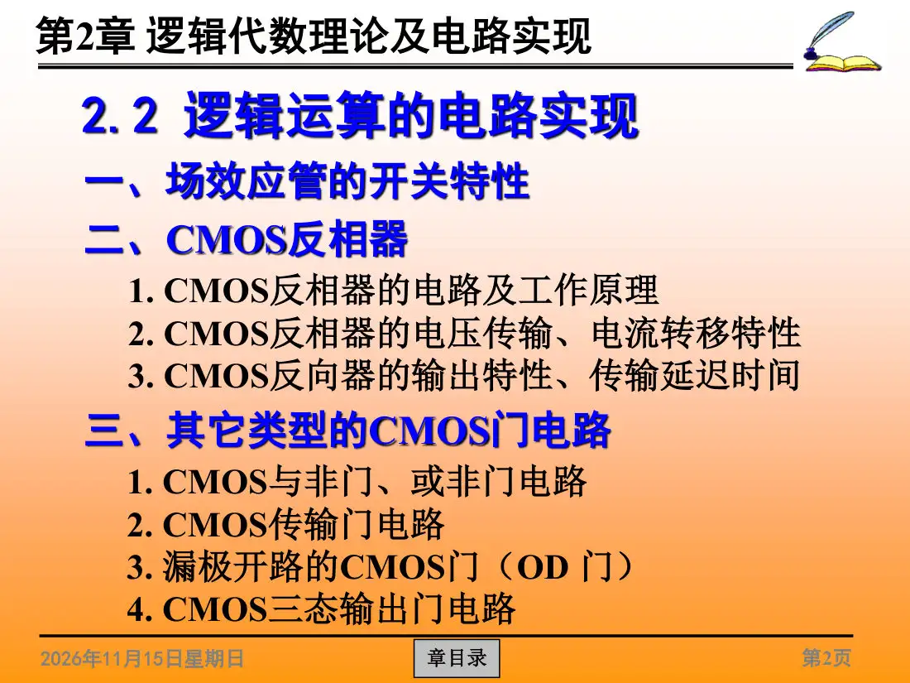

原文：

2.2 逻辑运算的电路实现

一、场效应管的开关特性

二、CMOS反相器

1. CMOS反相器的电路及工作原理

2. CMOS反相器的电压传输、电流转移特性

3. CMOS反向器的输出特性、传输延迟时间

三、其它类型的CMOS门电路

1. CMOS与非门、或非门电路

2. CMOS传输门电路

3. 漏极开路的CMOS门（OD 门）

4. CMOS三态输出门电路

第2章 逻辑代数理论及电路实现

2026年11月15日星期日

章目录

第2页

### 2.3 逻辑代数的公式

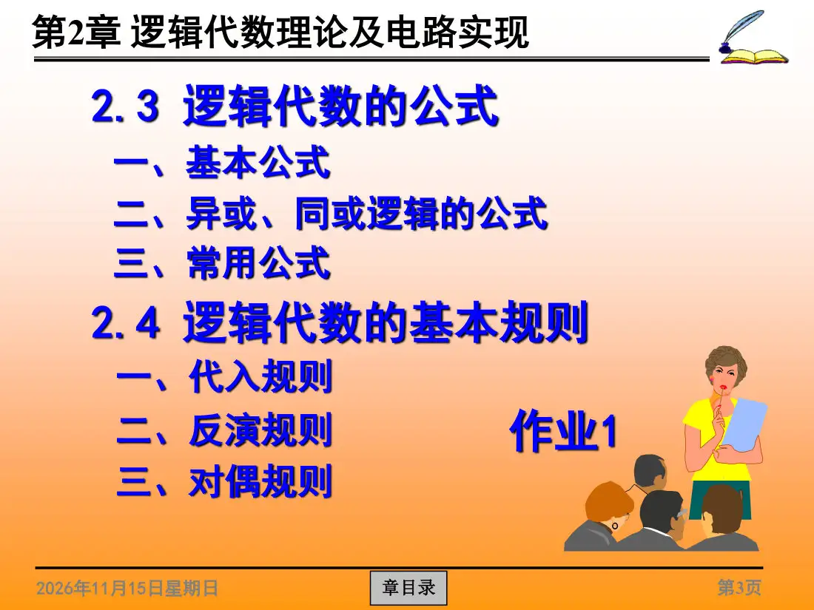

原文：

2.3 逻辑代数的公式
一、基本公式
二、异或、同或逻辑的公式
三、常用公式
2.4 逻辑代数的基本规则
一、代入规则
二、反演规则
作业1
三、对偶规则

第2章 逻辑代数理论及电路实现

2026年11月15日星期日

章目录

第3页

### 2.5 逻辑函数的表达式

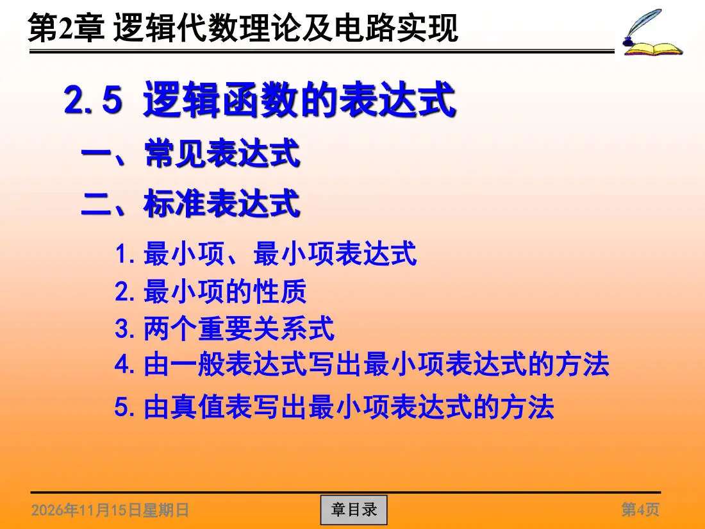

原文：

2.5 逻辑函数的表达式

一、常见表达式

二、标准表达式

1.最小项、最小项表达式

2.最小项的性质

3.两个重要关系式

4.由一般表达式写出最小项表达式的方法

5.由真值表写出最小项表达式的方法

第2章逻辑代数理论及电路实现

2026年11月15日星期日

章目录

第4页

### 2.6 逻辑函数的化简

原文：

2.6 逻辑函数的化简

一、化简的意义和最简的标准

1.化简的意义(目的)

2.化简的目标

3.最简的标准

二、公式法

1.与或式的化简

作业2

第2章逻辑代数理论及电路实现

2026年11月15日星期日

章目录

第5页

### 三、卡诺图化简法

原文：

三、卡诺图化简法

1.逻辑函数的卡诺图表示

2.卡诺图的运算

3.卡诺图化简法

四、非完全描述逻辑函数的化简

1.约束项、任意项、无关项及非完全描述逻辑函数 作业3

2.非完全描述逻辑函数的化简

3.无关项的运算规则

第2章 逻辑代数理论及电路实现

く

2026年11月15日星期日

章目录

第6页

### 第2章逻辑代数理论及电路实现

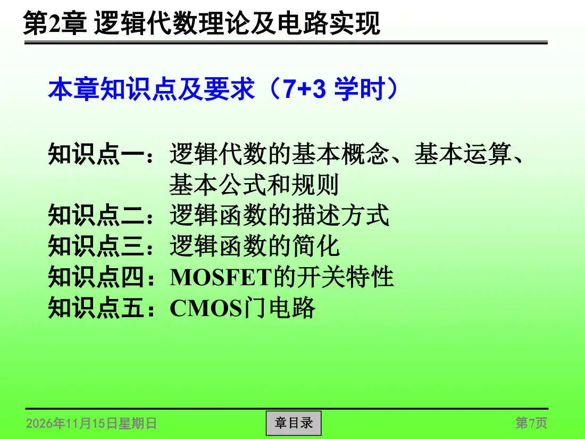

原文：

第2章逻辑代数理论及电路实现

本章知识点及要求（7+3 学时）

知识点一：逻辑代数的基本概念、基本运算、基本公式和规则

知识点二：逻辑函数的描述方式

知识点三：逻辑函数的简化

知识点四：MOSFET的开关特性

知识点五：CMOS门电路

2026年11月15日星期日

章目录

第7页

### 第2章 逻辑代数理论及电路实现

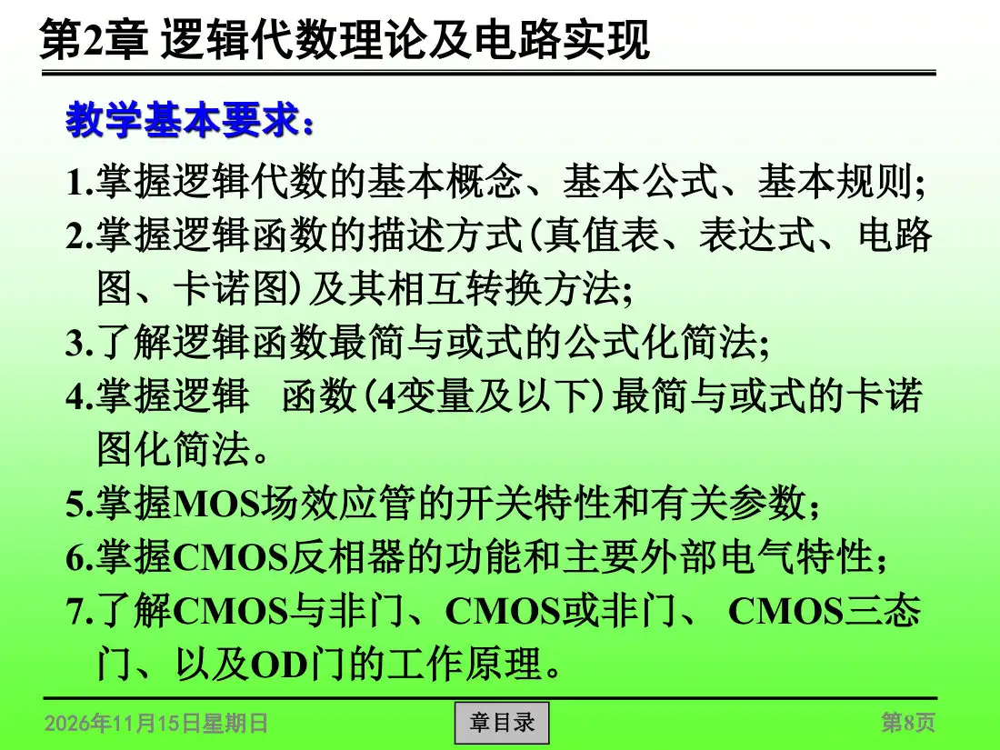

原文：

第2章 逻辑代数理论及电路实现

教学基本要求：

1.掌握逻辑代数的基本概念、基本公式、基本规则;

2.掌握逻辑函数的描述方式(真值表、表达式、电路图、卡诺图)及其相互转换方法;

3.了解逻辑函数最简与或式的公式化简法;

4.掌握逻辑 函数(4变量及以下)最简与或式的卡诺图化简法。

5.掌握MOS场效应管的开关特性和有关参数；

6.掌握CMOS反相器的功能和主要外部电气特性；

7.了解CMOS与非门、CMOS或非门、 CMOS三态门、以及OD门的工作原理。

2026年11月15日星期日

章目录

第8页

### 第2章 逻辑代数理论及电路实现

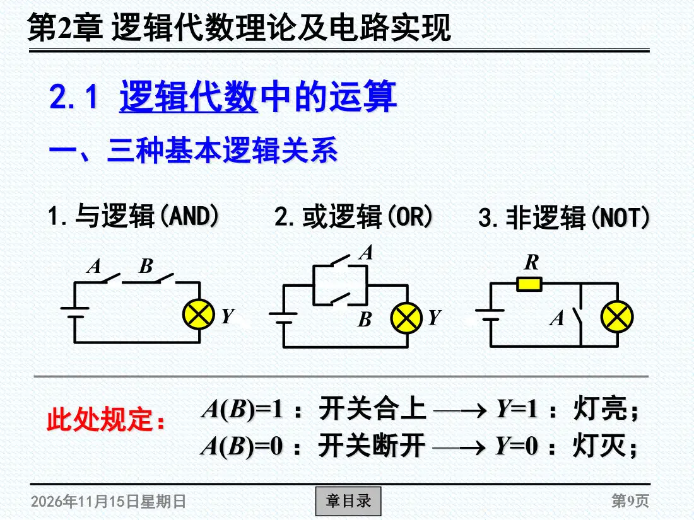

原文：

第2章 逻辑代数理论及电路实现

2.1 逻辑代数中的运算

三种基本逻辑关系

1.与逻辑(AND)

2.或逻辑(OR)

3.非逻辑(NOT)

此处规定：

A(B)=1 ：开关合上 —→ Y=1 ：灯亮；

A(B)=0 ：开关断开 —→ Y=0 ：灯灭；

2026年11月15日星期日

章目录

第9页

### 第2章逻辑代数理论及电路实现

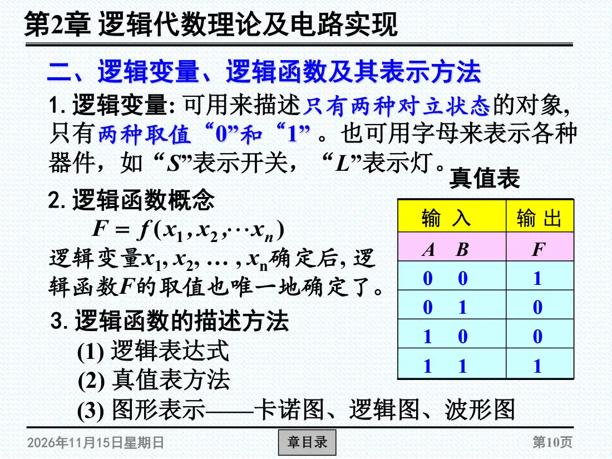

原文：

第2章逻辑代数理论及电路实现

二、逻辑变量、逻辑函数及其表示方法

1.逻辑变量: 可用来描述只有两种对立状态的对象,只有两种取值“0”和“1”。也可用字母来表示各种器件，如“S”表示开关，“L”表示灯。

2.逻辑函数概念

$$
F = f (x _ {1}, x _ {2}, \dots x _ {n})
$$

逻辑变量 $x _ { 1 } , x _ { 2 } , \ldots , x _ { \mathrm { n } }$ 确定后, 逻辑函数F的取值也唯一地确定了。

3.逻辑函数的描述方法

(1) 逻辑表达式

(2) 真值表方法

真值表

<table><tr><td colspan="2">输入</td><td>输出</td></tr><tr><td>A</td><td>B</td><td>F</td></tr><tr><td>0</td><td>0</td><td>1</td></tr><tr><td>0</td><td>1</td><td>0</td></tr><tr><td>1</td><td>0</td><td>0</td></tr><tr><td>1</td><td>1</td><td>1</td></tr></table>

(3) 图形表示——卡诺图、逻辑图、波形图

2026年11月15日星期日

章目录

第10页

### 第2章 逻辑代数理论及电路实现

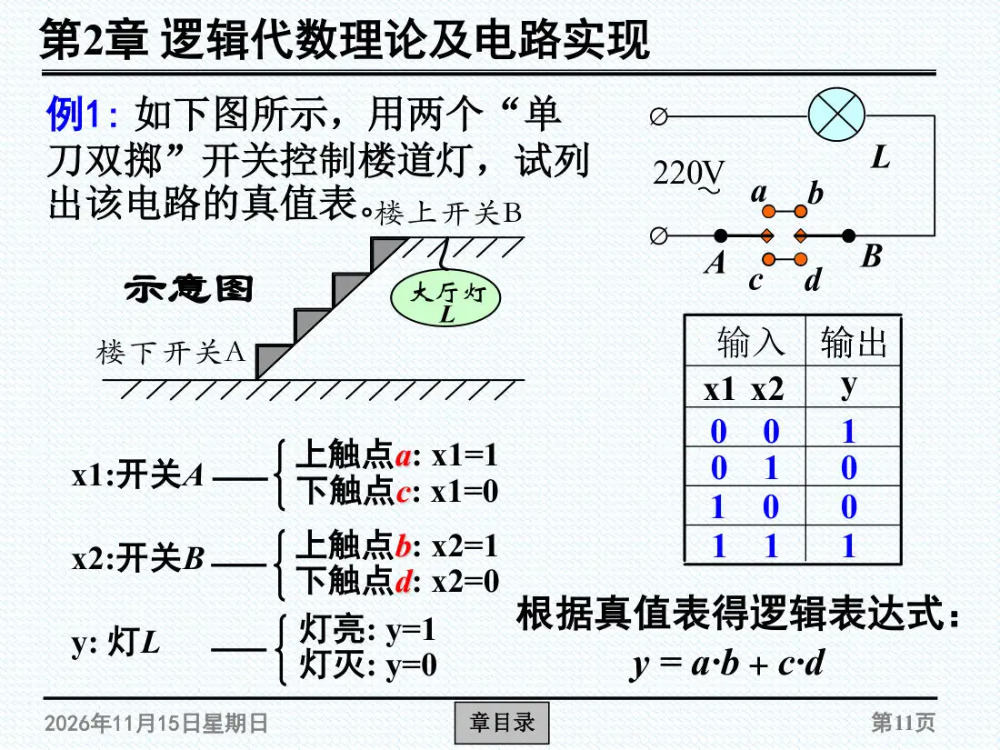

原文：

第2章 逻辑代数理论及电路实现

例1: 如下图所示，用两个“单刀双掷”开关控制楼道灯，试列出该电路的真值表。

示意图

上触点 $\mathbf { { \mathit { a } } { : } \mathbf { { X } } \mathbf { 1 } { = } 1 }$ x1:开关A下触点c: x1=0

x2:开关B 上触点 $b \colon \mathbf { X } 2 { = } 1$ 下触点 $d \colon \mathbf { X } 2 { = } 0$

y: 灯L 灯亮: y=1灯灭: y=0根据真值表得逻辑表达式：

<table><tr><td>输入</td><td>输出</td></tr><tr><td>x1 x2</td><td>y</td></tr><tr><td>0 0</td><td>1</td></tr><tr><td>0 1</td><td>0</td></tr><tr><td>1 0</td><td>0</td></tr><tr><td>1 1</td><td>1</td></tr></table>

$$
\mathbf {y} = \mathbf {a} \cdot \mathbf {b} + \mathbf {c} \cdot \mathbf {d}
$$

2026年11月15日星期日

章目录

第11页

### 第2章 逻辑代数理论及电路实现

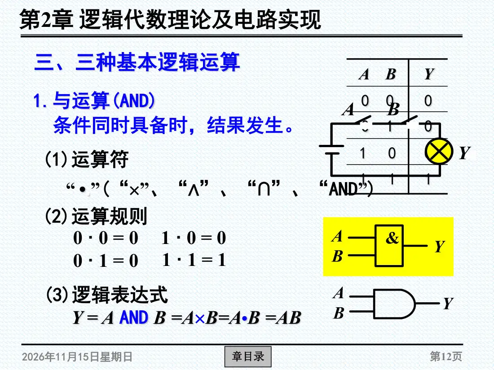

原文：

第2章 逻辑代数理论及电路实现

三、三种基本逻辑运算

1.与运算(AND)条件同时具备时，结果发生。

(1)运算符

$$
\text { “ } \bullet \text { ”(“ } \times \text { ” }
$$

$$
\text { “ } \wedge \text { ” }
$$

$$
\text { ``\cap'' }
$$

(2)运算规则

$$
\mathbf {0} \cdot \mathbf {0} = \mathbf {0}
$$

$$
1 \cdot 0 = 0
$$

$$
\mathbf {0} \cdot \mathbf {1} = \mathbf {0}
$$

$$
1 \cdot 1 = 1
$$

(3)逻辑表达式

$$
Y = A \text { AND } B = A \times B = A \cdot B = A B
$$

$$
\begin{array}{c} \text {A} \\ \text {B} \end{array} \boxed {\ & } \text {Y}
$$

2026年11月15日星期日

章目录

第12页

### 第2章 逻辑代数理论及电路实现

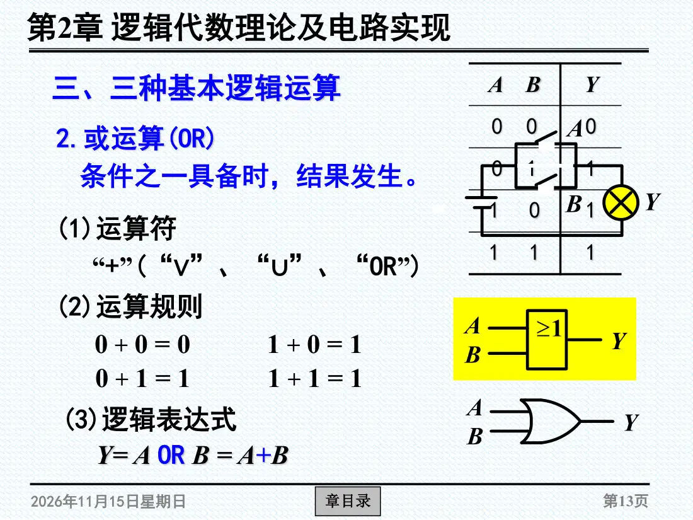

原文：

第2章 逻辑代数理论及电路实现

三、三种基本逻辑运算

2.或运算(OR)条件之一具备时，结果发生。

(1)运算符

“OR”)

(2)运算规则

0 + 0 = 0

1 + 0 = 1

0 + 1 = 1

1 + 1 = 1

(3)逻辑表达式

$$
Y = A \text {   OR   } B = A + B
$$

2026年11月15日星期日

章目录

第13页

### 第2章 逻辑代数理论及电路实现

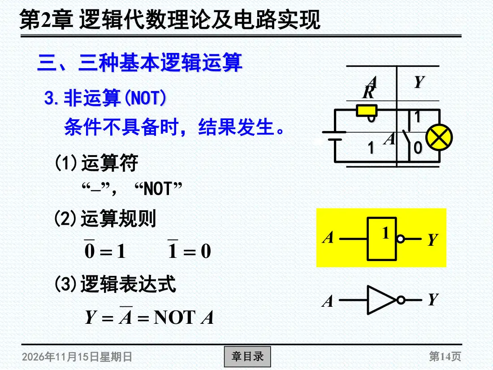

原文：

第2章 逻辑代数理论及电路实现

三、三种基本逻辑运算

3.非运算(NOT)条件不具备时，结果发生。

(1)运算符 “NOT”

(2)运算规则

$$
\overline {{0}} = 1
$$

$$
\overline {{1}} = 0
$$

(3)逻辑表达式

$$
\boldsymbol {Y} = \overline {{\boldsymbol {A}}} = \mathbf {N O T} \boldsymbol {A}
$$

2026年11月15日星期日

章目录

第14页

### 第2章逻辑代数理论及电路实现

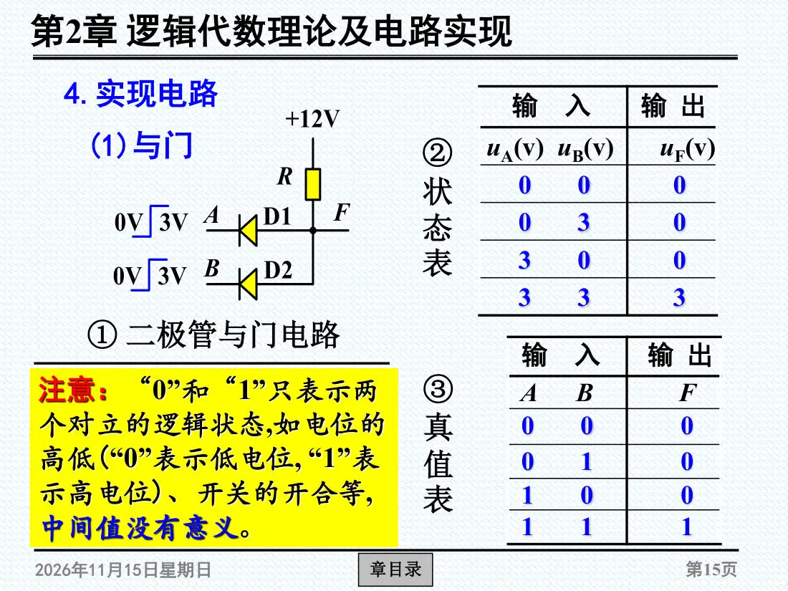

原文：

第2章逻辑代数理论及电路实现

4.实现电路

状

态

表

$$
\begin{array}{l} \text {(1) 与门} \\ \text {0V} \sqrt {3 V} \quad A \quad D 1 \quad F \\ \text {0V} \sqrt {3 V} \quad B \quad D 2 \end{array}
$$

① 二极管与门电路

注意：“0”和“1”只表示两个对立的逻辑状态,如电位的高低(“0”表示低电位, “1”表示高电位)、开关的开合等,中间值没有意义。

③

真

值

表

<table><tr><td colspan="2">输入</td><td>输出</td></tr><tr><td> $u_{\mathrm {A}}(\mathrm {v})$ </td><td> $u_{\mathrm {B}}(\mathrm {v})$ </td><td> $u_{\mathrm {F}}(\mathrm {v})$ </td></tr><tr><td>0</td><td>0</td><td>0</td></tr><tr><td>0</td><td>3</td><td>0</td></tr><tr><td>3</td><td>0</td><td>0</td></tr><tr><td>3</td><td>3</td><td>3</td></tr></table>

<table><tr><td colspan="2">输入</td><td>输出</td></tr><tr><td>A</td><td>B</td><td>F</td></tr><tr><td>0</td><td>0</td><td>0</td></tr><tr><td>0</td><td>1</td><td>0</td></tr><tr><td>1</td><td>0</td><td>0</td></tr><tr><td>1</td><td>1</td><td>1</td></tr></table>

2026年11月15日星期日

章目录

第15页

### 第2章逻辑代数理论及电路实现

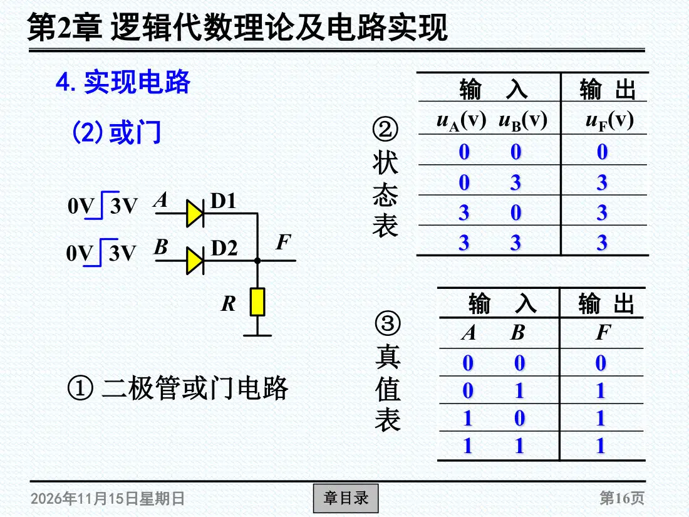

原文：

第2章逻辑代数理论及电路实现

4.实现电路

状

态

表

(2)或门

① 二极管或门电路

③

真

值

表

<table><tr><td colspan="2">输入</td><td>输出</td></tr><tr><td> $u_{\text{A}}(\text{v})$ </td><td> $u_{\text{B}}(\text{v})$ </td><td> $u_{\text{F}}(\text{v})$ </td></tr><tr><td>0</td><td>0</td><td>0</td></tr><tr><td>0</td><td>3</td><td>3</td></tr><tr><td>3</td><td>0</td><td>3</td></tr><tr><td>3</td><td>3</td><td>3</td></tr></table>

<table><tr><td colspan="2">输入</td><td>输出</td></tr><tr><td>A</td><td>B</td><td>F</td></tr><tr><td>0</td><td>0</td><td>0</td></tr><tr><td>0</td><td>1</td><td>1</td></tr><tr><td>1</td><td>0</td><td>1</td></tr><tr><td>1</td><td>1</td><td>1</td></tr></table>

2026年11月15日星期日

章目录

第16页

### 第2章 逻辑代数理论及电路实现

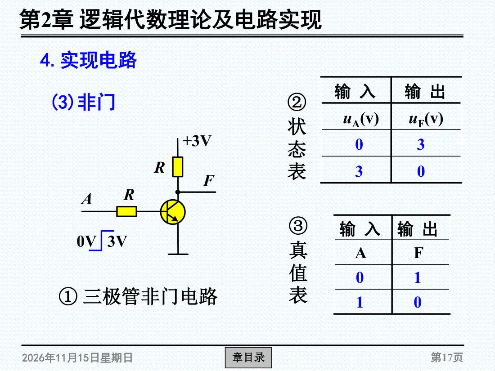

原文：

第2章 逻辑代数理论及电路实现

4.实现电路

状

态

表

(3)非门

③

真

值

表

① 三极管非门电路

<table><tr><td>输入</td><td>输出</td></tr><tr><td> $u_{\mathrm {A}}(\mathbf {v})$ </td><td> $u_{\mathrm {F}}(\mathbf {v})$ </td></tr><tr><td>0</td><td>3</td></tr><tr><td>3</td><td>0</td></tr></table>

<table><tr><td>输入</td><td>输出</td></tr><tr><td>A</td><td>F</td></tr><tr><td>0</td><td>1</td></tr><tr><td>1</td><td>0</td></tr></table>

2026年11月15日星期日

章目录

第17页

### 第2章 逻辑代数理论及电路实现

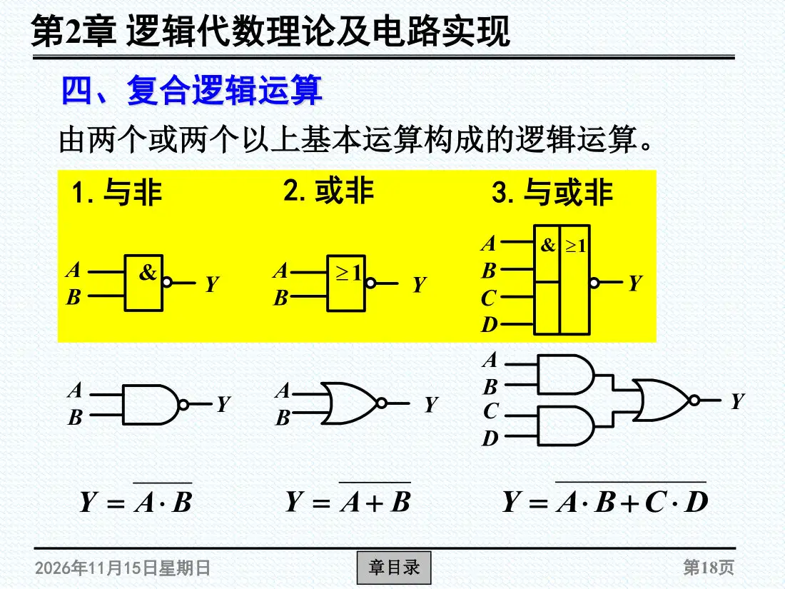

原文：

第2章 逻辑代数理论及电路实现

四、复合逻辑运算

由两个或两个以上基本运算构成的逻辑运算。

1.与非

2.或非

3.与或非

$$
\begin{array}{c} A \\ B \end{array} \boxed {\ & } \text { Y }
$$

$$
\begin{array}{c} A \text {   一   } \geq 1 \\ B \text {   一   } \end{array} Y
$$

$$
\begin{array}{c c c} & \& \geq 1 \\ A & \\ B & \\ C & \\ D & \end{array} Y
$$

$$
A \quad B \quad \text {   AND   } Y
$$

$$
A \quad B \quad Y
$$

$$
Y = \overline {{A \cdot B}}
$$

$$
Y = A + B
$$

$$
Y = A \cdot B + C \cdot D
$$

2026年11月15日星期日

章目录

第18页

### 第2章 逻辑代数理论及电路实现

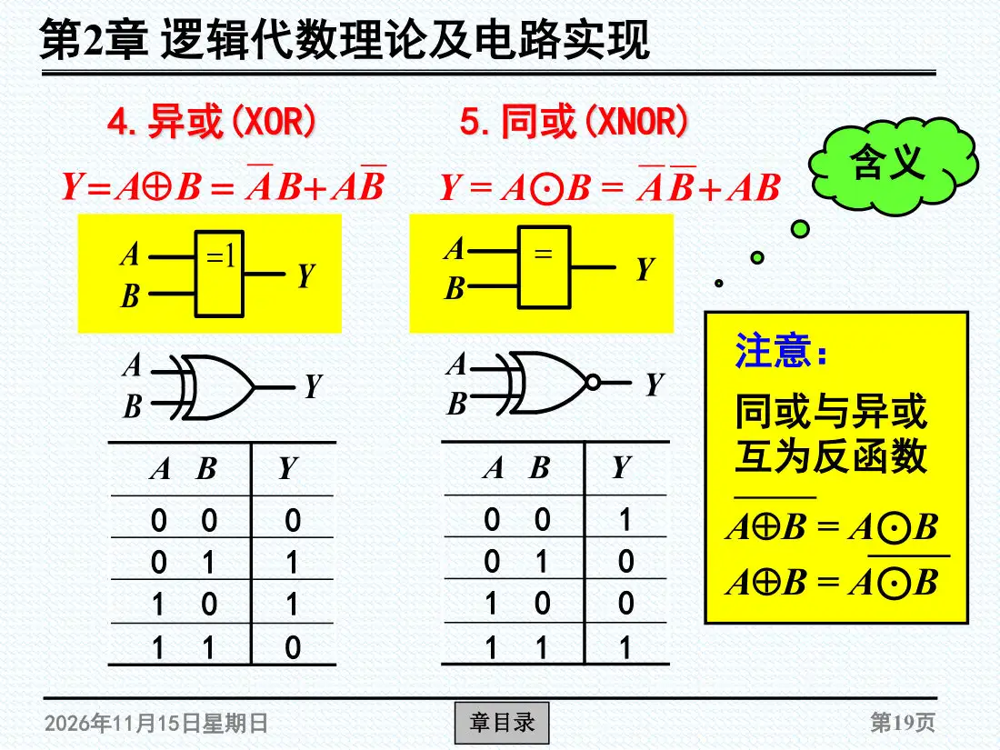

原文：

第2章 逻辑代数理论及电路实现

4.异或(XOR)

$$
Y = A \oplus B = \overline {{A}} B + A \overline {{B}}
$$

5.同或(XNOR)

$$
\begin{array}{c c} A & = 1 \\ B \end{array} Y
$$

$$
Y = A \odot B = \overline {{A}} \overline {{B}} + A B
$$

含义

$$
\begin{array}{c c} A & = \\ B \end{array} Y
$$

注意：

<table><tr><td>A</td><td>B</td><td>Y</td></tr><tr><td>0</td><td>0</td><td>0</td></tr><tr><td>0</td><td>1</td><td>1</td></tr><tr><td>1</td><td>0</td><td>1</td></tr><tr><td>1</td><td>1</td><td>0</td></tr></table>

<table><tr><td>A</td><td>B</td><td>Y</td></tr><tr><td>0</td><td>0</td><td>1</td></tr><tr><td>0</td><td>1</td><td>0</td></tr><tr><td>1</td><td>0</td><td>0</td></tr><tr><td>1</td><td>1</td><td>1</td></tr></table>

同或与异或互为反函数

$$
A \oplus B = A \odot B
$$

$$
A \oplus B = A \odot B
$$

2026年11月15日星期日

章目录

第19页

### 第2章 逻辑代数理论及电路实现

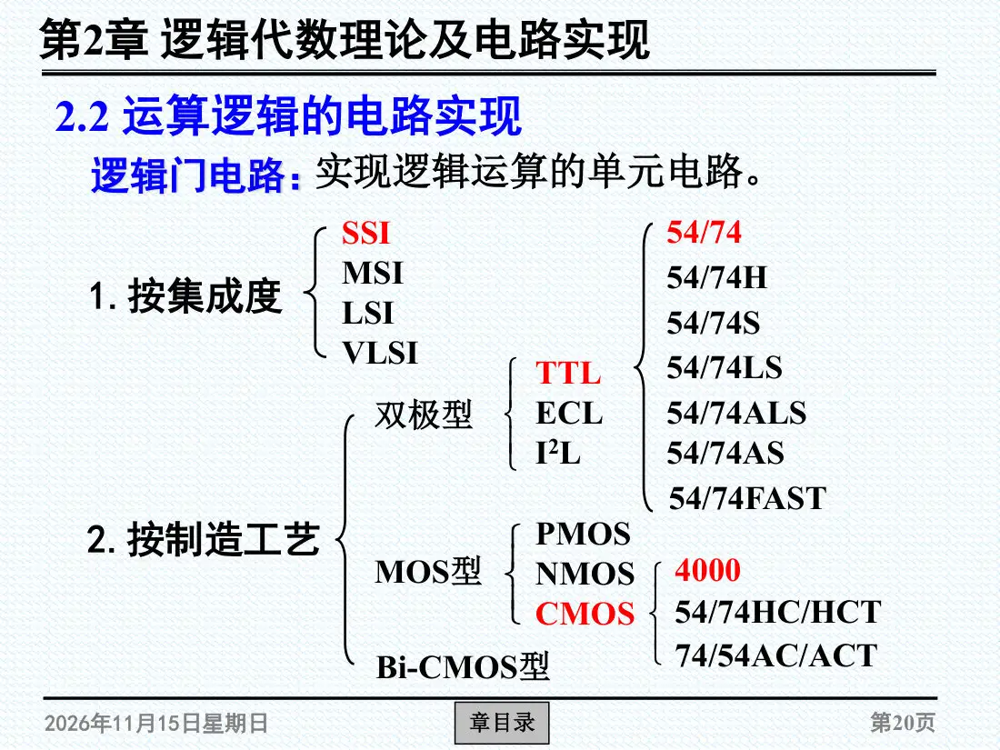

原文：

第2章 逻辑代数理论及电路实现

2.2 运算逻辑的电路实现

逻辑门电路：实现逻辑运算的单元电路。

1.按集成度

双极型

2.按制造工艺

MOS型

Bi-CMOS型

4000

54/74HC/HCT

74/54AC/ACT

2026年11月15日星期日

章目录

第20页

### 第2章 逻辑代数理论及电路实现

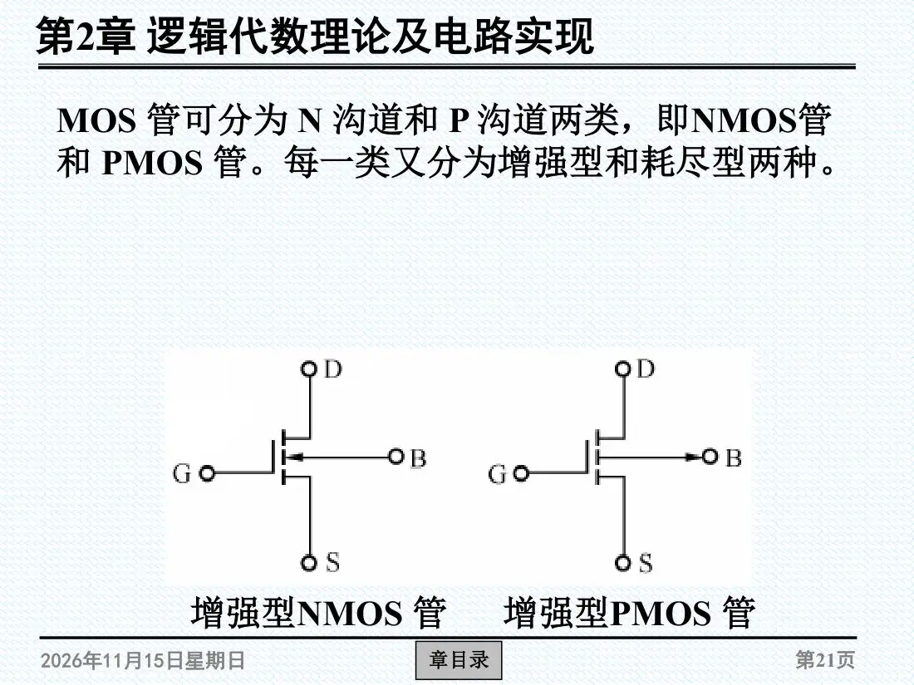

原文：

第2章 逻辑代数理论及电路实现

MOS 管可分为 N 沟道和 P 沟道两类，即NMOS管和 PMOS 管。每一类又分为增强型和耗尽型两种。

增强型NMOS 管 增强型PMOS 管

2026年11月15日星期日

章目录

第21页

### 第2章 逻辑代数理论及电路实现

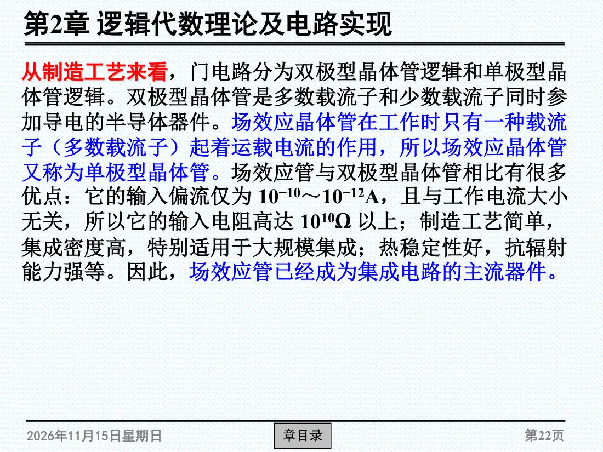

原文：

第2章 逻辑代数理论及电路实现

从制造工艺来看，门电路分为双极型晶体管逻辑和单极型晶体管逻辑。双极型晶体管是多数载流子和少数载流子同时参加导电的半导体器件。场效应晶体管在工作时只有一种载流子（多数载流子）起着运载电流的作用，所以场效应晶体管又称为单极型晶体管。场效应管与双极型晶体管相比有很多优点：它的输入偏流仅为 $1 0 ^ { - 1 0 } { \sim } 1 0 ^ { - 1 2 } \mathrm { A }$ 且与工作电流大小无关，所以它的输入电阻高达 $1 0 ^ { 1 0 } \Omega$ 以上；制造工艺简单，集成密度高，特别适用于大规模集成；热稳定性好，抗辐射能力强等。因此，场效应管已经成为集成电路的主流器件。

2026年11月15日星期日

章目录

第22页

### 第2章 逻辑代数理论及电路实现

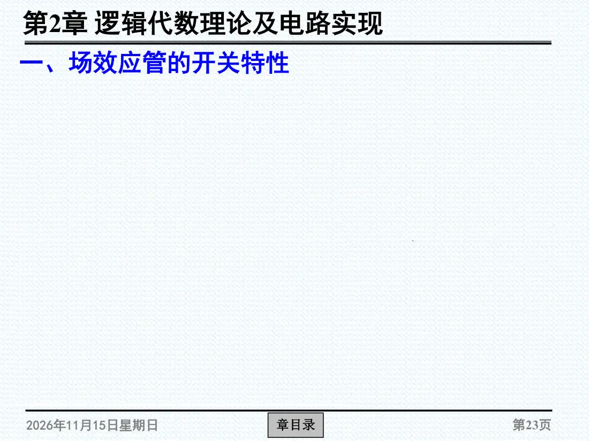

原文：

第2章 逻辑代数理论及电路实现

WW 场效应管的开关特性

2026年11月15日星期日

章目录

第23页

### 第2章 逻辑代数理论及电路实现

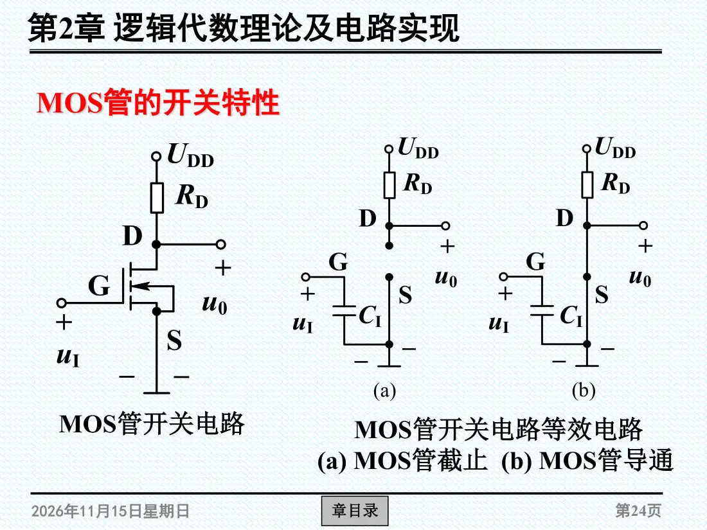

原文：

第2章 逻辑代数理论及电路实现

MOS管的开关特性

MOS管开关电路

MOS管开关电路等效电路

(a) MOS管截止 (b) MOS管导通

2026年11月15日星期日

章目录

第24页

### 第2章 逻辑代数理论及电路实现

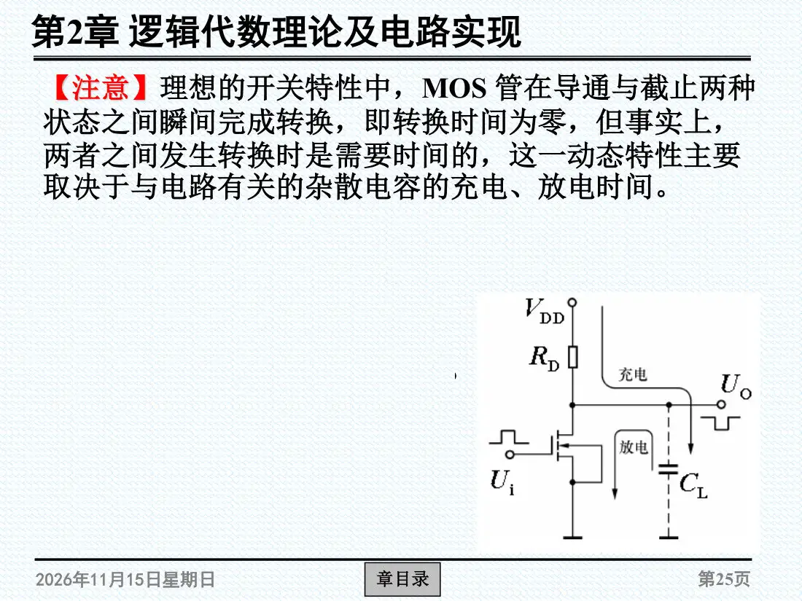

原文：

第2章 逻辑代数理论及电路实现

【注意】理想的开关特性中，MOS 管在导通与截止两种状态之间瞬间完成转换，即转换时间为零，但事实上，两者之间发生转换时是需要时间的，这一动态特性主要取决于与电路有关的杂散电容的充电、放电时间。

2026年11月15日星期日

章目录

第25页

### 第2章 逻辑代数理论及电路实现

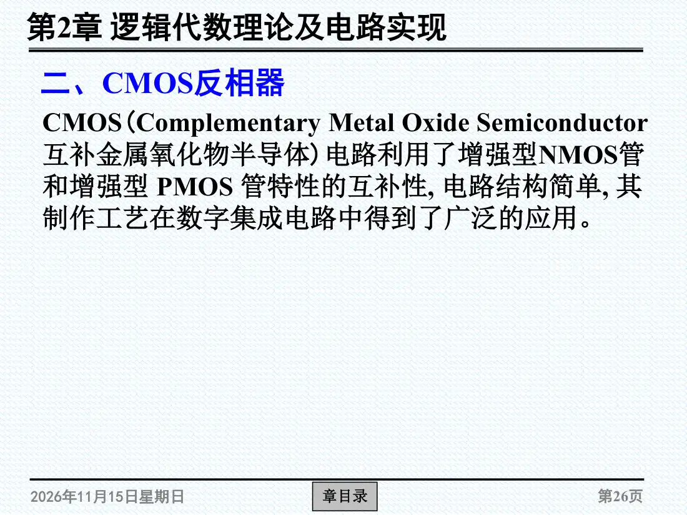

原文：

第2章 逻辑代数理论及电路实现

二、CMOS反相器

CMOS(Complementary Metal Oxide Semiconductor互补金属氧化物半导体)电路利用了增强型NMOS管和增强型 PMOS 管特性的互补性, 电路结构简单, 其制作工艺在数字集成电路中得到了广泛的应用。

2026年11月15日星期日

章目录

第26页

### 第2章 逻辑代数理论及电路实现

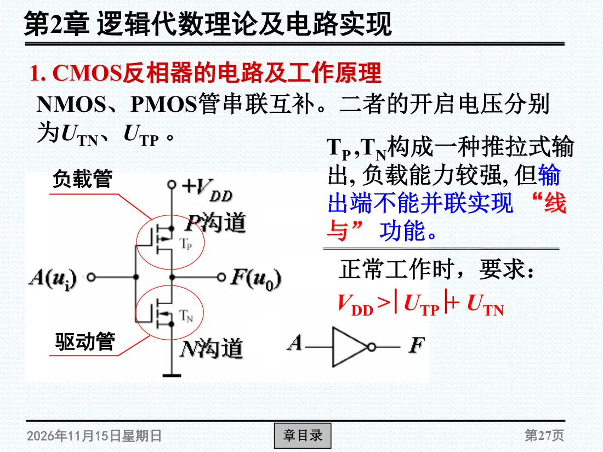

原文：

第2章 逻辑代数理论及电路实现

1. CMOS反相器的电路及工作原理

NMOS、PMOS管串联互补。二者的开启电压分别为 $U _ { \mathrm { T N } } , ~ U _ { \mathrm { T P } }$ $\mathrm { T } _ { \mathbf { P } } , \mathrm { T } _ { \mathbf { N } }$ 构成一种推拉式输 构成一种推拉式输

负载管

出, 负载能力较强, 但输出端不能并联实现 “线与” 功能。

正常工作时，要求：

$$
V _ {\mathrm{DD}} > \left| U _ {\mathrm{TP}} \right| + U _ {\mathrm{TN}}
$$

2026年11月15日星期日

章目录

第27页

### 第2章 逻辑代数理论及电路实现

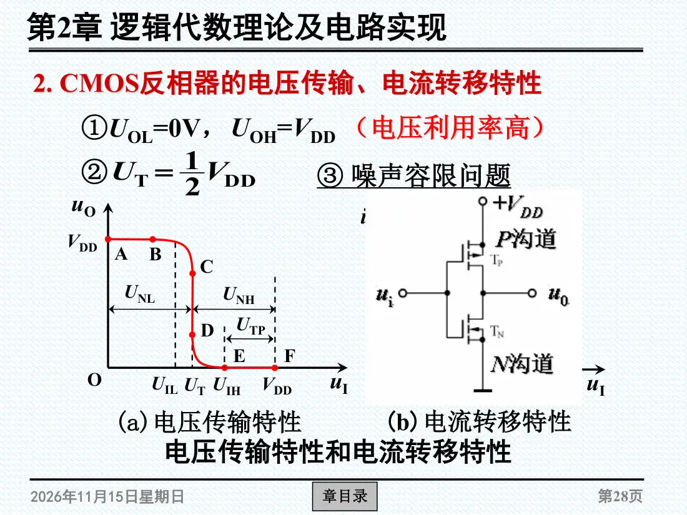

原文：

第2章 逻辑代数理论及电路实现

2. CMOS反相器的电压传输、电流转移特性$U _ { \mathbf { O L } } { = } \mathbf { 0 V }$ $U _ { \mathbf { O H } } { = } V _ { \mathbf { D D } }$ （电压利用率高）$U _ { \mathrm { T } } = \frac { 1 } { 2 } V _ { \mathrm { D D } }$ ③ 噪声容限问题

(a)电压传输特性 (b)电流转移特性 电压传输特性和电流转移特性

2026年11月15日星期日

章目录

第28页

### 第2章逻辑代数理论及电路实现

原文：

第2章逻辑代数理论及电路实现

注意：加电后，CMOS器件输入端不能悬空!

①输入电位不定（此时输入电位由保护二极管的反向电阻比来决定），从而破坏了电路的正常逻辑关系；

②由于输入阻抗高，易接受外界噪声干扰，使电路产生误动作；

③极易使栅极感应静电，造成栅击穿。

2026年11月15日星期日

章目录

第29页

### 第2章逻辑代数理论及电路实现

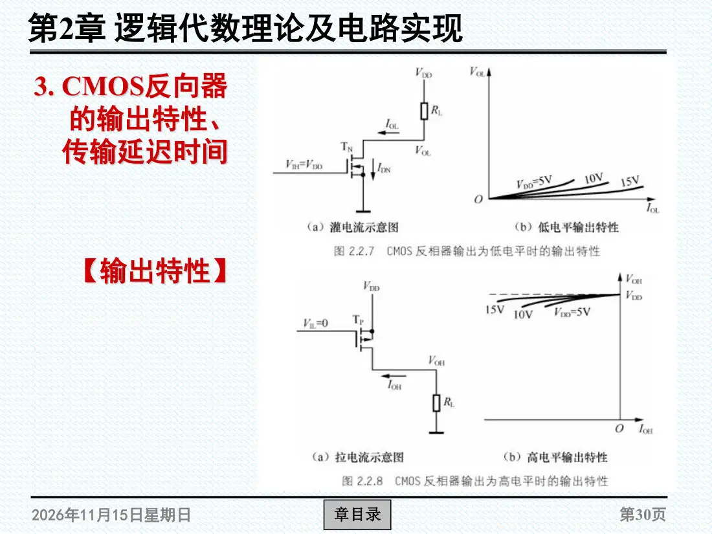

原文：

第2章逻辑代数理论及电路实现

3. CMOS反向器的输出特性、传输延迟时间

【输出特性】

2026年11月15日星期日

章目录

第30页

### 第2章 逻辑代数理论及电路实现

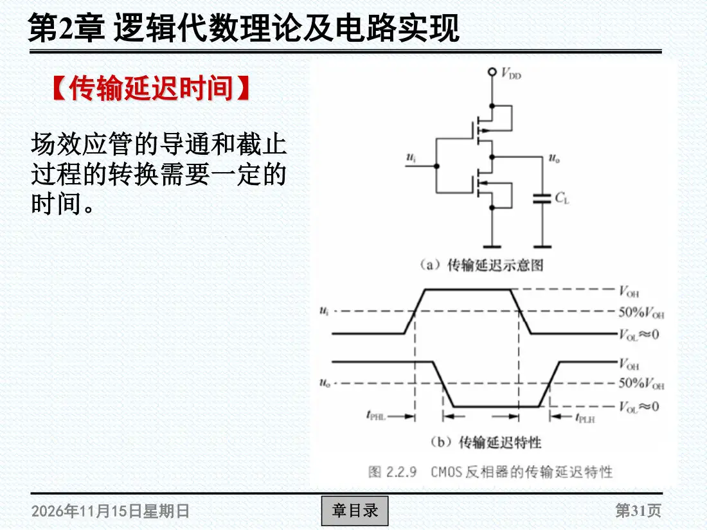

原文：

第2章 逻辑代数理论及电路实现

【传输延迟时间】

场效应管的导通和截止过程的转换需要一定的时间。

2026年11月15日星期日

章目录

第31页

### 第2章 逻辑代数理论及电路实现

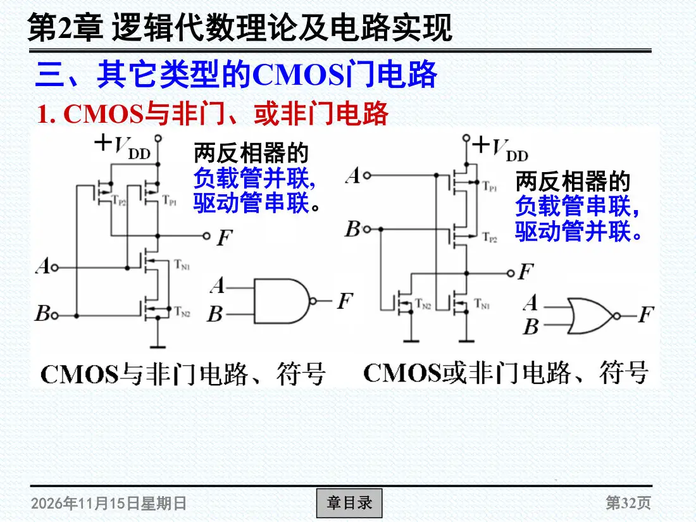

原文：

第2章 逻辑代数理论及电路实现

三、其它类型的CMOS门电路

1. CMOS与非门、或非门电路

两反相器的负载管串联，驱动管并联。

CMOS与非门电路、符号CMOS或非门电路、符号

2026年11月15日星期日

章目录

第32页

### 第2章 逻辑代数理论及电路实现

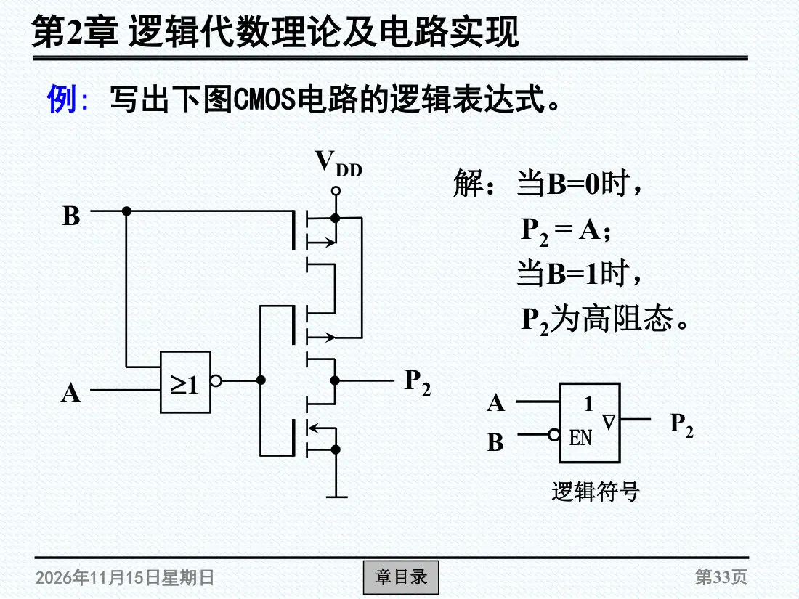

原文：

第2章 逻辑代数理论及电路实现

例: 写出下图CMOS电路的逻辑表达式。

解：当B=0时，$\mathbf { P } _ { 2 } {  } \mathbf { A } ;$ 当 $\mathbf { B } { = } 1$ 时，$\mathbf { P } _ { 2 }$ 为高阻态。

2026年11月15日星期日

章目录

第33页

### 第2章逻辑代数理论及电路实现

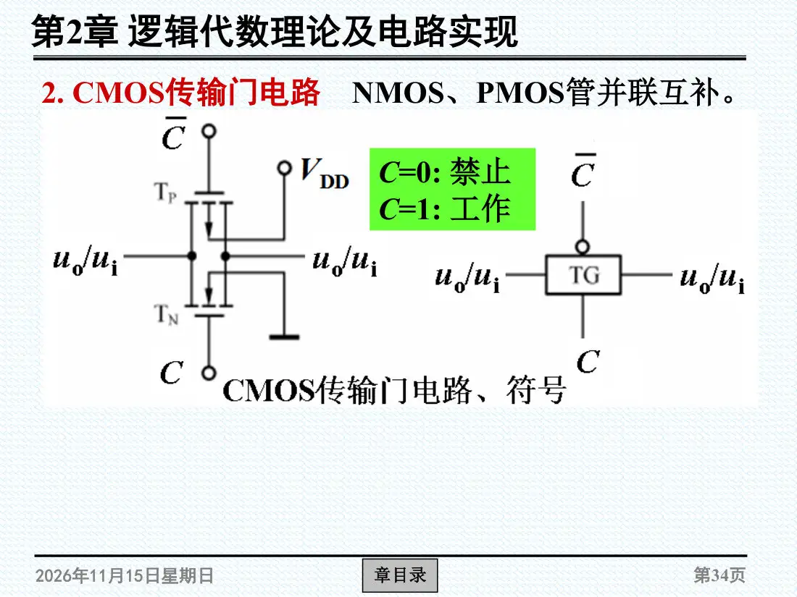

原文：

第2章逻辑代数理论及电路实现

2. CMOS传输门电路 NMOS、PMOS管并联互补。

C=0: 禁止C=1: 工作

CMOS传输门电路、符号

2026年11月15日星期日

章目录

第34页

### 第2章 逻辑代数理论及电路实现

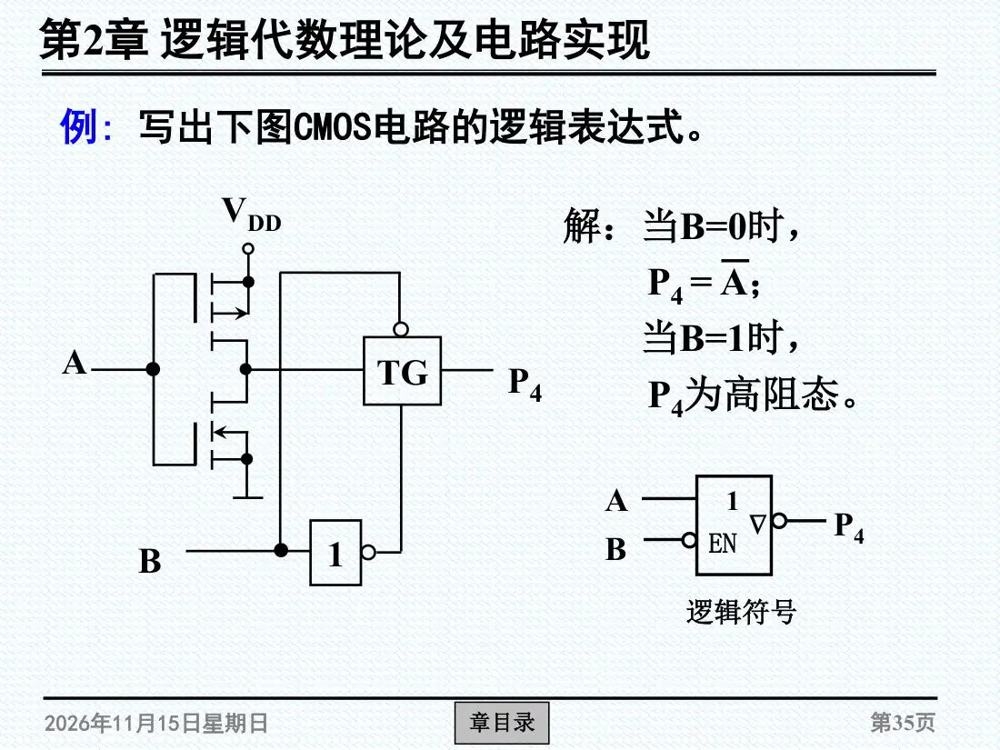

原文：

第2章 逻辑代数理论及电路实现

例: 写出下图CMOS电路的逻辑表达式。

解：当 $\bf { B } { = } { } \bf { 0 }$ 时，$\mathbf { P _ { 4 } } = \mathbf { \overline { { A } } } ;$ 当 $\mathbf { B } { = } 1$ 时，$\mathrm { \bf P _ { 4 } }$ 为高阻态。

2026年11月15日星期日

章目录

第35页

### 第2章 逻辑代数理论及电路实现

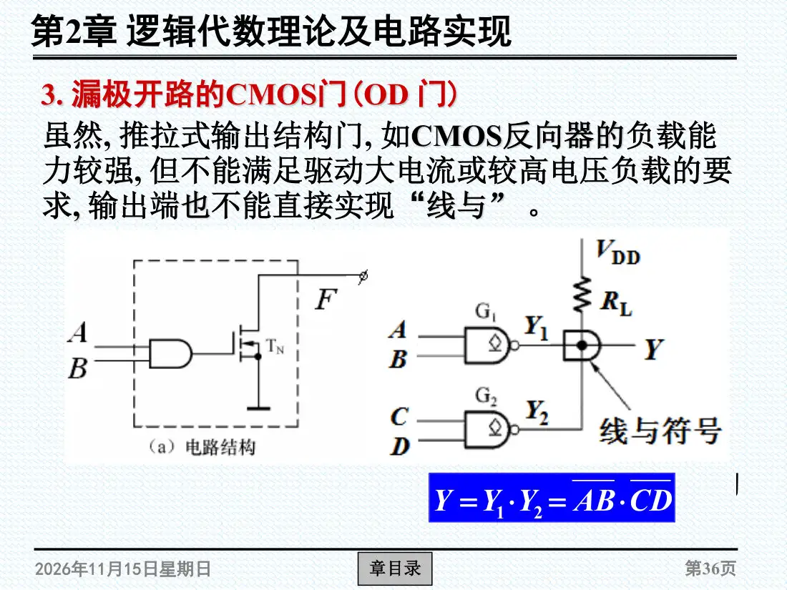

原文：

第2章 逻辑代数理论及电路实现

3. 漏极开路的CMOS门(OD 门)

虽然, 推拉式输出结构门, 如CMOS反向器的负载能力较强, 但不能满足驱动大电流或较高电压负载的要求, 输出端也不能直接实现“线与”

$$
Y = Y _ {1} \cdot Y _ {2} = A B \cdot C D
$$

2026年11月15日星期日

章目录

第36页

### 第2章逻辑代数理论及电路实现

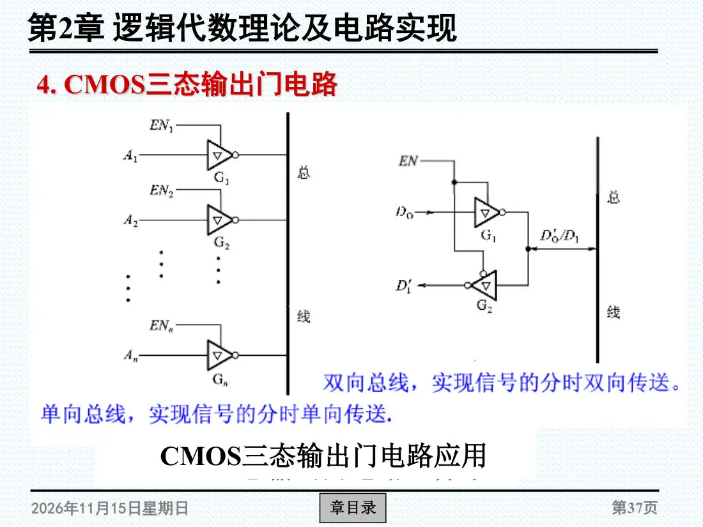

原文：

第2章逻辑代数理论及电路实现

4. CMOS三态输出门电路

双向总线，实现信号的分时双向传送。

单向总线，实现信号的分时单向传送.

CMOS三态输出门电路应用

2026年11月15日星期日

章目录

第37页

### 第2章 逻辑代数理论及电路实现

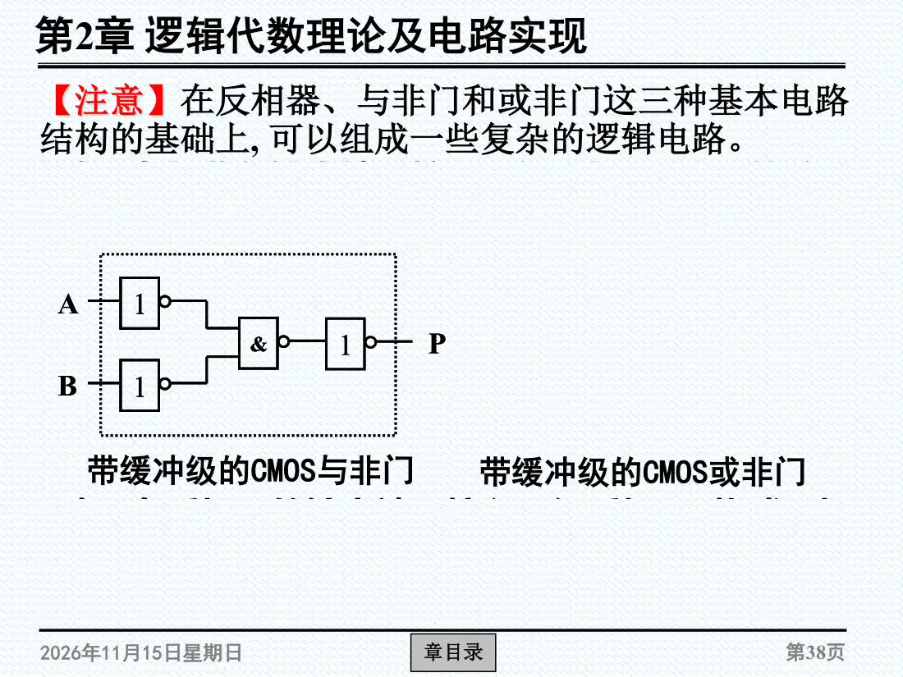

原文：

第2章 逻辑代数理论及电路实现

【注意】在反相器、与非门和或非门这三种基本电路结构的基础上, 可以组成一些复杂的逻辑电路。

带缓冲级的CMOS与非门 带缓冲级的CMOS或非门

2026年11月15日星期日

章目录

第38页

### 第2章 逻辑代数理论及电路实现

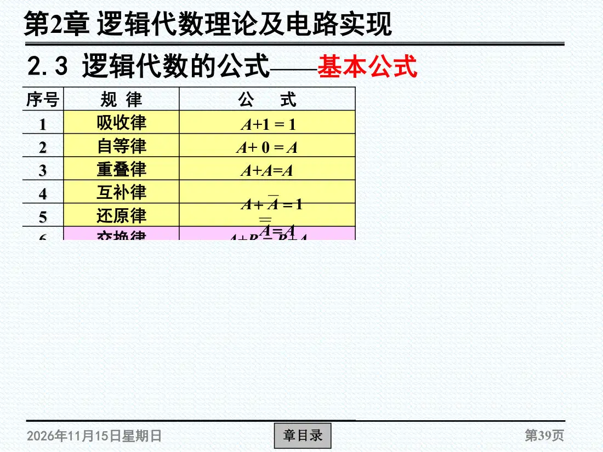

原文：

第2章 逻辑代数理论及电路实现

2.3 逻辑代数的公式——基本公式

<table><tr><td>序号</td><td>规律</td><td>公式</td></tr><tr><td>1</td><td>吸收律</td><td> $A+1=1$ </td></tr><tr><td>2</td><td>自等律</td><td> $A+0=A$ </td></tr><tr><td>3</td><td>重叠律</td><td> $A+A=A$ </td></tr><tr><td>4</td><td>互补律</td><td> $A+\overline{A}=1$ </td></tr><tr><td>5</td><td>还原律</td><td>=</td></tr><tr><td>6</td><td>交缔律</td><td> $A\perp D=\overline{D}\perp A$ </td></tr></table>

2026年11月15日星期日

章目录

第39页

### 第2章 逻辑代数理论及电路实现

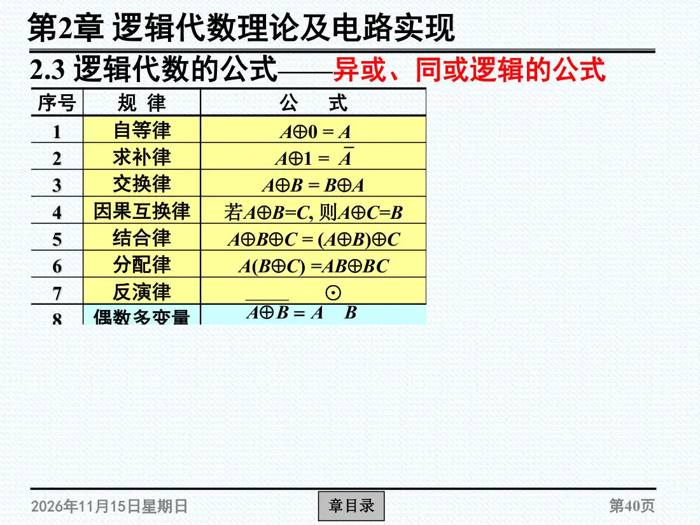

原文：

第2章 逻辑代数理论及电路实现

2.3 逻辑代数的公式— 异或、同或逻辑的公式

<table><tr><td>序号</td><td>规律</td><td>公式</td></tr><tr><td>1</td><td>自等律</td><td> $A \oplus 0 = A$ </td></tr><tr><td>2</td><td>求补律</td><td> $A \oplus 1 = \overline{A}$ </td></tr><tr><td>3</td><td>交换律</td><td> $A \oplus B = B \oplus A$ </td></tr><tr><td>4</td><td>因果互换律</td><td>若 $A \oplus B = C$ ,则 $A \oplus C = B$ </td></tr><tr><td>5</td><td>结合律</td><td> $A \oplus B \oplus C = (A \oplus B) \oplus C$ </td></tr><tr><td>6</td><td>分配律</td><td> $A(B \oplus C) = AB \oplus BC$ </td></tr><tr><td>7</td><td>反演律</td><td> $\odot$ </td></tr><tr><td>8</td><td>偶数多变量</td><td> $A \oplus B = A \quad B$ </td></tr></table>

2026年11月15日星期日

章目录

第40页

### 第2章逻辑代数理论及电路实现

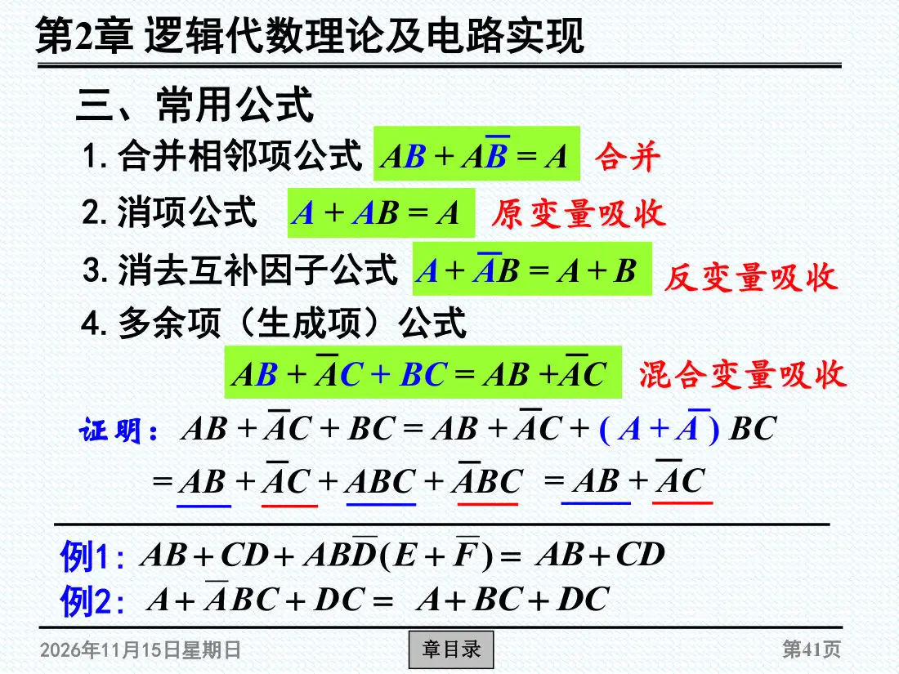

原文：

第2章逻辑代数理论及电路实现

常用公式

1.合并相邻项公式 $A B + A \overline { { B } } = A$ 合并

2.消项公式 $A + A B = A$ 原变量吸收

3.消去互补因子公式 $A + \overline { { A } } B = A + B$ 反变量吸收

4.多余项（生成项）公式

$A B + \overline { { A } } C + B C = A B + \overline { { A } } C$ 混合变量吸收

证明： $A B + \overline { { A } } C + B C = A B + \overline { { A } } C + \left( A + \overline { { A } } \right) B C$ $= \underline { { A } } \underline { { B } } + \overline { { A } } C + \underline { { A } } \underline { { B } } C + \overline { { A } } B C \ = \underline { { A } } \underline { { B } } + \overline { { A } } C$

例1: $A B + C D + A B D ( E + \overline { { { F } } } ) = A B + C D$

例2: $A + A B C + D C = A + B C + D C$

2026年11月15日星期日

章目录

第41页

### 第2章 逻辑代数理论及电路实现

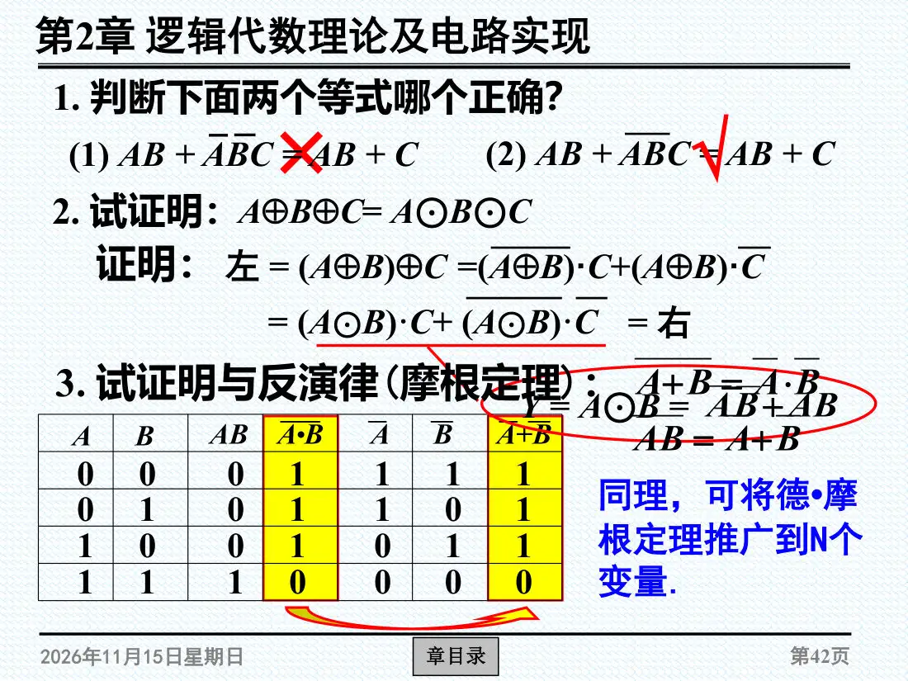

原文：

第2章 逻辑代数理论及电路实现

1. 判断下面两个等式哪个正确？

(1) $A B + A B C \geq \sqrt { 1 3 + C }$ (2) $A B + \sqrt { B C } + \sqrt { A B + C }$

2. 试证明： $A \oplus B \oplus C = A \odot B \odot C$

证明： $\begin{array} { l } { \pmb { { \mathcal { F } } } = ( A \oplus B ) \oplus C - ( A \oplus B ) \cdot \pmb { C } + ( A \oplus B ) \cdot \pmb { C } } \\ { = ( A \odot B ) \cdot \pmb { C } + ( A \odot B ) \cdot \pmb { \overline { { C } } } = \pmb { \mathcal { G } } } \end{array}$

⊙3. 试证明与反演律(摩根定理)：

<table><tr><td>A</td><td>B</td><td>AB</td><td> $\overline{A \cdot B}$ </td><td> $\overline{A}$ </td><td> $\overline{B}$ </td><td> $\overline{A + \overline{B}}$ </td></tr><tr><td>0</td><td>0</td><td>0</td><td>1</td><td>1</td><td>1</td><td>1</td></tr><tr><td>0</td><td>1</td><td>0</td><td>1</td><td>1</td><td>0</td><td>1</td></tr><tr><td>1</td><td>0</td><td>0</td><td>1</td><td>0</td><td>1</td><td>1</td></tr><tr><td>1</td><td>1</td><td>1</td><td>0</td><td>0</td><td>0</td><td>0</td></tr></table>

$$
\begin{array}{l} \dot {A} \odot B = A B + A B \\ A B = A + B \end{array}
$$

同理，可将德•摩根定理推广到N个变量.

2026年11月15日星期日

章目录

第42页

### 第2章 逻辑代数理论及电路实现

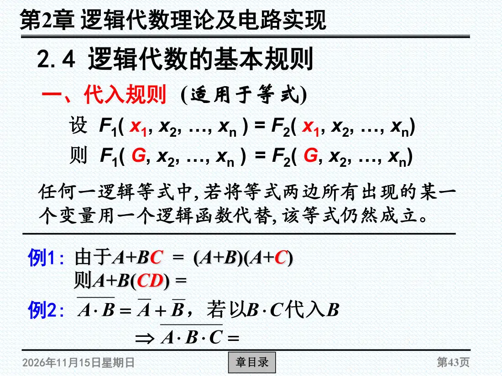

原文：

第2章 逻辑代数理论及电路实现

2.4 逻辑代数的基本规则

一、代入规则 (适用于等式)

设 $F _ { 1 } ( x _ { 1 } , x _ { 2 } , . . . , x _ { n } ) = F _ { 2 } ( x _ { 1 } , x _ { 2 } , . . . , x _ { n } )$

则 $F _ { 1 } ( G , x _ { 2 } , . . . , x _ { n } ) = F _ { 2 } ( G , x _ { 2 } , . . . , x _ { n } )$

任何一逻辑等式中, 若将等式两边所有出现的某一个变量用一个逻辑函数代替, 该等式仍然成立。

由例1: 则 $\begin{array} { l } { { \operatorname { \mathbb { F } } A \dag B C \dag = ( A \dag B ) ( A \dag C ) } } \\ { { A \dag + B ( C D ) = } } \end{array}$

例2: $\begin{array} { r } { A \cdot B = \overline { { A } } + \overline { { B } } , \quad \bigoplus \limits _ { k = 1 } ^ { \# } \lfloor B \cdot C / \ell \lambda B } \\ { \Rightarrow \overline { { A \cdot B \cdot C } } = } \end{array}$

2026年11月15日星期日

章目录

第43页

### 第2章 逻辑代数理论及电路实现

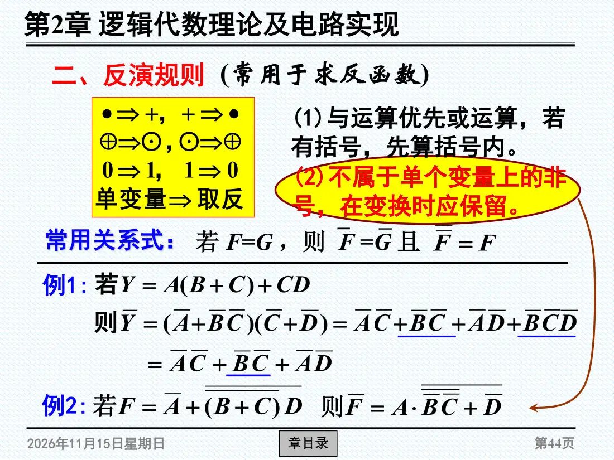

原文：

第2章 逻辑代数理论及电路实现

二、反演规则 (常用于求反函数)

$$
\bullet \Rightarrow +, + \Rightarrow \bullet
$$

$$
\oplus \Rightarrow \odot , \odot \Rightarrow \oplus
$$

$$
0 \Rightarrow 1, \quad 1 \Rightarrow 0
$$

单变量→取反(1)与运算优先或运算，若有括号，先算括号内。

(2)不属于单个变量上的非号，在变换时应保留。

常用关系式： 若 $F { = } G$ ，则 $F { = } \overline { G }$ 且 ${ \overline { { F } } } = F$

例1: $Y = A ( B + C ) + C D$

$$
\begin{array}{r l} \overline {{Y}} & = (\overline {{A}} + \overline {{B}} \overline {{C}}) (\overline {{C}} + \overline {{D}}) = \overline {{A}} \overline {{C}} + \overline {{B}} \overline {{C}} + \overline {{A}} \overline {{D}} + \overline {{B}} \overline {{C}} \overline {{D}} \\ & = \overline {{A}} \overline {{C}} + \overline {{B}} \overline {{C}} + \overline {{A}} \overline {{D}} \end{array}
$$

例2: $F = \overline { { A } } + ( B + C ) D$ 则 $F = A \cdot { \overline { { \overline { { B } } } } } { \overline { { C } } } + { \overline { { D } } }$

2026年11月15日星期日

章目录

第44页

### 第2章 逻辑代数理论及电路实现

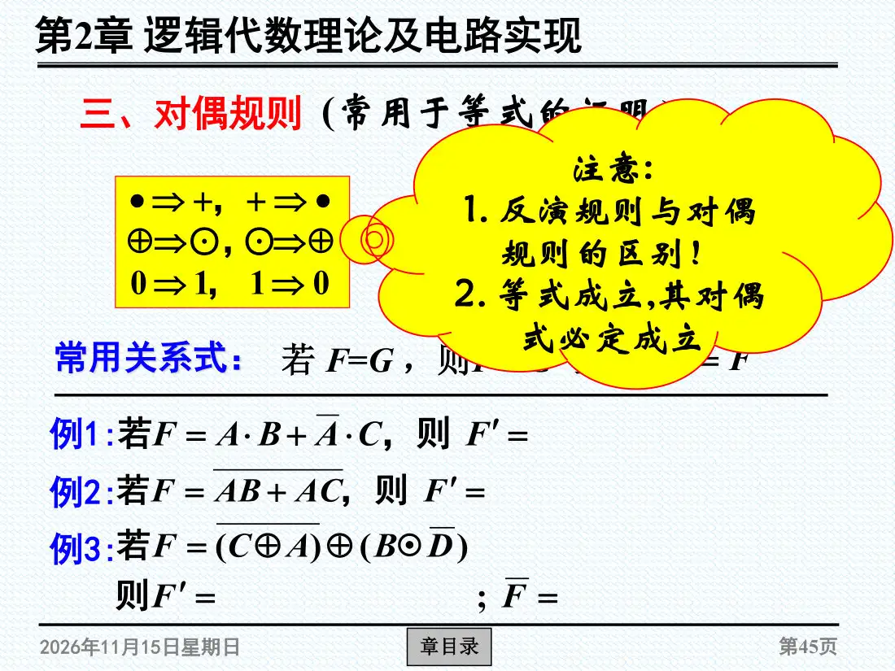

原文：

第2章 逻辑代数理论及电路实现

三、对偶规则 (常用于等式的证明

$$
\bullet \Rightarrow +, + \Rightarrow \bullet
$$

$$
\oplus \Rightarrow \odot , \odot \Rightarrow \oplus
$$

$$
0 \Rightarrow 1, \quad 1 \Rightarrow 0
$$

算优先注意:

有括号，先算括号内。1. 反演规则与对偶规则的区别！

常用关系式： 若 $\pmb { F } \mathrm { = } \pmb { G }$

2. 等式成立,其对偶式必定成立

例1: $\boldsymbol { F } = \boldsymbol { A } \cdot \boldsymbol { B } + \boldsymbol { \overline { { A } } } \cdot \boldsymbol { C } ,$ 则 $\pmb { F } ^ { \prime } =$

例2: ${ \cal F } = A B + A C ,$ 则 $F ^ { \prime } { = }$

例3: $\boldsymbol { F } = \left( \boldsymbol { C } \oplus \boldsymbol { A } \right) \oplus \left( \boldsymbol { B } \odot \boldsymbol { \overline { { D } } } \right)$ 则 $F ^ { \prime } { = }$

; F =

2026年11月15日星期日

章目录

第45页

### 第2章逻辑代数理论及电路实现

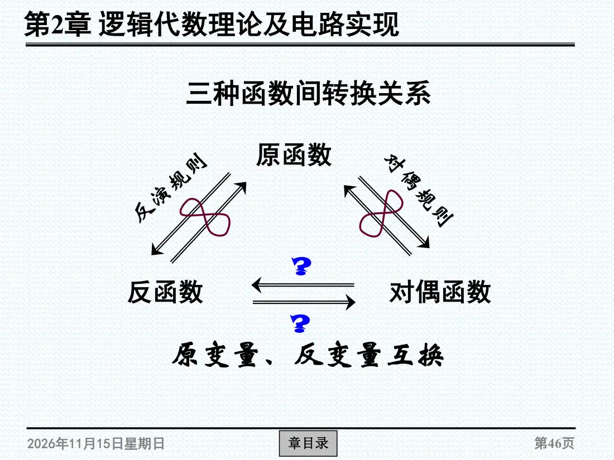

原文：

第2章逻辑代数理论及电路实现

三种函数间转换关系

原函数

对偶函数

原变量、反变量互换

2026年11月15日星期日

章目录

第46页

### 第2章逻辑代数理论及电路实现

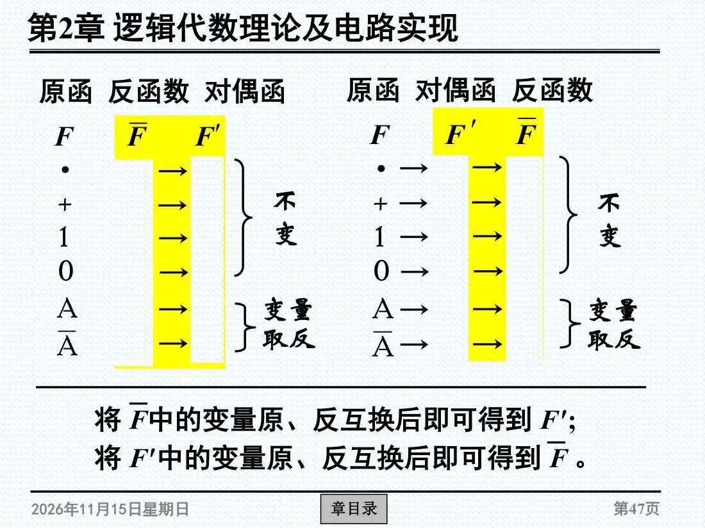

原文：

第2章逻辑代数理论及电路实现

原函 反函数 对偶函

$$
\left.\begin{array}{c c c}F&F ^ {\prime}&\overline {{F}}\\\bullet&\rightarrow&\\+&\rightarrow&\\1&\rightarrow&\\0&\rightarrow&\\A&\rightarrow&\\\overline {{A}}&\rightarrow&\end{array}\right\}
$$

$$
\begin{array}{c c c}F&\overline {{F}}&F ^ {\prime}\\\bullet&\rightarrow&\\+&\rightarrow&\\1&\rightarrow&\\0&\rightarrow&\\A&\rightarrow&\\\overline {{A}}&\rightarrow&\end{array}
$$

不变

不 变

原函 对偶函 反函数

变量取反 变量 取反

将 $\bar { F }$ 中的变量原、反互换后即可得到 $F ^ { \prime }$ ;

将 $F ^ { \prime }$ 中的变量原、反互换后即可得到 $\bar { F }$

2026年11月15日星期日

章目录

第47页

### 第2章 逻辑代数理论及电路实现

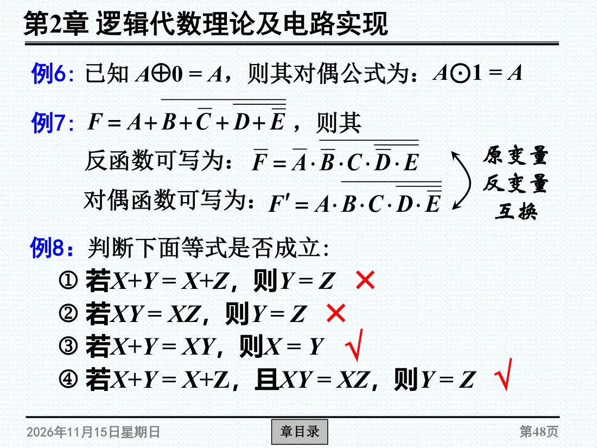

原文：

第2章 逻辑代数理论及电路实现

例6: 已知 $A @ 0 = A$ ，则其对偶公式为： $A { \odot } 1 { = } A$

例7: $F = A + B + C + D + E$ 则其反函数可写为： $\scriptstyle F = A \cdot B \cdot C \cdot { \overline { { D \cdot E } } }$ 原变量反变量对偶函数可写为： $F ^ { \prime } = A \cdot B \cdot C \cdot D \cdot \overline { { E } }$ 互换

例8：判断下面等式是否成立:

 若 $X + Y = X + Z$ 则 $Y = Z \times$

 若 $X Y = X Z$ ，则 $Y = Z \times$

 若 $X { + } Y { = } X Y .$ 则 $X = Y \setminus N$

 若 $X + Y = X + Z$ ，且 $X Y = X Z$ ，则 $Y = Z \downarrow$

2026年11月15日星期日

章目录

第48页

### 第2章 逻辑代数理论及电路实现

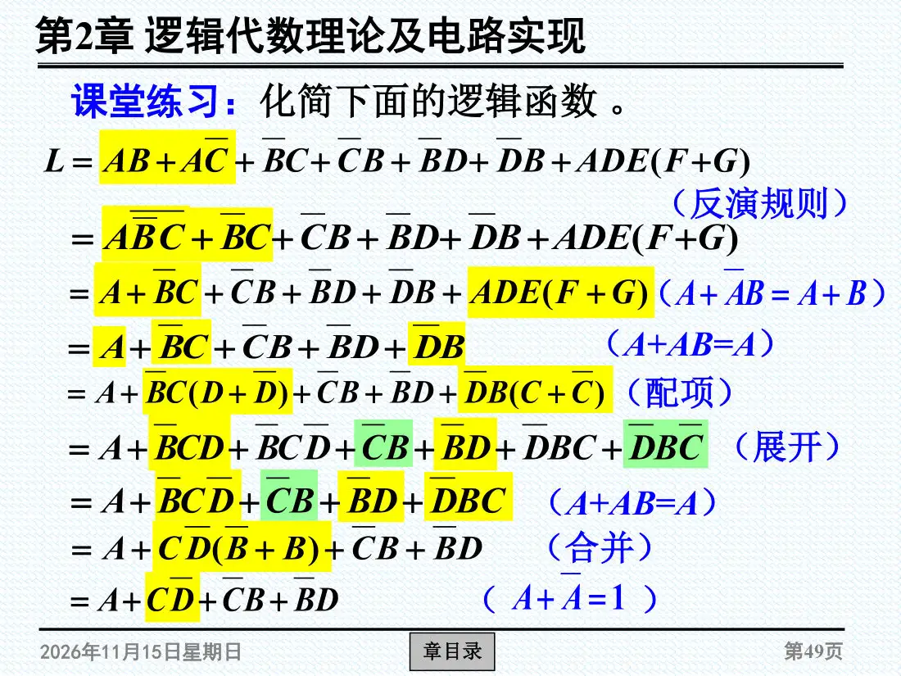

原文：

第2章 逻辑代数理论及电路实现

课堂练习：化简下面的逻辑函数 。

$$
\begin{array}{r l} & L = A B + A \overline {{C}} + \overline {{B}} C + \overline {{C}} B + \overline {{B}} D + \overline {{D}} B + A D E (F + G) \\ & \quad \text {(反演规则)} \\ & = A \overline {{\overline {{B}} C}} + \overline {{B}} C + \overline {{C}} B + \overline {{B}} D + \overline {{D}} B + A D E (F + G) \\ & = A + \overline {{B}} C + \overline {{C}} B + \overline {{B}} D + \overline {{D}} B + A D E (F + G) (A + \overline {{A}} B = A + B) \\ & = A + \overline {{B}} C + \overline {{C}} B + \overline {{B}} D + \overline {{D}} B (A + A B = A) \\ & = A + \overline {{B}} C (D + \overline {{D}}) + \overline {{C}} B + \overline {{B}} D + \overline {{D}} B (C + \overline {{C}}) (\text {配项}) \\ & = A + \overline {{B}} C D + \overline {{B}} C \overline {{D}} + \overline {{C}} B + \overline {{B}} D + \overline {{D}} B C + \overline {{D}} B \overline {{C}} (\text {展开}) \\ & = A + \overline {{B}} C \overline {{D}} + \overline {{C}} B + \overline {{B}} D + \overline {{D}} B C (A + A B = A) \\ & = A + C \overline {{D}} (\overline {{B}} + B) + \overline {{C}} B + \overline {{B}} D (\text {合并}) \\ & = A + C \overline {{D}} + \overline {{C}} B + \overline {{B}} D (A + \overline {{A}} = 1) \end{array}
$$

2026年11月15日星期日

章目录

第49页

### 第2章 逻辑代数理论及电路实现

原文：

第2章 逻辑代数理论及电路实现

思考题

1. 事物间的基本因果关系有几种？分别是什么？

2. 一个逻辑变量的取值有几种？分别是什么？

3. 如何理解 1+1=1？

4. 解释概念：逻辑相邻项。

5. 多个常量异或运算的结果如何确定？

6. 对偶函数和反函数如何相互转换？

2026年11月15日星期日

章目录

第50页

### 第2章逻辑代数理论及电路实现

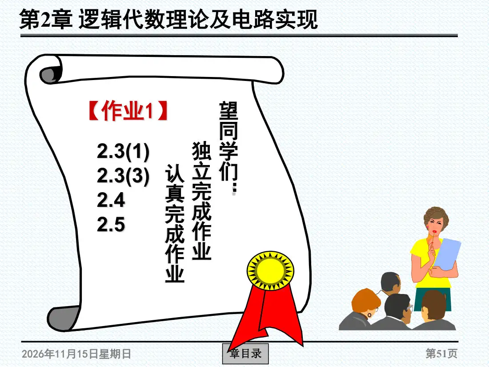

原文：

第2章逻辑代数理论及电路实现

望

同

学

们

：

【作业1】

独

立

完

成

作

业

认

真

完

成

作

业

2.3(1)

2.3(3)

2.4

2.5

2026年11月15日星期日

章目录

第51页

### 第2章 逻辑代数理论及电路实现

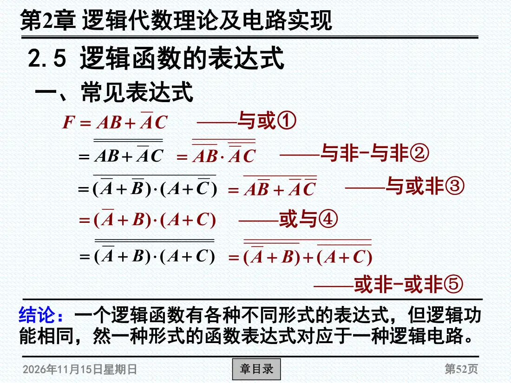

原文：

第2章 逻辑代数理论及电路实现

2.5 逻辑函数的表达式

常见表达式

$$
\begin{array}{r l} {F = A B + \overline {{{A}}} C} & {\text {——与或①}} \\ {= \overline {{{A B + \overline {{{A}}} C}}}} & {= \overline {{{A B}}} \cdot \overline {{{\overline {{{A}}} C}}}} \\ {= (\overline {{{A}}} + \overline {{{B}}}) \cdot (A + \overline {{{C}}})} & = \overline {{{A \overline {{{B}}} + \overline {{{A}}} \overline {{{C}}}}}} \\ {= (\overline {{{A}}} + B) \cdot (A + C)} & {\text {——或与④}} \\ {= (\overline {{{A}}} + B) \cdot (A + C)} & {= (\overline {{{\overline {{{A}}} + B}}}) + (\overline {{{A + C}}})} \\ & {\text {——或非-或非⑤}} \end{array}
$$

结论：一个逻辑函数有各种不同形式的表达式，但逻辑功能相同，然一种形式的函数表达式对应于一种逻辑电路。

2026年11月15日星期日

章目录

第52页

### 第2章逻辑代数理论及电路实现

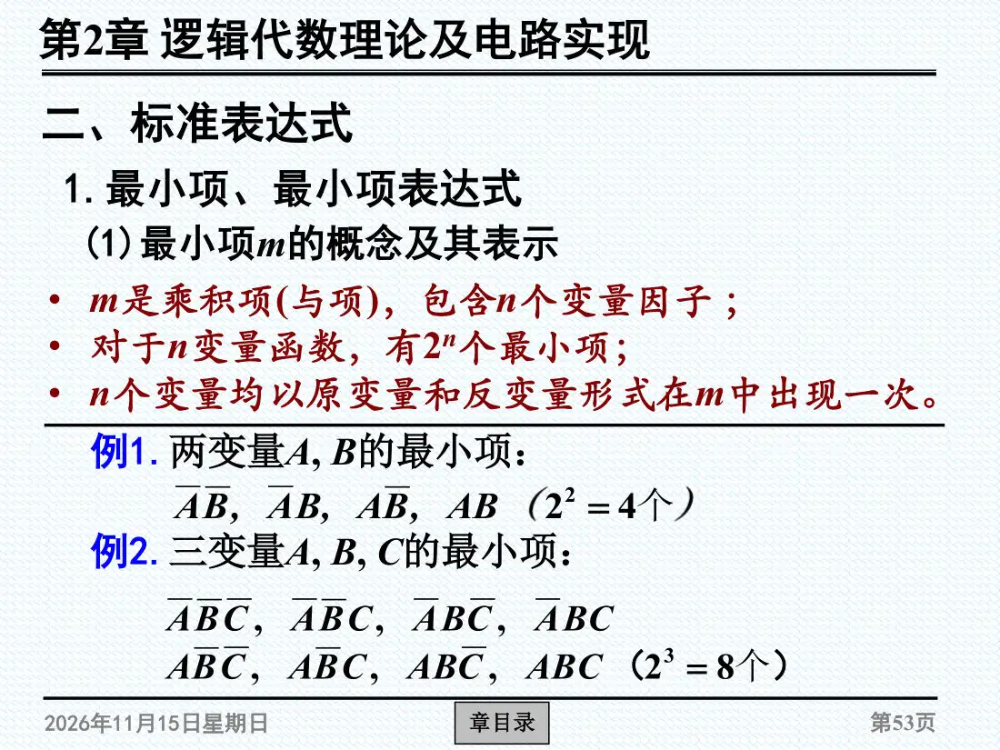

原文：

第2章逻辑代数理论及电路实现

二、标准表达式

最小项、最小项表达式

(1)最小项m的概念及其表示

m是乘积项(与项)，包含n个变量因子 ；

• 对于n变量函数，有2n个最小项；

• n个变量均以原变量和反变量形式在m中出现一次。

例1.两变量A,B的最小项：

$$
\overline {{A}} \overline {{B}}, \overline {{A}} B, A \overline {{B}}, A B (2 ^ {2} = 4 \text {个})
$$

例2.三变量A, B, C的最小项：

$$
\overline {{A}} \overline {{B}} \overline {{C}}, \overline {{A}} \overline {{B}} C, \overline {{A}} B \overline {{C}}, \overline {{A}} B C
$$

$$
A \overline {{B}} \overline {{C}}, A \overline {{B}} C, A B \overline {{C}}, A B C (2 ^ {3} = 8 \text {个})
$$

2026年11月15日星期日

章目录

第53页

### 第2章 逻辑代数理论及电路实现

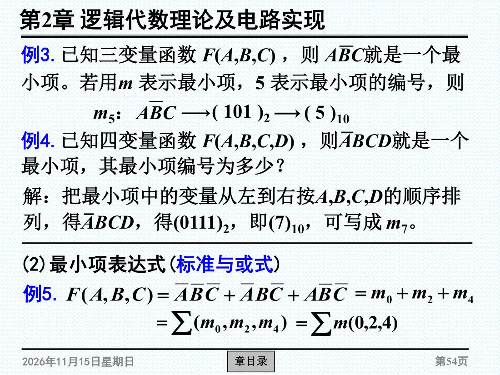

原文：

第2章 逻辑代数理论及电路实现

例3.已知三变量函数 F(A,B,C) ，则ABC就是一个最小项。若用m 表示最小项，5 表示最小项的编号，则

$$
m _ {5} \colon A \overline {{B}} C \longrightarrow (1 0 1) _ {2} \longrightarrow (5) _ {1 0}
$$

例4.已知四变量函数 $F ( A , B , C , D )$ 则ABCD就是一个最小项，其最小项编号为多少？

解：把最小项中的变量从左到右按A,B,C,D的顺序排列，得ABCD，得(0111) ，即 $( 7 ) _ { 1 0 } ,$ 可写成 $m _ { 7 }$

(2)最小项表达式(标准与或式)

例5. $\begin{array} { l } { { \displaystyle F ( A , B , C ) = A \overline { { { B } } } \overline { { { C } } } + A B C + A \overline { { { B } } } \overline { { { C } } } = m _ { 0 } + m _ { 2 } + m _ { 4 } } } \\ { { \displaystyle ~ = \sum ( m _ { 0 } , m _ { 2 } , m _ { 4 } ) = \sum m ( 0 , 2 , 4 ) } } \end{array}$

2026年11月15日星期日

章目录

第54页

### 第2章 逻辑代数理论及电路实现

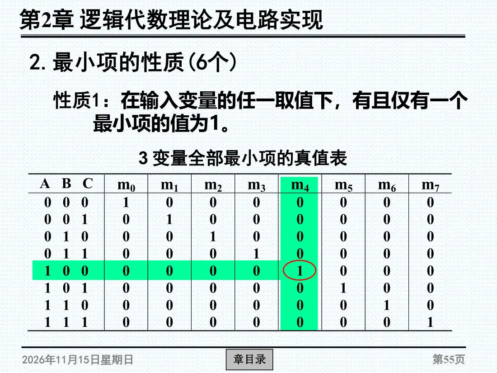

原文：

第2章 逻辑代数理论及电路实现

2.最小项的性质(6个)

性质1：在输入变量的任一取值下，有且仅有一个最小项的值为1。

3 变量全部最小项的真值表
<table><tr><td>A</td><td>B</td><td>C</td><td> $m_0$ </td><td> $m_1$ </td><td> $m_2$ </td><td> $m_3$ </td><td> $m_4$ </td><td> $m_5$ </td><td> $m_6$ </td><td> $m_7$ </td></tr><tr><td>0</td><td>0</td><td>0</td><td>1</td><td>0</td><td>0</td><td>0</td><td>0</td><td>0</td><td>0</td><td>0</td></tr><tr><td>0</td><td>0</td><td>1</td><td>0</td><td>1</td><td>0</td><td>0</td><td>0</td><td>0</td><td>0</td><td>0</td></tr><tr><td>0</td><td>1</td><td>0</td><td>0</td><td>0</td><td>1</td><td>0</td><td>0</td><td>0</td><td>0</td><td>0</td></tr><tr><td>0</td><td>1</td><td>1</td><td>0</td><td>0</td><td>0</td><td>1</td><td>0</td><td>0</td><td>0</td><td>0</td></tr><tr><td>1</td><td>0</td><td>0</td><td>0</td><td>0</td><td>0</td><td>0</td><td>1</td><td>0</td><td>0</td><td>0</td></tr><tr><td>1</td><td>0</td><td>1</td><td>0</td><td>0</td><td>0</td><td>0</td><td>0</td><td>1</td><td>0</td><td>0</td></tr><tr><td>1</td><td>1</td><td>0</td><td>0</td><td>0</td><td>0</td><td>0</td><td>0</td><td>0</td><td>1</td><td>0</td></tr><tr><td>1</td><td>1</td><td>1</td><td>0</td><td>0</td><td>0</td><td>0</td><td>0</td><td>0</td><td>0</td><td>1</td></tr></table>

2026年11月15日星期日

章目录

第55页

### 第2章 逻辑代数理论及电路实现

原文：

第2章 逻辑代数理论及电路实现

2.最小项的性质(6个)

性质2：不同的最小项， 使它的值为1的那一组变量取值也不同。

3变量全部最小项的真值表
<table><tr><td>A</td><td>B</td><td>C</td><td> $m_0$ </td><td> $m_1$ </td><td> $m_2$ </td><td> $m_3$ </td><td> $m_4$ </td><td> $m_5$ </td><td> $m_6$ </td><td> $m_7$ </td></tr><tr><td>0</td><td>0</td><td>0</td><td>1</td><td>0</td><td>0</td><td>0</td><td>0</td><td>0</td><td>0</td><td>0</td></tr><tr><td>0</td><td>0</td><td>1</td><td>0</td><td>1</td><td>0</td><td>0</td><td>0</td><td>0</td><td>0</td><td>0</td></tr><tr><td>0</td><td>1</td><td>0</td><td>0</td><td>0</td><td>1</td><td>0</td><td>0</td><td>0</td><td>0</td><td>0</td></tr><tr><td>0</td><td>1</td><td>1</td><td>0</td><td>0</td><td>0</td><td>1</td><td>0</td><td>0</td><td>0</td><td>0</td></tr><tr><td>1</td><td>0</td><td>0</td><td>0</td><td>0</td><td>0</td><td>0</td><td>1</td><td>0</td><td>0</td><td>0</td></tr><tr><td>1</td><td>0</td><td>1</td><td>0</td><td>0</td><td>0</td><td>0</td><td>0</td><td>1</td><td>0</td><td>0</td></tr><tr><td>1</td><td>1</td><td>0</td><td>0</td><td>0</td><td>0</td><td>0</td><td>0</td><td>0</td><td>1</td><td>0</td></tr><tr><td>1</td><td>1</td><td>1</td><td>0</td><td>0</td><td>0</td><td>0</td><td>0</td><td>0</td><td>0</td><td>1</td></tr></table>

2026年11月15日星期日

章目录

第56页

### 2.最小项的性质(6个)

原文：

2.最小项的性质(6个)

性质3：全部最小项之和恒等于1。即： $\sum _ { i = 0 } ^ { 2 ^ { n } - 1 } m _ { i } \gets 1$

3 变量全部最小项的真值表
<table><tr><td>A</td><td>B</td><td>C</td><td> $m_0$ </td><td> $m_1$ </td><td> $m_2$ </td><td> $m_3$ </td><td> $m_4$ </td><td> $m_5$ </td><td> $m_6$ </td><td> $m_7$ </td></tr><tr><td>0</td><td>0</td><td>0</td><td>1</td><td>0</td><td>0</td><td>0</td><td>0</td><td>0</td><td>0</td><td>0</td></tr><tr><td>0</td><td>0</td><td>1</td><td>0</td><td>1</td><td>0</td><td>0</td><td>0</td><td>0</td><td>0</td><td>0</td></tr><tr><td>0</td><td>1</td><td>0</td><td>0</td><td>0</td><td>1</td><td>0</td><td>0</td><td>0</td><td>0</td><td>0</td></tr><tr><td>0</td><td>1</td><td>1</td><td colspan="8"></td></tr><tr><td>1</td><td>0</td><td>0</td><td>0</td><td>0</td><td>0</td><td>0</td><td>1</td><td>0</td><td>0</td><td>0</td></tr></table>

变量ABC取值为010情况下，各最小项之和为1。因为其中只有一个最小项为1，其余全为0。

第2章 逻辑代数理论及电路实现

2026年11月15日星期日

章目录

第57页

### 第2章 逻辑代数理论及电路实现

原文：

第2章 逻辑代数理论及电路实现

2.最小项的性质(6个) ${ \overline { { A } } } B C \cdot A { \overline { { B } } } C = 0$

性质4：任意两个最小项的乘积恒等于0 。

即： $m _ { i } \cdot m _ { j } = 0 \quad ( 0 \leq i ( j ) \zeta 2 ^ { n } \dashv 1 , \ \boxplus i \ne j )$

3 变量全部最小项的真值表
<table><tr><td>A</td><td>B</td><td>C</td><td> $m_0$ </td><td> $m_1$ </td><td> $m_2$ </td><td> $m_3$ </td><td> $m_4$ </td><td> $m_5$ </td><td> $m_6$ </td><td> $m_7$ </td></tr><tr><td>0</td><td>0</td><td>0</td><td>1</td><td>0</td><td>0</td><td>0</td><td>0</td><td>0</td><td>0</td><td>0</td></tr><tr><td>0</td><td>0</td><td>1</td><td>0</td><td>1</td><td>0</td><td>0</td><td>0</td><td>0</td><td>0</td><td>0</td></tr><tr><td>0</td><td>1</td><td>0</td><td>0</td><td>0</td><td>1</td><td>0</td><td>0</td><td>0</td><td>0</td><td>0</td></tr><tr><td>0</td><td>1</td><td>1</td><td>0</td><td>0</td><td>0</td><td>1</td><td>0</td><td>0</td><td>0</td><td>0</td></tr><tr><td>1</td><td>0</td><td>0</td><td>0</td><td>0</td><td>0</td><td>0</td><td>1</td><td>0</td><td>0</td><td>0</td></tr><tr><td>1</td><td>0</td><td>1</td><td>0</td><td>0</td><td>0</td><td>0</td><td>0</td><td>1</td><td>0</td><td>0</td></tr><tr><td>1</td><td>1</td><td>0</td><td>0</td><td>0</td><td>0</td><td>0</td><td>0</td><td>0</td><td>1</td><td>0</td></tr><tr><td>1</td><td>1</td><td>1</td><td>0</td><td>0</td><td>0</td><td>0</td><td>0</td><td>0</td><td>0</td><td>1</td></tr></table>

2026年11月15日星期日

章目录

第58页

### 性质5：任一最小项与另一最小项非之积恒等于该最小项 。

原文：

第2章逻辑代数理论及电 $\begin{array} { l } { m _ { 2 } \cdot \overline { { m } } _ { 6 } = \overline { { A } } B \overline { { C } } \cdot \overline { { A } } B \overline { { C } } } \\ { = \overline { { A } } B \overline { { C } } \cdot ( \overline { { A } } + \overline { { B } } + C ) } \\ { = \overline { { A } } B \overline { { C } } + \bf { 0 } + \bf { 0 } = m _ { 2 } } \end{array}$ 2.最小项的性质(6个)

性质5：任一最小项与另一最小项非之积恒等于该最小项 。

即： $m _ { i } \cdot m _ { j } = m _ { i }$ $( 0 \leq i ( j ) \leq 2 ^ { n } - 1$ 且 $i \neq j )$

证明：若自变量的取值组合使 $| m _ { \mathrm { i } } = 1$ (有且只有一组)，或使 ${ \bf \nabla } _ { m _ { i } } = { \bf 0 }$ (其余 $2 n { - } 1$ 组)，则$\mathbf { \boldsymbol { m } } _ { i } \cdot \mathbf { \overline { { { m } } } } _ { j } = \mathbf { 1 } = \mathbf { \boldsymbol { m } } _ { i }$ 或 $\mathbf { \nabla } m _ { i } \cdot \overline { { \boldsymbol { m } } } _ { j } = 0 = m _ { i }$

<table><tr><td>0 1 0</td><td>0</td><td>0</td><td>1</td><td>0</td><td>0</td><td>0</td><td>0</td><td>0</td></tr><tr><td>0 1 1</td><td>0</td><td>0</td><td>0</td><td>1</td><td>0</td><td>0</td><td>0</td><td>0</td></tr><tr><td>1 0 0</td><td>0</td><td>0</td><td>0</td><td>0</td><td>1</td><td>0</td><td>0</td><td>0</td></tr><tr><td>1 0 1</td><td>0</td><td>0</td><td>0</td><td>0</td><td>0</td><td>1</td><td>0</td><td>0</td></tr><tr><td>1 1 0</td><td>0</td><td>0</td><td>0</td><td>0</td><td>0</td><td>0</td><td>1</td><td>0</td></tr><tr><td>1 1 1</td><td>0</td><td>0</td><td>0</td><td>0</td><td>0</td><td>0</td><td>0</td><td>1</td></tr></table>

2026年11月15日星期日

章目录

第59页

### 第2章 逻辑代数理论及电路实现

原文：

第2章 逻辑代数理论及电路实现

2.最小项的性质(6个)

性质6：两个相邻最小项之和可以合并成一项，并消去一对因子。

任何两个最小项如果它们只有一个因子不同,其余因子都相同, 则这两个最小项互为相邻最小项。

例如：

显然 ${ \bf \nabla } m _ { \bf 0 }$ 与 $m _ { 1 }$ 具有相邻性,而 ${ m } _ { 1 }$ (知BC) $m _ { 2 } ( \overline { { A } } B \overline { { C } } )$ 不相邻，因为他们有两个因子不相同。 $m _ { 3 }$ 与 $m _ { 4 }$ 也不相邻，而 $m _ { 0 }$ 与 $m _ { 2 }$ 相邻，即，

$$
m _ {0} + m _ {1} = \overline {{A}} \overline {{B}} \overline {{C}} + \overline {{A}} \overline {{B}} C = \overline {{A}} \overline {{B}} (C + \overline {{C}}) = \overline {{A}} \overline {{B}}
$$

$$
\boldsymbol {m} _ {0} + \boldsymbol {m} _ {2} = \overline {{A}} \overline {{B}} \overline {{C}} + \overline {{A}} B \overline {{C}} = \overline {{A}} (\overline {{B}} + B) \overline {{C}} = \overline {{A}} C
$$

2026年11月15日星期日

章目录

第60页

### 第2章 逻辑代数理论及电路实现

原文：

第2章 逻辑代数理论及电路实现

3.两个重要关系式

(1)若 $F = \sum m _ { i }$ 则 $\overline { { F } } = \sum m _ { k }$

(k为 $0 \sim ( 2 ^ { n } - 1 )$ 中除了i以外的所有正整数）

证明：根据最小项的性质1— 在输入变量的任取值下，有且仅有一个最小项的值为1。

•若自变量的取值组合使 $\sum m _ { i } = 0 ,$ ，则 $\sum m _ { k } = 1$

•若自变量的取值组合使 $\sum m _ { i } = 1 ,$ 则 $\sum m _ { k } = 0$

所以， $\sum m _ { i } = \sum m _ { k }$ 即上述关系式成立！

例如： $F ( A , B , C ) = \sum m ( 1 , 2 , 4 )$

则 $\overline { { F } } ( A , B , C ) = \sum m ( 0 , 3 , 5 , 6 , 7 )$

2026年11月15日星期日

章目录

第61页

### 第2章 逻辑代数理论及电路实现

原文：

第2章 逻辑代数理论及电路实现

3.两个重要关系式

下标号互补

(②) 若 $\overline { { F } } = \sum m _ { i }$ 则 $F ^ { \prime } = \sum m _ { k } , \ k = ( 2 ^ { n } - 1 ) - i$ 证明：根据反演和对偶之间的关系可知，证明： $\bar { F }$ 中原、反变量互换可得到 $F ^ { \prime }$ 且F和 $F ^ { \prime }$ 中包含的最小项个数相等，所对应的最小项的编号之和为 $( 2 ^ { n } { \xrightarrow { } } 1 )$

例6：若 $\overline { { F } } ( A , B , C ) = \sum m ( 3 , 4 , 6 )$ 则 $F ^ { \prime } ( A , B , C ) = \sum m ( { \ ? } )$ 解： $F ^ { \prime } ( A , B , C ) = \sum m ( 4 , 3 , 1 )$ 例7：若 $F ( A , B , C ) \mathrm { ~ - ~ } \sum m ( 3 , 4 , 6 )$ 则 $F ^ { \prime } ( A , B , C ) = \sum m ( { \ ? } )$ 解： $\overline { { F } } ( A , B , C ) = \sum m ( 0 , 1 , 2 , 5 , 7 )$ $F ^ { \prime } ( A , B , C ) = \sum m ( 0 , 2 , 5 , 6 , 7 )$

2026年11月15日星期日

章目录

第62页

### 第2章 逻辑代数理论及电路实现

原文：

第2章 逻辑代数理论及电路实现

4.由一般表达式写出最小项表达式的方法

一般表达式 标准与或式

任何一个逻辑函数都可以表示成唯一的一组最小项之和——标准与或表达式，也称最小项表达式。

对于不是最小项表达式的与或表达式，可利用公式

$A + A ^ { = 1 }$ 和 $A ( B + C ) = A B + B C$

来配项展开成最小项表达式。

例8： $F ( A , B , C ) = A B$ 展开成最小项之和的形式。

解： $F ( A , B , C ) = A B ( C + \overline { { C } } ) = A B \overline { { C } } + A B C = \sum m ( 6 , 7 )$

2026年11月15日星期日

章目录

第63页

### 第2章 逻辑代数理论及电路实现

原文：

第2章 逻辑代数理论及电路实现

例9：将下列函数化为最小项之和的形式。

$$
\begin{array}{r l} & Y = \overline {{A}} + B C \\ & = \overline {{A}} (B + \overline {{B}}) (C + \overline {{C}}) + (A + \overline {{A}}) B C \\ & = \overline {{A}} B C + \overline {{A}} B \overline {{C}} + \overline {{A}} \overline {{B}} C + \overline {{A}} \overline {{B}} \overline {{C}} + A B C + \overline {{A}} B C \\ & = \overline {{A}} \overline {{B}} \overline {{C}} + \overline {{A}} \overline {{B}} C + \overline {{A}} B \overline {{C}} + \overline {{A}} B C + A B C \\ & = m _ {0} + m _ {1} + m _ {2} + m _ {3} + m _ {7} \\ & = \sum m (0, 1, 2, 3, 7) \end{array}
$$

2026年11月15日星期日

章目录

第64页

### 第2章 逻辑代数理论及电路实现

原文：

第2章 逻辑代数理论及电路实现

5.由真值表写出最小项表达式的方法

最小项表达式是真值表中所有使函数值为 1 的取值组合所对应的各最小项之和。

例如： $m _ { 1 } = { \overline { { A } } } { \overline { { B } } } C \quad m _ { 2 } = { \overline { { A } } } B { \overline { { C } } }$

$$
\begin{array}{c} m _ {3} = \overline {{A}} B C \quad m _ {5} = A \overline {{B}} C \\ Y = m _ {1} + m _ {2} + m _ {3} + m _ {5} \end{array}
$$

<table><tr><td>A</td><td>B</td><td>C</td><td>Y</td><td>最小项</td></tr><tr><td>0</td><td>0</td><td>0</td><td>0</td><td> $m_0$ </td></tr><tr><td>0</td><td>0</td><td>1</td><td>1</td><td> $m_1$ </td></tr><tr><td>0</td><td>1</td><td>0</td><td>1</td><td> $m_2$ </td></tr><tr><td>0</td><td>1</td><td>1</td><td>1</td><td> $m_3$ </td></tr><tr><td>1</td><td>0</td><td>0</td><td>0</td><td> $m_4$ </td></tr><tr><td>1</td><td>0</td><td>1</td><td>1</td><td> $m_5$ </td></tr><tr><td>1</td><td>1</td><td>0</td><td>0</td><td> $m_6$ </td></tr><tr><td>1</td><td>1</td><td>1</td><td>0</td><td> $m_7$ </td></tr></table>

在n个变量的逻辑系统中，如果Y 为 i 个最小推论：项之和，则 必为余下的 $( 2 ^ { \mathfrak { n } } - i )$ 个最小项之和。

2026年11月15日星期日

章目录

第65页

### 第2章 逻辑代数理论及电路实现

原文：

第2章 逻辑代数理论及电路实现

函数表达式具有多样性, 因此各表达式的实现电路通常差异较大, 但最小项表达式具有唯一性。

一个逻辑函数表达式常用的有以下5种表示形式：

(1)与或表达式：

(2)与或非表达式：

(3)或与表达式：

(4)与非-与非表达式：

(5)或非-或非表达式：

$$
\begin{array}{r l} & {L = A C + \overline {{C}} D} \\ & {\qquad = (\overline {{A}} C + \overline {{C}} \overline {{D}})} \\ & {\qquad = (A + \overline {{C}}) (C + D)} \\ & {\qquad = (\overline {{A C}} \overline {{\overline {{C}} D}})} \\ & {\qquad = \overline {{A + \overline {{C}} + \overline {{C + D}}}}} \end{array}
$$

说明：通常将表达式化简为与或或或与表示式。若要求用其它形式表示，则可用反演规则来转换。

2026年11月15日星期日

章目录

第66页

### 第2章逻辑代数理论及电路实现——逻辑函数的表达式

原文：

第2章逻辑代数理论及电路实现——逻辑函数的表达式

1.与非逻辑形式

$$
\begin{array}{l} \boldsymbol {F} = \boldsymbol {B} \bar {\boldsymbol {C}} + \boldsymbol {A} \bar {\boldsymbol {B}} \boldsymbol {C} + \bar {\boldsymbol {A}} \bar {\boldsymbol {B}} \boldsymbol {D} \\ \boldsymbol {F} = \frac {\text { ? }}{\overline {{\boldsymbol {B} \bar {\boldsymbol {C}} \cdot \boldsymbol {A} \bar {\boldsymbol {B}} \boldsymbol {C} \cdot \bar {\boldsymbol {A}} \bar {\boldsymbol {B}} \boldsymbol {D}}}} \end{array}
$$

2.或非逻辑形式将或与逻辑两次求反：

$$
\boldsymbol {F} = (\boldsymbol {B} + \bar {\boldsymbol {D}}) (\boldsymbol {B} + \bar {\boldsymbol {C}}) (\boldsymbol {A} + \bar {\boldsymbol {C}} + \boldsymbol {D})
$$

2026年11月15日星期日

章目录

第67页

### 第2章 逻辑代数理论及电路实现

原文：

第2章 逻辑代数理论及电路实现

3.与或非逻辑形式

——可从两种途径得到：

（1）从与或式得到, 将结果两次求反,不用摩根定律即可得与或非式。

$$
F = \overline {{\overline {{F}}}} = B \overline {{C}} + A \overline {{B}} C + \overline {{A}} \overline {{B}} D
$$

（2）求得反函数后, 再求一次反,不用摩根定律也可得与或非式。

$$
F = \overline {{\overline {{F}}}} = \overline {{B D + B C + A C D}}
$$

2026年11月15日星期日

章目录

第68页

### 第2章逻辑代数理论及电路实现

原文：

第2章逻辑代数理论及电路实现

2.6 逻辑函数的化简

W 化简的意义和最简的标准

1.化简的意义(目的)：节省元器件; 提高工作可靠性.

3.最简的标准：逻例如：最简与或式

乘积项的项数最少。

每个乘积项中变量个数最少。

(1)逻辑电路所用逻辑门最少；

(2)各个逻辑门的输入端要少；

(3)逻辑电路所用的级数要少；

(4)逻辑电路能可靠地工作。

降低成本

提高速度

提高系统可靠性

2026年11月15日星期日

章目录

第69页

### 二、公式法 — 3种方法

原文：

二、公式法 <与或式的化简 >— 3种方法

(1)合并法 相邻项合并： $A B + A B = A$

例10: $\begin{array} { l } { { F = A \ B + C D + A \ \bar { B } + \bar { C } D } } \\ { { \ = ( A \ B + A \ \bar { B } ) + ( C D + \bar { C } D ) \ = _ { A } + D } } \end{array}$

原变量吸收： $A + A B = A$

(2)消项法 反变量吸收： $A + A B = A + B$

混合变量吸收： $A B + \overline { { A } } C + B C = A B + \overline { { A } } C$

例11: $\begin{array} { l } { F = A B + A B \overline { { C } } + A B D } \\ { = A B + A B ( \overline { { C } } + D ) = A B } \end{array}$

例12: $F = A C + \overline { { C } } D + A D E + A D G \ = A C + C D$

第2章逻辑代数理论及电路实现

2026年11月15日星期日

章目录

第70页

### 第2章逻辑代数理论及电路实现

原文：

第2章逻辑代数理论及电路实现

例2.6.4

$$
A B + \overline {{A}} C + B C = A B + \overline {{A}} C
$$

$$
\begin{array}{r l} & A \overline {{B}} + \overline {{A}} B + A B C D + \overline {{A}} \overline {{B}} C D \\ & = A \overline {{B}} + \overline {{A}} B + C D (A B + \overline {{A}} \overline {{B}}) \\ & = A \oplus B + C D \cdot A \odot B \\ & = (A \oplus B) + C D \cdot \overline {{A \oplus B}} \\ & = (A \oplus B) + C D \\ & = A \overline {{B}} + \overline {{A}} B + C D \end{array}
$$

$$
A + \overline {{A}} B = A + B
$$

2026年11月15日星期日

章目录

第71页

### 第2章逻辑代数理论及电路实现

原文：

第2章逻辑代数理论及电路实现

例题：应用公式法 ，消去多余乘积项和多余因子。

$$
Y = A C + \overline {{B}} C + B \overline {{D}} + C \overline {{D}} + A (B + \overline {{C}}) + \overline {{A}} B C \overline {{D}} + A \overline {{B}} D E
$$

原变量吸收 $A + A B = A$ ，摩根定理

$$
= A C + \overline {{B}} C + B \overline {{D}} + C \overline {{D}} + A \overline {{\overline {{B}} C}} + A \overline {{B}} D E
$$

反变量吸收 $A + \overline { { A } } B = A + B$

$$
= A C + \overline {{B}} C + B \overline {{D}} + C \overline {{D}} + A + A \overline {{B}} D E
$$

原变量吸收 $A + A B = A$

$$
= A + \overline {{B}} C + B \overline {{D}} + C \overline {{D}}
$$

混和变量吸收 $A B + \overline { { A } } C + B C = A B + \overline { { A } } C$

$$
= A + \overline {{B}} C + B \overline {{D}}
$$

2026年11月15日星期日

章目录

第72页

### 第2章 逻辑代数理论及电路实现

原文：

第2章 逻辑代数理论及电路实现

(3)综合法

在合并法和消项法的基础上，结合拆项 $( A + { \overline { { A } } } = 1 )$ 添项 $\left( A + A { = } A \right)$ 和反演律等各种规则进行化简。

基本方法：先找公共因子，再找互补因子！

例13: ${ \begin{array} { r l } { F { = } A B + { \overline { { A } } } C + { \overline { { B } } } C } & { = A B + ( { \overline { { A } } } + { \overline { { B } } } ) C } \\ { = A B + { \overline { { A B } } } C } & { = A B + C } \end{array} }$

反演

例14: ${ \begin{array} { r l } & { F = { \overline { { A } } } B { \overline { { C } } } + { \overline { { A } } } B C + A B C } \\ & { \qquad = ( { \overline { { A } } } B { \overline { { C } } } + { \overline { { A } } } B { \overline { { C } } } ) + { \overline { { A } } } B C + A B C } \\ & { \qquad = { \overline { { A } } } B ( C + { \overline { { C } } } ) + B C ( { \overline { { A } } } + A ) } \\ & { \qquad = { \overline { { A } } } B + B C } \end{array} }$ 添项

2026年11月15日星期日

章目录

第73页

### 第2章 逻辑代数理论及电路实现

原文：

第2章 逻辑代数理论及电路实现

课堂练习：

$$
A B = A + B
$$

$$
\begin{array}{r l} & F = \overline {{A B + A B}} \cdot \overline {{B C + B C}} \\ & = (A B + \overline {{A}} \overline {{B}}) + (B C + \overline {{B}} \overline {{C}}) \\ & = A B + \overline {{A}} \overline {{B}} (C + \overline {{C}}) + B C (A + \overline {{A}}) + \overline {{B}} \overline {{C}} \\ & = A B + \overline {{A}} \overline {{B}} C + \overline {{A}} \overline {{B}} \overline {{C}} + A B C + \overline {{A}} B C + \overline {{B}} \overline {{C}} \\ & = A B + \overline {{A}} C (\overline {{B}} + B) + \overline {{B}} \overline {{C}} \\ & = A B + \overline {{A}} C + \overline {{B}} \overline {{C}} \end{array}
$$

2026年11月15日星期日

章目录

第74页

### 第2章逻辑代数理论及电路实现

原文：

第2章逻辑代数理论及电路实现

公式化简法优缺点

优点：不受变量数目的限制。

缺点：无固定的步骤可循，需一定的技巧和经验；需要熟练运用各种公式和规则；不易判定化简结果是否最简。

用公式法化简应使得逻辑函数式包含的项数以及变量数最少为原则。

然而，对于化简的结果，尤其较为复杂的结果通常难于判断是否最简，因此还常使用卡诺图的方法来化简逻辑函数。

2026年11月15日星期日

章目录

第75页

### 第2章 逻辑代数理论及电路实现

原文：

第2章 逻辑代数理论及电路实现

思考题

1.如何理解“最小项对应的取值组合”？

2.最小项具有哪些主要性质？

3.真值表、最小项表达式、最简与或式有何差异？

4.何谓最简与或式？

2026年11月15日星期日

章目录

第76页

### 第2章逻辑代数理论及电路实现

原文：

第2章逻辑代数理论及电路实现

望

同

学

们

独

立

完

成

作

业

【作业2】

认

真

完

成

作

业

2.8(1) 2.8(3) 2.10(1)

2.10(2)

2026年11月15日星期日

章目录

第77页

### 第2章逻辑代数理论及电路实现

原文：

第2章逻辑代数理论及电路实现

三、卡诺图化简法

1.卡诺图概述

逻辑相邻：两个最小项中只有一个变量互为反变量,其余变量均相同, 如 $m _ { 5 } \left( A \bar { B } C \right) \hat { \square } m _ { 1 } \left( \bar { A } \bar { B } C \right)$

卡诺图的实质：是将逻辑函数的最小项按逻辑相邻的原则排列而成的方格图。

以2n 个方格分别代表n变量逻辑函数的所有 $2 ^ { n }$ 最小项, 并使几何位置相邻的两个最小项在逻辑上也是相邻的(逻辑相邻), 就得到表示 n 变量全部最小项的卡诺图。

2026年11月15日星期日

章目录

第78页

### 输出F

原文：

输出F

第2章 逻辑代数理论及电路实现

例如:二变量卡诺图

输入变量A, B

<table><tr><td colspan="2">输入</td><td>输出</td></tr><tr><td>A</td><td>B</td><td>F</td></tr><tr><td>0</td><td>0</td><td>1</td></tr><tr><td>0</td><td>1</td><td>1</td></tr><tr><td>1</td><td>0</td><td>0</td></tr><tr><td>1</td><td>1</td><td>1</td></tr></table>

<table><tr><td>A\B</td><td>0</td><td>1</td></tr><tr><td>0</td><td> $\overline{A}\overline{B}$ </td><td> $\overline{A}B$ </td></tr><tr><td>1</td><td> $A\overline{B}$ </td><td>AB</td></tr></table>

$$
\begin{array}{r l} & F (A, B) \\ & = \overline {{A}} \overline {{B}} + \overline {{A}} B + A B \\ & = \overline {{A}} + B \end{array}
$$

<table><tr><td>A\B</td><td>0</td><td>1</td></tr><tr><td>0</td><td>m0</td><td>m1</td></tr><tr><td>1</td><td>m2</td><td>m3</td></tr></table>

2026年11月15日星期日

章目录

第79页

### 第2章逻辑代数理论及电路实 逻辑相邻

原文：

第2章逻辑代数理论及电路实 逻辑相邻

BC BC BCBC每个3变量的最小项有3个最小项与它逻辑相邻,BC不能为 00 01 10 11

逻

辑

相

邻

例如:三变量卡诺图有23=8个最小项！

<table><tr><td>输入</td><td>输出</td></tr><tr><td>A B C</td><td>F</td></tr><tr><td>0 0 0</td><td>0</td></tr><tr><td>0 0 1</td><td>1</td></tr><tr><td>0 1 0</td><td>0</td></tr><tr><td>0 1 1</td><td>0</td></tr><tr><td>1 0 0</td><td>1</td></tr><tr><td>1 0 1</td><td>0</td></tr><tr><td>1 1 0</td><td>1</td></tr><tr><td>1 1 1</td><td>1</td></tr></table>

<table><tr><td rowspan="2">A\BC</td><td>00</td><td>01</td><td>11</td><td>10</td></tr><tr><td>m0</td><td>m1</td><td>m3</td><td>m2</td></tr><tr><td>1</td><td>m4</td><td>m5</td><td>m7</td><td>m6</td></tr></table>

<table><tr><td rowspan="3">A\BC</td><td>00</td><td>01</td><td>11</td><td>10</td></tr><tr><td>0</td><td>1</td><td>0</td><td>0</td></tr><tr><td>1</td><td>0</td><td>1</td><td>1</td></tr></table>

2026年11月15日星期日

章目录

第80页

### 第2章 逻辑代数理论及电路实现

原文：

第2章 逻辑代数理论及电路实现

例如:四变量卡诺图

有24=16个最小项！

<table><tr><td>AB\CD</td><td>00</td><td>01</td><td>11</td><td>10</td></tr><tr><td>00</td><td>0</td><td>1</td><td>3</td><td>2</td></tr><tr><td>01</td><td>4</td><td>5</td><td>7</td><td>6</td></tr><tr><td>11</td><td>12</td><td>13</td><td>15</td><td>14</td></tr><tr><td>10</td><td>8</td><td>9</td><td>11</td><td>10</td></tr></table>

方法二
<table><tr><td>CD\AB</td><td>00</td><td>01</td><td>11</td><td>10</td></tr><tr><td>00</td><td>0</td><td>4</td><td>12</td><td>8</td></tr><tr><td>01</td><td>1</td><td>5</td><td>13</td><td>9</td></tr><tr><td>11</td><td>3</td><td>7</td><td>15</td><td>11</td></tr><tr><td>10</td><td>2</td><td>6</td><td>14</td><td>10</td></tr></table>

每个4变量的最小项有4个最小项与它逻辑相邻！

注意：卡诺图不同，但化简结果相同！

2026年11月15日星期日

章目录

第81页

### 第2章 逻辑代数理论及电路实现

原文：

第2章 逻辑代数理论及电路实现

例如:五变量卡诺图 有25=32个最小项！
<table><tr><td>CDEAB\AB</td><td>000</td><td>001</td><td>011</td><td>010</td><td>110</td><td>111</td><td>101</td><td>100</td></tr><tr><td>00</td><td>0</td><td>1</td><td>3</td><td>2</td><td>6</td><td>7</td><td>5</td><td>4</td></tr><tr><td>01</td><td>8</td><td>9</td><td>11</td><td>10</td><td>14</td><td>15</td><td>13</td><td>12</td></tr><tr><td>11</td><td>24</td><td>25</td><td>27</td><td>26</td><td>30</td><td>31</td><td>29</td><td>28</td></tr><tr><td>10</td><td>16</td><td>17</td><td>19</td><td>18</td><td>22</td><td>23</td><td>21</td><td>20</td></tr></table>

每个5变量的最小项有逻辑相邻5个最小项与它逻辑相邻！

2026年11月15日星期日

章目录

第82页

### 第2章 逻辑代数理论及电路实现

原文：

第2章 逻辑代数理论及电路实现

例2.6.11 将图示卡诺图用最小项表达式表示。

<table><tr><td>A\BC</td><td>00</td><td>01</td><td>11</td><td>10</td></tr><tr><td>0</td><td>0</td><td>1</td><td>0</td><td>0</td></tr><tr><td>1</td><td>1</td><td>0</td><td>0</td><td>1</td></tr></table>

<table><tr><td rowspan="2">A\BC</td><td>00</td><td>01</td><td>11</td><td>10</td></tr><tr><td>m0</td><td>m1</td><td>m3</td><td>m2</td></tr><tr><td>1</td><td>m4</td><td>m5</td><td>m7</td><td>m6</td></tr></table>

解： $\begin{array} { c } { { F ( A , B , C ) = m _ { 1 } + m _ { 4 } + m _ { 6 } } } \\ { { { } } } \\ { { { } = \overline { { { A } } } \overline { { { B } } } C + A \overline { { { B } } } \overline { { { C } } } + A B C } } \end{array}$

2026年11月15日星期日

章目录

第83页

### 第2章 逻辑代数理论及电路实现

原文：

第2章 逻辑代数理论及电路实现

例：已知 $F _ { 1 } ( A , B )$ 和 $F _ { 2 } ( A , B )$ 的卡诺图如下所示

试求 $F ( A , B ) = F _ { 1 } \oplus F _ { 2 } = \sum m ( 2 )$

(1)按函数取值为1或为0理解卡诺图 $F ( A , B ) = m _ { 0 } + m _ { 1 }$

$$
\begin{array}{c c c} \text {   A   } & B \\ \text {   0   } & 0 & 1 \\ \text {   1   } & 1 & \\ \text {   1   } & 1 & \end{array}
$$

$$
= \begin{array}{c c c} A & B & 0 \\ 0 & 1 & 1 \\ 1 & \end{array}
$$

F

(2)按函数标准与或式中是否包含最小项理解卡诺图

$$
\begin{array}{r l} & F (A, B) = F _ {1} \oplus F _ {2} = (m _ {0} + m _ {2}) \oplus (m _ {1} + m _ {2}) \\ & = \overline {{m}} _ {0} m _ {1} + m _ {0} \overline {{m}} _ {1} = m _ {0} + m _ {1} \end{array}
$$

2026年11月15日星期日

章目录

第84页

### 第2章 逻辑代数理论及电路实现

原文：

第2章 逻辑代数理论及电路实现

注意：当逻辑函数是以真值表或者以最小项表达式给出时，在卡诺图上那些与给定逻辑函数的最小项相对应的方格内填入1，其余的方格内填入0。

例如： $Y ( A , B , C , D ) = \sum m ( 1 , 3 , 4 , 6 , 7 , 1 1 , 1 4 , 1 5 )$

<table><tr><td>AB\CD</td><td>00</td><td>01</td><td>11</td><td>10</td></tr><tr><td>00</td><td>0</td><td>1</td><td>3</td><td>0</td></tr><tr><td>01</td><td>4</td><td>0</td><td>7</td><td>6</td></tr><tr><td>11</td><td>102</td><td>103</td><td>15</td><td>14</td></tr><tr><td>10</td><td>0</td><td>0</td><td>11</td><td>00</td></tr></table>

<table><tr><td>CD\AB</td><td>00</td><td>01</td><td>11</td><td>10</td></tr><tr><td>00</td><td>0</td><td>4</td><td>102</td><td>80</td></tr><tr><td>01</td><td>1</td><td>50</td><td>103</td><td>90</td></tr><tr><td>11</td><td>3</td><td>7</td><td>115</td><td>111</td></tr><tr><td>10</td><td>0</td><td>6</td><td>114</td><td>10</td></tr></table>

2026年11月15日星期日

章目录

第85页

### 第2章 逻辑代数理论及电路实现

原文：

第2章 逻辑代数理论及电路实现

例如：

$$
\begin{array}{r l} Y & = (A + D) (B + \overline {{{C}}}) = A + D + B + \overline {{{C}}} \\ & = \overline {{{A}}} \overline {{{D}}} + \overline {{{B}}} C \end{array}
$$

填写卡诺图过程如下：

<table><tr><td>AB\CD</td><td>00</td><td>01</td><td>11</td><td>10</td></tr><tr><td>A{00</td><td>1</td><td>0</td><td>1</td><td>1</td></tr><tr><td>01</td><td>1</td><td>0</td><td>0</td><td>1</td></tr><tr><td>A{11</td><td>0</td><td>0</td><td>0</td><td>0</td></tr><tr><td>10</td><td>0</td><td>0</td><td>1</td><td>1</td></tr></table>

结果为与或表达式,可直接利用卡诺图化简。

说明：

如果先求得了函数Y的反函数Y, 则针对Y中所包含的各个最小项, 在卡诺图相应方格内填入0, 其余方格内填入1。

2026年11月15日星期日

章目录

第86页

### 补充说明：利用卡诺图求或与逻辑形式

原文：

补充说明：利用卡诺图求或与逻辑形式

第步 求反函数：圈“0”方格，得到 $" 0 ^ { \circ }$ 卡诺圈；第步 对反函数求反：反演求得“或与式”

<table><tr><td>AB\CD</td><td>00</td><td>01</td><td>11</td><td>10</td></tr><tr><td>00</td><td>1</td><td>1</td><td>1</td><td>1</td></tr><tr><td>01</td><td>1</td><td>1</td><td>1</td><td>1</td></tr><tr><td>11</td><td>1</td><td>0</td><td>0</td><td>1</td></tr><tr><td>10</td><td>1</td><td>1</td><td>1</td><td>1</td></tr></table>

为什么？ ${ \overline { { m } } } _ { i } = M _ { i }$

$$
\overline {{F}} = A B D
$$

$$
\boldsymbol {F} = \overline {{\overline {{\boldsymbol {F}}}}} = \overline {{A B D}} = \overline {{A}} + \overline {{B}} + \overline {{D}}
$$

第2章 逻辑代数理论及电路实现

2026年11月15日星期日

章目录

第87页

### 第2章 逻辑代数理论及电路实现

原文：

第2章 逻辑代数理论及电路实现

例如: 求下面表达式的反函数和或与式:

1.圈“0”

2.求反函数

3.反演, 得到或与式

$$
\begin{array}{r l} \overline {{{F}}} & = \overline {{{B}}} D + \overline {{{B}}} C + \overline {{{A}}} C \overline {{{D}}} \\ & \downarrow \text {反演} \end{array}
$$

<table><tr><td>AB\CD</td><td>00</td><td>01</td><td>11</td><td>10</td></tr><tr><td>00</td><td>1</td><td>0</td><td>0</td><td>0</td></tr><tr><td>01</td><td>1</td><td>1</td><td>1</td><td>0</td></tr><tr><td>11</td><td>1</td><td>1</td><td>1</td><td>1</td></tr><tr><td>10</td><td>1</td><td>0</td><td>0</td><td>0</td></tr></table>

$$
\boldsymbol {F} = \overline {{\overline {{\boldsymbol {F}}}}} = (\boldsymbol {B} + \overline {{\boldsymbol {D}}}) (\boldsymbol {B} + \overline {{\boldsymbol {C}}}) (\boldsymbol {A} + \overline {{\boldsymbol {C}}} + \boldsymbol {D})
$$

2026年11月15日星期日

章目录

第88页

### 第2章 逻辑代数理论及电路实现

原文：

第2章 逻辑代数理论及电路实现

[接上例]：若先在卡诺图上圈 “0” 方格，然后：

1. 原变量→0 ，反变量→1；

2. 各变量“或” →分别得到“或”项（即最大

项）；

3. 各或项“与” 。

【结论】

不通过求反函数，也可直接由最大项得到或与式：

<table><tr><td>AB\CD</td><td>00</td><td>01</td><td>11</td><td>10</td></tr><tr><td>00</td><td>1</td><td>0</td><td>0</td><td>0</td></tr><tr><td>01</td><td>1</td><td>1</td><td>1</td><td>0</td></tr><tr><td>11</td><td>1</td><td>1</td><td>1</td><td>1</td></tr><tr><td>10</td><td>1</td><td>0</td><td>0</td><td>0</td></tr></table>

$$
F = (B + \overline {{D}}) (B + \overline {{C}}) (A + \overline {{C}} + D)
$$

2026年11月15日星期日

章目录

第89页

### 第2章 逻辑代数理论及电路实现

原文：

第2章 逻辑代数理论及电路实现

2.卡诺图的运算

——反演、逻辑加、逻辑乘、异或、同或。

<table><tr><td>A\BC</td><td>00</td><td>01</td><td>11</td><td>10</td></tr><tr><td>0</td><td>0</td><td>1</td><td>0</td><td>0</td></tr><tr><td>1</td><td>0</td><td>1</td><td>0</td><td>0</td></tr></table>

F

<table><tr><td>A\BC</td><td>00</td><td>01</td><td>11</td><td>10</td></tr><tr><td>0</td><td>1</td><td>0</td><td>1</td><td>1</td></tr><tr><td>1</td><td>1</td><td>0</td><td>1</td><td>1</td></tr></table>
反演 → $F$

$$
F (A, B, C) = \sum m (1, 5)
$$

$$
\overline {{F}} (A, B, C) = \sum m (0, 2, 3, 4, 6, 7)
$$

2026年11月15日星期日

章目录

第90页

### 第2章 逻辑代数理论及电路实现

原文：

第2章 逻辑代数理论及电路实现

2.卡诺图的运算

F1
<table><tr><td>A\BC</td><td>00</td><td>01</td><td>11</td><td>10</td></tr><tr><td>0</td><td>0</td><td>1</td><td>1</td><td>0</td></tr><tr><td>1</td><td>0</td><td>0</td><td>0</td><td>0</td></tr></table>

<table><tr><td>A\BC</td><td>00</td><td>01</td><td>11</td><td>10</td></tr><tr><td>0</td><td>0</td><td>1</td><td>1</td><td>0</td></tr><tr><td>1</td><td>0</td><td>1</td><td>0</td><td>0</td></tr></table>

<table><tr><td>A\BC</td><td>00</td><td>01</td><td>11</td><td>10</td></tr><tr><td>0</td><td>0</td><td>1</td><td>0</td><td>0</td></tr><tr><td>1</td><td>0</td><td>1</td><td>0</td><td>0</td></tr></table>

(1)相加 $F _ { 1 } + F _ { 2 }$

<table><tr><td>A\BC</td><td>00</td><td>01</td><td>11</td><td>10</td></tr><tr><td>0</td><td>0</td><td>1</td><td>0</td><td>0</td></tr><tr><td>1</td><td>0</td><td>0</td><td>0</td><td>0</td></tr></table>

(2)相乘 $F _ { 1 } { \times } F _ { 2 }$

2026年11月15日星期日

章目录

第91页

### 第2章 逻辑代数理论及电路实现

原文：

第2章 逻辑代数理论及电路实现

2.卡诺图的运算

<table><tr><td>A\BC</td><td>00</td><td>01</td><td>11</td><td>10</td></tr><tr><td>0</td><td>0</td><td>1</td><td>1</td><td>0</td></tr><tr><td>1</td><td>0</td><td>0</td><td>0</td><td>0</td></tr></table>

<table><tr><td>A\BC</td><td>00</td><td>01</td><td>11</td><td>10</td></tr><tr><td>0</td><td>0</td><td>0</td><td>1</td><td>0</td></tr><tr><td>1</td><td>0</td><td>1</td><td>0</td><td>0</td></tr></table>

<table><tr><td>A\BC</td><td>00</td><td>01</td><td>11</td><td>10</td></tr><tr><td>0</td><td>0</td><td>1</td><td>0</td><td>0</td></tr><tr><td>1</td><td>0</td><td>1</td><td>0</td><td>0</td></tr></table>

(3)异或 $F _ { 1 } \oplus F _ { 2 }$

F2

<table><tr><td>A\BC</td><td>00</td><td>01</td><td>11</td><td>10</td></tr><tr><td>0</td><td>1</td><td>1</td><td>0</td><td>1</td></tr><tr><td>1</td><td>1</td><td>0</td><td>1</td><td>1</td></tr></table>

(4)同或 $F _ { 1 } { \odot } F _ { 2 }$

2026年11月15日星期日

章目录

第92页

### 第2章逻辑代数理论及电路实现

原文：

第2章逻辑代数理论及电路实现

例如：已知 $F _ { 1 } ( A , B , C , D ) = A \overline { { B } } + C D$

$$
F _ {2} (A, B, C, D) = B \overline {{C}} + A D
$$

试求 $F ( A , B , C , D ) = F _ { 1 } \oplus F _ { 2 } = \sum m ( { \mathrm { ? } } )$

<table><tr><td>AB\CD</td><td>00</td><td>01</td><td>11</td><td>10</td></tr><tr><td>00</td><td></td><td></td><td>1</td><td></td></tr><tr><td>01</td><td></td><td></td><td>1</td><td></td></tr><tr><td>11</td><td></td><td></td><td>1</td><td></td></tr><tr><td>10</td><td>1</td><td>1</td><td>1</td><td>1</td></tr></table>

<table><tr><td>00</td><td></td><td></td><td></td><td></td></tr><tr><td>01</td><td>1</td><td>1</td><td></td><td></td></tr><tr><td>11</td><td>1</td><td>1</td><td>1</td><td></td></tr><tr><td>10</td><td></td><td>1</td><td>1</td><td></td></tr></table>

$$
F _ {2}
$$

<table><tr><td>00</td><td>0</td><td>0</td><td>1</td><td>0</td></tr><tr><td>01</td><td>1</td><td>1</td><td>1</td><td>0</td></tr><tr><td>11</td><td>1</td><td>1</td><td>0</td><td>0</td></tr><tr><td>10</td><td>1</td><td>0</td><td>0</td><td>1</td></tr></table>

所以 $F ( A , B , C , D ) = \sum m ( 3 , 4 , 5 , 7 , 8 , 1 0 , 1 2 , 1 3 )$

2026年11月15日星期日

章目录

第93页

### 第2章 逻辑代数理论及电路实现

原文：

第2章 逻辑代数理论及电路实现

3.卡诺图化简法

(1)化简原理 1. 卡诺图化简过程比公式法简单直观。

利用基本公式 ，可以使相邻最小项合并，2. 卡诺图适用于输入变量为3、4、5 个的逻辑代去一对不同数式的化简。

例如：

ABC

<table><tr><td>A\BC</td><td>00</td><td>01</td><td>11</td><td>10</td></tr><tr><td>0</td><td>0</td><td>0</td><td>1</td><td>0</td></tr><tr><td>1</td><td>0</td><td>0</td><td>1</td><td>1</td></tr></table>

$$
A B C + \overline {{A}} B C = B C
$$

当BC=11时,逻辑函数的取值与变量A无关, 取“1”。

ABC

2026年11月15日星期日

章目录

第94页

### 第2章 逻辑代数理论及电路实现

原文：

第2章 逻辑代数理论及电路实现

（2）化简时的合并规则

相邻最小项的数目必须为2m个才能合并为一项，并消去m个变量，合并后的结果只包含公共因子。

相邻最小项合并规律“1”→原变量，“0”→反变量

(1)两相邻项可合并为一项，消去一个取值不同的变量，保留相同变量；

(2)四相邻项可合并为一项，消去两个取值不同的变量，保留相同变量；

(3)八相邻项可合并为一项，消去三个取值不同的变量，保留相同变量。

2026年11月15日星期日

章目录

第95页

### 第2章 逻辑代数理论及电路实现

原文：

第2章 逻辑代数理论及电路实现

——画卡诺圈时应遵循的原则：

① 圈内最小项个数必须是2n个， $\scriptstyle \mathbf { n } = \mathbf { 0 } , 1 , 2 ,$

② 相邻方格包括上下底相邻、左右边相邻和四角相邻。

③ 同一方格可以被重用，但重用时新圈中一定要有新成员加入，否则新圈就是多余的。

④ 每个圈内的方格数尽可能多，圈的总个数尽可能少。

注意: 包含最小项的卡诺圈的圈法可能不惟因此化简结果也可能不惟一！

2026年11月15日星期日

章目录

第96页

### 第2章 逻辑代数理论及电路实现

原文：

第2章 逻辑代数理论及电路实现

应注意：

相邻单元的个数是 $2 ^ { n }$ ，并组成矩形，然后合并。

<table><tr><td rowspan="5">AB\CD</td><td>00</td><td>01</td><td>11</td><td>10</td></tr><tr><td>0</td><td>0</td><td>0</td><td>0</td></tr><tr><td>0</td><td>0</td><td>1</td><td>0</td></tr><tr><td>0</td><td>1</td><td>1</td><td>0</td></tr><tr><td>1</td><td>1</td><td>1</td><td>0</td></tr></table>

<table><tr><td>AB\CD</td><td>00</td><td>01</td><td>11</td><td>10</td></tr><tr><td>00</td><td>0</td><td>0</td><td>0</td><td>0</td></tr><tr><td>01</td><td>0</td><td>1</td><td>0</td><td>0</td></tr><tr><td>11</td><td>1</td><td>1</td><td>0</td><td>0</td></tr><tr><td>1000</td><td>1</td><td>01</td><td>01</td><td>0</td></tr><tr><td>01</td><td>1</td><td></td><td></td><td>1→BD</td></tr><tr><td>11</td><td>1</td><td></td><td></td><td>1</td></tr><tr><td>10</td><td></td><td>1</td><td>1</td><td>→BD</td></tr></table>

2026年11月15日星期日

章目录

第97页

### 第2章逻辑代数理论及电路实现

原文：

第2章逻辑代数理论及电路实现

结论：圈 2i 个相邻最小项，01 11 10可消去 i 个变量 $( i = 0 , 1 , 2 . . . n )$

<table><tr><td>00</td><td>1</td><td></td><td></td><td>1</td></tr><tr><td>01</td><td>1</td><td></td><td></td><td>1</td></tr><tr><td>11</td><td>1</td><td></td><td></td><td>1</td></tr><tr><td>10</td><td>1</td><td></td><td></td><td>1</td></tr></table>

圈

2

个

相

邻

最

小

项

可

消

去

1

个

变

量圈

4

个

相

邻

最

小

项

可

消

去

2

个

变

量圈

8

个

最

相

邻

小

项

可

消

去

3

个

变

量

2026年11月15日星期日

章目录

第98页

### 第2章 逻辑代数理论及电路实现

原文：

第2章 逻辑代数理论及电路实现

—— 卡诺图化简时应遵循的原则：

① 将给定的真值表或逻辑函数式化成最小项之和的形式, 或化成与或形式。

② 画卡诺图：凡式中包含的最小项，其对应方格填1，其余方格填0。

合并最小项：将满足2n个最小项相邻的1方格圈在一起，形成一个包围圈，对应该圈可以写成一个新的乘积项。

写出最简与或表达式：将所有包围圈对应的乘积项相加。

2026年11月15日星期日

章目录

第99页

### 第2章 逻辑代数理论及电路实现

原文：

第2章 逻辑代数理论及电路实现

例如：用卡诺图将下式化简为最简与或式形式。

$$
Y (A, B, C, D) = \sum m (3, 5, 7, 8, 1 1, 1 2, 1 3, 1 5)
$$

逻辑表达式或真值表

卡诺图

Y(A, B,C, D) = ∑m(3,5,7,8,11,12,13,15)

<table><tr><td>AB\CD</td><td>00</td><td>01</td><td>11</td><td>10</td></tr><tr><td>00</td><td>0</td><td>0</td><td>1</td><td>0</td></tr><tr><td>01</td><td>0</td><td>1</td><td>1</td><td>0</td></tr><tr><td>11</td><td>1</td><td>1</td><td>1</td><td>0</td></tr><tr><td>10</td><td>1</td><td>0</td><td>1</td><td>0</td></tr></table>

2026年11月15日星期日

章目录

第100页

### 第2章 逻辑代数理论及电路实现

原文：

第2章 逻辑代数理论及电路实现

①卡诺圈越大越好, 但每个圈中标1的方 格数目必须为 个。

②每个最小项可重复圈用,但至少应包含一根据圈“1”规则，个未使用过的1项，直画卡诺圈到所有的1项都被圈过!

③检查：不能漏掉任何一个标1的方格!

合并最小项

3

最简与或表达式将代表每个圈的乘积项相加

Y(A,B,C,D)=BD+CD+ACD

2026年11月15日星期日

章目录

第101页

### 第2章 逻辑代数理论及电路实现

原文：

第2章 逻辑代数理论及电路实现

(3)化简举例

例2.6.14 化简函数下面函数为最简与或式。

$$
F (A, B, C, D) = \sum m (0, 2, 5, 6, 7, 9, 1 0, 1 4, 1 5)
$$

图 2.6.13
<table><tr><td>AB\CD</td><td>00</td><td>01</td><td>11</td><td>10</td></tr><tr><td>00</td><td>1</td><td>0</td><td>0</td><td>1</td></tr><tr><td>01</td><td>0</td><td>1</td><td>1</td><td>1</td></tr><tr><td>11</td><td>0</td><td>0</td><td>1</td><td>1</td></tr><tr><td>10</td><td>0</td><td>1</td><td>0</td><td>1</td></tr></table>

$$
F (A, B, C, D) = \overline {{A}} \overline {{B}} \overline {{D}} + \overline {{A}} B D + A \overline {{B}} \overline {{C}} D + B C + C \overline {{D}}
$$

2026年11月15日星期日

章目录

第102页

### 第2章 逻辑代数理论及电路实现

原文：

第2章 逻辑代数理论及电路实现

例2.6.16 化简函数下面函数为最简与或式。

$$
F (A, B, C, D) = \sum m (0, 2, 5, 6, 7, 8, 9, 1 0, 1 1, 1 4, 1 5)
$$

图 2.6.15
<table><tr><td>AB\CD</td><td>00</td><td>01</td><td>11</td><td>10</td></tr><tr><td>00</td><td>1</td><td>0</td><td>0</td><td>1</td></tr><tr><td>01</td><td>0</td><td>1</td><td>1</td><td>1</td></tr><tr><td>11</td><td>0</td><td>0</td><td>1</td><td>1</td></tr><tr><td>10</td><td>1</td><td>1</td><td>1</td><td>1</td></tr></table>

$$
F (A, B, C, D) = \overline {{A}} B D + \overline {{B}} \overline {{D}} + A \overline {{B}} + B C
$$

2026年11月15日星期日

章目录

第103页

### 第2章 逻辑代数理论及电路实现

原文：

第2章 逻辑代数理论及电路实现

——卡诺图化简时的两点说明：

① 在有些情况下，最小项的圈法不只一种，得到的各个乘积项组成的与或表达式各不相同，哪个是最简的，要经过比较、检查才能确定。

<table><tr><td>AB\CD</td><td>00</td><td>01</td><td>11</td><td>10</td></tr><tr><td>00</td><td>1</td><td>0</td><td>0</td><td>0</td></tr><tr><td>01</td><td>1</td><td>1</td><td>0</td><td>0</td></tr><tr><td>11</td><td>0</td><td>1</td><td>1</td><td>0</td></tr><tr><td>10</td><td>1</td><td>1</td><td>1</td><td>0</td></tr></table>

不

是

最

简

$$
\overline {{A}} \overline {{C}} \overline {{D}} + B \overline {{C}} D + A \overline {{B}} \overline {{C}} + A D
$$

最简

<table><tr><td>AB\CD</td><td>00</td><td>01</td><td>11</td><td>10</td></tr><tr><td>00</td><td>1</td><td>0</td><td>0</td><td>0</td></tr><tr><td>01</td><td>1</td><td>1</td><td>0</td><td>0</td></tr><tr><td>11</td><td>0</td><td>1</td><td>1</td><td>0</td></tr><tr><td>10</td><td>1</td><td>1</td><td>1</td><td>0</td></tr></table>

$$
\overline {{B}} \overline {{C}} \overline {{D}} + \overline {{A}} B \overline {{C}} + A D
$$

2026年11月15日星期日

章目录

第104页

### 第2章 逻辑代数理论及电路实现

原文：

第2章 逻辑代数理论及电路实现

② 某些情况下，不同圈法得到的与或表达式都是最简形式。即一个函数的最简与或表达式不是唯一的。

$$
\overline {{A}} \overline {{C}} + \overline {{A}} \overline {{B}} \overline {{D}} + A B C + B \overline {{C}} D
$$

$$
\overline {{A}} \overline {{C}} + \overline {{A}} \overline {{B}} D + A B C + A B D
$$

2026年11月15日星期日

章目录

第105页

### 第2章 逻辑代数理论及电路实现

原文：

第2章 逻辑代数理论及电路实现

例如: 求下式的最简与或式。

F = ∑m(0,4,5,6,7,8,11,13,15,16,20,21,22,23,24,25,27,29,31)

2026年11月15日星期日

章目录

第106页

### 第2章逻辑代数理论及电路实现

原文：

第2章逻辑代数理论及电路实现

四、非完全描述逻辑函数的化简

1.无关项及非完全描述逻辑函数

(1)无关项

约束项： 不可能出现的取值组合所对应的最小项。如：交通指示灯全亮不可能出现

任意项： 函数的值可任意规定的取值组合所对应的最小项。如：无请求时电梯的状态可任意规定

(2)非完全描述逻辑函数

无关项

例如： $F ( A , B , C ) = \sum m ( 0 , 1 , 2 , 5 ) + \sum \phi ( 3 , 7 )$

2026年11月15日星期日

章目录

第107页

### 第2章逻辑代数理论及电路实现

原文：

第2章逻辑代数理论及电路实现

例1：交通灯规定：红灯停，绿灯行，黄灯注意。

分析：若以变量 A、B、C 分别表示红、绿、黄灯的状态，以灯亮为1，灯灭为0；用 F 表示停车与否，以停车为0，通行为1；且规定不允许有两个以上的灯同时亮。则A、B、C 三个变量所有可能的取值组合是001、010、100，而不应出现000、011、101、110、111 这五种情况——即 A,B、A,C、B,C、A,B,C 均不可能同时为1。

所以，A、B、C是一组具有约束的变量，其相互约束关系即为逻辑函数的约束项:

$$
\overline {{A}} \overline {{B}} \overline {{C}} + \overline {{A}} B C + A \overline {{B}} C + A B \overline {{C}} + A B C = 0
$$

即： $A B + A C + B C + A \overline { { { B } } } \overline { { { C } } } = 0$ 化简

2026年11月15日星期日

章目录

第108页

### 即00.011.101.10.11不可能出现.A、3C是一但是有的来的变景

原文：

例、A.B.C分别表示一台电机正、反一行命令.A=1:正转B=1：反转 C=1:行运

则) Y1= ABC 正转100 2=ABC反转010 Y3=ABC C竹止001

1规定：不允许西个以上变易同时取值为1则] ABC +A BC + ABC+ ABC+ ABC=0

即00.011.101.10.11不可能出现.A、3C是一但是有的来的变景

结论：在存有约来项的情况下.的来项数终为0.可以直接写入逻辑己数式中也可以将的束项从已级式中删去、并不五数质

②规定：允许两尔以上变量同时取值为)或0.但比时电路解自动切断电完、那么这时下、Y2.Y3生数为1或。已无关坚要因为电机会亿方运！

例如A=B=C=1时F(即m7=1).若将胁C=1入Y1式中则时T=1、若ABC=1未多入式中Y1=。因为这时Y1=1或Y=0都是心许的.所以既可地胁C=1字入丫式中也可不写入.

也是个1、Y2，Y3的任意项！

第2章

2026年11月15日星期日

章目录

第109页

### 第2章 逻辑代数理论及电路实现

原文：

第2章 逻辑代数理论及电路实现

接上例

红 绿 黄

<table><tr><td>A</td><td>B</td><td>C</td><td>F</td></tr><tr><td>0</td><td>0</td><td>0</td><td> $\phi$ </td></tr><tr><td>0</td><td>0</td><td>1</td><td>0</td></tr><tr><td>0</td><td>1</td><td>0</td><td>1</td></tr><tr><td>0</td><td>1</td><td>1</td><td> $\phi$ </td></tr><tr><td>1</td><td>0</td><td>0</td><td>0</td></tr><tr><td>1</td><td>0</td><td>1</td><td> $\phi$ </td></tr><tr><td>1</td><td>1</td><td>0</td><td> $\phi$ </td></tr><tr><td>1</td><td>1</td><td>1</td><td> $\phi$ </td></tr></table>

写出交通灯功能的真值表：

对于含有无关项逻辑函数可表示为：

$$
F = \sum m (2) + \sum \phi (0, 3, 5, 6, 7)
$$

也可表示为：

$$
F = \overline {{A}} \overline {{B}} C + \overline {{A}} B \overline {{C}} + A \overline {{B}} \overline {{C}}
$$

约束条件为：

$$
A B + A C + B C + \overline {{A}} \overline {{B}} \overline {{C}} = 0
$$

2026年11月15日星期日

章目录

第110页

### 第2章 逻辑代数理论及电路实现

原文：

第2章 逻辑代数理论及电路实现

例2： 一自动供水系统原理示意图如下所示，其中$F _ { 1 }$ 为大功率供水机， $F _ { 2 }$ 为小功率供水机。

自动控制过程为：当水位在A线以下时， $F _ { 1 }$ 和 $F _ { 2 }$ 同时启动；当水位在A线和B线之间时, 只有 $F _ { 1 }$ 启动；当水位在B线和C线之间时, 只有 $F _ { 2 }$ 启动；当水位在C线以上时， $F _ { 1 }$ 和 $F _ { 2 }$ 停机。

用真值表和逻辑表达式描述该系统的控制功能。

2026年11月15日星期日

章目录

第111页

### 第2章 逻辑代数理论及电路实现

原文：

第2章 逻辑代数理论及电路实现

接上例

解：(1)列真值表。

由题意知A、B、C为输入变量， $F _ { 1 }$ 和 $F _ { 2 }$ 为函数。设水位在刻度线以上，相应的输入变量取1；反之，取0。供水机启动，相应的函数取1；反之，取0。

(2)逻辑函数表达式

$$
\begin{array}{l} F _ {1} (C, B, A) = \sum m (0, 1) + \sum \phi (2, 4, 5, 6) \\ F _ {2} (C, B, A) = \sum m (0, 3) + \sum \phi (2, 4, 5, 6) \end{array}
$$

真值表
<table><tr><td>C B A</td><td> $F_1$   $F_2$ </td></tr><tr><td>0 0 0</td><td>1 1</td></tr><tr><td>0 0 1</td><td>1 0</td></tr><tr><td>0 1 0</td><td> $\phi$   $\phi$ </td></tr><tr><td>0 1 1</td><td>0 1</td></tr></table>

<table><tr><td>1 0 0</td><td> $\phi$   $\phi$ </td></tr><tr><td>1 0 1</td><td> $\phi$   $\phi$ </td></tr><tr><td>1 1 0</td><td> $\phi$   $\phi$ </td></tr><tr><td>1 1 1</td><td>0 0</td></tr></table>

2026年11月15日星期日

章目录

第112页

### 第2章 逻辑代数理论及电路实现

原文：

第2章 逻辑代数理论及电路实现

例3： 车站自动调度系统原理示意图如下所示，其中 $A _ { 2 } A _ { 1 } A _ { 0 }$ 为三列火车， $F _ { 2 } F _ { 1 } F _ { 0 }$ 为对应的信号灯。

自动调度过程为：火车在发车前必须提出发车请求，若对应的信号灯亮，则允许发车；否则不允许。若三列火车同时提出发车请求，则按 $A _ { 2 } A _ { 1 } A _ { 0 }$ 优先顺序发车。

用真值表和逻辑表达式描述该系统的控制功能。

2026年11月15日星期日

章目录

第113页

### 第2章逻辑代数理论及电路实现

原文：

第2章逻辑代数理论及电路实现

解：(1)列真值表。

由题意知 $A _ { 2 } \setminus A _ { 1 } \setminus A _ { 0 }$ 为输入变量， $F _ { 2 } , F _ { 1 } , F _ { 0 }$ 为函数。火车提出发车请求时，相应的输入变量取1；反之，取0。允许发车时，相应的函数取1；反之，取0。同时请求时的优先级：A >A

$$
A _ {2} > A _ {1} > A _ {0}
$$

(2)逻辑函数表达式

$$
\begin{array}{l} F _ {2} (A _ {2}, A _ {1}, A _ {0}) = \sum m (4, 5, 6, 7) + \phi_ {0} \\ F _ {1} (A _ {2}, A _ {1}, A _ {0}) = \sum m (2, 3) + \phi_ {0} \\ F _ {0} (A _ {2}, A _ {1}, A _ {0}) = m _ {1} + \phi_ {0} \end{array}
$$

接上例

真值表

<table><tr><td> $A_2$   $A_1$   $A_0$ </td><td> $F_2$   $F_1$   $F_0$ </td></tr><tr><td>1  $\phi$   $\phi$ </td><td>1 0 0</td></tr><tr><td>0 1  $\phi$ </td><td>0 1 0</td></tr><tr><td>0 0 1</td><td>0 0 1</td></tr><tr><td>0 0 0</td><td> $\phi$   $\phi$   $\phi$ </td></tr></table>

2026年11月15日星期日

章目录

第114页

### 第2章 逻辑代数理论及电路实现

原文：

第2章 逻辑代数理论及电路实现

例4：判断一位十进制数是否为偶数。

假设：偶数时输出Y为1，奇数时输出Y为0。

<table><tr><td>ABCD</td><td>Y</td><td>ABCD</td><td>Y</td></tr><tr><td>0 0 0 0</td><td>1</td><td>1 0 0 0</td><td>1</td></tr><tr><td>0 0 0 1</td><td>0</td><td>1 0 0 1</td><td>0</td></tr><tr><td>0 0 1 0</td><td>1</td><td>1 0 1 0</td><td> $\phi$ </td></tr><tr><td>0 0 1 1</td><td>0</td><td>1 0 1 1</td><td> $\phi$ </td></tr><tr><td>0 1 0 0</td><td>1</td><td>1 1 0 0</td><td> $\phi$ </td></tr><tr><td>0 1 0 1</td><td>0</td><td>1 1 0 1</td><td> $\phi$ </td></tr><tr><td>0 1 1 0</td><td>1</td><td>1 1 1 0</td><td> $\phi$ </td></tr><tr><td>0 1 1 1</td><td>0</td><td>1 1 1 1</td><td> $\phi$ </td></tr></table>

<table><tr><td>AB\CD</td><td>00</td><td>01</td><td>11</td><td>10</td></tr><tr><td>00</td><td>1</td><td>0</td><td>0</td><td>1</td></tr><tr><td>01</td><td>1</td><td>0</td><td>0</td><td>1</td></tr><tr><td>11</td><td> $\phi$ </td><td> $\phi$ </td><td> $\phi$ </td><td> $\phi$ </td></tr><tr><td>10</td><td>1</td><td>0</td><td> $\phi$ </td><td> $\phi$ </td></tr></table>

$$
\begin{array}{l} F (A, B, C, D) \\ = \Sigma m (0, 2, 4, 6, 8) \\ + \Sigma \phi (1 0, 1 1, 1 2, 1 3, 1 4, 1 5) \end{array}
$$

2026年11月15日星期日

章目录

第115页

### 第2章 逻辑代数理论及电路实现

原文：

第2章 逻辑代数理论及电路实现

2.非完全描述逻辑函数的化简

无关项所对应的取值，既可作为“0”处理，也可作为“1” 处理，具体应以使化简结果最简为准。

【注意】(1) 卡诺圈中不可全是无关项；

(2) 不可把无关项作为实质小项。

例： $F = 4 \overline { { B } } \overline { { C } } + \overline { { A } } \overline { { C } }$ $A B = \mathbf { 0 } \cdots$ 约束条件

BC 00 01表达式化简： 11 10

$$
A \overline {{F}} = A \overline {{B}} | \overline {{C}} + \overline {{A}} | \overline {{C}} + \sum \phi
$$

$$
F = \overline {{C}}
$$

2026年11月15日星期日

章目录

第116页

### 第2章 逻辑代数理论及电路实现

原文：

第2章 逻辑代数理论及电路实现

例： $Y = \mathit { \Pi } \overline { { { A } } } \overline { { { B } } } \overline { { { C } } } D + \overline { { { A } } } B C D + A \overline { { { B } } } \overline { { { C } } } \overline { { { D } } }$ 给定约束条件为：

$$
\begin{array}{r l} & {\overline {{A}} \overline {{B}} C D + \overline {{A}} B \overline {{C}} D + A B \overline {{C}} \overline {{D}} + A \overline {{B}} \overline {{C}} D} \\ & {+ A B C D + A B \overline {{C}} \overline {{D}} + A \overline {{B}} C \overline {{D}} = 0} \end{array}
$$

2026年11月15日星期日

章目录

第117页

### 第2章 逻辑代数理论及电路实现

原文：

第2章 逻辑代数理论及电路实现

3.无关项的运算规则

(a) φ与0,1,φ相加“+”

注： $\overline { { \phi } } = \phi$

<table><tr><td>+</td><td>0</td><td>1</td><td> $\phi$ </td></tr><tr><td> $\phi$ </td><td> $\phi$ </td><td>1</td><td> $\phi$ </td></tr></table>

<table><tr><td>×</td><td>0</td><td>1</td><td>φ</td></tr><tr><td>φ</td><td>0</td><td>φ</td><td>φ</td></tr></table>

$$
\begin{array}{c c c c} \hline \bigoplus & 0 & 1 & \phi \\ \hline \phi & \phi & \phi & \phi \\ \hline \end{array}
$$

2026年11月15日星期日

章目录

第118页

### 第2章 逻辑代数理论及电路实现

原文：

第2章 逻辑代数理论及电路实现

例：化简下面函数，并用与非门实现之。

$$
F = \sum (1, 3, 5, 9) + \sum_ {\mathrm{d}} (7, 1 1, 1 3)
$$

解： ①画出F的卡诺图

②合并最小项

③写出最简与或表达式

$$
\begin{array}{r l r} {F = \overline {{A}} D + \overline {{B}} D} & {F = \overline {{A}} D + \overline {{B}} D} \\ {= \overline {{\overline {{A}} D + \overline {{B}} D}}} & {= (\overline {{A}} + \overline {{B}}) D} \\ {= \overline {{\overline {{A}} D}} \cdot \overline {{\overline {{B}} D}}} & {= \overline {{\overline {{A}} B}} \cdot D} \end{array}
$$

2026年11月15日星期日

章目录

第119页

### 第2章 逻辑代数理论及电路实现

原文：

第2章 逻辑代数理论及电路实现

电路实现

需5个与非门

需3个与非门

2026年11月15日星期日

章目录

第120页

### 第2章逻辑代数理论及电路实现

原文：

第2章逻辑代数理论及电路实现

2026年11月15日星期日

章目录

第121页

### 第2章逻辑代数理论及电路实现

原文：

第2章逻辑代数理论及电路实现

思考题

1.如何理解卡诺图中的0和1？

2.利用卡诺图化简函数的原理是什么？

3.如何理解无关项？

2026年11月15日星期日

章目录

第122页

### 第2章逻辑代数理论及电路实现

原文：

第2章逻辑代数理论及电路实现

望

同

学

们

：

【作业3】

独

立

完

成

作

业认

真

完

成

作

业

2.11 2.13 2.14 2.15

2026年11月15日星期日

章目录

第123页

### 第2章 逻辑代数理论及电路实现

原文：

第2章 逻辑代数理论及电路实现

逻辑代数—

逻辑代数又称布尔代数, 由英国数学家乔治·布尔提出，其二值性质，它把事物间逻辑关系简化为符号间的数学运算，适合于两态元件组成的数字电路。

布尔代数中的常量、变量只有“真” (True)和“假”(False)两种取值，所以也称为二值代数。

因为无论何种形式的数字系统，都是由一些基本的逻辑电路所组成的，因此逻辑代数可解决数字系统分析和设计中的各种具体问题。目前，逻辑代数已成为研究数字系统逻辑设计的基础理论。

2026年11月15日星期日

章目录

第124页

### 第2章逻辑代数理论及电路实现

原文：

第2章逻辑代数理论及电路实现

卡诺图

卡诺图是用来化简逻辑函数的一种方格图。由英国工程师Karnaugh首先提出，也称卡诺图为K图。

2026年11月15日星期日

章目录

第125页

### 第2章 逻辑代数理论及电路实现

原文：

第2章 逻辑代数理论及电路实现

【噪声容限】在保证电路不出现逻辑错误的情况下,输入端所允许加入干扰信号的大小。

CC4000系列CMOS电路的性能指标中规定：在输出高低电平的变化不大于 $1 0 \% \mathrm { V _ { D D } }$ 的条件下, 输入信号的高低电平允许的最大变化量。

$$
\begin{array}{r l} & {\mathrm{ax}) = 0. 5 V _ {\mathrm{DD}} - 0. 1 V _ {\mathrm{DD}} = 0. 4 V _ {\mathrm{DD}}} \\ & {\mathrm{N}) = 0. 9 V _ {\mathrm{DD}} - 0. 5 V _ {\mathrm{DD}} = 0. 4 V _ {\mathrm{DD}}} \end{array}
$$

即可提高电路的抗干扰能力。

2026年11月15日星期日

章目录

第126页

### 第2章逻辑代数理论及电路实现

原文：

第2章逻辑代数理论及电路实现

<table><tr><td rowspan="4">逻辑高电平输出范围</td><td>驱动门</td><td>被驱动门</td></tr><tr><td>V_{OH, min}</td><td>逻辑高电平输入范围</td></tr><tr><td>V_{IH, min} V_{IL, max}</td><td>逻辑低电平输入范围</td></tr><tr><td>V_{OL, max}</td><td>逻辑低电平输入范围</td></tr></table>

CMOS反相器的 直流噪声容限

$$
V _ {N L} = V _ {I L \max} - 0 = V _ {I L \max}
$$

$$
V _ {N H} = V _ {D D} - V _ {I H \min}
$$

低噪声容限 $\mathbf { \Gamma } ( \mathbf { N M } _ { \mathbf { L } } )$

驱动门的最大输出低电平 $( \mathbf { V _ { O L } } , \mathbf { \Lambda _ { m a x } } )$ 与被驱动门的最大输入低电平 $( \mathbf { V _ { I L } } , \mathbf { \Omega _ { m a x } } )$ 之差的绝对值。即

$$
\mathbf {N M} _ {\mathrm{L}} = \left| V _ {I L, \max} - V _ {O L, \max} \right|
$$

高噪声容限 $\mathbf { \Gamma } ( \mathbf { N M _ { H } } )$

驱动门的最小输出高电平 $( \mathbf { V _ { O H , \ m i n } } )$ 与被驱动门的最小输入高电平 $( \mathbf { V _ { I H } } , \mathbf { \Lambda _ { m i n } } )$ 之差的绝对值。即

$$
\mathbf {N M} _ {\mathrm{H}} = \left| V _ {O H, \min} - V _ {I H, \min} \right|
$$

2026年11月1

第127页
