# 《数字电路与逻辑设计B》第2章 逻辑函数的卡诺图化简（课件）

原件的每一页，下面附识别出的文字。

### 2.6.3 逻辑函数的卡诺图化简：

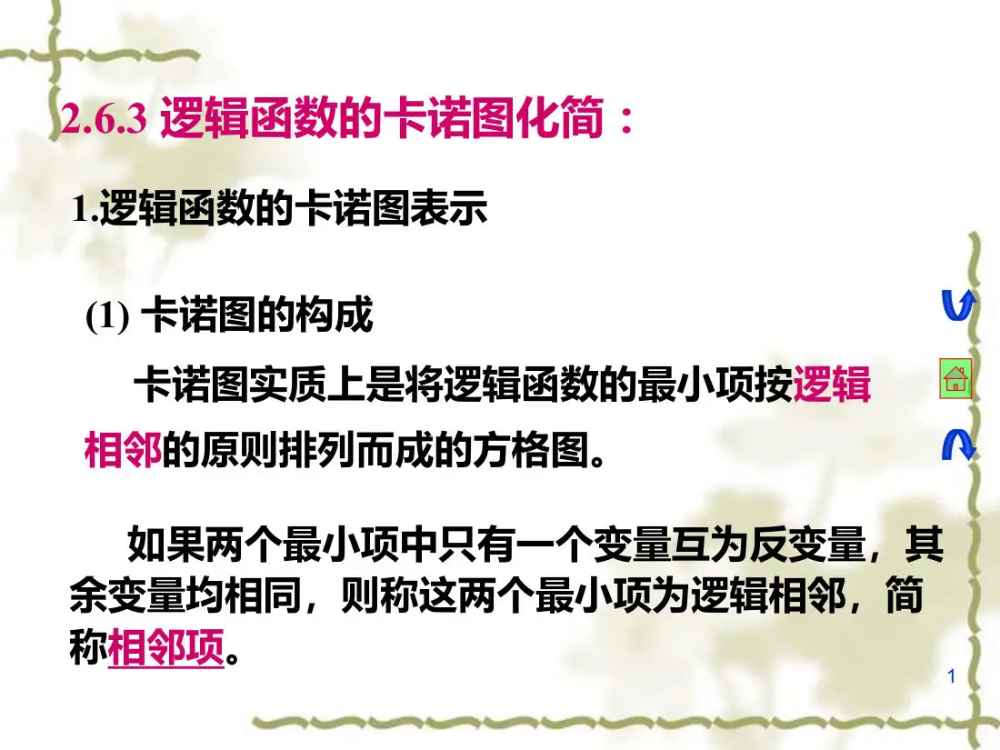

原文：

2.6.3 逻辑函数的卡诺图化简：

1. 逻辑函数的卡诺图表示

(1) 卡诺图的构成

卡诺图实质上是将逻辑函数的最小项按逻辑相邻的原则排列而成的方格图。

如果两个最小项中只有一个变量互为反变量，其余变量均相同，则称这两个最小项为逻辑相邻，简称相邻项。

### 构成方法:

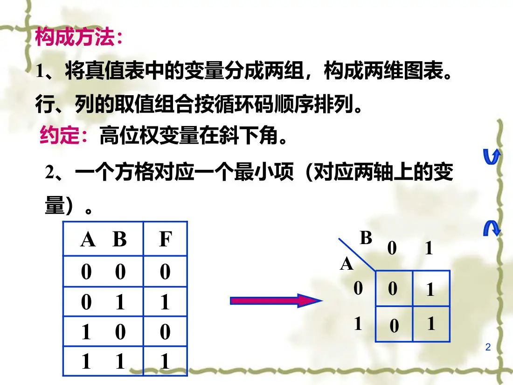

原文：

构成方法:

1、将真值表中的变量分成两组，构成两维图表。行、列的取值组合按循环码顺序排列。

约定：高位权变量在斜下角。

2、一个方格对应一个最小项（对应两轴上的变量）。

$$
\begin{array}{c c c} \hline A & B & F \\ \hline 0 & 0 & 0 \\ \hline 0 & 1 & 1 \\ \hline 1 & 0 & 0 \\ \hline 1 & 1 & 1 \\ \hline \end{array} \quad \xrightarrow {\quad} \quad \begin{array}{c c c} \hline B & 0 & 1 \\ A & 0 & 1 \\ \hline 0 & 0 & 1 \\ \hline 1 & 0 & 1 \\ \hline \end{array}
$$

2

### 三变量的卡诺图：

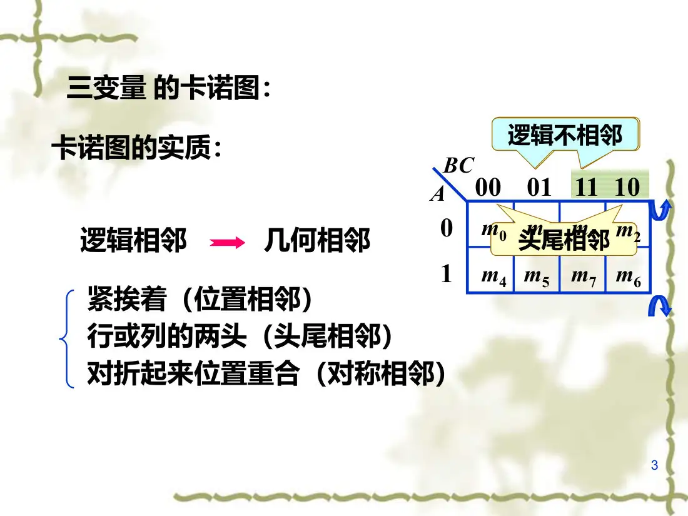

原文：

三变量的卡诺图：

卡诺图的实质：

逻辑相邻 → 几何相邻

紧挨着（位置相邻）

行或列的两头（头尾相邻）

对折起来位置重合（对称相邻）

3

### 四变量的卡诺图：十六个最小项

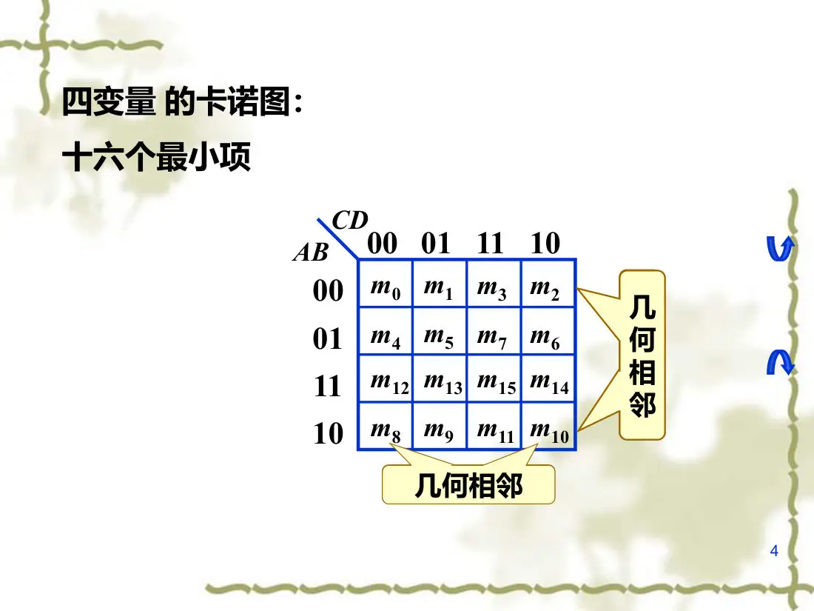

原文：

四变量的卡诺图：十六个最小项

### 例2.6.11 将图2.6.4所示卡诺图用最小项表达式表示。

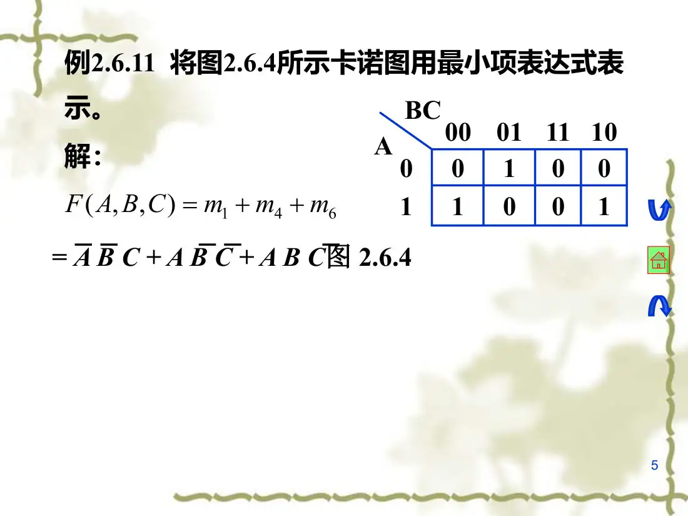

原文：

例2.6.11 将图2.6.4所示卡诺图用最小项表达式表示。

解：

$$
F (A, B, C) = m _ {1} + m _ {4} + m _ {6}
$$

$$
\begin{array}{c c c c c} \text {BC} & 0 0 & 0 1 & 1 1 & 1 0 \\ \text {A} & 0 & 0 & 1 & 0 & 0 \\ 1 & 1 & 0 & 0 & 1 \end{array}
$$

$= \overline{A}\overline{B}C + A\overline{B}\overline{C} + A B C 图 2.6.4$

### (2) 逻辑函数的卡诺图表示法

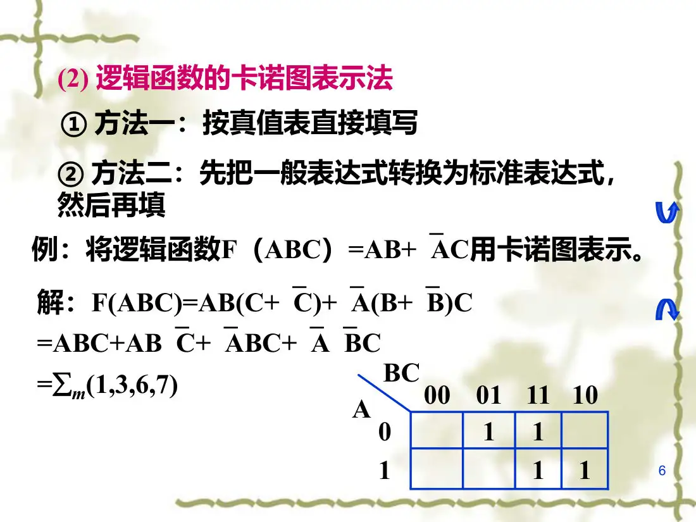

原文：

(2) 逻辑函数的卡诺图表示法

① 方法一：按真值表直接填写

② 方法二：先把一般表达式转换为标准表达式，然后再填

例：将逻辑函数F（ABC）=AB+ $\overline{A}C$ 用卡诺图表示。

解： $\mathrm{F}(\mathrm{ABC}) = \mathrm{AB}(\mathrm{C} + \overline{\mathrm{C}}) + \overline{\mathrm{A}}(\mathrm{B} + \overline{\mathrm{B}})\mathrm{C}$

$$
= \mathbf {A} \mathbf {B} \mathbf {C} + \mathbf {A} \mathbf {B} \overline {{\mathbf {C}}} + \overline {{\mathbf {A}}} \mathbf {B} \mathbf {C} + \overline {{\mathbf {A}}} \overline {{\mathbf {B}}} \mathbf {C}
$$

$$
= \sum_ {m} (1, 3, 6, 7)
$$

<table><tr><td rowspan="3">A\BC</td><td>00</td><td>01</td><td>11</td><td>10</td></tr><tr><td>0</td><td></td><td>1</td><td>1</td></tr><tr><td>1</td><td></td><td></td><td>1</td></tr></table>

### ③ 方法三：观察法

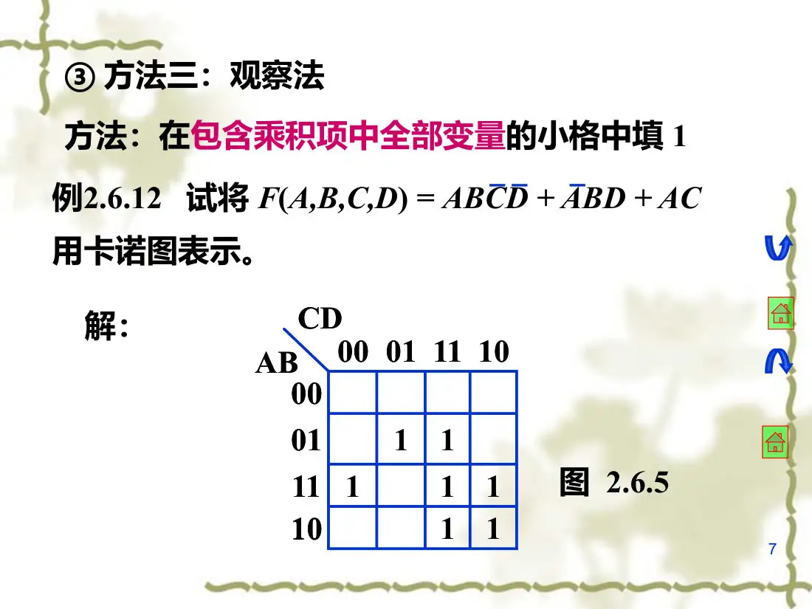

原文：

③ 方法三：观察法

方法：在包含乘积项中全部变量的小格中填 1

例2.6.12 试将 $F(A, B, C, D) = A B \overline{C} \overline{D} + \overline{A} B D + A C$ 用卡诺图表示。

解：

### 解：

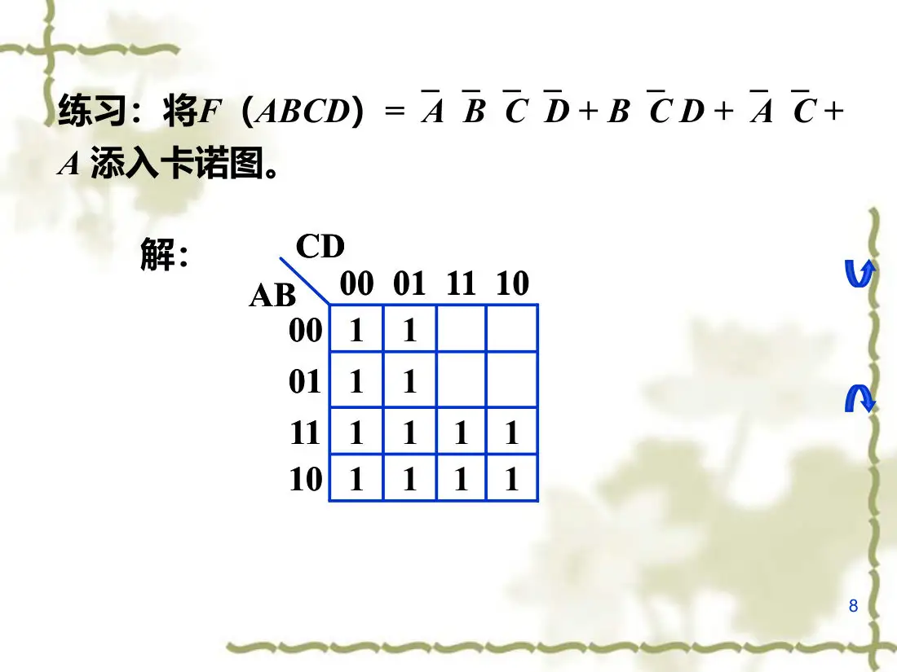

原文：

练习: 将 $F(ABCD) = \overline{A} \overline{B} \overline{C} \overline{D} + B \overline{C} D + \overline{A} \overline{C} + A$ 添入卡诺图。

解：

<table><tr><td>AB\CD</td><td>00</td><td>01</td><td>11</td><td>10</td></tr><tr><td>00</td><td>1</td><td>1</td><td></td><td></td></tr><tr><td>01</td><td>1</td><td>1</td><td></td><td></td></tr><tr><td>11</td><td>1</td><td>1</td><td>1</td><td>1</td></tr><tr><td>10</td><td>1</td><td>1</td><td>1</td><td>1</td></tr></table>

### 2. 卡诺图化简法

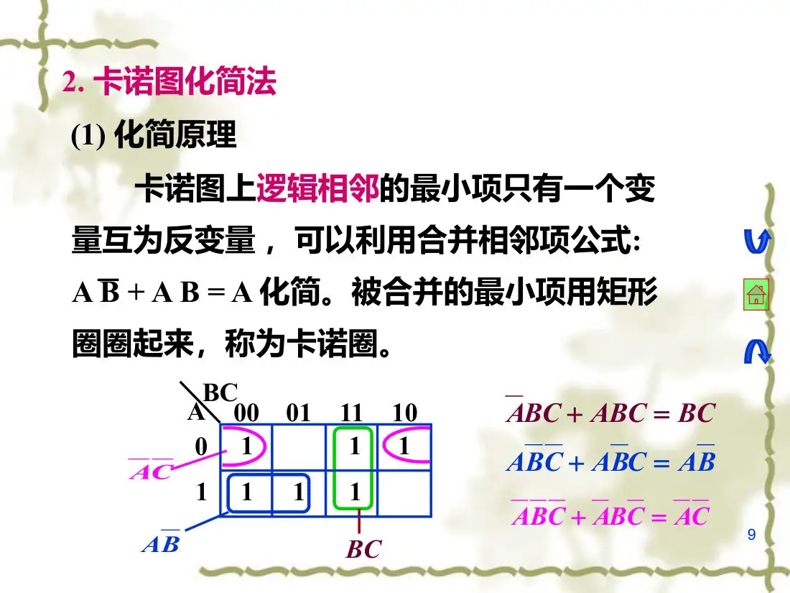

原文：

2. 卡诺图化简法

(1) 化简原理

卡诺图上逻辑相邻的最小项只有一个变量互为反变量，可以利用合并相邻项公式： $A \overline{B} + A B = A$ 化简。被合并的最小项用矩形圈圈起来，称为卡诺圈。

$$
\overline {{A B C}} + A B C = B C
$$

$$
\overline {{A B C}} + \overline {{A B C}} = \overline {{A B}}
$$

$$
\overline {{A}} \overline {{B}} \overline {{C}} + \overline {{A}} B \overline {{C}} = \overline {{A}} C
$$

### 10

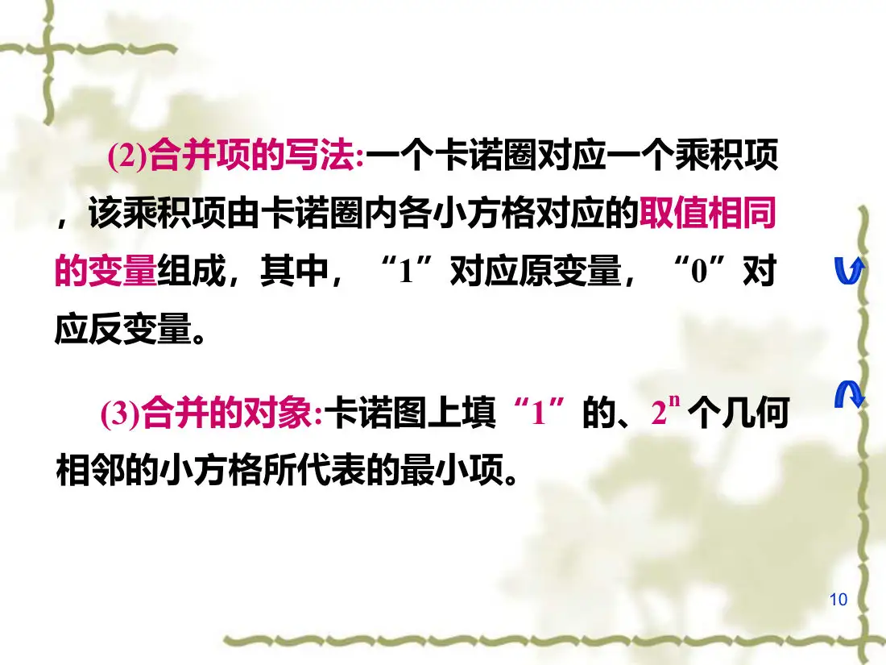

原文：

(2)合并项的写法:一个卡诺圈对应一个乘积项，该乘积项由卡诺圈内各小方格对应的取值相同的变量组成，其中，“1”对应原变量，“0”对应反变量。

(3)合并的对象:卡诺图上填 “1” 的、 $2^{n}$ 个几何相邻的小方格所代表的最小项。

10

### (4) 合并的规律

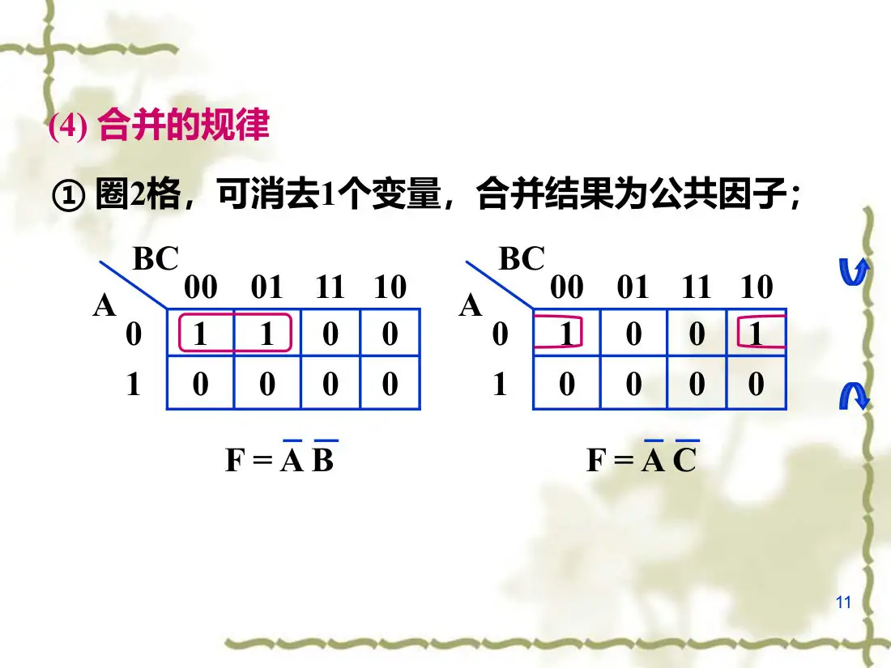

原文：

(4) 合并的规律

①圈2格，可消去1个变量，合并结果为公共因子；

$$
\begin{array}{c c c c c} \text {BC} & 0 0 & 0 1 & 1 1 & 1 0 \\ \text {A} & 0 & 1 & 1 & 0 \\ 1 & 0 & 0 & 0 & 0 \end{array}
$$

$\mathbf{F} = \overline{\mathbf{A}}\overline{\mathbf{B}}$

$$
\begin{array}{c c c c c} \text {BC} & 0 0 & 0 1 & 1 1 & 1 0 \\ \text {A} & 0 & 1 & 0 & 0 \\ 1 & 0 & 0 & 0 & 0 \end{array}
$$

$\mathbf{F} = \overline{\mathbf{A}}\overline{\mathbf{C}}$

11

### ②圈4格，可消去2个变量，合并结果为公共因子；

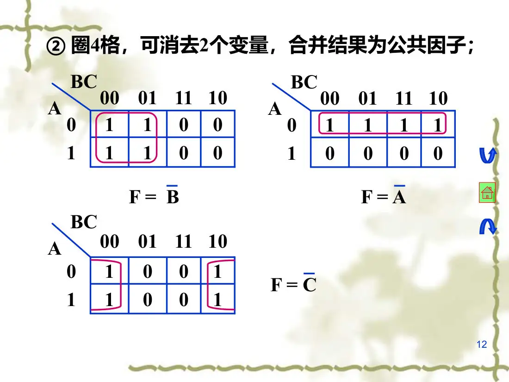

原文：

②圈4格，可消去2个变量，合并结果为公共因子；

$$
\begin{array}{c c c c c} \text {BC} & 0 0 & 0 1 & 1 1 & 1 0 \\ \text {A} & 0 & 1 & 1 & 0 \\ 1 & 1 & 1 & 0 & 0 \end{array}
$$

$$
\begin{array}{c c c c c} \text {BC} & 0 0 & 0 1 & 1 1 & 1 0 \\ \text {A} & 0 & 1 & 1 & 1 \\ 1 & 0 & 0 & 0 & 0 \end{array}
$$

$\mathbf{F} = \overline{\mathbf{B}}$

$\mathbf{F} = \overline{\mathbf{A}}$

$$
\begin{array}{c c c c c} \text {BC} & 0 0 & 0 1 & 1 1 & 1 0 \\ \text {A} & 0 & 1 & 0 & 0 & 1 \\ 1 & 1 & 0 & 0 & 1 \end{array} \quad \mathbf {F} = \overline {{\mathbf {C}}}
$$

12

### $$

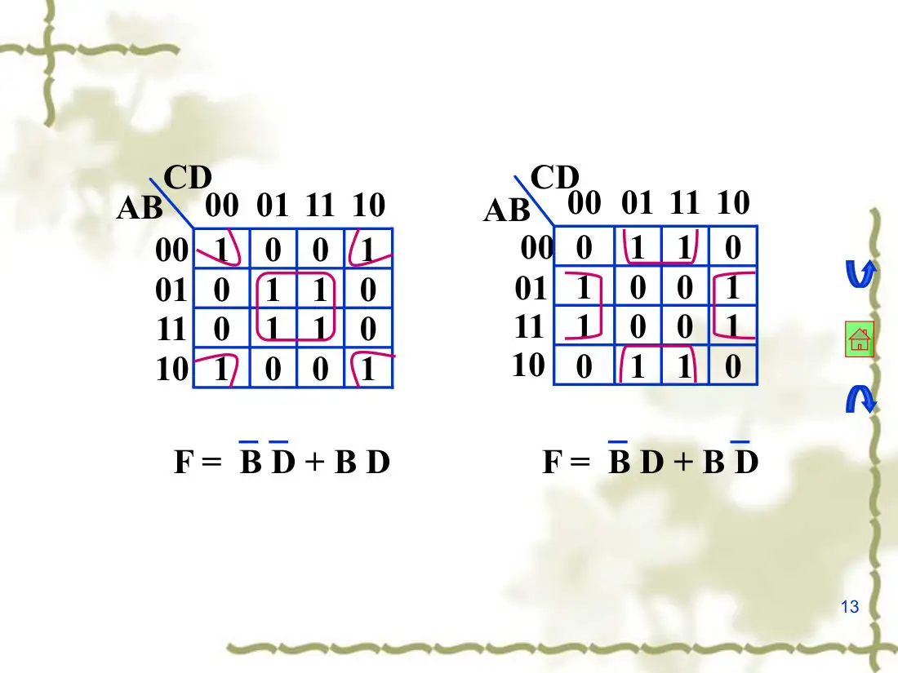

原文：

$$
\begin{array}{c c c c c} \text {CD} & 0 0 & 0 1 & 1 1 & 1 0 \\ \text {AB} & \hline 0 0 & 1 & 0 & 0 \\ 0 1 & 0 & 1 & 1 & 0 \\ 1 1 & 0 & 1 & 1 & 0 \\ 1 0 & 1 & 0 & 0 & 1 \end{array}
$$

$\mathbf{F} = \overline{\mathbf{B}}\overline{\mathbf{D}} +\mathbf{B}\mathbf{D}$

$$
\begin{array}{c c c c c} \text {CD} & 0 0 & 0 1 & 1 1 & 1 0 \\ \text {AB} & 0 0 & 1 & 1 & 0 \\ \hline 0 0 & 0 & 1 & 1 & 0 \\ 0 1 & 1 & 0 & 0 & 1 \\ 1 1 & 1 & 0 & 0 & 1 \\ 1 0 & 0 & 1 & 1 & 0 \end{array}
$$

$\mathbf{F} = \overline{\mathbf{B}}\mathbf{D} + \mathbf{B}\overline{\mathbf{D}}$

13

### ③圈8格，可消去3个变量，合并结果为公共因子；

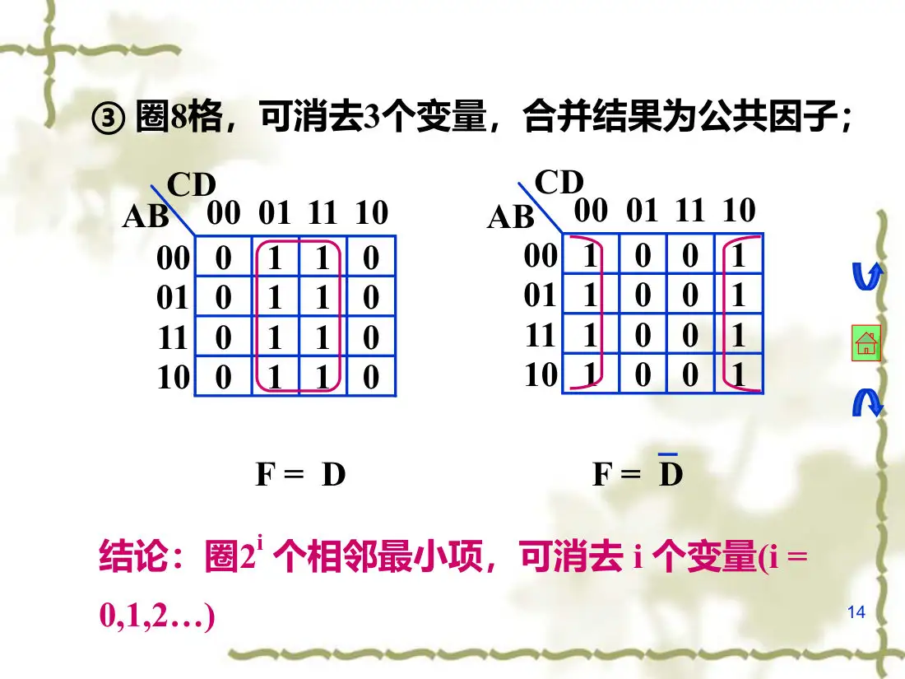

原文：

③圈8格，可消去3个变量，合并结果为公共因子；

$$
\begin{array}{c c c c c} \text {CD} & 0 0 & 0 1 & 1 1 & 1 0 \\ \text {AB} & \hline 0 0 & 0 & 1 & 1 \\ 0 1 & 0 & 1 & 1 & 0 \\ 1 1 & 0 & 1 & 1 & 0 \\ 1 0 & 0 & 1 & 1 & 0 \end{array}
$$

$$
\begin{array}{c c c c c} \text {CD} & 0 0 & 0 1 & 1 1 & 1 0 \\ \text {AB} & 0 0 & 1 & 0 & 0 & 1 \\ \hline 0 0 & 1 & 0 & 0 & 1 \\ 0 1 & 1 & 0 & 0 & 1 \\ 1 1 & 1 & 0 & 0 & 1 \\ 1 0 & 1 & 0 & 0 & 1 \end{array}
$$

$\mathbf{F} = \mathbf{D}$

$\mathbf{F} = \overline{\mathbf{D}}$

结论: 圈 $2^{i}$ 个相邻最小项, 可消去 $i$ 个变量 $(i = 0,1,2\dots)$

14

### (5)卡诺图化简的步骤

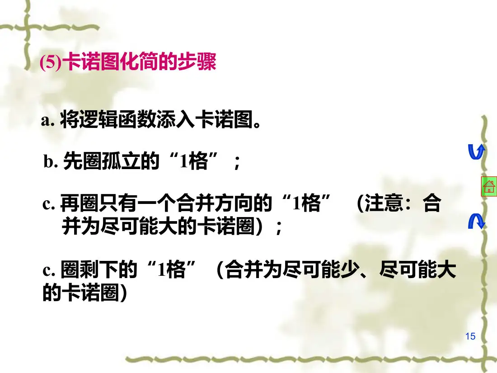

原文：

(5)卡诺图化简的步骤

a. 将逻辑函数添入卡诺图。

b. 先圈孤立的 “1格”；

c. 再圈只有一个合并方向的 “1格” （注意：合并为尽可能大的卡诺圈）；

c. 圈剩下的 “1格” （合并为尽可能少、尽可能大的卡诺圈）

15

### (6) 化简举例

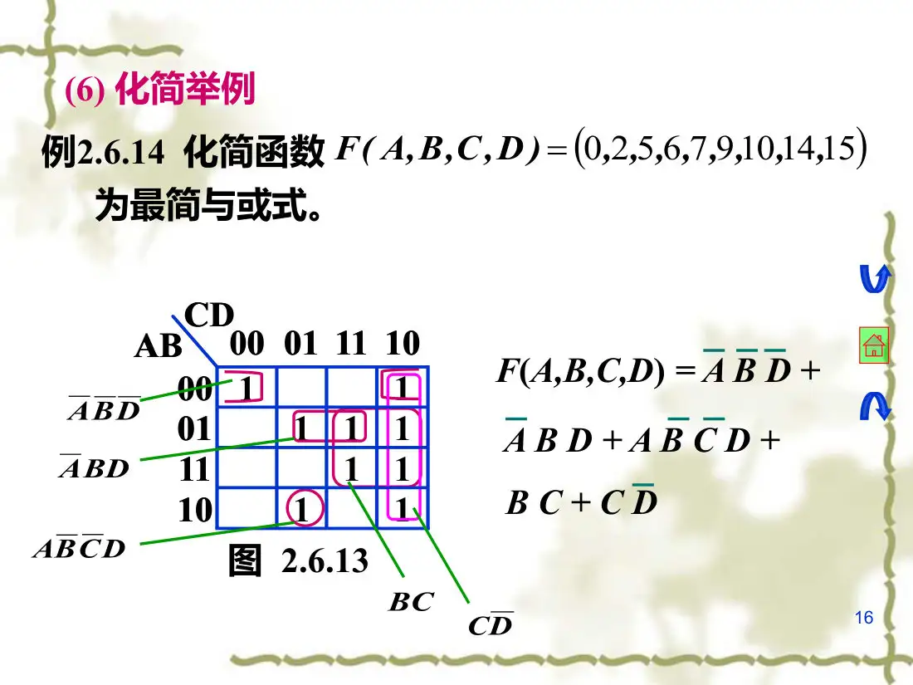

原文：

(6) 化简举例

例2.6.14 化简函数 $F(A,B,C,D)=(0,2,5,6,7,9,10,14,15)$ 为最简与或式。

16

### 注意:

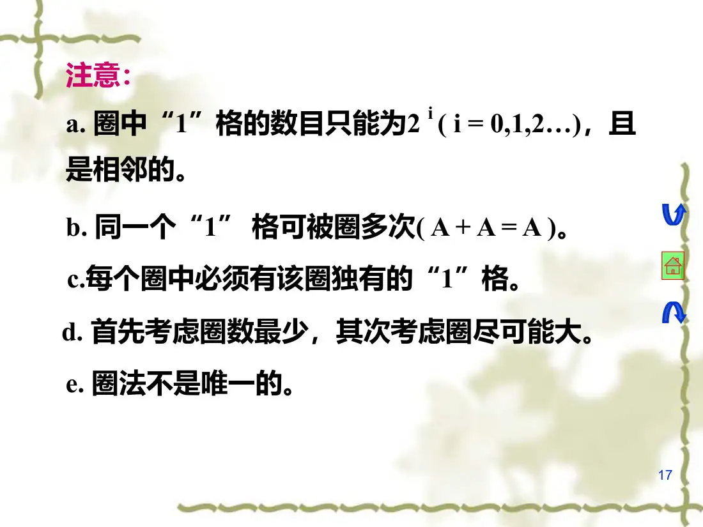

原文：

注意:

a. 圈中 “1” 格的数目只能为 $2^{i} (i = 0, 1, 2 \ldots)$ ，且是相邻的。
b. 同一个 “1” 格可被圈多次 ( $A + A = A$ )。
c. 每个圈中必须有该圈独有的 “1” 格。
d. 首先考虑圈数最少，其次考虑圈尽可能大。
e. 圈法不是唯一的。

17

### $F=AB+\bar{A}C+BC=AB+\bar{A}C$ BC项是多余的。

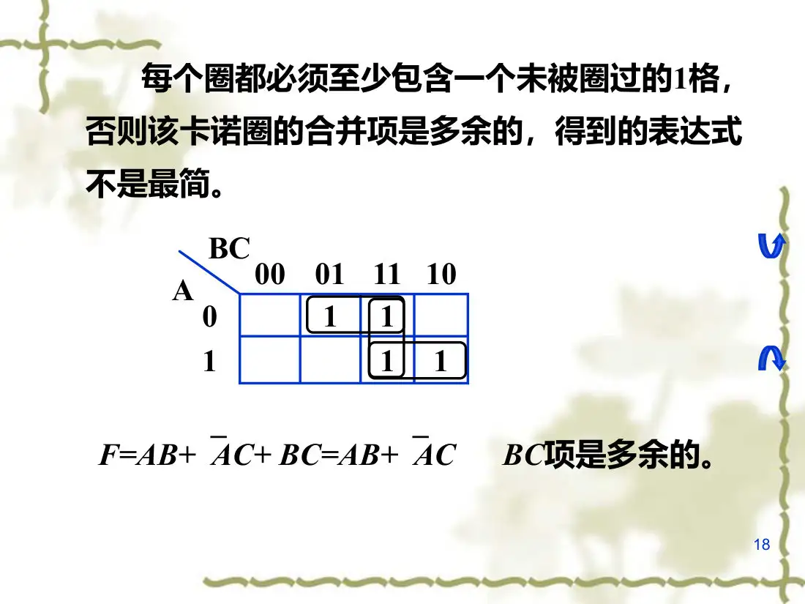

原文：

每个圈都必须至少包含一个未被圈过的1格，否则该卡诺圈的合并项是多余的，得到的表达式不是最简。

$F=AB+\bar{A}C+BC=AB+\bar{A}C$ BC项是多余的。

18

### 例2.6.16 化简函数

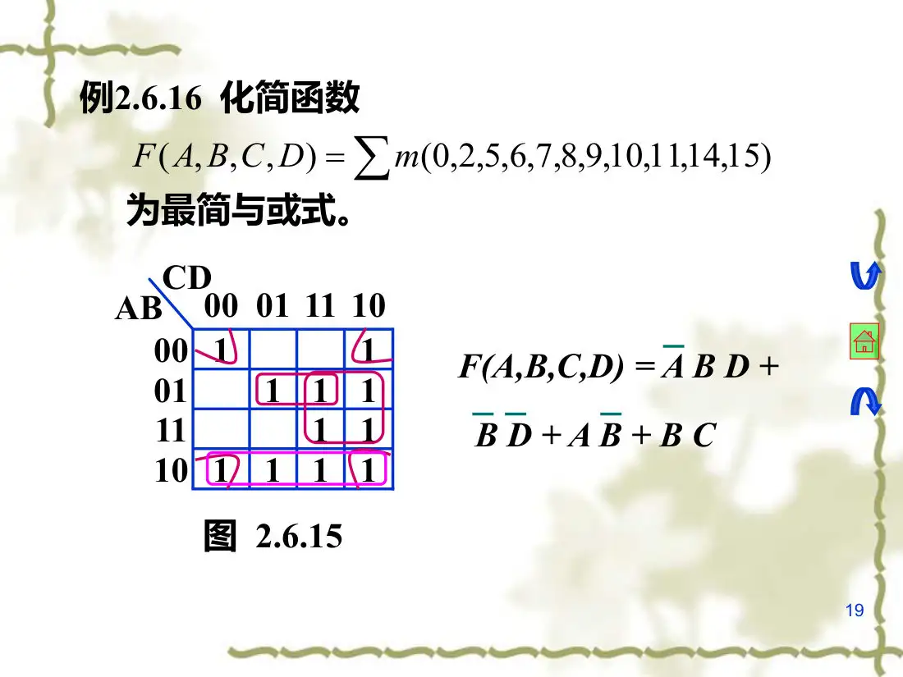

原文：

例2.6.16 化简函数

$F(A,B,C,D) = \sum m(0,2,5,6,7,8,9,10,11,14,15)$ 为最简与或式。

$$
\begin{array}{r l} & F (A, B, C, D) = \overline {{A}} B D + \\ & \overline {{B}} \overline {{D}} + A \overline {{B}} + B C \end{array}
$$

19

### 20

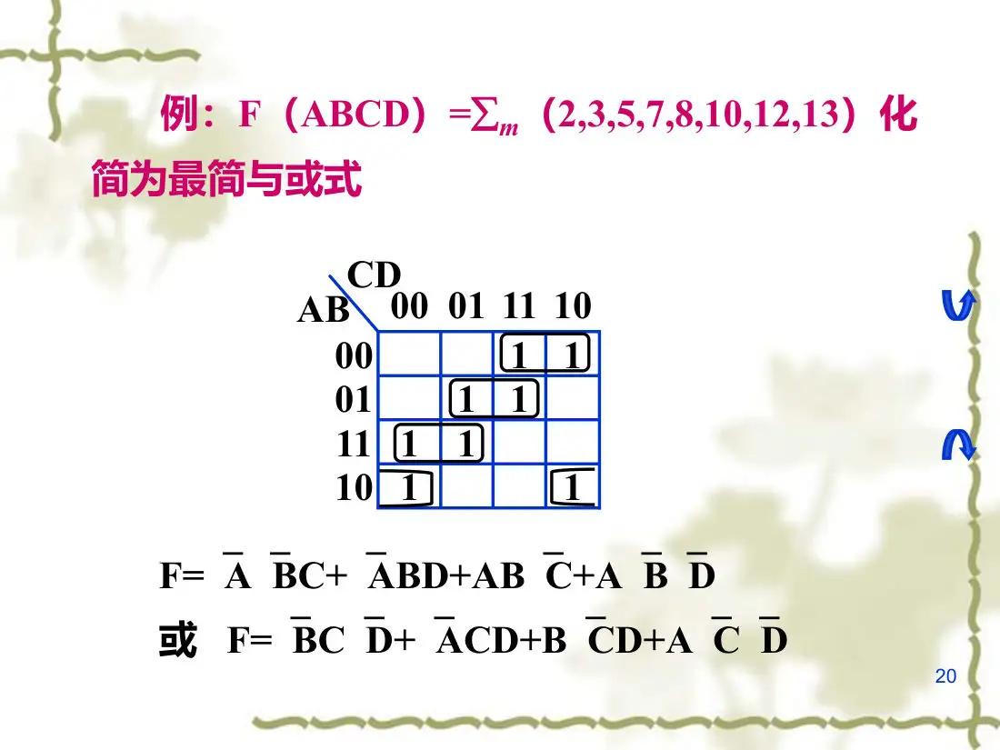

原文：

例: F (ABCD) = $\sum_{m}$ (2,3,5,7,8,10,12,13) 化简为最简与或式

$\mathbf{F} = \overline{\mathbf{A}}\overline{\mathbf{B}}\mathbf{C} + \overline{\mathbf{A}}\mathbf{B}\mathbf{D} + \mathbf{A}\mathbf{B}\overline{\mathbf{C}} + \mathbf{A}\overline{\mathbf{B}}\overline{\mathbf{D}}$ 或 $\mathbf{F} = \overline{\mathbf{B}}\mathbf{C}\overline{\mathbf{D}} + \overline{\mathbf{A}}\mathbf{C}\mathbf{D} + \mathbf{B}\overline{\mathbf{C}}\mathbf{D} + \mathbf{A}\overline{\mathbf{C}}\overline{\mathbf{D}}$ 练习1：用卡诺图将函数化为最简与或式。

20

### $$

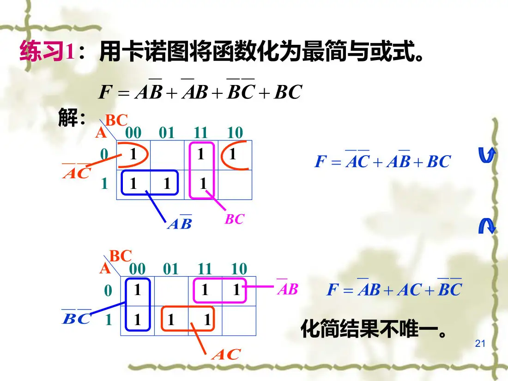

原文：

$$
\boldsymbol {F} = \boldsymbol {A} \overline {{\boldsymbol {B}}} + \overline {{\boldsymbol {A}}} \boldsymbol {B} + \overline {{\boldsymbol {B}}} \overline {{\boldsymbol {C}}} + \boldsymbol {B} \boldsymbol {C}
$$

解：

$$
\boldsymbol {F} = \overline {{\boldsymbol {A}}} \overline {{\boldsymbol {C}}} + \boldsymbol {A} \overline {{\boldsymbol {B}}} + \boldsymbol {B} \boldsymbol {C}
$$

$$
\boldsymbol {F} = \overline {{\boldsymbol {A}}} \boldsymbol {B} + \boldsymbol {A} \boldsymbol {C} + \overline {{\boldsymbol {B}}} \overline {{\boldsymbol {C}}}
$$

化简结果不唯一。

21

### $$

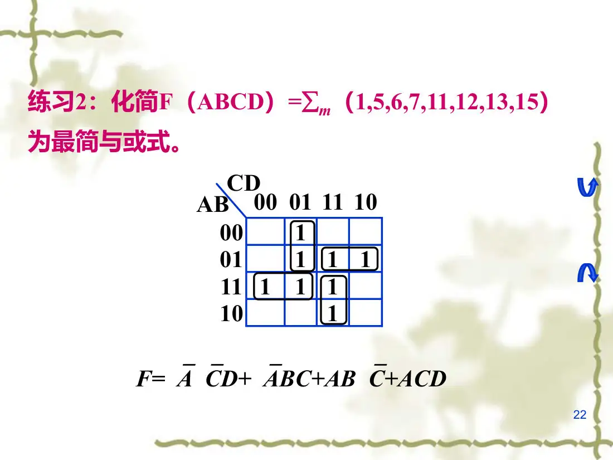

原文：

练习2: 化简F (ABCD) = $\sum_{m}$ (1,5,6,7,11,12,13,15) 为最简与或式。

$$
F = \overline {{A}} \overline {{C}} D + \overline {{A}} B C + A B \overline {{C}} + A C D
$$

22

### $$

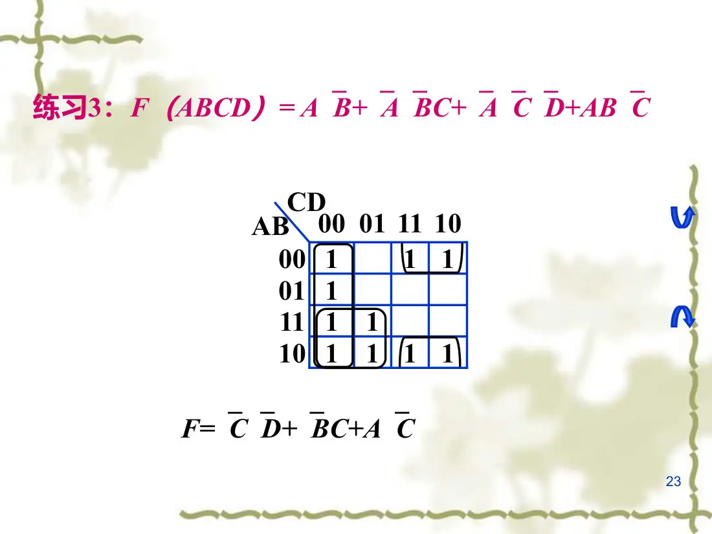

原文：

练习3: $F(ABCD) = A\overline{B} + \overline{A}\overline{BC} + \overline{A}\overline{C}\overline{D} + AB\overline{C}$

$$
F = \overline {{C}} \overline {{D}} + \overline {{B}} C + A \overline {{C}}
$$

23

### 解: CD

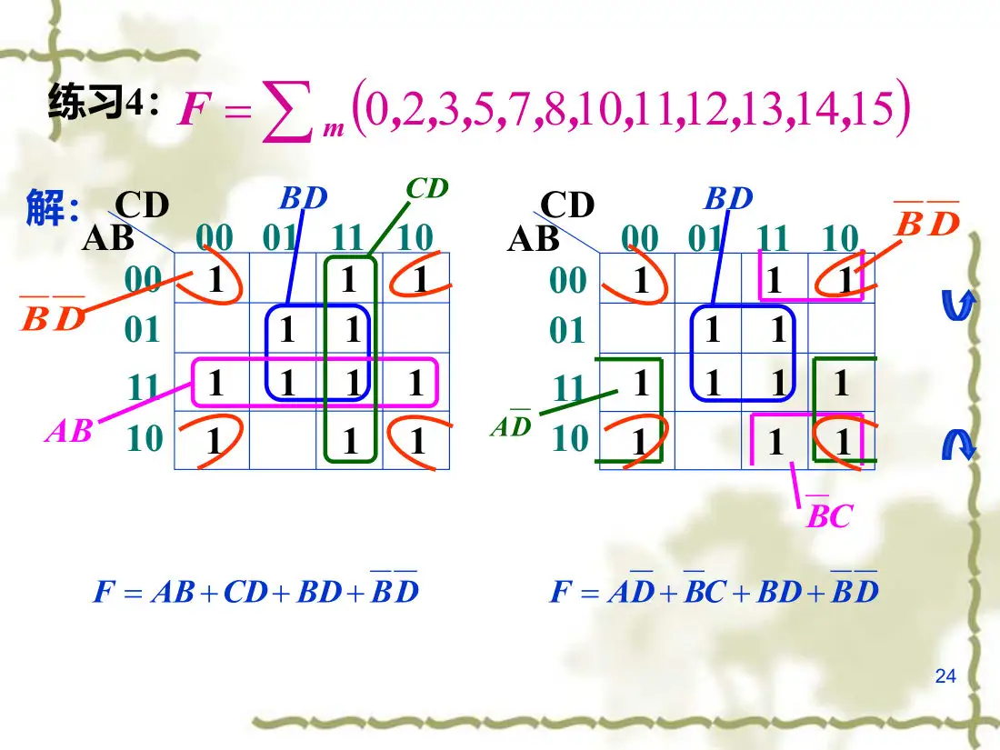

原文：

练习4: $F = \sum_{m} (0, 2, 3, 5, 7, 8, 10, 11, 12, 13, 14, 15)$

解: CD
AB 00 01 11 10
00 1 1 1
01 1 1
11 1 1 1
AB 10 1 1 1

CD
AB 00 01 11 10
00 1 1 1
01 1 1 1
11 1 1 1
AD 10 1 1 1
BC

$$
\boldsymbol {F} = \boldsymbol {A} \boldsymbol {B} + \boldsymbol {C} \boldsymbol {D} + \boldsymbol {B} \boldsymbol {D} + \overline {{\boldsymbol {B}}} \overline {{\boldsymbol {D}}}
$$

$$
\boldsymbol {F} = \boldsymbol {A} \overline {{\boldsymbol {D}}} + \overline {{\boldsymbol {B}}} \boldsymbol {C} + \boldsymbol {B} \boldsymbol {D} + \overline {{\boldsymbol {B}}} \overline {{\boldsymbol {D}}}
$$

24

### 四、非完全描述逻辑函数的化简

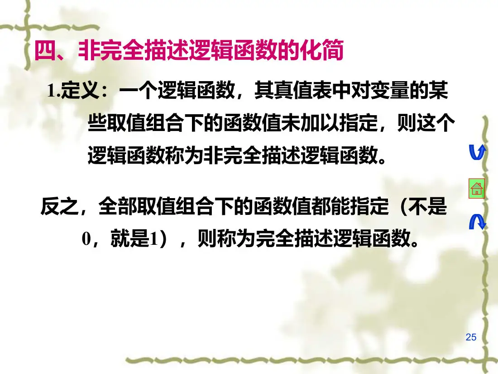

原文：

四、非完全描述逻辑函数的化简

1. 定义：一个逻辑函数，其真值表中对变量的某些取值组合下的函数值未加以指定，则这个逻辑函数称为非完全描述逻辑函数。

反之，全部取值组合下的函数值都能指定（不是0，就是1），则称为完全描述逻辑函数。

25

### 非完全描述有两种情况：无关项

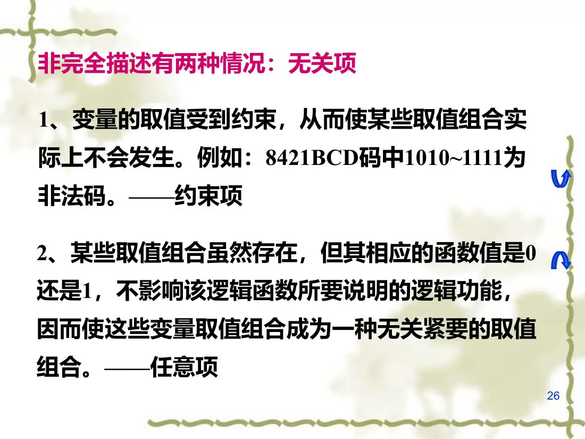

原文：

非完全描述有两种情况：无关项

1、变量的取值受到约束，从而使某些取值组合实际上不会发生。例如：8421BCD码中1010\~1111为非法码。——约束项

2、某些取值组合虽然存在，但其相应的函数值是0还是1，不影响该逻辑函数所要说明的逻辑功能，因而使这些变量取值组合成为一种无关紧要的取值组合。——任意项

26

### 表示方法:

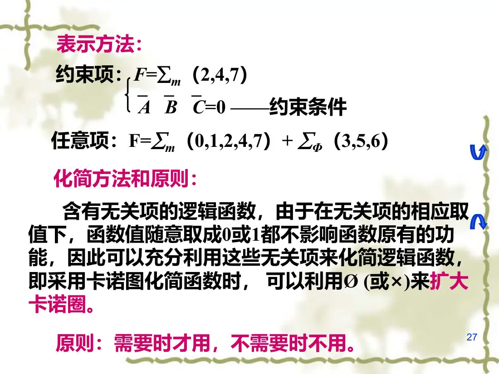

原文：

表示方法:

约束项： $\left\{\begin{array}{ll}F=\sum_{m}(2,4,7)\\\overline{A}\quad\overline{B}\quad\overline{C}=0\end{array}\right.$ ——约束条件

任意项： $F=\sum_{m}(0,1,2,4,7)+\sum_{\Phi}(3,5,6)$

化简方法和原则：

含有无关项的逻辑函数，由于在无关项的相应取值下，函数值随意取成0或1都不影响函数原有的功能，因此可以充分利用这些无关项来化简逻辑函数，即采用卡诺图化简函数时，可以利用∅(或×)来扩大卡诺圈。

原则：需要时才用，不需要时不用。

27

### $$

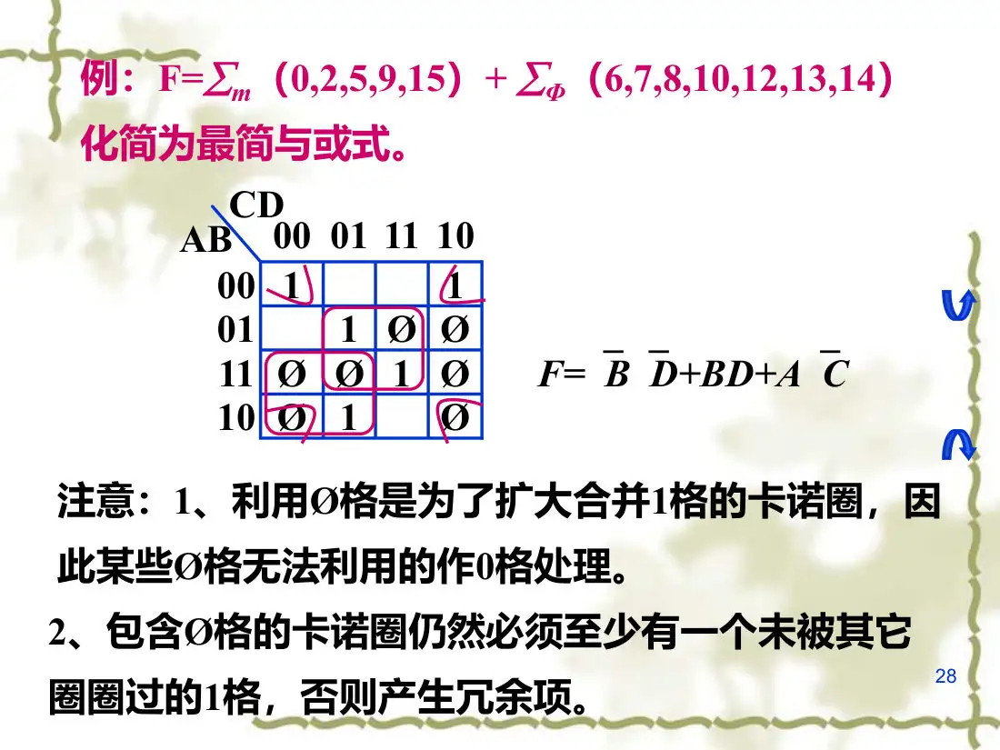

原文：

例： $F=\sum_{m}(0,2,5,9,15)+\sum_{\Phi}(6,7,8,10,12,13,14)$ 化简为最简与或式。

$$
\begin{array}{c c c c c} \text {CD} & 0 0 & 0 1 & 1 1 & 1 0 \\ \text {AB} & 0 0 & 1 & & 1 \\ 0 0 & 1 & & & 1 \\ 0 1 & & 1 & \emptyset & \emptyset \\ 1 1 & \emptyset & \emptyset & 1 & \emptyset \\ 1 0 & \emptyset & 1 & & \emptyset \end{array} \quad F = \overline {{B}} \overline {{D}} + B D + A \overline {{C}}
$$

注意：1、利用∅格是为了扩大合并1格的卡诺圈，因此某些∅格无法利用的作0格处理。

2、包含∅格的卡诺圈仍然必须至少有一个未被其它圈圈过的1格，否则产生冗余项。

28

### 例2.6.22 用卡诺图化简逻辑函数

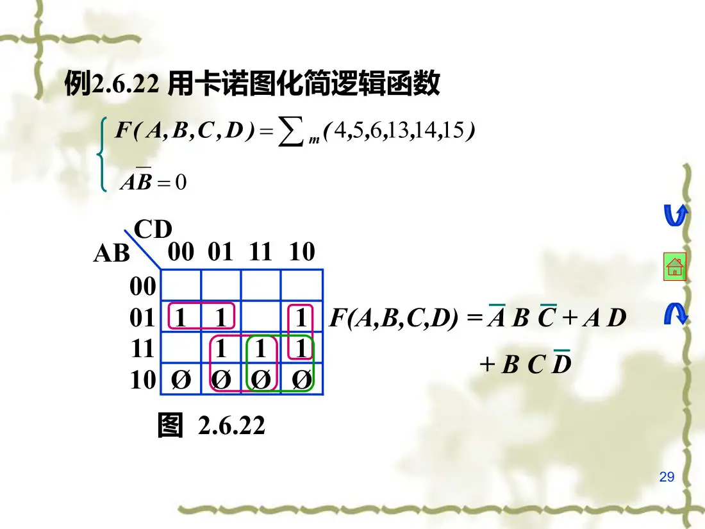

原文：

例2.6.22 用卡诺图化简逻辑函数

$$
\left\{ \begin{array}{l} F (A, B, C, D) = \sum_ {m} (4, 5, 6, 1 3, 1 4, 1 5) \\ A \overline {{B}} = 0 \end{array} \right.
$$

$$
\begin{array}{c c c c c} \text {CD} & 0 0 & 0 1 & 1 1 & 1 0 \\ \text {AB} & 0 0 & & & \\ 0 0 & & & & \\ 0 1 & 1 & 1 & & 1 \\ 1 1 & & 1 & 1 & 1 \\ 1 0 & \emptyset & \emptyset & \emptyset & \emptyset \end{array} F (A, B, C, D) = \overline {{A}}   B   \overline {{C}} + A   D + B   C   \overline {{D}}
$$

图 2.6.22

29

### $$

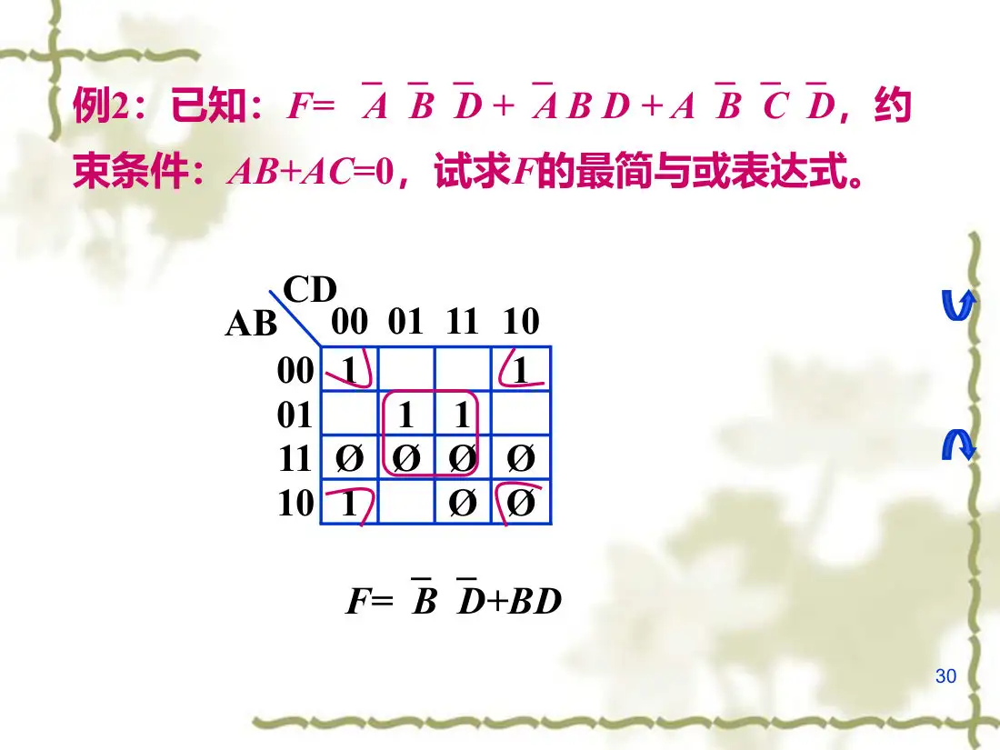

原文：

例2: 已知: $F = \overline{A} \overline{B} \overline{D} + \overline{A} B D + A \overline{B} \overline{C} \overline{D}$ , 约束条件: $AB + AC = 0$ , 试求 $F$ 的最简与或表达式。

$$
F = \overline {{B}} \overline {{D}} + B D
$$

30

### 2. 卡诺图的运算

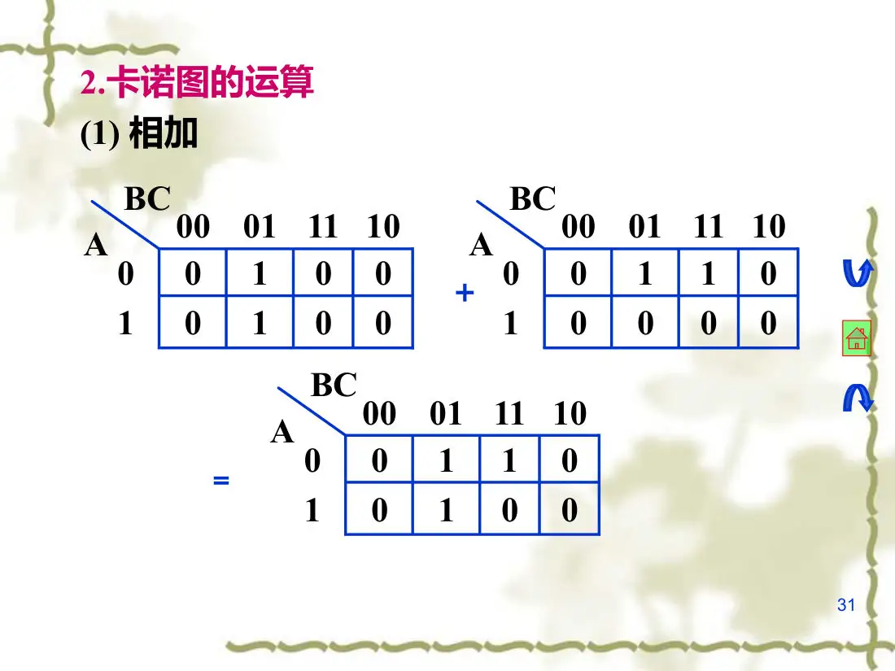

原文：

2. 卡诺图的运算

(1) 相加

$$
\begin{array}{c c} \text {BC} & \\ \text {A} & 0 0 \quad 0 1 \quad 1 1 \quad 1 0 \\ 0 & 0 \quad 1 \quad 0 \quad 0 \\ 1 & 0 \quad 1 \quad 0 \quad 0 \end{array} + \begin{array}{c c} \text {BC} & \\ \text {A} & 0 0 \quad 0 1 \quad 1 1 \quad 1 0 \\ 0 & 0 \quad 1 \quad 1 \quad 0 \\ 1 & 0 \quad 0 \quad 0 \quad 0 \end{array}
$$

$$
= \begin{array}{c c c c c} & \text {BC} \\ \text {A} & 0 0 & 0 1 & 1 1 & 1 0 \\ \hline 0 & 0 & 1 & 1 & 0 \\ \hline 1 & 0 & 1 & 0 & 0 \end{array}
$$

31

### (2) 相乘

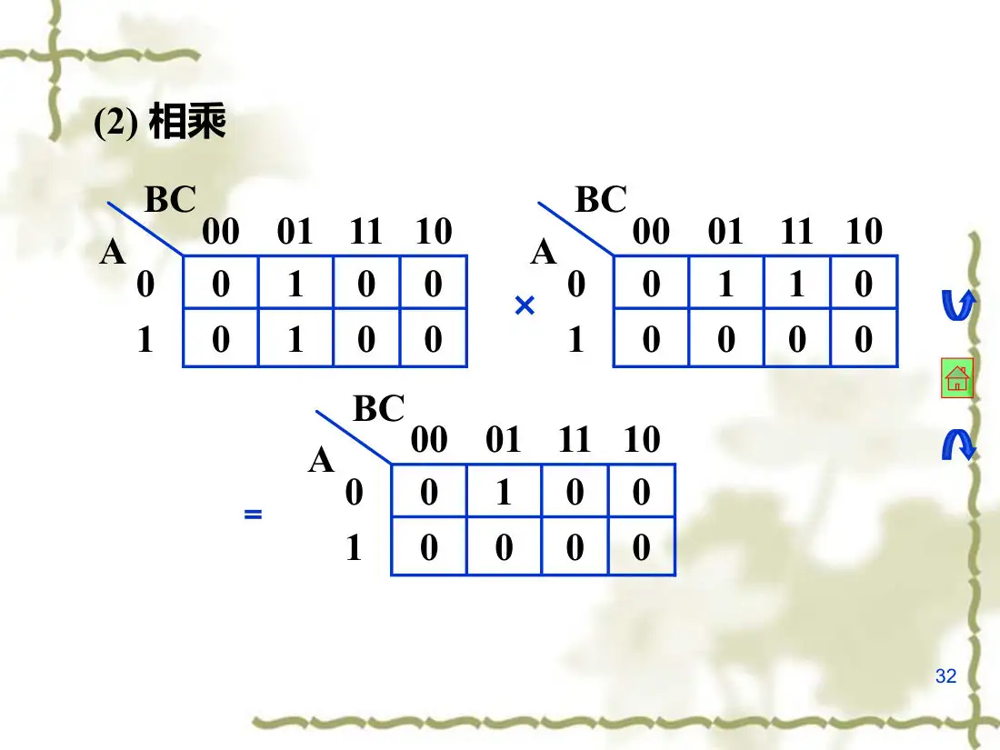

原文：

(2) 相乘

$$
\begin{array}{c c} \text {BC} & \\ \text {A} & 0 0 \quad 0 1 \quad 1 1 \quad 1 0 \\ 0 & 0 \quad 1 \quad 0 \quad 0 \\ 1 & 0 \quad 1 \quad 0 \quad 0 \end{array} \quad \begin{array}{c c} \text {BC} & \\ \text {A} & 0 0 \quad 0 1 \quad 1 1 \quad 1 0 \\ \times & 0 \quad 1 \quad 1 \quad 0 \\ 1 & 0 \quad 0 \quad 0 \quad 0 \end{array}
$$

$$
= \begin{array}{c c c c c} & \text {BC} \\ \text {A} & 0 0 & 0 1 & 1 1 & 1 0 \\ \hline 0 & 0 & 1 & 0 & 0 \\ \hline 1 & 0 & 0 & 0 & 0 \end{array}
$$

32

### (3) 异或

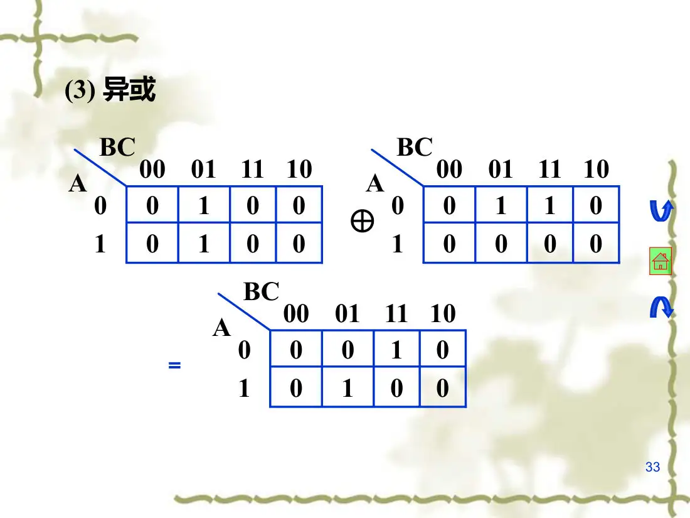

原文：

(3) 异或

$$
\begin{array}{c c} \text {BC} & \\ \text {A} & 0 0 \quad 0 1 \quad 1 1 \quad 1 0 \\ 0 & 0 \quad 1 \quad 0 \quad 0 \\ 1 & 0 \quad 1 \quad 0 \quad 0 \end{array} \oplus \begin{array}{c c} \text {BC} & \\ \text {A} & 0 0 \quad 0 1 \quad 1 1 \quad 1 0 \\ 0 & 0 \quad 1 \quad 1 \quad 0 \\ 1 & 0 \quad 0 \quad 0 \quad 0 \end{array}
$$

$$
= \begin{array}{c c c c c} & \text {BC} \\ \text {A} & 0 0 & 0 1 & 1 1 & 1 0 \\ \hline 0 & 0 & 0 & 1 & 0 \\ \hline 1 & 0 & 1 & 0 & 0 \end{array}
$$

33

### (4) 反演

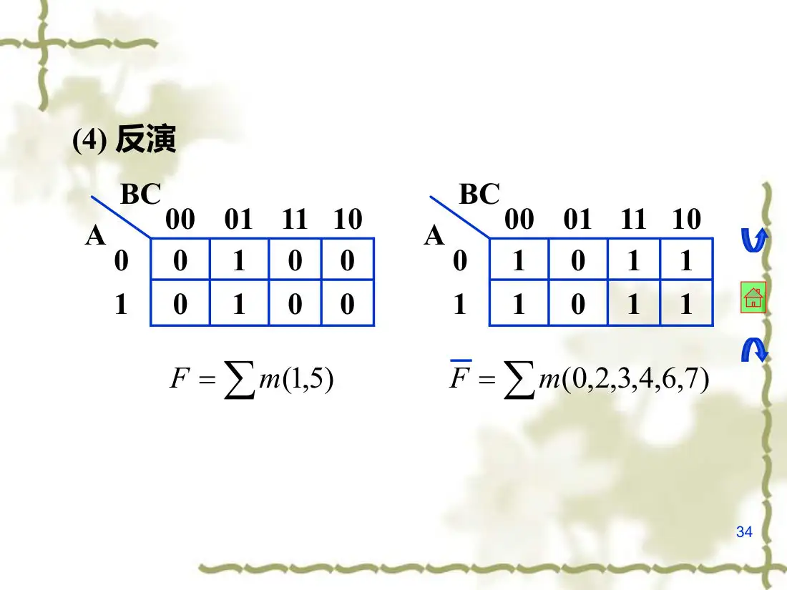

原文：

(4) 反演

$$
\begin{array}{c c c c c} \text {BC} & 0 0 & 0 1 & 1 1 & 1 0 \\ \text {A} & 0 & 0 & 1 & 0 & 0 \\ 1 & 0 & 1 & 0 & 0 \end{array}
$$

$$F = \sum m(1,5)$$

$$
\begin{array}{c c c c c} \text {BC} & 0 0 & 0 1 & 1 1 & 1 0 \\ \text {A} & 0 & 1 & 0 & 1 & 1 \\ & 1 & 1 & 0 & 1 & 1 \end{array}
$$

$$
\overline {{F}} = \sum m (0, 2, 3, 4, 6, 7)
$$

34

### 例：已知 $F_{1}(A,B,C,D)=A\overline{B}+C\ D$

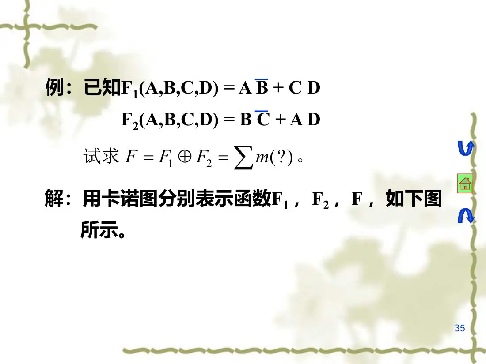

原文：

例：已知 $F_{1}(A,B,C,D)=A\overline{B}+C\ D$

$$
\mathbf {F} _ {2} (\mathbf {A}, \mathbf {B}, \mathbf {C}, \mathbf {D}) = \mathbf {B} \overline {{\mathbf {C}}} + \mathbf {A} \mathbf {D}
$$

试求 $F = F_{1} \oplus F_{2} = \sum m(1)$ 。

解: 用卡诺图分别表示函数 $F_{1}$ , $F_{2}$ , $F$ , 如下图所示。

35

### $$

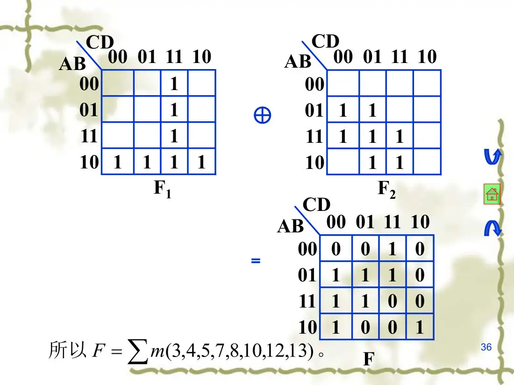

原文：

$$
F = \sum m (3, 4, 5, 7, 8, 1 0, 1 2, 1 3)
$$

### $$

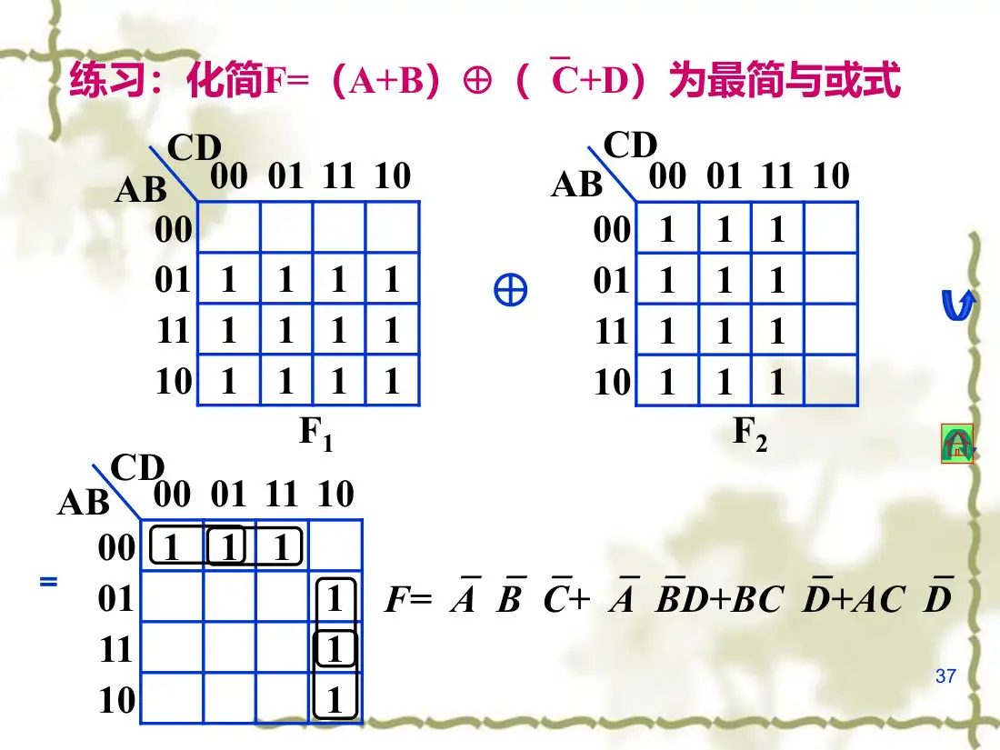

原文：

练习: 化简 $F = (A + B) \oplus (\overline{C} + D)$ 为最简与或式

$$
F = \overline {{A}} \overline {{B}} \overline {{C}} + \overline {{A}} \overline {{B}} D + B C \overline {{D}} + A C \overline {{D}}
$$

37

### 3. 无关项的运算规则

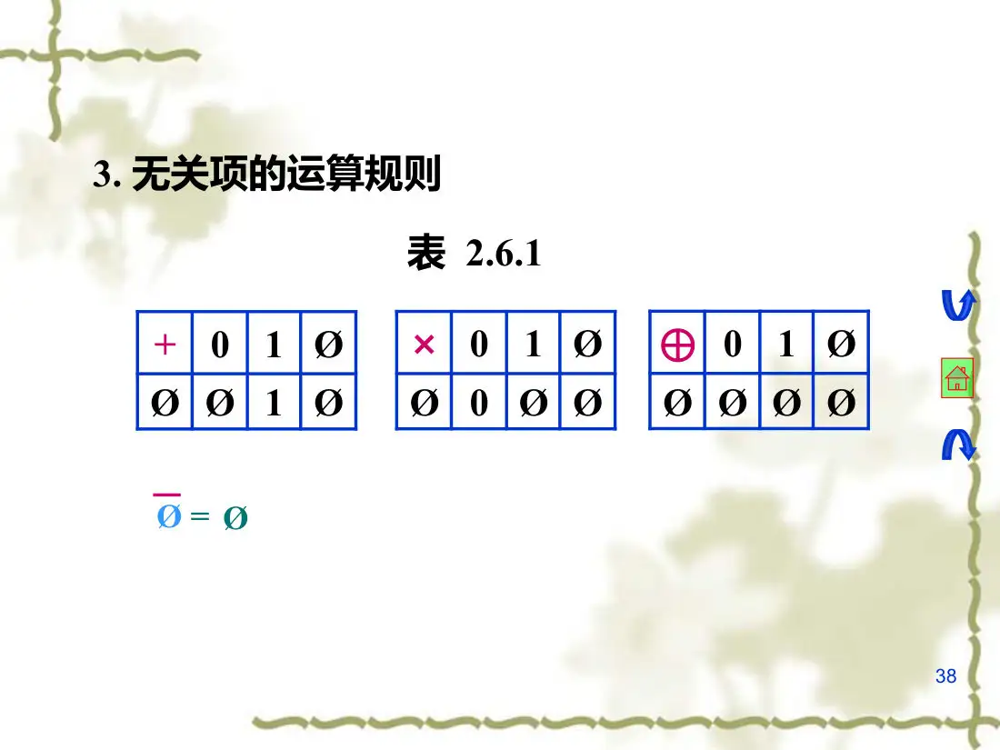

原文：

3. 无关项的运算规则

$$
\begin{array}{c c c c} \hline + & \mathbf {0} & 1 & \emptyset \\ \hline \emptyset & \emptyset & 1 & \emptyset \\ \hline \end{array}
$$

$$
\overline {{\emptyset}} = \emptyset
$$

表 2.6.1

$$
\begin{array}{c c c c} \times & 0 & 1 & \emptyset \\ \hline \emptyset & 0 & \emptyset & \emptyset \end{array}
$$

$$
\begin{array}{c c c c} \text {⊕} & 0 & 1 & \emptyset \\ \hline \emptyset & \emptyset & \emptyset & \emptyset \end{array}
$$

38

### 五、用卡诺图化简其他逻辑表达式

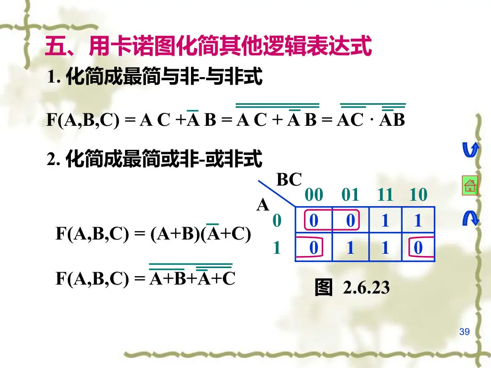

原文：

五、用卡诺图化简其他逻辑表达式

1. 化简成最简与非-与非式

$$
\mathbf {F} (\mathbf {A}, \mathbf {B}, \mathbf {C}) = \mathbf {A} \mathbf {C} + \overline {{\mathbf {A}}} \mathbf {B} = \overline {{\mathbf {A} \mathbf {C} + \overline {{\mathbf {A}}} \mathbf {B}}} = \overline {{\mathbf {A} \mathbf {C}}} \cdot \overline {{\overline {{\mathbf {A}}} \mathbf {B}}}
$$

2. 化简成最简或非-或非式

$$
\begin{array}{r l} & {\mathbf {F} (\mathbf {A}, \mathbf {B}, \mathbf {C}) = (\mathbf {A} + \mathbf {B}) (\overline {{\mathbf {A}}} + \mathbf {C})} \\ & {\mathbf {F} (\mathbf {A}, \mathbf {B}, \mathbf {C}) = \overline {{\overline {{\mathbf {A}}} + \overline {{\mathbf {B}}}} + \overline {{\overline {{\mathbf {A}}}}} + \overline {{\mathbf {C}}}}} \end{array}
$$

39

### 3. 转换成与或非式

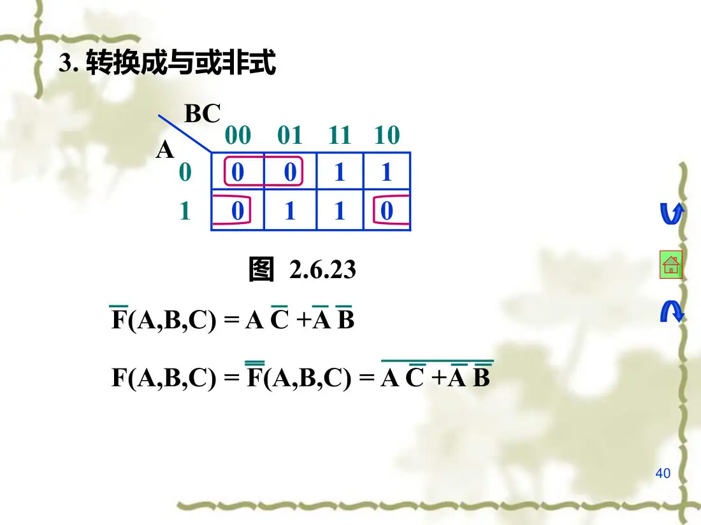

原文：

3. 转换成与或非式

$$
\overline {{{\mathbf {F}}}} (\mathbf {A}, \mathbf {B}, \mathbf {C}) = \mathbf {A} \overline {{{\mathbf {C}}}} + \overline {{{\mathbf {A}}}} \overline {{{\mathbf {B}}}}
$$

$$
\mathbf {F} (\mathbf {A}, \mathbf {B}, \mathbf {C}) = \overline {{\overline {{\mathbf {F}}}}} (\mathbf {A}, \mathbf {B}, \mathbf {C}) = \overline {{\mathbf {A} \overline {{\mathbf {C}}} + \overline {{\mathbf {A}}} \overline {{\mathbf {B}}}}}
$$

40

### 第 41 页

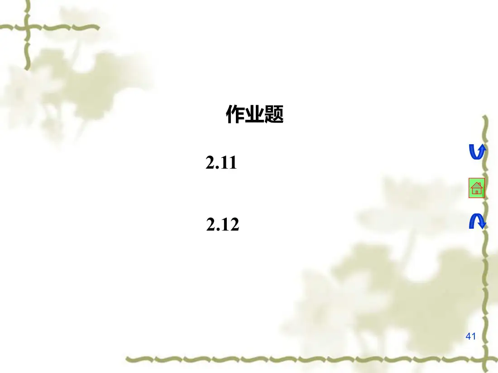
