# 《数字电路与逻辑设计B》第2章 逻辑函数的标准形式（课件）

原件的每一页，下面附识别出的文字。

### 2.5 逻辑函数的标准形式

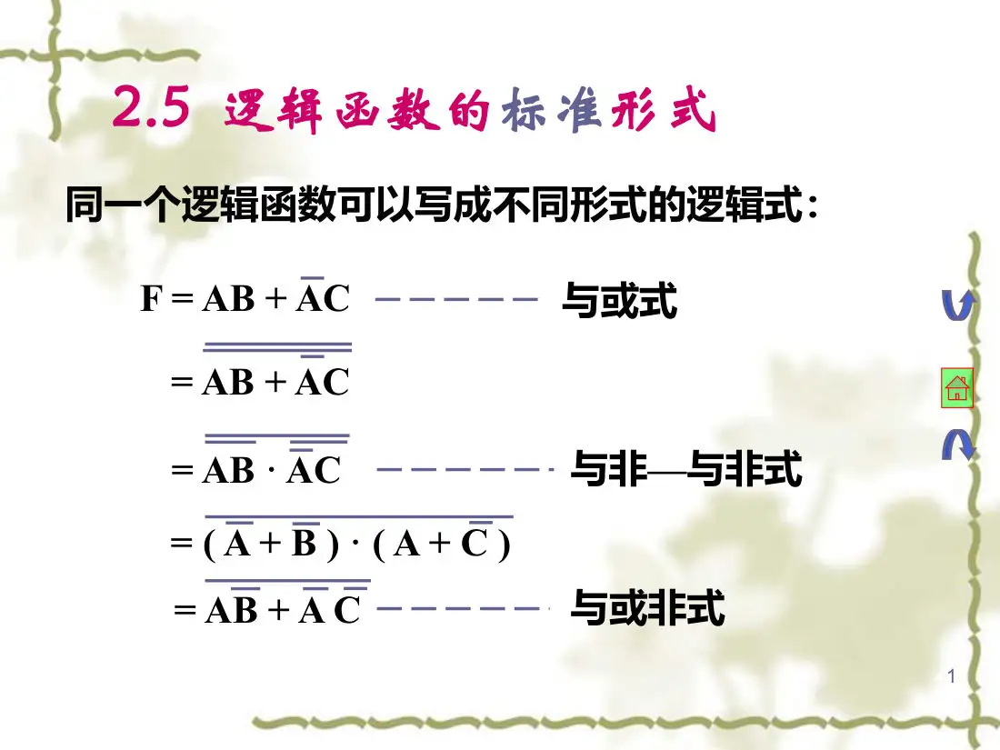

原文：

2.5 逻辑函数的标准形式

同一个逻辑函数可以写成不同形式的逻辑式：

$$
\begin{array}{r l} & {\mathbf {F} = \mathbf {A B} + \overline {{\mathbf {A C}}}} \\ & {\qquad = \overline {{\mathbf {A B}}} + \overline {{\mathbf {A C}}}} \\ & {\qquad = \overline {{\mathbf {A B}}} \cdot \overline {{\mathbf {A C}}}} \\ & {\qquad = (\overline {{\mathbf {A}}} + \overline {{\mathbf {B}}}) \cdot (\mathbf {A} + \overline {{\mathbf {C}}})} \\ & {\qquad = \overline {{\mathbf {A B}}} + \overline {{\mathbf {A C}}}} \end{array}
$$

与或式

与非—与非式

与或非式

### $$

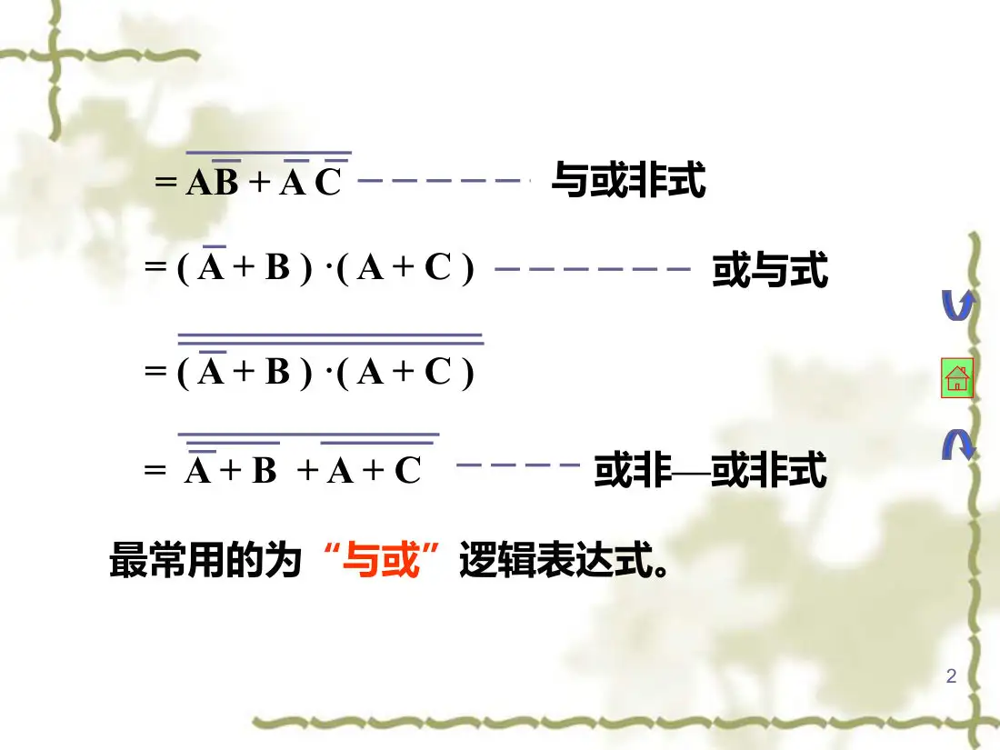

原文：

$$
= \overline {{\mathbf {A} \overline {{\mathbf {B}}} + \overline {{\mathbf {A}}} \overline {{\mathbf {C}}}}} - - - - -
$$

与或非式

或与式

$$
= (\overline {{{\mathbf {A}}}} + \mathbf {B}) \cdot (\mathbf {A} + \mathbf {C})
$$

$= \overline{\overline{\mathbf{A}} + \mathbf{B} + \mathbf{A} + \mathbf{C}}$ ——或非—或非式

最常用的为“与或”逻辑表达式。

### 2.5 逻辑函数的表达式

原文：

2.5 逻辑函数的表达式

一、标准表达式：

1. 最小项、最小项表达式：

(1)最小项的概念

是一种特殊的乘积项（与项），在该乘积项中逻辑函数的所有变量都要以原变量或反变量的形式出现一次，而且只能出现一次。

3

### (2) 最小项的数量

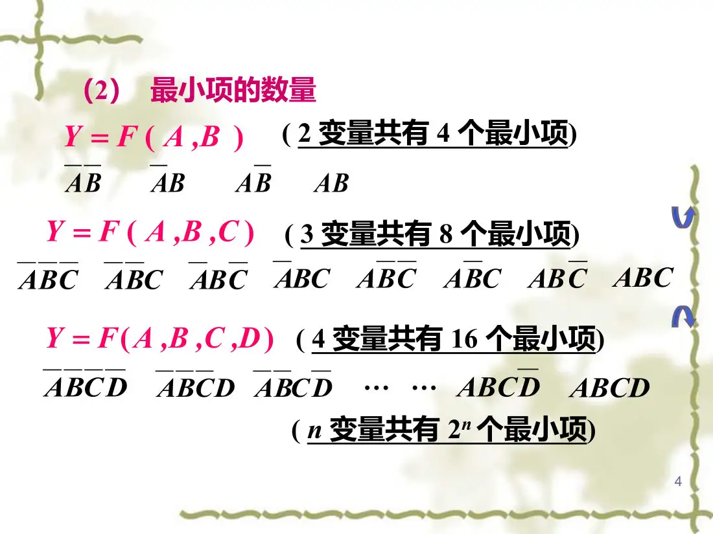

原文：

(2) 最小项的数量

$Y = F(A, B)$ (2 变量共有 4 个最小项) $\overline{AB}$ $\overline{AB}$ $\overline{AB}$ $AB$

$Y = F(A, B, C)$ (3 变量共有 8 个最小项) $\overline{A}\overline{B}\overline{C}$ $\overline{A}\overline{B}C$ $\overline{A}B\overline{C}$ $\overline{A}BC$ $\overline{A}\overline{B}C$ $\overline{A}\overline{B}C$ $\overline{A}BC$ $\overline{A}BC$ $\overline{A}BC$ $\overline{A}BC$ $\overline{A}BC$ $\overline{A}BC$ $Y = F(A, B, C, D)$ (4 变量共有 16 个最小项) $\overline{A}\overline{B}C\overline{D}$ $\overline{A}B\overline{C}D$ $\overline{A}B\overline{C}\overline{D}$ $\cdots\cdots$ $ABC\overline{D}$ $ABCD$ (n 变量共有 $2^{n}$ 个最小项)

### (3) 最小项的编号:

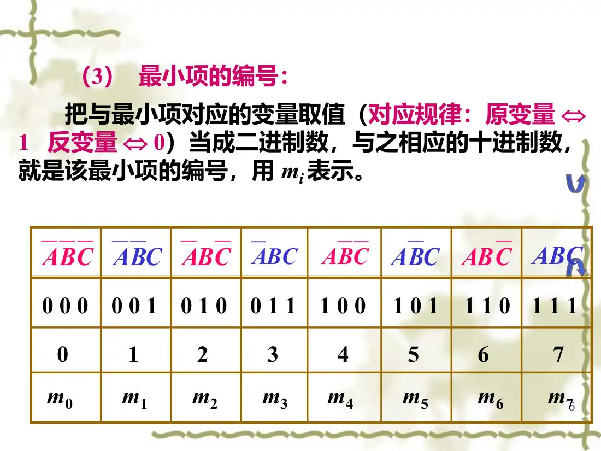

原文：

(3) 最小项的编号:

把与最小项对应的变量取值（对应规律：原变量 $\Leftrightarrow$ 1 反变量 $\Leftrightarrow$ 0）当成二进制数，与之相应的十进制数，就是该最小项的编号，用 $m_{i}$ 表示。

<table><tr><td> $\overline{ABC}$ </td><td> $\overline{ABC}$ </td><td> $\overline{ABC}$ </td><td> $\overline{ABC}$ </td><td> $\overline{ABC}$ </td><td> $\overline{ABC}$ </td><td> $\overline{ABC}$ </td><td> $ABC$ </td></tr><tr><td>0 0 0</td><td>0 0 1</td><td>0 1 0</td><td>0 1 1</td><td>1 0 0</td><td>1 0 1</td><td>1 1 0</td><td>1 1 1</td></tr><tr><td>0</td><td>1</td><td>2</td><td>3</td><td>4</td><td>5</td><td>6</td><td>7</td></tr><tr><td> $m_0$ </td><td> $m_1$ </td><td> $m_2$ </td><td> $m_3$ </td><td> $m_4$ </td><td> $m_5$ </td><td> $m_6$ </td><td> $m_7$ </td></tr></table>

### 第 6 页

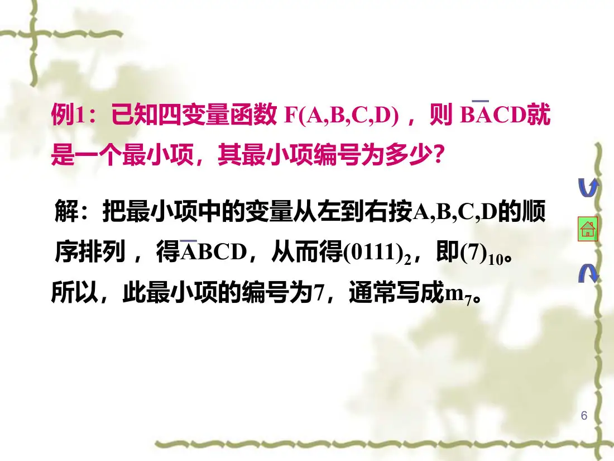

原文：

例1: 已知四变量函数 $F(A, B, C, D)$ , 则 $\overline{BACD}$ 就是一个最小项, 其最小项编号为多少?

解: 把最小项中的变量从左到右按A,B,C,D的顺序排列, 得 $\overline{\mathrm{ABCD}}$ , 从而得(0111) $_2$ , 即(7) $_{10}$ 。所以, 此最小项的编号为7, 通常写成m $_7$ 。

### 逻辑函数最小项标准形式

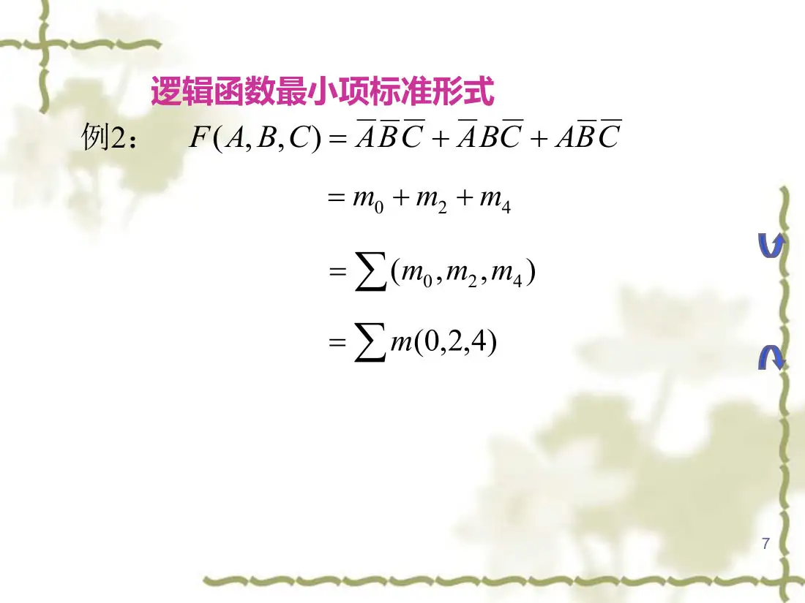

原文：

逻辑函数最小项标准形式

$$
\begin{array}{r l} \text {例2:} & F (A, B, C) = \overline {{A}} \overline {{B}} \overline {{C}} + \overline {{A}} B \overline {{C}} + A \overline {{B}} \overline {{C}} \\ & = m _ {0} + m _ {2} + m _ {4} \\ & = \sum (m _ {0}, m _ {2}, m _ {4}) \\ & = \sum m (0, 2, 4) \end{array}
$$

### (2) 最小项的主要性质

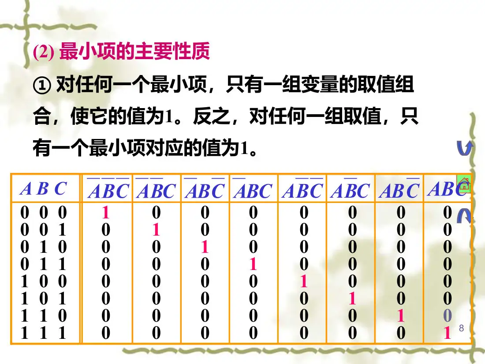

原文：

(2) 最小项的主要性质

① 对任何一个最小项，只有一组变量的取值组合，使它的值为1。反之，对任何一组取值，只有一个最小项对应的值为1。

$$
\begin{array}{c c c c c c c c c c} A & B & C & \overline {{A}} \overline {{B}} \overline {{C}} & \overline {{A}} \overline {{B}} C & \overline {{A}} \overline {{B}} \overline {{C}} & \overline {{A}} \overline {{B}} C & \overline {{A}} \overline {{B}} \overline {{C}} & \overline {{A}} \overline {{B}} C & \overline {{A}} \overline {{B}} \overline {{C}} & A B \\ \hline 0 & 0 & 0 & 1 & 0 & 0 & 0 & 0 & 0 & 0 \\ 0 & 0 & 1 & 0 & 1 & 0 & 0 & 0 & 0 & 0 \\ 0 & 1 & 0 & 0 & 0 & 1 & 0 & 0 & 0 & 0 \\ 0 & 1 & 1 & 0 & 0 & 0 & 1 & 0 & 0 & 0 \\ 1 & 0 & 0 & 0 & 0 & 0 & 0 & 1 & 0 & 0 \\ 1 & 0 & 1 & 0 & 0 & 0 & 0 & 0 & 1 & 0 \\ 1 & 1 & 0 & 0 & 0 & 0 & 0 & 0 & 1 & 0 \\ 1 & 1 & 1 & 0 & 0 & 0 & 0 & 0 & 0 & 1 ^ {8} \end{array}
$$

### ②全部最小项之和恒等于1。

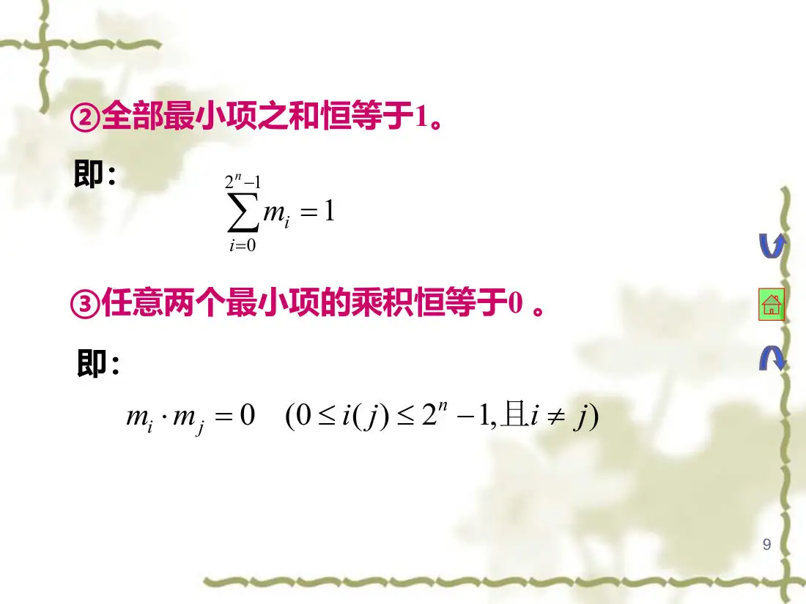

原文：

②全部最小项之和恒等于1。

即：

$$
\sum_ {i = 0} ^ {2 ^ {n} - 1} m _ {i} = 1
$$

③任意两个最小项的乘积恒等于0。

即：

$$
m _ {i} \cdot m _ {j} = 0 \quad (0 \leq i (j) \leq 2 ^ {n} - 1, \text {且} i \neq j)
$$

### ④任一最小项与另一最小项非之积恒等于该最小项。

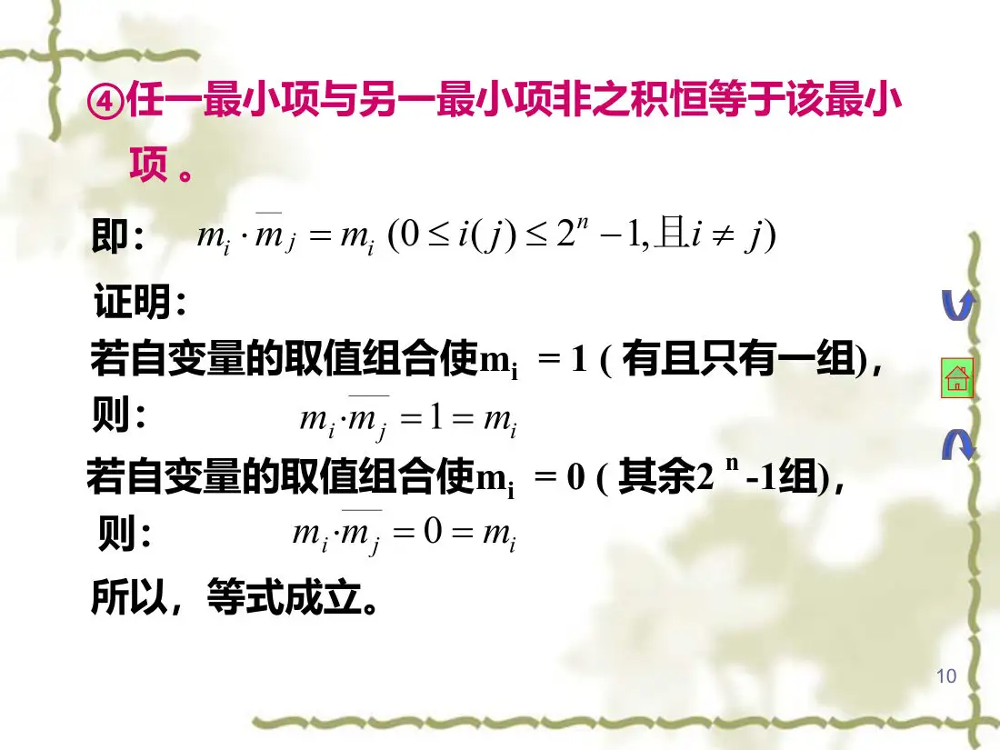

原文：

④任一最小项与另一最小项非之积恒等于该最小项。

即： $m_{i}\cdot\overline{m}_{j}=m_{i}(0\leq i(j)\leq2^{n}-1,$ 且 $i\neq j)$

证明：

若自变量的取值组合使 $m_{i}=1$ （有且只有一组），

则： $m_{i}\cdot \overline{m_{j}} = 1 = m_{i}$

若自变量的取值组合使 $m_{i}=0$ （其余 $2^{n}-1$ 组），

则： $m_{i}\cdot \overline{m_{j}} = 0 = m_{i}$

所以，等式成立。

10

### (2)最小项表达式（标准与或式）

原文：

(2)最小项表达式（标准与或式）

逻辑函数的与或式表达式中，若全部与项都是最小项，则该表达式称为标准与或式或最小项表达式。

一般表达式写成最小项表达式的方法：

(1) 配全项法

(2) 真值表法

11

### [例1] 用配全项法写出下列函数的标准与或式：

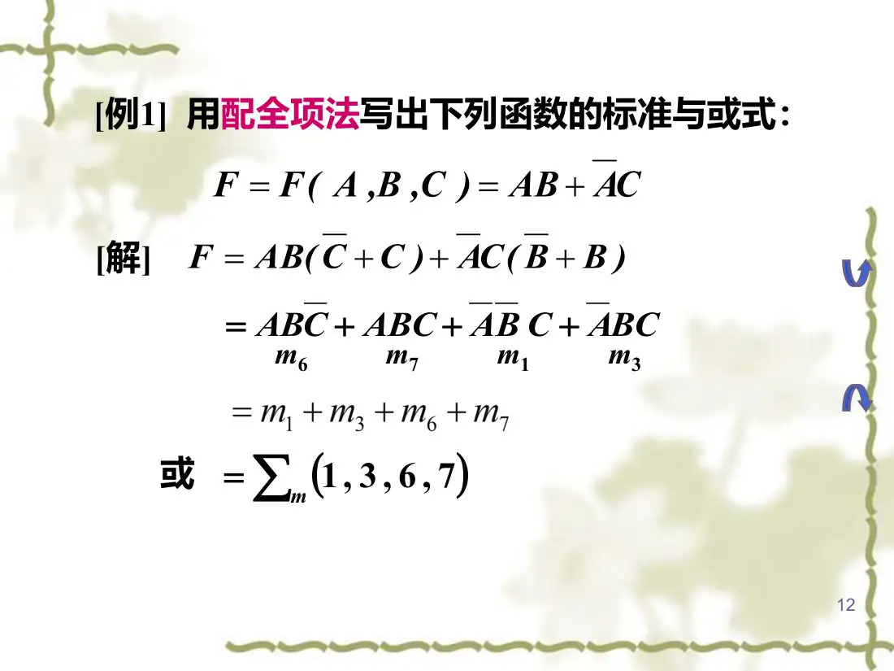

原文：

[例1] 用配全项法写出下列函数的标准与或式：

$$
\boldsymbol {F} = \boldsymbol {F} (\boldsymbol {A}, \boldsymbol {B}, \boldsymbol {C}) = \boldsymbol {A} \boldsymbol {B} + \overline {{\boldsymbol {A}}} \boldsymbol {C}
$$

[解]

$$
\begin{array}{r l} & {\boldsymbol {F} = \boldsymbol {A B} (\overline {{\boldsymbol {C}}} + \boldsymbol {C}) + \overline {{\boldsymbol {A}}} \boldsymbol {C} (\overline {{\boldsymbol {B}}} + \boldsymbol {B})} \\ & {\qquad = \boldsymbol {A B} \overline {{\boldsymbol {C}}} + \boldsymbol {A B C} + \overline {{\boldsymbol {A}}} \overline {{\boldsymbol {B}}} \boldsymbol {C} + \overline {{\boldsymbol {A}}} \boldsymbol {B C}} \\ & {\qquad = m _ {1} + m _ {3} + m _ {6} + m _ {7}} \end{array}
$$

$$
\text {或} = \sum_ {m} (1, 3, 6, 7)
$$

12

### [练习] 写出下列函数的标准与或式：

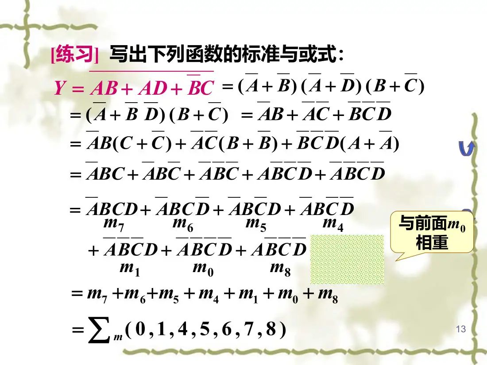

原文：

[练习] 写出下列函数的标准与或式：

$$
\begin{array}{r l} & Y = \overline {{A B + A D + \overline {{B C}}}} = (\overline {{A}} + \overline {{B}}) (\overline {{A}} + \overline {{D}}) (B + \overline {{C}}) \\ & = (\overline {{A}} + \overline {{B}} \overline {{D}}) (B + \overline {{C}}) = \overline {{A}} B + \overline {{A}} \overline {{C}} + \overline {{B}} \overline {{C}} \overline {{D}} \\ & = \overline {{A}} B (C + \overline {{C}}) + \overline {{A}} \overline {{C}} (B + \overline {{B}}) + \overline {{B}} \overline {{C}} \overline {{D}} (A + \overline {{A}}) \\ & = \overline {{A}} B C + \overline {{A}} B \overline {{C}} + \overline {{A}} B \overline {{C}} + A \overline {{B}} C \overline {{D}} + A \overline {{B}} C \overline {{D}} \\ & = \overline {{A}} B C D + \overline {{A}} B C \overline {{D}} + \overline {{A}} B C D + A B C D \\ & m _ {7} m _ {6} m _ {5} m _ {4} \\ & + \overline {{A}} B C D + \overline {{A}} B C D + A B C D \\ & m _ {1} m _ {0} m _ {8} \\ & = m _ {7} + m _ {6} + m _ {5} + m _ {4} + m _ {1} + m _ {0} + m _ {8} \\ & = \sum_ {m} (0, 1, 4, 5, 6, 7, 8) \end{array}
$$

与前面 $m_0$ 相重

13

### 解：列真值表：

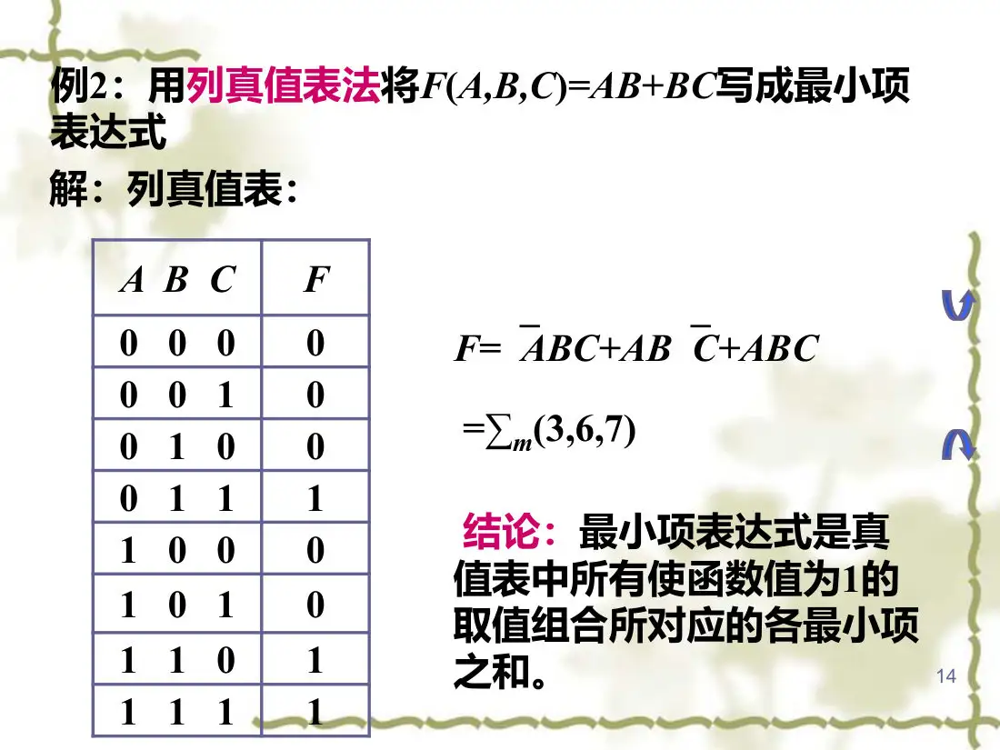

原文：

例2: 用列真值表法将 $F(A, B, C) = A B + B C$ 写成最小项表达式

解：列真值表：

<table><tr><td>A B C</td><td>F</td></tr><tr><td>0 0 0</td><td>0</td></tr><tr><td>0 0 1</td><td>0</td></tr><tr><td>0 1 0</td><td>0</td></tr><tr><td>0 1 1</td><td>1</td></tr><tr><td>1 0 0</td><td>0</td></tr><tr><td>1 0 1</td><td>0</td></tr><tr><td>1 1 0</td><td>1</td></tr><tr><td>1 1 1</td><td>1</td></tr></table>

$$
\begin{array}{r l} & F = \overline {{A}} B C + A B \overline {{C}} + A B C \\ & = \sum_ {m} (3, 6, 7) \end{array}
$$

结论：最小项表达式是真值表中所有使函数值为1的取值组合所对应的各最小项之和。

14

### 2.6逻辑函数的化简

原文：

2.6逻辑函数的化简

一、化简的意义和最简的标准：

1. 化简的意义（目的）：

节省元器件；提高工作可靠性

2. 化简的目标：

最简与或式

3.最简“与或”式的标准：

(1)含的与项最少; - - 门最少

(2)各与项中的变量数最少。 - - 门的输入端最少

15

### 二、公式法

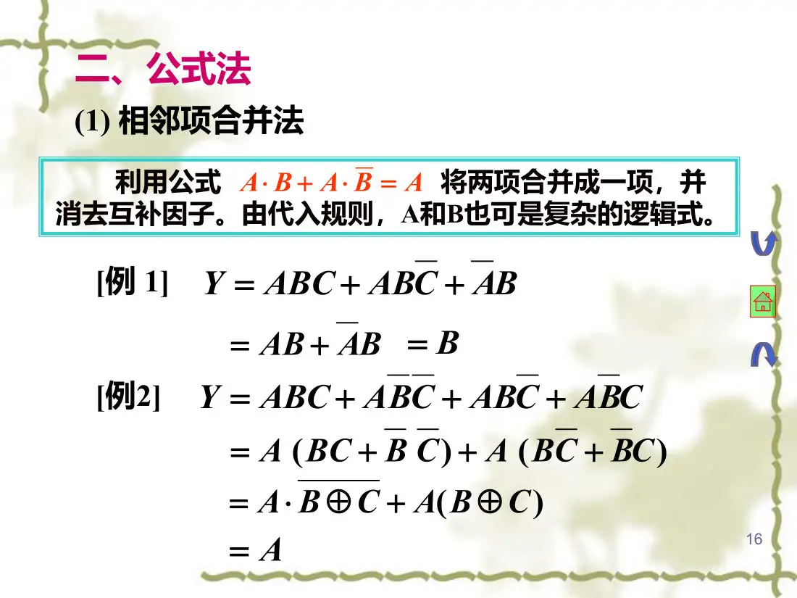

原文：

二、公式法

(1) 相邻项合并法

利用公式 $A \cdot B + A \cdot \overline{B} = A$ 将两项合并成一项，并消去互补因子。由代入规则，A和B也可是复杂的逻辑式。

[例 1] $Y = ABC + AB\overline{C} + \overline{A}B$ $= AB + \overline{A}B = B$

[例2] $Y = ABC + A\overline{B}\overline{C} +AB\overline{C} +A\overline{B} C$ $= A(BC + \overline{B}\overline{C}) + A(B\overline{C} +\overline{B} C)$ $= A\cdot \overline{B\oplus C} +A(B\oplus C)$ $= A$

16

### (2) 消项法

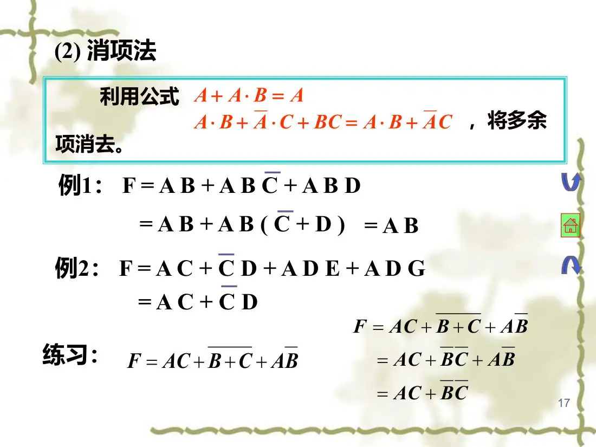

原文：

(2) 消项法

利用公式 $A + A \cdot B = A$ $A \cdot B + \overline{A} \cdot C + BC = A \cdot B + \overline{A}C$ ，将多余项消去。

例1: $\mathbf{F} = \mathbf{A}\mathbf{B} + \mathbf{A}\mathbf{B}\overline{\mathbf{C}} +\mathbf{A}\mathbf{B}\mathbf{D}$ $= \mathbf{A}\mathbf{B} + \mathbf{A}\mathbf{B}(\overline{\mathbf{C}} +\mathbf{D}) = \mathbf{A}\mathbf{B}$

例2: $\mathbf{F} = \mathbf{A}\mathbf{C} + \overline{\mathbf{C}}\mathbf{D} + \mathbf{A}\mathbf{D}\mathbf{E} + \mathbf{A}\mathbf{D}\mathbf{G}$ $= \mathbf{A}\mathbf{C} + \overline{\mathbf{C}}\mathbf{D}$

$$
\boldsymbol {F} = \boldsymbol {A} \boldsymbol {C} + \overline {{\boldsymbol {B} + \boldsymbol {C}}} + \boldsymbol {A} \overline {{\boldsymbol {B}}}
$$

$$
\begin{array}{r l} \boldsymbol {F} & = \boldsymbol {A C} + \overline {{\boldsymbol {B} + \boldsymbol {C}}} + \boldsymbol {A B} \\ & = \boldsymbol {A C} + \overline {{\boldsymbol {B}}} \overline {{\boldsymbol {C}}} + \boldsymbol {A B} \\ & = \boldsymbol {A C} + \overline {{\boldsymbol {B}}} \overline {{\boldsymbol {C}}} \end{array}
$$

17

### (3) 消去互补因子法

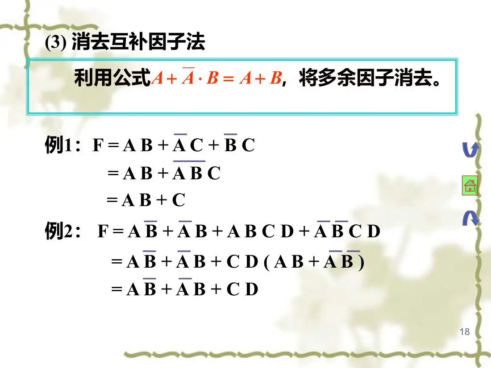

原文：

(3) 消去互补因子法

利用公式 $A + \overline{A} \cdot B = A + B$ ，将多余因子消去。

例1: $\mathbf{F} = \mathbf{A}\mathbf{B} + \overline{\mathbf{A}}\mathbf{C} + \overline{\mathbf{B}}\mathbf{C}$ $= \mathbf{A}\mathbf{B} + \overline{\mathbf{A}}\mathbf{B}\mathbf{C}$ $= \mathbf{A}\mathbf{B} + \mathbf{C}$

例2: $\mathbf{F} = \mathbf{A}\overline{\mathbf{B}} +\overline{\mathbf{A}}\mathbf{B} + \mathbf{A}\mathbf{B}\mathbf{C}\mathbf{D} + \overline{\mathbf{A}}\overline{\mathbf{B}}\mathbf{C}\mathbf{D}$ $= \mathbf{A}\overline{\mathbf{B}} +\overline{\mathbf{A}}\mathbf{B} + \mathbf{C}\mathbf{D}(\mathbf{A}\mathbf{B} + \overline{\mathbf{A}}\overline{\mathbf{B}})$ $= \mathbf{A}\overline{\mathbf{B}} +\overline{\mathbf{A}}\mathbf{B} + \mathbf{C}\mathbf{D}$

18

### (4) 拆项法

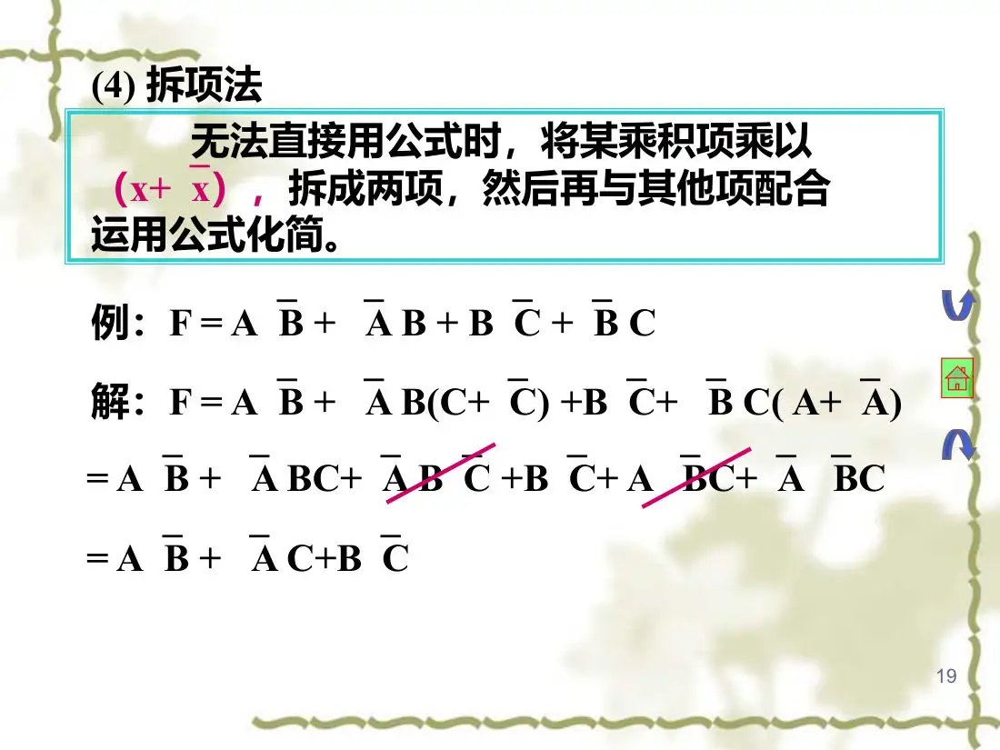

原文：

(4) 拆项法

无法直接用公式时，将某乘积项乘以 $(\mathrm{x} + \overline{\mathrm{x}})$ ，拆成两项，然后再与其他项配合运用公式化简。

例： $\mathbf{F} = \mathbf{A}\overline{\mathbf{B}} +\overline{\mathbf{A}}\mathbf{B} + \mathbf{B}\overline{\mathbf{C}} +\overline{\mathbf{B}}\mathbf{C}$

解： $F = A \overline{B} + \overline{A} B (C + \overline{C}) + B \overline{C} + \overline{B} C (A + \overline{A})$ $= A \overline{B} + \overline{A} BC + \overline{A} B \overline{C} + B \overline{C} + A \overline{BC} + \overline{A} \overline{BC}$ $= A \overline{B} + \overline{A} C + B \overline{C}$

19

### (5) 添项法

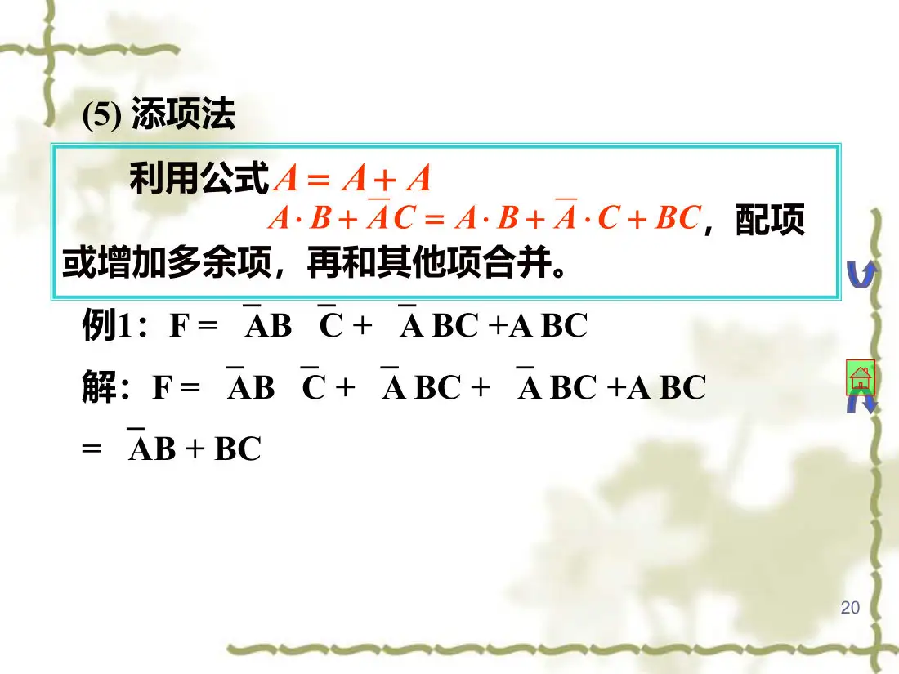

原文：

(5) 添项法

利用公式 $A = A + A$ $A \cdot B + \overline{A} C = A \cdot B + \overline{A} \cdot C + BC$ ，配项或增加多余项，再和其他项合并。

例1: F = $\overline{A}B$ $\overline{C} + \overline{A}BC + ABC$

解： $F = \overline{A}B \quad \overline{C} + \overline{A}BC + \overline{A}BC + ABC$ $= \overline{A}B + BC$ 例2 化简逻辑函数: $F = A \overline{B} + B \overline{C} + \overline{B} C + \overline{A} B$

20

### 由上例可知，有些逻辑函数的化简结果不是唯一的。

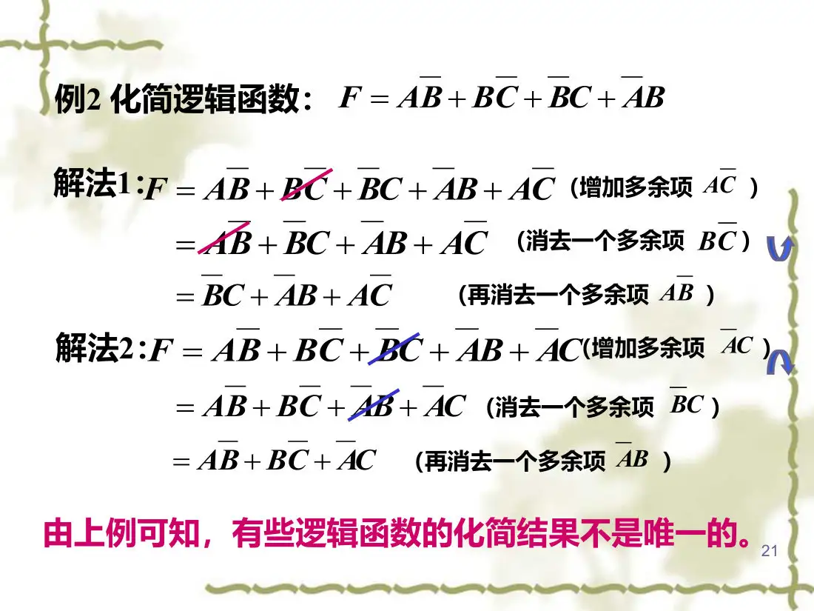

原文：

解法1: $F = A\overline{B} + B\overline{C} + \overline{B}C + \overline{A}B + A\overline{C}$ （增加多余项 $A\overline{C}$ ） $= A\overline{B} + \overline{B}C + \overline{A}B + A\overline{C}$ （消去一个多余项 $B\overline{C}$ ） $= \overline{B}C + \overline{A}B + A\overline{C}$ （再消去一个多余项 $A\overline{B}$ ）

解法2: $F = A\overline{B} + B\overline{C} + \overline{B}C + \overline{A}B + \overline{A}C$ (增加多余项 $\overline{AC}$ ) $= A\overline{B} + B\overline{C} + \overline{A}B + \overline{A}C$ (消去一个多余项 $\overline{BC}$ ) $= A\overline{B} + B\overline{C} + \overline{A}C$ (再消去一个多余项 $\overline{AB}$ )

由上例可知，有些逻辑函数的化简结果不是唯一的。

### 综合法

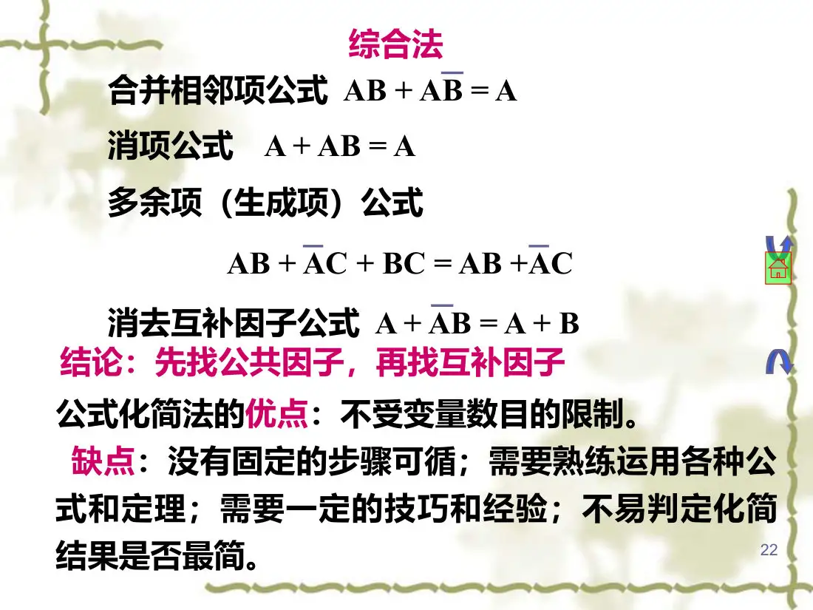

原文：

综合法

合并相邻项公式 $\mathbf{AB} + \mathbf{A}\overline{\mathbf{B}} = \mathbf{A}$

消项公式 $\mathbf{A} + \mathbf{A}\mathbf{B} = \mathbf{A}$

多余项（生成项）公式

$$
\mathbf {A B} + \overline {{\mathbf {A C}}} + \mathbf {B C} = \mathbf {A B} + \overline {{\mathbf {A C}}}
$$

消去互补因子公式 $A + \overline{A} B = A + B$ 结论: 先找公共因子, 再找互补因子公式化简法的优点: 不受变量数目的限制。

缺点：没有固定的步骤可循；需要熟练运用各种公式和定理；需要一定的技巧和经验；不易判定化简结果是否最简。

### 第 23 页

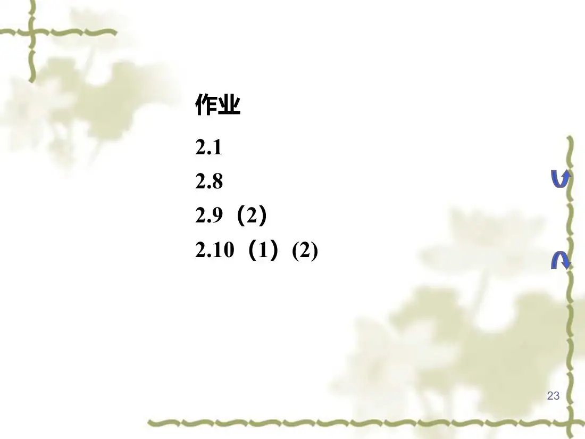
