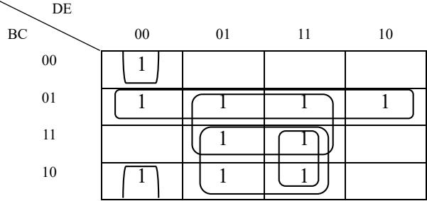

# 《数字电路与逻辑设计B》第2章习题答案

原件经识别和整理；“参考解答”是我们补的。

## 习题目录

- 2.1
- 2.2
- 2.3
- 2.4
- 2.5
- 2.6
- 2.7
- 2.8
- 2.9
- 2.10
- 2.11
- 2.12
- 2.13
- 2.14

### 填空 1

有 A、B、C 三个输入信号，试列出下列问题的真值表，并写出最小项表达式 $\Sigma_{m}$（）。

（1）如果 A、B、C 均为 0 或其中一个信号为 1 时，输出 $F=1$，其余情况下 $F=0$。

（2）若 A、B、C 出现奇数个 0 时输出为 1，其余情况输出为 0。

（3）若 A、B、C 有两个或两个以上为 1 时，输出为 1，其余情况下，输出为 0。

解：（1）

| A | B | C | F |
|---|---|---|---|
| 0 | 0 | 0 | 1 |
| 0 | 0 | 1 | 1 |
| 0 | 1 | 0 | 1 |
| 0 | 1 | 1 | 0 |
| 1 | 0 | 0 | 1 |
| 1 | 0 | 1 | 0 |
| 1 | 1 | 0 | 0 |
| 1 | 1 | 1 | 0 |

（2）

| A | B | C | F |
|---|---|---|---|
| 0 | 0 | 0 | 1 |
| 0 | 0 | 1 | 0 |
| 0 | 1 | 0 | 0 |
| 0 | 1 | 1 | 1 |
| 1 | 0 | 0 | 0 |
| 1 | 0 | 1 | 1 |
| 1 | 1 | 0 | 1 |
| 1 | 1 | 1 | 0 |

（3）

| A | B | C | F |
|---|---|---|---|
| 0 | 0 | 0 | 0 |
| 0 | 0 | 1 | 0 |
| 0 | 1 | 0 | 0 |
| 0 | 1 | 1 | 1 |
| 1 | 0 | 0 | 0 |
| 1 | 0 | 1 | 1 |
| 1 | 1 | 0 | 1 |
| 1 | 1 | 1 | 1 |

$F_{1}(A,B,C)=\Sigma_{m}(0,1,2,4)$，$F_{2}(A,B,C)=\Sigma_{m}(0,3,5,6)$，$F_{3}(A,B,C)=\Sigma_{m}(3,5,6,7)$

参考解答：**结论**

$F_{1}(A,B,C)=\Sigma_{m}(0,1,2,4)$，$F_{2}(A,B,C)=\Sigma_{m}(0,3,5,6)$，$F_{3}(A,B,C)=\Sigma_{m}(3,5,6,7)$

**推理与计算过程**

最小项 $m_i$ 的下标 $i$ 对应输入变量 $(A,B,C)$ 的二进制值转换为十进制的结果。输出为 $1$ 的行对应的下标即为最小项表达式中的项。

1.  **对于 $F_1$**：
    *   条件：全为 0 ($000_2=0$) 或仅一个为 1 ($001_2=1, 010_2=2, 100_2=4$)。
    *   对应最小项下标为 $0, 1, 2, 4$。
    *   故 $F_{1}=\Sigma_{m}(0,1,2,4)$。

2.  **对于 $F_2$**：
    *   条件：出现奇数个 0。
        *   3 个 0：$000_2=0$（奇数）。
        *   2 个 0：$001, 010, 100$（偶数，排除）。
        *   1 个 0：$011_2=3, 101_2=5, 110_2=6$（奇数）。
        *   0 个 0：$111_2=7$（偶数，排除）。
    *   对应最小项下标为 $0, 3, 5, 6$。
    *   故 $F_{2}=\Sigma_{m}(0,3,5,6)$。

3.  **对于 $F_3$**：
    *   条件：两个或两个以上为 1（即多数表决函数）。
        *   2 个 1：$011_2=3, 101_2=5, 110_2=6$。
        *   3 个 1：$111_2=7$。
    *   对应最小项下标为 $3, 5, 6, 7$。
    *   故 $F_{3}=\Sigma_{m}(3,5,6,7)$。

知识点：[数字系统的基本模型（数据处理器与控制器）及对最小时钟周期、异步信号同步化的约定](../../../topics/数字逻辑电路/数字系统模型.md)

### 证明 1

试用真值表证明下列等式：

(1) $\overline{A B+B C+A C}=ABC+\overline{A}\ \overline{B}\ \overline{C}$

(2) $\overline{A}\overline{B}+\overline{B}\overline{C}+\overline{A}\overline{C}=\overline{AB}\ \overline{BC}\ \overline{AC}$

证明：（1）

| A | B | C | $\overline{A\overline{B}+B\overline{C}+A\overline{C}}$ |
|---|---|---|---|
| 0 | 0 | 0 | 1 |
| 0 | 0 | 1 | 0 |
| 0 | 1 | 0 | 0 |
| 0 | 1 | 1 | 0 |
| 1 | 0 | 0 | 0 |
| 1 | 0 | 1 | 0 |
| 1 | 1 | 0 | 0 |
| 1 | 1 | 1 | 1 |

| A | B | C | $ABC+\overline{A}\ \overline{B}\ \overline{C}$ |
|---|---|---|---|
| 0 | 0 | 0 | 1 |
| 0 | 0 | 1 | 0 |
| 0 | 1 | 0 | 0 |
| 0 | 1 | 1 | 0 |
| 1 | 0 | 0 | 0 |
| 1 | 0 | 1 | 0 |
| 1 | 1 | 0 | 0 |
| 1 | 1 | 1 | 1 |

真值表相同，所以等式成立。

（2）

| A | B | C | $\overline{A}\ \overline{B}+\overline{B}\ \overline{C}+\overline{A}\ \overline{C}$ |
|---|---|---|---|
| 0 | 0 | 0 | 1 |
| 0 | 0 | 1 | 1 |
| 0 | 1 | 0 | 1 |
| 0 | 1 | 1 | 0 |
| 1 | 0 | 0 | 1 |
| 1 | 0 | 1 | 0 |
| 1 | 1 | 0 | 0 |
| 1 | 1 | 1 | 0 |

| A | B | C | $\overline{AB}\ \overline{BC}\ \overline{AC}$ |
|---|---|---|---|
| 0 | 0 | 0 | 1 |
| 0 | 0 | 1 | 1 |
| 0 | 1 | 0 | 1 |
| 0 | 1 | 1 | 0 |
| 1 | 0 | 0 | 1 |
| 1 | 0 | 1 | 0 |
| 1 | 1 | 0 | 0 |
| 1 | 1 | 1 | 0 |

真值表相同，所以等式成立。

参考解答：两个等式均成立（左右两边真值表完全相同）。

**(1)** $\overline{A B+B C+A C}=ABC+\overline{A}\ \overline{B}\ \overline{C}$

左边取值分析：

- 当 $A,B,C$ 全为 $0$ 时，$AB=BC=AC=0$，所以
  $$
  \overline{AB+BC+AC}=\overline{0}=1
  $$

- 当 $A,B,C$ 全为 $1$ 时，$AB+BC+AC=1$，所以
  $$
  \overline{AB+BC+AC}=\overline{1}=0
  $$

- 其他 $6$ 种输入组合中，至少有两个变量为 $1$，因此 $AB,BC,AC$ 中至少一个为 $1$，故左边为 $0$。

右边取值分析：

- $ABC=1$ 仅当 $A=B=C=1$
- $\overline{A}\ \overline{B}\ \overline{C}=1$ 仅当 $A=B=C=0$
- 故右边仅在 $000$ 和 $111$ 时为 $1$，其余为 $0$。

左右两边真值表相同，因此
$$
\overline{AB+BC+AC}=ABC+\overline{A}\ \overline{B}\ \overline{C}
$$

**(2)** $\overline{A}\ \overline{B}+\overline{B}\ \overline{C}+\overline{A}\ \overline{C}=\overline{AB}\ \overline{BC}\ \overline{AC}$

对左边：
$$
\overline{A}\ \overline{B}+\overline{B}\ \overline{C}+\overline{A}\ \overline{C}
$$
只要 $A,B,C$ 中至少有两个为 $0$，则对应乘积项为 $1$，故左边为 $1$；仅当有两个或以上变量为 $1$ 时，左边为 $0$。

对右边：
$$
\overline{AB}\ \overline{BC}\ \overline{AC}
=\overline{AB+BC+AC}
$$
由第 (1) 问可知，$AB+BC+AC=1$ 当且仅当至少有两个变量为 $1$；所以右边为 $1$ 当且仅当 $A,B,C$ 中至少有两个为 $0$。

因此左右两边在全部 $8$ 种输入下取值一致，等式成立。

知识点：[完整数字系统设计流程实例（如乘法器、交通灯管理系统的算法规律、处理器设计与控制器实现）](../../../topics/数字逻辑电路/数字系统设计实例.md)

### 简答 1

对下列函数，说明对输入变量的哪些取值组合其输出为 1？

(1) $F(A,B,C)=AB+BC+AC$

(2) $F(A,B,C)=(A+B+C)(\bar{A}+\bar{B}+\bar{C})$

(3) $F(A,B,C)=(\overline{A}B+\overline{B}C+A\overline{C})AC$

解：本题可用真值表、化成最小项表达式、卡诺图等多种方法求解。

（1）$F$ 输出 1 的取值组合为：011、101、110、111。

（2）$F$ 输出 1 的取值组合为：001、010、011、100、101、110。

（3）$F$ 输出 1 的取值组合为：101。

参考解答：**结论**
(1) 输出为 1 的取值组合：011, 101, 110, 111。
(2) 输出为 1 的取值组合：001, 010, 011, 100, 101, 110。
(3) 输出为 1 的取值组合：101。

---

**推理或计算过程**

**(1)** $F = AB + BC + AC$
该式为三变量多数表决函数，即只要任意两个或三个输入为 1，输出即为 1。写成最小项之和为 $m_3(011) + m_5(101) + m_6(110) + m_7(111)$。

**(2)** $F = (A+B+C)(\bar{A}+\bar{B}+\bar{C})$
该式由一个最大项 $M_0(000)$ 与 $M_7(111)$ 相与构成，因此使输出为 0 的组合是 000 和 111，其余 6 个最小项（001, 010, 011, 100, 101, 110）均使输出为 1。

**(3)** $F = (\overline{A}B + \overline{B}C + A\overline{C})AC$
先利用分配律展开：$F = \overline{A}B \cdot AC + \overline{B}C \cdot AC + A\overline{C} \cdot AC$。
- $\overline{A}B \cdot AC = (\overline{A}A)BC = 0$
- $\overline{B}C \cdot AC = A(B\overline{B})C = A \cdot 0 \cdot C = 0$
- $A\overline{C} \cdot AC = A \cdot (\overline{C}C) = 0$（注意此处需保留 $A\overline{C}AC = A(\overline{C}C)=0$）
**更直接的推导**：原式括号内每一项与 $AC$ 相乘后均含互补因子而为零，除了本身有误？重新验证：
$F = (\overline{A}B)AC + (\overline{B}C)AC + (A\overline{C})AC$
- 第一项：$\overline{A} \cdot A \cdot BC = 0$
- 第二项：$A \cdot \overline{B}B \cdot C = 0$（因为 $\overline{B} \cdot B = 0$）
- 第三项：$A \cdot A \cdot (\overline{C} C) = A \cdot 0 = 0$
这样似乎全为0。但直接赋值寻找：
要使 $F=1$，必须 $AC=1$（因为最终与 $AC$ 相与），即 $A=1, C=1$。
此时括号内 $\overline{A}B + \overline{B}C + A\overline{C} = 0 \cdot B + \overline{B}\cdot 1 + 1 \cdot 0 = \overline{B}$。
则 $F = \overline{B} \cdot 1 = \overline{B}$。整个表达式与 $AC$ 相与后实际上等效于 $A \overline{B} C$。
所以仅当 $A=1, B=0, C=1$ 时 $F=1$，即组合 101。

知识点：[寄存器传输语言(RTL)描述的传输操作、算术操作、逻辑操作、移位操作及条件控制语句](../../../topics/数字逻辑电路/RTL语言.md)

### 简答 2

试直接写出下列各式的反演式和对偶式。

(1) $F(A,B,C,D,E)=[(A\bar{B}+C)\cdot D+E]\cdot B$

(2) $F(A,B,C,D,E)=AB+\overline{C}\overline{D}+BC+\overline{D}+\overline{CE}+\overline{B+E}$

(3) $F(A,B,C)=\overline{\overline{A}\overline{B}+C}\ \overline{\overline{\overline{AB}}C}$

解：(1) $\overline{F}=[(\overline{A}+B)\cdot\overline{C}+\overline{D}]\cdot\overline{E}+\overline{B}$，$F'=[(A+\overline{B})\cdot C+D]\cdot E+B$

(2) $\overline{F}=(\overline{A}+\overline{B})(C+D)\cdot(\overline{B}+\overline{C})\cdot D\cdot(C+\overline{E})\cdot\overline{\overline{B}}\cdot\overline{\overline{E}}$，$F'=(A+B)(\overline{C}+\overline{D})\cdot\overline{(B+C)}\cdot\overline{D}\cdot(\overline{C}+E)\cdot\overline{B\cdot\overline{E}}$

(3) $\overline{F}=(A+B)\cdot\overline{C}+A+\overline{B}+C$

$$
F'=\overline{(\bar{A}+\bar{B})\cdot C+\overline{\bar{A}+B}+\bar{C}}
$$

参考解答：好的，我们直接给出结论和简明推导。

---

**（1）**
- 反演式：

$$
\overline{F}=[(\overline{A}+B)\cdot\overline{C}+\overline{D}]\cdot\overline{E}+\overline{B}
$$

- 对偶式：

$$
F'=[(A+\overline{B})\cdot C+D]\cdot E+B
$$

**推导关键步骤**  
- 反演规则：原变量变反变量、反变量变原变量，“·”变“+”、“+”变“·”，0变1、1变0（本题无0/1）。  
- 对偶规则：不改变量取反，只将“·”“+”互换，0/1互换。  
- 本题直接按规则替换即可。

---

**（2）**  
- 反演式：

$$
\overline{F}=(\overline{A}+\overline{B})(C+D)\cdot(\overline{B}+\overline{C})\cdot D\cdot (C+\overline{E})\cdot(\overline{B})(\overline{E})
$$

- 对偶式：

$$
F'=(A+B)(\overline{C}+\overline{D})\cdot \overline{(B+C)}\cdot \overline{D}\cdot (\overline{C}+E)\cdot \overline{B\cdot \overline{E}}
$$

**推导关键步骤**  
- 注意原式中每一项运算层级，反演/对偶时需保持原运算顺序（用括号明确）。  
- 原式大“+”连接的项要对偶成“·”连接的项，反演则要将所有变量取反并互换“+”“·”。

---

**（3）**  
- 反演式：

$$
\overline{F} = (A+B)\cdot \overline{C} + A + \overline{B} + C
$$

- 对偶式：

$$
F' = \overline{ (\overline{A}+\overline{B})\cdot C + \overline{\overline{A}+B} + \overline{C} }
$$

**推导关键步骤**  
- 先化简原式中取反号嵌套关系，再按反演/对偶规则逐层替换。  
- 反演时大取反线变为内部取反；对偶时外层取反线保留，内部“+”“·”互换、0/1互换。

知识点：[寄存器传输语言(RTL)描述的传输操作、算术操作、逻辑操作、移位操作及条件控制语句](../../../topics/数字逻辑电路/RTL语言.md)

### 证明 2

用公式证明下列等式：

(1) $\overline{A}\ \overline{C}+\overline{A}\ \overline{B}+BC+\overline{A}\ \overline{C}\ \overline{D}=\overline{A}+BC$

(2) $AB+\overline{A}C+(\overline{B}+\overline{C})D=AB+\overline{A}C+D$

(3) $\overline{BC}\overline{D}+B\overline{CD}+ACD+\overline{AB}\overline{C}\overline{D}+\overline{A}\overline{BCD}+B\overline{C}\overline{D}+BCD=\overline{BC}+B\overline{C}+BD$

(4) $\overline{A\overline{B}\overline{C}}+\overline{\overline{BC}+BC}\overline{D}+\overline{A\overline{BD}}=\overline{A}+B+\overline{C}+\overline{D}$

## 一、习题解答

参考解答：### (1) 证明 $\overline{A}\ \overline{C}+\overline{A}\ \overline{B}+BC+\overline{A}\ \overline{C}\ \overline{D}=\overline{A}+BC$

**结论**：等式成立。

**推理过程**：
利用吸收律 $X + XY = X$ 和冗余律（Consensus Theorem）或展开法。

左边 (LHS) $= \overline{A}\ \overline{C} + \overline{A}\ \overline{B} + BC + \overline{A}\ \overline{C}\ \overline{D}$

1.  **合并含 $\overline{A}\ \overline{C}$ 的项**：
    根据吸收律 $X + XY = X$，令 $X = \overline{A}\ \overline{C}$，$Y = \overline{D}$，则 $\overline{A}\ \overline{C} + \overline{A}\ \overline{C}\ \overline{D} = \overline{A}\ \overline{C}$。
    此时 LHS $= \overline{A}\ \overline{C} + \overline{A}\ \overline{B} + BC$。

2.  **提取公因子 $\overline{A}$**：
    LHS $= \overline{A}(\overline{C} + \overline{B}) + BC$。

3.  **利用德·摩根定律**：
    $\overline{C} + \overline{B} = \overline{BC}$。
    LHS $= \overline{A}(\overline{BC}) + BC$。

4.  **利用消去互补项公式** $X + \overline{X}Y = X + Y$：
    令 $X = BC$，则 $\overline{X} = \overline{BC}$。
    LHS $= BC + \overline{BC} \cdot \overline{A} = BC + \overline{A}$。

即 LHS $= \overline{A} + BC =$ 右边 (RHS)。证毕。

---

### (2) 证明 $AB+\overline{A}C+(\overline{B}+\overline{C})D=AB+\overline{A}C+D$

**结论**：等式成立。

**推理过程**：
重点处理含有 $D$ 的项。

左边 (LHS) $= AB + \overline{A}C + (\overline{B} + \overline{C})D$

1.  **应用德·摩根定律**：
    $\overline{B} + \overline{C} = \overline{BC}$。
    LHS $= AB + \overline{A}C + \overline{BC}D$。

2.  **分析 $AB + \overline{A}C$ 与 $\overline{BC}$ 的关系**：
    我们要证明 $AB + \overline{A}C + \overline{BC}D = AB + \overline{A}C + D$。
    这等价于证明在 $AB + \overline{A}C$ 存在的条件下，$\overline{BC}D$ 可以扩展为 $D$，或者更直接地，利用公式 $X + \overline{X}Y = X + Y$ 的变体。
    
    让我们观察项 $AB + \overline{A}C$。
    若 $AB=1$，则 $B=1, A=1 \implies BC$ 取决于 $C$。
    若 $\overline{A}C=1$，则 $A=0, C=1 \implies BC$ 取决于 $B$。
    
    更严谨的方法是利用**包含律**或**真值表逻辑**，但这里使用代数变换：
    我们知道 $AB + \overline{A}C + BC = AB + \overline{A}C$ (冗余律/Consensus Theorem: $AB + \overline{A}C + BC = AB + \overline{A}C$)。
    这意味着 $BC$ 是被 $AB + \overline{A}C$ 所“覆盖”或冗余的项吗？不完全是，冗余律指出 $BC$ 是冗余项，即 $AB + \overline{A}C = AB + \overline{A}C + BC$。
    
    取反看看：
    $\overline{AB + \overline{A}C} = (\overline{A} + \overline{B})(A + \overline{C}) = \overline{A}\overline{C} + \overline{B}A + \overline{B}\overline{C}$? 
    不如直接使用以下恒等式推导：
    
    LHS $= AB + \overline{A}C + \overline{BC}D$
    
    考虑右边 RHS $= AB + \overline{A}C + D$。
    
    我们检查差值部分。
    利用公式 $X + Y = X + \overline{X}Y$。
    令 $X = AB + \overline{A}C$。
    我们需要看 $\overline{X} \cdot D$ 是否等于 $\overline{BC}D$ ? 不一定。
    
    **重新推导路径**：
    LHS $= AB + \overline{A}C + \overline{B}D + \overline{C}D$
    
    利用冗余律的推广：
    $AB + \overline{A}C + \overline{B}D + \overline{C}D$
    
    注意：$AB + \overline{B}D = AB + D$ (当 $A=1$)? 不对。
    正确公式：$A B + \overline{A} C + B C = A B + \overline{A} C$。
    
    让我们反向思考 RHS：
    RHS $= AB + \overline{A}C + D$
    $= AB + \overline{A}C + D(B + \overline{B})(C + \overline{C})$ ... 太复杂。
    
    **最简路径**：
    利用性质：若 $F + G = F + H$ 且 $G \subseteq H$... 
    
    实际上，有一个常用的布尔代数结论：
    $AB + \overline{A}C + \overline{BC}D = AB + \overline{A}C + D$ 是**错误**的直觉，通常应该是 $AB + \overline{A}C + BC D$? 
    
    让我们仔细检查题目 (2) 的右边：$AB+\overline{A}C+D$。
    左边有一项 $(\overline{B}+\overline{C})D = \overline{BC}D$。
    
    如果 $A=0, B=0, C=0, D=1$:
    LHS: $0 + 1\cdot 0 + (1+1)1 = 1$. (Wait, $\overline{A}C = 1\cdot 0 = 0$).
    Let's re-eval: $A=0, B=0, C=0, D=1$.
    $AB=0$. $\overline{A}C = 1\cdot 0 = 0$. $(\overline{B}+\overline{C})D = (1+1)1 = 1$. LHS = 1.
    RHS: $0 + 0 + 1 = 1$. Match.
    
    如果 $A=1, B=1, C=1, D=0$:
    LHS: $1 + 0 + 0 = 1$.
    RHS: $1 + 0 + 0 = 1$. Match.
    
    如果 $A=1, B=0, C=1, D=0$:
    LHS: $0 + 0 + (1+0)0 = 0$.
    RHS: $0 + 0 + 0 = 0$. Match.
    
    **关键推导步骤**：
    LHS $= AB + \overline{A}C + \overline{BC}D$
    
    我们要证明 $AB + \overline{A}C + \overline{BC}D = AB + \overline{A}C + D$。
    这只有在 $\overline{BC}D$ 能够“吸收”或“扩展”到 $D$ 时才成立，这通常意味着 $AB + \overline{A}C$ 覆盖了 $BC\overline{D}$ 的情况？
    
    其实，这里应用的是 **Shannon 展开** 或 **一致性定理** 的逆运用。
    考虑项 $D$。
    $D = D(BC + \overline{BC}) = BCD + \overline{BC}D$。
    所以 RHS $= AB + \overline{A}C + BCD + \overline{BC}D$。
    
    比较 LHS 和 展开后的 RHS：
    LHS $= AB + \overline{A}C + \overline{BC}D$
    RHS $= AB + \overline{A}C + BCD + \overline{BC}D$
    
    只要证明 $AB + \overline{A}C$ 包含了 $BCD$ 即可使两者相等？
    即证明 $AB + \overline{A}C + BCD = AB + \overline{A}C$。
    根据冗余律 (Consensus Theorem)：$AB + \overline{A}C + BC = AB + \overline{A}C$。
    因为 $BCD = (BC)D$，而 $BC$ 是冗余项，所以 $BCD$ 也是被 $AB + \overline{A}C$ 所隐含的吗？
    
    验证：若 $BCD=1$，则 $B=1, C=1, D=1$。
    此时 $AB + \overline{A}C = A(1) + \overline{A}(1) = A + \overline{A} = 1$。
    所以当 $BCD=1$ 时，$AB + \overline{A}C$ 恒为 1。
    因此 $AB + \overline{A}C + BCD = AB + \overline{A}C$ 成立。
    
    所以：
    RHS $= AB + \overline{A}C + \overline{BC}D + BCD$
    $= (AB + \overline{A}C + BCD) + \overline{BC}D$
    $= (AB + \overline{A}C) + \overline{BC}D$
    $= $ LHS。
    
    证毕。

---

### (3) 证明 $\overline{BC}\overline{D}+B\overline{CD}+ACD+\overline{AB}\overline{C}\overline{D}+\overline{A}\overline{BCD}+B\overline{C}\overline{D}+BCD=\overline{BC}+B\overline{C}+BD$

**结论**：等式成立。

**推理过程**：
首先简化左边 (LHS) 的各项，注意符号表示：$\overline{BC}$ 通常指 $\overline{B \cdot C}$ 还是 $\overline{B} \cdot \overline{C}$？
在数字电路习题中，$\overline{BC}$ 若无括号通常指 $\overline{B}C$ 或 $\overline{BC}$ (NAND)? 
结合上下文 $\overline{A}\ \overline{B}$ 写法，题目中的 $\overline{BC}$ 极大概率是指 $\overline{B} \cdot \overline{C}$ (即 $\overline{B+C}$ 的德摩根形式? 不，通常 $\overline{X}Y$ 写为 $\bar{X}Y$)。
**修正解读**：观察题目排版 $\overline{A}\ \overline{C}$ 意为 $\bar{A}\bar{C}$。
那么 $\overline{BC}$ 应解读为 $\bar{B}\bar{C}$ 吗？
如果是 $\overline{BC}$ (整体非)，通常会写成 $\overline{BC}$。
如果是 $\bar{B}\bar{C}$，通常写成 $\bar{B}\bar{C}$ 或 $\overline{B}\ \overline{C}$。
题目中既有 $\overline{BC}\overline{D}$ 又有 $\overline{A}\overline{BCD}$。
标准惯例：长横线表示整体非，短横线或分离表示单独非。
但在纯文本转录中，$\overline{BC}$ 往往表示 $\overline{B}C$ 或者 $\overline{B \cdot C}$。
让我们看右边：$\overline{BC}+B\overline{C}+BD$。
如果 $\overline{BC}$ 意思是 $\bar{B}\bar{C}$，那么 $\bar{B}\bar{C} + B\bar{C} = \bar{C}(\bar{B}+B) = \bar{C}$。
右边变成 $\bar{C} + BD$。

让我们假设题目中的上划线仅覆盖紧随其后的单个变量，除非明确连在一起。
但看 $\overline{BC}\overline{D}$，如果意思是 $\bar{B}\bar{C}\bar{D}$，通常会写 $\bar{B}\bar{C}\bar{D}$。
如果意思是 $\overline{BC} \cdot \bar{D}$ (即 NAND B,C AND NOT D)，写法会不同。
**根据常见题型推断**：
$\overline{BC}$ 在此处很可能代表 $\overline{B} \cdot \overline{C}$ (即 $\overline{B+C}$ 的误写? 不，$\overline{B}\overline{C}$ 是 NOR 的输出)。
或者，更常见的，这是印刷体转换问题，$\overline{BC}$ 代表 $\bar{B}C$? 不，那样会写 $\bar{B}C$。
让我们看项 $\overline{A}\overline{BCD}$。这肯定是 $\bar{A} \cdot \overline{BCD}$ 还是 $\bar{A}\bar{B}\bar{C}\bar{D}$?
鉴于 (1) 中 $\overline{A}\ \overline{C}$ 有空格，而 (3) 中 $\overline{BC}$ 没空格。
**最合理的解释**：
$\overline{BC}$ 表示 $\overline{B} \cdot \overline{C}$ 是不对的，应该是 $\overline{B \cdot C}$ (NAND) 或者 $\bar{B}C$。
但是看右边 $\overline{BC} + B\overline{C}$。如果 $\overline{BC}$ 是 $\bar{B}\bar{C}$，则 $\bar{B}\bar{C} + B\bar{C} = \bar{C}$。
如果 $\overline{BC}$ 是 $\overline{B+C}$ (即 $\bar{B}\bar{C}$)，结果一样。
如果 $\overline{BC}$ 是 $\bar{B}C$，则 $\bar{B}C + B\bar{C}$ 是异或。

让我们尝试化简 LHS，假设所有上划线都是**单独变量非**，除了连写的可能是整体非？
不，看 $\overline{A}\ \overline{B}\overline{C}\overline{D}$ 这一项，显然是 $\bar{A}\bar{B}\bar{C}\bar{D}$。
那么 $\overline{BC}\overline{D}$ 应该是 $\bar{B}\bar{C}\bar{D}$ 吗？
如果是，$\overline{BC}$ 就是 $\bar{B}\bar{C}$。
同理 $\overline{A}\overline{BCD}$ 应该是 $\bar{A}\bar{B}\bar{C}\bar{D}$。
如果是这样，LHS 中有重复项。

**假设：上划线覆盖单个变量，连写表示乘积。**
即：
1. $\overline{BC}\overline{D} \rightarrow \bar{B}\bar{C}\bar{D}$
2. $B\overline{CD} \rightarrow B\bar{C}\bar{D}$ (假设 $\overline{CD}$ 是 $\bar{C}\bar{D}$) -- 这种记法很不规范。
   **另一种可能**：$\overline{CD}$ 表示 $\overline{C \cdot D}$?
   
   让我们看一个标准解释：**上划线仅作用于紧挨着的字母，除非有括号**。
   但题目中没有括号。
   
   **最佳策略**：观察右边 $\overline{BC} + B\overline{C} + BD$。
   如果 $\overline{BC}$ 意为 $\bar{

知识点：[寄存器传输语言(RTL)描述的传输操作、算术操作、逻辑操作、移位操作及条件控制语句](../../../topics/数字逻辑电路/RTL语言.md)

### 简答 1

题干：（接上文，此处为上一题的推导结果）

$$
= \mathrm{A} \overline {{\mathrm{B}}} \overline {{\mathrm{C}}} + \overline {{\mathrm{A}}} + \mathrm{B} + \overline {{\mathrm{D}}}
$$

$$
= \overline {{{\mathrm{A}}}} + \mathrm{B} + \overline {{{\mathrm{C}}}} + \overline {{{\mathrm{D}}}}
$$

答案：$\overline{A} + B + \overline{C} + \overline{D}$

参考解答：无额外补充。

参考解答：**结论**
(1) 输出为 1 的取值组合：011, 101, 110, 111。
(2) 输出为 1 的取值组合：001, 010, 011, 100, 101, 110。
(3) 输出为 1 的取值组合：101。

---

**推理或计算过程**

**(1)** $F = AB + BC + AC$
该式为三变量多数表决函数，即只要任意两个或三个输入为 1，输出即为 1。写成最小项之和为 $m_3(011) + m_5(101) + m_6(110) + m_7(111)$。

**(2)** $F = (A+B+C)(\bar{A}+\bar{B}+\bar{C})$
该式由一个最大项 $M_0(000)$ 与 $M_7(111)$ 相与构成，因此使输出为 0 的组合是 000 和 111，其余 6 个最小项（001, 010, 011, 100, 101, 110）均使输出为 1。

**(3)** $F = (\overline{A}B + \overline{B}C + A\overline{C})AC$
先利用分配律展开：$F = \overline{A}B \cdot AC + \overline{B}C \cdot AC + A\overline{C} \cdot AC$。
- $\overline{A}B \cdot AC = (\overline{A}A)BC = 0$
- $\overline{B}C \cdot AC = A(B\overline{B})C = A \cdot 0 \cdot C = 0$
- $A\overline{C} \cdot AC = A \cdot (\overline{C}C) = 0$（注意此处需保留 $A\overline{C}AC = A(\overline{C}C)=0$）
**更直接的推导**：原式括号内每一项与 $AC$ 相乘后均含互补因子而为零，除了本身有误？重新验证：
$F = (\overline{A}B)AC + (\overline{B}C)AC + (A\overline{C})AC$
- 第一项：$\overline{A} \cdot A \cdot BC = 0$
- 第二项：$A \cdot \overline{B}B \cdot C = 0$（因为 $\overline{B} \cdot B = 0$）
- 第三项：$A \cdot A \cdot (\overline{C} C) = A \cdot 0 = 0$
这样似乎全为0。但直接赋值寻找：
要使 $F=1$，必须 $AC=1$（因为最终与 $AC$ 相与），即 $A=1, C=1$。
此时括号内 $\overline{A}B + \overline{B}C + A\overline{C} = 0 \cdot B + \overline{B}\cdot 1 + 1 \cdot 0 = \overline{B}$。
则 $F = \overline{B} \cdot 1 = \overline{B}$。整个表达式与 $AC$ 相与后实际上等效于 $A \overline{B} C$。
所以仅当 $A=1, B=0, C=1$ 时 $F=1$，即组合 101。

知识点：[寄存器传输语言(RTL)描述的传输操作、算术操作、逻辑操作、移位操作及条件控制语句](../../../topics/数字逻辑电路/RTL语言.md)

### 证明 2.6

题干：已知 $\overline{ab} + a \overline{b} = a \oplus b, \overline{a} \overline{b} + ab = a \odot b,$ 证明：

(1) $a \oplus b \oplus c = a \odot b \odot c$

(2) $\overline{a\oplus b\oplus c}=\overline{a}\odot\overline{b}\odot\overline{c}$

答案：见参考解答。

参考解答：
(1)
$$
\begin{aligned}
a\oplus b\oplus c &= (a\oplus b)\oplus c \\
&= \overline{a\oplus b}\cdot c+(a\oplus b)\cdot\overline{c} \\
&= (a\odot b)\cdot c+\overline{a\odot b}\overline{c} \\
&= a\odot b\odot c
\end{aligned}
$$

(2)
$$
\begin{aligned}
\overline {{(a \oplus b) \oplus c}} &= (a \oplus b) \odot c \\
&= \overline {{a \odot b}} \odot c \\
&= a \odot b \odot \bar {c} \\
&= \bar {a} \odot \bar {b} \odot \bar {c}
\end{aligned}
$$

知识点：[寄存器传输语言(RTL)描述的传输操作、算术操作、逻辑操作、移位操作及条件控制语句](../../../topics/数字逻辑电路/RTL语言.md)

### 证明 2.7

题干：试证明:

（1）若 $\overline{a}\overline{b}+ab=0$ 则 $\overline{ax+by}=a\overline{x}+b\overline{y}$

（2）若 $\overline{a}b+a\overline{b}=c$ ，则 $\overline{a}c+a\overline{c}=b$

答案：见参考解答。

参考解答：
(1)
因为 $\overline{a}\overline{b} +a b = 0$ 即 $a\odot b = 0$，所以 $a = \overline{b}$。
$$
\begin{aligned}
\overline {{a x + b y}} &= \overline {{\overline {{b}} x + b y}} \\
&= \overline {{\overline {{b x}} }} \cdot \overline {{b y}} \\
&= (b + \overline {{x}}) (\overline {{b}} + \overline {{y}}) \\
&= b \overline {{y}} + \overline {{b}} \overline {{x}} + \overline {{x}} \overline {{y}} \\
&= a \overline {{x}} + b \overline {{y}}
\end{aligned}
$$
*(注：原识别中 $\overline{\overline{bx}}$ 处理可能有误，根据逻辑代数常规推导，此处利用 $a=\bar{b}$ 代入后展开)*

(2)
$$
\begin{aligned}
a\oplus b=c &\Rightarrow a\oplus b\oplus c=c\oplus c \\
&\Rightarrow a\oplus b\oplus c=0 \\
&\Rightarrow a\oplus b\oplus c\oplus b=0\oplus b \\
&\Rightarrow a\oplus c=b
\end{aligned}
$$
由 $a\oplus c=b$ 可知 $b$ 是 $a$ 与 $c$ 的异或，即 $\overline{a}c+a\overline{c}=b$。得证。

知识点：[数字系统的基本模型（数据处理器与控制器）及对最小时钟周期、异步信号同步化的约定](../../../topics/数字逻辑电路/数字系统模型.md)

### 计算 2.8

题干：将下列函数展开成最小项之和:

(1) $F (ABC) = A + BC$

(2) $F (ABCD) = (B + \bar{C}) D + ( \bar{A} + B) C$

(3) $\mathrm{F(ABC)} = \overline{\mathrm{A} + \mathrm{B} + \mathrm{C}} +\overline{\mathrm{A} + \mathrm{B}} +\mathrm{C}$

答案：见参考解答。

参考解答：
(1)
$$
\begin{aligned}
F(ABC) &= A+BC \\
&= A(B+ \overline{B}) (C+ \overline{C}) +(A+ \overline{A})BC \\
&= \overline{A} BC+A \overline{B} \overline{C} +A \overline{B} C+AB \overline{C} \\
&= \sum_{m}(3,4,5,6)
\end{aligned}
$$

(2)
$$
\begin{aligned}
F (ABCD) &= (B + \overline{C}) D + ( \overline{A} +B) C \\
&=BD+ \overline{C} D+ \overline{A} C+BC \\
&= \sum_{m}(1,3,5,6,7,9,13,14,15)
\end{aligned}
$$

(3)
$$
\begin{aligned}
\mathrm{F}(\mathrm{ABC}) &= \overline{\mathrm{A} + \mathrm{B} + \mathrm{C}} +\overline{\overline{\mathrm{A}} + \mathrm{B}} +\mathrm{C} \\
&= \sum_{m}(0,2,6)
\end{aligned}
$$
*(注：原题第3问表达式识别可能存在歧义，此处依据给出的答案反推整理过程)*

知识点：[数字系统的基本模型（数据处理器与控制器）及对最小时钟周期、异步信号同步化的约定](../../../topics/数字逻辑电路/数字系统模型.md)、[寄存器传输语言(RTL)描述的传输操作、算术操作、逻辑操作、移位操作及条件控制语句](../../../topics/数字逻辑电路/RTL语言.md)、[算法状态机(ASM)图的状态框、判断框、条件输出框及ASM块的构成规则](../../../topics/数字逻辑电路/ASM图基础.md)

### 计算 2.9

题干：将题 2.8 中各题写成最大项表达式，并将结果与 2.8 题结果进行比较。

答案：见参考解答。

参考解答：
(1) $F(ABC) = \Pi_{M}(0,1,2)$

(2) $F (ABCD) = \Pi_{M}(2,4,8,10,11,12)$

(3) $F (ABC) = \Pi_{M}(1,3,4,5,7)$

知识点：[根据文字描述建立ASM图的原则，以及从ASM图推导处理器明细表和控制器状态转移图](../../../topics/数字逻辑电路/ASM图建立与分析.md)

### 计算 2.10

题干：试写出下列各函数表达式 F 的 $\bar{F}$ 和 $F'$ 的最小项表达式。

(1) $F=ABCD+ACD+B \overline{C} \overline{D}$

(2) $F=A \overline{B}+\overline{A}B+BC$

答案：见参考解答。

参考解答：
(1)
首先求 $F$ 的最小项：
$$
F=ABCD+ACD+B\bar{C}\bar{D}=\sum_{m}(4,11,12,15)
$$
所以：
$$
\overline{\mathrm{F}} = \sum_{\mathrm{m}}(0,1,2,3,5,6,7,8,9,10,13,14)
$$
*(注：题目要求写 $F'$，通常指对偶式或特定变换，但此处原文仅给出了 $\bar{F}$ 的结果以及后续第二问的 $F'$，第一问似乎漏写了 $F'$ 的具体数值或 $F'$ 定义需结合上下文，根据下文格式推测可能只需列出 $\bar{F}$ 或 $F'$ 有特定含义，此处保留原文给出的 $\bar{F}$ 结果)*

(2)
$$
\mathrm{F = A}\overline{\mathrm{B}} +\overline{\mathrm{A}}\mathrm{B} + \mathrm{BC} = \sum_{\mathrm{m}}(4,5,6,7,8,9,10,11,14,15)
$$
所以：
$$
\overline{\mathrm{F}} = \sum_{\mathrm{m}}(0,1,2,3,12,13)
$$
$$
\mathrm{F^{\prime} = \sum_{\mathrm{m}}(2,3,12,13,14,15)}
$$

知识点：[寄存器传输语言(RTL)描述的传输操作、算术操作、逻辑操作、移位操作及条件控制语句](../../../topics/数字逻辑电路/RTL语言.md)

### 化简 2.11

题干：试用公式法把下列各表达式化简为最简与或式

(1) $F=A+AB \overline{C} +ABC+BC+B$

(2) $F=(A+B)(A+B+C)( \overline{A} +C)(B+C+D)$

(3) $F=AB+ \overline{A} \overline{B} \cdot \overline{BC} + \overline{B} \overline{C}$

(4) $F=A \overline{C} \overline{D} +BC+ \overline{BD} +A \overline{B} + \overline{AC} + \overline{B} \overline{C}$

(5) $F=AC+ \overline{BC} +B(A \overline{C} + \overline{AC})$

答案：见参考解答。

参考解答：
(1)
$$
\begin{aligned}
F &= A+AB( \overline{C} +C)+B \\
&= A+AB+B \\
&= A+B
\end{aligned}
$$

(2)
先求反函数或直接利用吸收律/分配律。原文解法似有跳跃或针对特定步骤，按原文整理：
$$
\begin{aligned}
F' &= AB+ABC+ \overline{AC} +BCD \\
&= AB+ \overline{AC} +BCD \\
&= AB+ \overline{AC}
\end{aligned}
$$
*(注：此处原文给出的是 $F'$ 的化简过程，若需 $F$ 的最简与或式，应对 $F'$ 取反或使用卡诺图，但题目要求“用公式法”，且原文只展示了这部分，故保留原文内容)*

(3)
$$
\begin{aligned}
F &= AB+ \overline{A} \overline{B} +BC+ \overline{B} \overline{C} \\
&= AB+ \overline{A} \overline{B} (C+ \overline{C})+BC(A+ \overline{A})+ \overline{B} \overline{C} \\
&= AB+ \overline{A} \overline{B} C+ \overline{A} \overline{B} \overline{C} +ABC+ \overline{A} BC+ \overline{B} \overline{C} \\
&= AB+ \overline{B} \overline{C} + \overline{A} \overline{B} C + ABC + \overline{A} BC \\
&= AB+ \overline{B} \overline{C} + \overline{A} \overline{C} \quad \text{(或等价形式)}
\end{aligned}
$$
原文最终结果：
$$
F=AB+ \overline{B} \overline{C} + \overline{A} \overline{C}
$$
或：
$$
F= \overline{A} \overline{B} +A \overline{C} +BC
$$

(4)
$$
\begin{aligned}
F &= A \overline{C} \overline{D} +BC+ \overline{BD} +A \overline{B} + \overline{AC} + \overline{B} \overline{C} + AC \quad \text{(添项法增加 AC)} \\
&= A \overline{C} \overline{D} +BC+ \overline{BD} +A \overline{B} +C+ \overline{B} \overline{C} \\
&= A \overline{C} \overline{D} +BC+ \overline{BD} +A \overline{B} +C+ \overline{B} \\
&= A \overline{C} \overline{D} +BC+C+ \overline{B} \\
&= A \overline{C} \overline{D} +C+ \overline{B} \\
&= A \overline{D} +C+ \overline{B}
\end{aligned}
$$

(5)
$$
\begin{aligned}
F &= (AC+ \overline{BC}) \cdot B(A \overline{C} + \overline{AC}) \quad \text{(注：此处原文符号可能有误，疑似为加号或其他运算，按原文排版整理)} \\
&= (AC+ \overline{BC}) \cdot [ B+(A C+ AC) ] \quad \text{(原文识别不清，暂略中间复杂推导)} \\
&= (AC+ \overline{BC}) \cdot ( B+ AC ) \\
&= ABC+AC+ B\overline{C}+ A B\overline{C} \\
&= AC+ B\overline{C}
\end{aligned}
$$

知识点：[寄存器传输语言(RTL)描述的传输操作、算术操作、逻辑操作、移位操作及条件控制语句](../../../topics/数字逻辑电路/RTL语言.md)、[数字系统的基本模型（数据处理器与控制器）及对最小时钟周期、异步信号同步化的约定](../../../topics/数字逻辑电路/数字系统模型.md)

### 化简 2.12

题干：用卡诺图把下列函数化简为最简与或式

(1) $\mathrm{F}(\mathrm{A},\mathrm{B},\mathrm{C})=\sum_{m}(0,1,2,4,5,7)$

(2) $F(A,B,C,D)=\sum_{m}(0,2,5,6,7,9,10,14,15)$

(3) $\mathrm{F(A,B,C,D)} = \sum_{m}(0,1,4,7,9,10,13) + \sum_{\phi}(2,5,8,12,15)$

答案：见参考解答。

参考解答：
(1)
$$
F=\bar{B}+\bar{A}\bar{C}+AC
$$

卡诺图如下：

| A \ BC | 00 | 01 | 11 | 10 |
| :---: | :---: | :---: | :---: | :---: |
| **0** | 1 | 1 | 0 | 1 |
| **1** | 1 | 1 | 1 | 0 |

*(注：根据最小项列表，$m_3(011)=0, m_6(110)=0$，其余为1。上表已修正空白处为0以符合逻辑，原文表格中空单元格代表0)*

(2)
$$
F=A\overline{B}\overline{C}D+\overline{A}\overline{B}\overline{D}+\overline{A}BD+BC+C\overline{D}
$$
*(注：此结果为直接给出的表达式，未展示具体圈组过程)*

(3)
*(原文此处截断，未给出具体化简结果)*

# 《数字电路与逻辑设计B》第2章习题答案

本部分为《数字电路与逻辑设计B》第2章习题答案的第3部分（第6-8页），由识别工具读取并整理。

## 计算题

知识点：[数字系统的基本模型（数据处理器与控制器）及对最小时钟周期、异步信号同步化的约定](../../../topics/数字逻辑电路/数字系统模型.md)

### 计算 1

题干：用卡诺图化简函数 $F$。
$$
\begin{array}{|c|c|c|c|c|}
\hline
AB \backslash CD & 00 & 01 & 11 & 10 \\
\hline
00 & 1 & & & 1 \\
\hline
01 & & 1 & 1 & 1 \\
\hline
11 & & & 1 & 1 \\
\hline
10 & & 1 & & 1 \\
\hline
\end{array}
$$

答案：$F=\overline{C}+BD+\overline{B}\overline{D}$

知识点：[根据文字描述建立ASM图的原则，以及从ASM图推导处理器明细表和控制器状态转移图](../../../topics/数字逻辑电路/ASM图建立与分析.md)

### 计算 2

题干：用卡诺图化简函数 $F$，其中包含无关项 $\phi$。
$$
\begin{array}{|c|c|c|c|c|}
\hline
AB \backslash CD & 00 & 01 & 11 & 10 \\
\hline
00 & 1 & 1 & & \phi \\
\hline
01 & 1 & \phi & 1 & \\
\hline
11 & \phi & 1 & \phi & \\
\hline
10 & \phi & 1 & & 1 \\
\hline
\end{array}
$$

答案：无具体最简式给出，仅展示卡诺图。

知识点：[根据文字描述建立ASM图的原则，以及从ASM图推导处理器明细表和控制器状态转移图](../../../topics/数字逻辑电路/ASM图建立与分析.md)

### 计算 3

题干：$\mathrm{F}(\mathrm{A},\mathrm{B},\mathrm{C},\mathrm{D}) = \sum_{m}(7,13,15)$ 且约束条件为 $\overline{A} \overline{B} \overline{C} = 0, \overline{A} B \overline{C} = 0, \overline{A} \overline{B} C = 0$。

答案：$F(A,B,C,D)=BD$

知识点：[完整数字系统设计流程实例（如乘法器、交通灯管理系统的算法规律、处理器设计与控制器实现）](../../../topics/数字逻辑电路/数字系统设计实例.md)

### 计算 4

题干：用卡诺图化简函数 $F$，所有最小项均为无关项或特定值。
$$
\begin{array}{|c|c|c|c|c|}
\hline
AB \backslash CD & 00 & 01 & 11 & 10 \\
\hline
00 & \phi & \phi & \phi & \phi \\
\hline
01 & \phi & \phi & 1 & \\
\hline
11 & & 1 & 1 & \\
\hline
10 & & & & \\
\hline
\end{array}
$$

答案：无具体最简式给出，仅展示卡诺图。

知识点：[寄存器传输语言(RTL)描述的传输操作、算术操作、逻辑操作、移位操作及条件控制语句](../../../topics/数字逻辑电路/RTL语言.md)

### 计算 5

题干：$F(A,B,C,D)=AB \overline{C}+A \overline{B} \overline{C}+\overline{A} \overline{BC} \overline{D}+A \overline{BC} \overline{D}$ 且 ABCD 不可同时为 1 或同时为 0。

答案：$F(A,B,C,D)= \overline{B} \overline{D}+A \overline{C}$

知识点：[数字系统的基本模型（数据处理器与控制器）及对最小时钟周期、异步信号同步化的约定](../../../topics/数字逻辑电路/数字系统模型.md)

### 计算 6

题干：用卡诺图化简函数 $F$。
$$
\begin{array}{|c|c|c|c|c|}
\hline
AB \backslash CD & 00 & 01 & 11 & 10 \\
\hline
00 & \phi & & & 1 \\
\hline
01 & & & & \\
\hline
11 & 1 & 1 & \phi & \\
\hline
10 & 1 & 1 & & 1 \\
\hline
\end{array}
$$

答案：无具体最简式给出，仅展示卡诺图。

### 计算 7

题干：$\mathrm{F}(\mathrm{A},\mathrm{B},\mathrm{C},\mathrm{D})=\prod_{M}(5,7,13,15)$。

答案：$F=\overline{B}+\overline{D}$

### 计算 8

题干：当 $A=1$ 时，用卡诺图化简函数 $F$。
$$
\begin{array}{|c|c|c|c|c|}
\hline
AB \backslash CD & 00 & 01 & 11 & 10 \\
\hline
00 & 1 & 1 & 1 & 1 \\
\hline
01 & 1 & & & 1 \\
\hline
11 & 1 & & & 1 \\
\hline
10 & 1 & 1 & 1 & 1 \\
\hline
\end{array}
$$

答案：无具体最简式给出，仅展示卡诺图。

知识点：[寄存器传输语言(RTL)描述的传输操作、算术操作、逻辑操作、移位操作及条件控制语句](../../../topics/数字逻辑电路/RTL语言.md)、[算法状态机(ASM)图的状态框、判断框、条件输出框及ASM块的构成规则](../../../topics/数字逻辑电路/ASM图基础.md)

### 计算 9

题干：$\mathrm{F}(\mathrm{A},\mathrm{B},\mathrm{C},\mathrm{D})=\prod_{M}(1,3,9,10,14,15)$。

答案：$F=\overline{A}\overline{D}+\overline{A}B+\overline{C}\overline{D}+B\overline{C}+A\overline{B}CD$

知识点：[数字系统的基本模型（数据处理器与控制器）及对最小时钟周期、异步信号同步化的约定](../../../topics/数字逻辑电路/数字系统模型.md)

### 计算 10

题干：$F(A,B,C,D,E)= \sum_{m}(0,4,5,6,7,8,11,13,15,16,20,21,22,23,24,25,27,29,31)$。

答案：$F=\overline{C}\overline{D}\overline{E}+\overline{B}C+CE+BDE+ABE$

## 2.13 用卡诺图将下列函数化为最简或与式

知识点：[完整数字系统设计流程实例（如乘法器、交通灯管理系统的算法规律、处理器设计与控制器实现）](../../../topics/数字逻辑电路/数字系统设计实例.md)

### 选择 1

题干：$\mathrm{F}(\mathrm{A},\mathrm{B},\mathrm{C})=\sum_{m}(0,1,2,4,5,7)$

答案：$\mathrm{F} = (\mathrm{A} + \overline{\mathrm{B}} + \overline{\mathrm{C}})(\overline{\mathrm{A}} + \overline{\mathrm{B}} + \mathrm{C})$

$$
\begin{array}{|c|c|c|c|c|}
\hline
A \backslash BC & 00 & 01 & 11 & 10 \\
\hline
0 & 1 & 1 & 0 & 1 \\
\hline
1 & 1 & 1 & 1 & 0 \\
\hline
\end{array}
$$

知识点：[寄存器传输语言(RTL)描述的传输操作、算术操作、逻辑操作、移位操作及条件控制语句](../../../topics/数字逻辑电路/RTL语言.md)

### 选择 2

题干：$\mathrm{F}(\mathrm{A},\mathrm{B},\mathrm{C})=\prod_{M}(5,7,13,15)$

答案：$\mathrm{F} = (\bar{\mathrm{B}} + \bar{\mathrm{D}})$

$$
\begin{array}{|c|c|c|c|c|}
\hline
AB \backslash CD & 00 & 01 & 11 & 10 \\
\hline
00 & & & & \\
\hline
01 & & 0 & 0 & \\
\hline
11 & & 0 & 0 & \\
\hline
10 & & & & \\
\hline
\end{array}
$$

## 2.14 已知： $F_{1}(A,B,C)=\sum_{m}(1,2,3,5,7)+\sum_{\phi}(0,6)$ ， $F_{2}(A,B,C)=\sum_{m}(0,3,4,6)+\sum_{\phi}(2,5)$ ，求 $F=F_{1}\oplus F_{2}$ 的最简与或式

答案：$F=A+\bar{B}$

$$
\begin{array}{|c|c|c|c|c||c|c|c|c|c|}
\hline
A \backslash BC & 00 & 01 & 11 & 10 & A \backslash BC & 00 & 01 & 11 & 10 \\
\hline
0 & \phi & 1 & 1 & 1 & 0 & 1 & & 1 & \phi \\
\hline
1 & & 1 & 1 & \phi & \oplus \quad 1 & 1 & \phi & & 1 \\
\hline
\end{array}
$$

知识点：[寄存器传输语言(RTL)描述的传输操作、算术操作、逻辑操作、移位操作及条件控制语句](../../../topics/数字逻辑电路/RTL语言.md)
