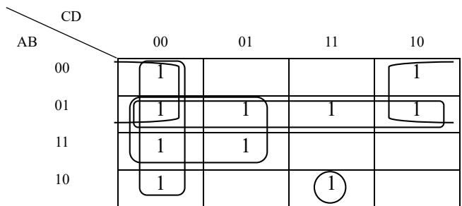
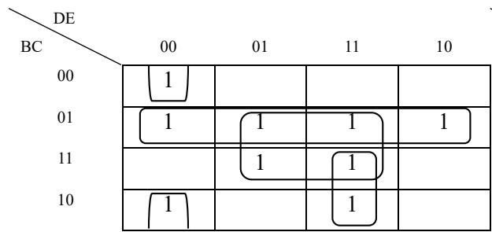
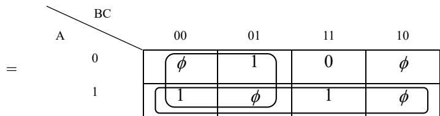

# 《数字电路与逻辑设计B》第2章习题答案

原件经识别和整理；“参考解答”是我们补的。

## 习题目录

- 2.1
- 2.2
- 2.3
- 2.4
- 2.5
- 2.6
- 2.7
- 2.8
- 2.9
- 2.10
- 2.11
- 2.12
- 2.13
- 2.14

### 填空 1

有 A、B、C 三个输入信号，试列出下列问题的真值表，并写出最小项表达式 $\Sigma_{m}$（）。

（1）如果 A、B、C 均为 0 或其中一个信号为 1 时，输出 $F=1$，其余情况下 $F=0$。

（2）若 A、B、C 出现奇数个 0 时输出为 1，其余情况输出为 0。

（3）若 A、B、C 有两个或两个以上为 1 时，输出为 1，其余情况下，输出为 0。

解：（1）

| A | B | C | F |
|---|---|---|---|
| 0 | 0 | 0 | 1 |
| 0 | 0 | 1 | 1 |
| 0 | 1 | 0 | 1 |
| 0 | 1 | 1 | 0 |
| 1 | 0 | 0 | 1 |
| 1 | 0 | 1 | 0 |
| 1 | 1 | 0 | 0 |
| 1 | 1 | 1 | 0 |

（2）

| A | B | C | F |
|---|---|---|---|
| 0 | 0 | 0 | 1 |
| 0 | 0 | 1 | 0 |
| 0 | 1 | 0 | 0 |
| 0 | 1 | 1 | 1 |
| 1 | 0 | 0 | 0 |
| 1 | 0 | 1 | 1 |
| 1 | 1 | 0 | 1 |
| 1 | 1 | 1 | 0 |

（3）

| A | B | C | F |
|---|---|---|---|
| 0 | 0 | 0 | 0 |
| 0 | 0 | 1 | 0 |
| 0 | 1 | 0 | 0 |
| 0 | 1 | 1 | 1 |
| 1 | 0 | 0 | 0 |
| 1 | 0 | 1 | 1 |
| 1 | 1 | 0 | 1 |
| 1 | 1 | 1 | 1 |

$F_{1}(A,B,C)=\Sigma_{m}(0,1,2,4)$，$F_{2}(A,B,C)=\Sigma_{m}(0,3,5,6)$，$F_{3}(A,B,C)=\Sigma_{m}(3,5,6,7)$

知识点：[数字系统的基本模型（数据处理器与控制器）及对最小时钟周期、异步信号同步化的约定](../../../topics/数字逻辑电路/数字系统模型.md)

### 证明 1

试用真值表证明下列等式：

(1) $\overline{A B+B C+A C}=ABC+\overline{A}\ \overline{B}\ \overline{C}$

(2) $\overline{A}\overline{B}+\overline{B}\overline{C}+\overline{A}\overline{C}=\overline{AB}\ \overline{BC}\ \overline{AC}$

证明：（1）

| A | B | C | $\overline{A\overline{B}+B\overline{C}+A\overline{C}}$ |
|---|---|---|---|
| 0 | 0 | 0 | 1 |
| 0 | 0 | 1 | 0 |
| 0 | 1 | 0 | 0 |
| 0 | 1 | 1 | 0 |
| 1 | 0 | 0 | 0 |
| 1 | 0 | 1 | 0 |
| 1 | 1 | 0 | 0 |
| 1 | 1 | 1 | 1 |

| A | B | C | $ABC+\overline{A}\ \overline{B}\ \overline{C}$ |
|---|---|---|---|
| 0 | 0 | 0 | 1 |
| 0 | 0 | 1 | 0 |
| 0 | 1 | 0 | 0 |
| 0 | 1 | 1 | 0 |
| 1 | 0 | 0 | 0 |
| 1 | 0 | 1 | 0 |
| 1 | 1 | 0 | 0 |
| 1 | 1 | 1 | 1 |

真值表相同，所以等式成立。

（2）

| A | B | C | $\overline{A}\ \overline{B}+\overline{B}\ \overline{C}+\overline{A}\ \overline{C}$ |
|---|---|---|---|
| 0 | 0 | 0 | 1 |
| 0 | 0 | 1 | 1 |
| 0 | 1 | 0 | 1 |
| 0 | 1 | 1 | 0 |
| 1 | 0 | 0 | 1 |
| 1 | 0 | 1 | 0 |
| 1 | 1 | 0 | 0 |
| 1 | 1 | 1 | 0 |

| A | B | C | $\overline{AB}\ \overline{BC}\ \overline{AC}$ |
|---|---|---|---|
| 0 | 0 | 0 | 1 |
| 0 | 0 | 1 | 1 |
| 0 | 1 | 0 | 1 |
| 0 | 1 | 1 | 0 |
| 1 | 0 | 0 | 1 |
| 1 | 0 | 1 | 0 |
| 1 | 1 | 0 | 0 |
| 1 | 1 | 1 | 0 |

真值表相同，所以等式成立。

知识点：[完整数字系统设计流程实例（如乘法器、交通灯管理系统的算法规律、处理器设计与控制器实现）](../../../topics/数字逻辑电路/数字系统设计实例.md)

### 简答 1

对下列函数，说明对输入变量的哪些取值组合其输出为 1？

(1) $F(A,B,C)=AB+BC+AC$

(2) $F(A,B,C)=(A+B+C)(\bar{A}+\bar{B}+\bar{C})$

(3) $F(A,B,C)=(\overline{A}B+\overline{B}C+A\overline{C})AC$

解：本题可用真值表、化成最小项表达式、卡诺图等多种方法求解。

（1）$F$ 输出 1 的取值组合为：011、101、110、111。

（2）$F$ 输出 1 的取值组合为：001、010、011、100、101、110。

（3）$F$ 输出 1 的取值组合为：101。

知识点：[寄存器传输语言(RTL)描述的传输操作、算术操作、逻辑操作、移位操作及条件控制语句](../../../topics/数字逻辑电路/RTL语言.md)

### 简答 2

试直接写出下列各式的反演式和对偶式。

(1) $F(A,B,C,D,E)=[(A\bar{B}+C)\cdot D+E]\cdot B$

(2) $F(A,B,C,D,E)=AB+\overline{C}\overline{D}+BC+\overline{D}+\overline{CE}+\overline{B+E}$

(3) $F(A,B,C)=\overline{\overline{A}\overline{B}+C}\ \overline{\overline{\overline{AB}}C}$

解：(1) $\overline{F}=[(\overline{A}+B)\cdot\overline{C}+\overline{D}]\cdot\overline{E}+\overline{B}$，$F'=[(A+\overline{B})\cdot C+D]\cdot E+B$

(2) $\overline{F}=(\overline{A}+\overline{B})(C+D)\cdot(\overline{B}+\overline{C})\cdot D\cdot(C+\overline{E})\cdot\overline{\overline{B}}\cdot\overline{\overline{E}}$，$F'=(A+B)(\overline{C}+\overline{D})\cdot\overline{(B+C)}\cdot\overline{D}\cdot(\overline{C}+E)\cdot\overline{B\cdot\overline{E}}$

(3) $\overline{F}=(A+B)\cdot\overline{C}+A+\overline{B}+C$

$$
F'=\overline{(\bar{A}+\bar{B})\cdot C+\overline{\bar{A}+B}+\bar{C}}
$$

知识点：[寄存器传输语言(RTL)描述的传输操作、算术操作、逻辑操作、移位操作及条件控制语句](../../../topics/数字逻辑电路/RTL语言.md)

### 证明 2

用公式证明下列等式：

(1) $\overline{A}\ \overline{C}+\overline{A}\ \overline{B}+BC+\overline{A}\ \overline{C}\ \overline{D}=\overline{A}+BC$

(2) $AB+\overline{A}C+(\overline{B}+\overline{C})D=AB+\overline{A}C+D$

(3) $\overline{BC}\overline{D}+B\overline{CD}+ACD+\overline{AB}\overline{C}\overline{D}+\overline{A}\overline{BCD}+B\overline{C}\overline{D}+BCD=\overline{BC}+B\overline{C}+BD$

(4) $\overline{A\overline{B}\overline{C}}+\overline{\overline{BC}+BC}\overline{D}+\overline{A\overline{BD}}=\overline{A}+B+\overline{C}+\overline{D}$

## 一、习题解答

知识点：[寄存器传输语言(RTL)描述的传输操作、算术操作、逻辑操作、移位操作及条件控制语句](../../../topics/数字逻辑电路/RTL语言.md)

### 简答 1

题干：（接上文，此处为上一题的推导结果）

$$
= \mathrm{A} \overline {{\mathrm{B}}} \overline {{\mathrm{C}}} + \overline {{\mathrm{A}}} + \mathrm{B} + \overline {{\mathrm{D}}}
$$

$$
= \overline {{{\mathrm{A}}}} + \mathrm{B} + \overline {{{\mathrm{C}}}} + \overline {{{\mathrm{D}}}}
$$

答案：$\overline{A} + B + \overline{C} + \overline{D}$

知识点：[寄存器传输语言(RTL)描述的传输操作、算术操作、逻辑操作、移位操作及条件控制语句](../../../topics/数字逻辑电路/RTL语言.md)

### 证明 2.6

题干：已知 $\overline{ab} + a \overline{b} = a \oplus b, \overline{a} \overline{b} + ab = a \odot b,$ 证明：

(1) $a \oplus b \oplus c = a \odot b \odot c$

(2) $\overline{a\oplus b\oplus c}=\overline{a}\odot\overline{b}\odot\overline{c}$

答案：见参考解答。

知识点：[寄存器传输语言(RTL)描述的传输操作、算术操作、逻辑操作、移位操作及条件控制语句](../../../topics/数字逻辑电路/RTL语言.md)

### 证明 2.7

题干：试证明:

（1）若 $\overline{a}\overline{b}+ab=0$ 则 $\overline{ax+by}=a\overline{x}+b\overline{y}$

（2）若 $\overline{a}b+a\overline{b}=c$ ，则 $\overline{a}c+a\overline{c}=b$

答案：见参考解答。

知识点：[数字系统的基本模型（数据处理器与控制器）及对最小时钟周期、异步信号同步化的约定](../../../topics/数字逻辑电路/数字系统模型.md)

### 计算 2.8

题干：将下列函数展开成最小项之和:

(1) $F (ABC) = A + BC$

(2) $F (ABCD) = (B + \bar{C}) D + ( \bar{A} + B) C$

(3) $\mathrm{F(ABC)} = \overline{\mathrm{A} + \mathrm{B} + \mathrm{C}} +\overline{\mathrm{A} + \mathrm{B}} +\mathrm{C}$

答案：见参考解答。

知识点：[数字系统的基本模型（数据处理器与控制器）及对最小时钟周期、异步信号同步化的约定](../../../topics/数字逻辑电路/数字系统模型.md)、[寄存器传输语言(RTL)描述的传输操作、算术操作、逻辑操作、移位操作及条件控制语句](../../../topics/数字逻辑电路/RTL语言.md)、[算法状态机(ASM)图的状态框、判断框、条件输出框及ASM块的构成规则](../../../topics/数字逻辑电路/ASM图基础.md)

### 计算 2.9

题干：将题 2.8 中各题写成最大项表达式，并将结果与 2.8 题结果进行比较。

答案：见参考解答。

知识点：[根据文字描述建立ASM图的原则，以及从ASM图推导处理器明细表和控制器状态转移图](../../../topics/数字逻辑电路/ASM图建立与分析.md)

### 计算 2.10

题干：试写出下列各函数表达式 F 的 $\bar{F}$ 和 $F'$ 的最小项表达式。

(1) $F=ABCD+ACD+B \overline{C} \overline{D}$

(2) $F=A \overline{B}+\overline{A}B+BC$

答案：见参考解答。

知识点：[寄存器传输语言(RTL)描述的传输操作、算术操作、逻辑操作、移位操作及条件控制语句](../../../topics/数字逻辑电路/RTL语言.md)

### 化简 2.11

题干：试用公式法把下列各表达式化简为最简与或式

(1) $F=A+AB \overline{C} +ABC+BC+B$

(2) $F=(A+B)(A+B+C)( \overline{A} +C)(B+C+D)$

(3) $F=AB+ \overline{A} \overline{B} \cdot \overline{BC} + \overline{B} \overline{C}$

(4) $F=A \overline{C} \overline{D} +BC+ \overline{BD} +A \overline{B} + \overline{AC} + \overline{B} \overline{C}$

(5) $F=AC+ \overline{BC} +B(A \overline{C} + \overline{AC})$

答案：见参考解答。

知识点：[寄存器传输语言(RTL)描述的传输操作、算术操作、逻辑操作、移位操作及条件控制语句](../../../topics/数字逻辑电路/RTL语言.md)、[数字系统的基本模型（数据处理器与控制器）及对最小时钟周期、异步信号同步化的约定](../../../topics/数字逻辑电路/数字系统模型.md)

### 化简 2.12

题干：用卡诺图把下列函数化简为最简与或式

(1) $\mathrm{F}(\mathrm{A},\mathrm{B},\mathrm{C})=\sum_{m}(0,1,2,4,5,7)$

(2) $F(A,B,C,D)=\sum_{m}(0,2,5,6,7,9,10,14,15)$

(3) $\mathrm{F(A,B,C,D)} = \sum_{m}(0,1,4,7,9,10,13) + \sum_{\phi}(2,5,8,12,15)$

答案：见参考解答。

知识点：[数字系统的基本模型（数据处理器与控制器）及对最小时钟周期、异步信号同步化的约定](../../../topics/数字逻辑电路/数字系统模型.md)

### 计算 1

题干：用卡诺图化简函数 $F$。
$$
\begin{array}{|c|c|c|c|c|}
\hline
AB \backslash CD & 00 & 01 & 11 & 10 \\
\hline
00 & 1 & & & 1 \\
\hline
01 & & 1 & 1 & 1 \\
\hline
11 & & & 1 & 1 \\
\hline
10 & & 1 & & 1 \\
\hline
\end{array}
$$

答案：$F=\overline{C}+BD+\overline{B}\overline{D}$

知识点：[根据文字描述建立ASM图的原则，以及从ASM图推导处理器明细表和控制器状态转移图](../../../topics/数字逻辑电路/ASM图建立与分析.md)

### 计算 2

题干：用卡诺图化简函数 $F$，其中包含无关项 $\phi$。
$$
\begin{array}{|c|c|c|c|c|}
\hline
AB \backslash CD & 00 & 01 & 11 & 10 \\
\hline
00 & 1 & 1 & & \phi \\
\hline
01 & 1 & \phi & 1 & \\
\hline
11 & \phi & 1 & \phi & \\
\hline
10 & \phi & 1 & & 1 \\
\hline
\end{array}
$$

答案：无具体最简式给出，仅展示卡诺图。

知识点：[根据文字描述建立ASM图的原则，以及从ASM图推导处理器明细表和控制器状态转移图](../../../topics/数字逻辑电路/ASM图建立与分析.md)

### 计算 3

题干：$\mathrm{F}(\mathrm{A},\mathrm{B},\mathrm{C},\mathrm{D}) = \sum_{m}(7,13,15)$ 且约束条件为 $\overline{A} \overline{B} \overline{C} = 0, \overline{A} B \overline{C} = 0, \overline{A} \overline{B} C = 0$。

答案：$F(A,B,C,D)=BD$

知识点：[完整数字系统设计流程实例（如乘法器、交通灯管理系统的算法规律、处理器设计与控制器实现）](../../../topics/数字逻辑电路/数字系统设计实例.md)

### 计算 4

题干：用卡诺图化简函数 $F$，所有最小项均为无关项或特定值。
$$
\begin{array}{|c|c|c|c|c|}
\hline
AB \backslash CD & 00 & 01 & 11 & 10 \\
\hline
00 & \phi & \phi & \phi & \phi \\
\hline
01 & \phi & \phi & 1 & \\
\hline
11 & & 1 & 1 & \\
\hline
10 & & & & \\
\hline
\end{array}
$$

答案：无具体最简式给出，仅展示卡诺图。

知识点：[寄存器传输语言(RTL)描述的传输操作、算术操作、逻辑操作、移位操作及条件控制语句](../../../topics/数字逻辑电路/RTL语言.md)

### 计算 5

题干：$F(A,B,C,D)=AB \overline{C}+A \overline{B} \overline{C}+\overline{A} \overline{BC} \overline{D}+A \overline{BC} \overline{D}$ 且 ABCD 不可同时为 1 或同时为 0。

答案：$F(A,B,C,D)= \overline{B} \overline{D}+A \overline{C}$

知识点：[数字系统的基本模型（数据处理器与控制器）及对最小时钟周期、异步信号同步化的约定](../../../topics/数字逻辑电路/数字系统模型.md)

### 计算 6

题干：用卡诺图化简函数 $F$。
$$
\begin{array}{|c|c|c|c|c|}
\hline
AB \backslash CD & 00 & 01 & 11 & 10 \\
\hline
00 & \phi & & & 1 \\
\hline
01 & & & & \\
\hline
11 & 1 & 1 & \phi & \\
\hline
10 & 1 & 1 & & 1 \\
\hline
\end{array}
$$

答案：无具体最简式给出，仅展示卡诺图。

### 计算 7

题干：$\mathrm{F}(\mathrm{A},\mathrm{B},\mathrm{C},\mathrm{D})=\prod_{M}(5,7,13,15)$。

答案：$F=\overline{B}+\overline{D}$

### 计算 8

题干：当 $A=1$ 时，用卡诺图化简函数 $F$。
$$
\begin{array}{|c|c|c|c|c|}
\hline
AB \backslash CD & 00 & 01 & 11 & 10 \\
\hline
00 & 1 & 1 & 1 & 1 \\
\hline
01 & 1 & & & 1 \\
\hline
11 & 1 & & & 1 \\
\hline
10 & 1 & 1 & 1 & 1 \\
\hline
\end{array}
$$

答案：无具体最简式给出，仅展示卡诺图。

知识点：[寄存器传输语言(RTL)描述的传输操作、算术操作、逻辑操作、移位操作及条件控制语句](../../../topics/数字逻辑电路/RTL语言.md)、[算法状态机(ASM)图的状态框、判断框、条件输出框及ASM块的构成规则](../../../topics/数字逻辑电路/ASM图基础.md)

### 计算 9

题干：$\mathrm{F}(\mathrm{A},\mathrm{B},\mathrm{C},\mathrm{D})=\prod_{M}(1,3,9,10,14,15)$。

答案：$F=\overline{A}\overline{D}+\overline{A}B+\overline{C}\overline{D}+B\overline{C}+A\overline{B}CD$

知识点：[数字系统的基本模型（数据处理器与控制器）及对最小时钟周期、异步信号同步化的约定](../../../topics/数字逻辑电路/数字系统模型.md)

### 计算 10

题干：$F(A,B,C,D,E)= \sum_{m}(0,4,5,6,7,8,11,13,15,16,20,21,22,23,24,25,27,29,31)$。

答案：$F=\overline{C}\overline{D}\overline{E}+\overline{B}C+CE+BDE+ABE$

## 2.13 用卡诺图将下列函数化为最简或与式

知识点：[完整数字系统设计流程实例（如乘法器、交通灯管理系统的算法规律、处理器设计与控制器实现）](../../../topics/数字逻辑电路/数字系统设计实例.md)

### 选择 1

题干：$\mathrm{F}(\mathrm{A},\mathrm{B},\mathrm{C})=\sum_{m}(0,1,2,4,5,7)$

答案：$\mathrm{F} = (\mathrm{A} + \overline{\mathrm{B}} + \overline{\mathrm{C}})(\overline{\mathrm{A}} + \overline{\mathrm{B}} + \mathrm{C})$

$$
\begin{array}{|c|c|c|c|c|}
\hline
A \backslash BC & 00 & 01 & 11 & 10 \\
\hline
0 & 1 & 1 & 0 & 1 \\
\hline
1 & 1 & 1 & 1 & 0 \\
\hline
\end{array}
$$

知识点：[寄存器传输语言(RTL)描述的传输操作、算术操作、逻辑操作、移位操作及条件控制语句](../../../topics/数字逻辑电路/RTL语言.md)

### 选择 2

题干：$\mathrm{F}(\mathrm{A},\mathrm{B},\mathrm{C})=\prod_{M}(5,7,13,15)$

答案：$\mathrm{F} = (\bar{\mathrm{B}} + \bar{\mathrm{D}})$

$$
\begin{array}{|c|c|c|c|c|}
\hline
AB \backslash CD & 00 & 01 & 11 & 10 \\
\hline
00 & & & & \\
\hline
01 & & 0 & 0 & \\
\hline
11 & & 0 & 0 & \\
\hline
10 & & & & \\
\hline
\end{array}
$$

## 2.14 已知： $F_{1}(A,B,C)=\sum_{m}(1,2,3,5,7)+\sum_{\phi}(0,6)$ ， $F_{2}(A,B,C)=\sum_{m}(0,3,4,6)+\sum_{\phi}(2,5)$ ，求 $F=F_{1}\oplus F_{2}$ 的最简与或式

答案：$F=A+\bar{B}$

$$
\begin{array}{|c|c|c|c|c||c|c|c|c|c|}
\hline
A \backslash BC & 00 & 01 & 11 & 10 & A \backslash BC & 00 & 01 & 11 & 10 \\
\hline
0 & \phi & 1 & 1 & 1 & 0 & 1 & & 1 & \phi \\
\hline
1 & & 1 & 1 & \phi & \oplus \quad 1 & 1 & \phi & & 1 \\
\hline
\end{array}
$$

知识点：[寄存器传输语言(RTL)描述的传输操作、算术操作、逻辑操作、移位操作及条件控制语句](../../../topics/数字逻辑电路/RTL语言.md)
