# 《数字电路与逻辑设计B》第3章 MSI组合逻辑电路（二）：译码器（课件）

原件的每一页，下面附识别出的文字。

### 二、 译码器

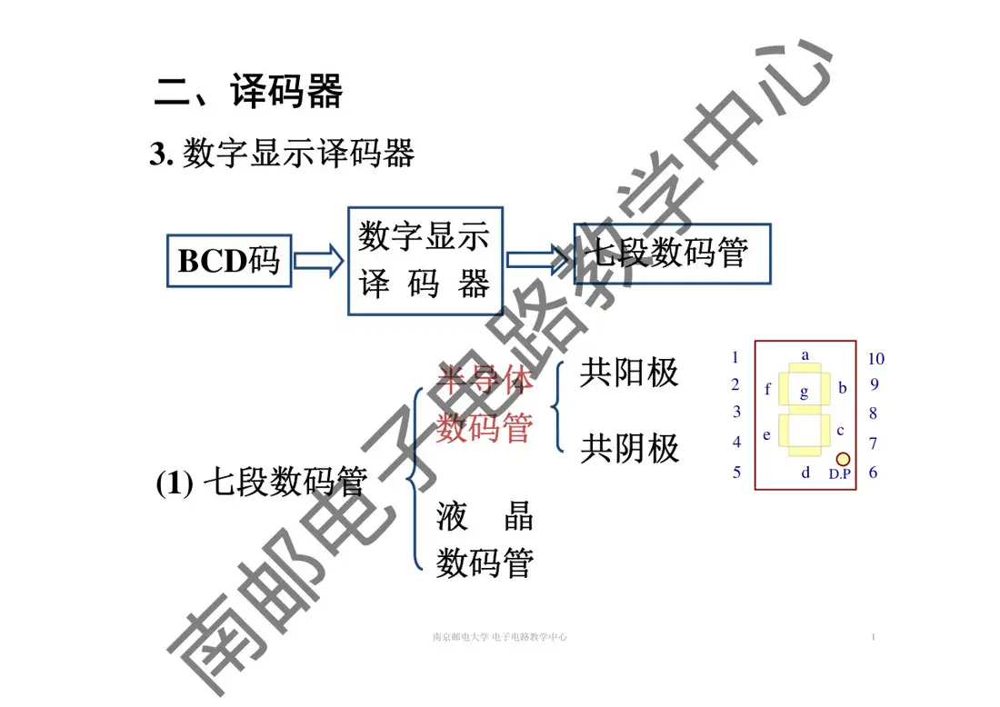

原文：

二、 译码器

3. 数字显示译码器

数字显示译 码 器

(1) 七段数码管

南京邮电大学 电子电路教学中心

1

### 南京邮电大学 电子电路教学中心

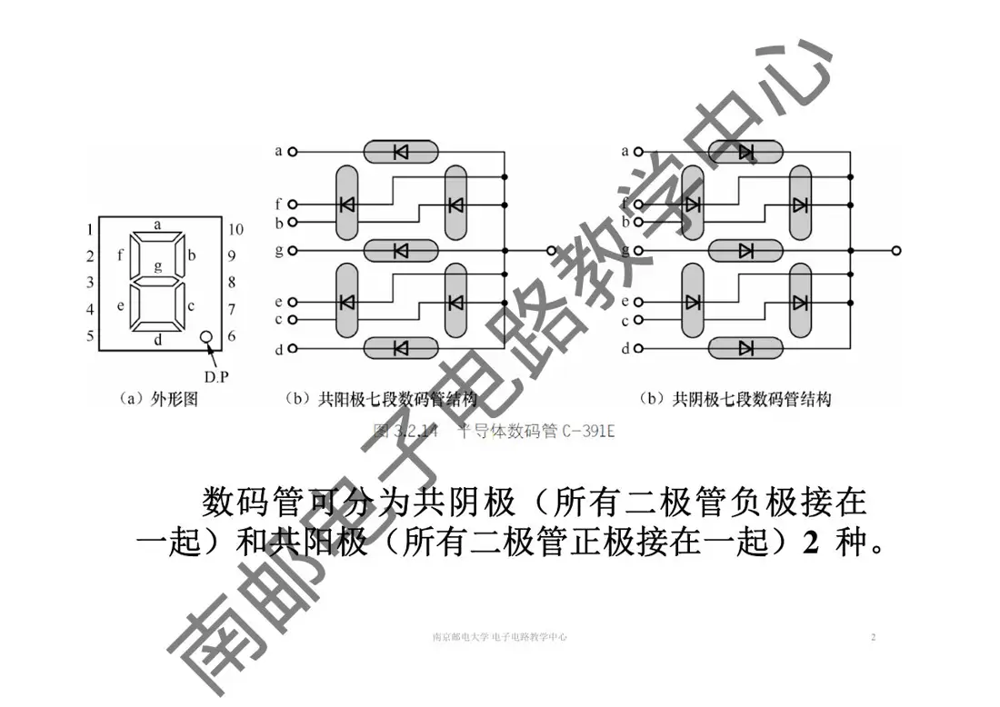

原文：

数码管可分为共阴极 （ 所有 极管负极接在二一起） 和共阳极 （所有二极管正极接在一起） 2 种。

南京邮电大学 电子电路教学中心

2

### (a) 逻辑图

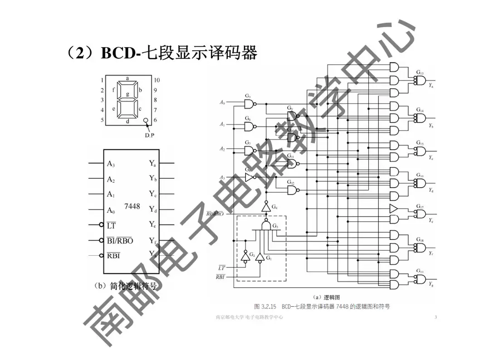

原文：

(a) 逻辑图

（2） BCD-七段显示译码器

(b) 简化逻辑符号

图 3.2.15 BCD-七段显示译码器7448 的逻辑图和符号

南京邮电大学 电子电路教学中心

3

### 123456789-3

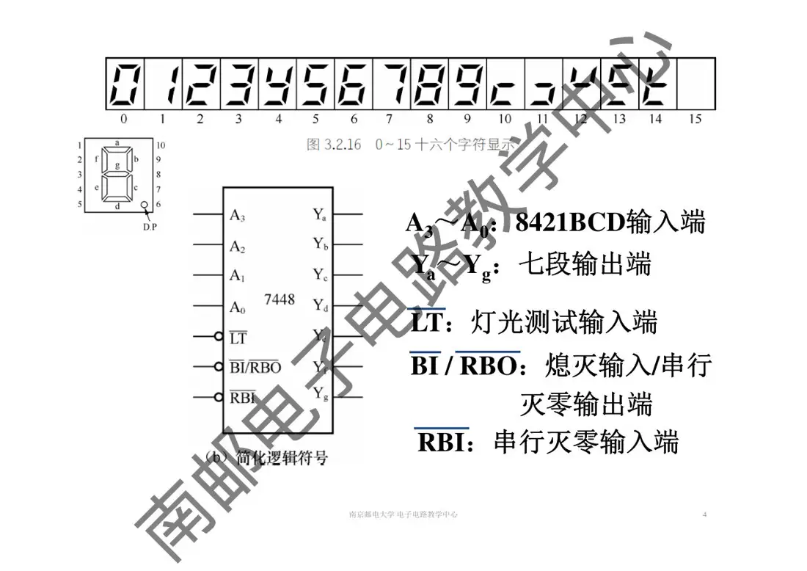

原文：

123456789-3

8421BCD输入端

Yg： 七段输出端

LT： 灯光测试输入端

BI / RBO： 熄灭输入/串 行灭零输出端

（b）简化逻辑符号

RBI： 串行灭零输入端

4

南京邮电大学 电子电路教学中心

### (b) 简化逻辑符号

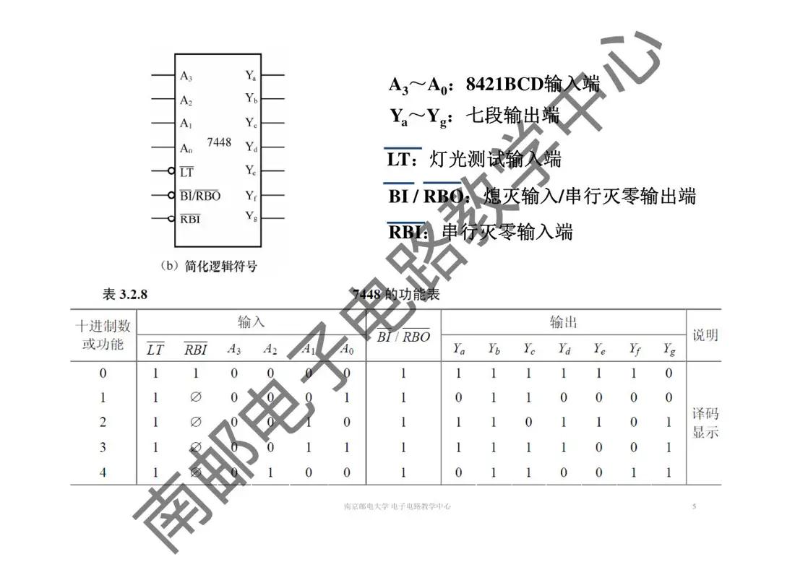

原文：

(b) 简化逻辑符号

${ \bf A } _ { 3 } \widetilde { \bf \Gamma } \sim { \bf A _ { 0 } } { \bf : \Gamma }$ 8421BCD 输入端

$\bf Y _ { a } \sim Y _ { g }$ ： 七段输出端

LT： 灯光测试输入端

BI / RBO： 熄灭输入/串 行灭零输出端

RBI： 串行灭零输入端

表3.2.8 7448的功能表
<table><tr><td rowspan="2">十进制数或功能</td><td colspan="6">输入</td><td rowspan="2"> $\overline{BI/RBO}$ </td><td colspan="7">输出</td><td rowspan="2">说明</td></tr><tr><td> $\overline{LT}$ </td><td> $\overline{RBI}$ </td><td> $A_3$ </td><td> $A_2$ </td><td> $A_1$ </td><td> $A_0$ </td><td> $Y_a$ </td><td> $Y_b$ </td><td> $Y_c$ </td><td> $Y_d$ </td><td> $Y_e$ </td><td> $Y_f$ </td><td> $Y_g$ </td></tr><tr><td>0</td><td>1</td><td>1</td><td>0</td><td>0</td><td>0</td><td>0</td><td>1</td><td>1</td><td>1</td><td>1</td><td>1</td><td>1</td><td>1</td><td>0</td><td rowspan="5">译码显示</td></tr><tr><td>1</td><td>1</td><td>∅</td><td>0</td><td>0</td><td>0</td><td>1</td><td>1</td><td>0</td><td>1</td><td>1</td><td>0</td><td>0</td><td>0</td><td>0</td></tr><tr><td>2</td><td>1</td><td>∅</td><td>0</td><td>0</td><td>1</td><td>0</td><td>1</td><td>1</td><td>1</td><td>0</td><td>1</td><td>1</td><td>0</td><td>1</td></tr><tr><td>3</td><td>1</td><td>∅</td><td>0</td><td>0</td><td>1</td><td>1</td><td>1</td><td>1</td><td>1</td><td>1</td><td>1</td><td>0</td><td>0</td><td>1</td></tr><tr><td>4</td><td>1</td><td>∅</td><td>0</td><td>1</td><td>0</td><td>0</td><td>1</td><td>0</td><td>1</td><td>1</td><td>0</td><td>0</td><td>1</td><td>1</td></tr></table>

南京邮电大学 电子电路教学中心

5

### 续表

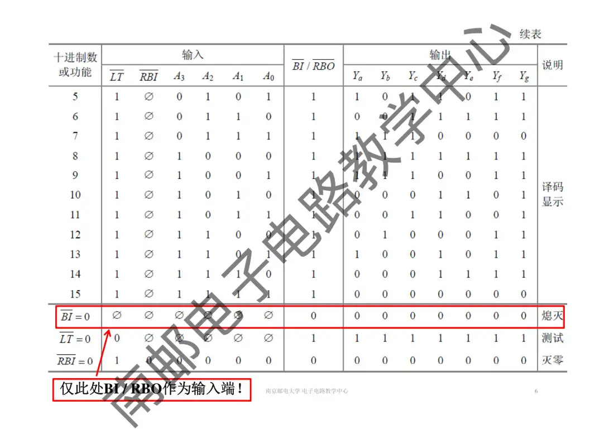

原文：

续表

<table><tr><td rowspan="2">十进制数或功能</td><td colspan="6">输入</td><td rowspan="2"> $\overline{BI}/\overline{RBO}$ </td><td colspan="7">输出</td><td rowspan="2">说明</td></tr><tr><td> $\overline{LT}$ </td><td> $\overline{RBI}$ </td><td> $A_3$ </td><td> $A_2$ </td><td> $A_1$ </td><td> $A_0$ </td><td> $Y_a$ </td><td> $Y_b$ </td><td> $Y_c$ </td><td> $Y_d$ </td><td> $Y_e$ </td><td> $Y_f$ </td><td> $Y_g$ </td></tr><tr><td>5</td><td>1</td><td>∅</td><td>0</td><td>1</td><td>0</td><td>1</td><td>1</td><td>1</td><td>0</td><td>1</td><td>1</td><td>0</td><td>1</td><td>1</td><td rowspan="11">译码显示</td></tr><tr><td>6</td><td>1</td><td>∅</td><td>0</td><td>1</td><td>1</td><td>0</td><td>1</td><td>0</td><td>0</td><td>1</td><td>1</td><td>1</td><td>1</td><td>1</td></tr><tr><td>7</td><td>1</td><td>∅</td><td>0</td><td>1</td><td>1</td><td>1</td><td>1</td><td>1</td><td>1</td><td>1</td><td>0</td><td>0</td><td>0</td><td>0</td></tr><tr><td>8</td><td>1</td><td>∅</td><td>1</td><td>0</td><td>0</td><td>0</td><td>1</td><td>1</td><td>1</td><td>1</td><td>1</td><td>1</td><td>1</td><td>1</td></tr><tr><td>9</td><td>1</td><td>∅</td><td>1</td><td>0</td><td>0</td><td>1</td><td>1</td><td>1</td><td>1</td><td>1</td><td>0</td><td>0</td><td>1</td><td>1</td></tr><tr><td>10</td><td>1</td><td>∅</td><td>1</td><td>0</td><td>1</td><td>0</td><td>1</td><td>0</td><td>0</td><td>0</td><td>1</td><td>1</td><td>0</td><td>1</td></tr><tr><td>11</td><td>1</td><td>∅</td><td>1</td><td>0</td><td>1</td><td>1</td><td>1</td><td>0</td><td>0</td><td>1</td><td>1</td><td>0</td><td>0</td><td>1</td></tr><tr><td>12</td><td>1</td><td>∅</td><td>1</td><td>1</td><td>0</td><td>0</td><td>1</td><td>0</td><td>1</td><td>0</td><td>0</td><td>0</td><td>1</td><td>1</td></tr><tr><td>13</td><td>1</td><td>∅</td><td>1</td><td>1</td><td>0</td><td>1</td><td>1</td><td>1</td><td>0</td><td>0</td><td>1</td><td>0</td><td>1</td><td>1</td></tr><tr><td>14</td><td>1</td><td>∅</td><td>1</td><td>1</td><td>1</td><td>0</td><td>1</td><td>0</td><td>0</td><td>0</td><td>1</td><td>1</td><td>1</td><td>1</td></tr><tr><td>15</td><td>1</td><td>∅</td><td>1</td><td>1</td><td>1</td><td>1</td><td>1</td><td>0</td><td>0</td><td>0</td><td>0</td><td>0</td><td>0</td><td>0</td></tr><tr><td> $\overline{BI}=0$ </td><td>∅</td><td>∅</td><td>∅</td><td>∅</td><td>∅</td><td>∅</td><td>0</td><td>0</td><td>0</td><td>0</td><td>0</td><td>0</td><td>0</td><td>0</td><td>熄灭</td></tr><tr><td> $\overline{LT}=0$ </td><td>0</td><td>∅</td><td>∅</td><td>∅</td><td>∅</td><td>∅</td><td>1</td><td>1</td><td>1</td><td>1</td><td>1</td><td>1</td><td>1</td><td>1</td><td rowspan="2">测试灭零</td></tr><tr><td> $\overline{RBI}=0$ </td><td>1</td><td>0</td><td>0</td><td>0</td><td>0</td><td>0</td><td>0</td><td>0</td><td>0</td><td>0</td><td>0</td><td>0</td><td>0</td><td>0</td></tr></table>

仅此处BI / RBO作为输入端 ！

南京邮电大学 电子电路教学中心

6

### 辅助端功能

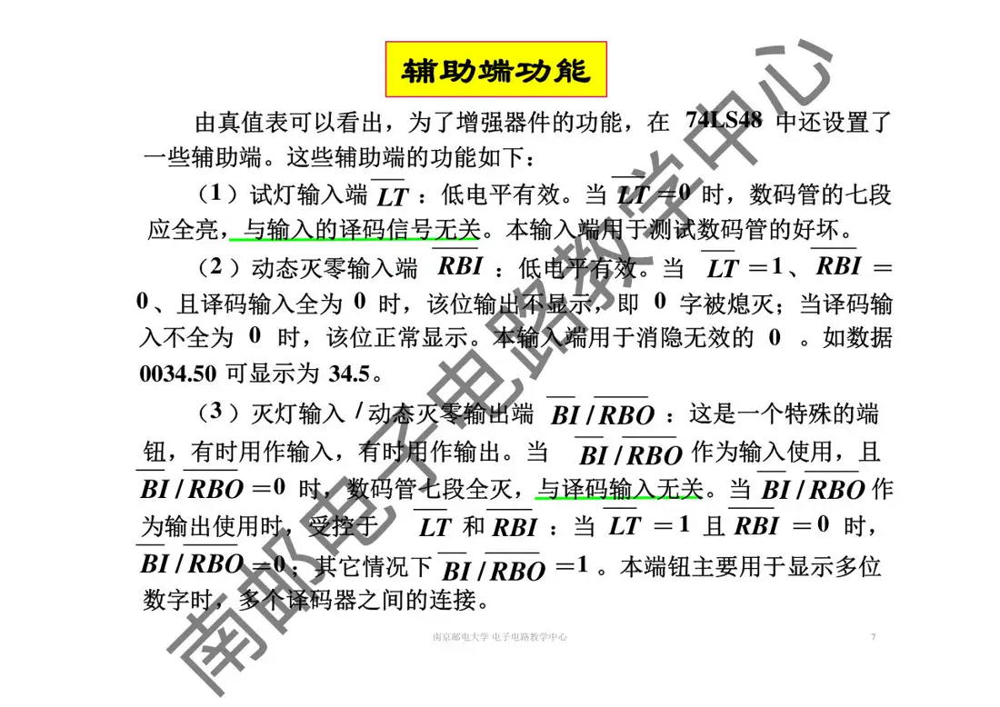

原文：

辅助端功能

由真值表可以看出 ， 为了增强器件的功能， 在 74LS48 中还设置了一些辅助端。 这些辅助端的功能如下：

（1 ） 试灯输入端 $L T$ ： 低 电平有效。 当 $\mathbf { \mathcal { L } } \mathbf { \mathcal { N } } { \boldsymbol { \sharp } } \mathbf { \mathcal { \mathbf { \ell } } } $ 时， 数码管的七段应全亮， 与输入的译码信号无关。 本输入端用于测试数码管的好坏。

（2 ） 动态灭零输入端 RBI ： 低 电平有效。 当 $L T = 1$ $R B I =$ 0 且译码输入全为 0 时， 该位输出不显示， 即 0 字被熄灭； 当译码输入不全为 0 时， 该位正常显示。 本输入端用于消隐无效的 0 。 如数据0034 50 可显示为 34 5 。

（3 ） 灭灯输入 / 动态灭零输出端 $B I / R B O$ ： 这是一个特殊的端钮， 有时用作输入， 有时用作输出 。 当 $\overline { { B I } } / \overline { { R B O } }$ 作为输入使用 ， 且$B I / R B O = \mathbf { 0 }$ 时， 数码管七段全灭， 与译码输入无关。 当 $B I / R B O$ 作为输出使用时， 受控于 $\overline { { L T } }$ 和 RBI ： 当 $L T = 1$ 且 $R B I = 0$ 时 ，$B I / R B O = 0 . ^ { \circ }$ ； 其它情况下 $\overline { { B I } } / \overline { { R B O } } = { \bf 1 }$ 。 本端钮主要用于显示多位数字时 多个译码器之间的连接， 。

南京邮电大学 电子电路教学中心

7

### 南京邮电大学 电子电路教学中心

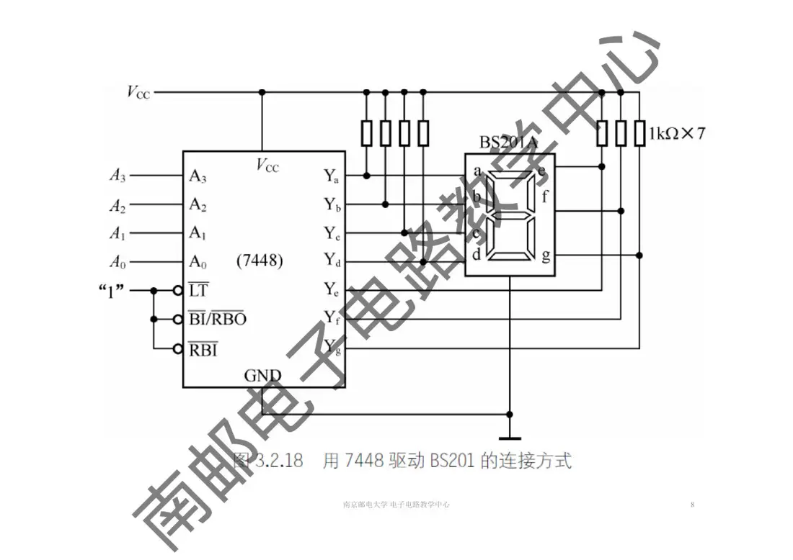

原文：

南京邮电大学 电子电路教学中心

8

### 南京邮电大学 电子电路教学中心

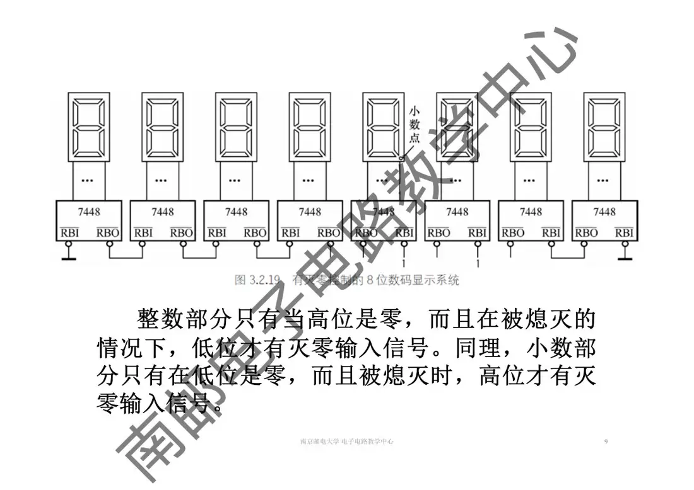

原文：

整数部分只有当高位是零， 而且在被熄灭的情况下， 低位才有灭零输入信号 。 同理， 小数部分只有在低位是零， 而且被熄灭时， 高位才有灭零输入信号。

南京邮电大学 电子电路教学中心

9

### 3 2 3. . 数据选择器

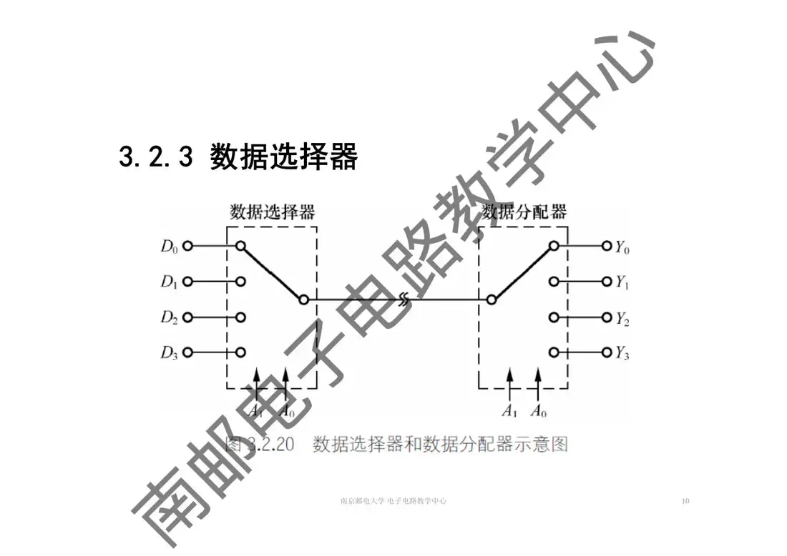

原文：

3 2 3. . 数据选择器

南京邮电大学 电子电路教学中心

1 0

### 1. 四选一数据选择器

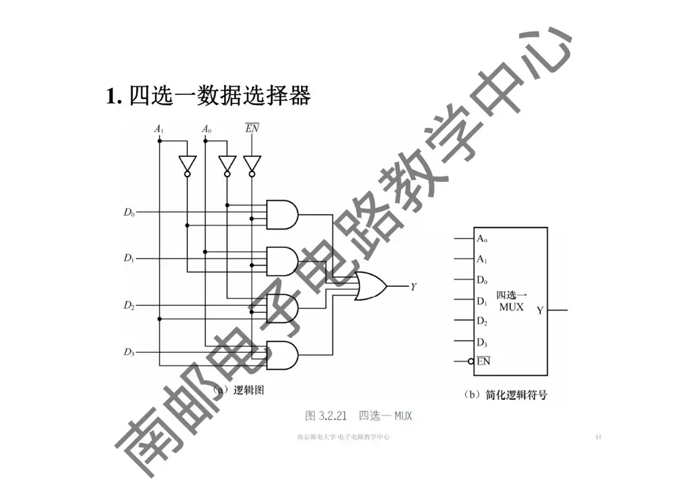

原文：

1. 四选一数据选择器

1 1

### 表 4 2 9. . 四选一MUX的功能表

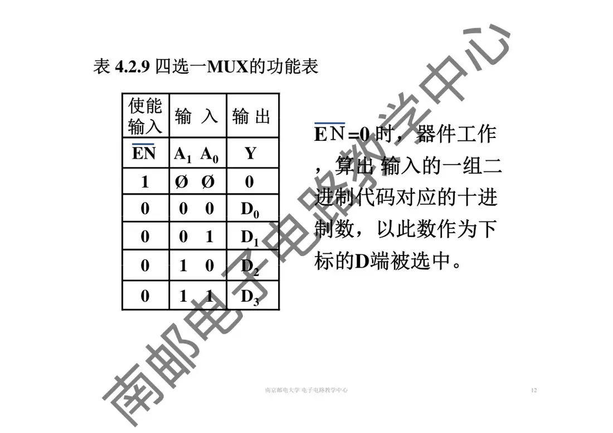

原文：

表 4 2 9. . 四选一MUX的功能表
<table><tr><td>使能输入</td><td>输入</td><td>输出</td></tr><tr><td> $\overline{EN}$ </td><td> $A_1$   $A_0$ </td><td>Y</td></tr><tr><td>1</td><td>∅ ∅</td><td>0</td></tr><tr><td>0</td><td>0 0</td><td> $D_0$ </td></tr><tr><td>0</td><td>0 1</td><td> $D_1$ </td></tr><tr><td>0</td><td>1 0</td><td> $D_2$ </td></tr><tr><td>0</td><td>1 1</td><td> $D_3$ </td></tr></table>

$\bf \overline { { E } } N \bf { \overline { { { \equiv } } } 0 }$ 时， 器件工作算出 输入的一组二进制代码对应的十进制数， 以此数作为下标的D端被选中 。

南京邮电大学 电子电路教学中心

1 2

### 四选一MUX的卡诺图

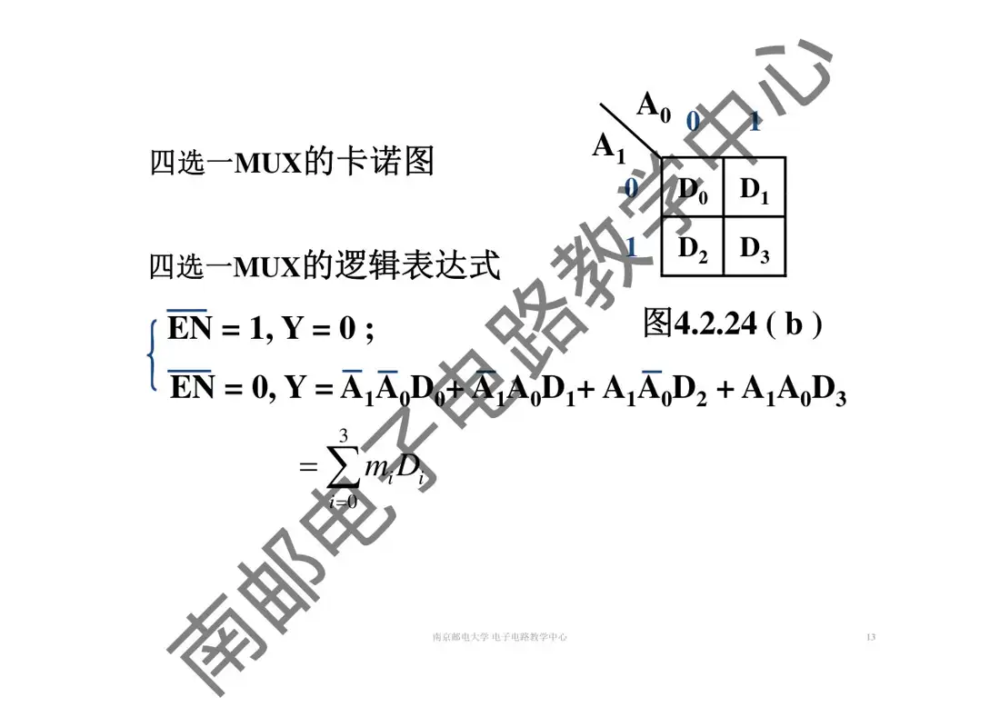

原文：

四选一MUX的卡诺图

四选一MUX的逻辑表达式

$$
\left\{ \begin{array}{l} \overline {{\mathbf {E N}}} = \mathbf {1}, \mathbf {Y} = \mathbf {0}; \\ \overline {{\mathbf {E N}}} = \mathbf {0}, \mathbf {Y} = \overline {{\mathbf {A}}} _ {\mathbf {1}} \overline {{\mathbf {A}}} _ {\mathbf {0}} \mathbf {D} _ {\mathbf {0}} \\ = \sum_ {i = 1} ^ {3} m _ {i} D _ {i} \end{array} \right.
$$

$$
\mathbf {A} _ {0} \mathbf {D} _ {1} + \mathbf {A} _ {1} \overline {{\mathbf {A}}} _ {0} \mathbf {D} _ {2} + \mathbf {A} _ {1} \mathbf {A} _ {0} \mathbf {D} _ {3}
$$

南京邮电大学 电子电路教学中心

1 3

### 74153的简化逻辑符号（双四选一）

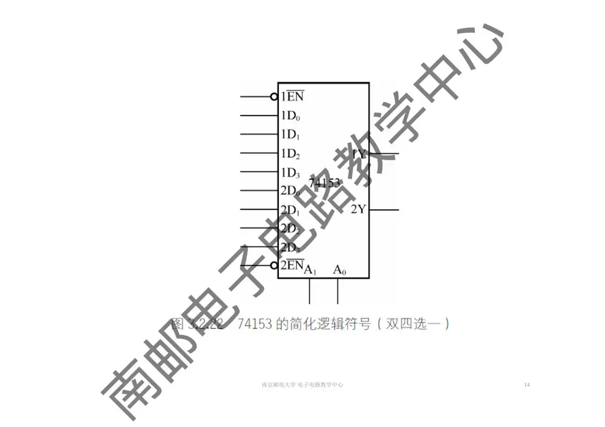

原文：

74153的简化逻辑符号（双四选一）

南京邮电大学 电子电路教学中心

1 4

### 2. 八选 数据选择器一

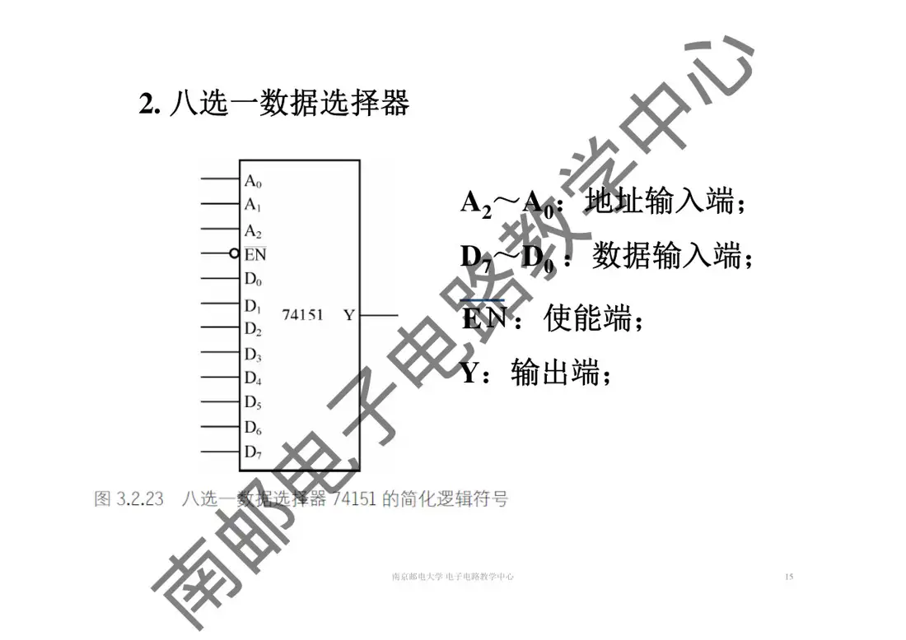

原文：

2. 八选 数据选择器一

A2～A0： 地址输入端；

D D 数据输入端7～ 0 ： ；

EN ： 使能端 ；

Y： 输出端；

图 3.2.23 八选一数据选择器 74151 的简化逻辑符号

南京邮电大学 电子电路教学中心

1 5

### 八选一MUX的功能表

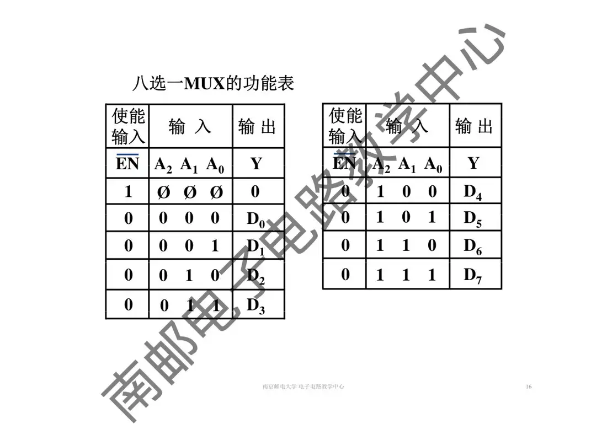

原文：

八选一MUX的功能表

<table><tr><td>使能输入</td><td>输入</td><td>输出</td></tr><tr><td> $\overline{EN}$ </td><td> $A_{2}$   $A_{1}$   $A_{0}$ </td><td>Y</td></tr><tr><td>1</td><td>∅ ∅ ∅</td><td>0</td></tr><tr><td>0</td><td>0 0 0</td><td> $D_{0}$ </td></tr><tr><td>0</td><td>0 0 1</td><td> $D_{1}$ </td></tr><tr><td>0</td><td>0 1 0</td><td> $D_{2}$ </td></tr><tr><td>0</td><td>0 1 1</td><td> $D_{3}$ </td></tr></table>

<table><tr><td>使能输入</td><td>输入</td><td>输出</td></tr><tr><td> $\overline{EN}$ </td><td> $A_{2}$   $A_{1}$   $A_{0}$ </td><td>Y</td></tr><tr><td>0</td><td>1 0 0</td><td> $D_{4}$ </td></tr><tr><td>0</td><td>1 0 1</td><td> $D_{5}$ </td></tr><tr><td>0</td><td>1 1 0</td><td> $D_{6}$ </td></tr><tr><td>0</td><td>1 1 1</td><td> $D_{7}$ </td></tr></table>

南京邮电大学 电子电路教学中心

1 6

### 八选一MUX的卡诺图

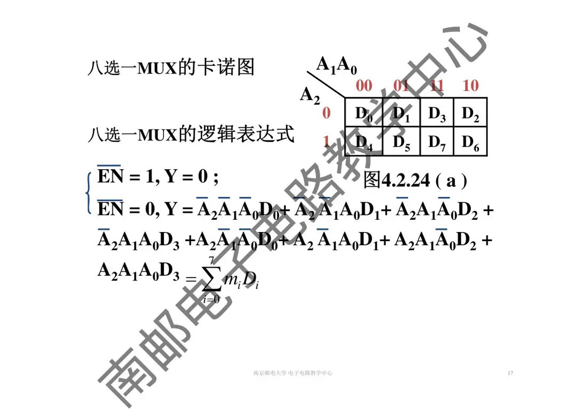

原文：

八选一MUX的卡诺图

八选一MUX的逻辑表达式

$$
\left\{ \begin{array}{l} \overline {{\mathbf {E N}}} = 1, \mathbf {Y} = \mathbf {0}; \\ \overline {{\mathbf {E N}}} = \mathbf {0}, \mathbf {Y} = \overline {{\mathbf {A}}} _ {2} \overline {{\mathbf {A}}} _ {1} \overline {{\mathbf {A}}} _ {0} \mathbf {D} _ {0} + \overline {{\mathbf {A}}} _ {2} \overline {{\mathbf {A}}} _ {1} \mathbf {A} _ {0} \mathbf {D} _ {1} + \overline {{\mathbf {A}}} _ {2} \mathbf {A} _ {1} \overline {{\mathbf {A}}} _ {0} \mathbf {D} _ {2} + \\ \overline {{\mathbf {A}}} _ {2} \mathbf {A} _ {1} \mathbf {A} _ {0} \mathbf {D} _ {3} + \mathbf {A} _ {2} \overline {{\mathbf {A}}} _ {1} \overline {{\mathbf {A}}} _ {0} \mathbf {D} _ {0} + \mathbf {A} _ {2} \overline {{\mathbf {A}}} _ {1} \mathbf {A} _ {0} \mathbf {D} _ {1} + \mathbf {A} _ {2} \mathbf {A} _ {1} \overline {{\mathbf {A}}} _ {0} \mathbf {D} _ {2} + \\ \mathbf {A} _ {2} \mathbf {A} _ {1} \mathbf {A} _ {0} \mathbf {D} _ {3} = \sum m _ {i} D _ {i} \end{array} \right. \tag {4.2.24(a)}
$$

南京邮电大学 电子电路教学中心

1 7

### A4A3A2A1A000∅∅∅01∅∅∅10∅∅∅11∅∅∅

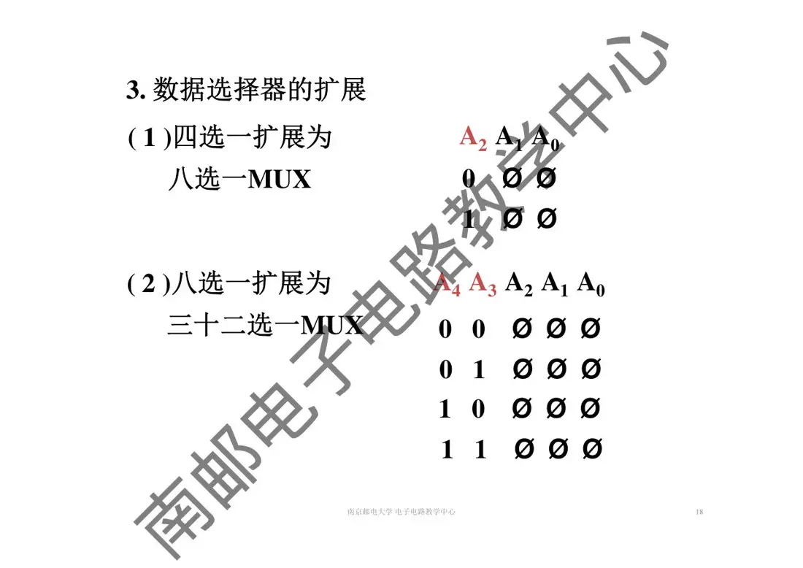

原文：

<table><tr><td>A4</td><td>A3</td><td>A2</td><td>A1</td><td>A0</td></tr><tr><td>0</td><td>0</td><td>∅</td><td>∅</td><td>∅</td></tr><tr><td>0</td><td>1</td><td>∅</td><td>∅</td><td>∅</td></tr><tr><td>1</td><td>0</td><td>∅</td><td>∅</td><td>∅</td></tr><tr><td>1</td><td>1</td><td>∅</td><td>∅</td><td>∅</td></tr></table>

3. 数据选择器的扩展

( 1 )四选一扩展为 八选一MUX

( 2 )八选 扩展为一 三十二选一MUX

南京邮电大学 电子电路教学中心

1 8

### 南京邮电大学 电子电路教学中心

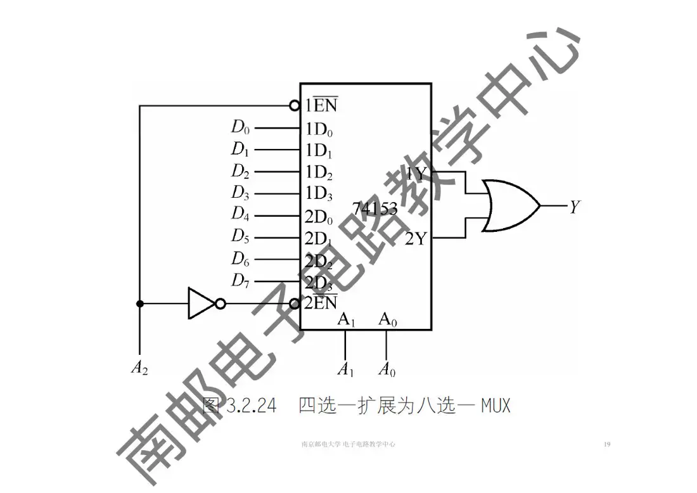

原文：

南京邮电大学 电子电路教学中心

1 9

### 南京邮电大学 电子电路教学中心

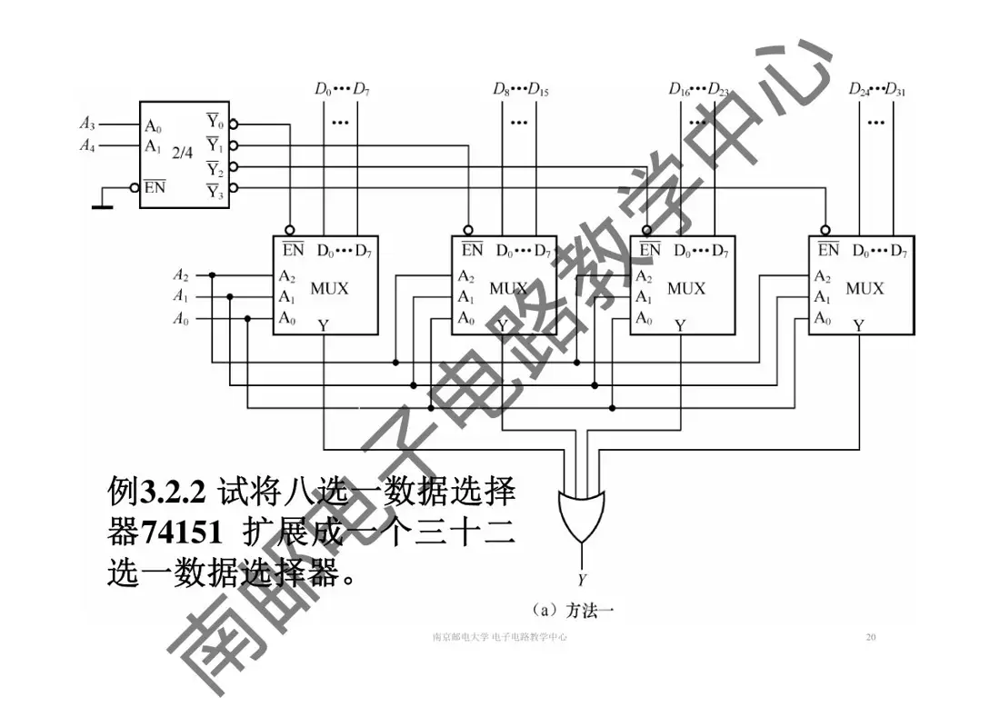

原文：

南京邮电大学 电子电路教学中心

20

### 2 1

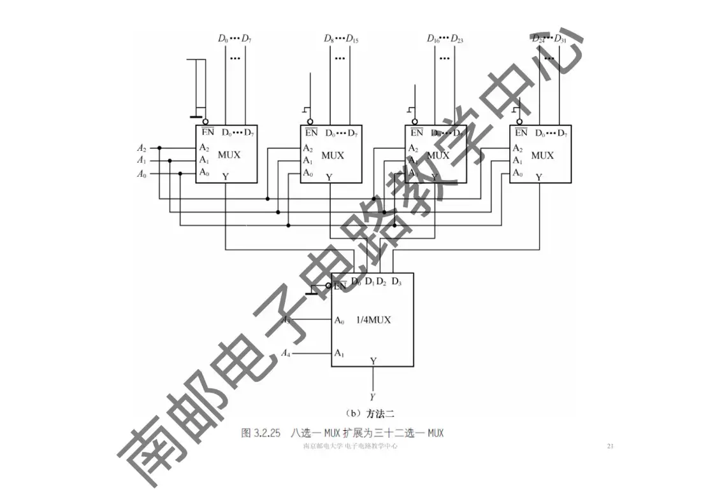

原文：

2 1

### A\BC0001111000001011

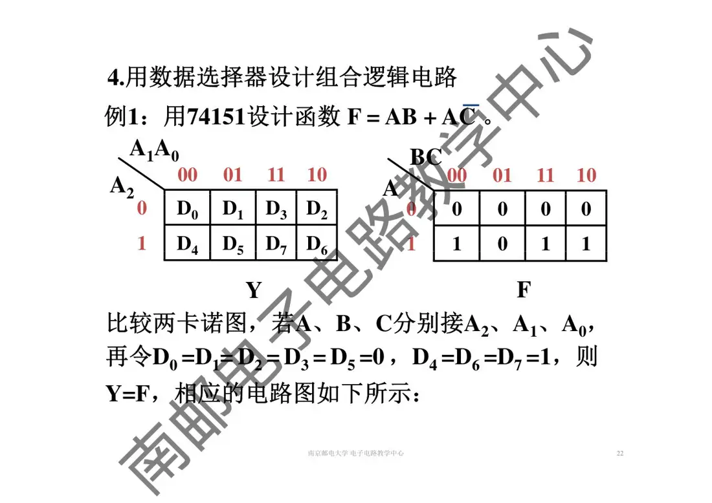

原文：

<table><tr><td rowspan="3">A\BC</td><td>00</td><td>01</td><td>11</td><td>10</td></tr><tr><td>0</td><td>0</td><td>0</td><td>0</td></tr><tr><td>1</td><td>0</td><td>1</td><td>1</td></tr></table>

4 用数据选择器设计组合逻辑电路例 1 ： 用 74151设计 函 数 $\mathbf { F } = \mathbf { A } \mathbf { B } + \mathbf { A } \mathbf { \bar { C } }$ 2

F
<table><tr><td colspan="5">A1A0</td></tr><tr><td rowspan="3">A2</td><td>00</td><td>01</td><td>11</td><td>10</td></tr><tr><td>D0</td><td>D1</td><td>D3</td><td>D2</td></tr><tr><td>D4</td><td>D5</td><td>D7</td><td>D6</td></tr></table>

比较两卡诺图， 若A、 B、 C分别接 $\mathbf { A } _ { 2 } \mathbf { \hat { \Pi } }$ $\mathbf { A _ { 1 } }$ $\mathbf { A _ { 0 } } ,$ 再令 ${ \bf D _ { 0 } } = { \bf D _ { 1 } } \mathrm { \widehat { = } } { \bf D _ { 2 } } \mathrm { \widehat { = } } { \bf D _ { 3 } } = { \bf D _ { 5 } } = \bf 0 \ , D _ { 4 }  = { \bf D _ { 6 } } = { \bf D _ { 7 } } = { \bf 1 }$ ， 则$\mathbf { Y = F }$ ， 相应的 电路图如下所示：

南京邮电大学 电子电路教学中心

22

### 23

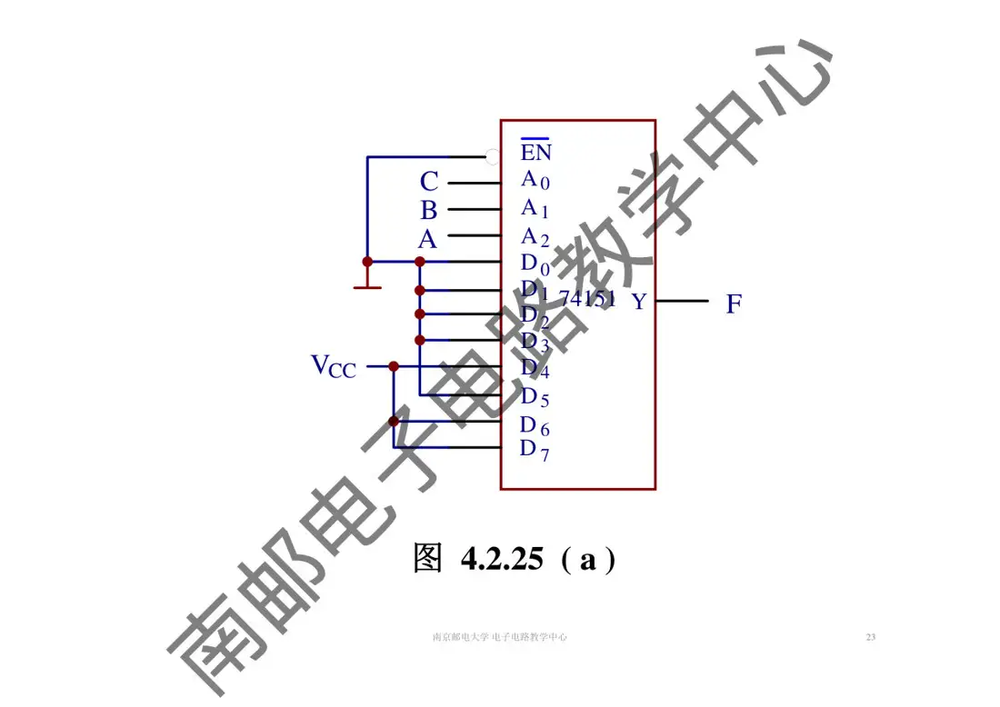

原文：

23

### A1A0A2000111100D0D1D3D21D4D5D7D6

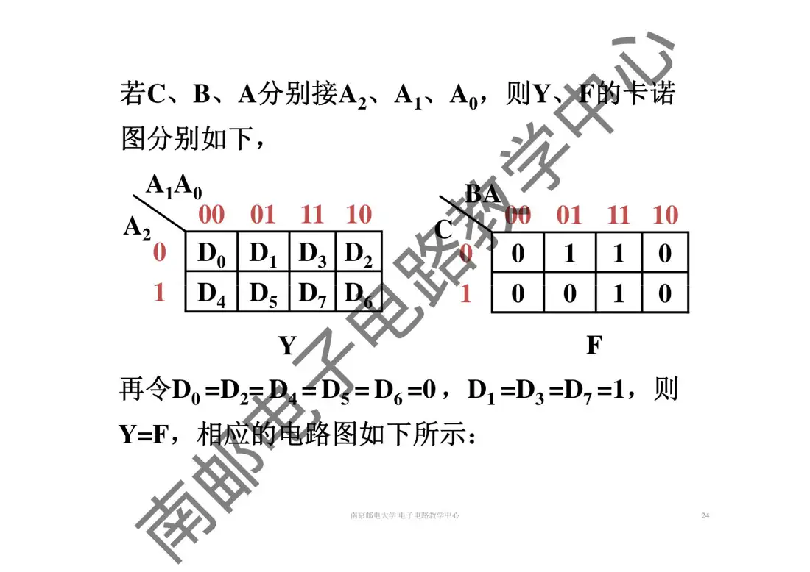

原文：

若C、 B、 A分别接 $\mathbf { A } _ { 2 } \setminus \mathbf { \Delta A _ { 1 } } \setminus \mathbf { \Delta A _ { 0 } } ,$ 则Y、 F的卡诺 图分别如下，

<table><tr><td colspan="5">A1A0</td></tr><tr><td>A2</td><td>00</td><td>01</td><td>11</td><td>10</td></tr><tr><td>0</td><td>D0</td><td>D1</td><td>D3</td><td>D2</td></tr><tr><td>1</td><td>D4</td><td>D5</td><td>D7</td><td>D6</td></tr></table>

F
<table><tr><td>00</td><td>01</td><td>11</td><td>10</td></tr><tr><td>0</td><td>1</td><td>1</td><td>0</td></tr><tr><td>0</td><td>0</td><td>1</td><td>0</td></tr></table>

再令 ${ \bf D _ { 0 } } = { \bf D _ { 2 } } { \bf \overline { { { = } } } } { \bf D _ { 4 } } { \bf \Xi } = { \bf D _ { 5 } } = { \bf D _ { 6 } } { \bf { = 0 } }$ $\mathbf { D _ { 1 } } \mathbf { = } \mathbf { D _ { 3 } } \mathbf { = } \mathbf { D _ { 7 } } \mathbf { = } \mathbf { 1 }$ ， 则Y=F， 相应的 电路图如下所示：

南京邮电大学 电子电路教学中心

24

### (a) A 对应最高位权

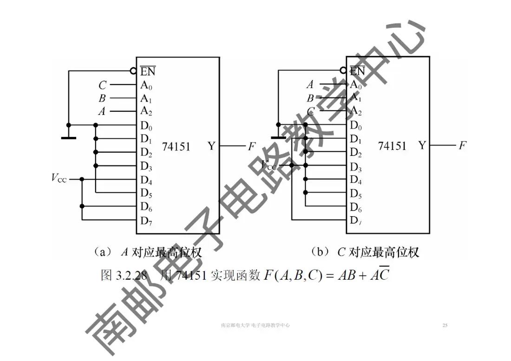

原文：

(a) A 对应最高位权

(b) C对应最高位权

图 3.2.28用74151实现函数 $F ( A , B , C ) = A B + A \overline { { C } }$

南京邮电大学 电子电路教学中心

25

### 例2： 用 片一 74153设计 个 位全加器 一 一 。

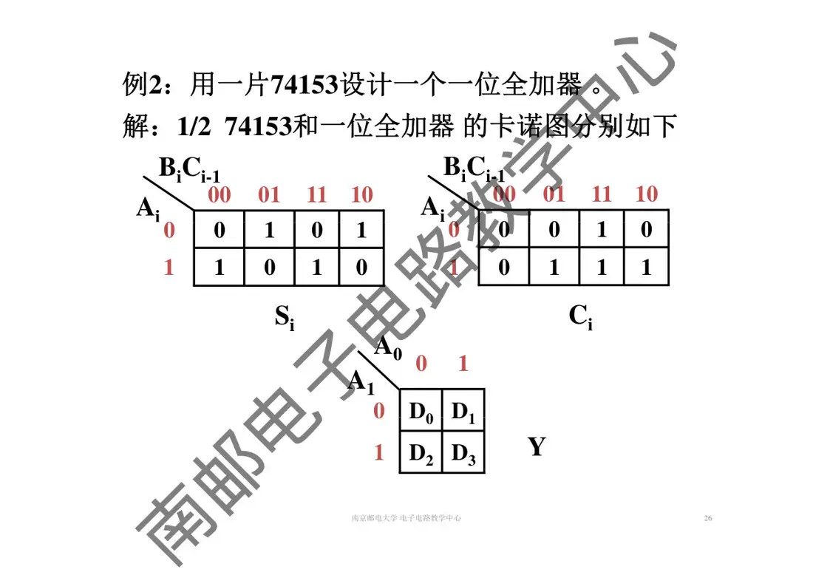

原文：

例2： 用 片一 74153设计 个 位全加器 一 一 。

解： 1/2 74153和一位全加器 的卡诺图分别如下

南京邮电大学 电子电路教学中心

26

### $$

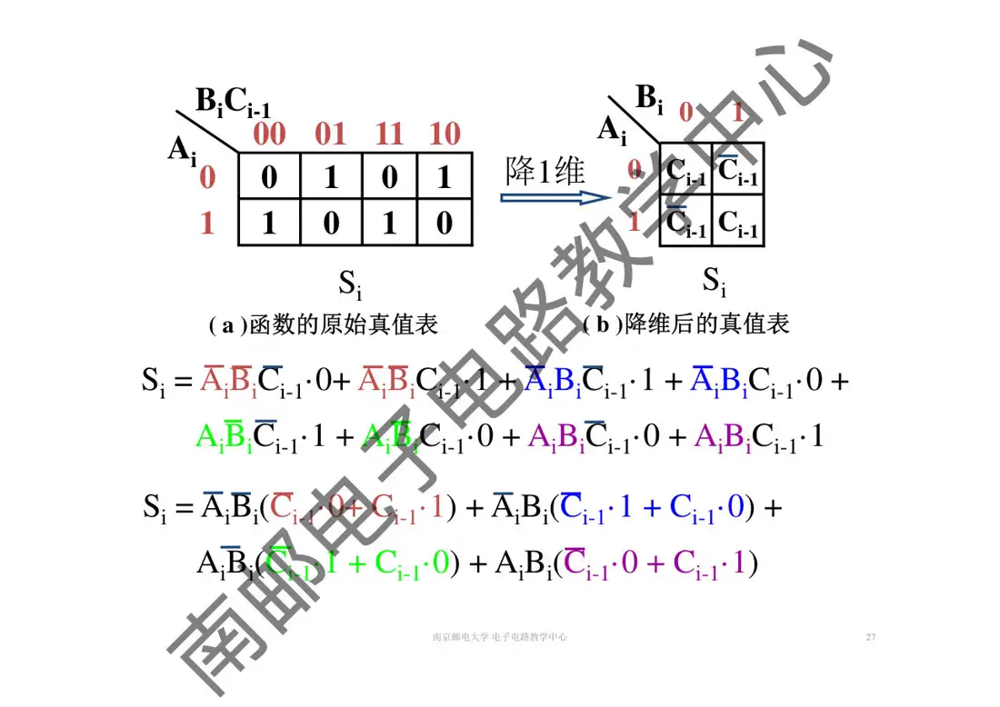

原文：

$$
{ } _ { \mathrm{i} } \mathrm{B} _ { \mathrm{i} } \overline { { { \mathrm{C} } } } _ { \mathrm{i-1} } \cdot 1 + \overline { { { \mathrm{A} } } } _ { \mathrm{i} } \mathrm{B} _ { \mathrm{i} } \mathrm{C} _ { \mathrm{i-1} } \cdot 0 +
$$

$$
\mathrm{A} _ {\mathrm{i}} \overline {{\mathrm{B}}} _ {\mathrm{i}} \overline {{\mathrm{C}}} _ {\mathrm{i-1}} \cdot 1 + \mathrm{A} _ {\mathrm{i}} \overline {{\mathrm{B}}} _ {\mathrm{i}} \mathrm{C} _ {\mathrm{i-1}} \cdot 0 + \mathrm{A} _ {\mathrm{i}} \mathrm{B} _ {\mathrm{i}} \overline {{\mathrm{C}}} _ {\mathrm{i-1}} \cdot 0 + \mathrm{A} _ {\mathrm{i}} \mathrm{B} _ {\mathrm{i}} \mathrm{C} _ {\mathrm{i-1}} \cdot 1
$$

$$
\mathbf {S} _ {\mathrm{i}} = \overline {{\mathbf {A}}} _ {\mathrm{i}} \overline {{\mathbf {B}}} _ {\mathrm{i}} (\overline {{\mathbf {C}}} _ {\mathrm{i-1}} \cdot 0 + \mathbf {C} _ {\mathrm{i-1}} \cdot 1) + \overline {{\mathbf {A}}} _ {\mathrm{i}} \mathbf {B} _ {\mathrm{i}} (\overline {{\mathbf {C}}} _ {\mathrm{i-1}} \cdot 1 + \mathbf {C} _ {\mathrm{i-1}} \cdot 0) +
$$

$$
\overline {{\mathbf {B}}} _ {\mathrm{i}} (\overline {{\mathbf {C}}} _ {\mathrm{i-1}} \cdot 1 + \mathbf {C} _ {\mathrm{i-1}} \cdot 0) + \mathbf {A} _ {\mathrm{i}} \mathbf {B} _ {\mathrm{i}} (\overline {{\mathbf {C}}} _ {\mathrm{i-1}} \cdot 0 + \mathbf {C} _ {\mathrm{i-1}} \cdot 1)
$$

南京邮电大学 电子电路教学中心

27

### 南京邮电大学 电子电路教学中心

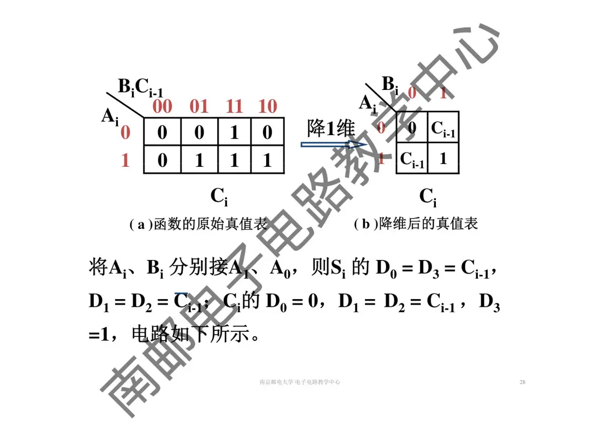

原文：

将 $\mathbf { A _ { i } } , \ \mathbf { B _ { i } }$ 分别接 A1、 $\mathbf { A _ { 0 } }$ 则 ， $\mathbf { S _ { i } }$ 的 $\mathbf { D _ { 0 } } = \mathbf { D _ { 3 } } = \mathbf { C _ { i - 1 } } ,$ ${ \bf D } _ { 1 } = { \bf D } _ { 2 } = \bf { C } _ { i = 1 } ; \bf { C } .$ 的 ${ \bf D _ { 0 } } = \bf { 0 } , ~ { \bf D _ { 1 } } = ~ { \bf D _ { 2 } } = { \bf C _ { i - 1 } } , ~ { \bf D _ { 3 } }$ =1， 电路如下所示。

南京邮电大学 电子电路教学中心

28

### 2.30 用一片74153实现一位全加器

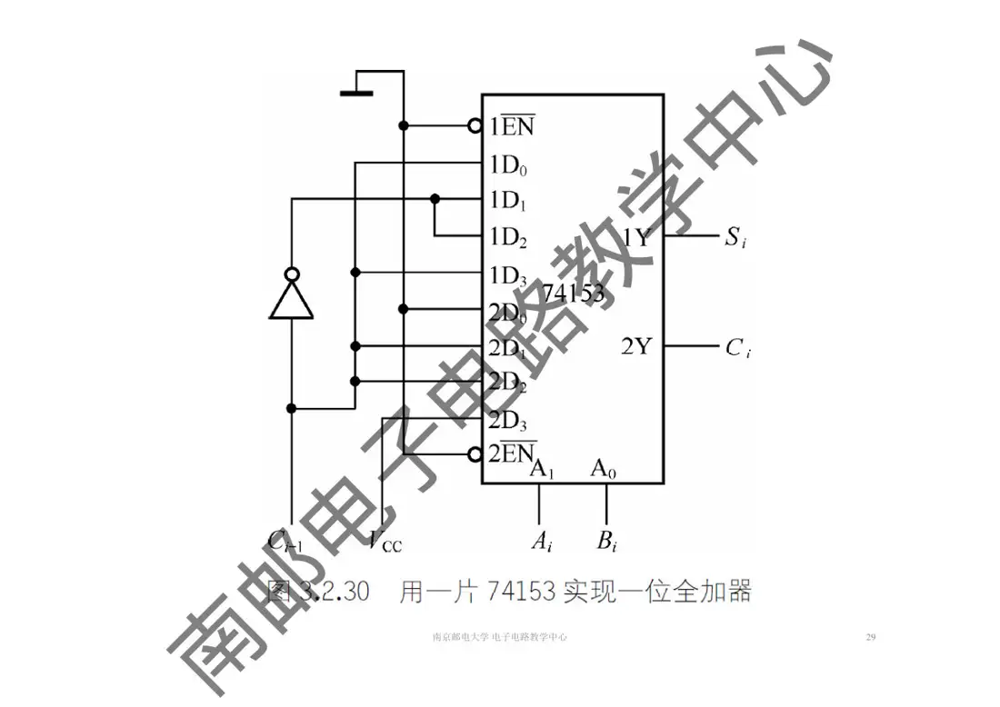

原文：

2.30 用一片74153实现一位全加器

南京邮电大学 电子电路教学中心

29

### 用数据选择器设计组合逻辑电路的步骤：

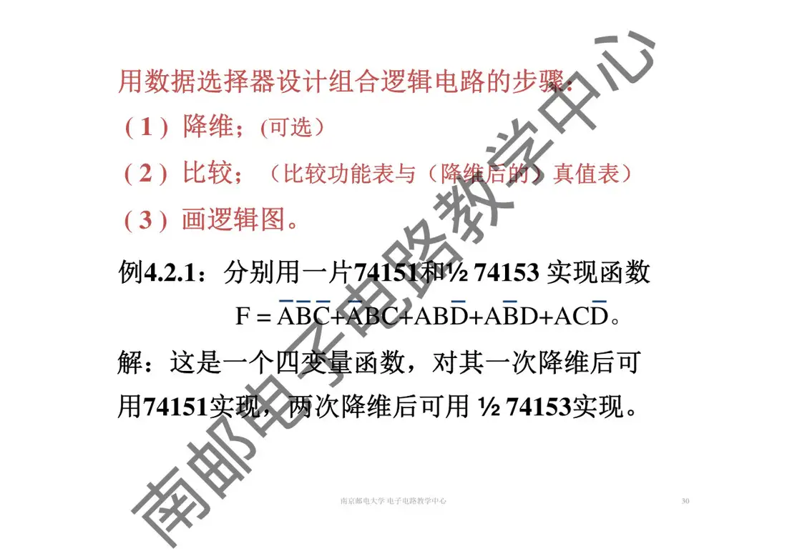

原文：

用数据选择器设计组合逻辑电路的步骤：

( 1 ) 降 维 ； (可 选 ）

( 2 ) 比较； （ 比较功能表与 （ 降维后的 ） 真值表）

( 3 ) 画逻辑 图 。

例4.2.1 ： 分别 用 一 片74151和½ 74153 实现 函 数$\mathrm { F } = \overline { { \mathrm { A B } } } \overline { { \mathrm { C } } } + \overline { { \mathrm { A B C } } } \overline { { \mathrm { C 4 } } } \mathrm { A B D + A \overline { { B } } D + A C \overline { { D } } } .$ 。

解： 这是一个四变量函数， 对其一次降维后可用74151实现， 两次降维后可用 ½ 74153实现。

南京邮电大学 电子电路教学中心

30

### ( )函数的原始真值表a

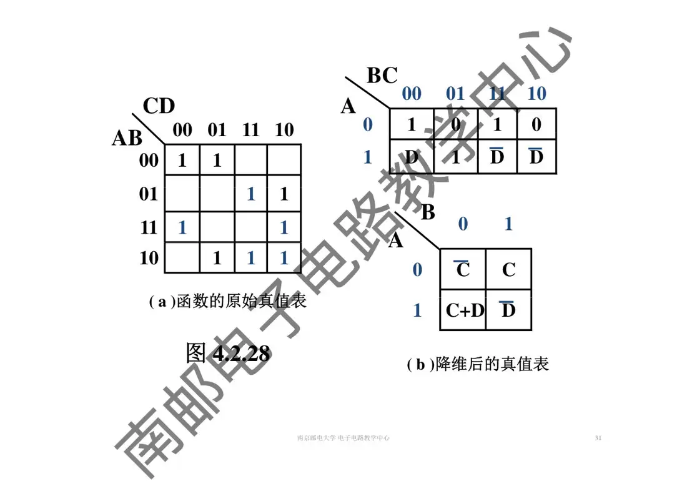

原文：

( )函数的原始真值表a
<table><tr><td>AB\CD</td><td>00</td><td>01</td><td>11</td><td>10</td></tr><tr><td>00</td><td>1</td><td>1</td><td></td><td></td></tr><tr><td>01</td><td></td><td></td><td>1</td><td>1</td></tr><tr><td>11</td><td>1</td><td></td><td></td><td>1</td></tr><tr><td>10</td><td></td><td>1</td><td>1</td><td>1</td></tr></table>

图 4 2 2 8 . .

南京邮电大学 电子电路教学中心

3 1

### 降维后的真值表

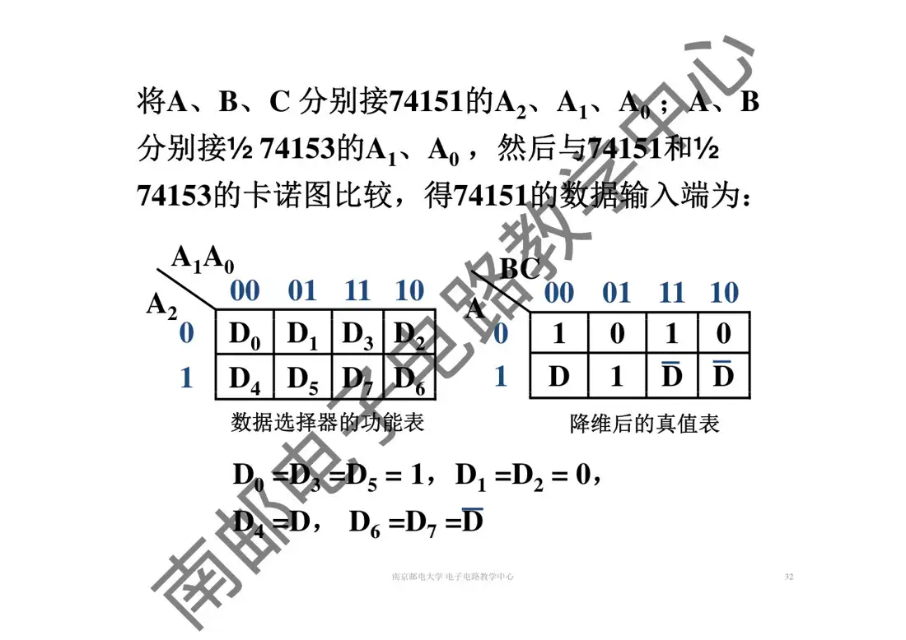

原文：

将A、 B 、 C 分别接74151 的 $\mathbf { A _ { 2 } } \mathbf { \setminus } \mathbf { A _ { 1 } } \mathbf { \setminus } \mathbf { A _ { 0 } } \mathbf { ; } \mathbf { A } \mathbf { \setminus } \mathbf { B }$ 分别接½ 74153 的 $\bf { A _ { 1 } } \cdot \bf { \delta A _ { 0 } }$ ， 然后 与74151和½74153的卡诺图 比较， 得74151的数据输入端为：

降维后的真值表
<table><tr><td>00</td><td>01</td><td>11</td><td>10</td></tr><tr><td>1</td><td>0</td><td>1</td><td>0</td></tr><tr><td>D</td><td>1</td><td> $\overline{D}$ </td><td> $\overline{D}$ </td></tr></table>

D D 1 D D 00 = 3 = 5 = ， 1 = 2 = ， D4 =D ， $\mathbf { D _ { 6 } } = \mathbf { D _ { 7 } } = \mathbf { D }$

南京邮电大学 电子电路教学中心

32

### 的数据输入端为½ 74153 ：

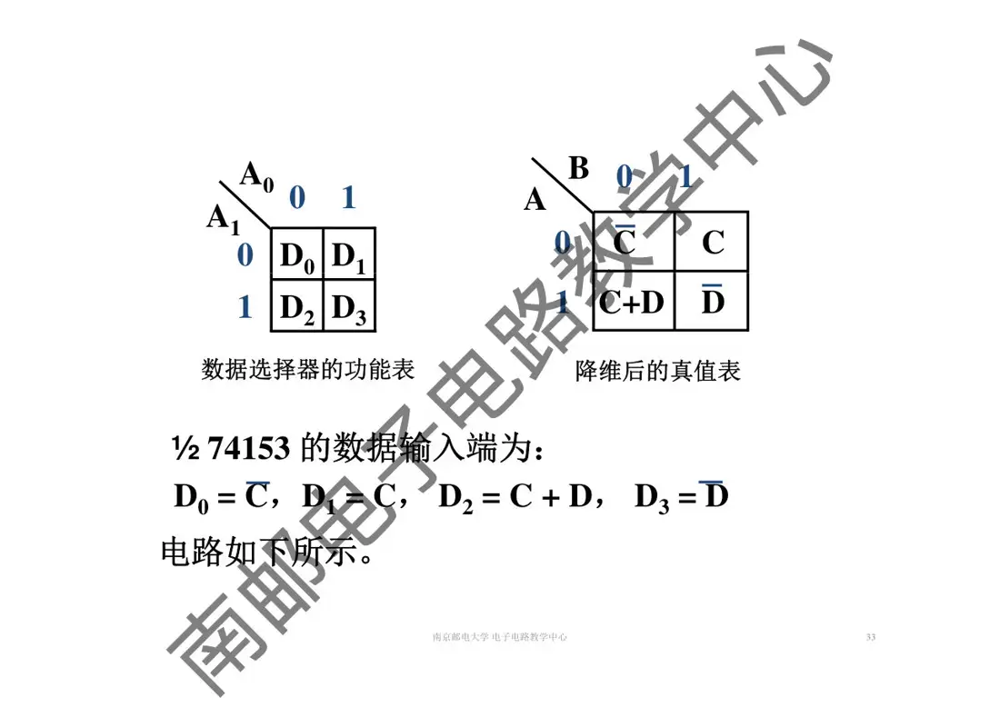

原文：

的数据输入端为½ 74153 ：

$$
\mathbf {D _ {0}} = \overline {{\mathbf {C}}}, \quad \mathbf {D _ {1}} = \overline {{\mathbf {C}}}, \quad \mathbf {D _ {2}} = \mathbf {C} + \mathbf {D}, \quad \mathbf {D _ {3}} = \overline {{\mathbf {D}}}
$$

电路如下所示。作业题3. 13 ( 1 )3 1 4.

南京邮电大学 电子电路教学中心

3 3

### 南京邮电大学 电子电路教学中心

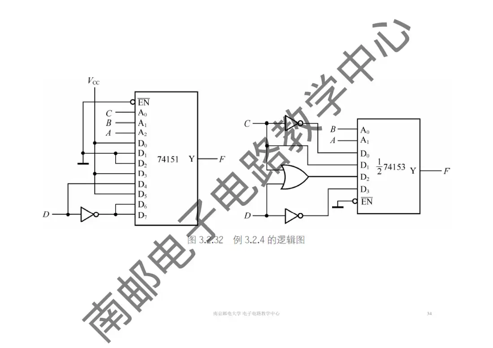

原文：

南京邮电大学 电子电路教学中心

34

### 南京邮电大学 电子电路教学中心

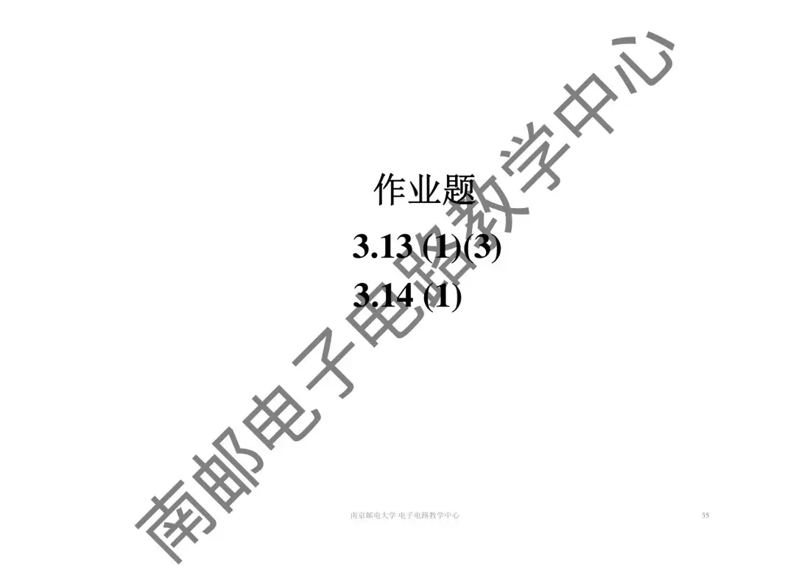

原文：

南京邮电大学 电子电路教学中心

3 5
