# 《数字电路与逻辑设计B》第3章 中规模集成组合逻辑电路（课件）

原件的每一页，下面附识别出的文字。

### 第二节 中规模集成组合逻辑电路

原文：

第二节 中规模集成组合逻辑电路

一、编码器

编码：对特定信息进行二进制数或BCD码的编制。

编码器：用来完成编码工作的数字电路称为编码器。

用途：使用编码技术可以大大减少数字电路系统中信号传输线的条数，同时便于信号的接收和处理。

### 1. 二进制编码器

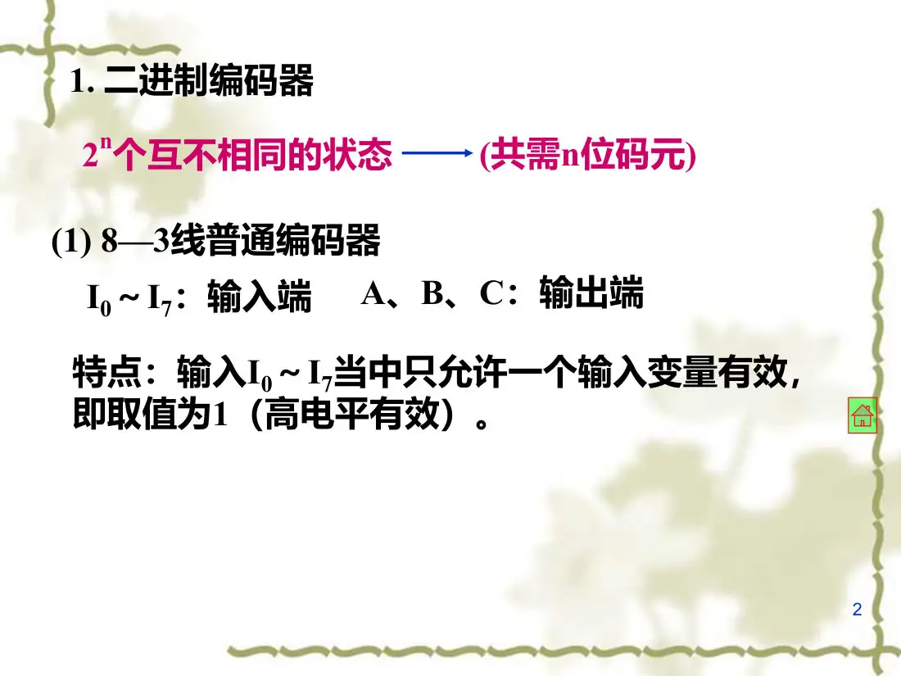

原文：

1. 二进制编码器

$2^{n}$ 个互不相同的状态 → (共需n位码元)

(1) 8—3线普通编码器

$\mathrm{I}_0 \sim \mathrm{I}_7$ ：输入端 A、B、C：输出端

特点：输入 $I_{0}\sim I_{7}$ 当中只允许一个输入变量有效，即取值为1（高电平有效）。

2

### 第 3 页

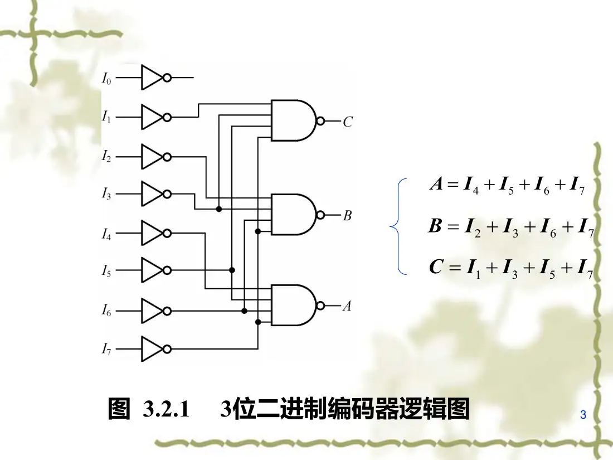

### 表4.2.1 3位二进制编码器真值表

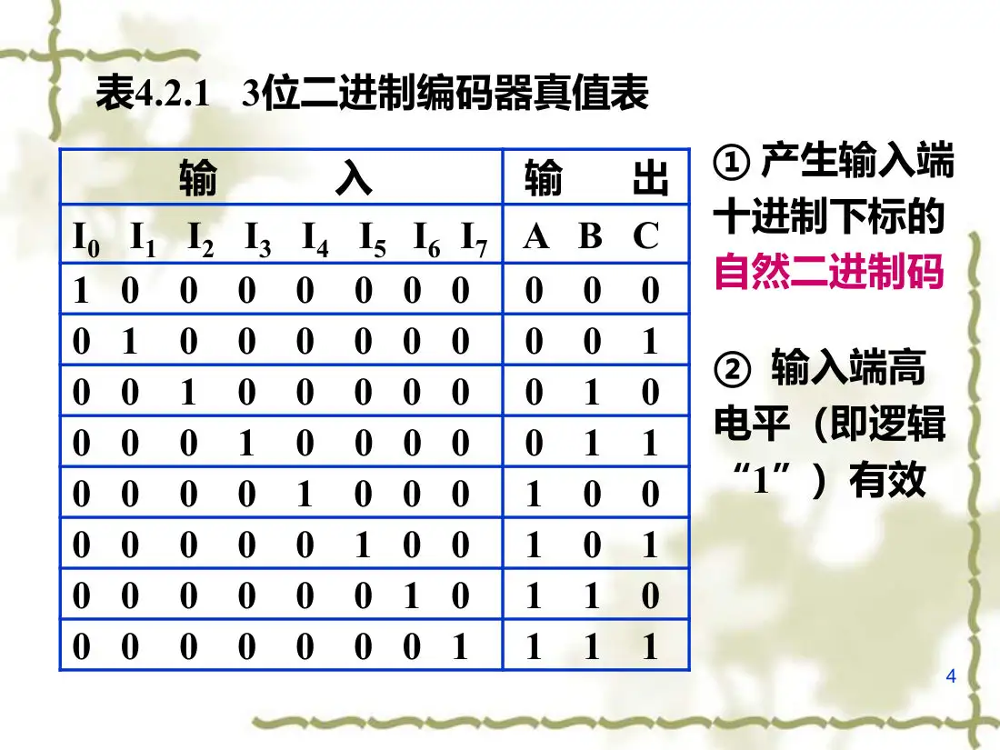

原文：

表4.2.1 3位二进制编码器真值表
<table><tr><td colspan="8">输入</td><td colspan="3">输出</td></tr><tr><td> $I_0$ </td><td> $I_1$ </td><td> $I_2$ </td><td> $I_3$ </td><td> $I_4$ </td><td> $I_5$ </td><td> $I_6$ </td><td> $I_7$ </td><td>A</td><td>B</td><td>C</td></tr><tr><td>1</td><td>0</td><td>0</td><td>0</td><td>0</td><td>0</td><td>0</td><td>0</td><td>0</td><td>0</td><td>0</td></tr><tr><td>0</td><td>1</td><td>0</td><td>0</td><td>0</td><td>0</td><td>0</td><td>0</td><td>0</td><td>0</td><td>1</td></tr><tr><td>0</td><td>0</td><td>1</td><td>0</td><td>0</td><td>0</td><td>0</td><td>0</td><td>0</td><td>1</td><td>0</td></tr><tr><td>0</td><td>0</td><td>0</td><td>1</td><td>0</td><td>0</td><td>0</td><td>0</td><td>0</td><td>1</td><td>1</td></tr><tr><td>0</td><td>0</td><td>0</td><td>0</td><td>1</td><td>0</td><td>0</td><td>0</td><td>1</td><td>0</td><td>0</td></tr><tr><td>0</td><td>0</td><td>0</td><td>0</td><td>0</td><td>1</td><td>0</td><td>0</td><td>1</td><td>0</td><td>1</td></tr><tr><td>0</td><td>0</td><td>0</td><td>0</td><td>0</td><td>0</td><td>1</td><td>0</td><td>1</td><td>1</td><td>0</td></tr><tr><td>0</td><td>0</td><td>0</td><td>0</td><td>0</td><td>0</td><td>0</td><td>1</td><td>1</td><td>1</td><td>1</td></tr></table>

① 产生输入端十进制下标的自然二进制码

② 输入端高电平（即逻辑“1”）有效

### (2) 8—3线优先编码器74148

原文：

(2) 8—3线优先编码器74148

优先编码器：允许同时在n个输入端有多个输入信号有效，编码器按输入线编号的大小来排列优先级，只对同时输入的多个信号中优先权最高的一个进行编码。

5

### 集成8线 - 3线优先编码器74LS148

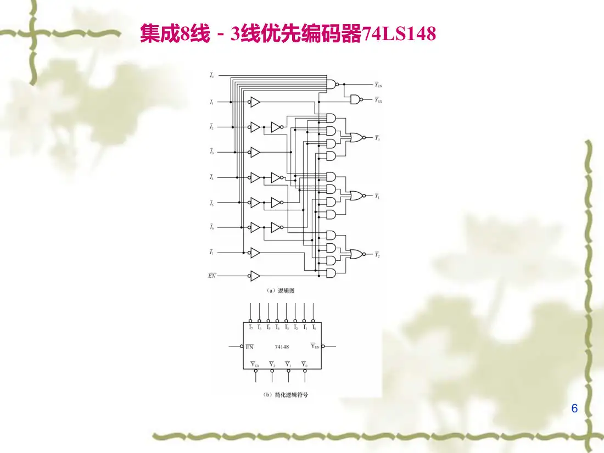

原文：

集成8线 - 3线优先编码器74LS148

6

### 简化符号

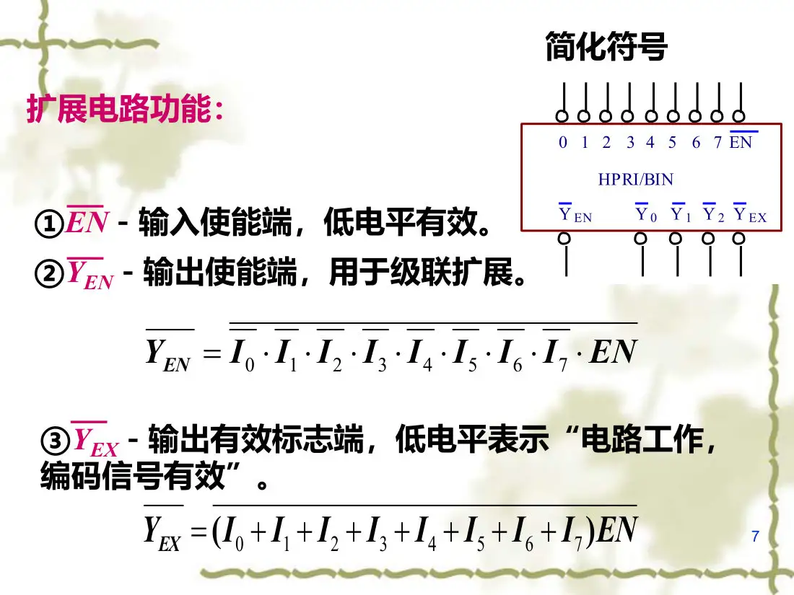

原文：

简化符号

扩展电路功能:

① $\overline{EN}$ - 输入使能端，低电平有效。

② $\overline{Y_{EN}}$ - 输出使能端，用于级联扩展。

$$
\overline {{Y _ {E N}}} = \overline {{I _ {0}}} \cdot \overline {{I _ {1}}} \cdot \overline {{I _ {2}}} \cdot \overline {{I _ {3}}} \cdot \overline {{I _ {4}}} \cdot \overline {{I _ {5}}} \cdot \overline {{I _ {6}}} \cdot \overline {{I _ {7}}} \cdot E N
$$

③ $\overline{Y_{EX}}$ - 输出有效标志端，低电平表示“电路工作，编码信号有效”。

$$
\overline {{Y _ {E X}}} = \overline {{(I _ {0} + I _ {1} + I _ {2} + I _ {3} + I _ {4} + I _ {5} + I _ {6} + I _ {7}) E N}}
$$

### 表4.2.2 8—3线优先编码器74148功能表

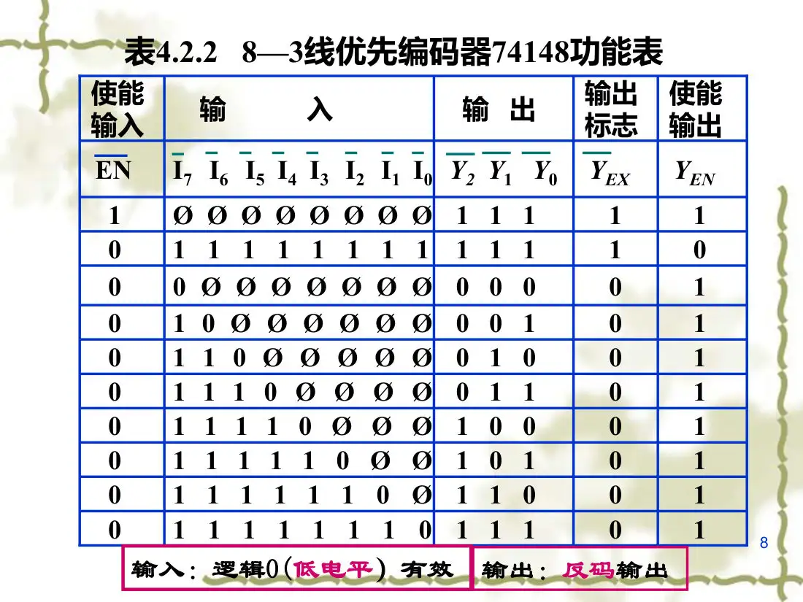

原文：

表4.2.2 8—3线优先编码器74148功能表
<table><tr><td>使能输入</td><td colspan="8">输入</td><td colspan="3">输出</td><td>输出标志</td><td>使能输出</td></tr><tr><td> $\overline{EN}$ </td><td> $\overline{I}_7$ </td><td> $\overline{I}_6$ </td><td> $\overline{I}_5$ </td><td> $\overline{I}_4$ </td><td> $\overline{I}_3$ </td><td> $\overline{I}_2$ </td><td> $\overline{I}_1$ </td><td> $\overline{I}_0$ </td><td> $\overline{Y}_2$ </td><td> $\overline{Y}_1$ </td><td> $\overline{Y}_0$ </td><td> $\overline{Y}_{EX}$ </td><td> $Y_{EN}$ </td></tr><tr><td>1</td><td>∅</td><td>∅</td><td>∅</td><td>∅</td><td>∅</td><td>∅</td><td>∅</td><td>∅</td><td>1</td><td>1</td><td>1</td><td>1</td><td>1</td></tr><tr><td>0</td><td>1</td><td>1</td><td>1</td><td>1</td><td>1</td><td>1</td><td>1</td><td>1</td><td>1</td><td>1</td><td>1</td><td>1</td><td>0</td></tr><tr><td>0</td><td>0</td><td>∅</td><td>∅</td><td>∅</td><td>∅</td><td>∅</td><td>∅</td><td>∅</td><td>0</td><td>0</td><td>0</td><td>0</td><td>1</td></tr><tr><td>0</td><td>1</td><td>0</td><td>∅</td><td>∅</td><td>∅</td><td>∅</td><td>∅</td><td>∅</td><td>0</td><td>0</td><td>1</td><td>0</td><td>1</td></tr><tr><td>0</td><td>1</td><td>1</td><td>0</td><td>∅</td><td>∅</td><td>∅</td><td>∅</td><td>∅</td><td>0</td><td>1</td><td>0</td><td>0</td><td>1</td></tr><tr><td>0</td><td>1</td><td>1</td><td>1</td><td>0</td><td>∅</td><td>∅</td><td>∅</td><td>∅</td><td>0</td><td>1</td><td>1</td><td>0</td><td>1</td></tr><tr><td>0</td><td>1</td><td>1</td><td>1</td><td>1</td><td>0</td><td>∅</td><td>∅</td><td>∅</td><td>1</td><td>0</td><td>0</td><td>0</td><td>1</td></tr><tr><td>0</td><td>1</td><td>1</td><td>1</td><td>1</td><td>1</td><td>0</td><td>∅</td><td>∅</td><td>1</td><td>0</td><td>1</td><td>0</td><td>1</td></tr><tr><td>0</td><td>1</td><td>1</td><td>1</td><td>1</td><td>1</td><td>1</td><td>0</td><td>∅</td><td>1</td><td>1</td><td>0</td><td>0</td><td>1</td></tr><tr><td>0</td><td>1</td><td>1</td><td>1</td><td>1</td><td>1</td><td>1</td><td>1</td><td>0</td><td>1</td><td>1</td><td>1</td><td>0</td><td>1</td></tr></table>

输入：逻辑0（低电平）有效

输出：反码输出

### (3) 74148的级联(不作要求)

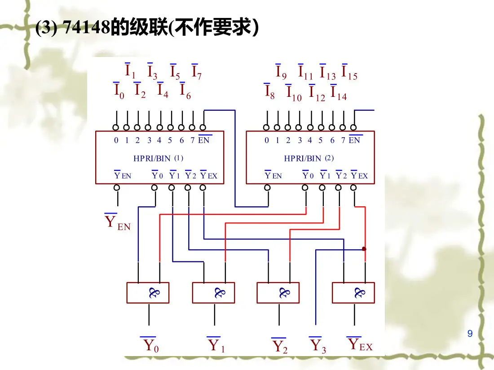

原文：

(3) 74148的级联(不作要求)

### 2. 二—十进制优先编码器74147

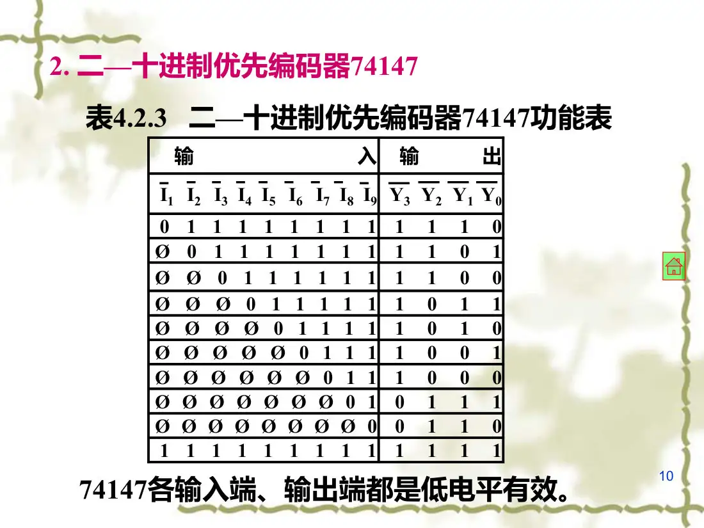

原文：

2. 二—十进制优先编码器74147

表4.2.3 二—十进制优先编码器74147功能表
<table><tr><td colspan="9">输入</td><td colspan="4">输出</td></tr><tr><td> $\overline{I}_{1}$ </td><td> $\overline{I}_{2}$ </td><td> $\overline{I}_{3}$ </td><td> $\overline{I}_{4}$ </td><td> $\overline{I}_{5}$ </td><td> $\overline{I}_{6}$ </td><td> $\overline{I}_{7}$ </td><td> $\overline{I}_{8}$ </td><td> $\overline{I}_{9}$ </td><td> $\overline{Y}_{3}$ </td><td> $\overline{Y}_{2}$ </td><td> $\overline{Y}_{1}$ </td><td> $\overline{Y}_{0}$ </td></tr><tr><td>0</td><td>1</td><td>1</td><td>1</td><td>1</td><td>1</td><td>1</td><td>1</td><td>1</td><td>1</td><td>1</td><td>1</td><td>0</td></tr><tr><td>∅</td><td>0</td><td>1</td><td>1</td><td>1</td><td>1</td><td>1</td><td>1</td><td>1</td><td>1</td><td>1</td><td>0</td><td>1</td></tr><tr><td>∅</td><td>∅</td><td>0</td><td>1</td><td>1</td><td>1</td><td>1</td><td>1</td><td>1</td><td>1</td><td>1</td><td>0</td><td>0</td></tr><tr><td>∅</td><td>∅</td><td>∅</td><td>0</td><td>1</td><td>1</td><td>1</td><td>1</td><td>1</td><td>1</td><td>0</td><td>1</td><td>1</td></tr><tr><td>∅</td><td>∅</td><td>∅</td><td>∅</td><td>0</td><td>1</td><td>1</td><td>1</td><td>1</td><td>1</td><td>0</td><td>1</td><td>0</td></tr><tr><td>∅</td><td>∅</td><td>∅</td><td>∅</td><td>∅</td><td>0</td><td>1</td><td>1</td><td>1</td><td>1</td><td>0</td><td>0</td><td>1</td></tr><tr><td>∅</td><td>∅</td><td>∅</td><td>∅</td><td>∅</td><td>∅</td><td>0</td><td>1</td><td>1</td><td>1</td><td>0</td><td>0</td><td>0</td></tr><tr><td>∅</td><td>∅</td><td>∅</td><td>∅</td><td>∅</td><td>∅</td><td>∅</td><td>0</td><td>1</td><td>1</td><td>0</td><td>1</td><td>1</td></tr><tr><td>∅</td><td>∅</td><td>∅</td><td>∅</td><td>∅</td><td>∅</td><td>∅</td><td>∅</td><td>0</td><td>1</td><td>1</td><td>1</td><td>0</td></tr><tr><td>1</td><td>1</td><td>1</td><td>1</td><td>1</td><td>1</td><td>1</td><td>1</td><td>1</td><td>1</td><td>1</td><td>1</td><td>1</td></tr></table>
74147各输入端、输出端都是低电平有效。

10

### 二、译码器

原文：

二、译码器

译码：编码的逆过程，将输入的每个代码的含义“翻译”过来，给出相应的输出信号。

1.二进制译码器

n位二进制代码 → 2 $^{n}$ 个互不相同的状态

(1) 2 - 4 线译码器

11

### 12

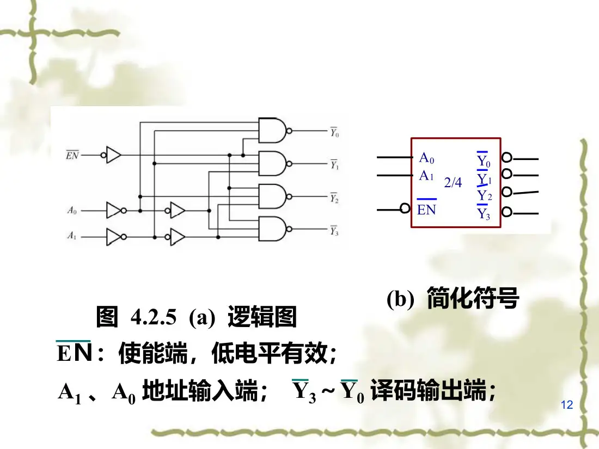

原文：

$\mathrm{A}_1$ 、 $\mathrm{A}_0$ 地址输入端； $\overline{\mathrm{Y}}_3\sim \overline{\mathrm{Y}}_0$ 译码输出端；

12

### $\overline{\mathbf{EN}} = \mathbf{0}$

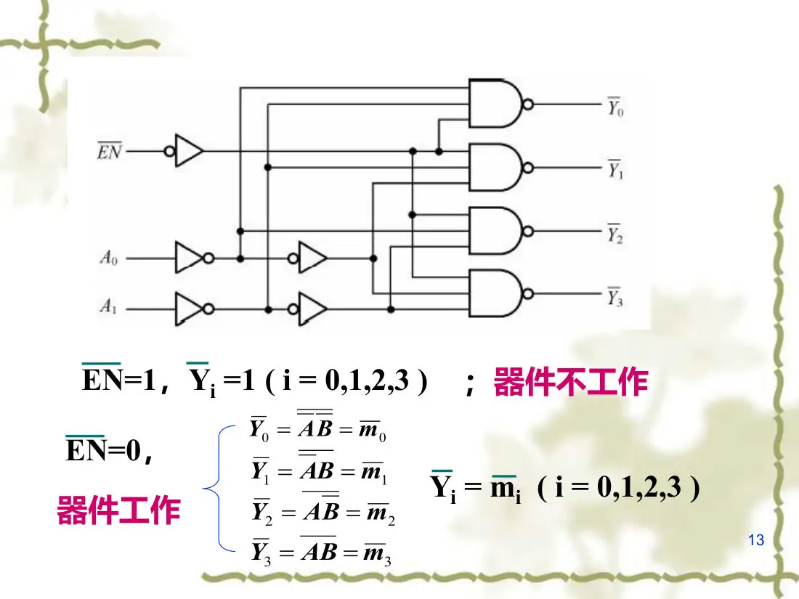

原文：

$\overline{EN}=1,\quad\overline{Y}_{i}=1(i=0,1,2,3)$ ；器件不工作

$\overline{\mathbf{EN}} = \mathbf{0}$

器件工作

$$
\left\{ \begin{array}{l} \overline {{Y}} _ {0} = \overline {{\overline {{A B}}}} = \overline {{m}} _ {0} \\ \overline {{Y}} _ {1} = \overline {{\overline {{A B}}}} = \overline {{m}} _ {1} \\ \overline {{Y}} _ {2} = \overline {{A B}} = \overline {{m}} _ {2} \\ \overline {{Y}} _ {3} = \overline {{A B}} = \overline {{m}} _ {3} \end{array} \right.
$$

$$
\overline {{\mathbf {Y}}} _ {\mathbf {i}} = \overline {{\mathbf {m}}} _ {\mathbf {i}} (\mathbf {i} = 0, 1, 2, 3)
$$

13

### 表 4.2.4 2 - 4 线译码器的功能表

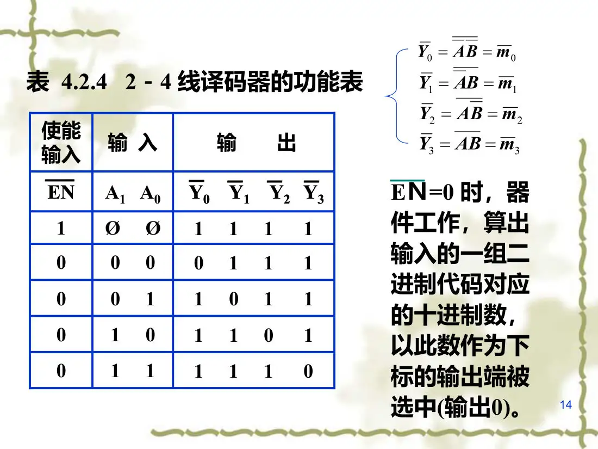

原文：

表 4.2.4 2 - 4 线译码器的功能表
<table><tr><td>使能输入</td><td colspan="2">输入</td><td colspan="4">输出</td></tr><tr><td> $\overline{EN}$ </td><td> $A_1$ </td><td> $A_0$ </td><td> $\overline{Y}_0$ </td><td> $\overline{Y}_1$ </td><td> $\overline{Y}_2$ </td><td> $\overline{Y}_3$ </td></tr><tr><td>1</td><td>∅</td><td>∅</td><td>1</td><td>1</td><td>1</td><td>1</td></tr><tr><td>0</td><td>0</td><td>0</td><td>0</td><td>1</td><td>1</td><td>1</td></tr><tr><td>0</td><td>0</td><td>1</td><td>1</td><td>0</td><td>1</td><td>1</td></tr><tr><td>0</td><td>1</td><td>0</td><td>1</td><td>1</td><td>0</td><td>1</td></tr><tr><td>0</td><td>1</td><td>1</td><td>1</td><td>1</td><td>1</td><td>0</td></tr></table>

$$
\left\{ \begin{array}{l} \overline {{\boldsymbol {Y}}} _ {0} = \overline {{\overline {{\boldsymbol {A}}} \overline {{\boldsymbol {B}}}}} = \overline {{\boldsymbol {m}}} _ {0} \\ \overline {{\boldsymbol {Y}}} _ {1} = \overline {{\overline {{\boldsymbol {A}}} \boldsymbol {B}}} = \overline {{\boldsymbol {m}}} _ {1} \\ \overline {{\boldsymbol {Y}}} _ {2} = \overline {{\boldsymbol {A}}} \overline {{\overline {{\boldsymbol {B}}}}} = \overline {{\boldsymbol {m}}} _ {2} \\ \overline {{\boldsymbol {Y}}} _ {3} = \overline {{\boldsymbol {A}}} \overline {{\boldsymbol {B}}} = \overline {{\boldsymbol {m}}} _ {3} \end{array} \right.
$$

EN=0 时，器件工作，算出输入的一组二进制代码对应的十进制数，以此数作为下标的输出端被选中(输出0)。

14

### 15

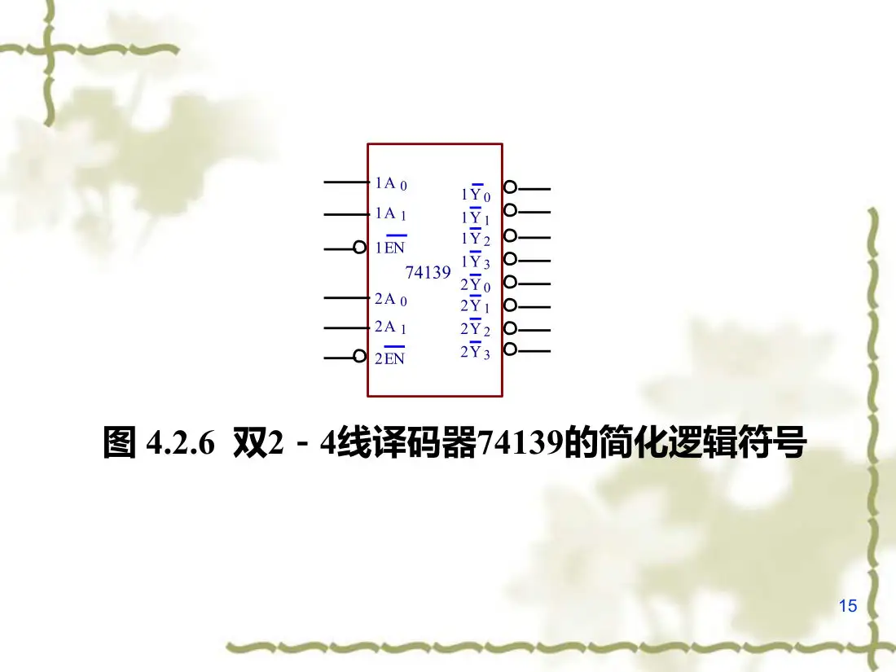

原文：

15

### 第 16 页

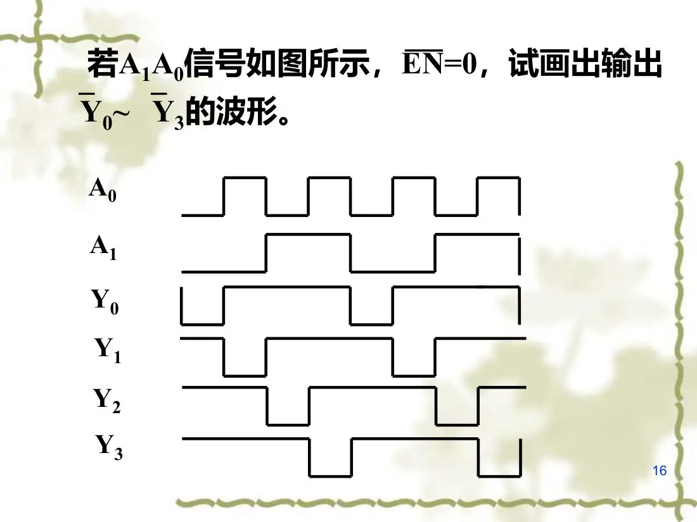

原文：

若 $A_{1}A_{0}$ 信号如图所示， $\overline{EN}=0$ ，试画出输出 $\overline{Y}_{0}\sim\overline{Y}_{3}$ 的波形。

### $$

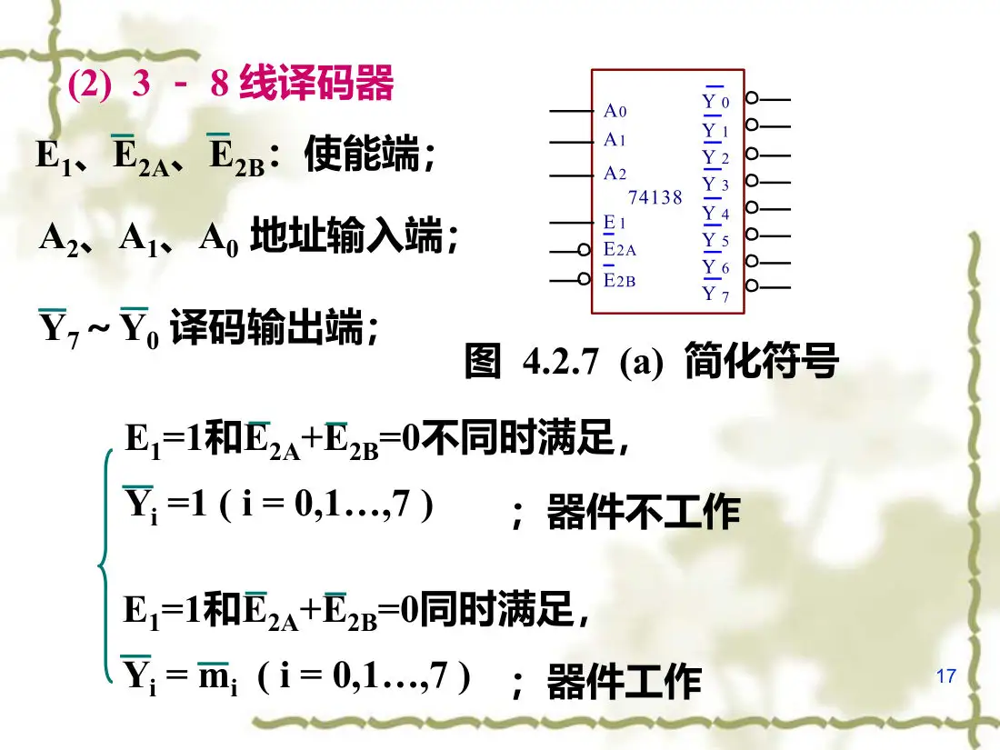

原文：

(2) 3 - 8 线译码器 $E_{1}$ 、 $\overline{E}_{2A}$ 、 $\overline{E}_{2B}$ : 使能端; $A_{2}$ 、 $A_{1}$ 、 $A_{0}$ 地址输入端; $\overline{Y}_{7} \sim \overline{Y}_{0}$ 译码输出端;

$$
\begin{array}{c c} \text {A0} & \overline {{\mathrm{Y}}} _ {0} \\ \text {A1} & \overline {{\mathrm{Y}}} _ {1} \\ \text {A2} & \overline {{\mathrm{Y}}} _ {2} \\ 7 4 1 3 8 & \overline {{\mathrm{Y}}} _ {3} \\ \text {E1} & \overline {{\mathrm{Y}}} _ {4} \\ \text {E2A} & \overline {{\mathrm{Y}}} _ {5} \\ \text {- - - } & \overline {{\mathrm{Y}}} _ {6} \\ \text {E2B} & \overline {{\mathrm{Y}}} _ {7} \end{array}
$$

图 4.2.7 (a) 简化符号

$\begin{cases} \mathrm{E}_1 = 1 \text{和} \overline{\mathrm{E}}_{2\mathrm{A}} + \overline{\mathrm{E}}_{2\mathrm{B}} = 0 \text{不同时满足,} \\ \overline{\mathrm{Y}}_i = 1 (i = 0,1...,7) \quad ; \text{器件不工作} \\ \mathrm{E}_1 = 1 \text{和} \overline{\mathrm{E}}_{2\mathrm{A}} + \overline{\mathrm{E}}_{2\mathrm{B}} = 0 \text{同时满足,} \\ \overline{\mathrm{Y}}_i = \overline{\mathrm{m}}_i (i = 0,1...,7) \quad ; \text{器件工作} \end{cases}$

17

### 18

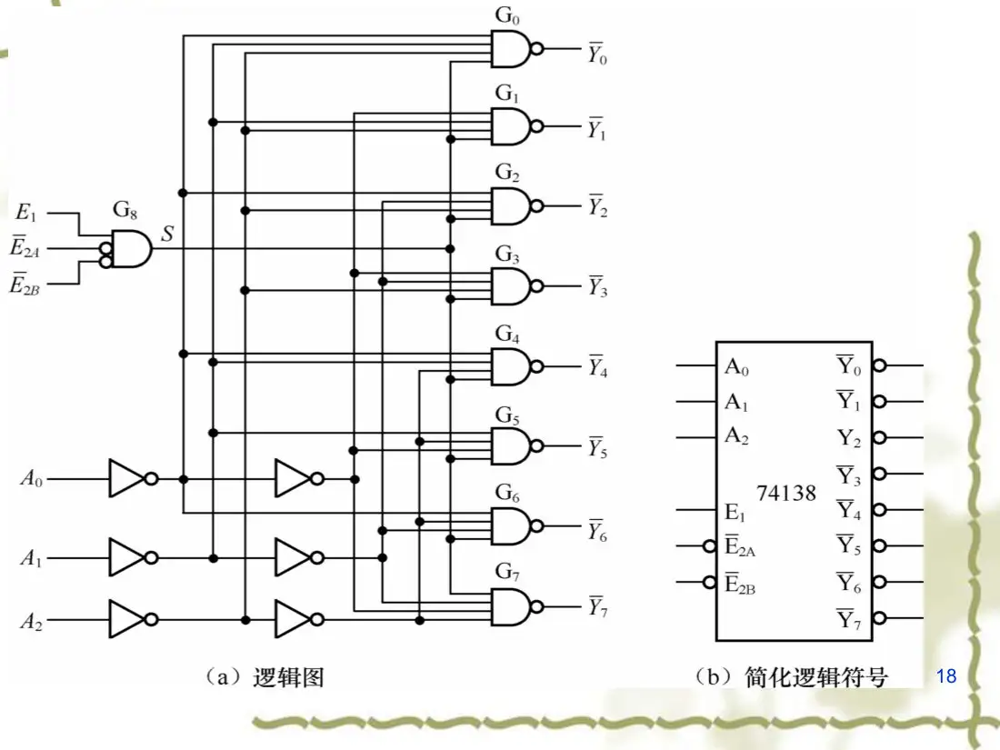

原文：

18

### 表 4.2.5 3 - 8 线译码器74138的功能表

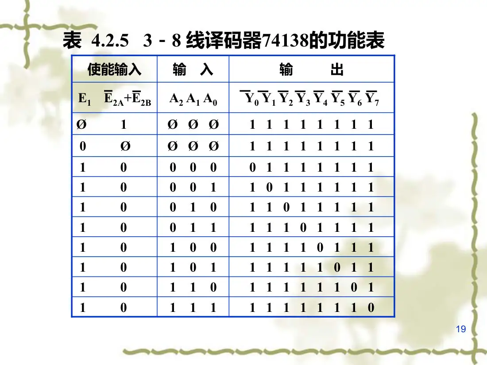

原文：

表 4.2.5 3 - 8 线译码器74138的功能表
<table><tr><td colspan="2">使能输入</td><td>输入</td><td>输出</td></tr><tr><td> $E_1$ </td><td> $\overline{E}_{2A} + \overline{E}_{2B}$ </td><td> $A_2 A_1 A_0$ </td><td> $\overline{Y}_0 \overline{Y}_1 \overline{Y}_2 \overline{Y}_3 \overline{Y}_4 \overline{Y}_5 \overline{Y}_6 \overline{Y}_7$ </td></tr><tr><td>∅</td><td>1</td><td>∅ ∅ ∅</td><td>1 1 1 1 1 1 1 1</td></tr><tr><td>0</td><td>∅</td><td>∅ ∅ ∅</td><td>1 1 1 1 1 1 1 1</td></tr><tr><td>1</td><td>0</td><td>0 0 0</td><td>0 1 1 1 1 1 1 1</td></tr><tr><td>1</td><td>0</td><td>0 0 1</td><td>1 0 1 1 1 1 1 1</td></tr><tr><td>1</td><td>0</td><td>0 1 0</td><td>1 1 0 1 1 1 1 1</td></tr><tr><td>1</td><td>0</td><td>0 1 1</td><td>1 1 1 0 1 1 1 1</td></tr><tr><td>1</td><td>0</td><td>1 0 0</td><td>1 1 1 1 0 1 1 1</td></tr><tr><td>1</td><td>0</td><td>1 0 1</td><td>1 1 1 1 1 0 1 1</td></tr><tr><td>1</td><td>0</td><td>1 1 0</td><td>1 1 1 1 1 1 0 1</td></tr><tr><td>1</td><td>0</td><td>1 1 1</td><td>1 1 1 1 1 1 1 0</td></tr></table>

19

### (3) 使能端的作用

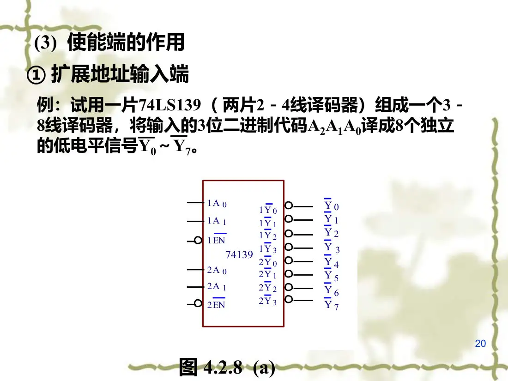

原文：

(3) 使能端的作用

① 扩展地址输入端

例：试用一片74LS139（两片2 - 4线译码器）组成一个3 - 8线译码器，将输入的3位二进制代码 $A_{2}A_{1}A_{0}$ 译成8个独立的低电平信号 $\overline{Y}_{0}\sim\overline{Y}_{7}$ 。

$$
\begin{array}{c c c} \hline 1 A _ {0} & 1 \overline {{Y}} _ {0} & \text {O- - } \quad \overline {{Y}} _ {0} \\ \hline 1 A _ {1} & 1 \overline {{Y}} _ {1} & \text {O- - } \quad \overline {{Y}} _ {1} \\ \hline 1 E N & 1 \overline {{Y}} _ {2} & \text {O- - } \quad \overline {{Y}} _ {2} \\ 7 4 1 3 9 & 1 \overline {{Y}} _ {3} & \text {O- - } \quad \overline {{Y}} _ {3} \\ \hline 2 A _ {0} & 2 \overline {{Y}} _ {0} & \text {O- - } \quad \overline {{Y}} _ {4} \\ \hline 2 A _ {1} & 2 \overline {{Y}} _ {1} & \text {O- - } \quad \overline {{Y}} _ {5} \\ \hline 2 E N & 2 \overline {{Y}} _ {2} & \text {O- - } \quad \overline {{Y}} _ {6} \\ \hline \end{array}
$$

图 4.2.8 (a)

20

### 表 4.2.5 3 - 8 线译码器74138的功能表

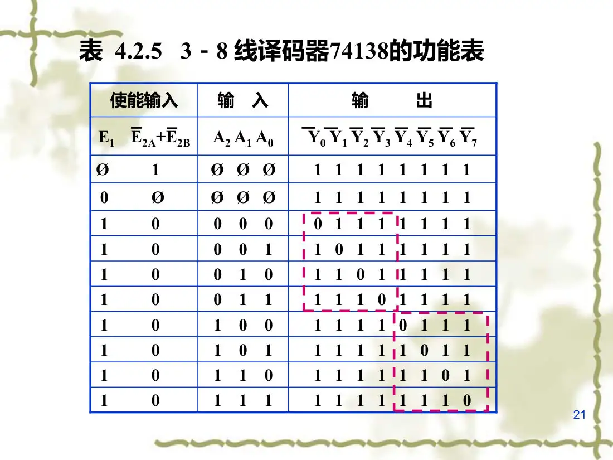

原文：

表 4.2.5 3 - 8 线译码器74138的功能表

<table><tr><td colspan="2">使能输入</td><td>输入</td><td>输出</td></tr><tr><td> $E_1$ </td><td> $\overline{E}_{2A} + \overline{E}_{2B}$ </td><td> $A_2 A_1 A_0$ </td><td> $\overline{Y}_0 \overline{Y}_1 \overline{Y}_2 \overline{Y}_3 \overline{Y}_4 \overline{Y}_5 \overline{Y}_6 \overline{Y}_7$ </td></tr><tr><td>∅</td><td>1</td><td>∅ ∅ ∅</td><td>1 1 1 1 1 1 1 1</td></tr><tr><td>0</td><td>∅</td><td>∅ ∅ ∅</td><td>1 1 1 1 1 1 1 1</td></tr><tr><td>1</td><td>0</td><td>0 0 0</td><td>0 1 1 1 1 1 1 1</td></tr><tr><td>1</td><td>0</td><td>0 0 1</td><td>1 0 1 1 1 1 1 1</td></tr><tr><td>1</td><td>0</td><td>0 1 0</td><td>1 1 0 1 1 1 1 1</td></tr><tr><td>1</td><td>0</td><td>0 1 1</td><td>1 1 1 0 1 1 1 1</td></tr><tr><td>1</td><td>0</td><td>1 0 0</td><td>1 1 1 1 0 1 1 1</td></tr><tr><td>1</td><td>0</td><td>1 0 1</td><td>1 1 1 1 1 0 1 1</td></tr><tr><td>1</td><td>0</td><td>1 1 0</td><td>1 1 1 1 1 1 0 1</td></tr><tr><td>1</td><td>0</td><td>1 1 1</td><td>1 1 1 1 1 1 1 0</td></tr></table>

21

### 表 4.2.6 2 - 4 线译码器扩展为 3 - 8 线译码器的真值表

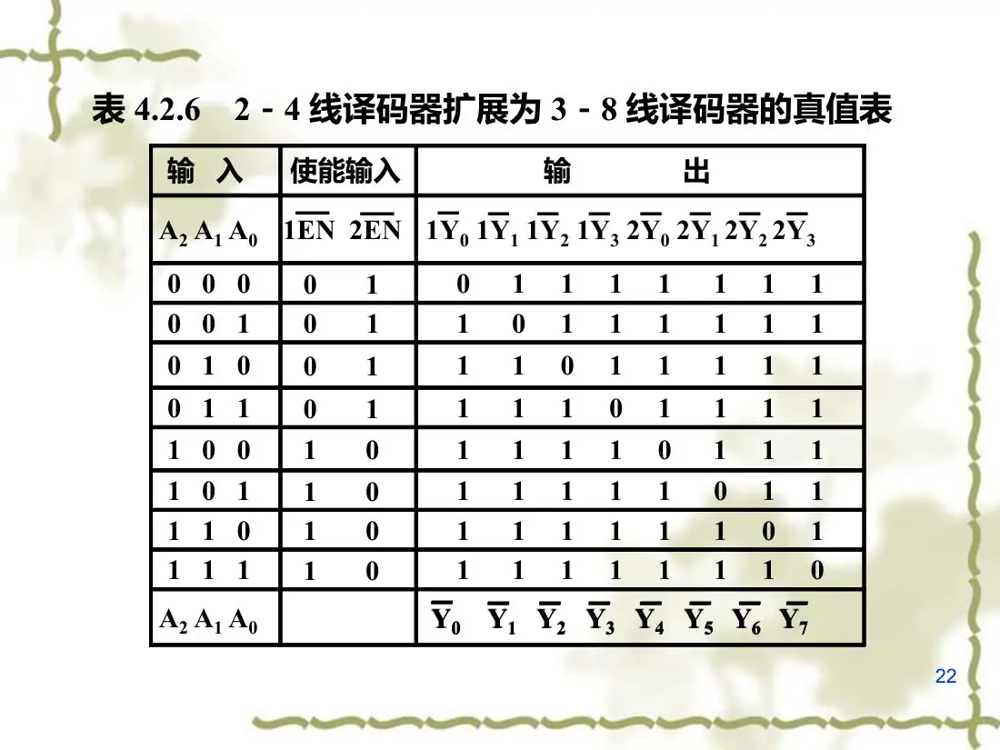

原文：

表 4.2.6 2 - 4 线译码器扩展为 3 - 8 线译码器的真值表
<table><tr><td>输入</td><td>使能输入</td><td>输出</td></tr><tr><td> $A_{2}A_{1}A_{0}$ </td><td> $1\overline{EN}$   $2\overline{EN}$ </td><td> $1\overline{Y}_{0}$   $1\overline{Y}_{1}$   $1\overline{Y}_{2}$   $1\overline{Y}_{3}$   $2\overline{Y}_{0}$   $2\overline{Y}_{1}$   $2\overline{Y}_{2}$   $2\overline{Y}_{3}$ </td></tr><tr><td>0 0 0</td><td>0 1</td><td>0 1 1 1 1 1 1 1</td></tr><tr><td>0 0 1</td><td>0 1</td><td>1 0 1 1 1 1 1 1</td></tr><tr><td>0 1 0</td><td>0 1</td><td>1 1 0 1 1 1 1 1</td></tr><tr><td>0 1 1</td><td>0 1</td><td>1 1 1 0 1 1 1 1</td></tr><tr><td>1 0 0</td><td>1 0</td><td>1 1 1 1 0 1 1 1</td></tr><tr><td>1 0 1</td><td>1 0</td><td>1 1 1 1 1 0 1 1 1</td></tr><tr><td>1 1 0</td><td>1 0</td><td>1 1 1 1 1 1 0 1</td></tr><tr><td>1 1 1</td><td>1 0</td><td>1 1 1 1 1 1 1 0</td></tr><tr><td> $A_{2}A_{1}A_{0}$ </td><td></td><td> $\overline{Y}_{0}$   $\overline{Y}_{1}$   $\overline{Y}_{2}$   $\overline{Y}_{3}$   $\overline{Y}_{4}$   $\overline{Y}_{5}$   $\overline{Y}_{6}$   $\overline{Y}_{7}$ </td></tr></table>

22

### $$

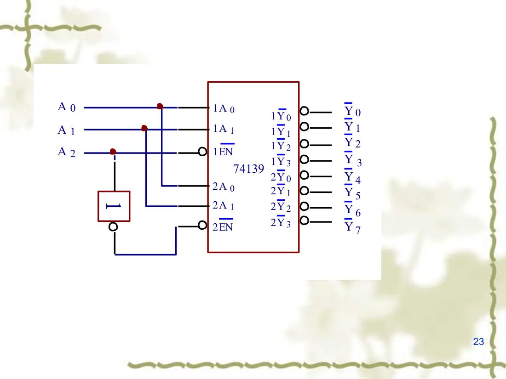

原文：

$$
\begin{array}{c c c} \text {A 0} & 1 \mathrm{A} _ {0} & 1 \overline {{\mathrm{Y}}} _ {0} \\ \text {A 1} & 1 \mathrm{A} _ {1} & 1 \overline {{\mathrm{Y}}} _ {1} \\ \text {A 2} & 1 \overline {{\mathrm{EN}}} & 1 \overline {{\mathrm{Y}}} _ {2} \\ & & 7 4 1 3 9 \\ & 2 \mathrm{A} _ {0} & 2 \overline {{\mathrm{Y}}} _ {0} \\ & 2 \mathrm{A} _ {1} & 2 \overline {{\mathrm{Y}}} _ {1} \\ & 2 \overline {{\mathrm{EN}}} & 2 \overline {{\mathrm{Y}}} _ {2} \\ & & 2 \overline {{\mathrm{Y}}} _ {3} \end{array}
$$

23

### 24

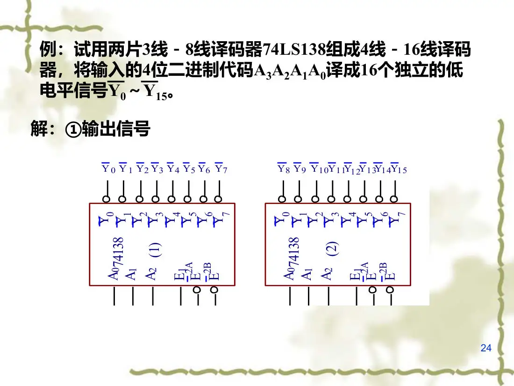

原文：

例：试用两片3线 - 8线译码器74LS138组成4线 - 16线译码器，将输入的4位二进制代码 $A_{3}A_{2}A_{1}A_{0}$ 译成16个独立的低电平信号 $\overline{Y}_{0}\sim\overline{Y}_{15}$ 。

24

### ②输入信号和级联问题

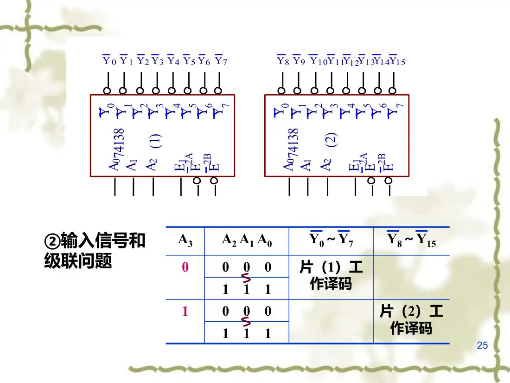

原文：

②输入信号和级联问题
<table><tr><td>A3</td><td>A2A1A0</td><td> $\overline{Y}_{0} \sim \overline{Y}_{7}$ </td><td> $\overline{Y}_{8} \sim \overline{Y}_{15}$ </td></tr><tr><td rowspan="2">0</td><td>0 0 0</td><td rowspan="2">片(1)工作译码</td><td rowspan="2"></td></tr><tr><td>1 1 1</td></tr><tr><td rowspan="2">1</td><td>0 0 0</td><td rowspan="2"></td><td rowspan="2">片(2)工作译码</td></tr><tr><td>1 1 1</td></tr></table>

25

### 26

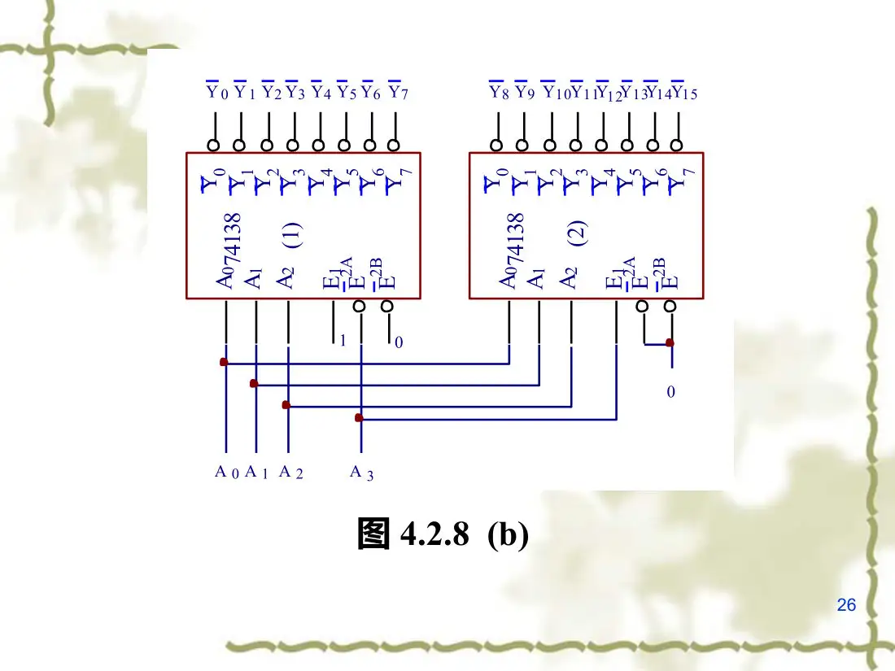

原文：

26

### ② 构造数据分配器 (不要求)

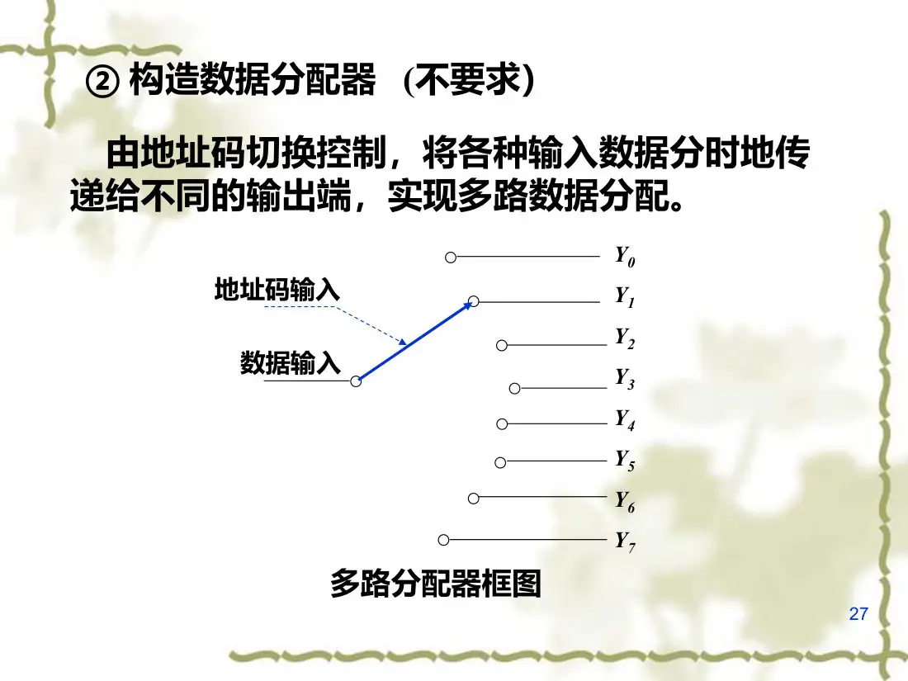

原文：

② 构造数据分配器 (不要求)

由地址码切换控制，将各种输入数据分时地传递给不同的输出端，实现多路数据分配。

27

### $$

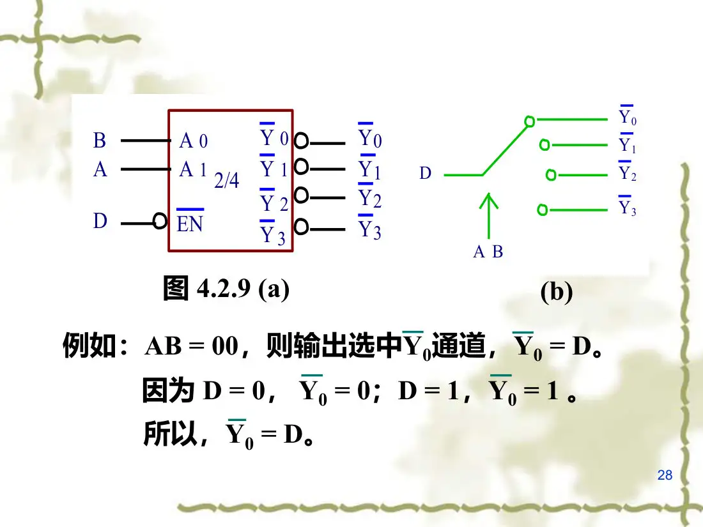

原文：

$$
\begin{array}{c c c} \text {B} & \text {A 0} & \overline {{\mathrm{Y}}} _ {0} \\ \text {A} & \text {A 1} _ {2 / 4} & \overline {{\mathrm{Y}}} _ {1} \\ \text {D} & \overline {{\mathrm{EN}}} & \overline {{\mathrm{Y}}} _ {2} \\ & & \overline {{\mathrm{Y}}} _ {3} \end{array} \begin{array}{c c c} \text {Y} _ {0} & \text {Y} _ {0} \\ \text {Y} _ {1} & \text {Y} _ {1} \\ \text {Y} _ {2} & \text {Y} _ {2} \\ \text {Y} _ {3} & \text {Y} _ {3} \end{array}
$$

图 4.2.9 (a)

$$
\begin{array}{c} \text {D} \\ \text {A B} \end{array} \begin{array}{c} \text {Y} _ {0} \\ \text {Y} _ {1} \\ \text {Y} _ {2} \\ \text {Y} _ {3} \end{array}
$$

(b)

例如：AB = 00，则输出选中 $\overline{Y}_{0}$ 通道， $\overline{Y}_{0} = D$ 。
因为 D = 0, $\overline{Y}_{0} = 0$ ; D = 1, $\overline{Y}_{0} = 1$ 。
所以， $\overline{Y}_{0}=D$ 。

28

### (5) 用译码器设计组合逻辑电路

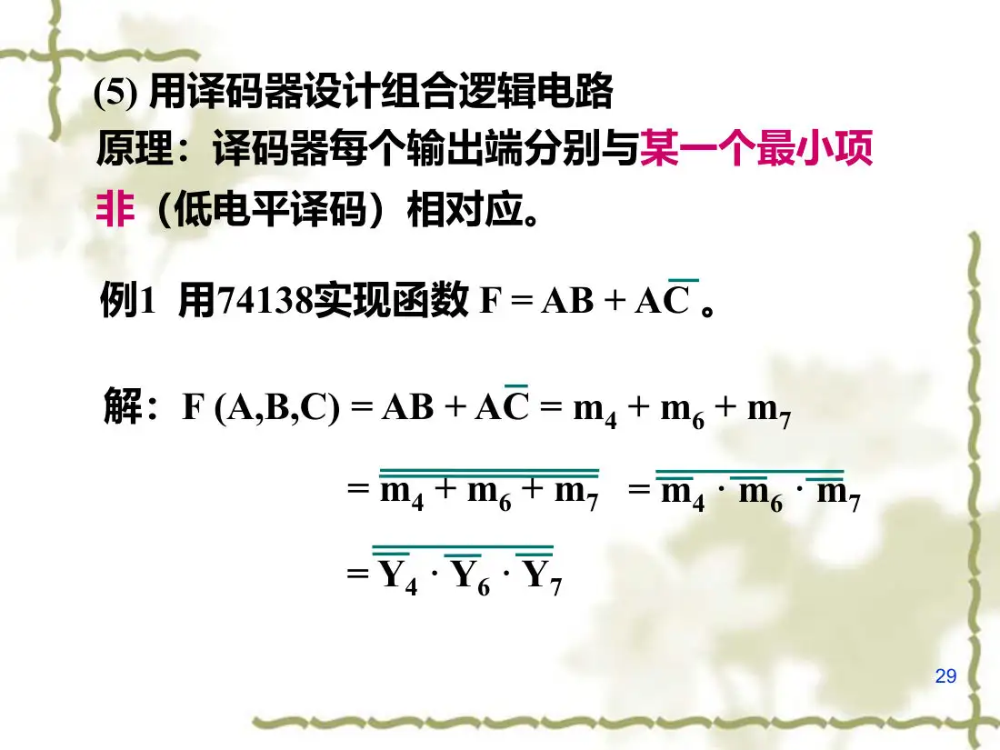

原文：

(5) 用译码器设计组合逻辑电路

原理：译码器每个输出端分别与某一个最小项非（低电平译码）相对应。

例1 用74138实现函数 F = AB + AC。

$$
{ \begin{array}{r l} {{\mathrm{解}: {\bf F} ({\bf A}, {\bf B}, {\bf C}) = {\bf A} {\bf B} + {\bf A} {\overline {{{{\bf C}}}}} = {\bf m} _ {4} + {\bf m} _ {6} + {\bf m} _ {7}}} \\ & {= {\overline {{{{\bf m} _ {4} + {\bf m} _ {6} + {\bf m} _ {7}}}}}} = {\overline {{{{\bf m} _ {4} \cdot {\bf m} _ {6} \cdot {\bf m} _ {7}}}}}} \\ & {= {\overline {{{{\bf Y} _ {4} \cdot {\bf Y} _ {6} \cdot {\bf Y} _ {7}}}}}} \end{array}
$$

29

### $$

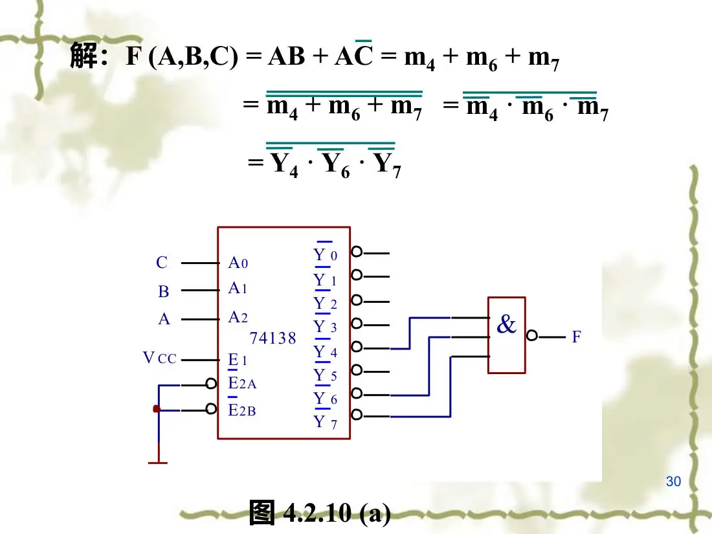

原文：

$$
\begin{array}{r l} \mathbf {F} (\mathbf {A}, \mathbf {B}, \mathbf {C}) = \mathbf {A B} + \mathbf {A} \overline {{\mathbf {C}}} = \mathbf {m} _ {4} + \mathbf {m} _ {6} + \mathbf {m} _ {7} \\ & = \overline {{\overline {{\mathbf {m} _ {4} + \mathbf {m} _ {6} + \mathbf {m} _ {7}}}}} = \overline {{\overline {{\mathbf {m} _ {4}}} \cdot \overline {{\mathbf {m} _ {6}}} \cdot \overline {{\mathbf {m}}} _ {7}}} \\ & = \overline {{\overline {{\mathbf {Y} _ {4}}} \cdot \overline {{\mathbf {Y} _ {6}}} \cdot \overline {{\mathbf {Y}}} _ {7}}} \end{array}
$$

图 4.2.10 (a)

30

### $$

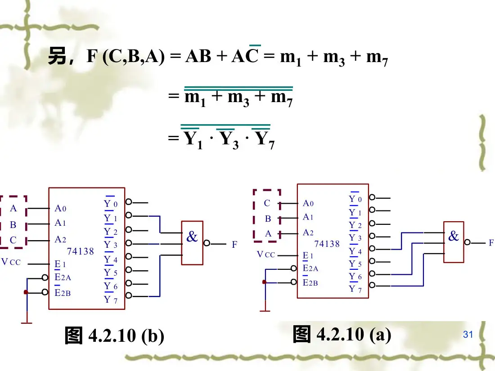

原文：

$$
\begin{array}{r l} & {\mathbf {F} (\mathbf {C}, \mathbf {B}, \mathbf {A}) = \mathbf {A B} + \mathbf {A} \overline {{\mathbf {C}}} = \mathbf {m} _ {1} + \mathbf {m} _ {3} + \mathbf {m} _ {7}} \\ & {\qquad = \overline {{\mathbf {m} _ {1} + \mathbf {m} _ {3} + \mathbf {m} _ {7}}}} \\ & {\qquad = \overline {{\overline {{\mathbf {Y} _ {1}}} \cdot \overline {{\mathbf {Y} _ {3}}} \cdot \overline {{\mathbf {Y} _ {7}}}}}} \end{array}
$$

### 32

原文：

32

### $$

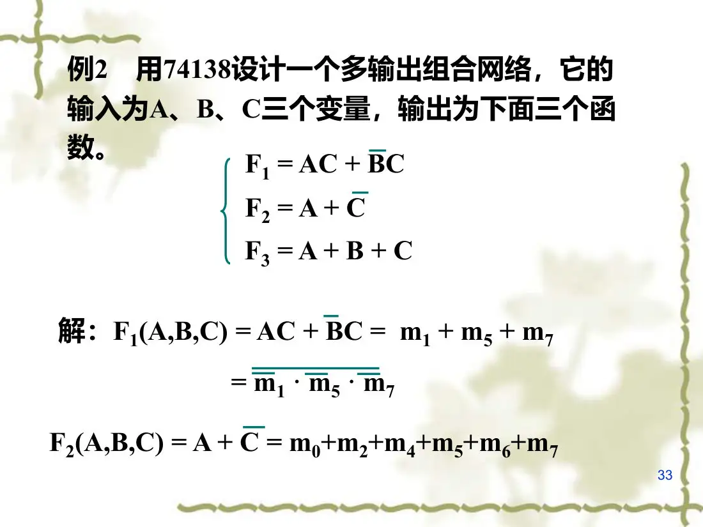

原文：

例2 用74138设计一个多输出组合网络, 它的输入为A、B、C三个变量, 输出为下面三个函数。

$$
\left\{ \begin{array}{l} \mathbf {F} _ {1} = \mathbf {A C} + \overline {{\mathbf {B}}} \mathbf {C} \\ \mathbf {F} _ {2} = \mathbf {A} + \overline {{\mathbf {C}}} \\ \mathbf {F} _ {3} = \mathbf {A} + \mathbf {B} + \mathbf {C} \end{array} \right.
$$

解： $\mathrm{F}_{1}(\mathrm{A},\mathrm{B},\mathrm{C}) = \mathrm{AC} + \overline{\mathrm{BC}} = \mathrm{m}_{1} + \mathrm{m}_{5} + \mathrm{m}_{7}$ $= \overline{\overline{\mathbf{m}}_{1} \cdot \overline{\mathbf{m}}_{5} \cdot \overline{\mathbf{m}}_{7}}$

$$
\mathbf {F} _ {2} (\mathbf {A}, \mathbf {B}, \mathbf {C}) = \mathbf {A} + \overline {{\mathbf {C}}} = \mathbf {m} _ {0} + \mathbf {m} _ {2} + \mathbf {m} _ {4} + \mathbf {m} _ {5} + \mathbf {m} _ {6} + \mathbf {m} _ {7}
$$

33

### $$

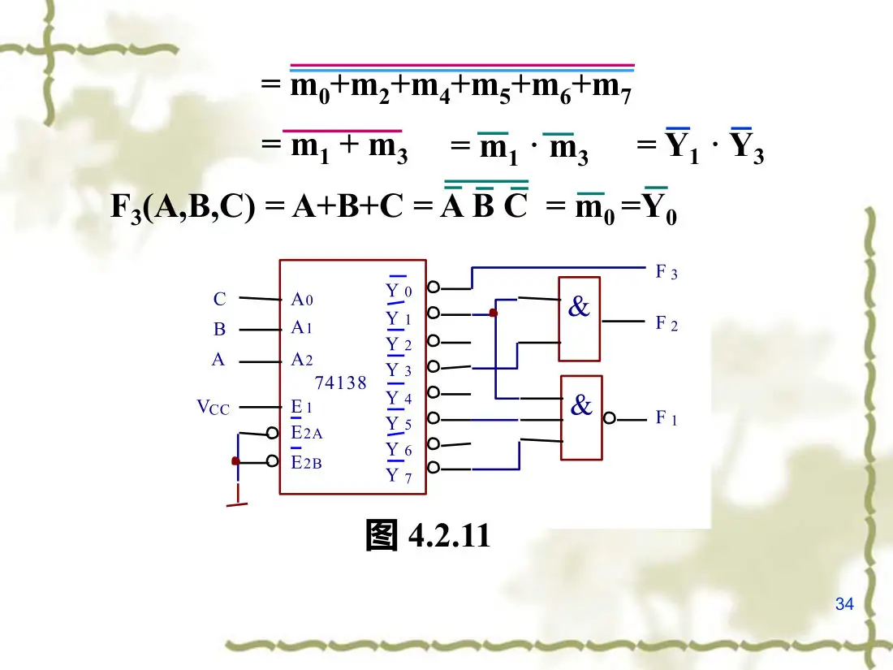

原文：

$$
\begin{array}{r l} & = \overline {{\mathbf {m} _ {0} + \mathbf {m} _ {2} + \mathbf {m} _ {4} + \mathbf {m} _ {5} + \mathbf {m} _ {6} + \mathbf {m} _ {7}}} \\ & = \overline {{\mathbf {m} _ {1} + \mathbf {m} _ {3}}} = \overline {{\mathbf {m} _ {1}}} \cdot \overline {{\mathbf {m} _ {3}}} = \overline {{\mathbf {Y}}} _ {1} \cdot \overline {{\mathbf {Y}}} _ {3} \end{array}
$$

$$
\mathbf {F} _ {3} (\mathbf {A}, \mathbf {B}, \mathbf {C}) = \mathbf {A} + \mathbf {B} + \mathbf {C} = \overline {{\overline {{\mathbf {A}}} \overline {{\mathbf {B}}} \overline {{\mathbf {C}}}}} = \overline {{\mathbf {m}}} _ {0} = \overline {{\mathbf {Y}}} _ {0}
$$

34

### 2.二—十进制译码器

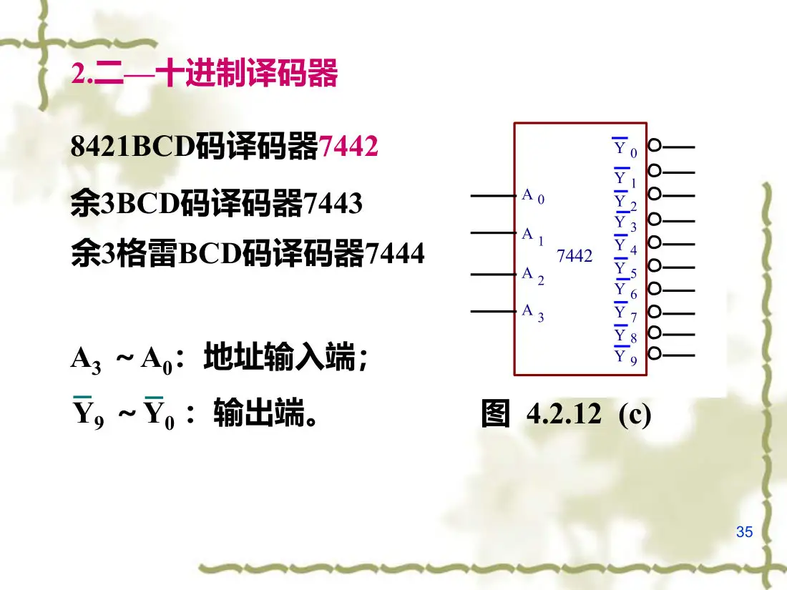

原文：

2.二—十进制译码器

8421BCD码译码器7442

余3BCD码译码器7443

余3格雷BCD码译码器7444

$\mathrm{A}_3 \sim \mathrm{A}_0$ ：地址输入端；

$\overline{\mathrm{Y}}_9 \sim \overline{\mathrm{Y}}_0$ ：输出端。

35

### 表 4.2.7 二—十进制译码器 7442 的功能表

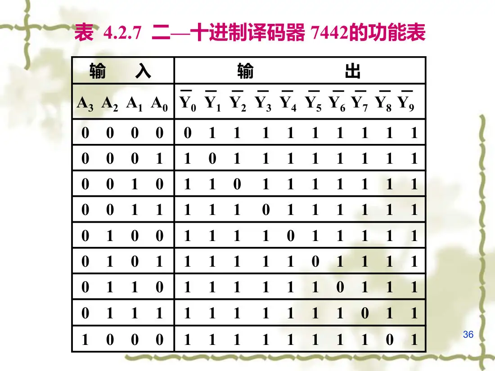

原文：

表 4.2.7 二—十进制译码器 7442 的功能表

<table><tr><td colspan="4">输入</td><td colspan="11">输出</td></tr><tr><td> $A_3$ </td><td> $A_2$ </td><td> $A_1$ </td><td> $A_0$ </td><td> $\overline{Y}_0$ </td><td> $\overline{Y}_1$ </td><td> $\overline{Y}_2$ </td><td> $\overline{Y}_3$ </td><td> $\overline{Y}_4$ </td><td> $\overline{Y}_5$ </td><td> $\overline{Y}_6$ </td><td> $\overline{Y}_7$ </td><td> $\overline{Y}_8$ </td><td> $\overline{Y}_9$ </td><td></td></tr><tr><td>0</td><td>0</td><td>0</td><td>0</td><td>0</td><td>1</td><td>1</td><td>1</td><td>1</td><td>1</td><td>1</td><td>1</td><td>1</td><td>1</td><td>1</td></tr><tr><td>0</td><td>0</td><td>0</td><td>1</td><td>1</td><td>0</td><td>1</td><td>1</td><td>1</td><td>1</td><td>1</td><td>1</td><td>1</td><td>1</td><td>1</td></tr><tr><td>0</td><td>0</td><td>1</td><td>0</td><td>1</td><td>1</td><td>0</td><td>1</td><td>1</td><td>1</td><td>1</td><td>1</td><td>1</td><td>1</td><td>1</td></tr><tr><td>0</td><td>0</td><td>1</td><td>1</td><td>1</td><td>1</td><td>1</td><td>0</td><td>1</td><td>1</td><td>1</td><td>1</td><td>1</td><td>1</td><td>1</td></tr><tr><td>0</td><td>1</td><td>0</td><td>0</td><td>1</td><td>1</td><td>1</td><td>1</td><td>0</td><td>1</td><td>1</td><td>1</td><td>1</td><td>1</td><td>1</td></tr><tr><td>0</td><td>1</td><td>0</td><td>1</td><td>1</td><td>1</td><td>1</td><td>1</td><td>1</td><td>0</td><td>1</td><td>1</td><td>1</td><td>1</td><td>1</td></tr><tr><td>0</td><td>1</td><td>1</td><td>0</td><td>1</td><td>1</td><td>1</td><td>1</td><td>1</td><td>1</td><td>0</td><td>1</td><td>1</td><td>1</td><td>1</td></tr><tr><td>0</td><td>1</td><td>1</td><td>1</td><td>1</td><td>1</td><td>1</td><td>1</td><td>1</td><td>1</td><td>1</td><td>0</td><td>1</td><td>1</td><td>1</td></tr><tr><td>1</td><td>0</td><td>0</td><td>0</td><td>1</td><td>1</td><td>1</td><td>1</td><td>1</td><td>1</td><td>1</td><td>1</td><td>1</td><td>0</td><td>1</td></tr><tr><td>1</td><td>0</td><td>0</td><td>1</td><td>1</td><td>1</td><td>1</td><td>1</td><td>1</td><td>1</td><td>1</td><td>1</td><td>1</td><td>0</td><td></td></tr><tr><td>1</td><td>0</td><td>1</td><td>0</td><td>1</td><td>1</td><td>1</td><td>1</td><td>1</td><td>1</td><td>1</td><td>1</td><td>1</td><td>1</td><td></td></tr><tr><td>1</td><td>0</td><td>1</td><td>1</td><td>1</td><td>1</td><td>1</td><td>1</td><td>1</td><td>1</td><td>1</td><td>1</td><td>1</td><td>1</td><td></td></tr><tr><td>1</td><td>1</td><td>0</td><td>0</td><td>1</td><td>1</td><td>1</td><td>1</td><td>1</td><td>1</td><td>1</td><td>1</td><td>1</td><td>1</td><td></td></tr><tr><td>1</td><td>1</td><td>0</td><td>1</td><td>1</td><td>1</td><td>1</td><td>1</td><td>1</td><td>1</td><td>1</td><td>1</td><td>1</td><td>1</td><td></td></tr><tr><td>1</td><td>1</td><td>1</td><td>0</td><td>1</td><td>1</td><td>1</td><td>1</td><td>1</td><td>1</td><td>1</td><td>1</td><td>1</td><td>1</td><td></td></tr><tr><td>1</td><td>1</td><td>1</td><td>1</td><td>1</td><td>1</td><td>1</td><td>1</td><td>1</td><td>1</td><td>1</td><td>1</td><td>1</td><td>1</td><td></td></tr></table>

36

### 37

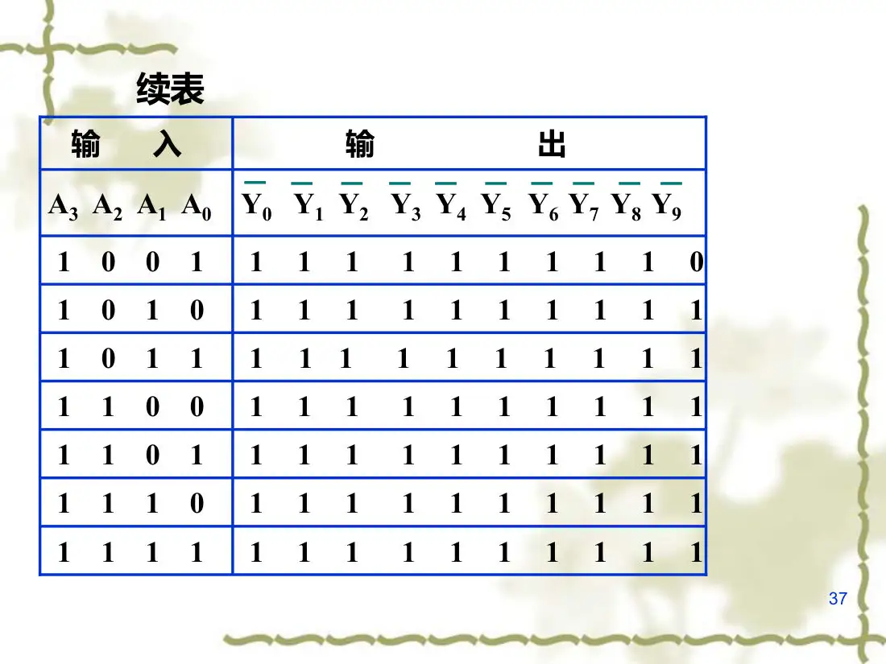

原文：

37

### 3. 数字显示译码器

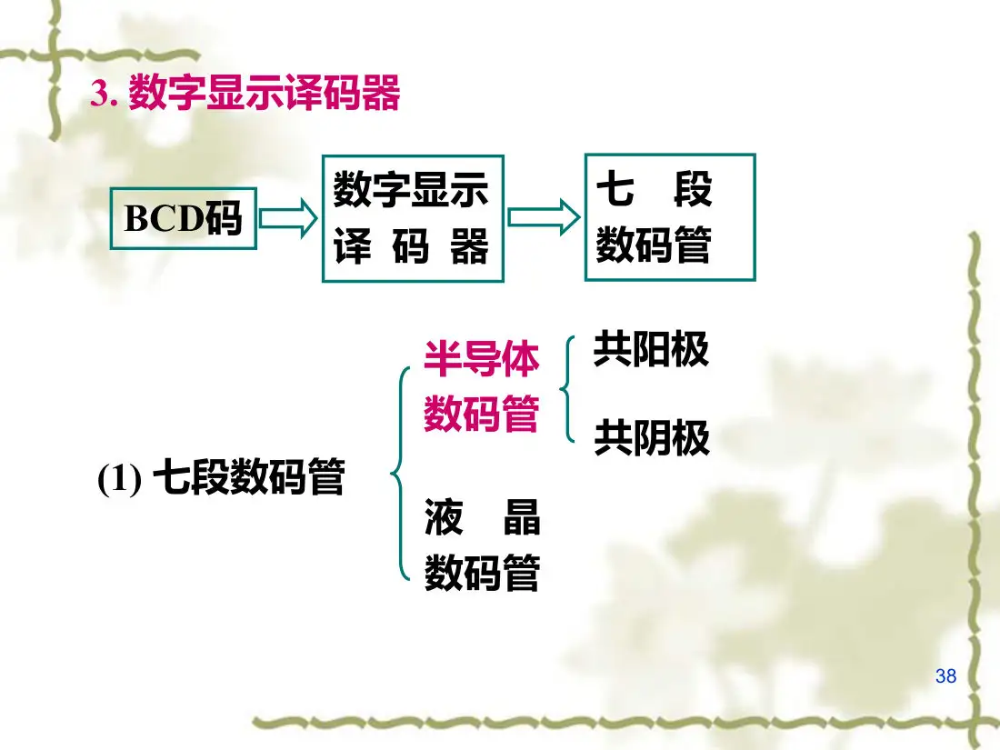

原文：

3. 数字显示译码器

BCD码

数字显示

译码器

七 段

数码管

半导体

数码管

(1) 七段数码管

液晶

数码管

共阳极

共阴极

38

### 39

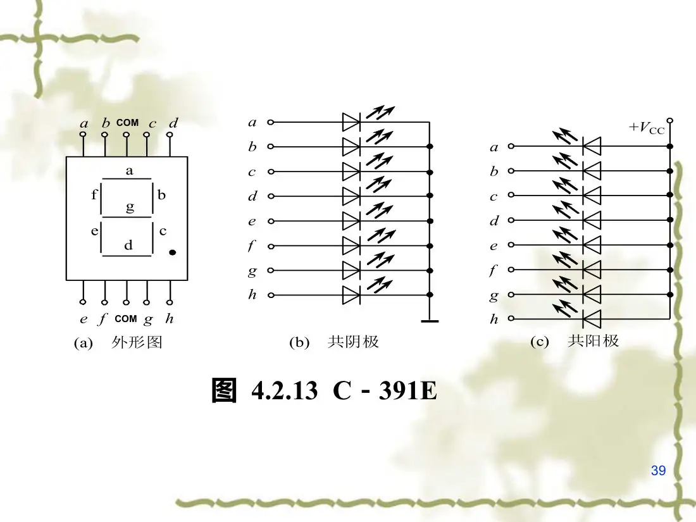

原文：

39

### (2) 数字显示译码器7448

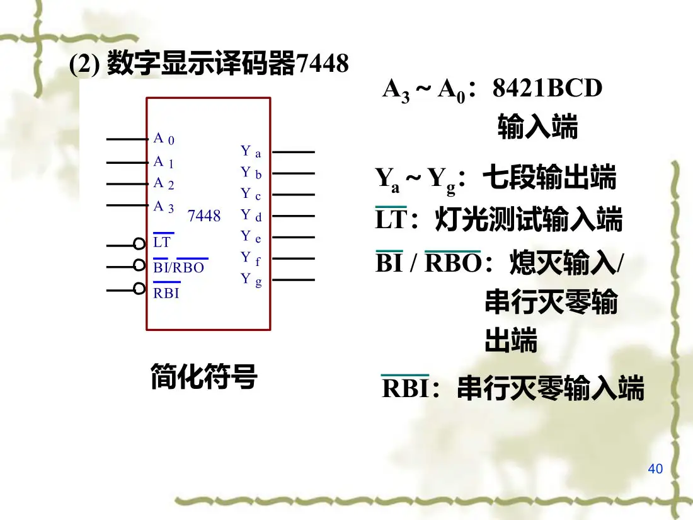

原文：

(2) 数字显示译码器7448

$$
\begin{array}{c c} \text {A} _ {0} & \text {Y} _ {a} \\ \text {A} _ {1} & \text {Y} _ {b} \\ \text {A} _ {2} & \text {Y} _ {c} \\ \text {A} _ {3} & 7 4 4 8 \\ \overline {{\text {LT}}} & \text {Y} _ {e} \\ \overline {{\text {BI/RBO}}} & \text {Y} _ {f} \\ \overline {{\text {RBI}}} & \text {Y} _ {g} \end{array}
$$

简化符号$\mathrm{A}_3 \sim \mathrm{A}_0$ ：8421BCD输入端

$\mathrm{Y_a}\sim \mathrm{Y_g}$ ：七段输出端

LT: 灯光测试输入端

BI / RBO: 熄灭输入/串行灭零输出端

RBI: 串行灭零输入端

40

### 辅助控制端功能：

原文：

辅助控制端功能：

①灯光测试输入端LT:

当LT=0时，数码管七段全亮，用于测试数码管的好坏。

②灭零输入端RBI:

当 $\overline{\mathrm{LT}} = 1$ ， $\overline{\mathrm{RBI}} = 0$ 时，0字被熄灭。当译码输入不为0时，该位正常显示。用于消隐无效的0。

③熄灭输入、灭零输出端BI/RBO。

作输入端使用时：如果 $\overline{\mathrm{BI}} = 0$ 时，数码管七段全灭。

作输出端使用时:

当 $\overline{LT}=1$ ， $\overline{RBI}=0$ ，实现“灭零”时， $\overline{RBO}=0$ ，用以指示该片正处于灭零状态。当译码输入不为0时， $\overline{RBO}=1$

41

### 第 42 页

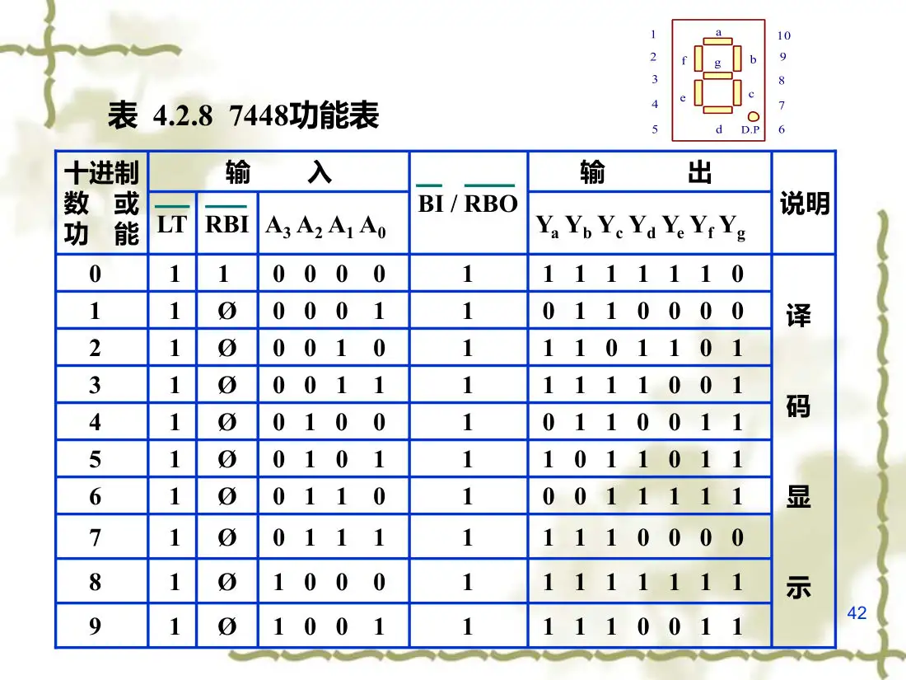

原文：

<table><tr><td rowspan="2">十进制数或功能</td><td colspan="3">输入</td><td rowspan="2">BI / RBO</td><td colspan="7">输出</td><td rowspan="2">说明</td></tr><tr><td>LT</td><td>RBI</td><td> $A_3$   $A_2$   $A_1$   $A_0$ </td><td> $Y_a$ </td><td> $Y_b$ </td><td> $Y_c$ </td><td> $Y_d$ </td><td> $Y_e$ </td><td> $Y_f$ </td><td> $Y_g$ </td></tr><tr><td>0</td><td>1</td><td>1</td><td>0 0 0 0</td><td>1</td><td>1</td><td>1</td><td>1</td><td>1</td><td>1</td><td>1</td><td>0</td><td rowspan="10">译码显示</td></tr><tr><td>1</td><td>1</td><td>∅</td><td>0 0 0 1</td><td>1</td><td>0</td><td>1</td><td>1</td><td>0</td><td>0</td><td>0</td><td>0</td></tr><tr><td>2</td><td>1</td><td>∅</td><td>0 0 1 0</td><td>1</td><td>1</td><td>1</td><td>0</td><td>1</td><td>1</td><td>0</td><td>1</td></tr><tr><td>3</td><td>1</td><td>∅</td><td>0 0 1 1</td><td>1</td><td>1</td><td>1</td><td>1</td><td>1</td><td>0</td><td>0</td><td>1</td></tr><tr><td>4</td><td>1</td><td>∅</td><td>0 1 0 0</td><td>1</td><td>0</td><td>1</td><td>1</td><td>0</td><td>0</td><td>1</td><td>1</td></tr><tr><td>5</td><td>1</td><td>∅</td><td>0 1 0 1</td><td>1</td><td>1</td><td>0</td><td>1</td><td>1</td><td>0</td><td>1</td><td>1</td></tr><tr><td>6</td><td>1</td><td>∅</td><td>0 1 1 0</td><td>1</td><td>0</td><td>0</td><td>1</td><td>1</td><td>1</td><td>1</td><td>1</td></tr><tr><td>7</td><td>1</td><td>∅</td><td>0 1 1 1</td><td>1</td><td>1</td><td>1</td><td>1</td><td>0</td><td>0</td><td>0</td><td>0</td></tr><tr><td>8</td><td>1</td><td>∅</td><td>1 0 0 0</td><td>1</td><td>1</td><td>1</td><td>1</td><td>1</td><td>1</td><td>1</td><td>1</td></tr><tr><td>9</td><td>1</td><td>∅</td><td>1 0 0 1</td><td>1</td><td>1</td><td>1</td><td>1</td><td>0</td><td>0</td><td>1</td><td>1</td></tr></table>

### 续表

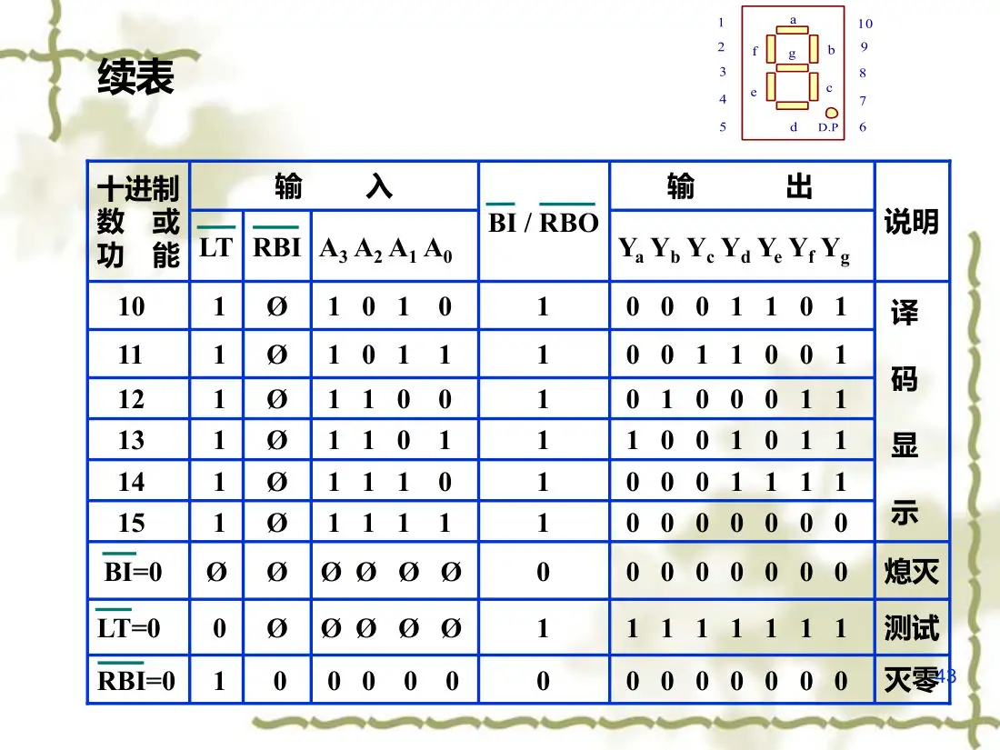

原文：

续表

<table><tr><td rowspan="2">十进制数或功能</td><td colspan="3">输入</td><td rowspan="2">BI / RBO</td><td colspan="6">输出</td><td rowspan="2">说明</td><td></td></tr><tr><td>LT</td><td>RBI</td><td> $A_{3}A_{2}A_{1}A_{0}$ </td><td colspan="6"> $Y_{a}Y_{b}Y_{c}Y_{d}Y_{e}Y_{f}Y_{g}$ </td><td></td></tr><tr><td>10</td><td>1</td><td>∅</td><td>1 0 1 0</td><td>1</td><td>0</td><td>0</td><td>0</td><td>1</td><td>1</td><td>0</td><td>1</td><td rowspan="6">译码显示</td></tr><tr><td>11</td><td>1</td><td>∅</td><td>1 0 1 1</td><td>1</td><td>0</td><td>0</td><td>1</td><td>1</td><td>0</td><td>0</td><td>1</td></tr><tr><td>12</td><td>1</td><td>∅</td><td>1 1 0 0</td><td>1</td><td>0</td><td>1</td><td>0</td><td>0</td><td>0</td><td>1</td><td>1</td></tr><tr><td>13</td><td>1</td><td>∅</td><td>1 1 0 1</td><td>1</td><td>1</td><td>0</td><td>0</td><td>1</td><td>0</td><td>1</td><td>1</td></tr><tr><td>14</td><td>1</td><td>∅</td><td>1 1 1 0</td><td>1</td><td>0</td><td>0</td><td>0</td><td>1</td><td>1</td><td>1</td><td>1</td></tr><tr><td>15</td><td>1</td><td>∅</td><td>1 1 1 1</td><td>1</td><td>0</td><td>0</td><td>0</td><td>0</td><td>0</td><td>0</td><td>0</td></tr><tr><td> $\overline{BI}=0$ </td><td>∅</td><td>∅</td><td>∅ ∅ ∅ ∅</td><td>0</td><td>0</td><td>0</td><td>0</td><td>0</td><td>0</td><td>0</td><td>0</td><td>熄灭</td></tr><tr><td> $\overline{LT}=0$ </td><td>0</td><td>∅</td><td>∅ ∅ ∅ ∅</td><td>1</td><td>1</td><td>1</td><td>1</td><td>1</td><td>1</td><td>1</td><td>1</td><td>测试</td></tr><tr><td> $\overline{RBI}=0$ </td><td>1</td><td>0</td><td>0 0 0 0</td><td>0</td><td>0</td><td>0</td><td>0</td><td>0</td><td>0</td><td>0</td><td>0</td><td>灭零48</td></tr></table>

### 44

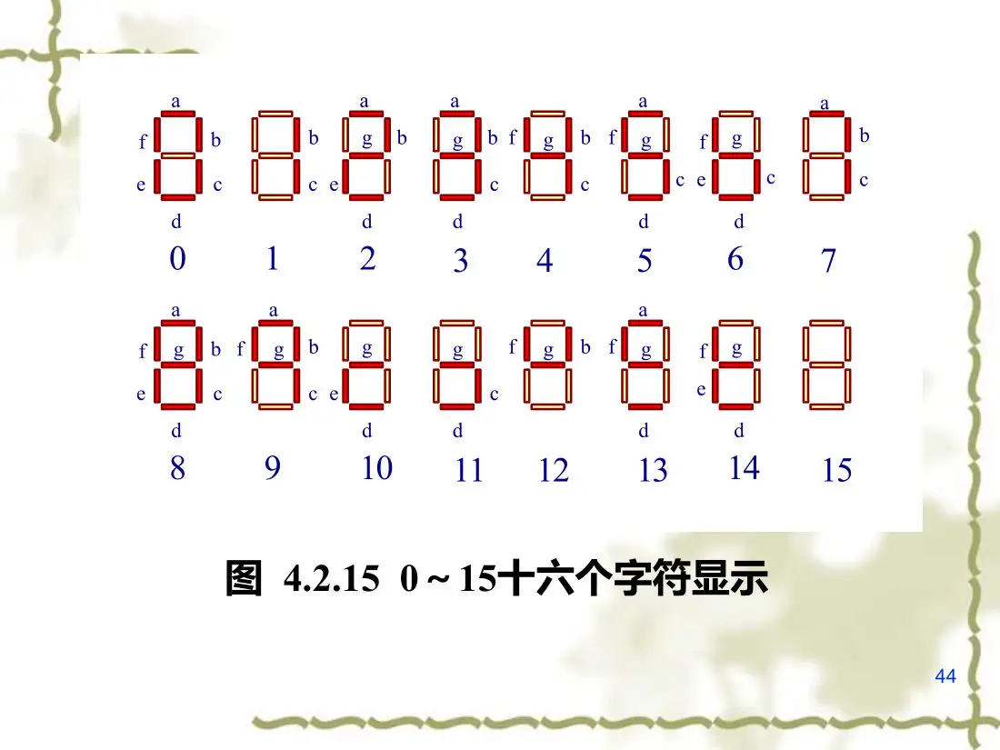

原文：

44

### 45

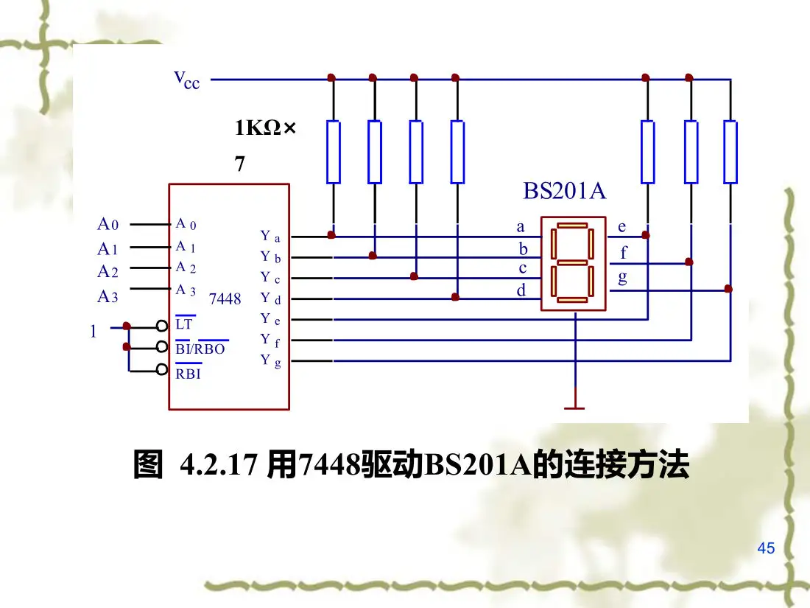

原文：

45

### 熄灭输入、灭零输出端BI/RBO。

原文：

熄灭输入、灭零输出端BI/RBO。

作输入端使用时：如果 $\overline{\mathrm{BI}} = 0$ 时，数码管七段全灭。

作输出端使用时：

当 $\overline{LT}=1$ ， $\overline{RBI}=0$ ，实现“灭零”时， $\overline{RBO}=0$ ，用以指示该片正处于灭零状态。当译码输入不为0时， $\overline{RBO}=1$

46

### 47

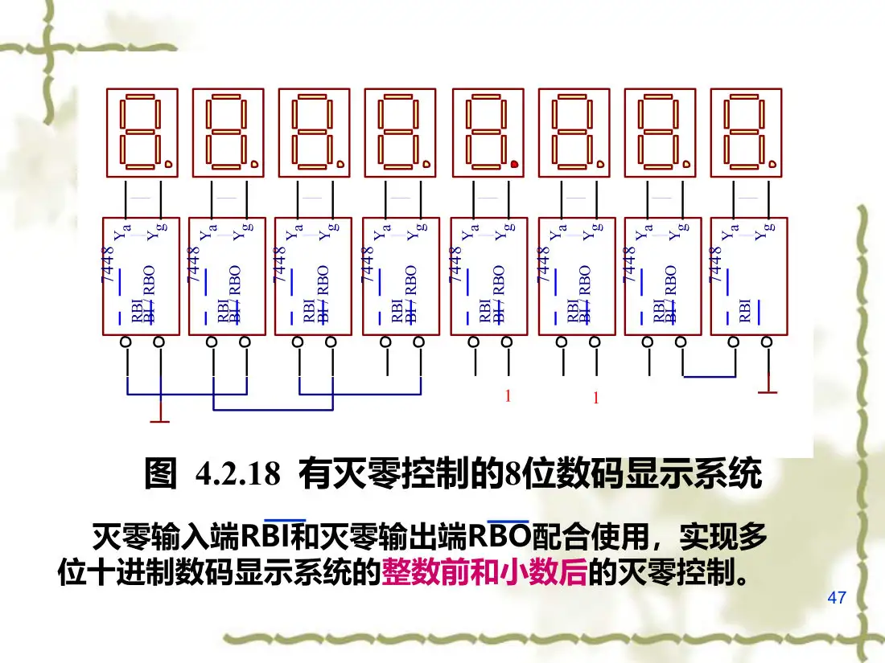

原文：

灭零输入端RBI和灭零输出端RBO配合使用，实现多位十进制数码显示系统的整数前和小数后的灭零控制。

47

### 第 48 页

### 3.11 试将2/4译码器扩展成4/16译码器

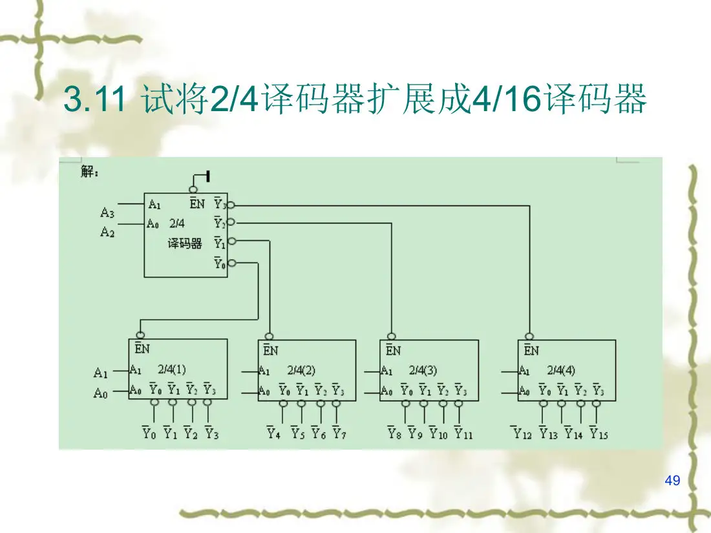

原文：

3.11 试将2/4译码器扩展成4/16译码器

49
