# 《数字电路与逻辑设计B》第3章 数据比较器及全加器（课件）

原件的每一页，下面附识别出的文字。

### 四 、 数据比较器

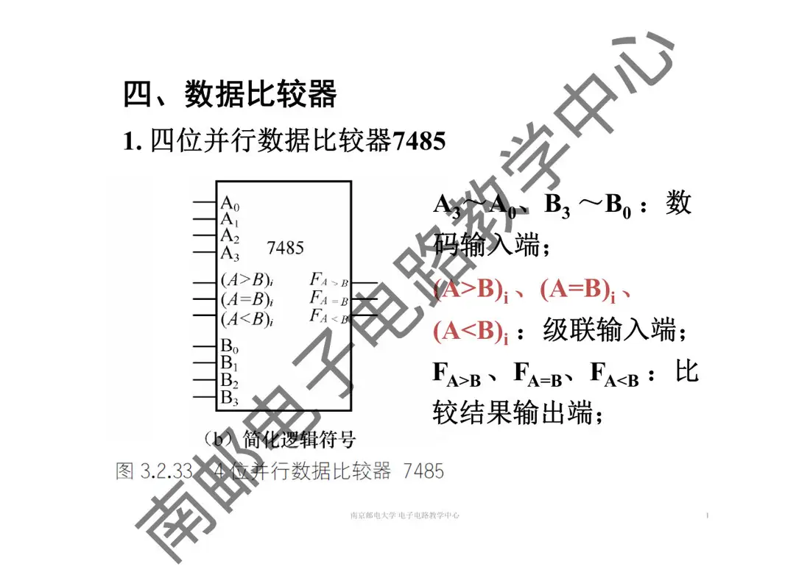

原文：

四 、 数据比较器

1. 四位并行数据 比较器7485

(b)简化逻辑符号

${ \bf B } _ { 3 } \sim { \bf B _ { 0 } }$ ： 数 码输入端；

$$
(A > B) _ {i} 、 (A = B) _ {i} 、
$$

$( \mathbf { A } { < } \mathbf { B } ) _ { \mathrm { i } }$ ： 级联输入端；$\mathbf { F _ { A > B } } \setminus \mathbf { F _ { A = B } } \setminus \mathbf { F _ { A < B } }$ ： 比较结果输出端；

南京邮电大学 电子电路教学中心

1

### 表 3 2 1 0 4. . 位数值 比较器7485功 能表

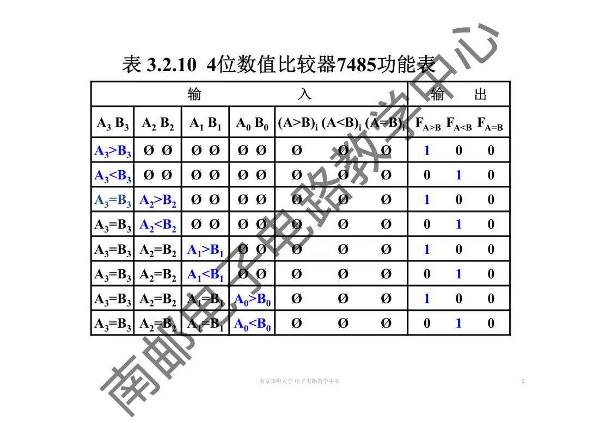

原文：

表 3 2 1 0 4. . 位数值 比较器7485功 能表
<table><tr><td colspan="5">输入</td><td colspan="3">输出</td></tr><tr><td> $A_3 B_3$ </td><td> $A_2 B_2$ </td><td> $A_1 B_1$ </td><td> $A_0 B_0$ </td><td> $(A>B)_i (A100F_{A>B} F_{A10} F_{A=B}$ </td><td> $F_{A>B}$ </td><td> $F_{A10} F_{A10} F_{A=B}$ </td><td></td></tr><tr><td> $A_3>B_3$ </td><td>∅ ∅</td><td>∅ ∅</td><td>∅ ∅</td><td>∅ ∅ ∅</td><td>1</td><td>0</td><td>0</td></tr><tr><td> $A_310</td><td>∅ ∅</td><td>∅ ∅</td><td>∅ ∅</td><td>∅ ∅ ∅</td><td>0</td><td>1</td><td>0</td></tr><tr><td>\( A_3=B_3$ </td><td> $A_2>B_2$ </td><td>∅ ∅</td><td>∅ ∅</td><td>∅ ∅ ∅</td><td>1</td><td>0</td><td>0</td></tr><tr><td> $A_3=B_3$ </td><td> $A_210</td><td>∅ ∅</td><td>∅ ∅</td><td>∅ ∅ ∅</td><td>0</td><td>1</td><td>0</td></tr><tr><td>\( A_3=B_3$ </td><td> $A_2=B_2$ </td><td> $A_1>B_1$ </td><td>∅ ∅</td><td>∅ ∅ ∅</td><td>1</td><td>0</td><td>0</td></tr><tr><td> $A_3=B_3$ </td><td> $A_2=B_2$ </td><td> $A_110∅ ∅∅010</td><td>∅ ∅</td><td>∅ ∅ ∅</td><td>0</td><td>1</td><td>0</td></tr><tr><td>\( A_3=B_3$ </td><td> $A_2=B_2$ </td><td> $A_1=B_1$ </td><td> $A_0>B_0$ </td><td>∅ ∅ ∅</td><td>1</td><td>0</td><td>0</td></tr><tr><td> $A_3=B_3$ </td><td> $A_2=B_2$ </td><td> $A_1=B_1$ </td><td>\( A_010∅ ∅∅010</td><td>∅ ∅ ∅</td><td>0</td><td>1</td><td>0</td></tr></table>

南京邮电大学 电子电路教学中心

2

### 续表

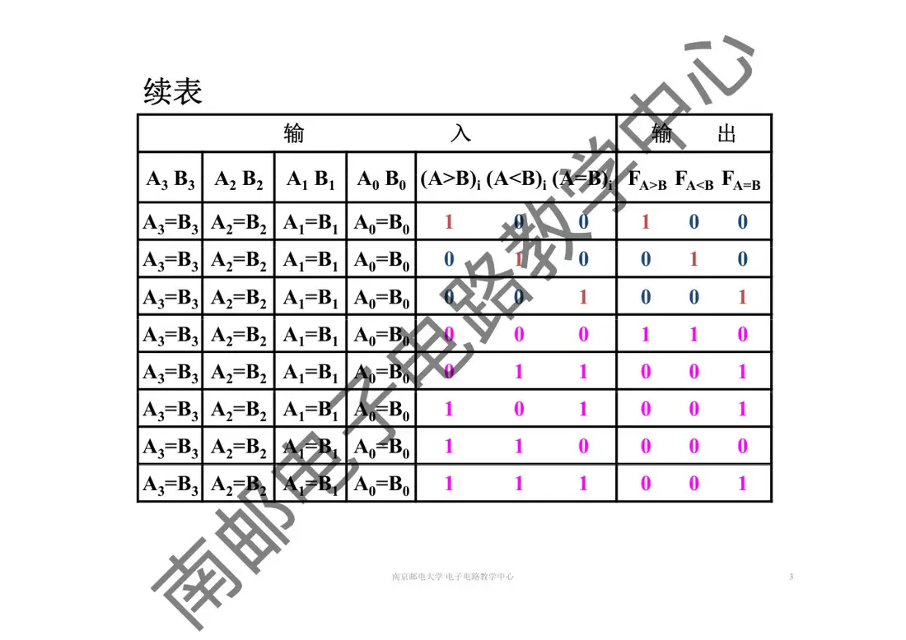

原文：

续表
<table><tr><td colspan="6">输入</td><td colspan="3">输出</td></tr><tr><td> $A_3 B_3$ </td><td> $A_2 B_2$ </td><td> $A_1 B_1$ </td><td> $A_0 B_0$ </td><td colspan="2"> $(A>B)_i (A100\( F_{A>B} F_{A10} F_{A=B}$ </td><td colspan="3"> $F_{A>B} F_{A10} F_{A=B}$ </td></tr><tr><td> $A_3=B_3$ </td><td> $A_2=B_2$ </td><td> $A_1=B_1$ </td><td> $A_0=B_0$ </td><td>1</td><td>0</td><td>0</td><td>1</td><td>0</td></tr><tr><td> $A_3=B_3$ </td><td> $A_2=B_2$ </td><td> $A_1=B_1$ </td><td> $A_0=B_0$ </td><td>0</td><td>1</td><td>0</td><td>0</td><td>1</td></tr><tr><td> $A_3=B_3$ </td><td> $A_2=B_2$ </td><td> $A_1=B_1$ </td><td> $A_0=B_0$ </td><td>0</td><td>0</td><td>1</td><td>0</td><td>0</td></tr><tr><td> $A_3=B_3$ </td><td> $A_2=B_2$ </td><td> $A_1=B_1$ </td><td> $A_0=B_0$ </td><td>0</td><td>0</td><td>0</td><td>1</td><td>1</td></tr><tr><td> $A_3=B_3$ </td><td> $A_2=B_2$ </td><td> $A_1=B_1$ </td><td> $A_0=B_0$ </td><td>0</td><td>1</td><td>1</td><td>0</td><td>0</td></tr><tr><td> $A_3=B_3$ </td><td> $A_2=B_2$ </td><td> $A_1=B_1$ </td><td> $A_0=B_0$ </td><td>1</td><td>0</td><td>1</td><td>0</td><td>0</td></tr><tr><td> $A_3=B_3$ </td><td> $A_2=B_2$ </td><td> $A_1=B_1$ </td><td> $A_0=B_0$ </td><td>1</td><td>1</td><td>0</td><td>0</td><td>0</td></tr><tr><td> $A_3=B_3$ </td><td> $A_2=B_2$ </td><td> $A_1=B_1$ </td><td> $A_0=B_0$ </td><td>1</td><td>1</td><td>1</td><td>0</td><td>0</td></tr></table>

金

南京邮电大学 电子电路教学中心

3

### 2. 数据比较器的应用举例

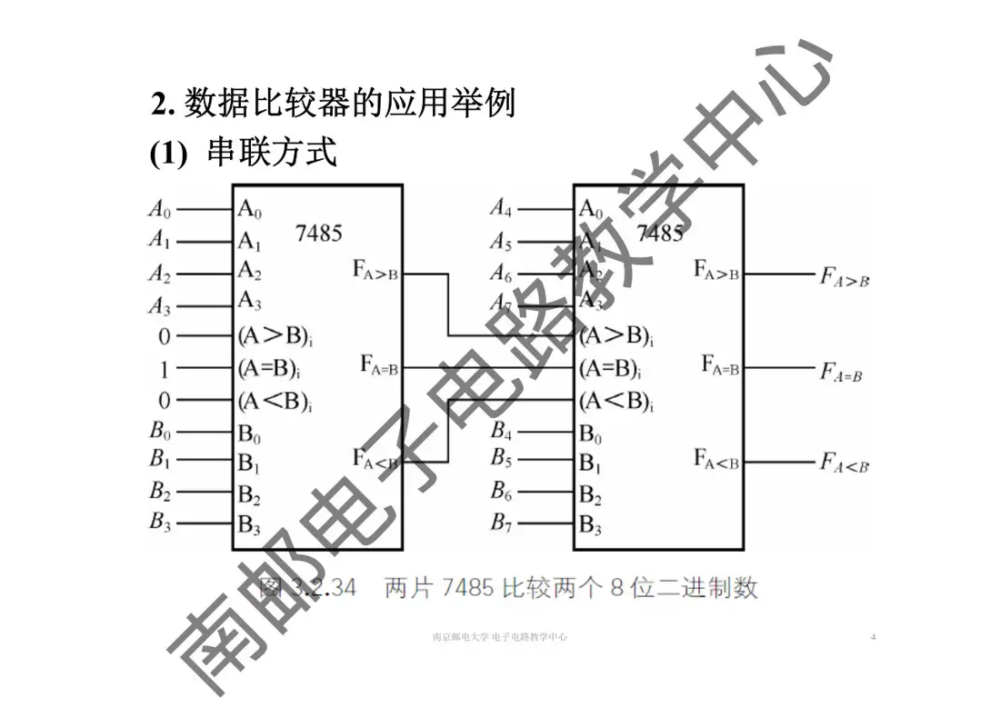

原文：

2. 数据比较器的应用举例

(1) 串 联方式

2.34 两片7485比较两个8位二进制数

南京邮电大学 电子电路教学中心

4

### (2) 并联方式

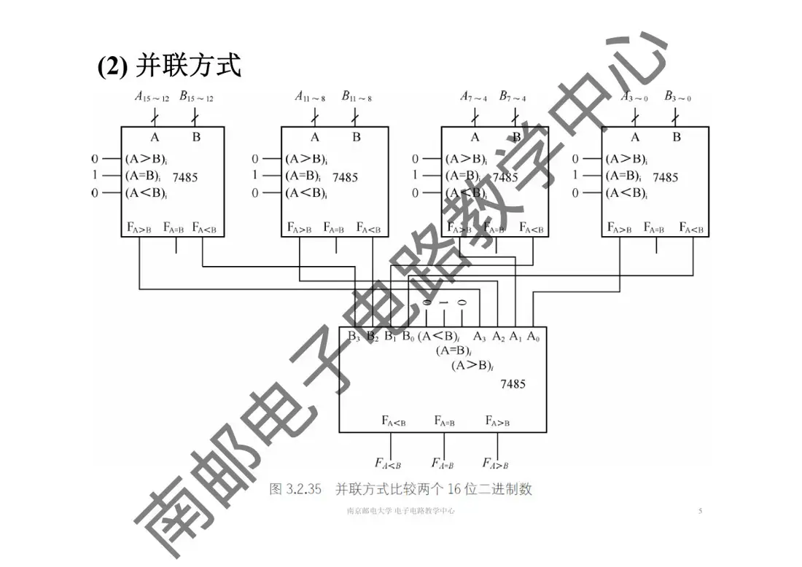

原文：

(2) 并联方式

5

### 表3.2.11 实现最低位比较的真值表

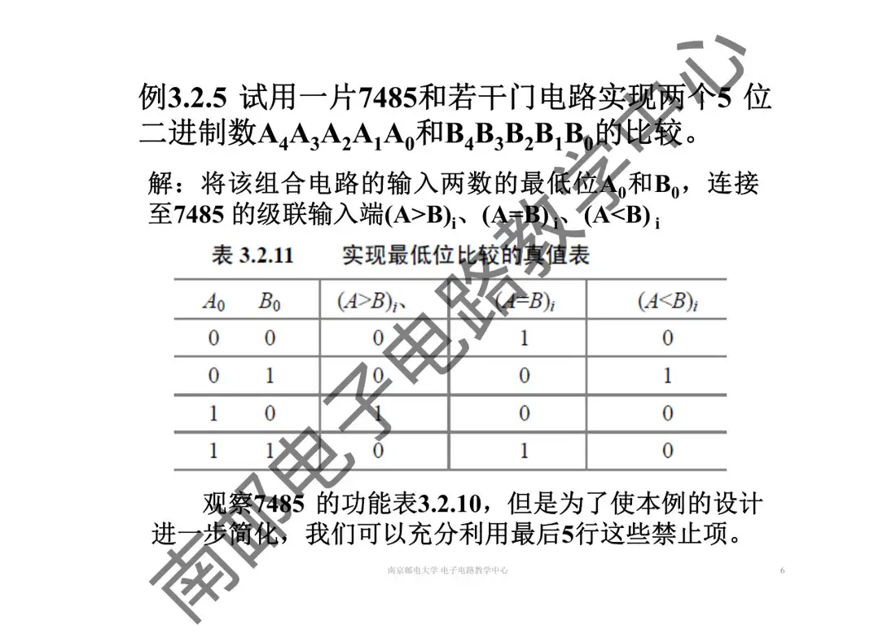

原文：

例3.2.5 试用 片一 7485和若干门 电路实现两个5 位二进制数 $\mathbf { A _ { 4 } A _ { 3 } A _ { 2 } A _ { 1 } A _ { 0 } }$ 和 $\mathbf { B _ { 4 } B _ { 3 } B _ { 2 } B _ { 1 } B _ { 0 } }$ 的 比较。

解： 将该组合 电路的输入两数的最低位 $\bf { A _ { 0 } }$ 和 $\bf { B _ { 0 } }$ ， 连接至7485 的级联输入端 $\mathbf { ( A { > } B ) _ { i } } ,$ 、 (A=B) i 、 (A<B) i

表3.2.11 实现最低位比较的真值表
<table><tr><td> $A_0$ </td><td> $B_0$ </td><td> $(A>B)_i$ </td><td> $(A=B)_i$ </td><td>\( (A</td></tr><tr><td>0</td><td>0</td><td>0</td><td>1</td><td>0</td></tr><tr><td>0</td><td>1</td><td>0</td><td>0</td><td>1</td></tr><tr><td>1</td><td>0</td><td>1</td><td>0</td><td>0</td></tr><tr><td>1</td><td>1</td><td>0</td><td>1</td><td>0</td></tr></table>

观察7485 的功能表3.2.10， 但是为了使本例 的设计进一步简化 我们可以充分利用最后5行这些禁止项， 。将真值表3.2.12 用卡诺图化简，得到输出表达式：

6

南京邮电大学 电子电路教学中心

### 表3.2.11 实现最低位比较的真值表

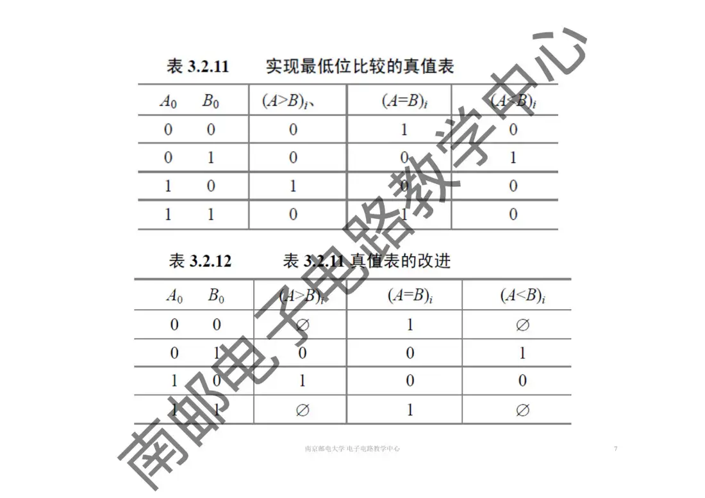

原文：

表3.2.11 实现最低位比较的真值表
<table><tr><td> $A_0$ </td><td> $B_0$ </td><td> $(A>B)_i$ 、</td><td> $(A=B)_i$ </td><td> $(A<B)_i$ </td></tr><tr><td>0</td><td>0</td><td>0</td><td>1</td><td>0</td></tr><tr><td>0</td><td>1</td><td>0</td><td>0</td><td>1</td></tr><tr><td>1</td><td>0</td><td>1</td><td>0</td><td>0</td></tr><tr><td>1</td><td>1</td><td>0</td><td>1</td><td>0</td></tr></table>

表3.2.12 表3.2.11真值表的改进
<table><tr><td> $A_0$ </td><td> $B_0$ </td><td> $(A>B)_i$ </td><td> $(A=B)_i$ </td><td>\( (A</td></tr><tr><td>0</td><td>0</td><td>∅</td><td>1</td><td>∅</td></tr><tr><td>0</td><td>1</td><td>0</td><td>0</td><td>1</td></tr><tr><td>1</td><td>0</td><td>1</td><td>0</td><td>0</td></tr><tr><td>1</td><td>1</td><td>∅</td><td>1</td><td>∅</td></tr></table>
南京邮电大学 电子电路教学中心

7

### $$

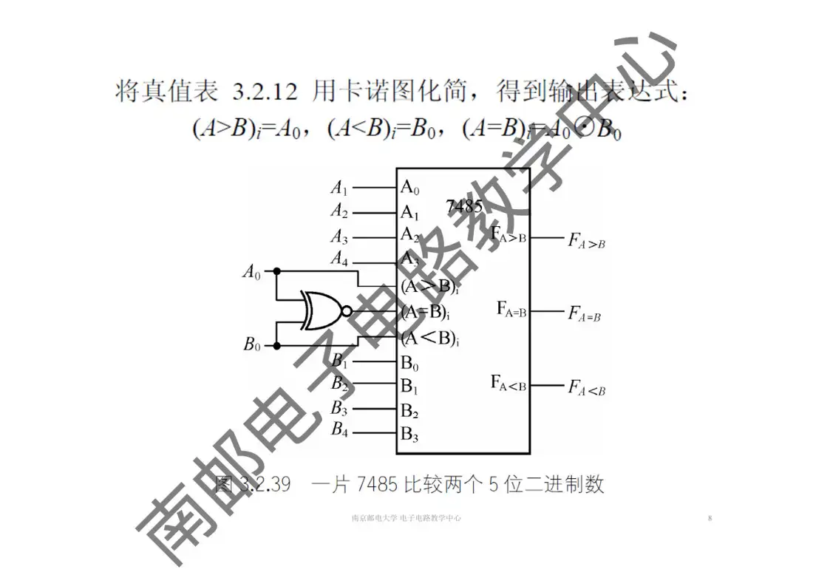

原文：

$$
(A > B) _ {i} = A _ {0}, \quad (A <   B) _ {i} = B _ {0}, \quad (A = B) _ {i} = A _ {0} \odot B _ {0}
$$

3.2.39 —片 7485 比较两个 5 位二进制数

南京邮电大学 电子电路教学中心

8

### 五 全加器、

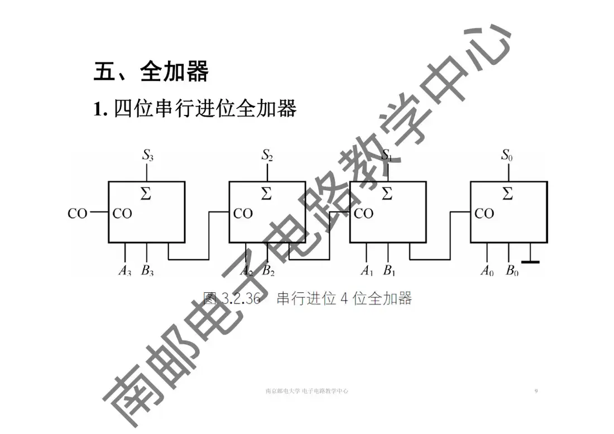

原文：

五 全加器、

1. 四位串行进位全加器

南京邮电大学 电子电路教学中心

9

### 2. 四位超前进位全加器

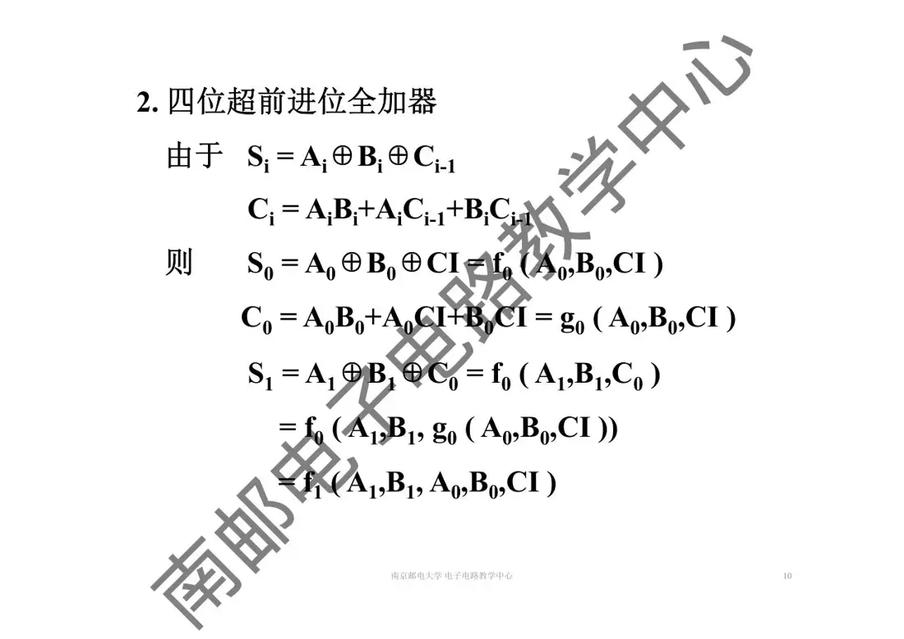

原文：

2. 四位超前进位全加器

由于 $\mathbf { S _ { i } } = \mathbf { A _ { i } } \oplus \mathbf { B _ { i } } \oplus \mathbf { C _ { i - 1 } }$

$$
\mathbf {C} _ {\mathrm{i}} = \mathbf {A} _ {\mathrm{i}} \mathbf {B} _ {\mathrm{i}} + \mathbf {A} _ {\mathrm{i}} \mathbf {C} _ {\mathrm{i-1}} + \mathbf {B} _ {\mathrm{i}} \mathbf {C} _ {\mathrm{i-1}}
$$

则

$$
\mathbf {S _ {0}} = \mathbf {A _ {0}} \oplus \mathbf {B _ {0}} \oplus \mathbf {C I} = \mathbf {f _ {0}} (\mathbf {A _ {0}}, \mathbf {B _ {0}}, \mathbf {C I})
$$

$$
\mathbf {C} _ {0} = \mathbf {A} _ {0} \mathbf {B} _ {0} + \mathbf {A} _ {0} \mathbf {C I} + \mathbf {B} _ {0} \mathbf {C I} = \mathbf {g} _ {0} (\mathbf {A} _ {0}, \mathbf {B} _ {0}, \mathbf {C I})
$$

$$
\begin{array}{r l} & {\mathbf {S} _ {1} = \mathbf {A} _ {1} \oplus \mathbf {B} _ {1} \oplus \mathbf {C} _ {0} = \mathbf {f} _ {0} (\mathbf {A} _ {1}, \mathbf {B} _ {1}, \mathbf {C} _ {0})} \\ & {\qquad = \mathbf {f} _ {0} (\mathbf {A} _ {1}, \mathbf {B} _ {1}, \mathbf {g} _ {0} (\mathbf {A} _ {0}, \mathbf {B} _ {0}, \mathbf {C I}))} \\ & {\qquad = \mathbf {f} _ {1} (\mathbf {A} _ {1}, \mathbf {B} _ {1}, \mathbf {A} _ {0}, \mathbf {B} _ {0}, \mathbf {C I})} \end{array}
$$

南京邮电大学 电子电路教学中心

1 0

### $$

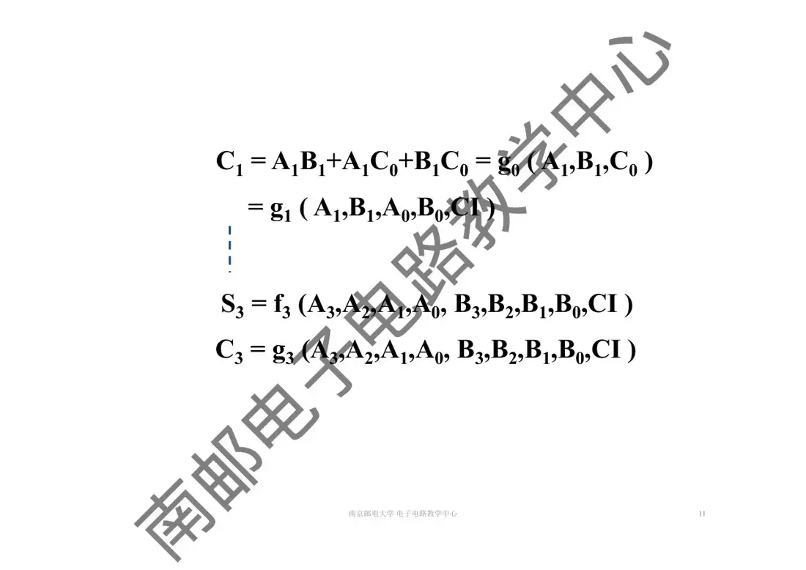

原文：

$$
\begin{array}{r l} & {\mathbf {C} _ {1} = \mathbf {A} _ {1} \mathbf {B} _ {1} + \mathbf {A} _ {1} \mathbf {C} _ {0} + \mathbf {B} _ {1} \mathbf {C} _ {0} = \mathbf {g} _ {0} (\mathbf {A} _ {1}, \mathbf {B} _ {1}, \mathbf {C} _ {0})} \\ & {\qquad = \mathbf {g} _ {1} (\mathbf {A} _ {1}, \mathbf {B} _ {1}, \mathbf {A} _ {0}, \mathbf {B} _ {0}, \mathbf {C I})} \end{array}
$$

$$
\mathbf {S} _ {3} = \mathbf {f} _ {3} (\mathbf {A} _ {3}, \mathbf {A} _ {2}, \mathbf {A} _ {1}, \mathbf {A} _ {0}, \mathbf {B} _ {3}, \mathbf {B} _ {2}, \mathbf {B} _ {1}, \mathbf {B} _ {0}, \mathrm{CI})
$$

$$
\mathbf {C} _ {3} = \mathbf {g} _ {3} (\mathbf {A} _ {3}, \mathbf {A} _ {2}, \mathbf {A} _ {1}, \mathbf {A} _ {0}, \mathbf {B} _ {3}, \mathbf {B} _ {2}, \mathbf {B} _ {1}, \mathbf {B} _ {0}, \mathbf {C I})
$$

南京邮电大学 电子电路教学中心

1 1

### 1 2

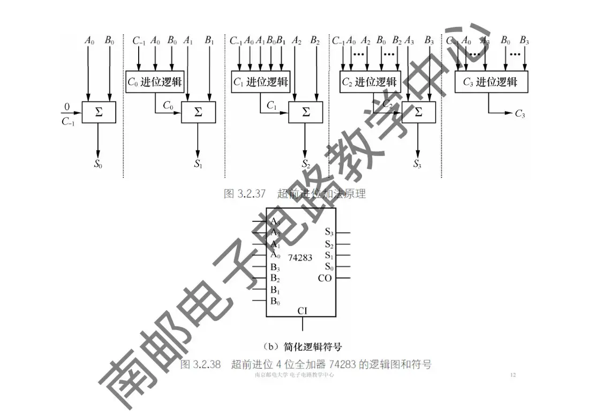

原文：

1 2

### 全加器的应用举例3.

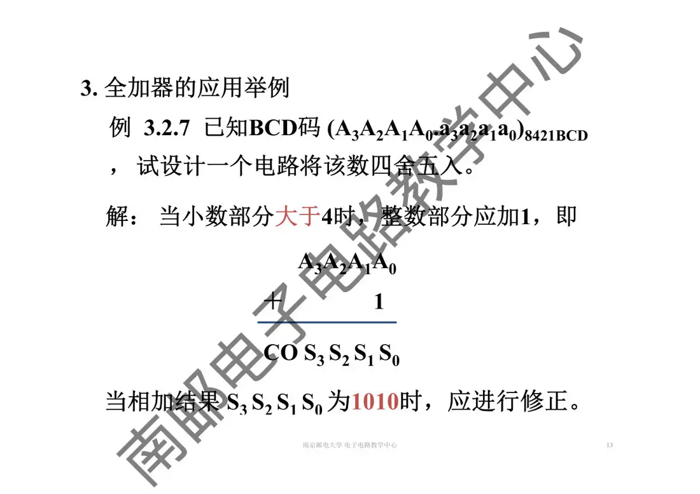

原文：

全加器的应用举例3.

例 3.2.7 已知BCD码 $( \mathbf { A _ { 3 } A _ { 2 } A _ { 1 } A _ { 0 } } \mathbf { . } \mathbf { \bar { 3 } } _ { 3 } \mathbf { . } \mathbf { \bar { 4 } } _ { 2 } \mathbf { 2 } \mathbf { 1 } \mathbf { . } \mathbf { \bar { 4 } } _ { 0 } ) _ { 8 4 2 1 \mathrm { B C D } }$ ， 试设计一个电路将该数四舍五入。

解： 当小数部分大于4时， 整数部分应加1， 即

当相加结果 $\mathbf { S } _ { 3 } \mathbf { S } _ { 2 } \mathbf { S } _ { 1 } \mathbf { S _ { 0 } }$ 为1010时， 应进行修正。因 为1010不是 $( \mathbf { 1 0 } ) _ { 1 0 }$ 的8421BCD码表示形式，正确 结 果应为0001 0000 ， 所 以 ：

南京邮电大学 电子电路教学中心

1 3

### 0001 0000

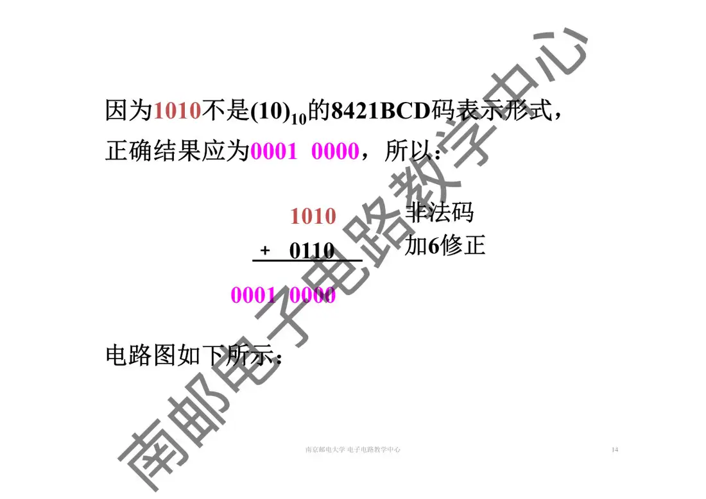

原文：

0001 0000

电路图如下所示：

南京邮电大学 电子电路教学中心

1 4

### 南京邮电大学 电子电路教学中心

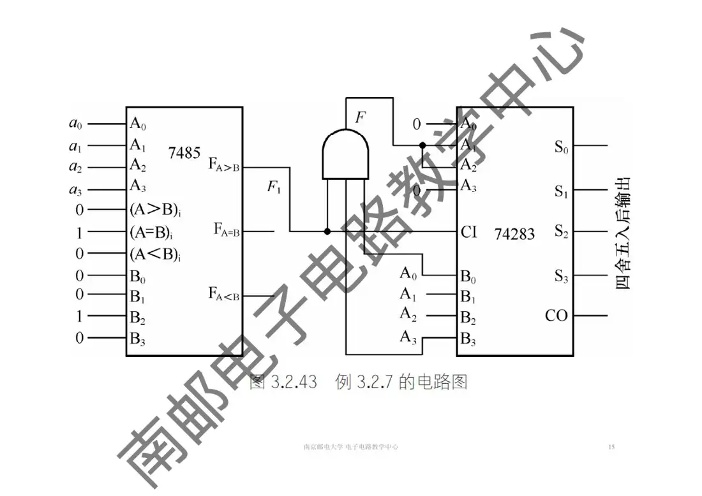

原文：

南京邮电大学 电子电路教学中心

1 5

### 南京邮电大学 电子电路教学中心

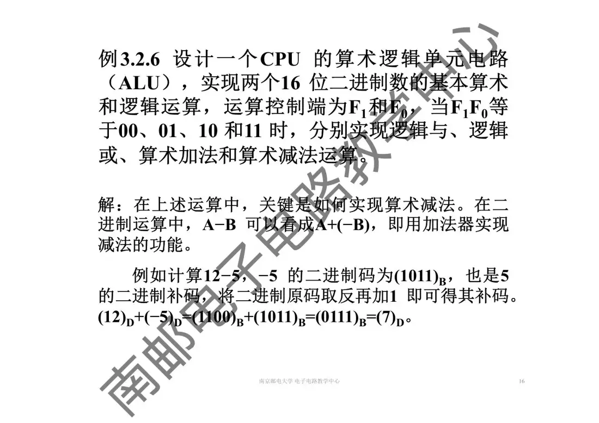

原文：

例3 2 6 设计一个CPU 的 算术逻辑单元 电路（ALU） ， 实现两个16 位二进制数的基本算术和逻辑运算， 运算控制端为 $\mathbf { F _ { 1 } }$ 和F $\ " \mathrm { \bar { \mathbf { \rho } } }$ 当 $\bf { F _ { 1 } F _ { 0 } }$ 等于00、 01 、 10 和11 时 ， 分别实现逻辑与 、 逻辑或、 算术加法和算术减法  算运 。

解： 在 述运算 中上 ， 关键是如何实现算术减法。 在二进制运算 中 ， A−B 可 以看成A+(−B)， 即用加法器实现减法的功能。 AY

例如计算12−5， −5 的二进制码为 $( 1 0 1 1 ) _ { \mathrm { B } }$ ， 也是5的二进制补码， 将二进制原码取反再加1 即可得其补码。$( 1 2 ) _ { \mathrm { D } } + ( - 5 ) _ { \mathrm { D } } = ( \mathrm { D } 0 0 ) _ { \mathrm { B } } + ( 1 0 1 1 ) _ { \mathrm { B } } = ( 0 1 1 1 ) _ { \mathrm { B } } = ( 7 ) _ { \mathrm { D } }$

南京邮电大学 电子电路教学中心

1 6

### 表 3.1.4例 3.1.4的真值表

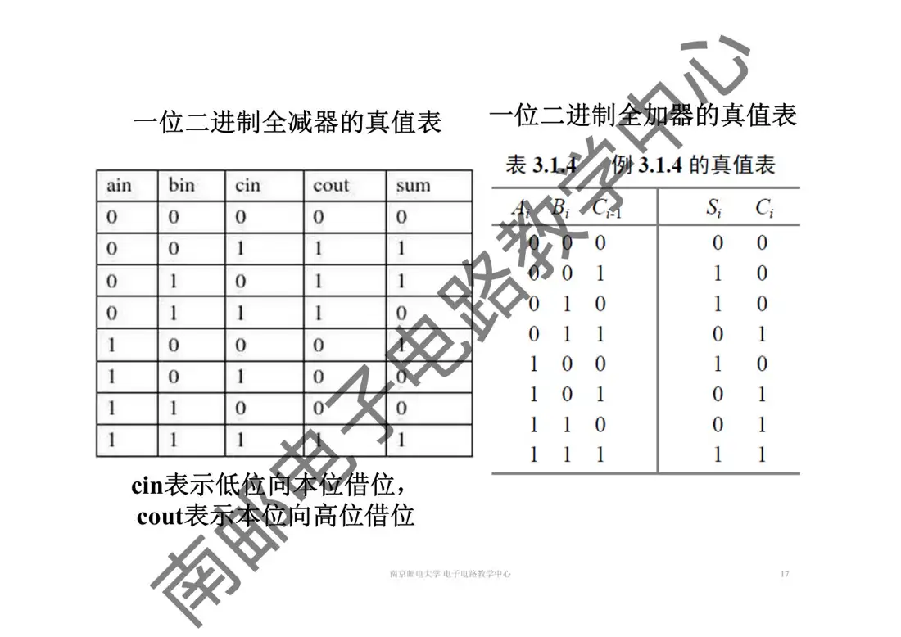

原文：

表 3.1.4例 3.1.4的真值表

一位二进制全减器的真值表

<table><tr><td>ain</td><td>bin</td><td>cin</td><td>cout</td><td>sum</td></tr><tr><td>0</td><td>0</td><td>0</td><td>0</td><td>0</td></tr><tr><td>0</td><td>0</td><td>1</td><td>1</td><td>1</td></tr><tr><td>0</td><td>1</td><td>0</td><td>1</td><td>1</td></tr><tr><td>0</td><td>1</td><td>1</td><td>1</td><td>0</td></tr><tr><td>1</td><td>0</td><td>0</td><td>0</td><td>1</td></tr><tr><td>1</td><td>0</td><td>1</td><td>0</td><td>0</td></tr><tr><td>1</td><td>1</td><td>0</td><td>0</td><td>0</td></tr><tr><td>1</td><td>1</td><td>1</td><td>1</td><td>1</td></tr></table>
cin表示低位向本位借位，cout表示本位向高位借位

一位二进制全加器的真值表

<table><tr><td> $A_i$ </td><td> $B_i$ </td><td> $C_{i-1}$ </td><td> $S_i$ </td><td> $C_i$ </td></tr><tr><td>0</td><td>0</td><td>0</td><td>0</td><td>0</td></tr><tr><td>0</td><td>0</td><td>1</td><td>1</td><td>0</td></tr><tr><td>0</td><td>1</td><td>0</td><td>1</td><td>0</td></tr><tr><td>0</td><td>1</td><td>1</td><td>0</td><td>1</td></tr><tr><td>1</td><td>0</td><td>0</td><td>1</td><td>0</td></tr><tr><td>1</td><td>0</td><td>1</td><td>0</td><td>1</td></tr><tr><td>1</td><td>1</td><td>0</td><td>0</td><td>1</td></tr><tr><td>1</td><td>1</td><td>1</td><td>1</td><td>1</td></tr></table>

南京邮电大学 电子电路教学中心

1 7

### 实现全加法器的表达式：

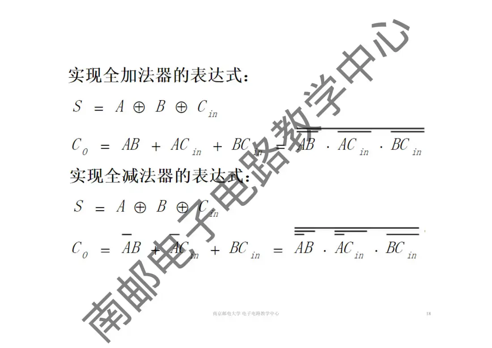

原文：

实现全加法器的表达式：

$$
S = A \oplus B \oplus C _ {i n}
$$

实现全减法器的表达式：

$$
S = A \oplus B \oplus C _ {i n}
$$

$$
C _ {o} = \overline {{A B}} + \overline {{A C}} _ {i n} + B C _ {i n} = \overline {{A B}} \cdot \overline {{A C}} _ {i n} \cdot \overline {{B C}} _ {i n}
$$

南京邮电大学 电子电路教学中心

1 8

### 1 9

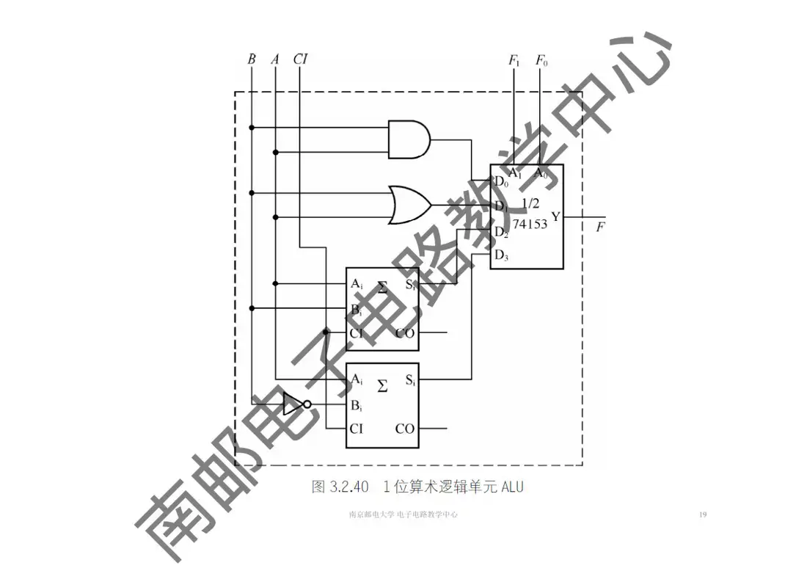

原文：

1 9

### 20

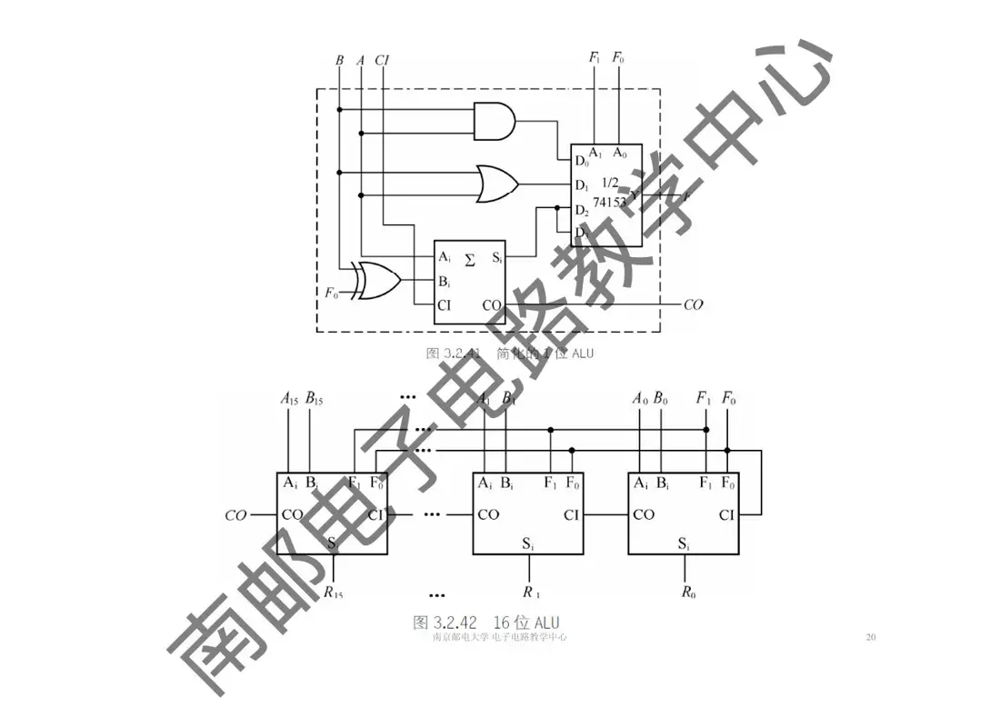

原文：

20

### 作业题3.173.19

原文：

<table><tr><td>作业题</td></tr><tr><td>3.17</td></tr><tr><td>3.19</td></tr></table>

2 1
