# 《数字电路与逻辑设计B》第3章 组合逻辑电路 SSI构成的组合电路的分析与设计（课件）

原件的每一页，下面附识别出的文字。

### 第三章 组合逻辑电路

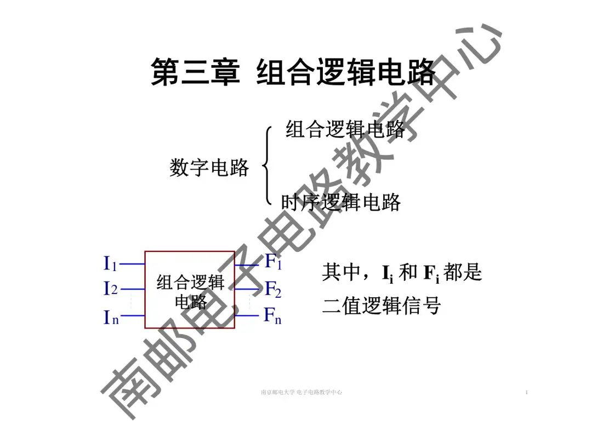

原文：

第三章 组合逻辑电路

数字电路

组合逻辑电路

组合 电路组合逻辑

时序逻辑电路

电路

其中 ， $\mathbf { I _ { i } }$ 和 $\mathbf { F _ { i } }$ 都是二值逻辑信号

南京邮电大学 电子电路教学中心

1

### 第 节一 SS I 构成的组合逻辑电路的分析和设计

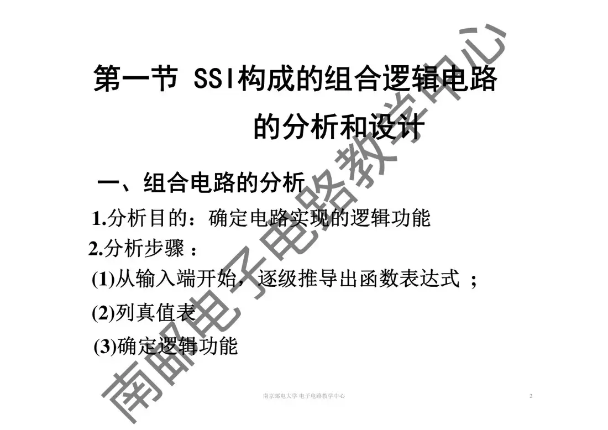

原文：

第 节一 SS I 构成的组合逻辑电路的分析和设计

一、 组合电路的分析

1.分析 目 的： 确定 电路实现的逻辑功能

2.分析步骤 ：

(1)从输入端开始， 逐级推导出 函数表达式 ;

(2)列真值表

(3)确定逻辑功能

南京邮电大学 电子电路教学中心

2

### 例3.1.1 分析如 图3.1.1(a)所示的逻辑 电路的逻辑功能

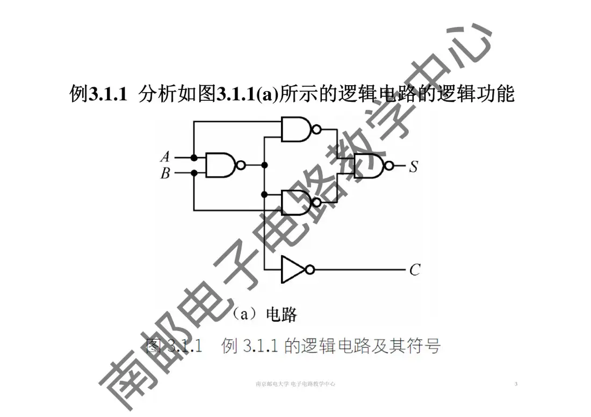

原文：

例3.1.1 分析如 图3.1.1(a)所示的逻辑 电路的逻辑功能

.1 例 3.1.1 的逻辑电路及其符号

南京邮电大学 电子电路教学中心

3

### 解 ： (1)写出逻辑表达式

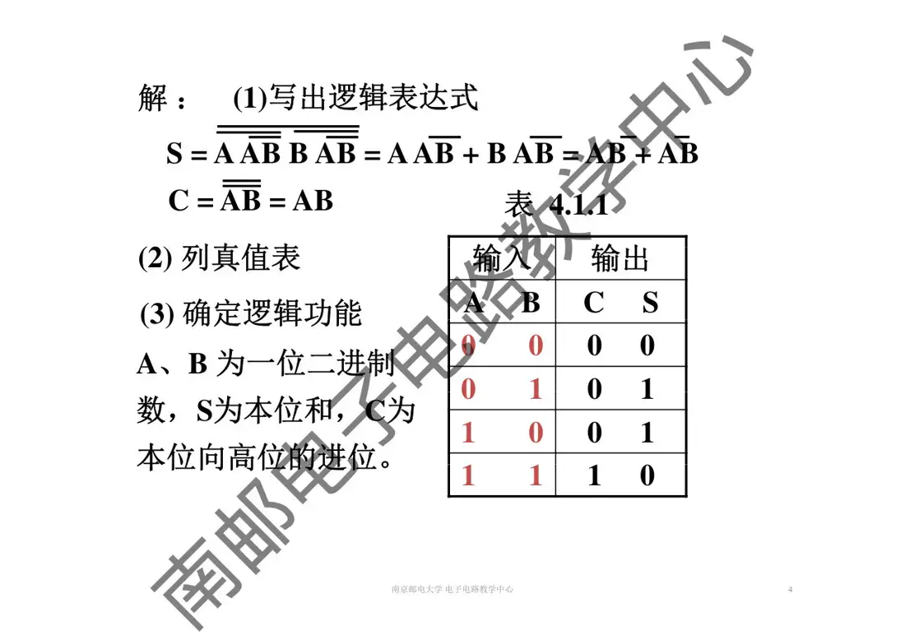

原文：

解 ： (1)写出逻辑表达式

S = A AB B AB = A AB + B AB = AB + AB C = AB = AB 表 4. 1 . 1

列真值表(2)

(3) 确定逻辑功能A、 B 为一位二进制数， S为本位和， C为本位向高位的进位。

<table><tr><td colspan="2">输入</td><td colspan="2">输出</td></tr><tr><td>A</td><td>B</td><td>C</td><td>S</td></tr><tr><td>0</td><td>0</td><td>0</td><td>0</td></tr><tr><td>0</td><td>1</td><td>0</td><td>1</td></tr><tr><td>1</td><td>0</td><td>0</td><td>1</td></tr><tr><td>1</td><td>1</td><td>1</td><td>0</td></tr></table>

南京邮电大学 电子电路教学中心

4

### (b)半加器逻辑符号

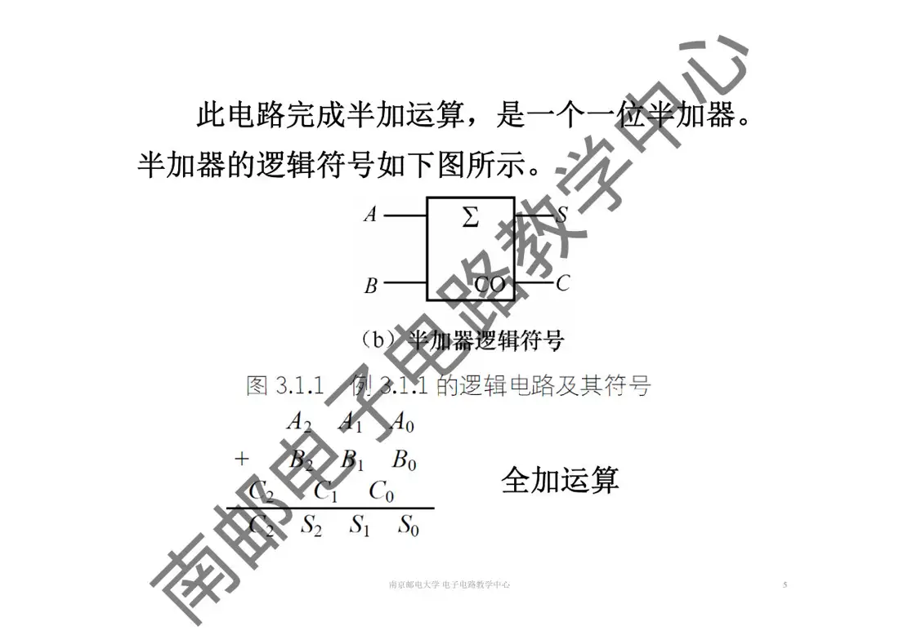

原文：

此电路完成半加 算 运 ， 是 个 位半加 一 一 器。半加器的逻辑符号如下图所示。

(b)半加器逻辑符号

图 3.1.1 例 8.1.1 的逻辑电路及其符号例3.1.2 已知 图3.1.2 所示的 电路用于数据分类， 试分析该电路的用途。

南京邮电大学 电子电路教学中心

5

### 南京邮电大学 电子电路教学中心

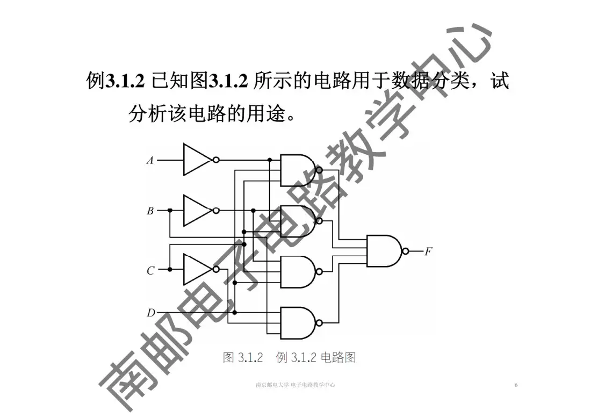

原文：

南京邮电大学 电子电路教学中心

6

### 解 ：

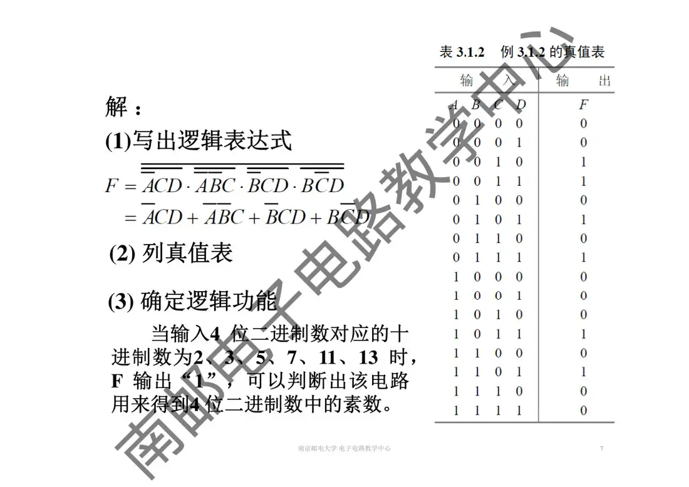

原文：

解 ：

(1)写出逻辑表达式

$$
\begin{array}{r l} F & = \overline {{\overline {{A C D}}}} \cdot \overline {{\overline {{A B C}}}} \cdot \overline {{\overline {{B C D}}}} \cdot \overline {{\overline {{B C D}}}} \\ & = \overline {{A C D}} + \overline {{A B C}} + \overline {{B C D}} + B \overline {{C D}} \end{array}
$$

(2) 列真值表

(3) 确定逻辑功能

当输入4 位二进制数对应的十进 制 数 为 2 、 3 、 5 、 7 、 11 、 13 时 ，F 输 出 “ 1 ” ， 可 以判 断 出 该 电路用来得到4 位二进制数中 的素数。

表 3.1.2 例 3.1.2的真值表
<table><tr><td colspan="4">输入</td><td>输出</td></tr><tr><td>A</td><td>B</td><td>C</td><td>D</td><td>F</td></tr><tr><td>0</td><td>0</td><td>0</td><td>0</td><td>0</td></tr><tr><td>0</td><td>0</td><td>0</td><td>1</td><td>0</td></tr><tr><td>0</td><td>0</td><td>1</td><td>0</td><td>1</td></tr><tr><td>0</td><td>0</td><td>1</td><td>1</td><td>1</td></tr><tr><td>0</td><td>1</td><td>0</td><td>0</td><td>0</td></tr><tr><td>0</td><td>1</td><td>0</td><td>1</td><td>1</td></tr><tr><td>0</td><td>1</td><td>1</td><td>0</td><td>0</td></tr><tr><td>0</td><td>1</td><td>1</td><td>1</td><td>1</td></tr><tr><td>1</td><td>0</td><td>0</td><td>0</td><td>0</td></tr><tr><td>1</td><td>0</td><td>0</td><td>1</td><td>0</td></tr><tr><td>1</td><td>0</td><td>1</td><td>0</td><td>0</td></tr><tr><td>1</td><td>0</td><td>1</td><td>1</td><td>1</td></tr><tr><td>1</td><td>1</td><td>0</td><td>0</td><td>0</td></tr><tr><td>1</td><td>1</td><td>0</td><td>1</td><td>1</td></tr><tr><td>1</td><td>1</td><td>1</td><td>0</td><td>0</td></tr><tr><td>1</td><td>1</td><td>1</td><td>1</td><td>0</td></tr></table>

南京邮电大学 电子电路教学中心

7

### 例 3. 1 .3 分析如 图3.1.3 所示 电路的功能。

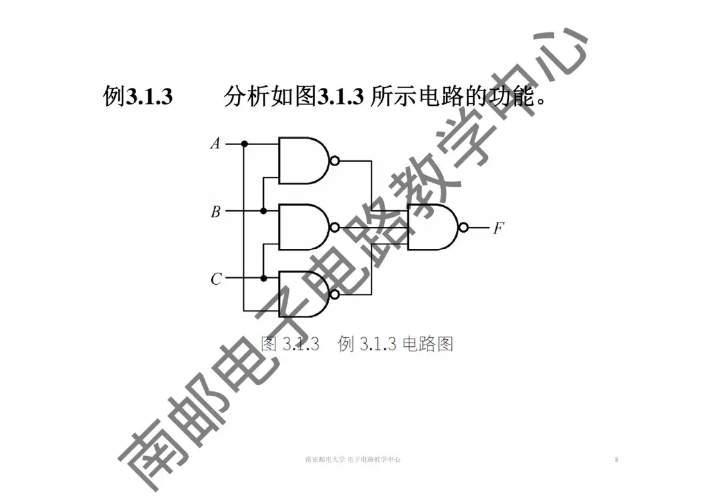

原文：

例 3. 1 .3 分析如 图3.1.3 所示 电路的功能。

南京邮电大学 电子电路教学中心

8

### 解 ：

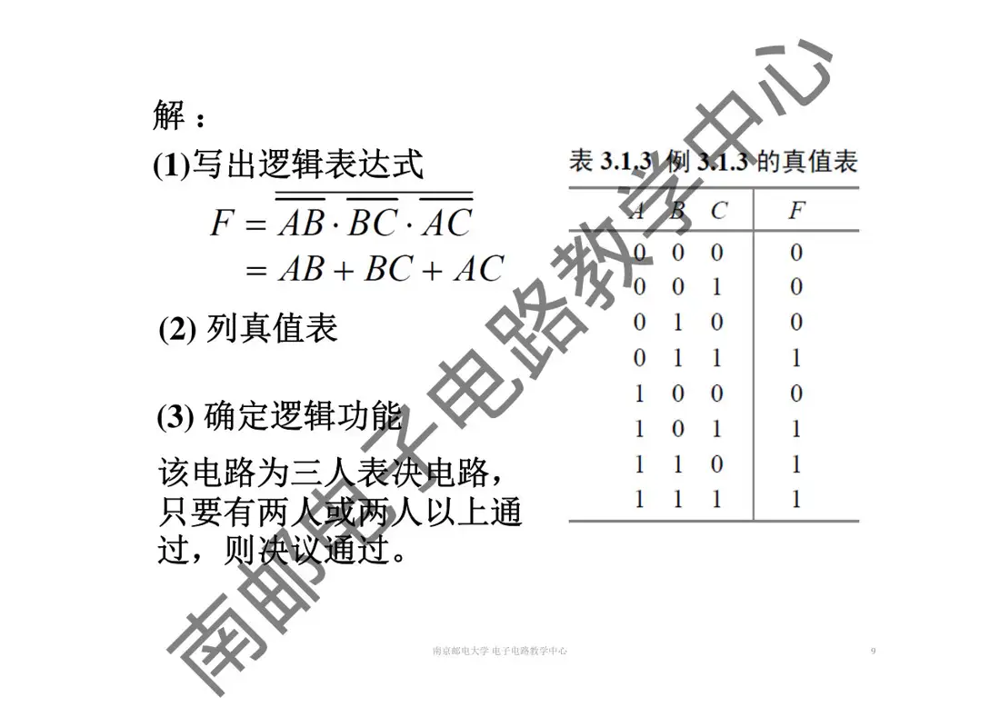

原文：

解 ：

(1)写出逻辑表达式

$$
\begin{array}{r l} & F = \overline {{A B}} \cdot \overline {{B C}} \cdot \overline {{A C}} \\ & = A B + B C + A C \end{array}
$$

(2) 列真值表

( )3 确定逻辑功能该电路为三人表决电路，只要有两人或两人以上通过， 则决议通过。

表3.1.3例3.1.3的真值表

<table><tr><td>A</td><td>B</td><td>C</td><td>F</td></tr><tr><td>0</td><td>0</td><td>0</td><td>0</td></tr><tr><td>0</td><td>0</td><td>1</td><td>0</td></tr><tr><td>0</td><td>1</td><td>0</td><td>0</td></tr><tr><td>0</td><td>1</td><td>1</td><td>1</td></tr><tr><td>1</td><td>0</td><td>0</td><td>0</td></tr><tr><td>1</td><td>0</td><td>1</td><td>1</td></tr><tr><td>1</td><td>1</td><td>0</td><td>1</td></tr><tr><td>1</td><td>1</td><td>1</td><td>1</td></tr></table>

南京邮电大学 电子电路教学中心

9

### 二、 组合电路的设计

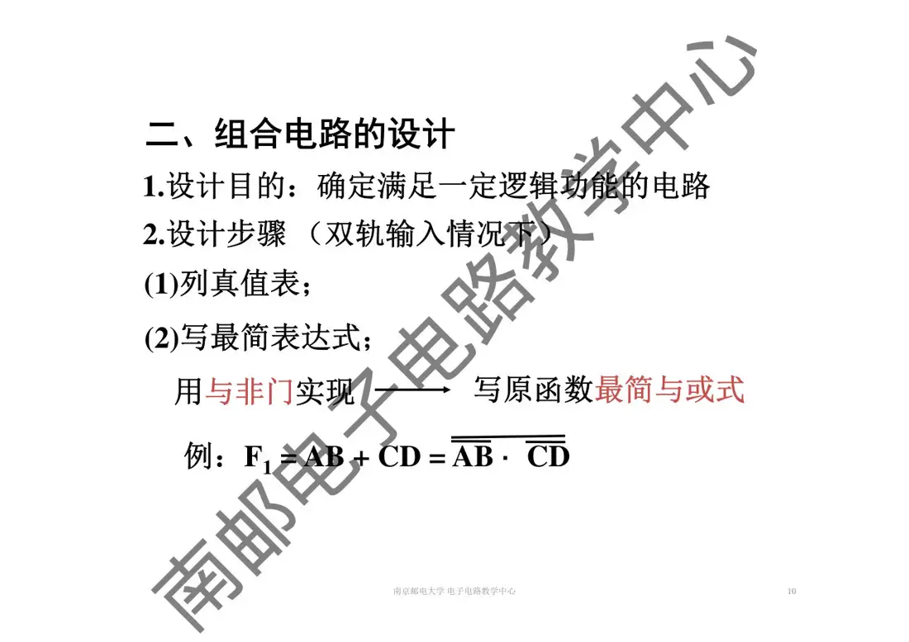

原文：

二、 组合电路的设计

1.设计 目 的： 确定满足 定逻辑功能的 电路一

2.设计步骤 （双轨输入情况下）

(1)列真值表 ；

(2)写最简表达式；

用与非门实现 写原函数最简与或式

例 ： $\mathbf { F _ { 1 } } = \mathbf { A B } + \mathbf { C D } = \mathbf { \overline { { A B } } } \cdot \mathbf { \overline { { C D } } }$ 用或非门实现 写原函数最简或与式例 ： $\mathbf { F } _ { 2 } = \left( \mathbf { A } { + } \mathbf { B } \right) \cdot \left( \mathbf { C } { + } \mathbf { D } \right)$ $\overline { { \mathbf { A } + \mathbf { B } } } + \overline { { \mathbf { C } + \mathbf { D } } }$ 用与或非门实现 反函数最简与或式例 ： $\overline { { \mathbf { F } _ { 3 } } } = \mathbf { A B } \bar { \mathbf { \Lambda } }$ 则 $\mathbf { F } _ { 3 } = \mathbf { \overline { { A } } } \mathbf { B } + \mathbf { C }$

南京邮电大学 电子电路教学中心

1 0

### (3)画逻辑电路

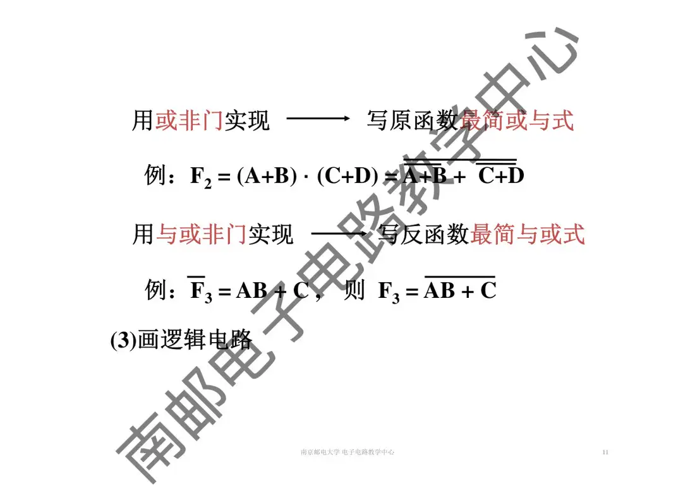

原文：

(3)画逻辑电路

南京邮电大学 电子电路教学中心

1 1

### 例 4 1 3. . 试设计一个1位全加器电路。

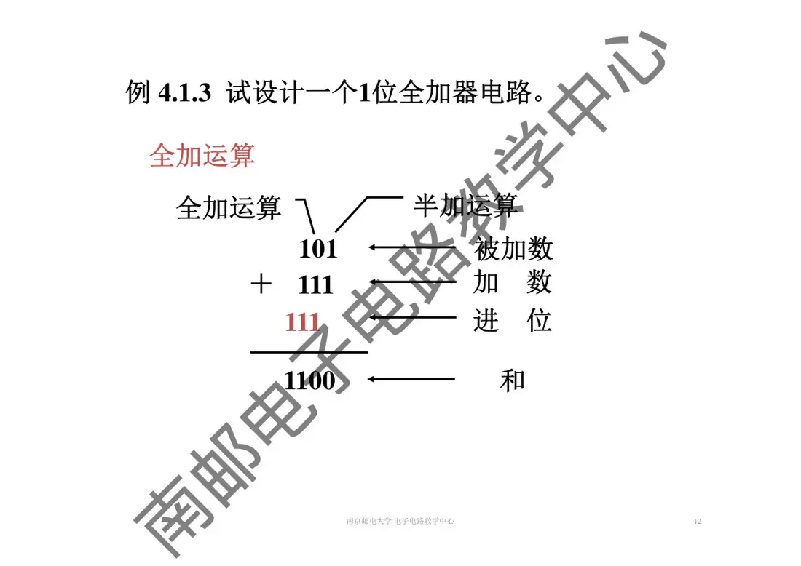

原文：

例 4 1 3. . 试设计一个1位全加器电路。

全加运算

全加运算

半加运算

和

南京邮电大学 电子电路教学中心

1 2

### 解： (1) 列真值表

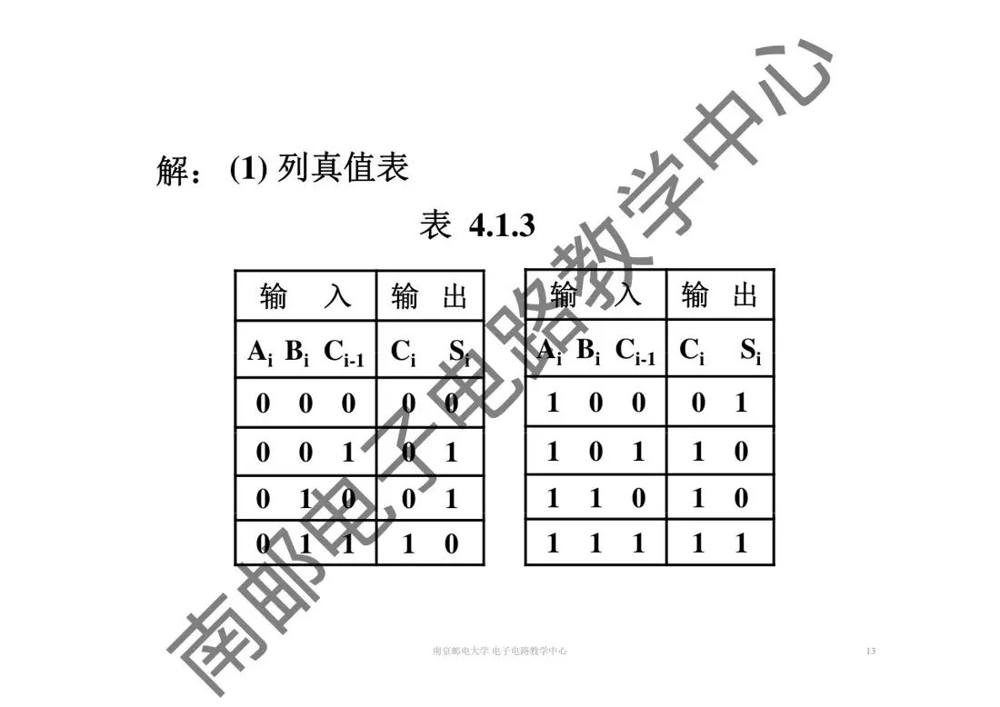

原文：

解： (1) 列真值表

<table><tr><td colspan="3">输入</td><td colspan="3">输出</td><td colspan="3">输入</td><td colspan="3">输出</td></tr><tr><td> $A_i$ </td><td> $B_i$ </td><td> $C_{i-1}$ </td><td> $C_i$ </td><td> $S_i$ </td><td></td><td> $A_i$ </td><td> $B_i$ </td><td> $C_{i-1}$ </td><td> $C_i$ </td><td> $S_i$ </td><td></td></tr><tr><td>0</td><td>0</td><td>0</td><td>0</td><td>0</td><td></td><td>1</td><td>0</td><td>0</td><td>0</td><td>1</td><td></td></tr><tr><td>0</td><td>0</td><td>1</td><td>0</td><td>1</td><td></td><td>1</td><td>0</td><td>1</td><td>1</td><td>0</td><td></td></tr><tr><td>0</td><td>1</td><td>0</td><td>0</td><td>1</td><td></td><td>1</td><td>1</td><td>0</td><td>1</td><td>0</td><td></td></tr><tr><td>0</td><td>1</td><td>1</td><td>1</td><td>0</td><td></td><td>1</td><td>1</td><td>1</td><td>1</td><td>1</td><td></td></tr></table>

南京邮电大学 电子电路教学中心

1 3

### (2)写最简表达式；

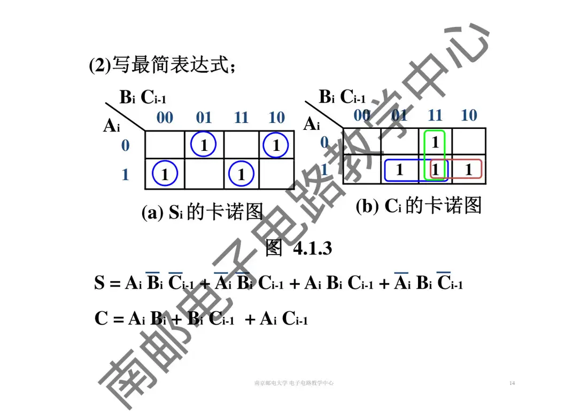

原文：

(2)写最简表达式；

$$
\mathbf {S} = \mathbf {A} _ {\mathrm{i}} \overline {{\mathbf {B}}} _ {\mathrm{i}} \overline {{\mathbf {C}}} _ {\mathrm{i-1}} + \overline {{\mathbf {A}}} _ {\mathrm{i}} \overline {{\mathbf {B}}} _ {\mathrm{i}} \mathbf {C} _ {\mathrm{i-1}} + \mathbf {A} _ {\mathrm{i}} \mathbf {B} _ {\mathrm{i}} \mathbf {C} _ {\mathrm{i-1}} + \overline {{\mathbf {A}}} _ {\mathrm{i}} \mathbf {B} _ {\mathrm{i}} \overline {{\mathbf {C}}} _ {\mathrm{i-1}}
$$

$$
\mathbf {C} = \mathbf {A} _ {\mathrm{i}} \mathbf {B} _ {\mathrm{i}} + \mathbf {B} _ {\mathrm{i}} \mathbf {C} _ {\mathrm{i-1}} + \mathbf {A} _ {\mathrm{i}} \mathbf {C} _ {\mathrm{i-1}}
$$

南京邮电大学 电子电路教学中心

1 4

### 变换Si 、 Ci ， 可得 ：

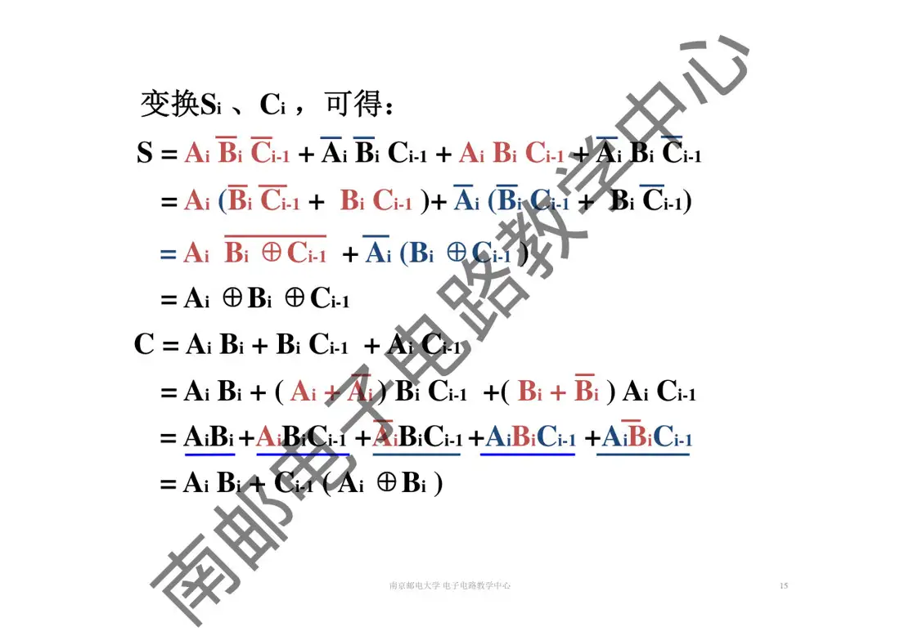

原文：

变换Si 、 Ci ， 可得 ：

$$
\begin{array}{r l} & {\mathbf {S} = \mathbf {A} _ {i} \overline {{\mathbf {B}}} _ {i} \overline {{\mathbf {C}}} _ {i - 1} + \overline {{\mathbf {A}}} _ {i} \overline {{\mathbf {B}}} _ {i} \mathbf {C} _ {i - 1} + \mathbf {A} _ {i} \mathbf {B} _ {i} \mathbf {C} _ {i - 1} + \overline {{\mathbf {A}}} _ {i} \mathbf {B} _ {i} \overline {{\mathbf {C}}} _ {i - 1}} \\ & {\quad = \mathbf {A} _ {i} (\overline {{\mathbf {B}}} _ {i} \overline {{\mathbf {C}}} _ {i - 1} + \mathbf {B} _ {i} \mathbf {C} _ {i - 1}) + \overline {{\mathbf {A}}} _ {i} (\overline {{\mathbf {B}}} _ {i} \mathbf {C} _ {i - 1} + \mathbf {B} _ {i} \overline {{\mathbf {C}}} _ {i - 1})} \\ & {\quad = \mathbf {A} _ {i} \overline {{\mathbf {B}}} _ {i} \oplus \mathbf {C} _ {i - 1} + \overline {{\mathbf {A}}} _ {i} (\mathbf {B} _ {i} \oplus \mathbf {C} _ {i - 1})} \\ & {\quad = \mathbf {A} _ {i} \oplus \mathbf {B} _ {i} \oplus \mathbf {C} _ {i - 1}} \end{array}
$$

$$
\begin{array}{r l} & {\mathbf {C} = \mathbf {A} _ {i} \mathbf {B} _ {i} + \mathbf {B} _ {i} \mathbf {C} _ {i - 1} + \mathbf {A} _ {i} \mathbf {C} _ {i - 1}} \\ & {\quad = \mathbf {A} _ {i} \mathbf {B} _ {i} + (\mathbf {A} _ {i} + \overline {{\mathbf {A}}} _ {i}) \mathbf {B} _ {i} \mathbf {C} _ {i - 1} + (\mathbf {B} _ {i} + \overline {{\mathbf {B}}} _ {i}) \mathbf {A} _ {i} \mathbf {C} _ {i - 1}} \\ & {\quad = \underline {{\mathbf {A} _ {i} \mathbf {B} _ {i}}} + \underline {{\mathbf {A} _ {i} \mathbf {B} _ {i} \mathbf {C} _ {i - 1}}} + \overline {{\mathbf {A}}} _ {i} \mathbf {B} _ {i} \mathbf {C} _ {i - 1} + \underline {{\mathbf {A} _ {i} \mathbf {B} _ {i} \mathbf {C} _ {i - 1}}} + \overline {{\mathbf {A}}} _ {i} \overline {{\mathbf {B}}} _ {i} \mathbf {C} _ {i - 1}} \\ & {\quad = \mathbf {A} _ {i} \mathbf {B} _ {i} + \mathbf {C} _ {i - 1} (\mathbf {A} _ {i} \oplus \mathbf {B} _ {i})} \end{array}
$$

南京邮电大学 电子电路教学中心

1 5

### (3)画逻辑 电路， 如下 图(a)所示。

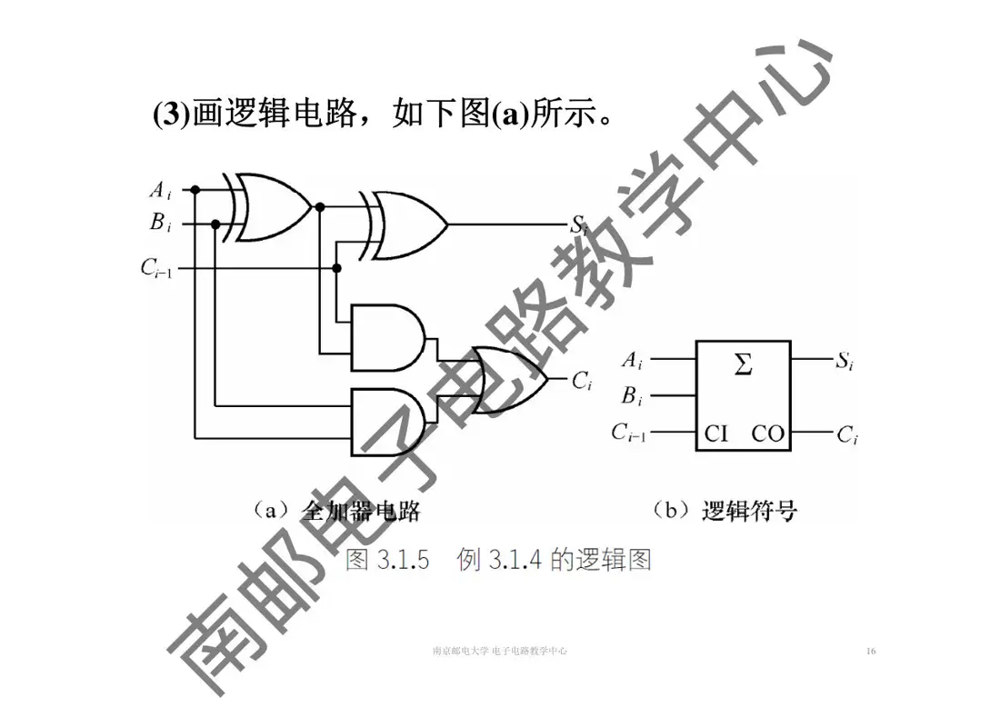

原文：

(3)画逻辑 电路， 如下 图(a)所示。

南京邮电大学 电子电路教学中心

1 6

### 例 4.1.4 试设计 个一 1位 进制数比较单元二 。

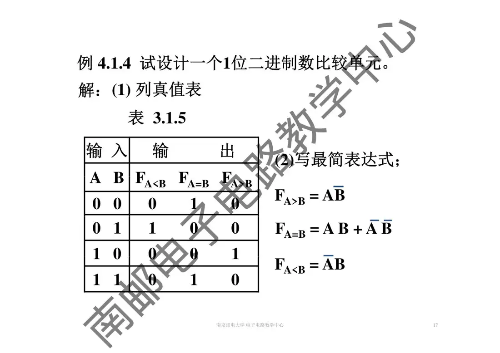

原文：

例 4.1.4 试设计 个一 1位 进制数比较单元二 。

解 ： ( ) 1 列 真值表

表 3. 1.5
<table><tr><td colspan="2">输入</td><td colspan="3">输出</td></tr><tr><td>A</td><td>B</td><td> $F_{A < B}$ </td><td> $F_{A=B}$ </td><td> $F_{A>B}$ </td></tr><tr><td>0</td><td>0</td><td>0</td><td>1</td><td>0</td></tr><tr><td>0</td><td>1</td><td>1</td><td>0</td><td>0</td></tr><tr><td>1</td><td>0</td><td>0</td><td>0</td><td>1</td></tr><tr><td>1</td><td>1</td><td>0</td><td>1</td><td>0</td></tr></table>

(2)写最简表达式；

$$
\mathbf {F} _ {\mathbf {A} > \mathbf {B}} = \mathbf {A} \overline {{\mathbf {B}}}
$$

$$
\mathbf {F} _ {\mathbf {A} = \mathbf {B}} = \mathbf {A B} + \overline {{\mathbf {A}}} \overline {{\mathbf {B}}}
$$

$$
\mathbf {F} _ {\mathbf {A} <   \mathbf {B}} = \overline {{\mathbf {A}}} \mathbf {B}
$$

南京邮电大学 电子电路教学中心

1 7

### (3)画逻辑电路

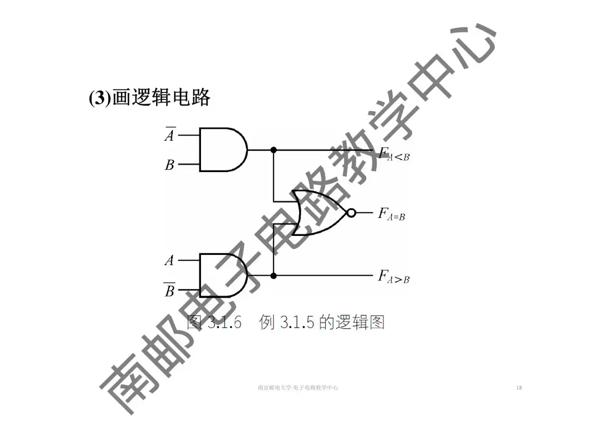

原文：

(3)画逻辑电路

南京邮电大学 电子电路教学中心

1 8

### 画逻辑电路图， 如下图所示。

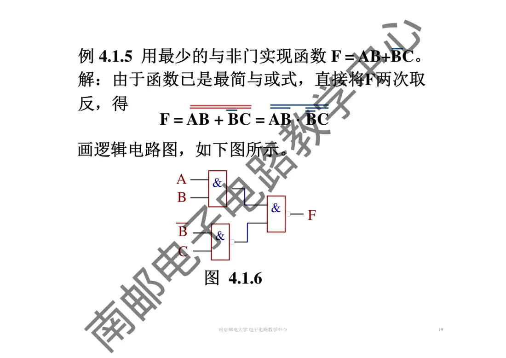

原文：

例 4 1 5. . 用最少 的与非门实现函数 $\mathbf { F } = \mathbf { A B } + \mathbf { B C }$ 解： 由于函数已是最简与或式， 直接将F两次取反， 得 $\mathbf { F } = { \overline { { \mathbf { A B } } } } + { \overline { { \mathbf { B C } } } } = { \overline { { \mathbf { A B } } } } \times { \overline { { \mathbf { B C } } } }$

画逻辑电路图， 如下图所示。

南京邮电大学 电子电路教学中心

1 9

### 例 4 1 6. . 用与非门实现函数

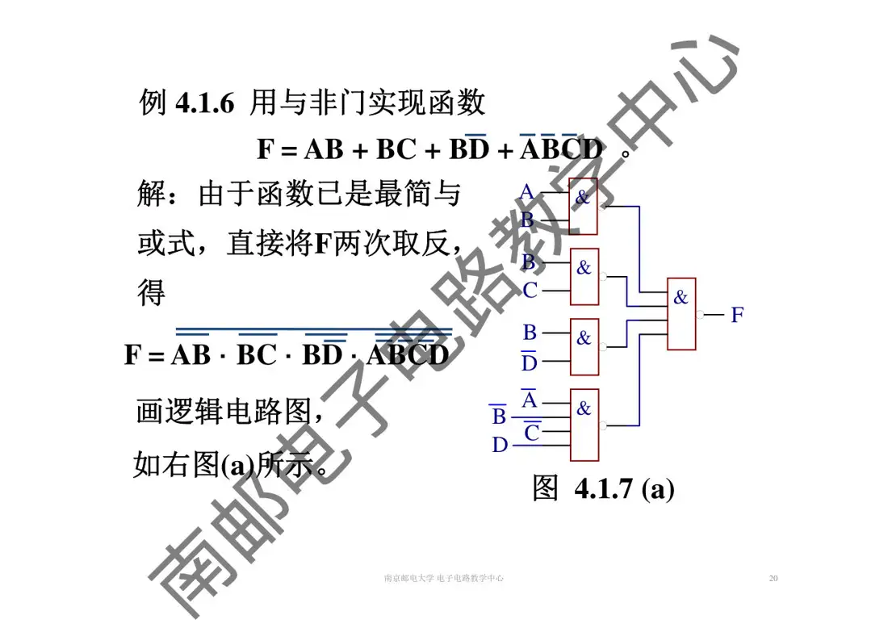

原文：

例 4 1 6. . 用与非门实现函数

$$
\mathbf {F} = \mathbf {A B} + \mathbf {B C} + \mathbf {B D} + \overline {{\mathbf {A}}} \overline {{\mathbf {B}}} \overline {{\mathbf {C}}} \mathbf {D}
$$

解： 由于函数已是最简与或式 直接将F两次取反， ，得F = AB · BC · BD ·画逻辑电路图，如 右 图 ( ) a 所示

南京邮电大学 电子电路教学中心

20

### 对函数还可做如下变换：

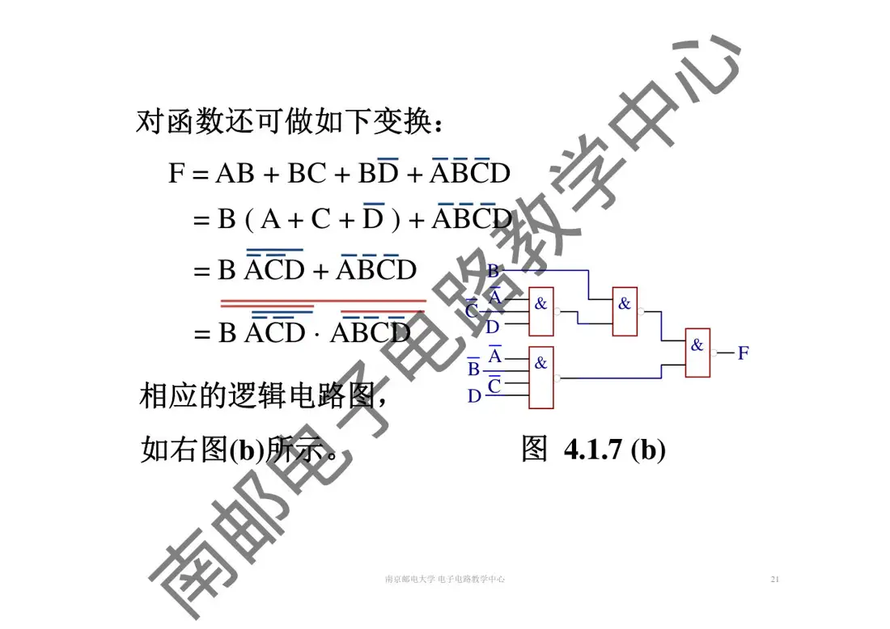

原文：

对函数还可做如下变换：

$$
\begin{array}{r l} & {\mathbf {F} = \mathbf {A B} + \mathbf {B C} + \mathbf {B D} + \overline {{\mathbf {A}}} \overline {{\mathbf {B}}} \overline {{\mathbf {C}}} \mathbf {D}} \\ & {\quad = \mathbf {B} (\mathbf {A} + \mathbf {C} + \overline {{\mathbf {D}}}) + \overline {{\mathbf {A}}} \overline {{\mathbf {B}}} \overline {{\mathbf {C}}} \mathbf {D}} \\ & {\quad = \mathbf {B} \overline {{\overline {{\mathbf {A}}} \overline {{\mathbf {C}}} \overline {{\mathbf {D}}}}} + \overline {{\mathbf {A}}} \overline {{\mathbf {B}}} \overline {{\mathbf {C}}} \overline {{\mathbf {D}}} \quad \text {   B   -   }} \\ & {\quad = \mathbf {B} \overline {{\overline {{\mathbf {A}}} \overline {{\mathbf {C}}} \overline {{\mathbf {D}}}}} \cdot \overline {{\mathbf {A}}} \overline {{\mathbf {B}}} \overline {{\mathbf {C}}} \overline {{\mathbf {D}}} \quad \text {   B   -   }} \\ & {\quad = \overline {{\overline {{\mathbf {A}}} \overline {{\mathbf {C}}} \overline {{\mathbf {D}}}}} \cdot \overline {{\mathbf {A}}} \overline {{\mathbf {B}}} \overline {{\mathbf {C}}} \overline {{\mathbf {D}}} \quad \text {   C   -   }} \end{array}
$$

相应的逻辑电路图，

如右 图(b)所示。

图 4 . 1 .7 (b)

南京邮电大学 电子电路教学中心

2 1

### 图(a) 为二级5与非 门 ， 图(b) 为三级4与非 门 。

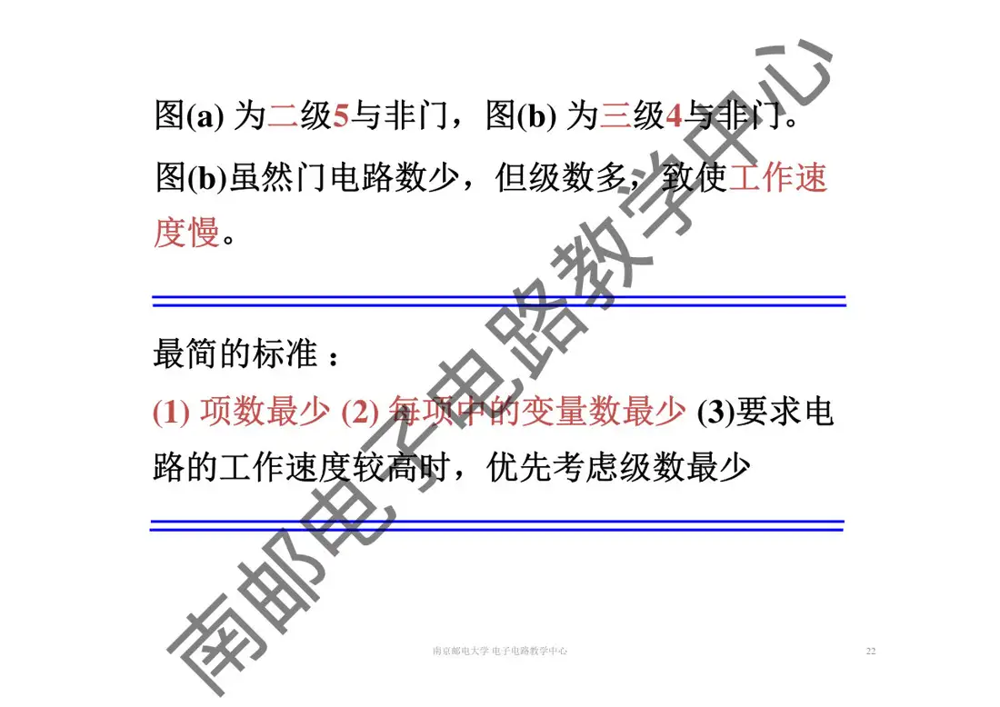

原文：

图(a) 为二级5与非 门 ， 图(b) 为三级4与非 门 。

图( )b 虽然门 电路数少， 但级数多， 致使工作速度慢。

最简的标准 ：

(1) 项数最少 (2) 每项中 的变量数最少 (3)要求电路的工作速度较高时， 优先考虑级数最少

南京邮电大学 电子电路教学中心

22

### 南京邮电大学 电子电路教学中心

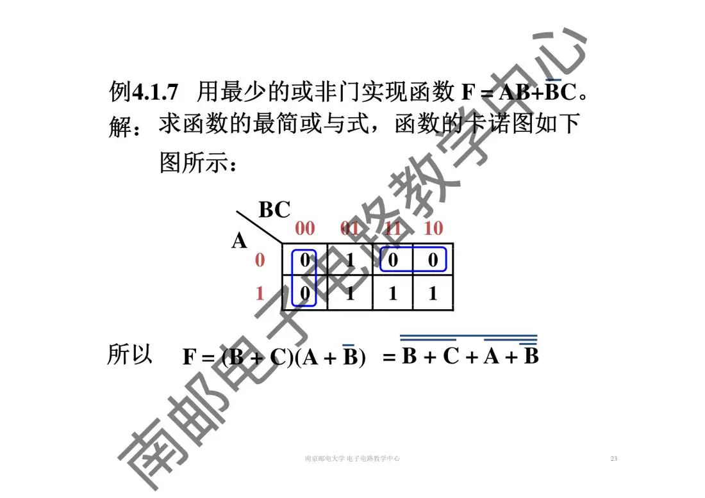

原文：

例4.1.7 用最少 的或非门实现函数 $\mathbf { F } \equiv \mathbf { A } \mathbf { B } + \overline { { \mathbf { B } } } \mathbf { C }$ 求函数的最简或与式， 函数的卡诺图如下解图所示：

2所以 $\mathbf { F } = ( \mathbf { B } + \mathbf { C } ) ( \mathbf { A } + \mathbf { \overline { { B } } } ) = \mathbf { \overline { { B } } } + \mathbf { \overline { { C } } } + \mathbf { \overline { { A } } } + \mathbf { \overline { { B } } }$ 逻辑电路如下图所示：

南京邮电大学 电子电路教学中心

23

### 求反函数的最简与或式， 函数的卡诺图如解下图所示：

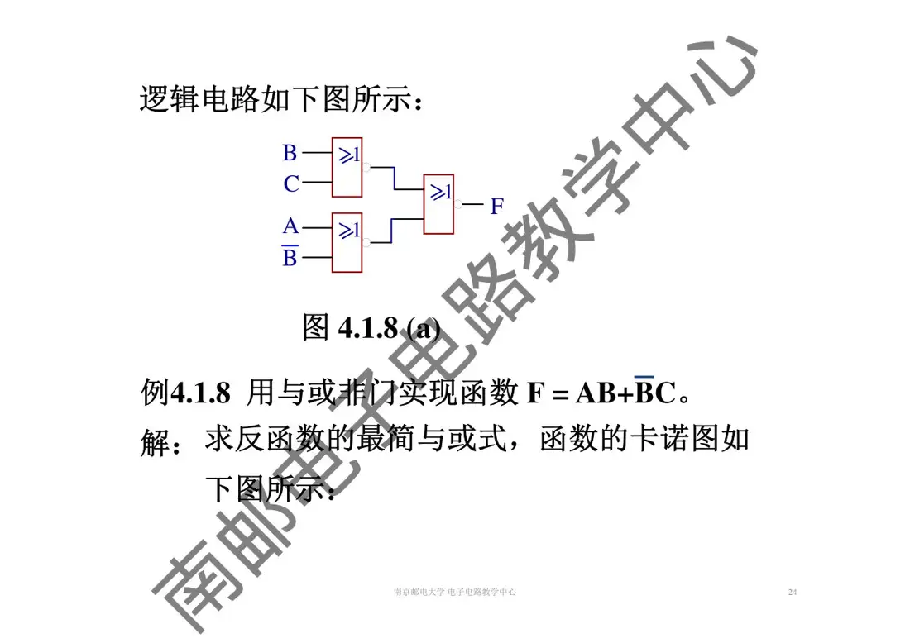

原文：

例4 1 8 用与或非门实现函数. . $\mathbf { F } = \mathbf { A B } + \mathbf { B C }$ 。

求反函数的最简与或式， 函数的卡诺图如解下图所示：

南京邮电大学 电子电路教学中心

24

### A\BC000111100010010111

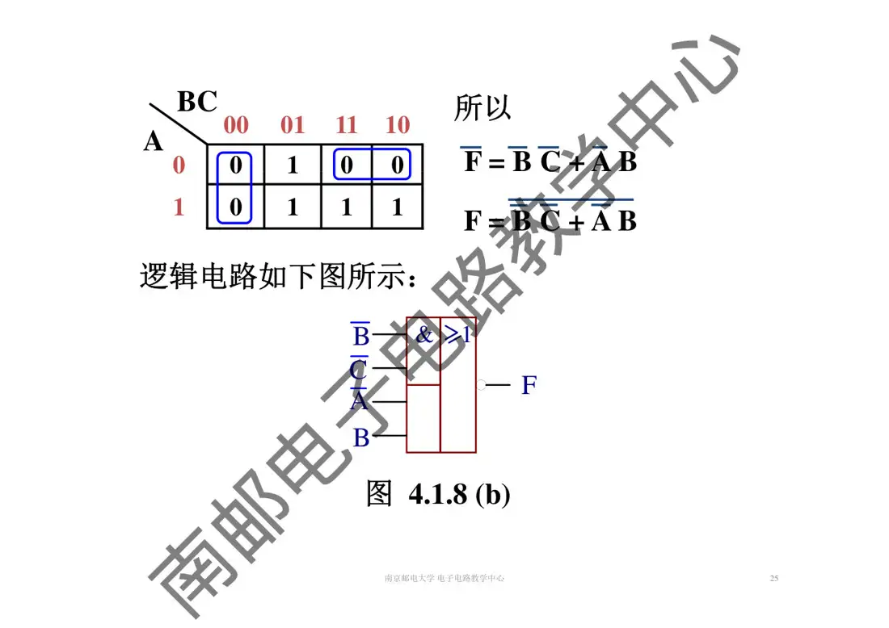

原文：

<table><tr><td>A\BC</td><td>00</td><td>01</td><td>11</td><td>10</td></tr><tr><td>0</td><td>0</td><td>1</td><td>0</td><td>0</td></tr><tr><td>1</td><td>0</td><td>1</td><td>1</td><td>1</td></tr></table>

所以

F = B C + A B

F = B C + A B

逻辑电路如下图所示：

南京邮电大学 电子电路教学中心

25

### 作业题3.13.23.4

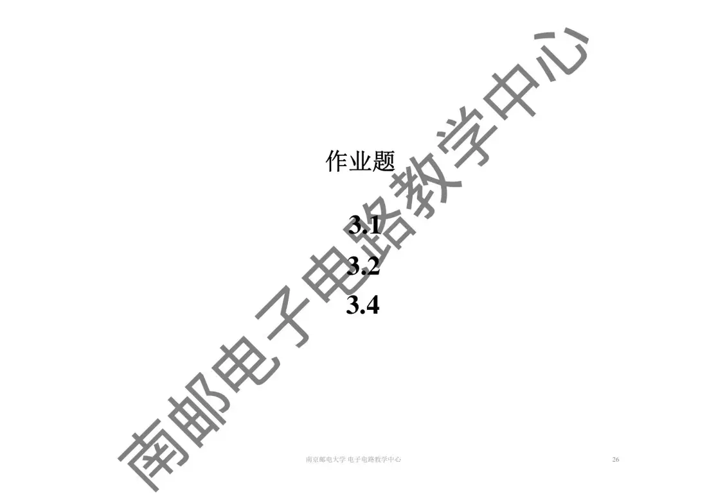

原文：

<table><tr><td>作业题</td></tr><tr><td>3.1</td></tr><tr><td>3.2</td></tr><tr><td>3.4</td></tr></table>

26
