# 《数字电路与逻辑设计B》第3章 组合逻辑电路习题课（课件）

原件的每一页，下面附识别出的文字。

### 组合逻辑电路 习题课

原文：

组合逻辑电路 习题课

### 一、组合逻辑电路的基本概念

原文：

一、组合逻辑电路的基本概念

1. 定义

2.结构特点

(1) 电路由逻辑门构成，不含记忆元件；

(2) 输入信号是单向传输的，电路中不含反馈回路；

3.功能描述

真值表；表达式；卡诺图；电路图；波形图

2

### 二、SSI构成的组合逻辑电路的分析和设计

原文：

二、SSI构成的组合逻辑电路的分析和设计

1. 分析步骤

(1)从输入端开始，逐级推导出函数表达式；

(2)列真值表

(3)确定逻辑功能

2.设计步骤

(1)列真值表;

(2)写最简表达式;

(3)画逻辑电路

3

### 三、MSI组合逻辑电路的工作原理及应用

原文：

三、MSI组合逻辑电路的工作原理及应用

1. 功能表、简化逻辑符号

2.典型应用

(1) 用二进制译码器设计组合逻辑电路

(2) 用数据选择器设计组合逻辑电路

四、组合逻辑电路中的竞争和冒险

1. 竞争和冒险的概念

(1) 1型冒险和0型冒险;

(2) 逻辑冒险和功能冒险；

4

### 2.逻辑冒险、功能冒险的检查

原文：

2.逻辑冒险、功能冒险的检查

3.冒险的消除方法

五、例题讲解

### 例1：分析下图电路的逻辑功能。

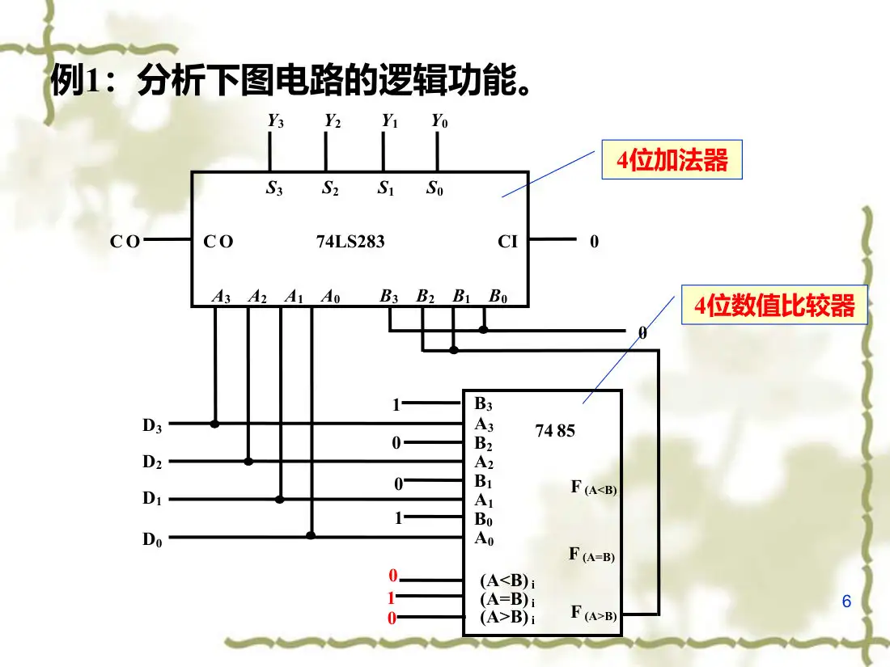

原文：

例1：分析下图电路的逻辑功能。

4位加法器

4位数值比较器

### 解：①逻辑真值表

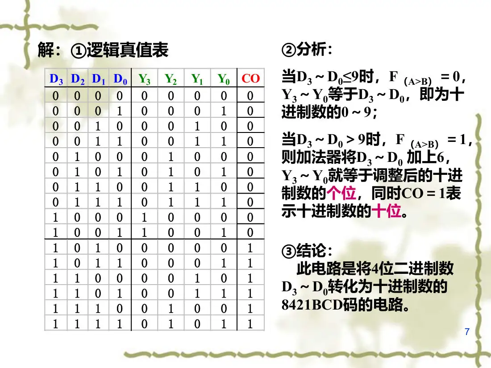

原文：

解：①逻辑真值表
<table><tr><td> $D_3$ </td><td> $D_2$ </td><td> $D_1$ </td><td> $D_0$ </td><td> $Y_3$ </td><td> $Y_2$ </td><td> $Y_1$ </td><td> $Y_0$ </td><td>CO</td></tr><tr><td>0</td><td>0</td><td>0</td><td>0</td><td>0</td><td>0</td><td>0</td><td>0</td><td>0</td></tr><tr><td>0</td><td>0</td><td>0</td><td>1</td><td>0</td><td>0</td><td>0</td><td>1</td><td>0</td></tr><tr><td>0</td><td>0</td><td>1</td><td>0</td><td>0</td><td>0</td><td>1</td><td>0</td><td>0</td></tr><tr><td>0</td><td>0</td><td>1</td><td>1</td><td>0</td><td>0</td><td>1</td><td>1</td><td>0</td></tr><tr><td>0</td><td>1</td><td>0</td><td>0</td><td>0</td><td>1</td><td>0</td><td>0</td><td>0</td></tr><tr><td>0</td><td>1</td><td>0</td><td>1</td><td>0</td><td>1</td><td>0</td><td>1</td><td>0</td></tr><tr><td>0</td><td>1</td><td>1</td><td>0</td><td>0</td><td>1</td><td>1</td><td>0</td><td>0</td></tr><tr><td>0</td><td>1</td><td>1</td><td>1</td><td>0</td><td>1</td><td>1</td><td>1</td><td>0</td></tr><tr><td>1</td><td>0</td><td>0</td><td>0</td><td>1</td><td>0</td><td>0</td><td>0</td><td>0</td></tr><tr><td>1</td><td>0</td><td>0</td><td>1</td><td>1</td><td>0</td><td>0</td><td>1</td><td>0</td></tr><tr><td>1</td><td>0</td><td>1</td><td>0</td><td>0</td><td>0</td><td>0</td><td>0</td><td>1</td></tr><tr><td>1</td><td>0</td><td>1</td><td>1</td><td>0</td><td>0</td><td>0</td><td>1</td><td>1</td></tr><tr><td>1</td><td>1</td><td>0</td><td>0</td><td>0</td><td>0</td><td>1</td><td>0</td><td>1</td></tr><tr><td>1</td><td>1</td><td>0</td><td>1</td><td>0</td><td>0</td><td>1</td><td>1</td><td>1</td></tr><tr><td>1</td><td>1</td><td>1</td><td>0</td><td>0</td><td>1</td><td>0</td><td>0</td><td>1</td></tr><tr><td>1</td><td>1</td><td>1</td><td>1</td><td>0</td><td>1</td><td>0</td><td>1</td><td>1</td></tr></table>

②分析：

当 $D_{3}\sim D_{0}\leq9$ 时， $F_{(A>B)}=0$ ， $Y_{3}\sim Y_{0}$ 等于 $D_{3}\sim D_{0}$ ，即为十进制数的0\~9；

当 $D_{3}\sim D_{0}>9$ 时， $F_{(A>B)}=1$ ，则加法器将 $D_{3}\sim D_{0}$ 加上6， $Y_{3}\sim Y_{0}$ 就等于调整后的十进制数的个位，同时CO=1表示十进制数的十位。

③结论：

此电路是将4位二进制数 $\mathrm{D}_{3} \sim \mathrm{D}_{0}$ 转化为十进制数的8421BCD码的电路。

7

### 例2：试用4位超前进位加法器74LS283构成4位减法器。

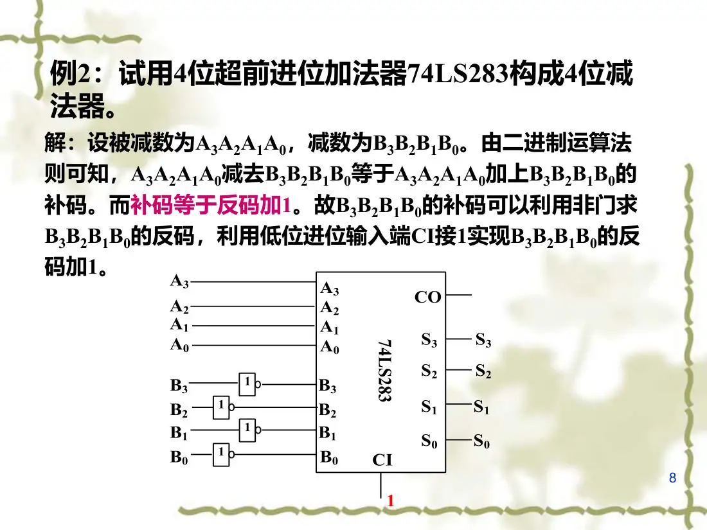

原文：

例2：试用4位超前进位加法器74LS283构成4位减法器。

解: 设被减数为 $\mathrm{A}_{3} \mathrm{~A}_{2} \mathrm{~A}_{1} \mathrm{~A}_{0}$ , 减数为 $\mathrm{B}_{3} \mathrm{~B}_{2} \mathrm{~B}_{1} \mathrm{~B}_{0}$ 。由二进制运算法则可知, $\mathrm{A}_{3} \mathrm{~A}_{2} \mathrm{~A}_{1} \mathrm{~A}_{0}$ 减去 $\mathrm{B}_{3} \mathrm{~B}_{2} \mathrm{~B}_{1} \mathrm{~B}_{0}$ 等于 $\mathrm{A}_{3} \mathrm{~A}_{2} \mathrm{~A}_{1} \mathrm{~A}_{0}$ 加上 $\mathrm{B}_{3} \mathrm{~B}_{2} \mathrm{~B}_{1} \mathrm{~B}_{0}$ 的补码。而补码等于反码加 1 。故 $\mathrm{B}_{3} \mathrm{~B}_{2} \mathrm{~B}_{1} \mathrm{~B}_{0}$ 的补码可以利用非门求 $\mathrm{B}_{3} \mathrm{~B}_{2} \mathrm{~B}_{1} \mathrm{~B}_{0}$ 的反码, 利用低位进位输入端 CI 接 1 实现 $\mathrm{B}_{3} \mathrm{~B}_{2} \mathrm{~B}_{1} \mathrm{~B}_{0}$ 的反码加 1 。

### 4.1 分析图P4.1电路的逻辑功能

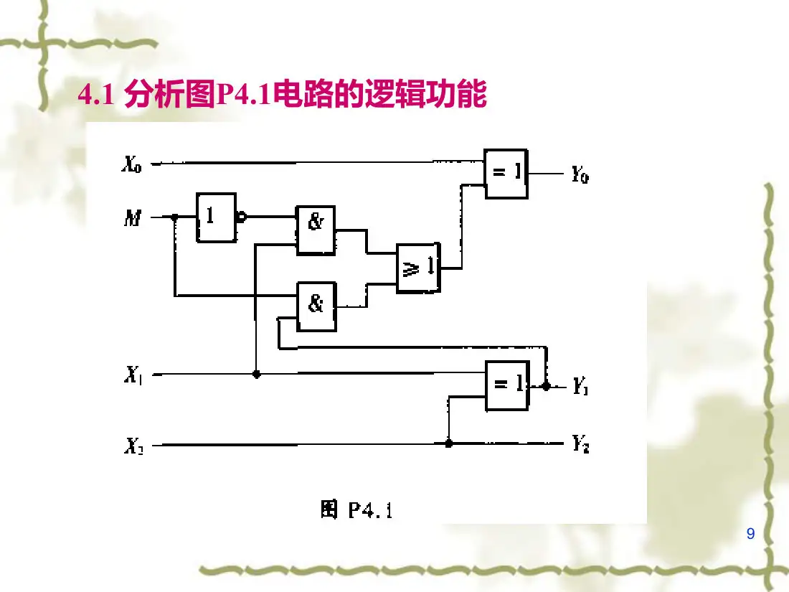

原文：

4.1 分析图P4.1电路的逻辑功能

### 解：（1）推导输出表达式

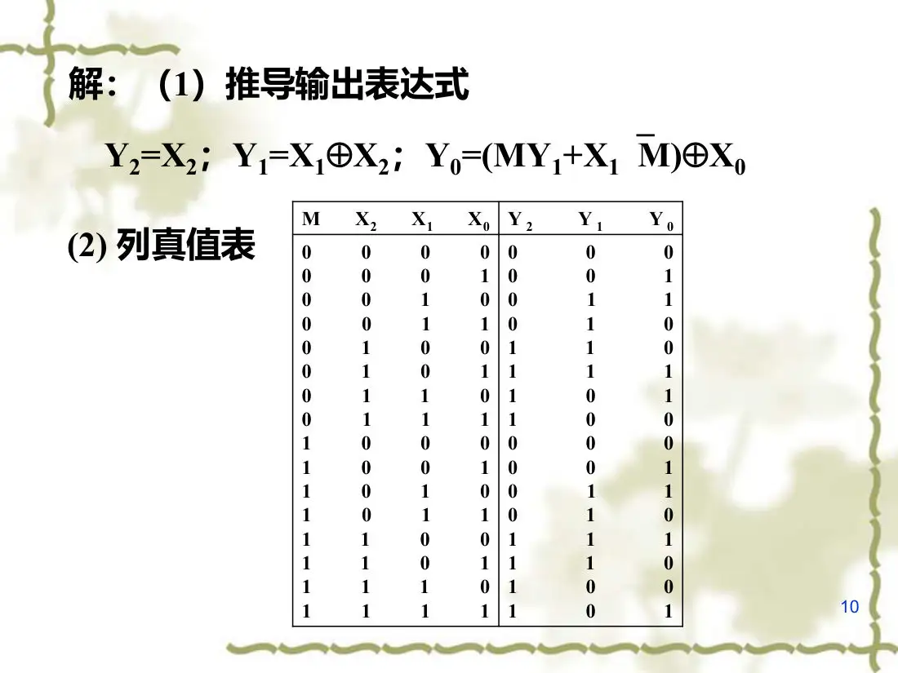

原文：

解：（1）推导输出表达式

$$
\mathbf {Y} _ {2} = \mathbf {X} _ {2}; \quad \mathbf {Y} _ {1} = \mathbf {X} _ {1} \oplus \mathbf {X} _ {2}; \quad \mathbf {Y} _ {0} = (\mathbf {M Y} _ {1} + \mathbf {X} _ {1} \overline {{\mathbf {M}}}) \oplus \mathbf {X} _ {0}
$$

(2) 列真值表

<table><tr><td>M</td><td> $X_2$ </td><td> $X_1$ </td><td> $X_0$ </td><td> $Y_2$ </td><td> $Y_1$ </td><td> $Y_0$ </td></tr><tr><td>0</td><td>0</td><td>0</td><td>0</td><td>0</td><td>0</td><td>0</td></tr><tr><td>0</td><td>0</td><td>0</td><td>1</td><td>0</td><td>0</td><td>1</td></tr><tr><td>0</td><td>0</td><td>1</td><td>0</td><td>0</td><td>1</td><td>1</td></tr><tr><td>0</td><td>0</td><td>1</td><td>1</td><td>0</td><td>1</td><td>0</td></tr><tr><td>0</td><td>1</td><td>0</td><td>0</td><td>1</td><td>1</td><td>0</td></tr><tr><td>0</td><td>1</td><td>0</td><td>1</td><td>1</td><td>1</td><td>1</td></tr><tr><td>0</td><td>1</td><td>1</td><td>0</td><td>1</td><td>0</td><td>1</td></tr><tr><td>0</td><td>1</td><td>1</td><td>1</td><td>1</td><td>0</td><td>0</td></tr><tr><td>1</td><td>0</td><td>0</td><td>0</td><td>0</td><td>0</td><td>0</td></tr><tr><td>1</td><td>0</td><td>0</td><td>1</td><td>0</td><td>0</td><td>1</td></tr><tr><td>1</td><td>0</td><td>1</td><td>0</td><td>0</td><td>1</td><td>1</td></tr><tr><td>1</td><td>0</td><td>1</td><td>1</td><td>0</td><td>1</td><td>0</td></tr><tr><td>1</td><td>1</td><td>0</td><td>0</td><td>1</td><td>1</td><td>1</td></tr><tr><td>1</td><td>1</td><td>0</td><td>1</td><td>1</td><td>1</td><td>0</td></tr><tr><td>1</td><td>1</td><td>1</td><td>0</td><td>1</td><td>0</td><td>0</td></tr><tr><td>1</td><td>1</td><td>1</td><td>1</td><td>1</td><td>0</td><td>1</td></tr></table>

10

### (3) 逻辑功能:

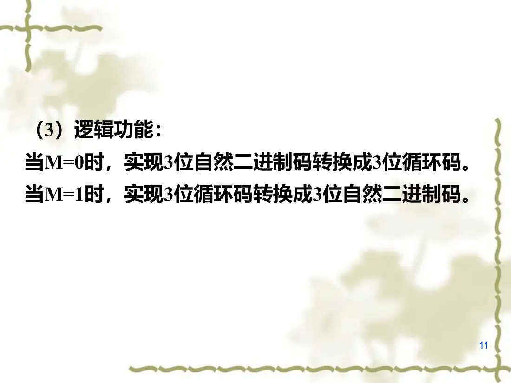

原文：

(3) 逻辑功能:

当M=0时，实现3位自然二进制码转换成3位循环码。当M=1时，实现3位循环码转换成3位自然二进制码。

11

### 4.2 分析图P4.2电路的逻辑功能。

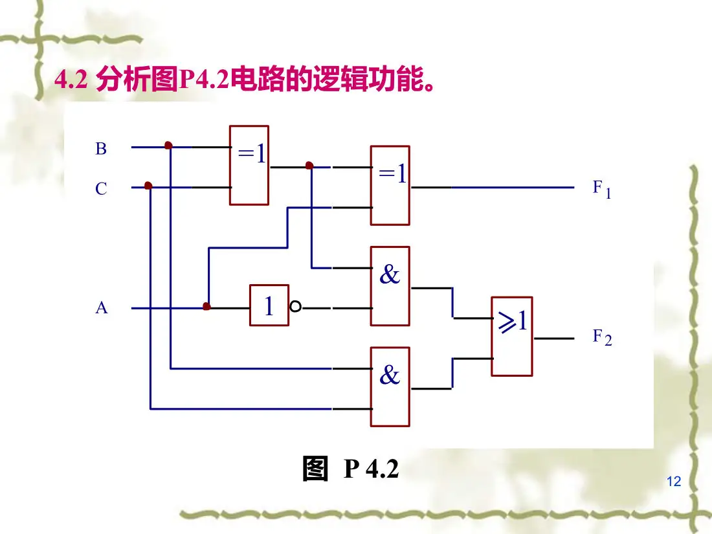

原文：

4.2 分析图P4.2电路的逻辑功能。

12

### 解：(1)从输入端开始，逐级推导出函数表达式

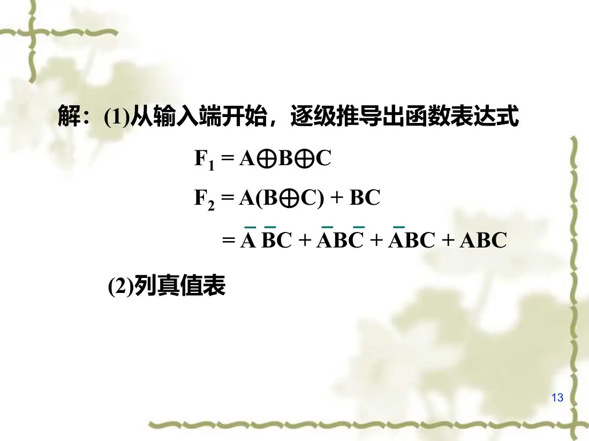

原文：

解：(1)从输入端开始，逐级推导出函数表达式

$$
\mathbf {F} _ {1} = \mathbf {A} \oplus \mathbf {B} \oplus \mathbf {C}
$$

$$
\begin{array}{r l} \mathbf {F} _ {2} & = \mathbf {A} (\mathbf {B} \oplus \mathbf {C}) + \mathbf {B C} \\ & = \overline {{\mathbf {A}}} \overline {{\mathbf {B}}} \overline {{\mathbf {C}}} + \overline {{\mathbf {A}}} \overline {{\mathbf {B}}} \overline {{\mathbf {C}}} + \overline {{\mathbf {A}}} \overline {{\mathbf {B}}} \mathbf {C} + \mathbf {A} \mathbf {B} \mathbf {C} \end{array}
$$

(2)列真值表

13

### (3)确定逻辑功能

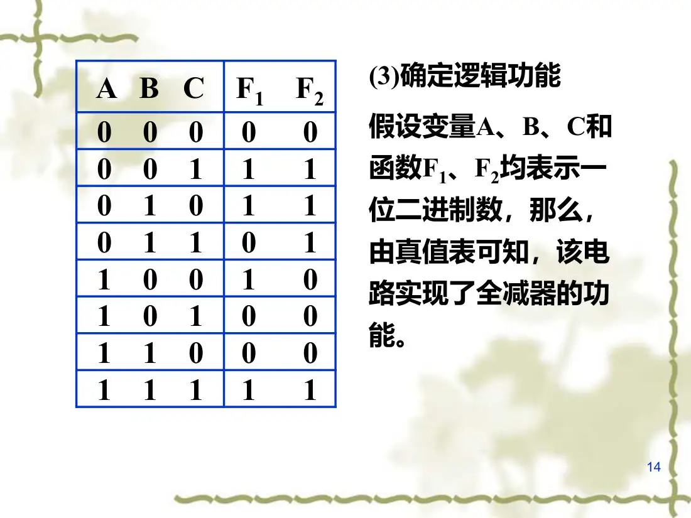

原文：

<table><tr><td>A B C</td><td> $F_1$   $F_2$ </td></tr><tr><td>0 0 0</td><td>0 0</td></tr><tr><td>0 0 1</td><td>1 1</td></tr><tr><td>0 1 0</td><td>1 1</td></tr><tr><td>0 1 1</td><td>0 1</td></tr><tr><td>1 0 0</td><td>1 0</td></tr><tr><td>1 0 1</td><td>0 0</td></tr><tr><td>1 1 0</td><td>0 0</td></tr><tr><td>1 1 1</td><td>1 1</td></tr></table>

(3)确定逻辑功能

假设变量A、B、C和函数 $F_{1}$ 、 $F_{2}$ 均表示一位二进制数，那么，由真值表可知，该电路实现了全减器的功能。

14

### $$

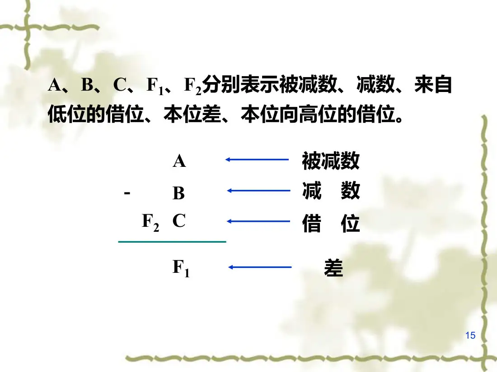

原文：

A、B、C、 $\mathrm{F}_{1}$ 、 $\mathrm{F}_{2}$ 分别表示被减数、减数、来自低位的借位、本位差、本位向高位的借位。

$$
\begin{array}{c c c} \text {A} & \xleftarrow {\text {被减数}} \\ - \text {B} & \xleftarrow {\text {减数}} \\ \text {F} _ {2} \text {C} & \xleftarrow {\text {借位}} \\ \hline \text {F} _ {1} & \xleftarrow {\text {差}} \end{array}
$$

15

### 解：(1)列真值表

原文：

4.4 设ABCD是一个8421BCD码，试用最少与非门设计一个能判断该8421BCD码是否大于等于5的电路，该数大于等于5，F=1；否则为0。

解：(1)列真值表

16

### $$

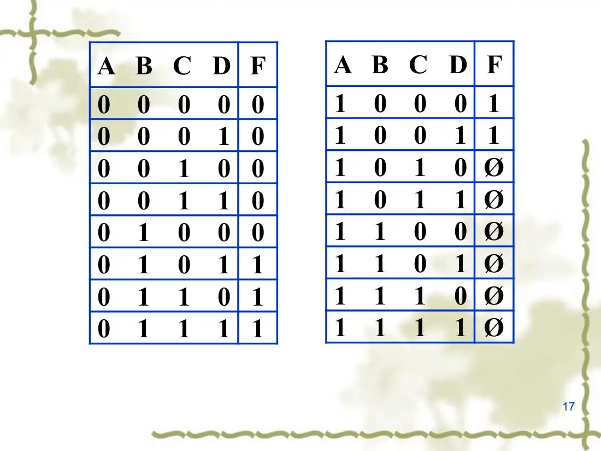

原文：

$$
\begin{array}{c c c c c} \hline \text {A B C D} & \text {F} \\ \hline 0 & 0 & 0 & 0 & 0 \\ \hline 0 & 0 & 0 & 1 & 0 \\ \hline 0 & 0 & 1 & 0 & 0 \\ \hline 0 & 0 & 1 & 1 & 0 \\ \hline 0 & 1 & 0 & 0 & 0 \\ \hline 0 & 1 & 0 & 1 & 1 \\ \hline 0 & 1 & 1 & 0 & 1 \\ \hline 0 & 1 & 1 & 1 & 1 \end{array}
$$

$$
\begin{array}{c c c c c} \hline \text {A} & \text {B} & \text {C} & \text {D} & \text {F} \\ \hline 1 & 0 & 0 & 0 & 1 \\ \hline 1 & 0 & 0 & 1 & 1 \\ \hline 1 & 0 & 1 & 0 & \emptyset \\ \hline 1 & 0 & 1 & 1 & \emptyset \\ \hline 1 & 1 & 0 & 0 & \emptyset \\ \hline 1 & 1 & 0 & 1 & \emptyset \\ \hline 1 & 1 & 1 & 0 & \emptyset \\ \hline 1 & 1 & 1 & 1 & \emptyset \end{array}
$$

17

### (2)写最简表达式

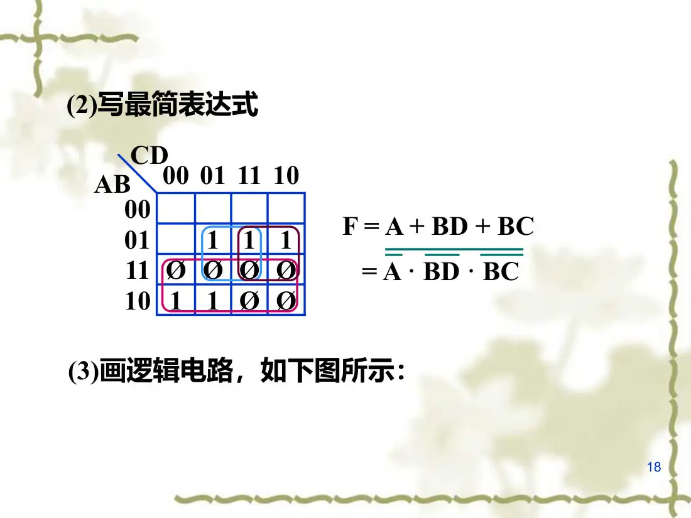

原文：

(2)写最简表达式

$$
\begin{array}{c c c c c} \text {CD} & 0 0 & 0 1 & 1 1 & 1 0 \\ \text {AB} & & & & \\ 0 0 & & & & \\ 0 1 & & 1 & 1 & 1 \\ 1 1 & \emptyset & \emptyset & \emptyset & \emptyset \\ 1 0 & 1 & 1 & \emptyset & \emptyset \end{array}
$$

$$
\begin{array}{r l} \mathbf {F} & = \mathbf {A} + \mathbf {B D} + \mathbf {B C} \\ & = \overline {{\mathbf {A}}} \cdot \overline {{\mathbf {B D}}} \cdot \overline {{\mathbf {B C}}} \end{array}
$$

(3)画逻辑电路，如下图所示：

18

### 19

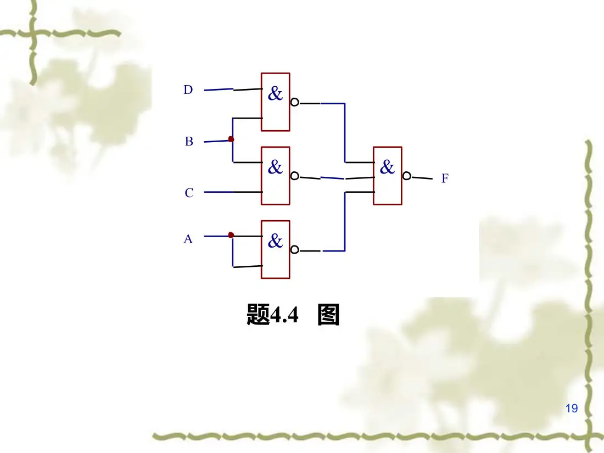

原文：

19

### 解：设火警为A，急救为B，普通为C，列真值表为：

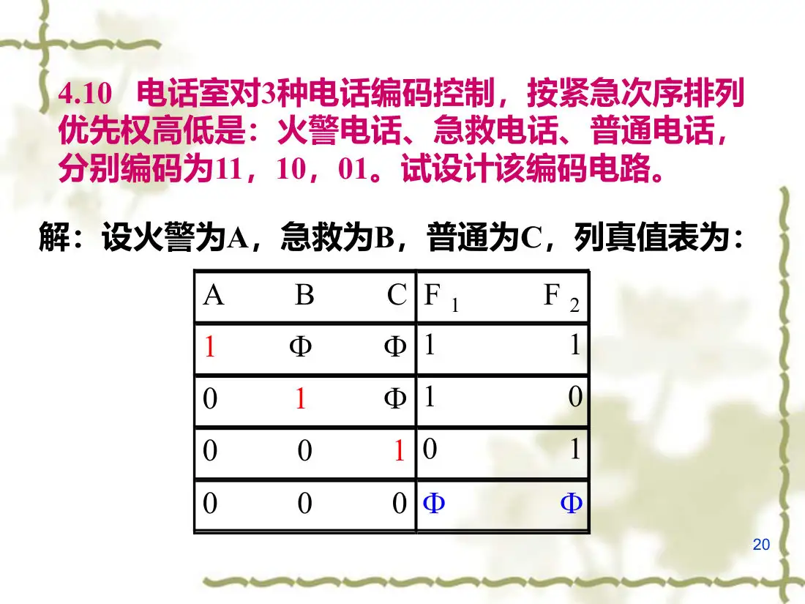

原文：

4.10 电话室对3种电话编码控制，按紧急次序排列优先权高低是：火警电话、急救电话、普通电话，分别编码为11，10，01。试设计该编码电路。

解：设火警为A，急救为B，普通为C，列真值表为：

<table><tr><td>A</td><td>B</td><td>C</td><td> $F_{1}$ </td><td> $F_{2}$ </td></tr><tr><td>1</td><td> $\Phi$ </td><td> $\Phi$ </td><td>1</td><td>1</td></tr><tr><td>0</td><td>1</td><td> $\Phi$ </td><td>1</td><td>0</td></tr><tr><td>0</td><td>0</td><td>1</td><td>0</td><td>1</td></tr><tr><td>0</td><td>0</td><td>0</td><td> $\Phi$ </td><td> $\Phi$ </td></tr></table>

20

### 第 21 页

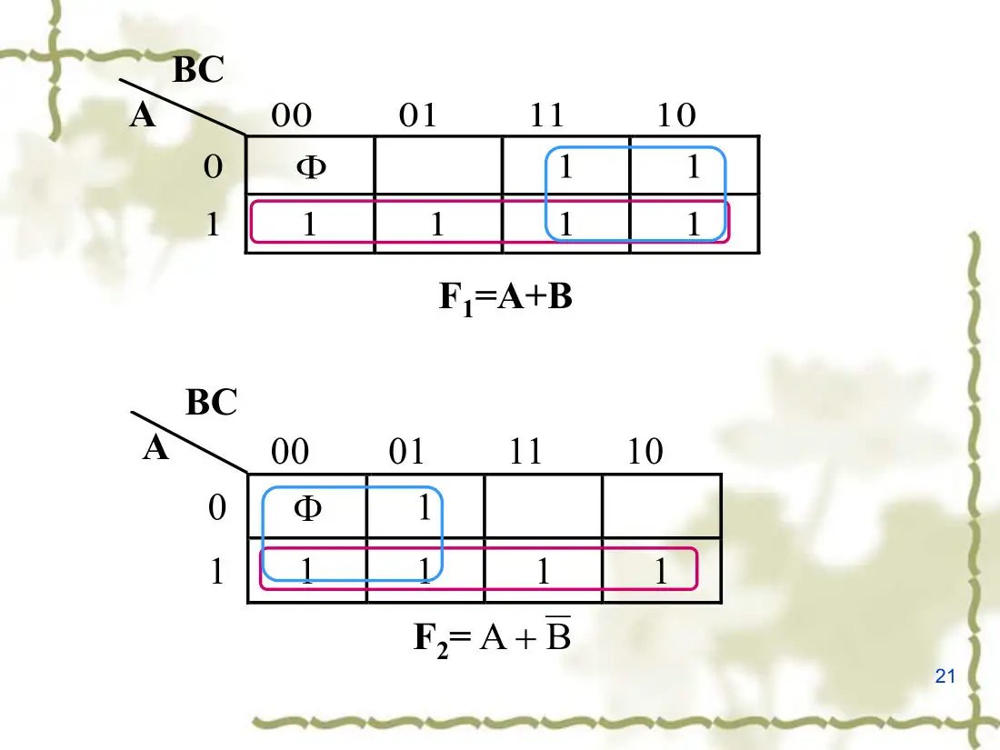

### 4.11 试将2/4译码器扩展成4/16译码器

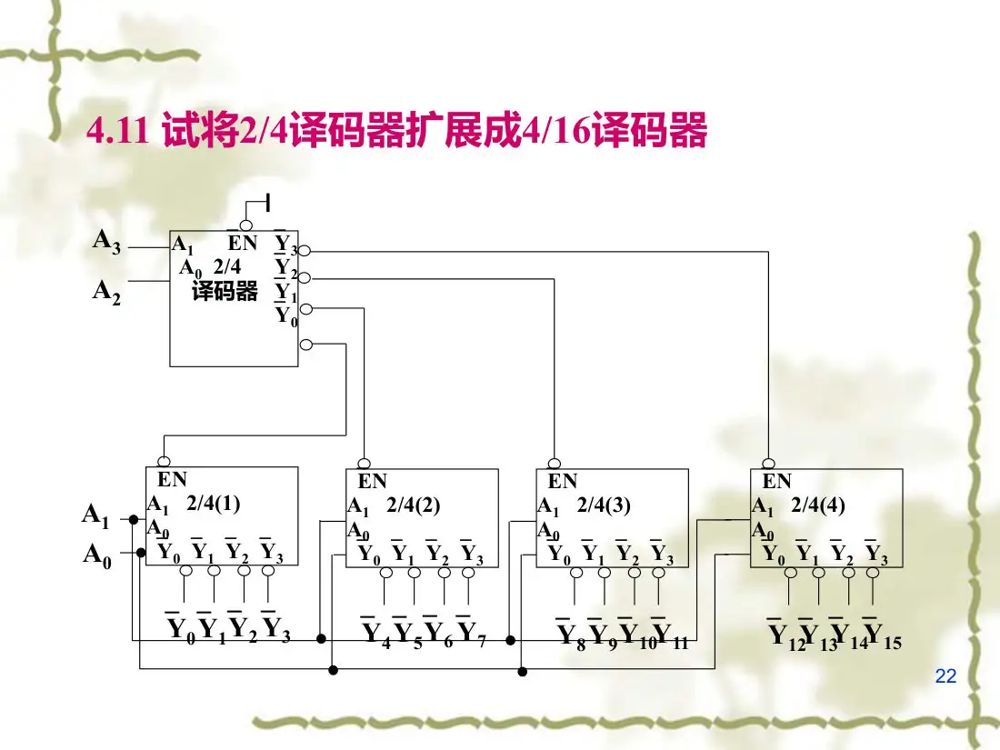

原文：

4.11 试将2/4译码器扩展成4/16译码器

22

### $F_{1}$ : ABCD是4的倍数。

原文：

4.12 试用74138设计一个多输出组合网络，它的输入是4位二进制码ABCD，输出为：

$F_{1}$ : ABCD是4的倍数。

$F_{2}$ : ABCD比2大。

$F_{3}$ : ABCD在8\~11之间。

$F_{4}$ : ABCD不等于0。

23

### $$

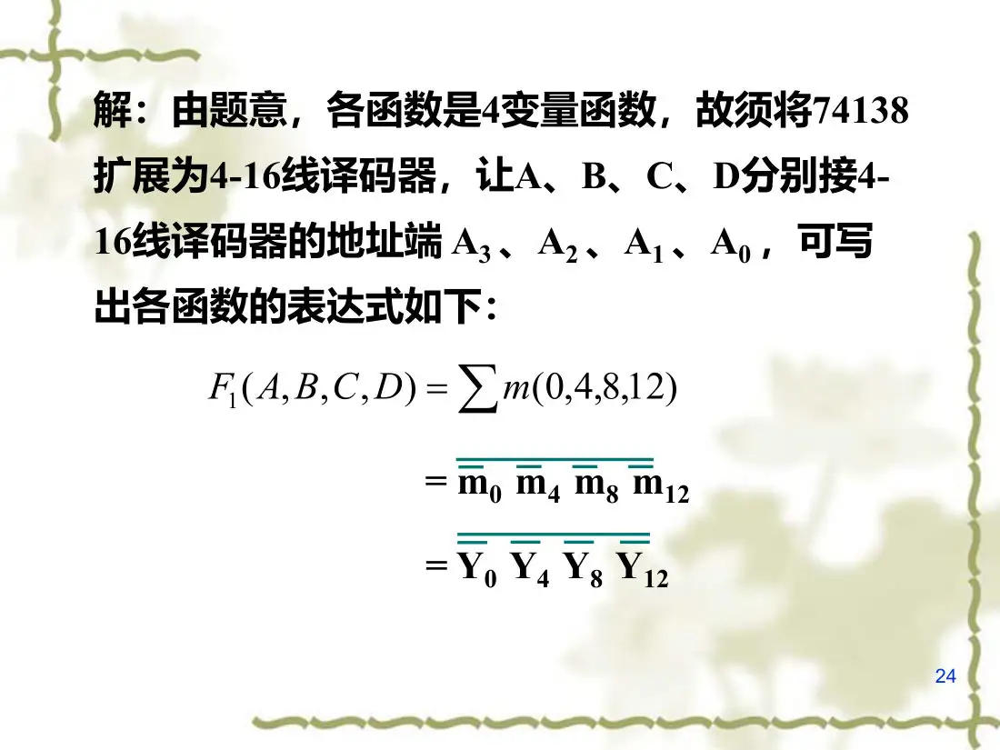

原文：

解：由题意，各函数是4变量函数，故须将74138扩展为4-16线译码器，让A、B、C、D分别接4-16线译码器的地址端 $A_{3}$ 、 $A_{2}$ 、 $A_{1}$ 、 $A_{0}$ ，可写出各函数的表达式如下：

$$
\begin{array}{r l} F _ {1} (A, B, C, D) = \sum m (0, 4, 8, 1 2) & \\ = \overline {{\overline {{\mathbf {m}}} _ {0} \overline {{\mathbf {m}}} _ {4} \overline {{\mathbf {m}}} _ {8} \overline {{\mathbf {m}}}}} _ {1 2} \\ = \overline {{\overline {{\mathbf {Y}}} _ {0} \overline {{\mathbf {Y}}} _ {4} \overline {{\mathbf {Y}}} _ {8} \overline {{\mathbf {Y}}}}} _ {1 2} \end{array}
$$

24

### $$

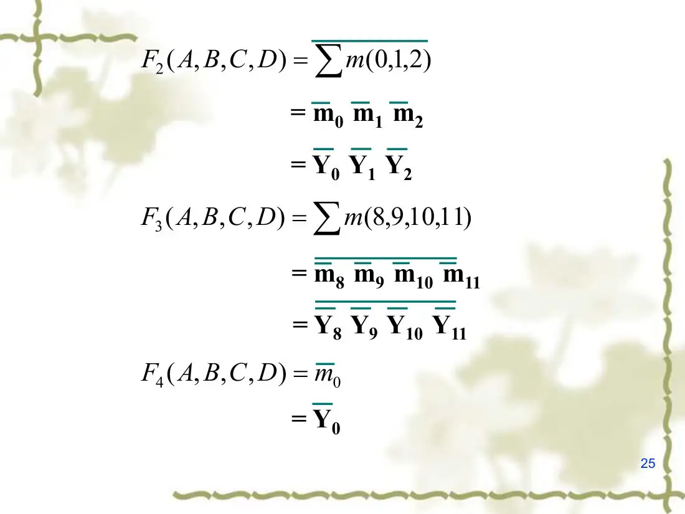

原文：

$$
\begin{array}{r l} F _ {2} (A, B, C, D) = \overline {{\sum m (0 , 1 , 2)}} \\ & = \overline {{\mathbf {m}}} _ {0} \overline {{\mathbf {m}}} _ {1} \overline {{\mathbf {m}}} _ {2} \\ & = \overline {{\mathbf {Y}}} _ {0} \overline {{\mathbf {Y}}} _ {1} \overline {{\mathbf {Y}}} _ {2} \end{array}
$$

$$
\begin{array}{r l} F _ {3} (A, B, C, D) & = \sum m (8, 9, 1 0, 1 1) \\ & = \overline {{\mathbf {m} _ {8} \mathbf {\bar {m}} _ {9} \mathbf {\bar {m}} _ {1 0} \mathbf {\bar {m}} _ {1 1}}} \\ & = \overline {{\mathbf {Y} _ {8} \mathbf {\bar {Y}} _ {9} \mathbf {\bar {Y}} _ {1 0} \mathbf {\bar {Y}} _ {1 1}}} \end{array}
$$

$$
\begin{array}{r} F _ {4} (A, B, C, D) = \overline {{m}} _ {0} \\ = \overline {{\mathbf {Y}}} _ {\mathbf {0}} \end{array}
$$

25

### 实现电路如下图所示：

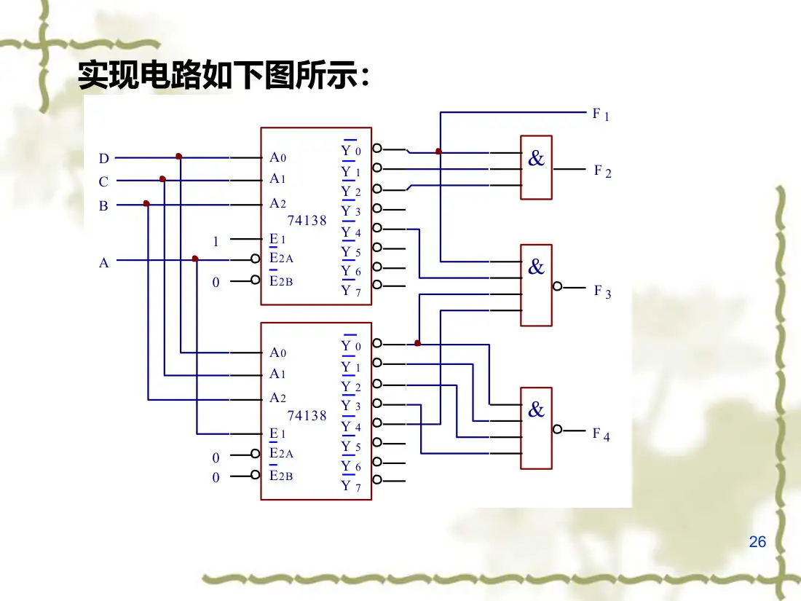

原文：

实现电路如下图所示：

26

### 4.13 试将八选一MUX扩展成三十二选一MUX。

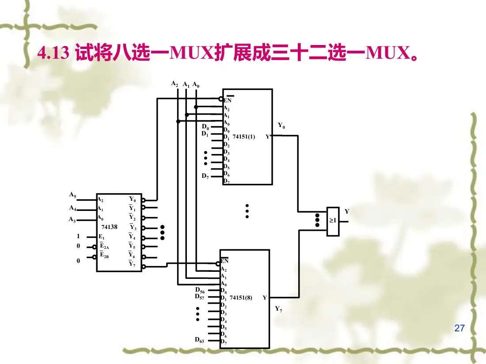

原文：

4.13 试将八选一MUX扩展成三十二选一MUX。

27

### 4.14 试用74151实现下列函数：

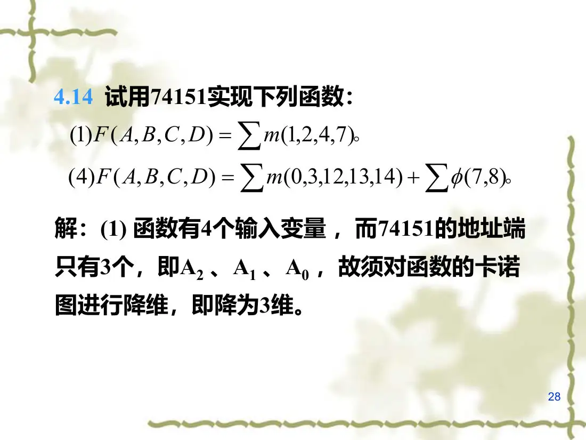

原文：

4.14 试用74151实现下列函数：

(1) $F(A,B,C,D)=\sum m(1,2,4,7)$ 。

(4) $F(A,B,C,D)=\sum m(0,3,12,13,14)+\sum\phi(7,8)$

解：(1) 函数有4个输入变量，而74151的地址端只有3个，即 $A_{2}$ 、 $A_{1}$ 、 $A_{0}$ ，故须对函数的卡诺图进行降维，即降为3维。

28

### AB\CD00011110001101111110

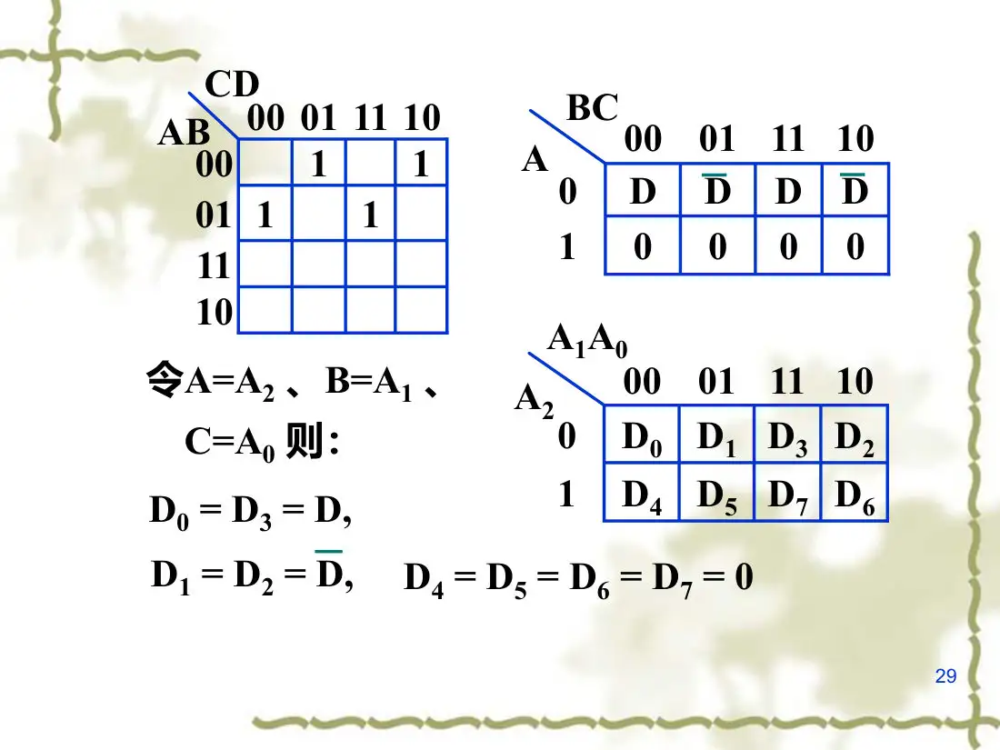

原文：

<table><tr><td>AB\CD</td><td>00</td><td>01</td><td>11</td><td>10</td></tr><tr><td>00</td><td></td><td>1</td><td></td><td>1</td></tr><tr><td>01</td><td>1</td><td></td><td>1</td><td></td></tr><tr><td>11</td><td></td><td></td><td></td><td></td></tr><tr><td>10</td><td></td><td></td><td></td><td></td></tr></table>

令 $\mathrm{A = A_2}$ 、 $\mathbf{B} = \mathbf{A}_1$ 、 $\mathbf{C} = \mathbf{A}_0$ 则：

$$
\mathbf {D _ {0}} = \mathbf {D _ {3}} = \mathbf {D},
$$

<table><tr><td rowspan="3">A\BC</td><td>00</td><td>01</td><td>11</td><td>10</td></tr><tr><td>0</td><td>D</td><td> $\overline{D}$ </td><td>D</td></tr><tr><td>1</td><td>0</td><td>0</td><td>0</td></tr></table>

<table><tr><td colspan="5">A1A0</td></tr><tr><td rowspan="3">A2</td><td>00</td><td>01</td><td>11</td><td>10</td></tr><tr><td>D0</td><td>D1</td><td>D3</td><td>D2</td></tr><tr><td>D4</td><td>D5</td><td>D7</td><td>D6</td></tr></table>

$$
\mathbf {D} _ {1} = \mathbf {D} _ {2} = \overline {{\mathbf {D}}}, \quad \mathbf {D} _ {4} = \mathbf {D} _ {5} = \mathbf {D} _ {6} = \mathbf {D} _ {7} = \mathbf {0}
$$

29

### 相应的电路图如下所示:

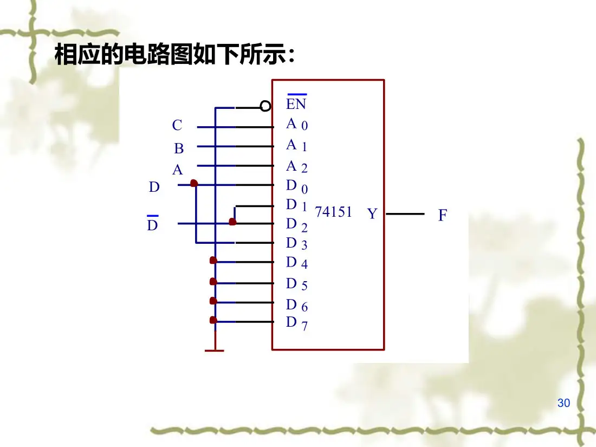

原文：

相应的电路图如下所示:

30

### A1A0A200011110D0D1D3D21D4D5D7D6

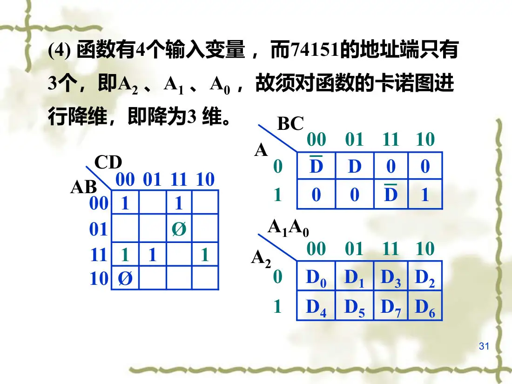

原文：

<table><tr><td colspan="5">A1A0</td></tr><tr><td rowspan="2">A2</td><td>00</td><td>01</td><td>11</td><td>10</td></tr><tr><td>D0</td><td>D1</td><td>D3</td><td>D2</td></tr><tr><td>1</td><td>D4</td><td>D5</td><td>D7</td><td>D6</td></tr></table>

<table><tr><td rowspan="3">A\BC</td><td>00</td><td>01</td><td>11</td><td>10</td></tr><tr><td>0</td><td> $\overline{D}$ </td><td>D</td><td>0</td></tr><tr><td>1</td><td>0</td><td>0</td><td> $\overline{D}$ </td></tr></table>

(4) 函数有4个输入变量，而74151的地址端只有3个，即 $A_{2}$ 、 $A_{1}$ 、 $A_{0}$ ，故须对函数的卡诺图进行降维，即降为3维。BC

<table><tr><td>AB\CD</td><td>00</td><td>01</td><td>11</td><td>10</td></tr><tr><td>00</td><td>1</td><td></td><td>1</td><td></td></tr><tr><td>01</td><td></td><td></td><td>∅</td><td></td></tr><tr><td>11</td><td>1</td><td>1</td><td></td><td>1</td></tr><tr><td>10</td><td>∅</td><td></td><td></td><td></td></tr></table>

31

### 令 $A=A_{2}$ 、 $B=A_{1}$ 、 $C=A_{0}$ 则：

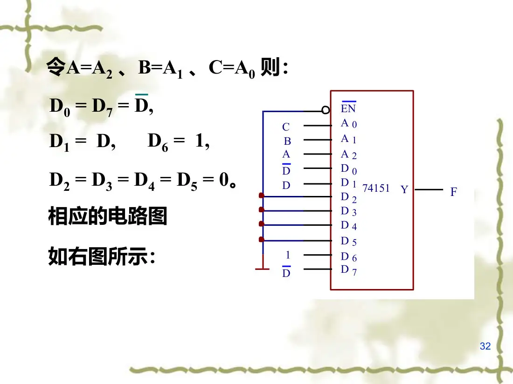

原文：

令 $A=A_{2}$ 、 $B=A_{1}$ 、 $C=A_{0}$ 则：

$$
\mathbf {D _ {0}} = \mathbf {D _ {7}} = \overline {{\mathbf {D}}},
$$

$$
\mathbf {D} _ {1} = \mathbf {D}, \quad \mathbf {D} _ {6} = \mathbf {1},
$$

$$
\mathbf {D} _ {2} = \mathbf {D} _ {3} = \mathbf {D} _ {4} = \mathbf {D} _ {5} = \mathbf {0} _ {\circ}
$$

相应的电路图

如右图所示:

$$
\begin{array}{c c} \text {EN} \\ \text {C} & \text {A0} \\ \text {B} & \text {A1} \\ \text {A} & \text {A2} \\ \overline {{\text {D}}} & \text {D0} \\ \text {D} & \text {D1} \\ & \text {D2} \\ & \text {D3} \\ & \text {D4} \\ & \text {D5} \\ 1 & \text {D6} \\ \overline {{\text {D}}} & \text {D7} \end{array} 7 4 1 5 1 Y - F
$$

32

### 4.15 用 $1 / 274153$ 实现下列函数：

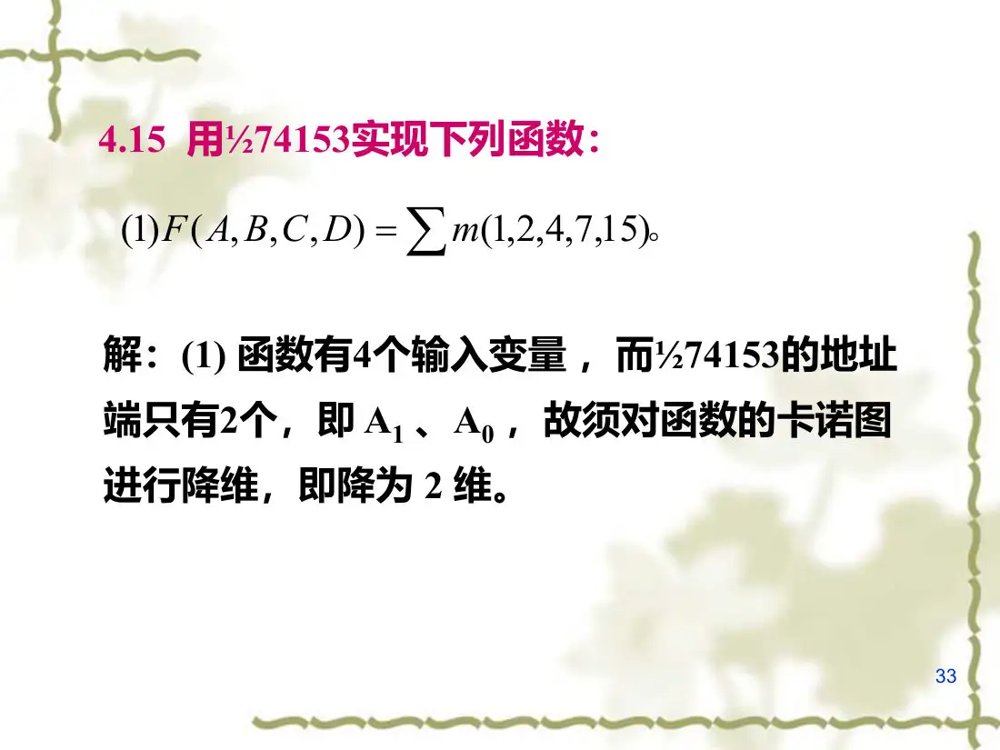

原文：

4.15 用 $1 / 274153$ 实现下列函数：

(1) $F(A,B,C,D)=\sum m(1,2,4,7,15)$ 。

解：(1) 函数有4个输入变量，而 $\frac{1}{2}$ 74153的地址端只有2个，即 $A_{1}$ 、 $A_{0}$ ，故须对函数的卡诺图进行降维，即降为2维。

33

### AB\CD000111100011011111110

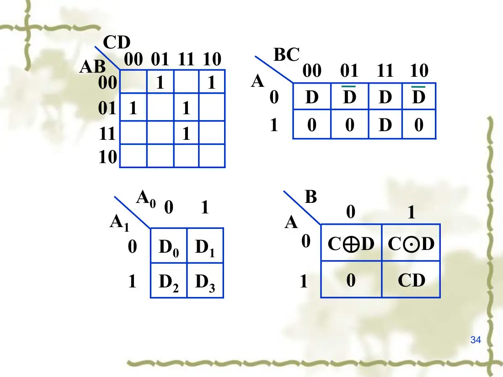

原文：

<table><tr><td>AB\CD</td><td>00</td><td>01</td><td>11</td><td>10</td></tr><tr><td>00</td><td></td><td>1</td><td></td><td>1</td></tr><tr><td>01</td><td>1</td><td></td><td>1</td><td></td></tr><tr><td>11</td><td></td><td></td><td>1</td><td></td></tr><tr><td>10</td><td></td><td></td><td></td><td></td></tr></table>

$$
\begin{array}{c c c} \hline A _ {0} & 0 & 1 \\ A _ {1} & \\ 0 & D _ {0} & D _ {1} \\ 1 & D _ {2} & D _ {3} \end{array}
$$

<table><tr><td rowspan="3">A\BC</td><td>00</td><td>01</td><td>11</td><td>10</td></tr><tr><td>0</td><td>D</td><td> $\overline{D}$ </td><td>D</td></tr><tr><td>1</td><td>0</td><td>0</td><td>D</td></tr></table>

$$
\begin{array}{c c c} \text { B } & 0 & 1 \\ \text { A } & 0 & \text { C } \oplus \text { D } \\ 0 & \text { C } \odot \text { D } \\ 1 & 0 & \text { CD } \end{array}
$$

34

### $$

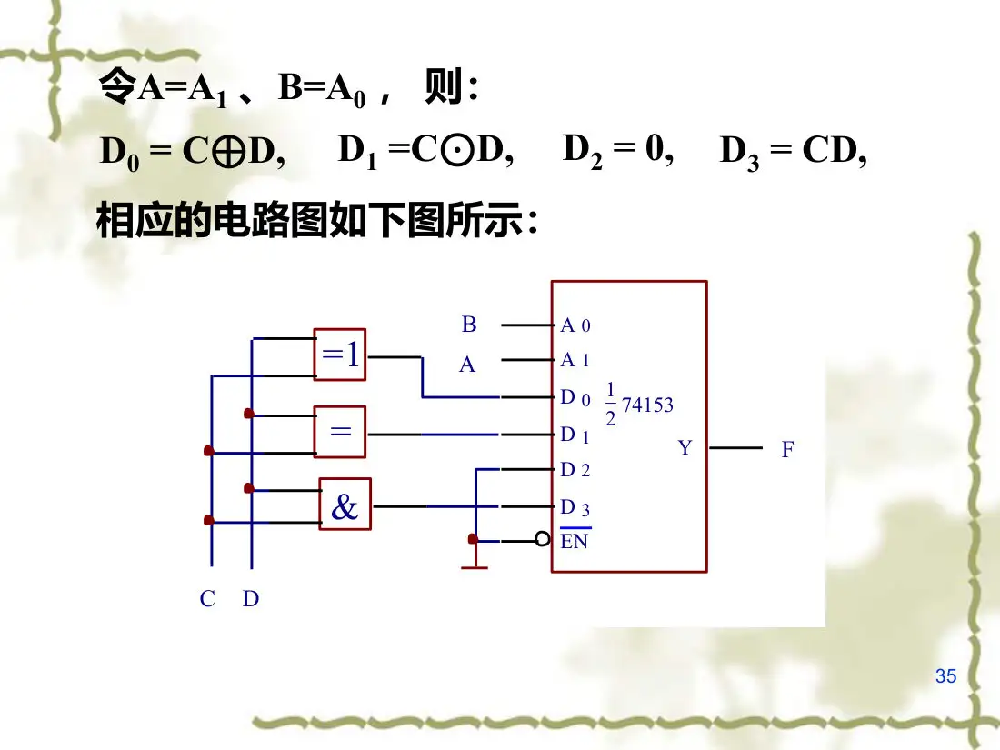

原文：

令 $\mathbf{A} = \mathbf{A}_1$ 、 $\mathbf{B} = \mathbf{A}_0$ ，则：

$$
\mathbf {D} _ {0} = \mathbf {C} \oplus \mathbf {D}, \quad \mathbf {D} _ {1} = \mathbf {C} \odot \mathbf {D}, \quad \mathbf {D} _ {2} = \mathbf {0}, \quad \mathbf {D} _ {3} = \mathbf {C D},
$$

相应的电路图如下图所示:

35

### 4.16 试在图4.2.31的基础上增加一片7485，构成25位数据比较器。

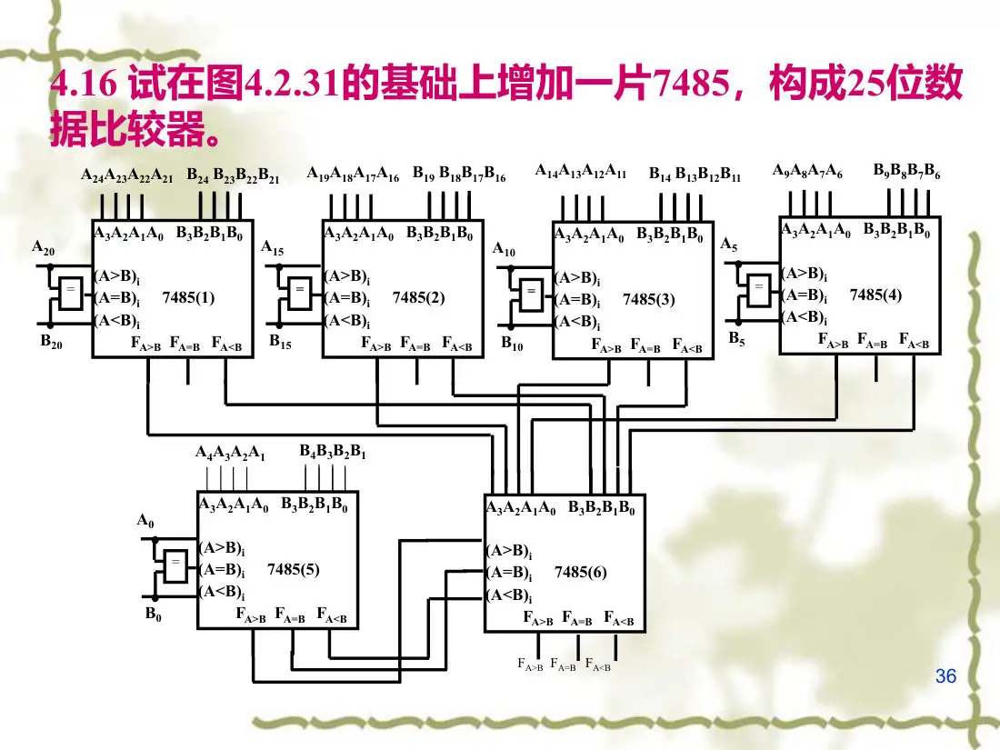

原文：

4.16 试在图4.2.31的基础上增加一片7485，构成25位数据比较器。

36

### 37

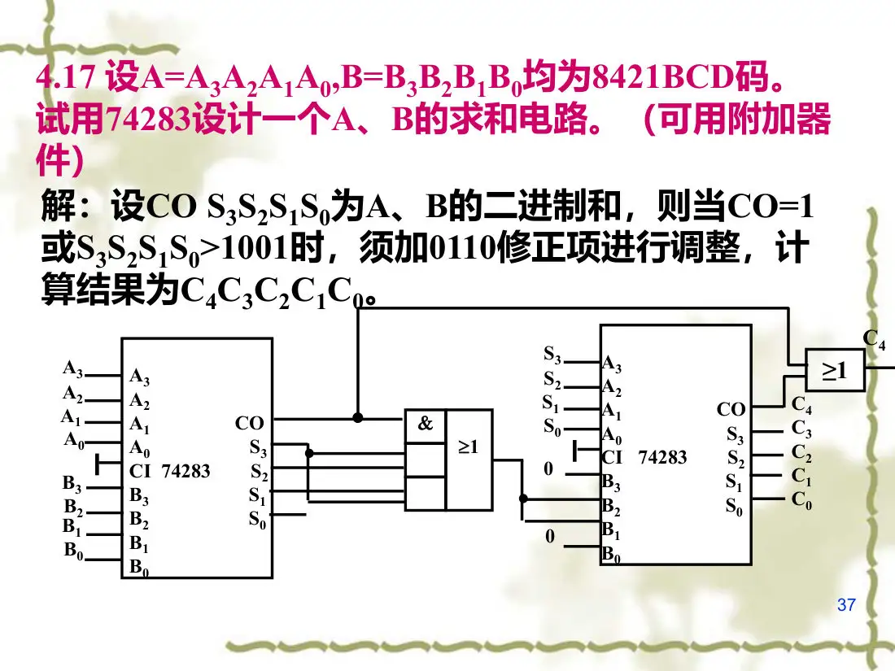

原文：

4.17 设 $A = A_{3}A_{2}A_{1}A_{0}, B = B_{3}B_{2}B_{1}B_{0}$ 均为8421BCD码。试用74283设计一个A、B的求和电路。（可用附加器件）

解: 设 $\mathrm{CO S}_{3} \mathrm{~S}_{2} \mathrm{~S}_{1} \mathrm{~S}_{0}$ 为 A、B 的二进制和, 则当 $\mathrm{CO} = 1$ 或 $\mathrm{S}_{3} \mathrm{~S}_{2} \mathrm{~S}_{1} \mathrm{~S}_{0} > 1001$ 时, 须加 0110 修正项进行调整, 计算结果为 $\mathrm{C}_{4} \mathrm{C}_{3} \mathrm{C}_{2} \mathrm{C}_{1} \mathrm{C}_{0}$ 。

37

### 4.18 用74283将8421BCD码转换为余3BCD码。

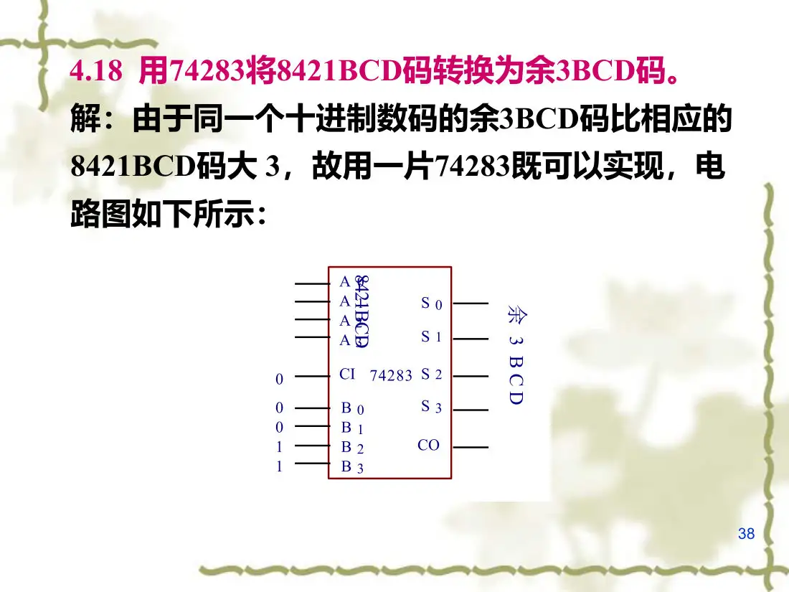

原文：

4.18 用74283将8421BCD码转换为余3BCD码。

解：由于同一个十进制数码的余3BCD码比相应的8421BCD码大3，故用一片74283既可以实现，电路图如下所示：

$$
\begin{array}{c c c} \text {A} & 8 \\ \text {A} & 4 2 1 \\ \text {A} & B C D \\ \text {A} & 3 \\ \text {0} & \text {CI} & 7 4 2 8 3 \end{array} \begin{array}{c c c} S _ {0} \\ S _ {1} \\ S _ {2} \\ S _ {3} \\ \text {B} _ {0} & \text {S} _ {3} \\ \text {B} _ {1} & \\ \text {B} _ {2} & \text {CO} \\ \text {B} _ {3} \end{array}
$$

38

### 74283

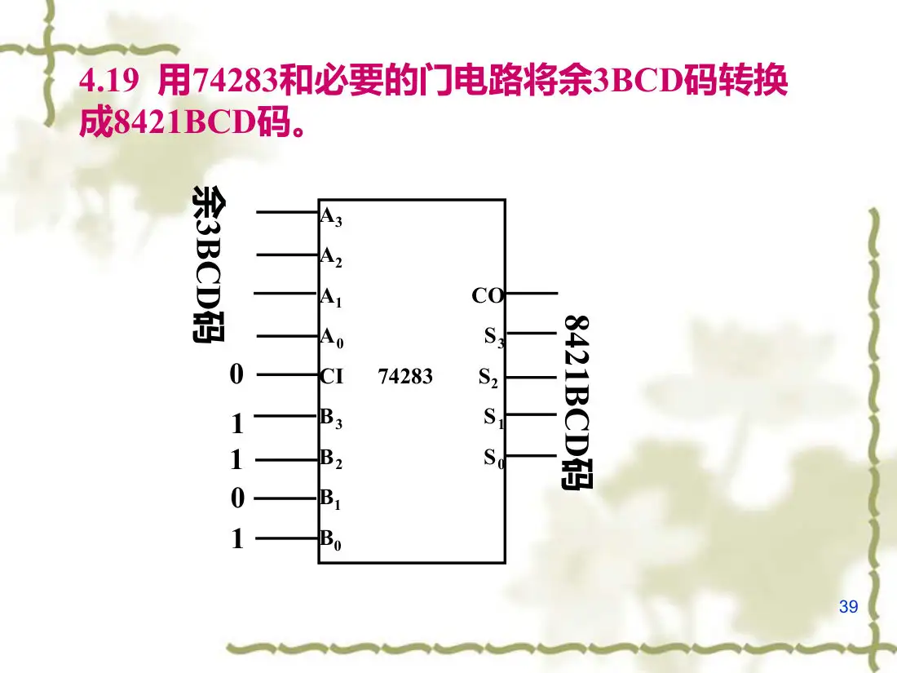

原文：

74283

4.19 用74283和必要的门电路将余3BCD码转换成8421BCD码。

39

### 4.20 用74283将8421BCD码转换为5421BCD码。

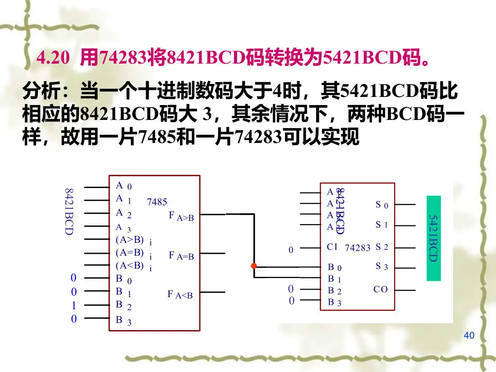

原文：

4.20 用74283将8421BCD码转换为5421BCD码。

分析：当一个十进制数码大于4时，其5421BCD码比相应的8421BCD码大3，其余情况下，两种BCD码一样，故用一片7485和一片74283可以实现

$$
\begin{array}{c c} \text {8421BCD} & \text {A 0} \\ & \text {A 1} \\ & \text {A 2} \\ & \text {A 3} \\ & (\text {A > B}) _ {\text {i}} \\ & (\text {A = B}) _ {\text {i}} \\ & (\text {A <   B}) _ {\text {i}} \\ & \text {B 0} \\ & \text {B 1} \\ & \text {B 2} \\ & \text {B 3} \end{array} \quad \begin{array}{c c} \text {7485} \\ & \text {F A > B} \\ & \text {F A = B} \\ & \text {F A <   B} \end{array} \quad \begin{array}{c c} \text {8421BCD} & \text {S 0} \\ & \text {S 1} \\ & \text {CI 74283 S 2} \\ & \text {B 0 S 3} \\ & \text {B 1 CO} \\ & \text {B 2 B 3} \end{array}
$$

40

### $$

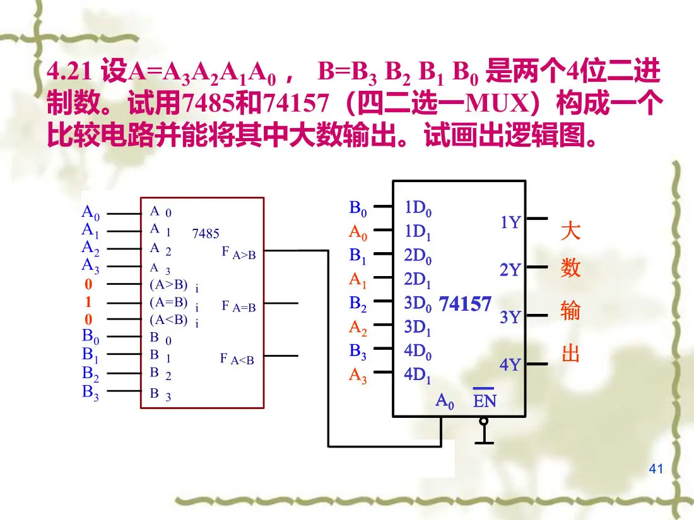

原文：

4.21 设 $A = A_{3}A_{2}A_{1}A_{0}$ , $B = B_{3}B_{2}B_{1}B_{0}$ 是两个4位二进制数。试用7485和74157（四二选一MUX）构成一个比较电路并能将其中大数输出。试画出逻辑图。

$$
\begin{array}{c c c c} \hline A _ {0} & A _ {0} & & \\ A _ {1} & A _ {1} & 7 4 8 5 & \\ A _ {2} & A _ {2} & & F _ {A > B} \\ A _ {3} & A _ {3} & & \\ 0 & (A > B) _ {i} & & \\ 1 & (A = B) _ {i} & F _ {A = B} \\ 0 & (A <   B) _ {i} & & \\ B _ {0} & B _ {0} & & \\ B _ {1} & B _ {1} & & F _ {A <   B} \\ B _ {2} & B _ {2} & & \\ B _ {3} & B _ {3} & & \end{array}
$$

$$
\begin{array}{c c c} \text {B} _ {0} & 1 \mathrm{D} _ {0} & 1 \mathrm{Y} \\ \text {A} _ {0} & 1 \mathrm{D} _ {1} & \\ \text {B} _ {1} & 2 \mathrm{D} _ {0} & 2 \mathrm{Y} \\ \text {A} _ {1} & 2 \mathrm{D} _ {1} & \\ \text {B} _ {2} & 3 \mathrm{D} _ {0} 7 4 1 5 7 & 3 \mathrm{Y} \\ \text {A} _ {2} & 3 \mathrm{D} _ {1} & \\ \text {B} _ {3} & 4 \mathrm{D} _ {0} & 4 \mathrm{Y} \\ \text {A} _ {3} & 4 \mathrm{D} _ {1} & \\ & \text {A} _ {0} & \overline {{\text {EN}}} \end{array}
$$

41

### 42

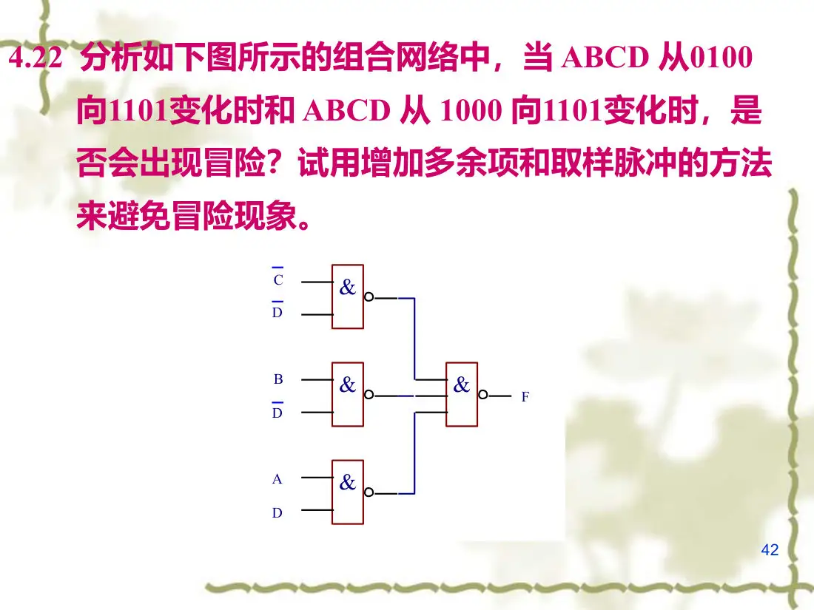

原文：

4.22 分析如下图所示的组合网络中，当 ABCD 从0100向1101变化时和 ABCD 从 1000 向1101变化时，是否会出现冒险？试用增加多余项和取样脉冲的方法来避免冒险现象。

42

### 解：1. 当 ABCD 从0100向1101变化时：

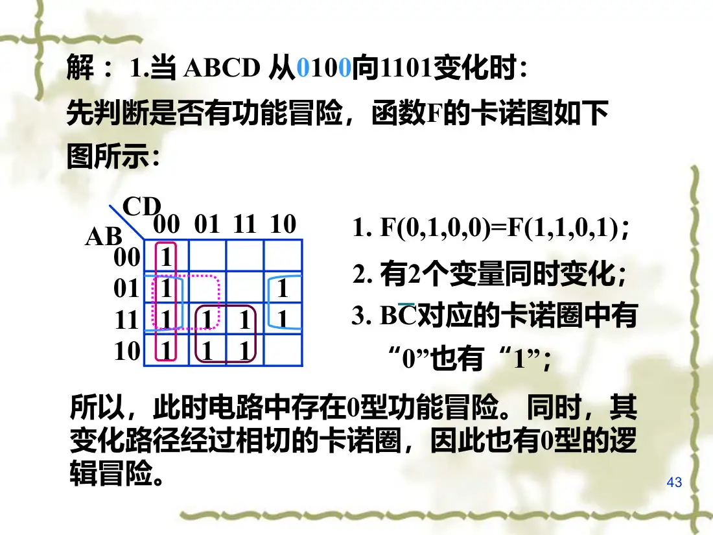

原文：

解：1. 当 ABCD 从0100向1101变化时：
先判断是否有功能冒险，函数F的卡诺图如下
图所示：

1. $F(0,1,0,0)=F(1,1,0,1)$ ;

2. 有2个变量同时变化;

3. BC对应的卡诺圈中有“0”也有“1”;

所以，此时电路中存在0型功能冒险。同时，其变化路径经过相切的卡诺圈，因此也有0型的逻辑冒险。

43

### 1. $F(1,0,0,0)=F(1,1,0,1)$ ;

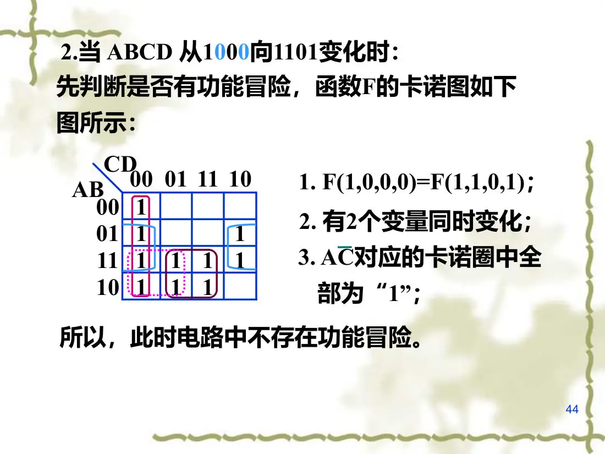

原文：

2. 当 ABCD 从1000向1101变化时: 先判断是否有功能冒险, 函数F的卡诺图如下图所示:

1. $F(1,0,0,0)=F(1,1,0,1)$ ;

2. 有2个变量同时变化;

3. AC对应的卡诺圈中全部为“1”;

所以，此时电路中不存在功能冒险。

44

### 再判断是否有逻辑冒险：

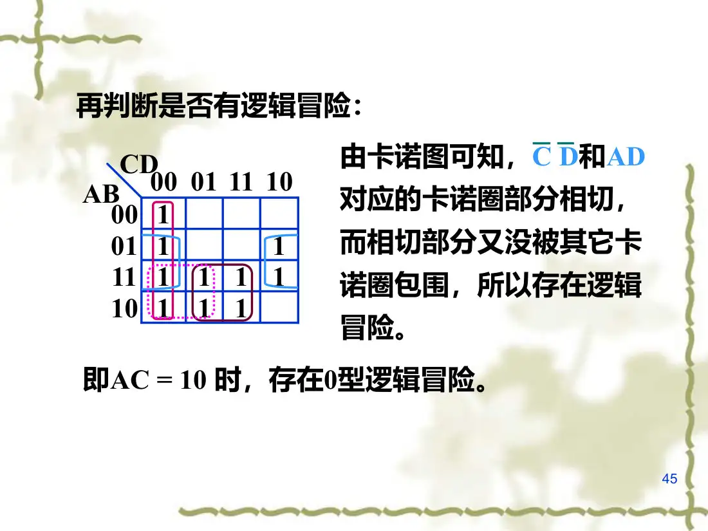

原文：

再判断是否有逻辑冒险：

由卡诺图可知， $\overline{\mathrm{C}} \overline{\mathrm{D}}$ 和AD对应的卡诺圈部分相切，而相切部分又没被其它卡诺圈包围，所以存在逻辑冒险。

即AC = 10 时，存在0型逻辑冒险。

45

### 增加多余项的方法消除逻辑冒险：

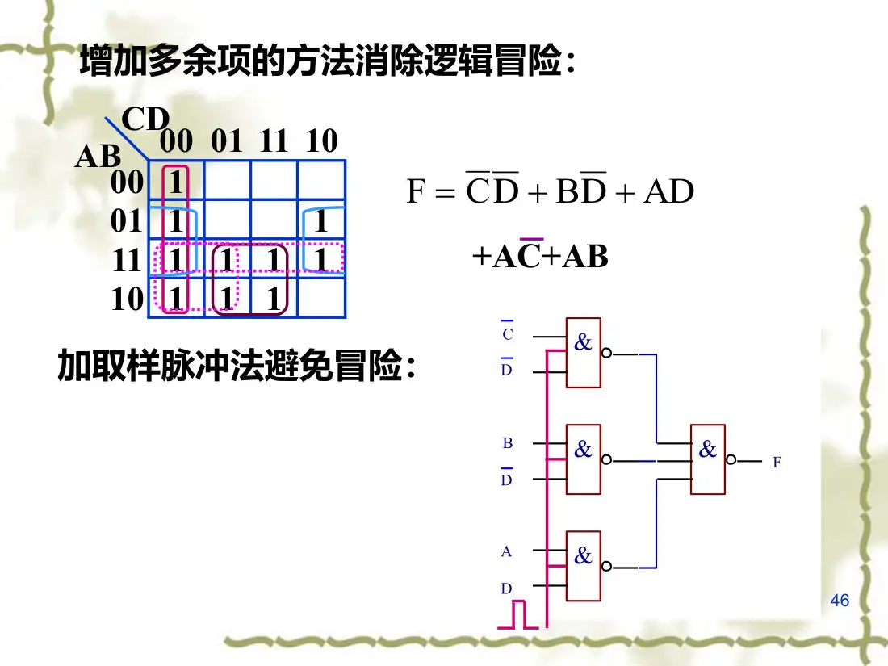

原文：

增加多余项的方法消除逻辑冒险：

加取样脉冲法避免冒险：

$$
\begin{array}{r} \mathrm{F} = \overline {{\mathrm{C}}} \overline {{\mathrm{D}}} + \mathrm{B} \overline {{\mathrm{D}}} + \mathrm{AD} \\ + \mathbf {A} \overline {{\mathbf {C}}} + \mathbf {A} \mathbf {B} \end{array}
$$

46

### 例1 某与非电路的逻辑函数表达式为

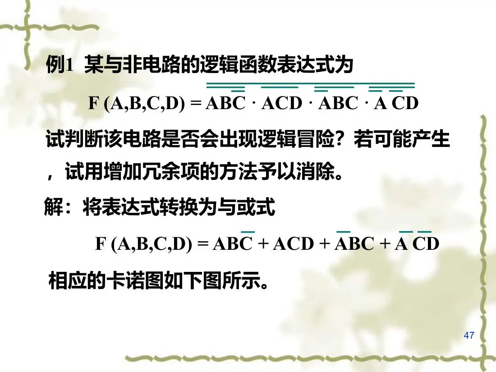

原文：

例1 某与非电路的逻辑函数表达式为

$$
\mathbf {F} (\mathbf {A}, \mathbf {B}, \mathbf {C}, \mathbf {D}) = \overline {{\mathbf {A B C}}} \cdot \overline {{\mathbf {A C D}}} \cdot \overline {{\mathbf {A B C}}} \cdot \overline {{\mathbf {A C D}}}
$$

试判断该电路是否会出现逻辑冒险？若可能产生，试用增加冗余项的方法予以消除。

解：将表达式转换为与或式

$\mathrm{F(A,B,C,D) = ABC + ACD + ABC + ACD}$ 相应的卡诺图如下图所示。

47

### $$

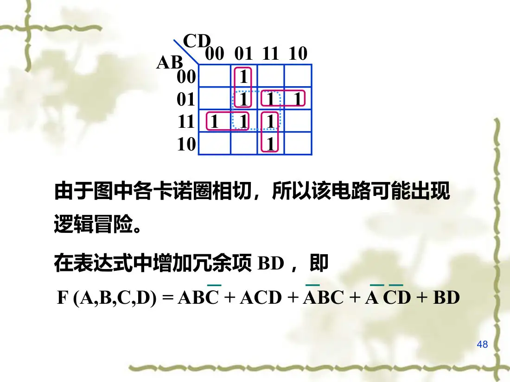

原文：

$$
\begin{array}{c c c c c} \text {CD} & 0 0 & 0 1 & 1 1 & 1 0 \\ \text {AB} & 0 0 & 1 & & \\ 0 1 & & 1 & 1 & 1 \\ 1 1 & 1 & 1 & 1 & \\ 1 0 & & & 1 \end{array}
$$

由于图中各卡诺圈相切，所以该电路可能出现逻辑冒险。

在表达式中增加冗余项 BD，即

$$
\mathbf {F} (\mathbf {A}, \mathbf {B}, \mathbf {C}, \mathbf {D}) = \mathbf {A B C} + \mathbf {A C D} + \overline {{\mathbf {A B C}}} + \overline {{\mathbf {A C D}}} + \mathbf {B D}
$$

48

### 增加冗余项后，相应逻辑电路中应增加一个与非门，其与非表达式为：

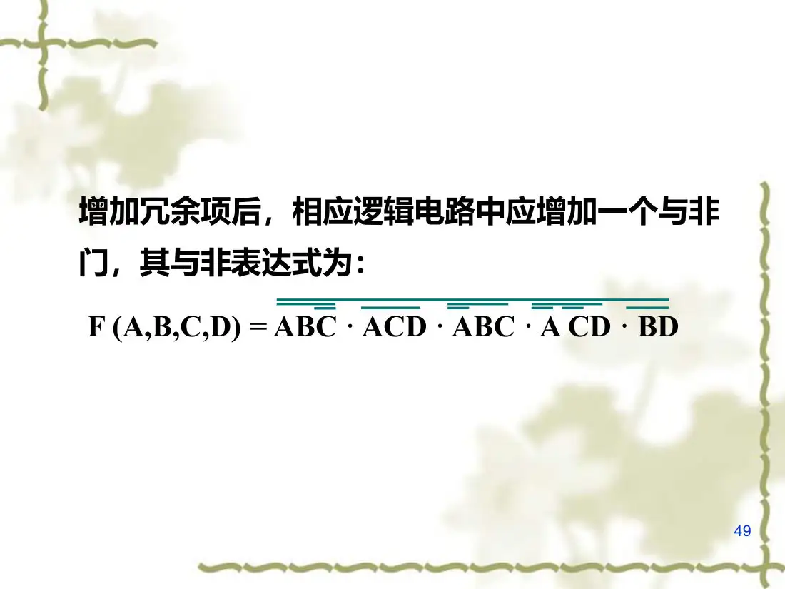

原文：

增加冗余项后，相应逻辑电路中应增加一个与非门，其与非表达式为：

$$
\mathbf {F} (\mathbf {A}, \mathbf {B}, \mathbf {C}, \mathbf {D}) = \overline {{\mathbf {A B C}}} \cdot \overline {{\mathbf {A C D}}} \cdot \overline {{\mathbf {A B C}}} \cdot \overline {{\mathbf {A C D}}} \cdot \overline {{\mathbf {B D}}}
$$

49
