# 《数字电路与逻辑设计B》第3章 组合逻辑电路设计（课件）

原件的每一页，下面附识别出的文字。

### 3.26基于MSI的组合电路设计

原文：

3.26基于MSI的组合电路设计

例3.2.5 试用一片7485 和若干门电路实现两个5位二进制数A4A3A2A1A0 和B4B3B2B1B0的比较。

### 解：关键在最低位的比较

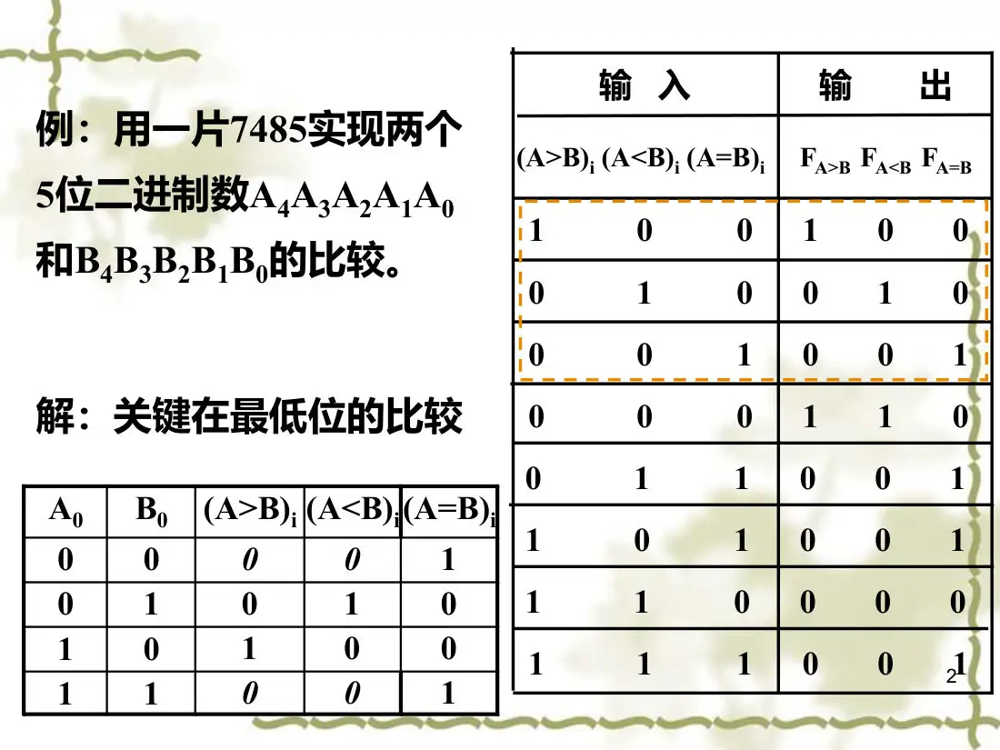

原文：

例：用一片7485实现两个5位二进制数 $A_{4}A_{3}A_{2}A_{1}A_{0}$ 和 $B_{4}B_{3}B_{2}B_{1}B_{0}$ 的比较。

解：关键在最低位的比较
<table><tr><td> $A_0$ </td><td> $B_0$ </td><td> $(A>B)_i$ </td><td> $(A(A=B)_i$ </td><td> $(A=B)_i$ </td></tr><tr><td>0</td><td>0</td><td>0</td><td>0</td><td>1</td></tr><tr><td>0</td><td>1</td><td>0</td><td>1</td><td>0</td></tr><tr><td>1</td><td>0</td><td>1</td><td>0</td><td>0</td></tr><tr><td>1</td><td>1</td><td>0</td><td>0</td><td>1</td></tr></table>

<table><tr><td colspan="3">输入</td><td colspan="3">输出</td></tr><tr><td colspan="3"> $(A>B)_i$   $(A\( F_{A>B}$   $F_{A\( F_{A=B}$   $F_{A=B}$ </td><td colspan="3"> $F_{A>B}$   $F_{A\( F_{A=B}$   $F_{A=B}$ </td></tr><tr><td>1</td><td>0</td><td>0</td><td>1</td><td>0</td><td>0</td></tr><tr><td>0</td><td>1</td><td>0</td><td>0</td><td>1</td><td>0</td></tr><tr><td>0</td><td>0</td><td>1</td><td>0</td><td>0</td><td>1</td></tr><tr><td>0</td><td>0</td><td>0</td><td>1</td><td>1</td><td>0</td></tr><tr><td>0</td><td>1</td><td>1</td><td>0</td><td>0</td><td>1</td></tr><tr><td>1</td><td>0</td><td>1</td><td>0</td><td>0</td><td>1</td></tr><tr><td>1</td><td>1</td><td>0</td><td>0</td><td>0</td><td>0</td></tr><tr><td>1</td><td>1</td><td>1</td><td>0</td><td>0</td><td> $_21$ </td></tr></table>

### $$

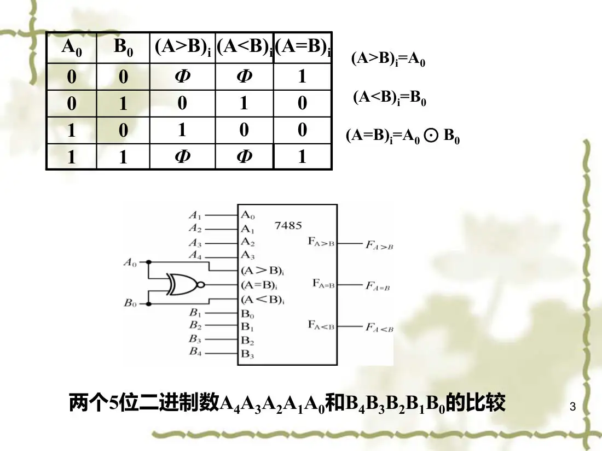

原文：

<table><tr><td> $A_0$ </td><td> $B_0$ </td><td> $(A>B)_i$ </td><td> $(A1(A=B)_i$ </td><td> $(A=B)_i$ </td></tr><tr><td>0</td><td>0</td><td> $\Phi$ </td><td> $\Phi$ </td><td>1</td></tr><tr><td>0</td><td>1</td><td>0</td><td>1</td><td>0</td></tr><tr><td>1</td><td>0</td><td>1</td><td>0</td><td>0</td></tr><tr><td>1</td><td>1</td><td> $\Phi$ </td><td> $\Phi$ </td><td>1</td></tr></table>

$$
(\mathbf {A} > \mathbf {B}) _ {\mathrm{i}} = \mathbf {A} _ {\mathbf {0}}
$$

$$
(\mathbf {A} <   \mathbf {B}) _ {\mathrm{i}} = \mathbf {B} _ {0}
$$

$$
(\mathbf {A} = \mathbf {B}) _ {\mathrm{i}} = \mathbf {A} _ {0} \odot \mathbf {B} _ {0}
$$

$$
\begin{array}{c} \text {A_1} \\ \text {A_2} \\ \text {A_3} \\ \text {A_4} \\ \text {A_0} \\ \text {B_0} \\ \text {B_1} \\ \text {B_2} \\ \text {B_3} \\ \text {B_4} \end{array} \begin{array}{c} \text {A_0} \\ \text {A_1} \\ \text {A_2} \\ \text {A_3} \\ (\text {A > B}) _ {\text {i}} \\ (\text {A = B}) _ {\text {i}} \\ (\text {A <   B}) _ {\text {i}} \\ \text {B_0} \\ \text {B_1} \\ \text {B_2} \\ \text {B_3} \\ \text {B_3} \end{array} \begin{array}{c} 7 4 8 5 \\ \text {F_{A>B}} \\ \text {F_{A=B}} \\ \text {F_{A=B}} \\ \text {F_{A< B}} \\ \text {F_{A< B}} \end{array}
$$

两个5位二进制数 $\mathrm{A}_4\mathrm{A}_3\mathrm{A}_2\mathrm{A}_1\mathrm{A}_0$ 和 $\mathrm{B}_4\mathrm{B}_3\mathrm{B}_2\mathrm{B}_1\mathrm{B}_0$ 的比较例3.2.6 设计一个CPU的算术逻辑单元电路（ALU），实现两个16位二进制数的基本算术和逻辑运算，运算控制端为F1和F0，当F1F0等于00、01、10和11时，分别实现逻辑与、逻辑或、算术加法和算术减法运算。

3

### 第 4 页

### 第 5 页

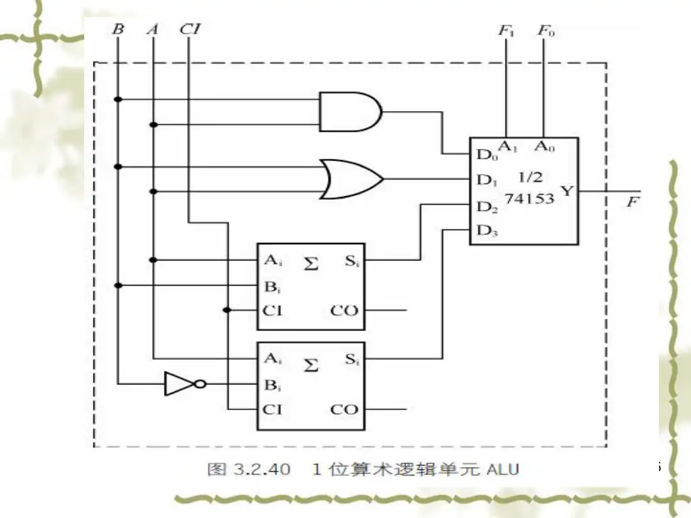

### 第 6 页

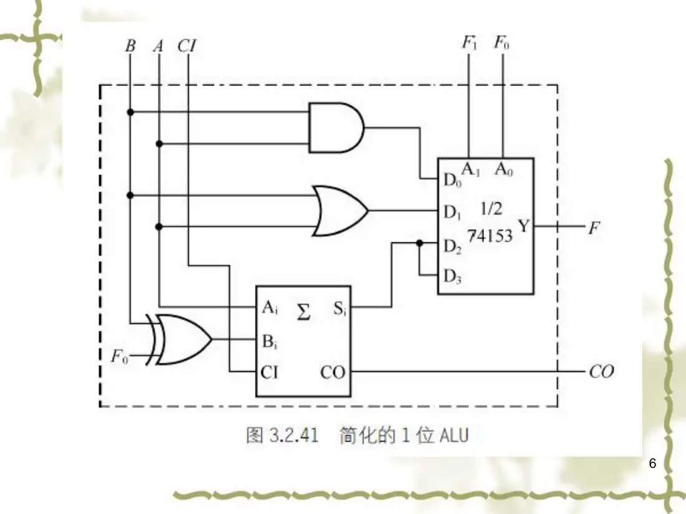

### 第 7 页

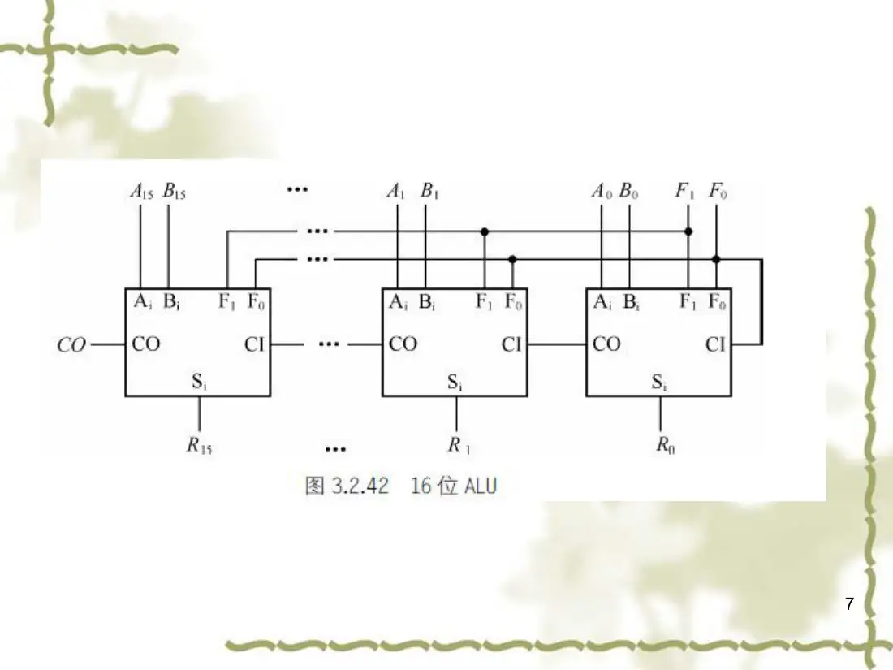

原文：

7

### 解：分析：当小数部分大于4时，整数部分应加1，即

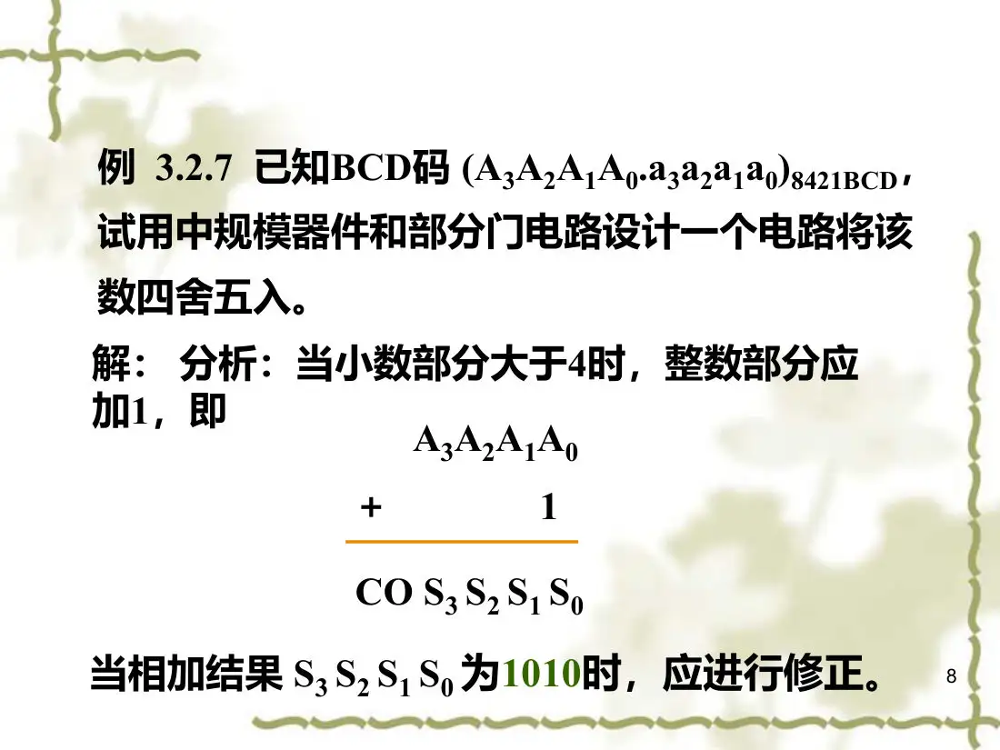

原文：

例 3.2.7 已知BCD码 $(A_{3}A_{2}A_{1}A_{0}.a_{3}a_{2}a_{1}a_{0})_{8421BCD}$ ，试用中规模器件和部分门电路设计一个电路将该数四舍五入。

解：分析：当小数部分大于4时，整数部分应加1，即

$$
\begin{array}{c} \mathrm {A_ {3} A_ {2} A_ {1} A_ {0}} \\ + \quad 1 \\ \hline \mathrm {CO S_ {3} S_ {2} S_ {1} S_ {0}} \end{array}
$$

当相加结果 $S_{3}S_{2}S_{1}S_{0}$ 为1010时，应进行修正。

### 第 9 页

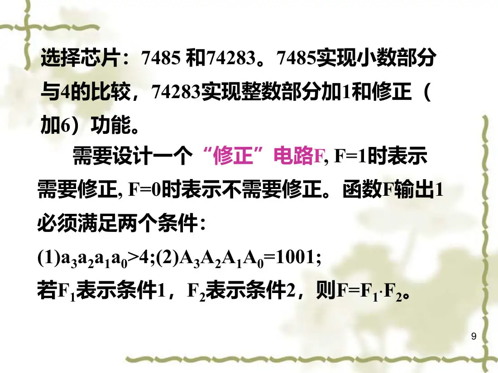

原文：

选择芯片：7485 和 74283。7485 实现小数部分与 4 的比较，74283 实现整数部分加 1 和修正（加 6）功能。

需要设计一个“修正”电路F, F=1时表示需要修正, F=0时表示不需要修正。函数F输出1必须满足两个条件:

(1) $a_{3}a_{2}a_{1}a_{0}>4$ ;(2) $A_{3}A_{2}A_{1}A_{0}=1001$ ;
若 $F_{1}$ 表示条件1， $F_{2}$ 表示条件2，则 $F=F_{1}\cdot F_{2}$ 。

9

### 函数F2真值表

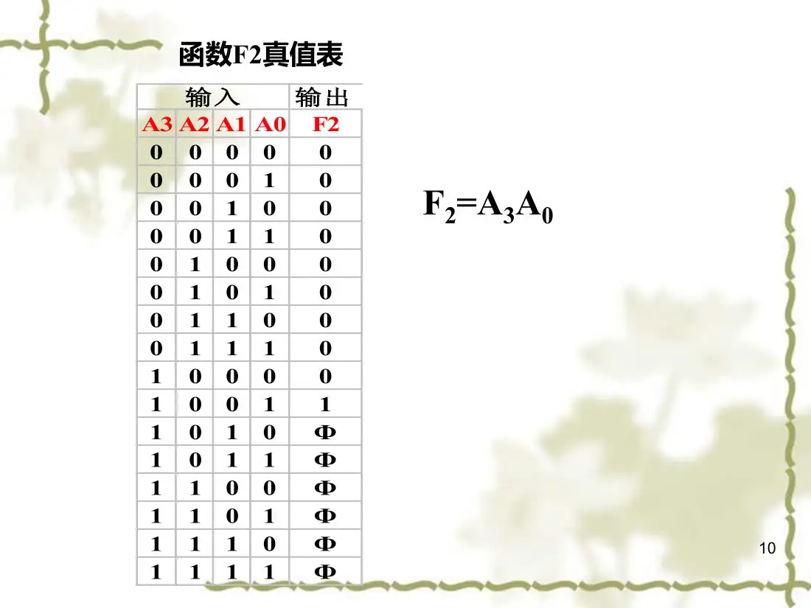

原文：

函数F2真值表

<table><tr><td colspan="4">输入</td><td>输出</td></tr><tr><td>A3</td><td>A2</td><td>A1</td><td>A0</td><td>F2</td></tr><tr><td>0</td><td>0</td><td>0</td><td>0</td><td>0</td></tr><tr><td>0</td><td>0</td><td>0</td><td>1</td><td>0</td></tr><tr><td>0</td><td>0</td><td>1</td><td>0</td><td>0</td></tr><tr><td>0</td><td>0</td><td>1</td><td>1</td><td>0</td></tr><tr><td>0</td><td>1</td><td>0</td><td>0</td><td>0</td></tr><tr><td>0</td><td>1</td><td>0</td><td>1</td><td>0</td></tr><tr><td>0</td><td>1</td><td>1</td><td>0</td><td>0</td></tr><tr><td>0</td><td>1</td><td>1</td><td>1</td><td>0</td></tr><tr><td>1</td><td>0</td><td>0</td><td>0</td><td>0</td></tr><tr><td>1</td><td>0</td><td>0</td><td>1</td><td>1</td></tr><tr><td>1</td><td>0</td><td>1</td><td>0</td><td> $\Phi$ </td></tr><tr><td>1</td><td>0</td><td>1</td><td>1</td><td> $\Phi$ </td></tr><tr><td>1</td><td>1</td><td>0</td><td>0</td><td> $\Phi$ </td></tr><tr><td>1</td><td>1</td><td>0</td><td>1</td><td> $\Phi$ </td></tr><tr><td>1</td><td>1</td><td>1</td><td>0</td><td> $\Phi$ </td></tr><tr><td>1</td><td>1</td><td>1</td><td>1</td><td> $\Phi$ </td></tr></table>

$$
\mathbf {F} _ {2} = \mathbf {A} _ {3} \mathbf {A} _ {0}
$$

10

### $$

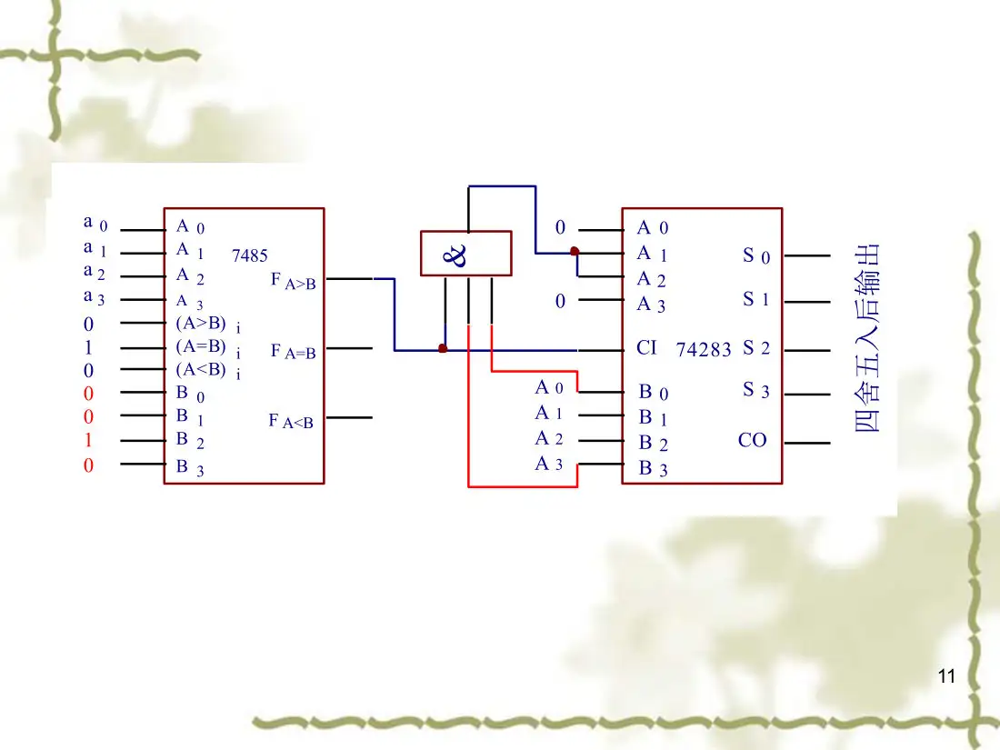

原文：

$$
\begin{array}{c c c} \text {四舍五入后输出} \\ \text {a0} & A 0 & \\ a 1 & A 1 & 7 4 8 5 \\ a 2 & A 2 & F _ {A > B} \\ a 3 & A 3 & \\ 0 & (A > B) i & \\ 1 & (A = B) i & F _ {A = B} \\ 0 & (A <   B) i & \\ 0 & B 0 & \\ 0 & B 1 & \\ 1 & B 2 & \\ 0 & B 3 & \end{array}
$$

11

### 3.3 竞争和冒险

原文：

3.3 竞争和冒险

3.3.1 竞争和冒险的概念

1. 竞争

(1) 由于连线和集成门有一定的延迟时间，致使同一输入信号经过不同路径到达输出端有先有后（1个或1个以上输入信号变化）；

(2) 多个输入信号同时变化，由于变化的快慢不同，致使多个输入信号到达输出端有先有后（2个或2个以上输入信号变化）。

12

### 冒险：由于竞争的存在，使数字电路输出出现非预期信号的现象。

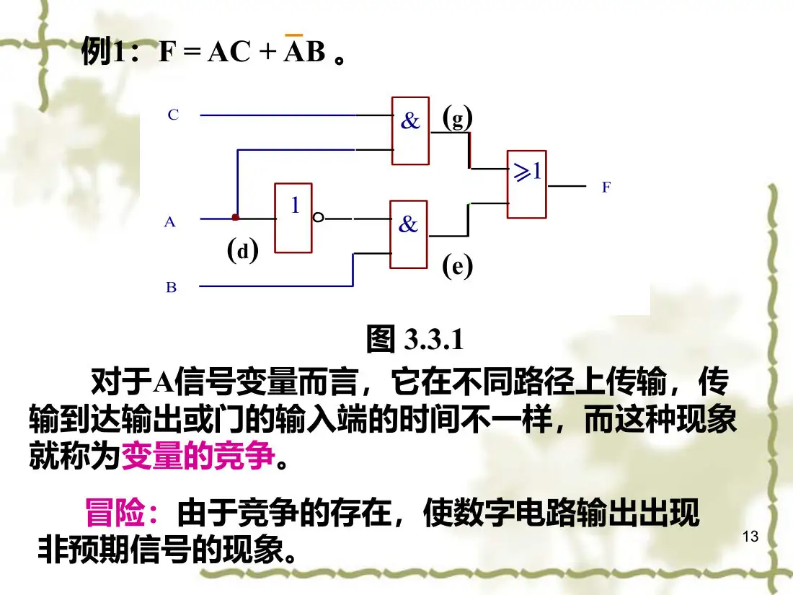

原文：

例1: $\mathbf{F} = \mathbf{A}\mathbf{C} + \overline{\mathbf{A}}\mathbf{B}$ 。

对于A信号变量而言，它在不同路径上传输，传输到达输出或门的输入端的时间不一样，而这种现象就称为变量的竞争。

冒险：由于竞争的存在，使数字电路输出出现非预期信号的现象。

13

### 可看出冒险发生在输入信号动态变化的瞬间。

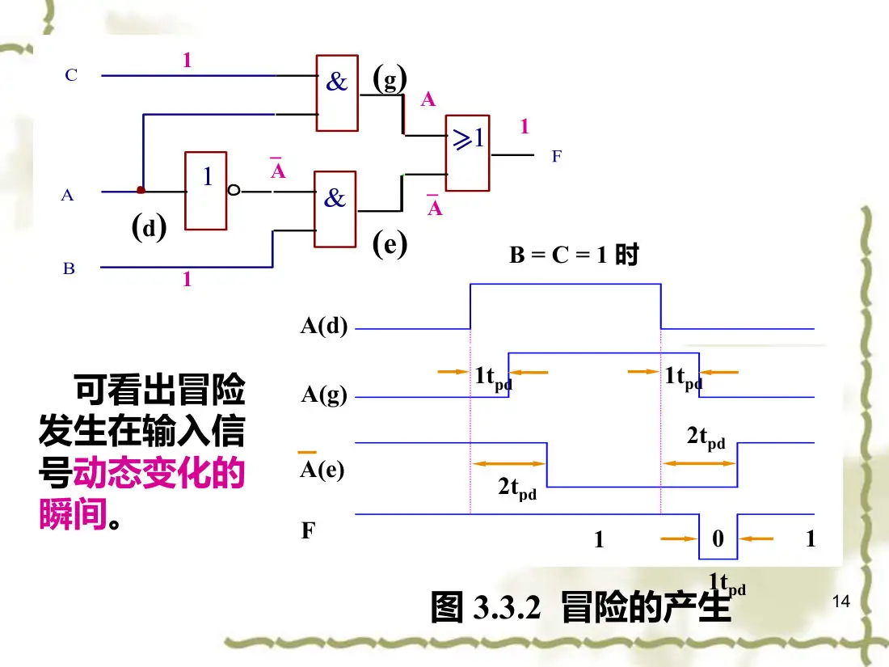

原文：

可看出冒险发生在输入信号动态变化的瞬间。

图 3.3.2 冒险的产生 $^{1t_{pd}}$

14

### 冒险的分类

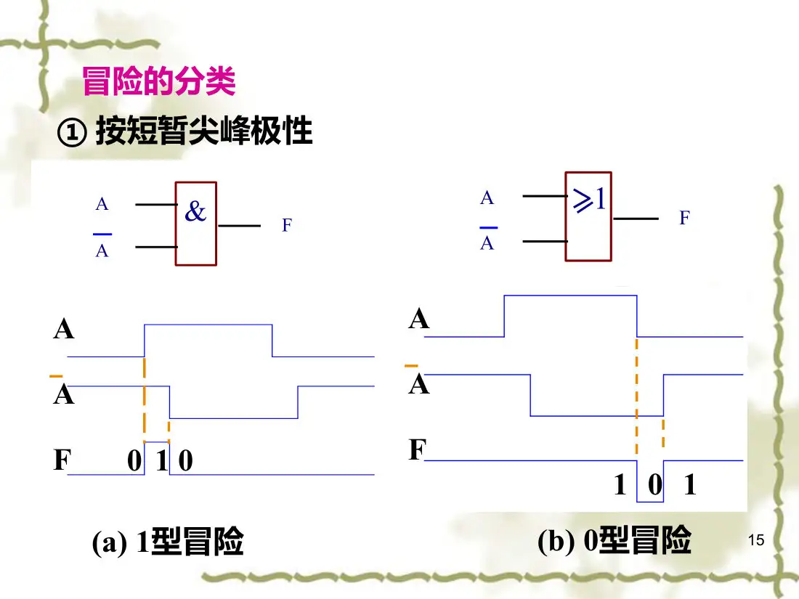

原文：

冒险的分类

① 按短暂尖峰极性

$$
\begin{array}{c c} \text {A} & \text {A} \\ \text {A} & \text {F} \end{array}
$$

15

### 按产生的原因分为逻辑冒险和功能冒险。

原文：

按产生的原因分为逻辑冒险和功能冒险。

逻辑冒险：由于输入信号经过的路径不同而引起的冒险；

功能冒险：由于若干个信号同时变化，变化的快慢不同而引起的冒险。

16

### 3.3.2 逻辑冒险

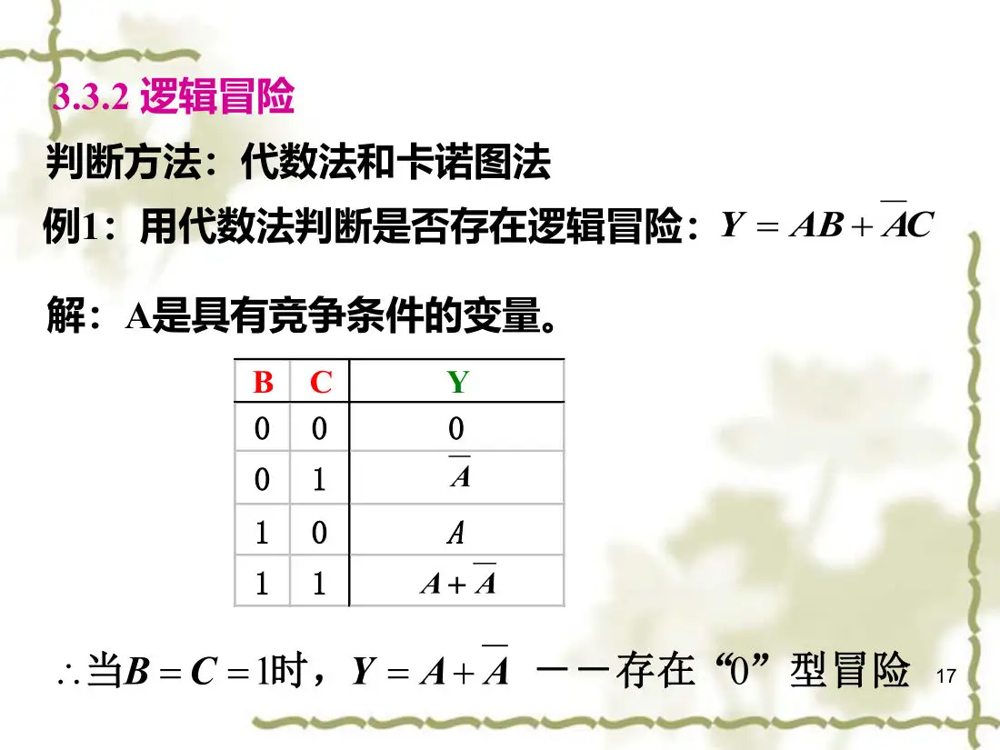

原文：

3.3.2 逻辑冒险

判断方法：代数法和卡诺图法

例1：用代数法判断是否存在逻辑冒险： $Y = AB + \overline{AC}$

解：A是具有竞争条件的变量。

<table><tr><td>B</td><td>C</td><td>Y</td></tr><tr><td>0</td><td>0</td><td>0</td></tr><tr><td>0</td><td>1</td><td> $\overline{A}$ </td></tr><tr><td>1</td><td>0</td><td>A</td></tr><tr><td>1</td><td>1</td><td> $A + \overline{A}$ </td></tr></table>

∴当B=C=1时， $Y=A+\overline{A}$ ——存在“0”型冒险

17

### 例2：用代数法判断电路是否存在逻辑冒险现象。

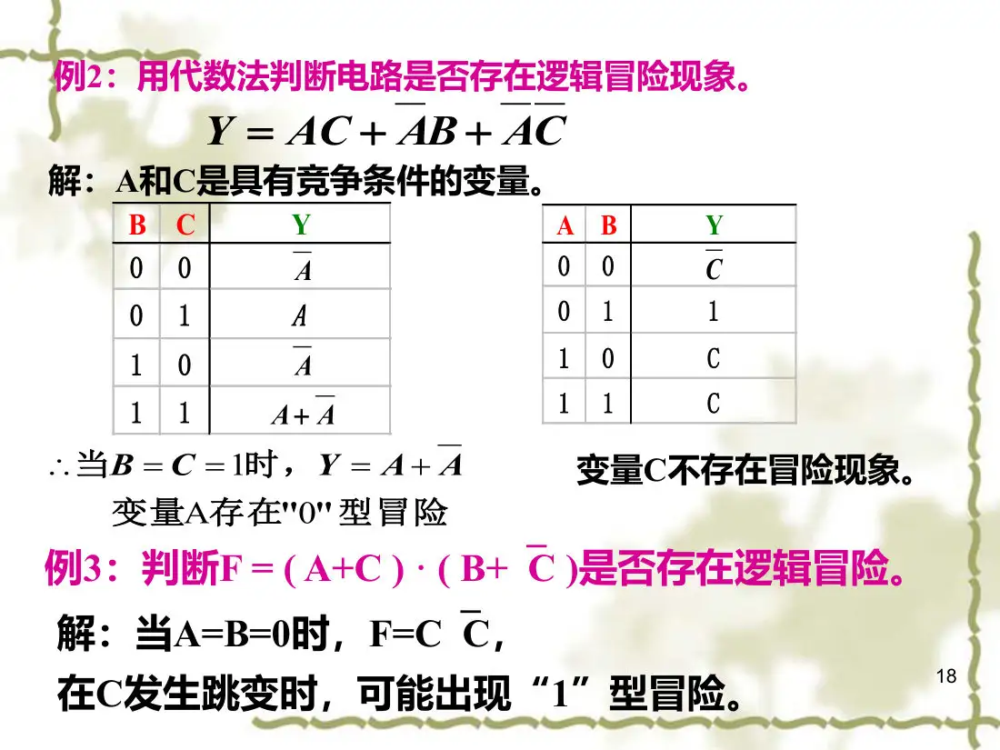

原文：

例2：用代数法判断电路是否存在逻辑冒险现象。

$$
Y = A C + A B + A C
$$

解：A和C是具有竞争条件的变量。

<table><tr><td>B</td><td>C</td><td>Y</td></tr><tr><td>0</td><td>0</td><td> $\overline{A}$ </td></tr><tr><td>0</td><td>1</td><td>A</td></tr><tr><td>1</td><td>0</td><td> $\overline{A}$ </td></tr><tr><td>1</td><td>1</td><td> $A + \overline{A}$ </td></tr></table>

<table><tr><td>A</td><td>B</td><td>Y</td></tr><tr><td>0</td><td>0</td><td> $\overline{C}$ </td></tr><tr><td>0</td><td>1</td><td>1</td></tr><tr><td>1</td><td>0</td><td>C</td></tr><tr><td>1</td><td>1</td><td>C</td></tr></table>

∴当B=C=1时， $Y=A+\overline{A}$ 变量A存在"0"型冒险变量C不存在冒险现象。

例3：判断 $F=(A+C)\cdot(B+\overline{C})$ 是否存在逻辑冒险。

解：当A=B=0时，F=C $\overline{C}$ ，

在C发生跳变时，可能出现“1”型冒险。

18

### 判断方法:

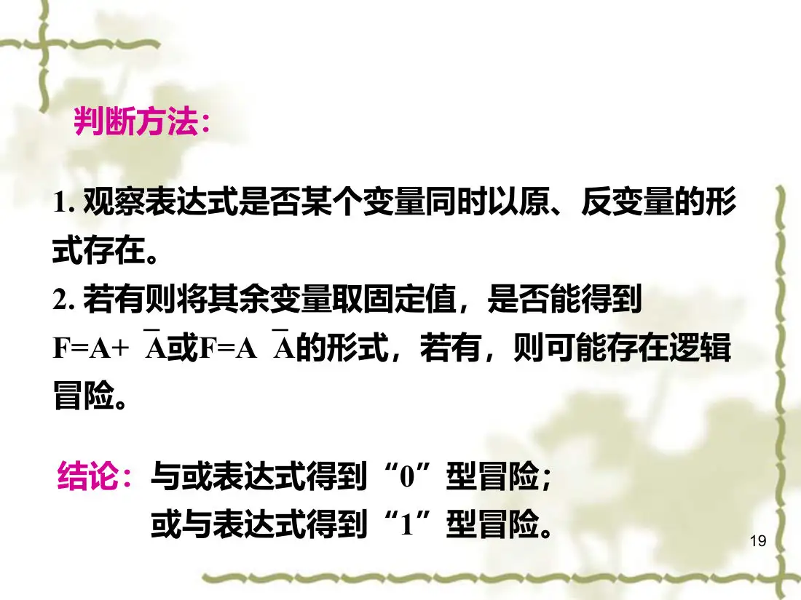

原文：

判断方法:

1. 观察表达式是否某个变量同时以原、反变量的形式存在。

2. 若有则将其余变量取固定值，是否能得到 $\mathrm{F} = \mathrm{A} + \overline{\mathrm{A}}$ 或 $\mathrm{F} = \mathrm{A} \overline{\mathrm{A}}$ 的形式，若有，则可能存在逻辑冒险。

结论：与或表达式得到“0”型冒险；或与表达式得到“1”型冒险。

19

### 2）卡诺图法

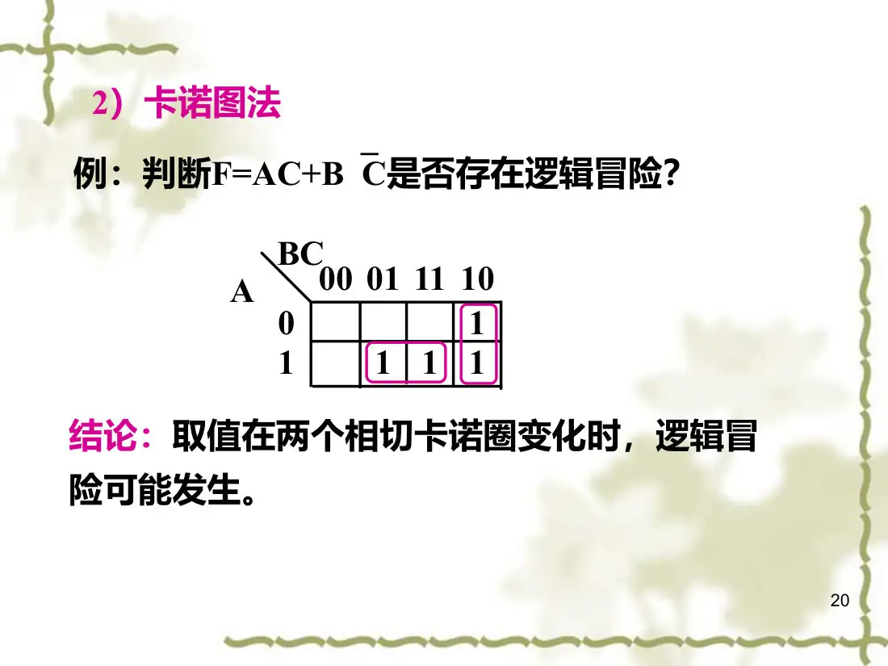

原文：

2）卡诺图法

例：判断F=AC+B $\overline{C}$ 是否存在逻辑冒险？

$$
\begin{array}{c c c c c} \text {BC} & 0 0 & 0 1 & 1 1 & 1 0 \\ \text {A} & 0 & & & 1 \\ & 1 & & 1 & 1 \\ & & & 1 & 1 \end{array}
$$

结论：取值在两个相切卡诺圈变化时，逻辑冒险可能发生。

20

### 21

原文：

判断方法：只要有两个存在部分相切，且相切部分没有被另外的卡诺圈包围，则可能存在冒险。冒险发生在其中一个卡诺圈中的最小项对应的取值变为另一卡诺圈中任一最小项对应取值的时刻。

21

### 在 AC = 00 时，或

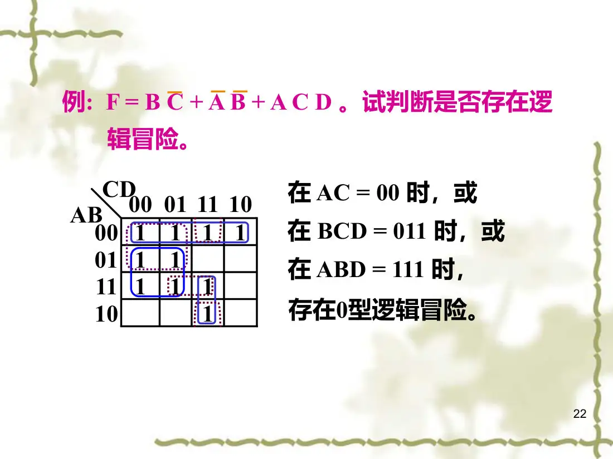

原文：

例: $F = B \overline{C} + \overline{A} \overline{B} + A C D$ 。试判断是否存在逻辑冒险。

在 AC = 00 时，或
在 BCD = 011 时，或
在 ABD = 111 时，
存在0型逻辑冒险。

22

### 2 功能冒险

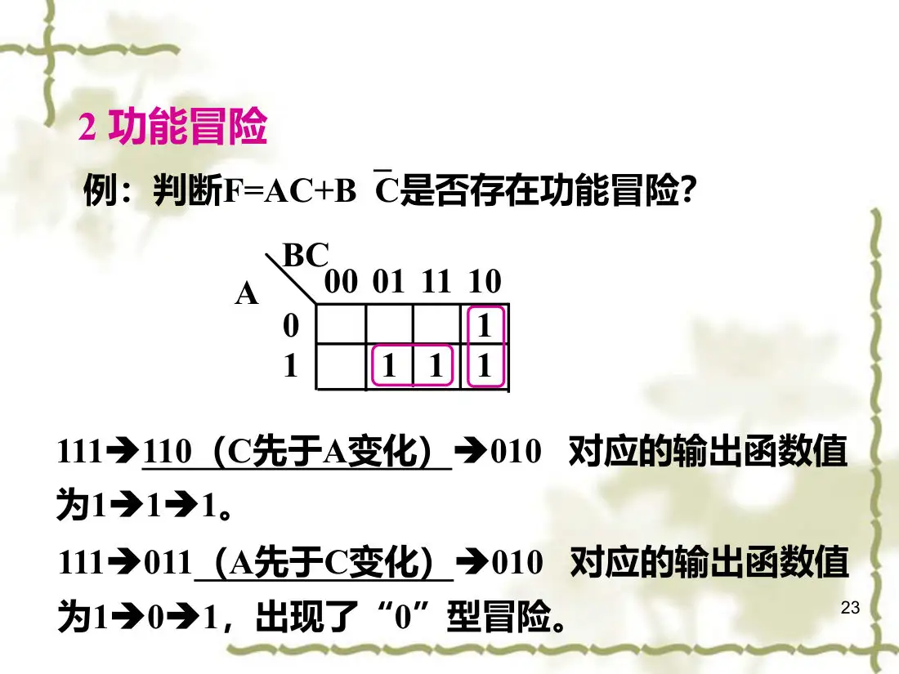

原文：

2 功能冒险

例：判断F=AC+B $\bar{C}$ 是否存在功能冒险？

$$
\begin{array}{c c c c c} \text {BC} & 0 0 & 0 1 & 1 1 & 1 0 \\ \text {A} & 0 & & & 1 \\ & 1 & & 1 & 1 \\ & & & 1 & 1 \end{array}
$$

111→110 (C先于A变化) →010 对应的输出函数值为1→1→1。

111→011 (A先于C变化) →010 对应的输出函数值为1→0→1，出现了“0”型冒险。

### 判断方法:

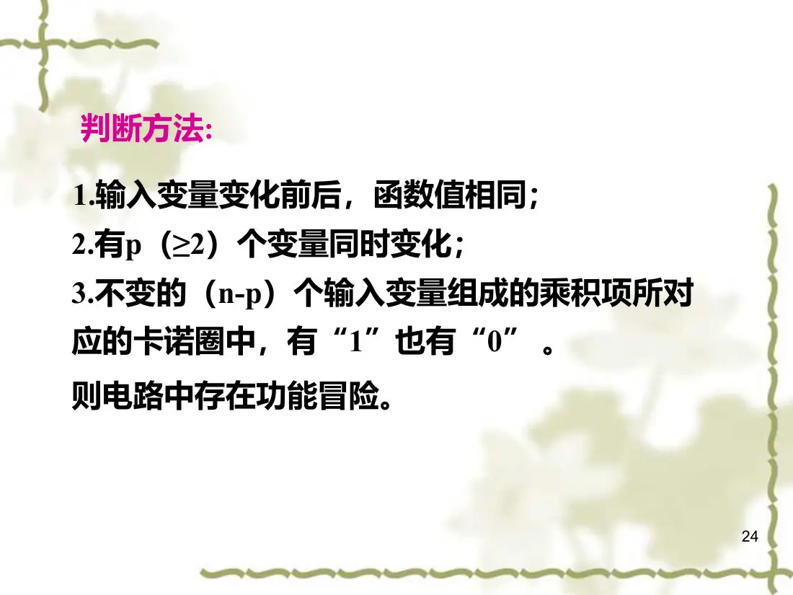

原文：

判断方法:

1. 输入变量变化前后，函数值相同；

2.有p (≥2) 个变量同时变化;

3. 不变的（n-p）个输入变量组成的乘积项所对应的卡诺圈中，有“1”也有“0”。

则电路中存在功能冒险。

24

### $$

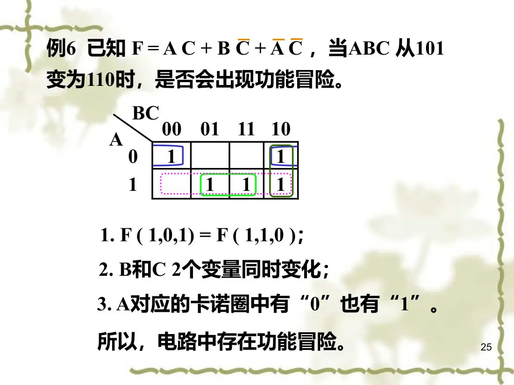

原文：

例6 已知 $F = A C + B \overline{C} + \overline{A} \overline{C}$ ，当ABC从101变为110时，是否会出现功能冒险。

$$
\begin{array}{c c c c c} \text {BC} & 0 0 & 0 1 & 1 1 & 1 0 \\ \text {A} & 0 & 1 & & 1 \\ & 1 & & 1 & 1 \\ & & \text {dotted} & 1 & 1 \end{array}
$$

1. F (1,0,1) = F (1,1,0);

2. B和C 2个变量同时变化;

3. A对应的卡诺圈中有“0”也有“1”。所以，电路中存在功能冒险。

25

### 解：该组合逻辑电路的逻辑函数表达式为：

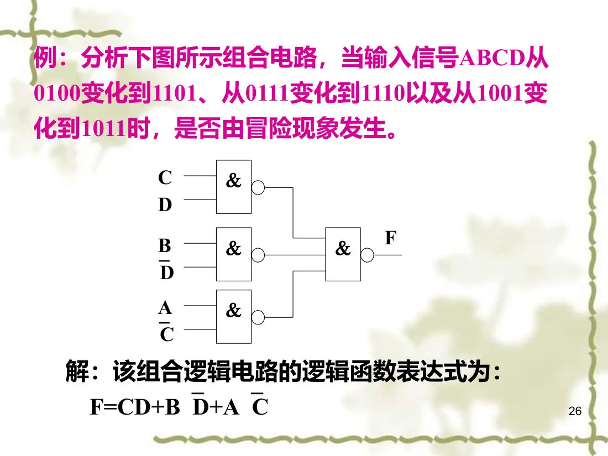

原文：

例：分析下图所示组合电路，当输入信号ABCD从0100变化到1101、从0111变化到1110以及从1001变化到1011时，是否由冒险现象发生。

解：该组合逻辑电路的逻辑函数表达式为：

$$
\mathbf {F} = \mathbf {C D} + \mathbf {B} \overline {{\mathbf {D}}} + \mathbf {A} \overline {{\mathbf {C}}}
$$

26

### $$

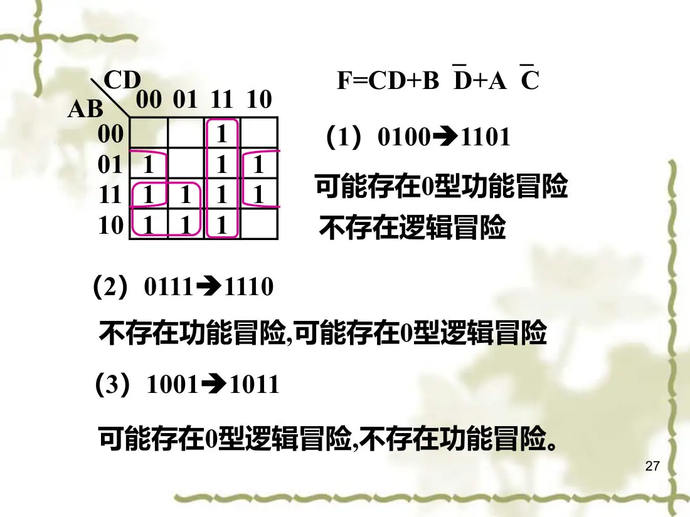

原文：

$$
\mathbf {F} = \mathbf {C D} + \mathbf {B} \overline {{\mathbf {D}}} + \mathbf {A} \overline {{\mathbf {C}}}
$$

(1) 0100→1101
可能存在0型功能冒险
不存在逻辑冒险

(2) 0111→1110

不存在功能冒险,可能存在0型逻辑冒险

(3) 1001→1011

可能存在0型逻辑冒险,不存在功能冒险。

27

### 4.3.4 冒险的消除方法

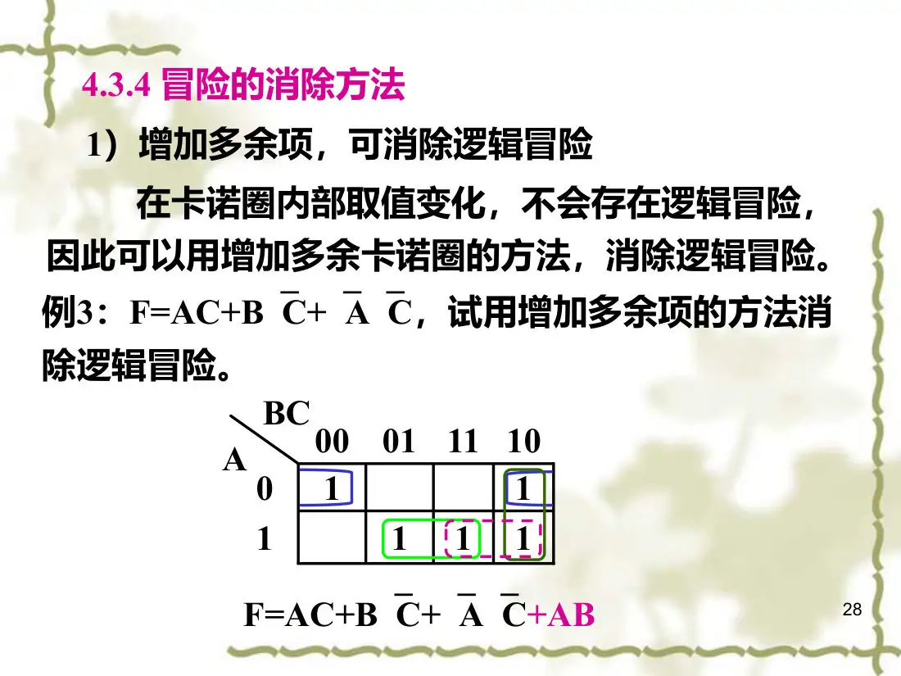

原文：

4.3.4 冒险的消除方法

1）增加多余项，可消除逻辑冒险

在卡诺圈内部取值变化，不会存在逻辑冒险，因此可以用增加多余卡诺圈的方法，消除逻辑冒险。例3：F=AC+B $\overline{C}+\overline{A}\overline{C}$ ，试用增加多余项的方法消除逻辑冒险。

$$
\mathbf {F} = \mathbf {A C} + \mathbf {B} \overline {{\mathbf {C}}} + \overline {{\mathbf {A}}} \overline {{\mathbf {C}}} + \mathbf {A B}
$$

28

### $$

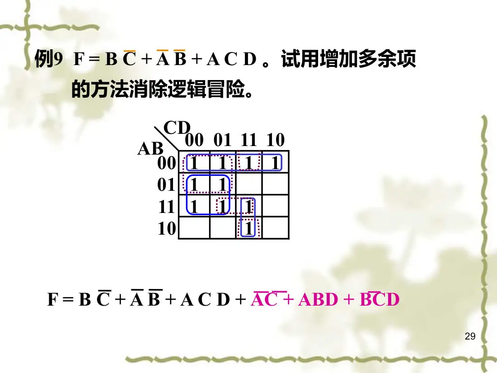

原文：

例9 $F = B\overline{C} + \overline{A}\overline{B} + ACD$ 。试用增加多余项的方法消除逻辑冒险。

$$
\mathbf {F} = \mathbf {B} \overline {{\mathbf {C}}} + \overline {{\mathbf {A}}} \overline {{\mathbf {B}}} + \mathbf {A C D} + \overline {{\mathbf {A C}}} + \mathbf {A B D} + \overline {{\mathbf {B C D}}}
$$

29

### 2）加滤波电容（对输出波形边沿要求不高的情况下运用）

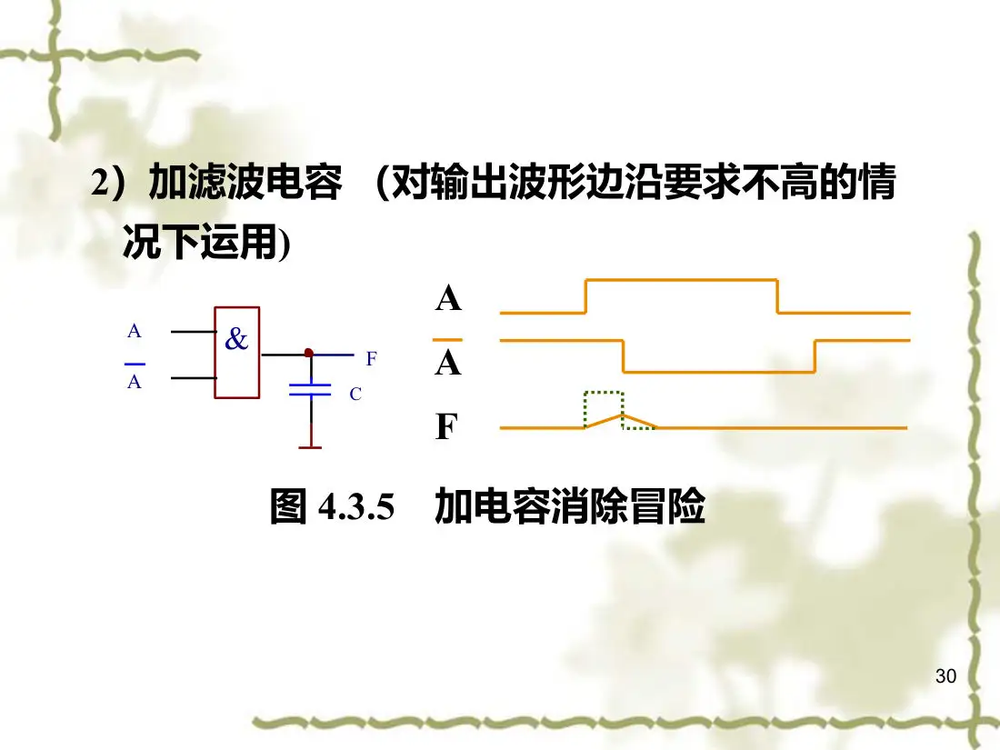

原文：

2）加滤波电容（对输出波形边沿要求不高的情况下运用）

30

### 3）加取样脉冲

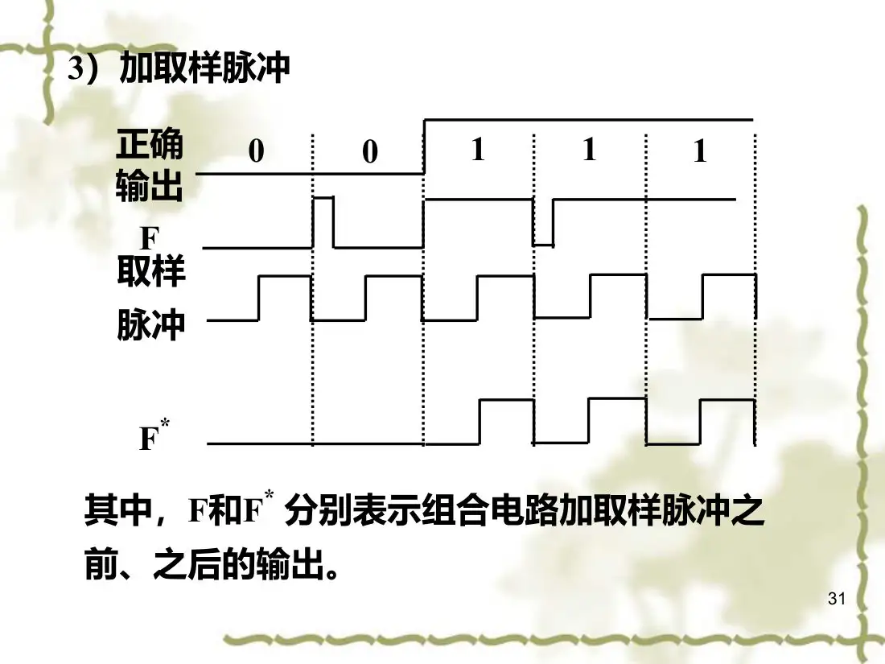

原文：

3）加取样脉冲

其中，F和F $^{*}$ 分别表示组合电路加取样脉冲之前、之后的输出。

31

### 32

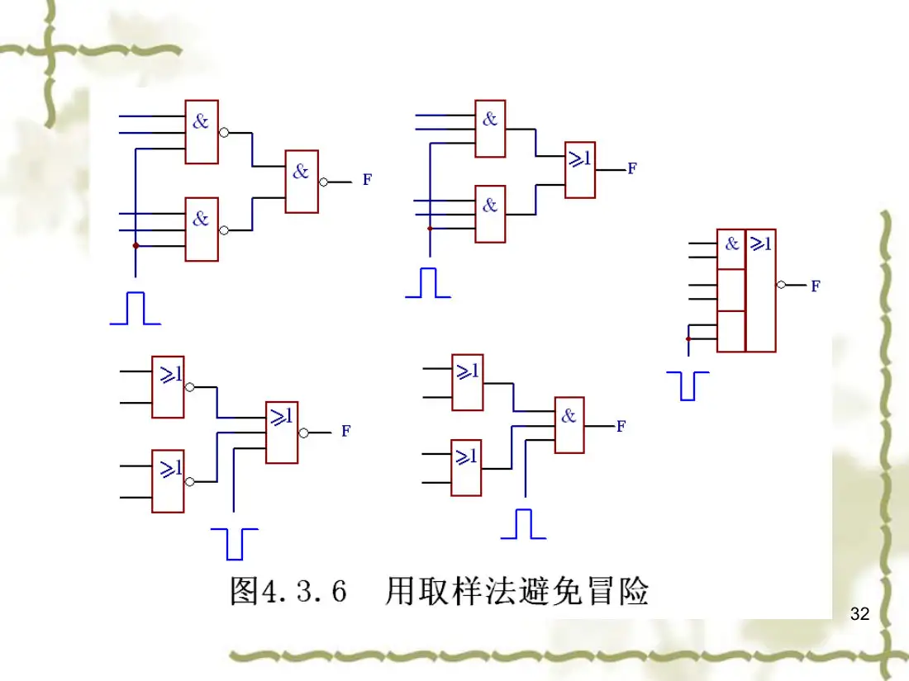

原文：

32

### 33

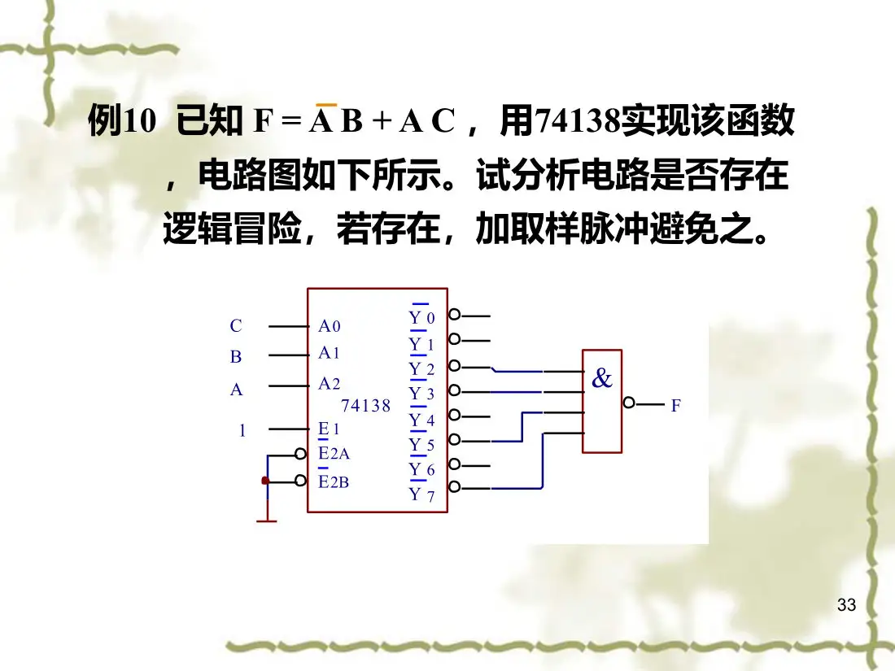

原文：

例10 已知 $F = \overline{A} B + A C$ ，用74138实现该函数，电路图如下所示。试分析电路是否存在逻辑冒险，若存在，加取样脉冲避免之。

33

### 由图可知，存在相切的卡诺圈，该电路可能存在0型逻辑冒险。

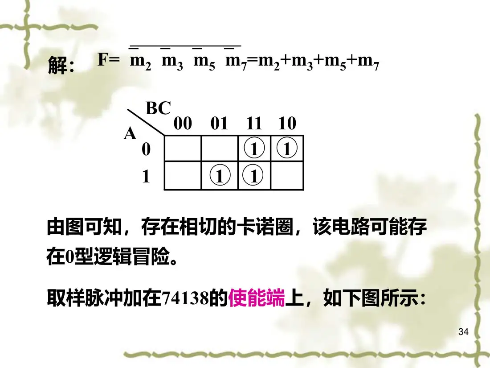

原文：

解: $\mathbf{F} = \mathbf{m}_2 \mathbf{m}_3 \mathbf{m}_5 \mathbf{m}_7 = \mathbf{m}_2 + \mathbf{m}_3 + \mathbf{m}_5 + \mathbf{m}_7$

由图可知，存在相切的卡诺圈，该电路可能存在0型逻辑冒险。

取样脉冲加在74138的使能端上，如下图所示：

34

### 35

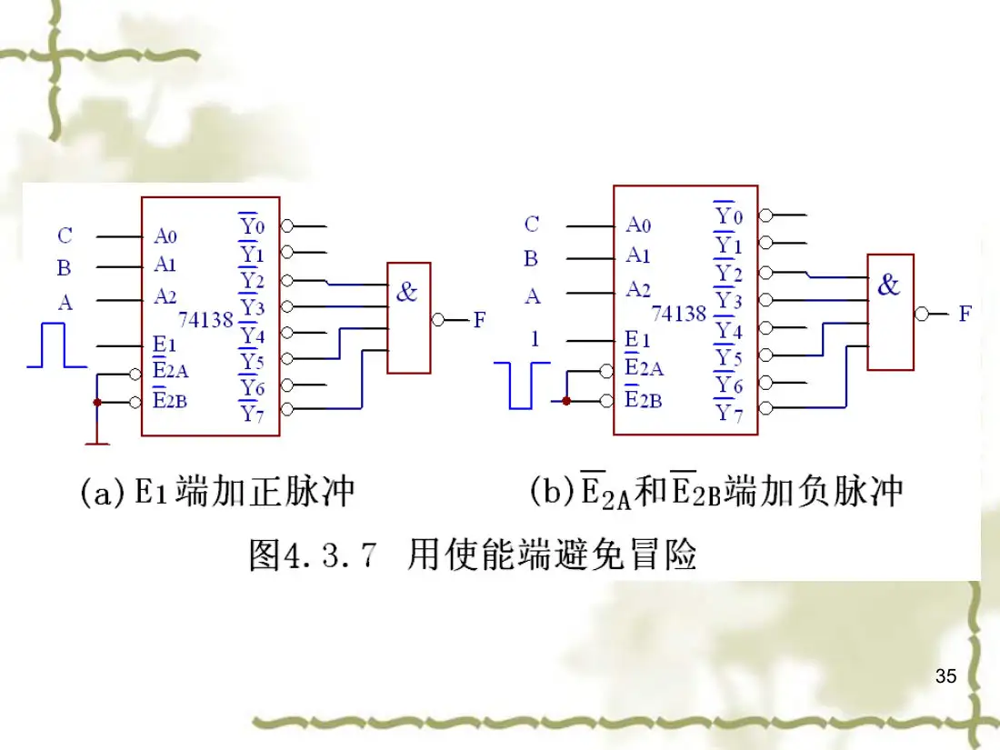

原文：

35

### 36

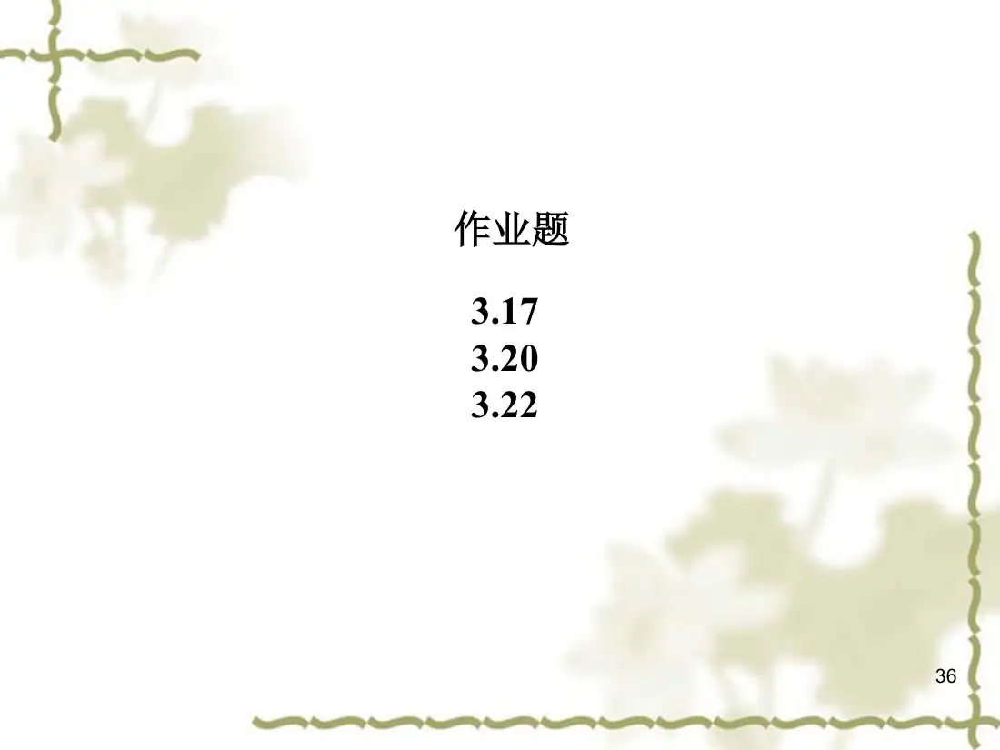

原文：

36
