# 《数字电路与逻辑设计B》第3章 组合逻辑电路（课件）

原件的每一页，下面附识别出的文字。

### 第三章 组合逻辑电路

原文：

第三章 组合逻辑电路

组合逻辑电路: 输出只取决于当时的输入有关。

数字电路

时序逻辑电路：输出不仅取决于当时的输入，且与电路以前的状态有关。

### 组合逻辑电路的特点

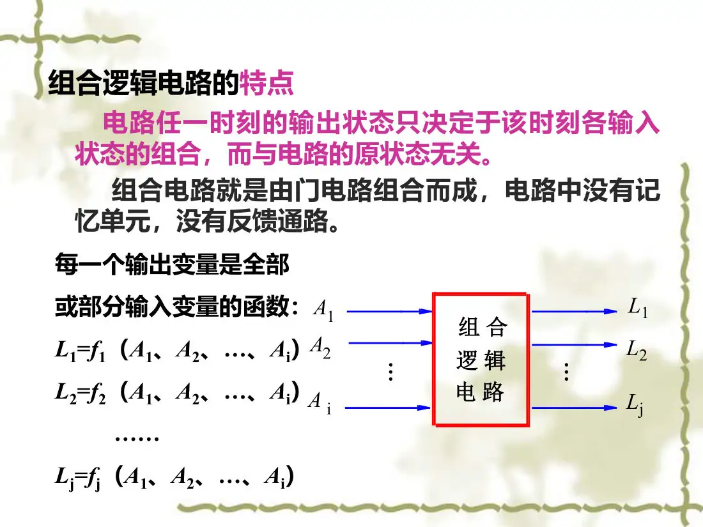

原文：

组合逻辑电路的特点

电路任一时刻的输出状态只决定于该时刻各输入状态的组合，而与电路的原状态无关。

组合电路就是由门电路组合而成，电路中没有记忆单元，没有反馈通路。

每一个输出变量是全部

或部分输入变量的函数： $A_{1}$

$$
\begin{array}{l} L _ {1} = f _ {1} (A _ {1}, A _ {2}, \dots , A _ {i}) A _ {2} \\ L _ {2} = f _ {2} (A _ {1}, A _ {2}, \dots , A _ {i}) A _ {i} \end{array}
$$

组合

逻辑

电路

$$
\begin{array}{c} \text { L } _ {1} \\ \text { L } _ {2} \\ \vdots \\ \text { L } _ {j} \end{array}
$$

$$
L _ {\mathrm{j}} = f _ {\mathrm{j}} \left(A _ {1}, A _ {2}, \dots , A _ {\mathrm{i}}\right)
$$

### 3.1 SSI构成的组合逻辑电路的分析和设计

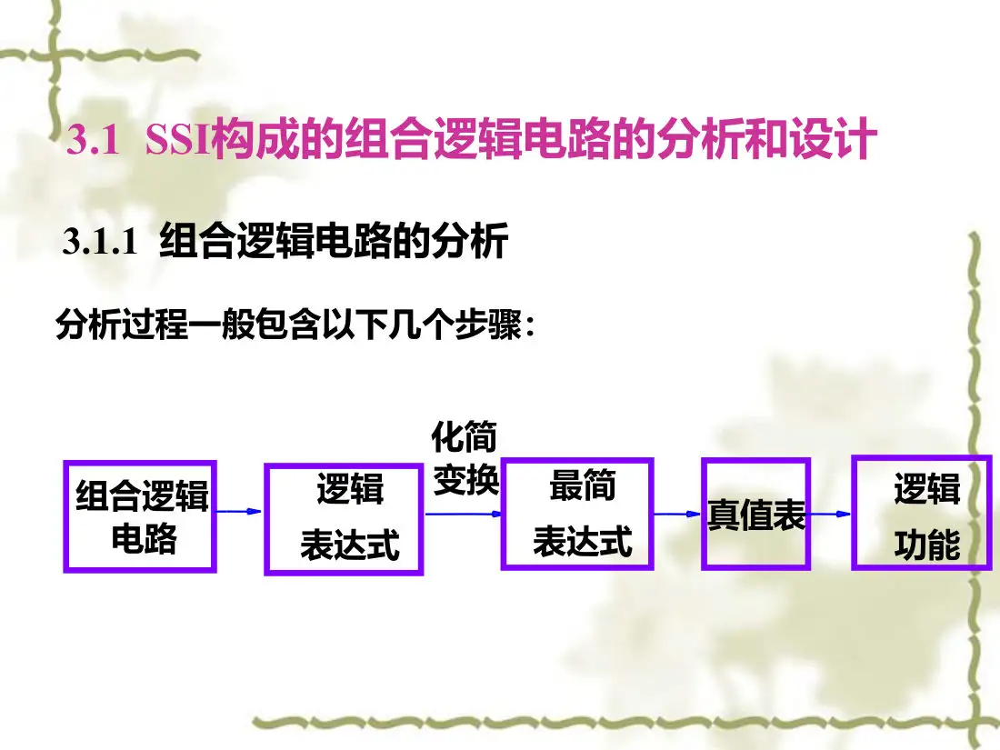

原文：

3.1 SSI构成的组合逻辑电路的分析和设计

3.1.1 组合逻辑电路的分析

分析过程一般包含以下几个步骤：

### 对给定电路进行功能分析。分析步骤：

原文：

对给定电路进行功能分析。分析步骤：

1、从输入到输出逐级地推导输出函数表达式。

2、利用代数法或卡诺图法对表达式进行化简。

3、列出真值表。

4、功能分析，电路设计评估。

### 例3.1.1 分析下图所示逻辑电路的逻辑功能：

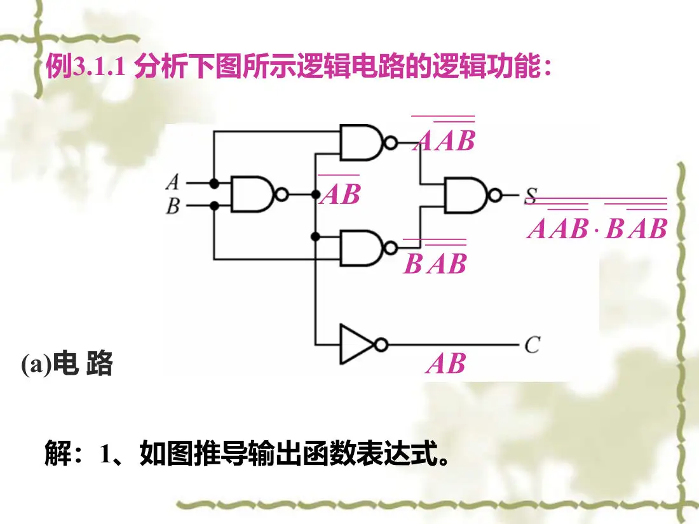

原文：

例3.1.1 分析下图所示逻辑电路的逻辑功能：

解：1、如图推导输出函数表达式。

### (a)电路

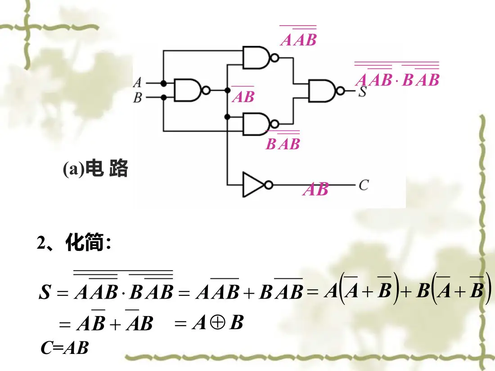

原文：

(a)电路

2、化简：

$$
\begin{array}{r l} & {\boldsymbol {S} = \overline {{\boldsymbol {A}}} \overline {{\boldsymbol {A}}} \overline {{\boldsymbol {B}}} \cdot \overline {{\boldsymbol {B}}} \overline {{\boldsymbol {A}}} \overline {{\boldsymbol {B}}} = \boldsymbol {A} \overline {{\boldsymbol {A}}} \overline {{\boldsymbol {B}}} + \boldsymbol {B} \overline {{\boldsymbol {A}}} \overline {{\boldsymbol {B}}} = \boldsymbol {A} (\overline {{\boldsymbol {A}}} + \overline {{\boldsymbol {B}}}) + \boldsymbol {B} (\overline {{\boldsymbol {A}}} + \overline {{\boldsymbol {B}}})} \\ & {\quad = \boldsymbol {A} \overline {{\boldsymbol {B}}} + \overline {{\boldsymbol {A}}} \boldsymbol {B} = \boldsymbol {A} \oplus \boldsymbol {B}} \\ & {\boldsymbol {C} = \boldsymbol {A} \boldsymbol {B}} \end{array}
$$

### $$

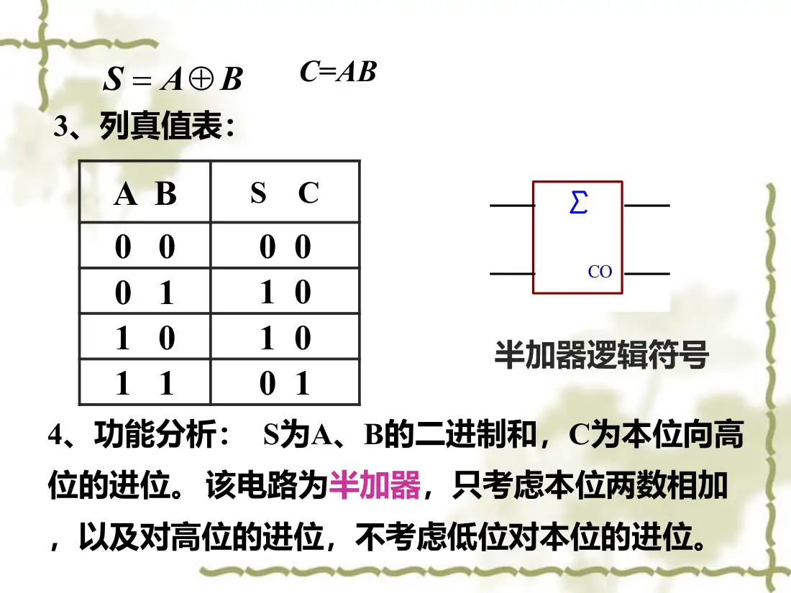

原文：

$$
\boldsymbol {S} = \boldsymbol {A} \oplus \boldsymbol {B} \quad \boldsymbol {C} = \boldsymbol {A B}
$$

3、列真值表:

<table><tr><td>A B</td><td>S C</td></tr><tr><td>0 0</td><td>0 0</td></tr><tr><td>0 1</td><td>1 0</td></tr><tr><td>1 0</td><td>1 0</td></tr><tr><td>1 1</td><td>0 1</td></tr></table>

$$
\begin{array}{c} \Sigma \\ \text { CO } \end{array}
$$

半加器逻辑符号

4、功能分析：S为A、B的二进制和，C为本位向高位的进位。该电路为半加器，只考虑本位两数相加，以及对高位的进位，不考虑低位对本位的进位。

### 例3.1.2 分析如图所示的逻辑电路的逻辑功能。

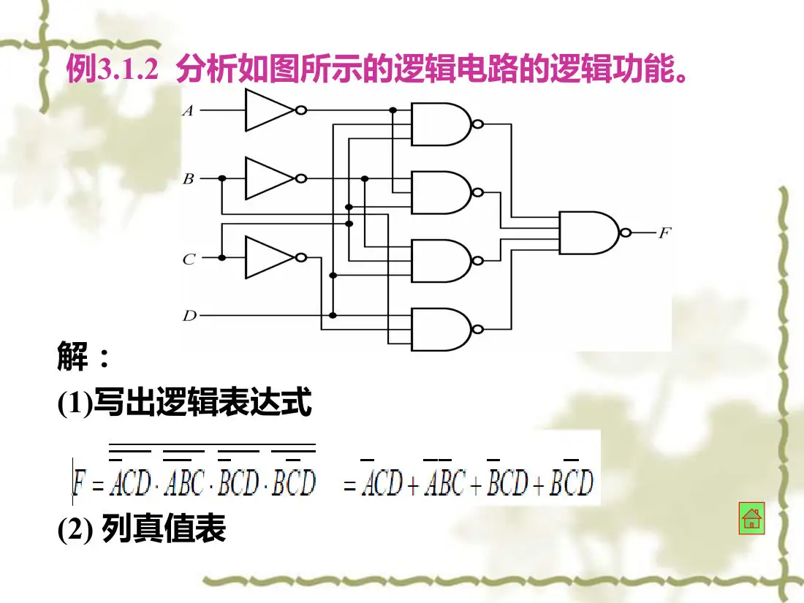

原文：

例3.1.2 分析如图所示的逻辑电路的逻辑功能。

解：

(1)写出逻辑表达式

$$
\left| F = \overline {{\overline {{A C D}}}} \cdot \overline {{\overline {{A B C}}}} \cdot \overline {{\overline {{B C D}}}} \cdot \overline {{\overline {{B C D}}}} \right. = \overline {{A C D}} + \overline {{A B C}} + \overline {{B C D}} + \overline {{B C D}}
$$

(2) 列真值表

### (3) 确定逻辑功能 判断素数

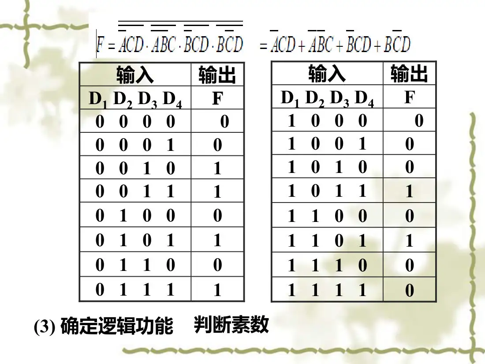

原文：

$\left|F = \overline{\overline{ACD}}\cdot \overline{\overline{ABC}}\cdot \overline{\overline{BCD}}\cdot \overline{\overline{BCD}}\right.$ $= \overline{ACD} +\overline{A}\overline{B} C + \overline{B} CD + B\overline{C} D$

<table><tr><td colspan="4">输入</td><td>输出</td></tr><tr><td> $D_1$ </td><td> $D_2$ </td><td> $D_3$ </td><td> $D_4$ </td><td>F</td></tr><tr><td>0</td><td>0</td><td>0</td><td>0</td><td>0</td></tr><tr><td>0</td><td>0</td><td>0</td><td>1</td><td>0</td></tr><tr><td>0</td><td>0</td><td>1</td><td>0</td><td>1</td></tr><tr><td>0</td><td>0</td><td>1</td><td>1</td><td>1</td></tr><tr><td>0</td><td>1</td><td>0</td><td>0</td><td>0</td></tr><tr><td>0</td><td>1</td><td>0</td><td>1</td><td>1</td></tr><tr><td>0</td><td>1</td><td>1</td><td>0</td><td>0</td></tr><tr><td>0</td><td>1</td><td>1</td><td>1</td><td>1</td></tr></table>

(3) 确定逻辑功能 判断素数

<table><tr><td colspan="4">输入</td><td>输出</td></tr><tr><td> $D_1$ </td><td> $D_2$ </td><td> $D_3$ </td><td> $D_4$ </td><td>F</td></tr><tr><td>1</td><td>0</td><td>0</td><td>0</td><td>0</td></tr><tr><td>1</td><td>0</td><td>0</td><td>1</td><td>0</td></tr><tr><td>1</td><td>0</td><td>1</td><td>0</td><td>0</td></tr><tr><td>1</td><td>0</td><td>1</td><td>1</td><td>1</td></tr><tr><td>1</td><td>1</td><td>0</td><td>0</td><td>0</td></tr><tr><td>1</td><td>1</td><td>0</td><td>1</td><td>1</td></tr><tr><td>1</td><td>1</td><td>1</td><td>0</td><td>0</td></tr><tr><td>1</td><td>1</td><td>1</td><td>1</td><td>0</td></tr></table>

### 练习1：组合电路如下图所示，分析该电路的逻辑功能。

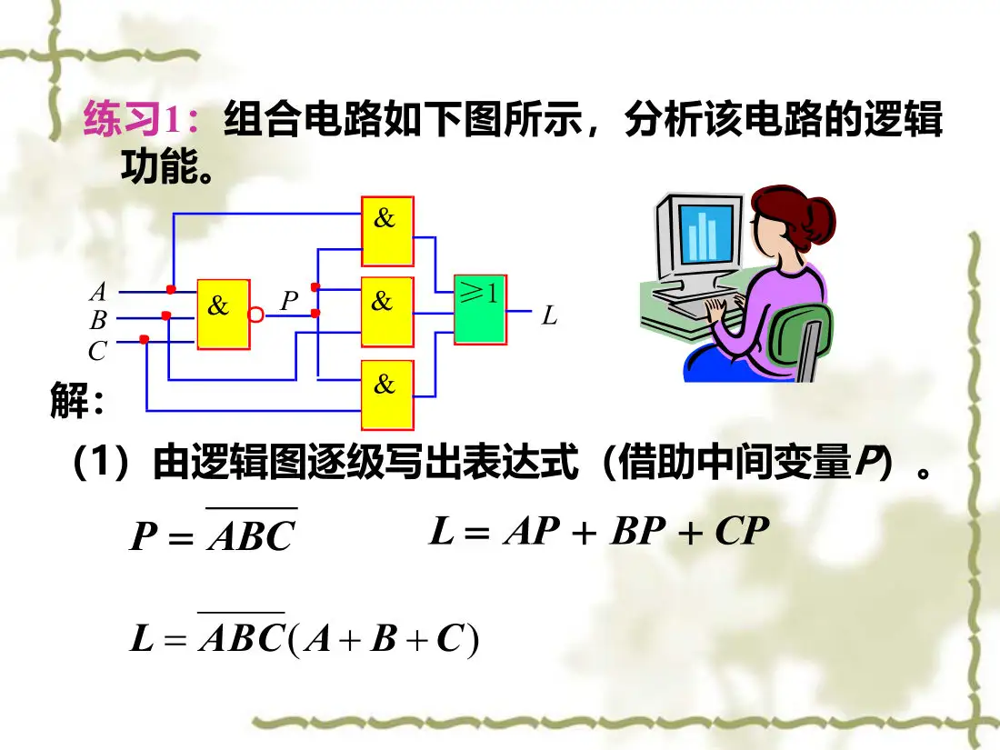

原文：

练习1：组合电路如下图所示，分析该电路的逻辑功能。

解：

(1) 由逻辑图逐级写出表达式（借助中间变量 $P$ ）。

$$
P = A B C
$$

$$
L = A P + B P + C P
$$

$$
\boldsymbol {L} = \boldsymbol {A B C} (\boldsymbol {A} + \boldsymbol {B} + \boldsymbol {C})
$$

### (2) 化简与变换:

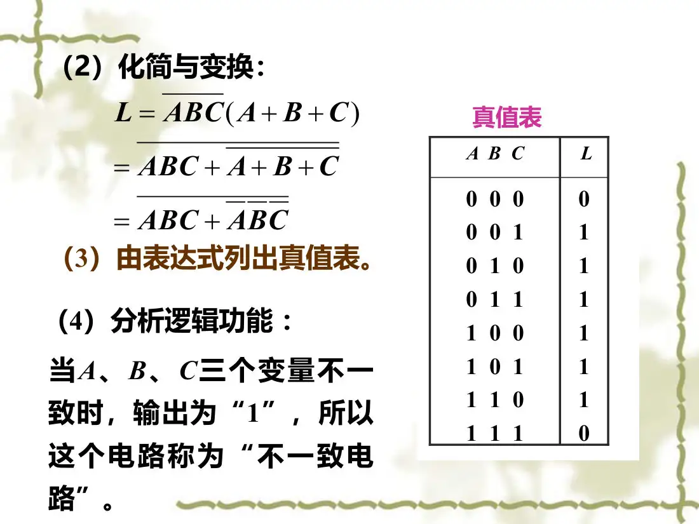

原文：

(2) 化简与变换:

$$
\begin{array}{l} \boldsymbol {L} = \overline {{A B C}} (\boldsymbol {A} + \boldsymbol {B} + \boldsymbol {C}) \\ = \overline {{A B C + A + B + C}} \\ = \overline {{A B C + A B C}} \end{array}
$$

(3) 由表达式列出真值表。

(4) 分析逻辑功能：

当A、B、C三个变量不一致时，输出为“1”，所以这个电路称为“不一致电路”。

真值表

<table><tr><td>A B C</td><td>L</td></tr><tr><td>0 0 0</td><td>0</td></tr><tr><td>0 0 1</td><td>1</td></tr><tr><td>0 1 0</td><td>1</td></tr><tr><td>0 1 1</td><td>1</td></tr><tr><td>1 0 0</td><td>1</td></tr><tr><td>1 0 1</td><td>1</td></tr><tr><td>1 1 0</td><td>1</td></tr><tr><td>1 1 1</td><td>0</td></tr></table>

### 练习2：分析下图电路的逻辑功能，已知此电路用于数据分类，试指出该电路的用途。

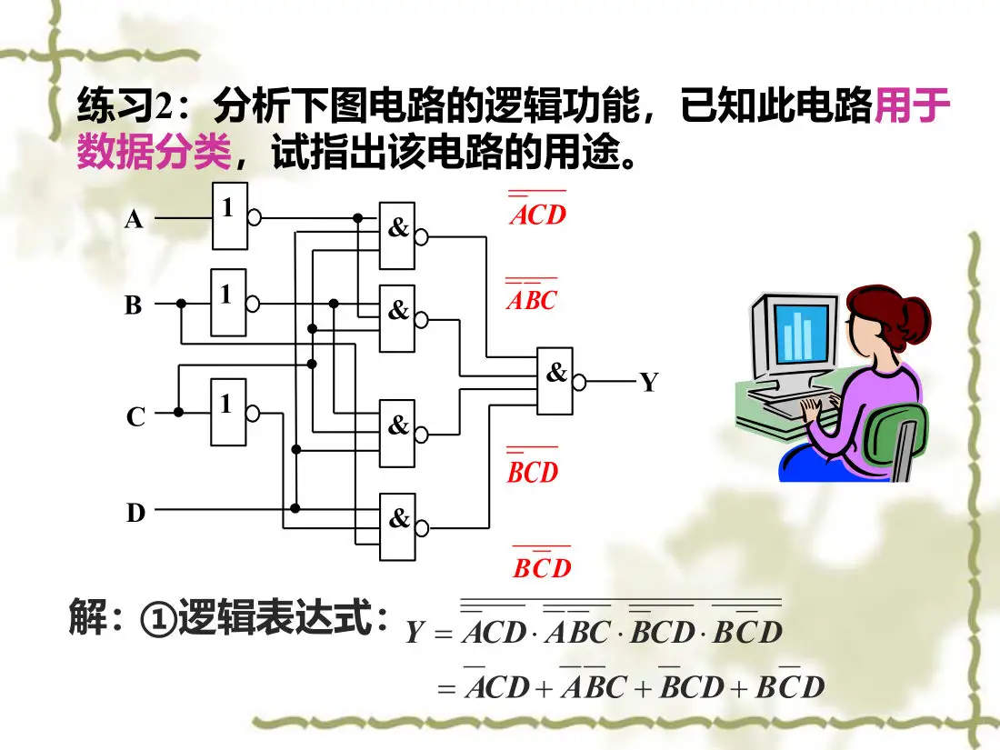

原文：

练习2：分析下图电路的逻辑功能，已知此电路用于数据分类，试指出该电路的用途。

解: ①逻辑表达式: $Y = \overline{ACD} \cdot \overline{ABC} \cdot \overline{BCD} \cdot \overline{BCD}$ $= \overline{ACD} + \overline{ABC} + \overline{BCD} + \overline{BCD}$

### ②真值表:

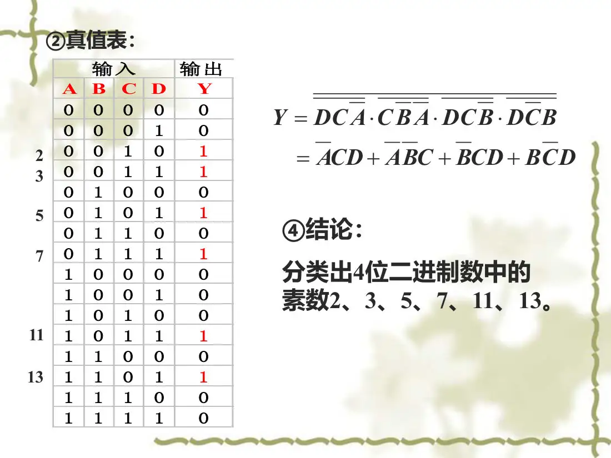

原文：

②真值表:

<table><tr><td rowspan="2"></td><td colspan="4">输入</td><td>输出</td></tr><tr><td>A</td><td>B</td><td>C</td><td>D</td><td>Y</td></tr><tr><td rowspan="3">2</td><td>0</td><td>0</td><td>0</td><td>0</td><td>0</td></tr><tr><td>0</td><td>0</td><td>0</td><td>1</td><td>0</td></tr><tr><td>0</td><td>0</td><td>1</td><td>0</td><td>1</td></tr><tr><td rowspan="2">3</td><td>0</td><td>0</td><td>1</td><td>1</td><td>1</td></tr><tr><td>0</td><td>1</td><td>0</td><td>0</td><td>0</td></tr><tr><td rowspan="2">5</td><td>0</td><td>1</td><td>0</td><td>1</td><td>1</td></tr><tr><td>0</td><td>1</td><td>1</td><td>0</td><td>0</td></tr><tr><td rowspan="4">7</td><td>0</td><td>1</td><td>1</td><td>1</td><td>1</td></tr><tr><td>1</td><td>0</td><td>0</td><td>0</td><td>0</td></tr><tr><td>1</td><td>0</td><td>0</td><td>1</td><td>0</td></tr><tr><td>1</td><td>0</td><td>1</td><td>0</td><td>0</td></tr><tr><td rowspan="2">11</td><td>1</td><td>0</td><td>1</td><td>1</td><td>1</td></tr><tr><td>1</td><td>1</td><td>0</td><td>0</td><td>0</td></tr><tr><td rowspan="3">13</td><td>1</td><td>1</td><td>0</td><td>1</td><td>1</td></tr><tr><td>1</td><td>1</td><td>1</td><td>0</td><td>0</td></tr><tr><td>1</td><td>1</td><td>1</td><td>1</td><td>0</td></tr></table>

$$
\begin{array}{r l} Y & = \overline {{D C \overline {{A}} \cdot C \overline {{B}} \overline {{A}} \cdot D C \overline {{B}} \cdot D C B}} \\ & = \overline {{A C D}} + \overline {{A B C}} + \overline {{B C D}} + \overline {{B C D}} \end{array}
$$

④结论：

分类出4位二进制数中的素数2、3、5、7、11、13。

### 3.1.2 组合逻辑电路的设计

原文：

3.1.2 组合逻辑电路的设计

设计是分析的一个逆过程，由逻辑功能→电路图。

设计步骤（双轨输入情况下）

1、根据给定的逻辑功能，列出真值表；

2、写出逻辑表达式，并根据所选器件，将原表达式化简成相应形式的最简表达式；

3、画出逻辑图。

### 例1：设计一个一位全加器。

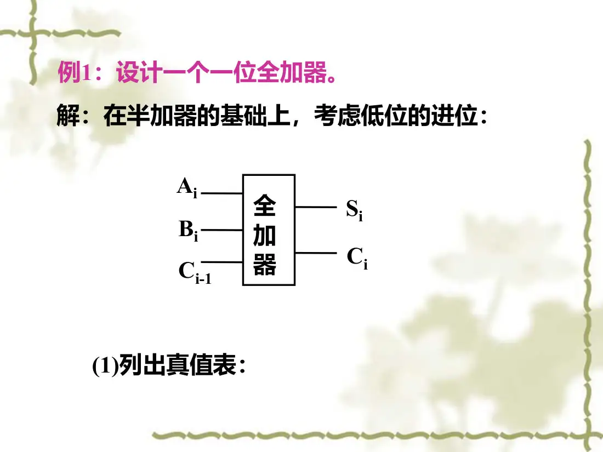

原文：

例1：设计一个一位全加器。

解：在半加器的基础上，考虑低位的进位：

$$
\begin{array}{c c} \text {A} _ {\mathrm{i}} & \text {全加器} \\ \text {B} _ {\mathrm{i}} & \text {C} _ {\mathrm{i-1}} \end{array} \begin{array}{c c} \text {S} _ {\mathrm{i}} \\ \text {C} _ {\mathrm{i}} \end{array}
$$

(1)列出真值表:

### $$

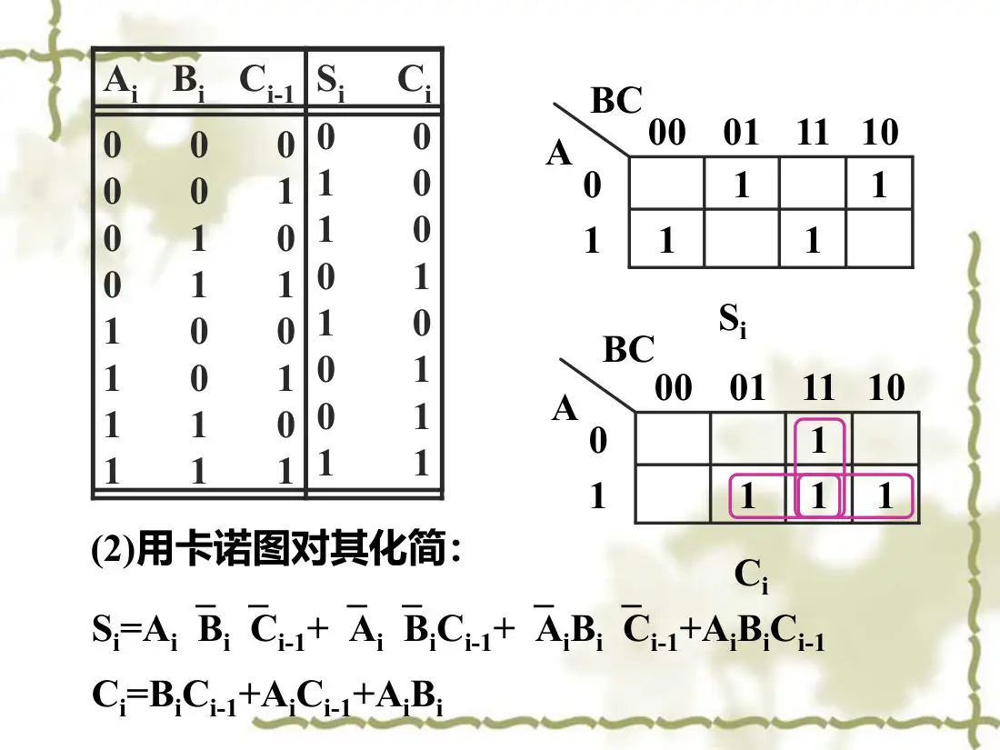

原文：

$$
\begin{array}{c c c c c} \hline A _ {i} & B _ {i} & C _ {i - 1} & S _ {i} & C _ {i} \\ \hline \hline 0 & 0 & 0 & 0 & 0 \\ 0 & 0 & 1 & 1 & 0 \\ 0 & 1 & 0 & 1 & 0 \\ 0 & 1 & 1 & 0 & 1 \\ 1 & 0 & 0 & 1 & 0 \\ 1 & 0 & 1 & 0 & 1 \\ 1 & 1 & 0 & 0 & 1 \\ 1 & 1 & 1 & 1 & 1 \\ \hline \hline \end{array}
$$

$$
\begin{array}{c c c c c} \text {BC} & 0 0 & 0 1 & 1 1 & 1 0 \\ \text {A} & 0 & 1 & & 1 \\ \hline 1 & 1 & & 1 & \end{array}
$$

$$
\begin{array}{c c c c c} \text {BC} & S _ {i} \\ \hline A & 0 0 & 0 1 & 1 1 & 1 0 \\ 0 & & & 1 \\ 1 & & 1 & 1 & 1 \end{array}
$$

(2)用卡诺图对其化简：

$\mathbf{C}_{\mathrm{i}}$

$$
\begin{array}{l} \mathbf {S _ {i}} = \mathbf {A _ {i}} \overline {{\mathbf {B}}} _ {i} \overline {{\mathbf {C}}} _ {i - 1} + \overline {{\mathbf {A}}} _ {i} \overline {{\mathbf {B}}} _ {i} \mathbf {C} _ {i - 1} + \overline {{\mathbf {A}}} _ {i} \mathbf {B} _ {i} \overline {{\mathbf {C}}} _ {i - 1} + \mathbf {A} _ {i} \mathbf {B} _ {i} \mathbf {C} _ {i - 1} \\ \mathbf {C _ {i}} = \mathbf {B} _ {i} \mathbf {C} _ {i - 1} + \mathbf {A} _ {i} \mathbf {C} _ {i - 1} + \mathbf {A} _ {i} \mathbf {B} _ {i} \end{array}
$$

### (3)画逻辑电路。

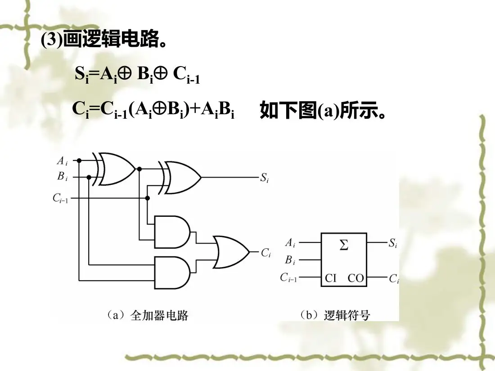

原文：

(3)画逻辑电路。

$$
\mathbf {S _ {i}} = \mathbf {A _ {i}} \oplus \mathbf {B _ {i}} \oplus \mathbf {C _ {i - 1}}
$$

$\mathbf{C}_{\mathrm{i}} = \mathbf{C}_{\mathrm{i - 1}}(\mathbf{A}_{\mathrm{i}}\oplus \mathbf{B}_{\mathrm{i}}) + \mathbf{A}_{\mathrm{i}}\mathbf{B}_{\mathrm{i}}$ 如下图(a)所示。

### $$

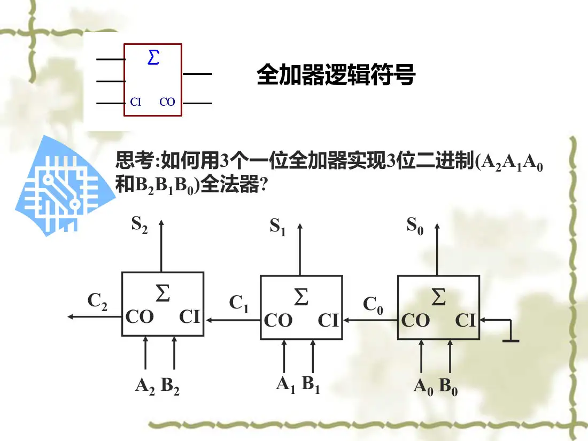

原文：

$$
\begin{array}{c c} \Sigma \\ \text { CI } & \text { CO } \end{array}
$$

全加器逻辑符号

思考:如何用3个一位全加器实现3位二进制 $\left(\mathrm{A}_{2}\mathrm{A}_{1}\mathrm{A}_{0}\right.$ 和 $\left.\mathrm{B}_{2}\mathrm{B}_{1}\mathrm{B}_{0}\right)$ 全法器?

### 例 3.1.5 试设计一个1位二进制数比较单元。

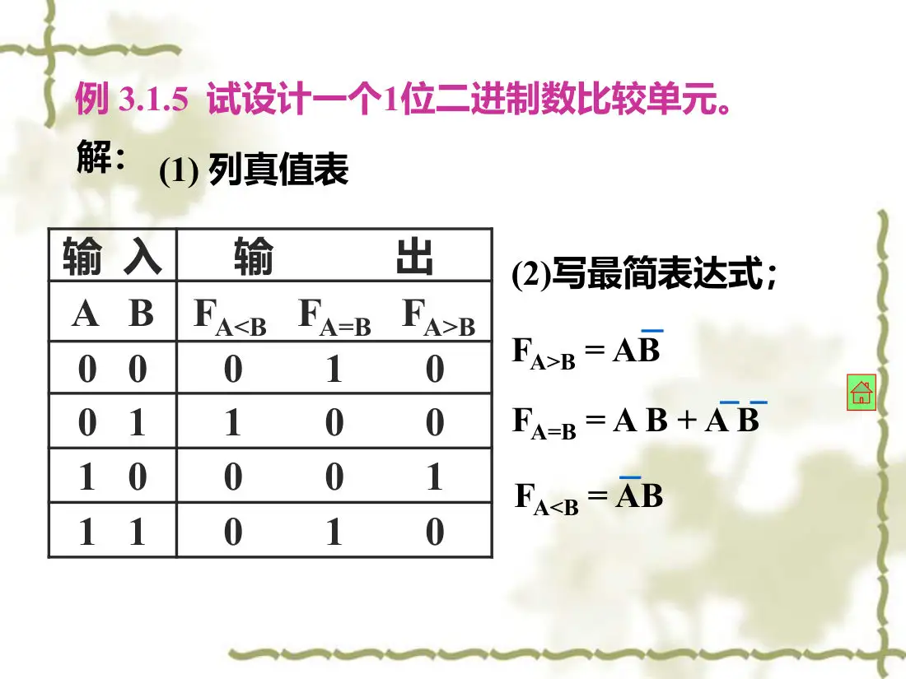

原文：

例 3.1.5 试设计一个1位二进制数比较单元。

解: (1) 列真值表

<table><tr><td colspan="2">输入</td><td colspan="3">输出</td></tr><tr><td>A</td><td>B</td><td> $F_{A} < B$ </td><td> $F_{A=B}$ </td><td> $F_{A>B}$ </td></tr><tr><td>0</td><td>0</td><td>0</td><td>1</td><td>0</td></tr><tr><td>0</td><td>1</td><td>1</td><td>0</td><td>0</td></tr><tr><td>1</td><td>0</td><td>0</td><td>0</td><td>1</td></tr><tr><td>1</td><td>1</td><td>0</td><td>1</td><td>0</td></tr></table>

(2)写最简表达式;

$$
\mathbf {F} _ {\mathbf {A} > \mathbf {B}} = \mathbf {A} \overline {{\mathbf {B}}}
$$

$$
\mathbf {F} _ {\mathbf {A} = \mathbf {B}} = \mathbf {A} \mathbf {B} + \mathbf {A} \overline {{\mathbf {B}}}
$$

$$
\mathbf {F} _ {\mathbf {A} <   \mathbf {B}} = \overline {{\mathbf {A}}} \mathbf {B}
$$

### (3)画逻辑电路

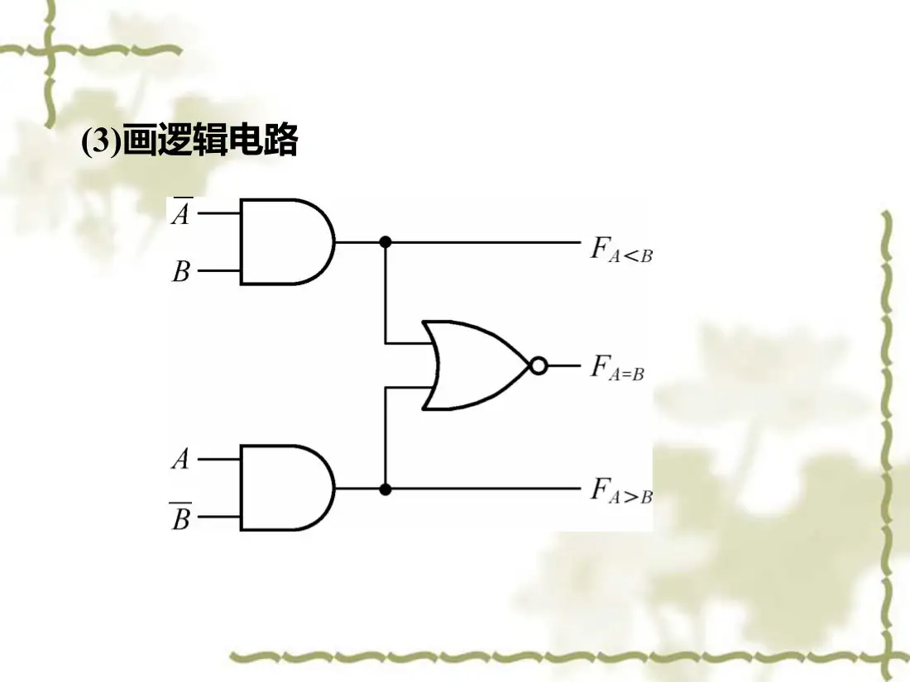

原文：

(3)画逻辑电路

### 解：

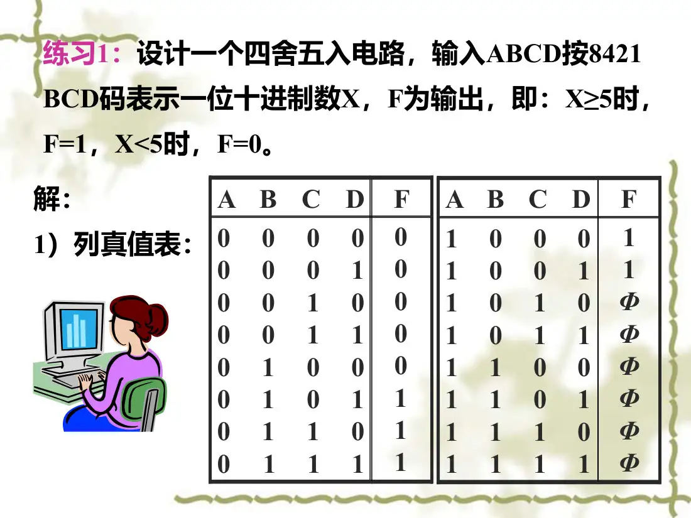

原文：

练习1: 设计一个四舍五入电路, 输入ABCD按8421 BCD码表示一位十进制数X, F为输出, 即: X≥5时, F=1, X<5时, F=0。

解：

1）列真值表：

<table><tr><td>A</td><td>B</td><td>C</td><td>D</td><td>F</td></tr><tr><td>0</td><td>0</td><td>0</td><td>0</td><td>0</td></tr><tr><td>0</td><td>0</td><td>0</td><td>1</td><td>0</td></tr><tr><td>0</td><td>0</td><td>1</td><td>0</td><td>0</td></tr><tr><td>0</td><td>0</td><td>1</td><td>1</td><td>0</td></tr><tr><td>0</td><td>1</td><td>0</td><td>0</td><td>0</td></tr><tr><td>0</td><td>1</td><td>0</td><td>1</td><td>1</td></tr><tr><td>0</td><td>1</td><td>1</td><td>0</td><td>1</td></tr><tr><td>0</td><td>1</td><td>1</td><td>1</td><td>1</td></tr></table>

### 2) 卡诺图化简:

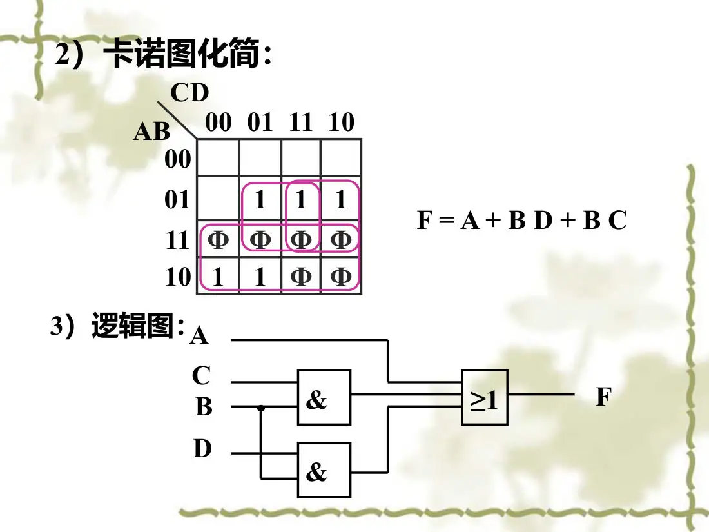

原文：

2) 卡诺图化简:

$$
\mathbf {F} = \mathbf {A} + \mathbf {B D} + \mathbf {B C}
$$

3）逻辑图：

### 第 23 页

原文：

练习2：设计一个电话机信号控制电路。电路有 $I_{0}$ （火警）、 $I_{1}$ （盗警）和 $I_{2}$ （日常业务）三种输入信号，设计一个排队电路使三种信号分别从 $L_{0}$ 、 $L_{1}$ 、 $L_{2}$ 输出，在同一时间只能有一个信号通过。如果同时有两个以上信号出现时，应首先接通火警信号，其次为盗警信号，最后是日常业务信号。试按照上述轻重缓急设计该信号控制电路。要求用集成门电路7400（每片含4个2输入与非门）实现。

### 输出: $L_{0} 、 L_{1} 、 L_{2}$ 。

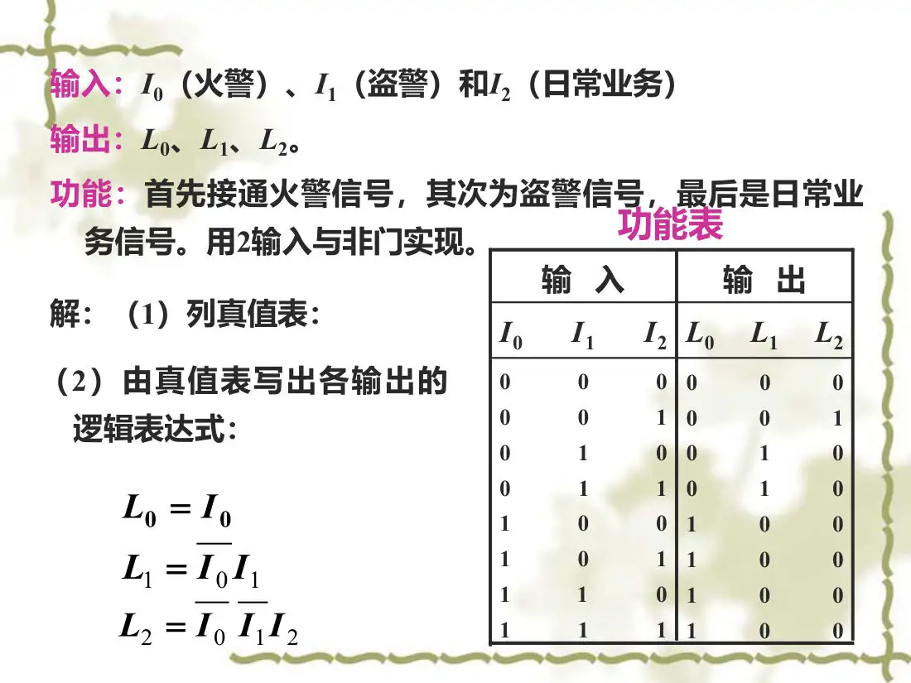

原文：

输入: $I_{0}$ (火警)、 $I_{1}$ (盗警)和 $I_{2}$ (日常业务)

输出: $L_{0} 、 L_{1} 、 L_{2}$ 。

功能：首先接通火警信号，其次为盗警信号，最后是日常业务信号。用2输入与非门实现。功能表

解：（1）列真值表：

(2) 由真值表写出各输出的逻辑表达式:

$$
\begin{array}{l} L _ {0} = I _ {0} \\ L _ {1} = \overline {{I _ {0}}} I _ {1} \\ L _ {2} = \overline {{I _ {0}}} \overline {{I _ {1}}} I _ {2} \end{array}
$$

<table><tr><td colspan="3">输入</td><td colspan="3">输出</td></tr><tr><td> $I_0$ </td><td> $I_1$ </td><td> $I_2$ </td><td> $L_0$ </td><td> $L_1$ </td><td> $L_2$ </td></tr><tr><td>0</td><td>0</td><td>0</td><td>0</td><td>0</td><td>0</td></tr><tr><td>0</td><td>0</td><td>1</td><td>0</td><td>0</td><td>1</td></tr><tr><td>0</td><td>1</td><td>0</td><td>0</td><td>1</td><td>0</td></tr><tr><td>0</td><td>1</td><td>1</td><td>0</td><td>1</td><td>0</td></tr><tr><td>1</td><td>0</td><td>0</td><td>1</td><td>0</td><td>0</td></tr><tr><td>1</td><td>0</td><td>1</td><td>1</td><td>0</td><td>0</td></tr><tr><td>1</td><td>1</td><td>0</td><td>1</td><td>0</td><td>0</td></tr><tr><td>1</td><td>1</td><td>1</td><td>1</td><td>0</td><td>0</td></tr></table>

### (3) 根据要求, 将上式转换为与非表达式:

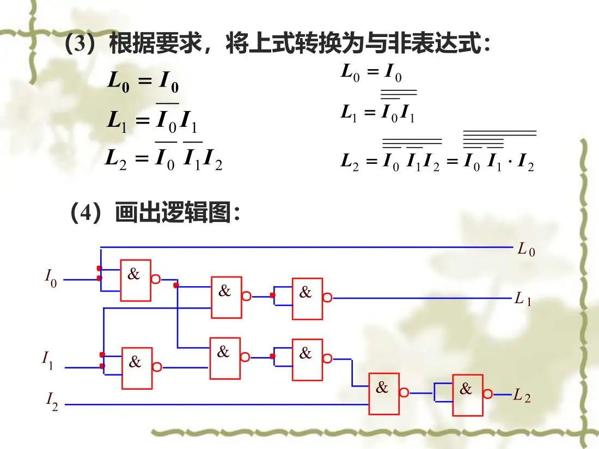

原文：

(3) 根据要求, 将上式转换为与非表达式:

$$
L _ {0} = I _ {0}
$$

$$
L _ {1} = \overline {{I _ {0}}} I _ {1}
$$

$$
\begin{array}{c} \boldsymbol {L} _ {0} = \boldsymbol {I} _ {0} \\ \overline {{\overline {{\boldsymbol {I}}} _ {0} \boldsymbol {I} _ {1}}} \\ \boldsymbol {L} _ {1} = \overline {{\boldsymbol {I} _ {0}}} \end{array}
$$

$$
L _ {2} = I _ {0} I _ {1} I _ {2}
$$

$$
\boldsymbol {L} _ {2} = \overline {{\overline {{\boldsymbol {I} _ {0}}} \overline {{\boldsymbol {I} _ {1}}} \boldsymbol {I} _ {2}}} = \overline {{\overline {{\boldsymbol {I} _ {0}}} \overline {{\boldsymbol {I} _ {1}}} \cdot \boldsymbol {I} _ {2}}}
$$

(4) 画出逻辑图:

### 第 26 页

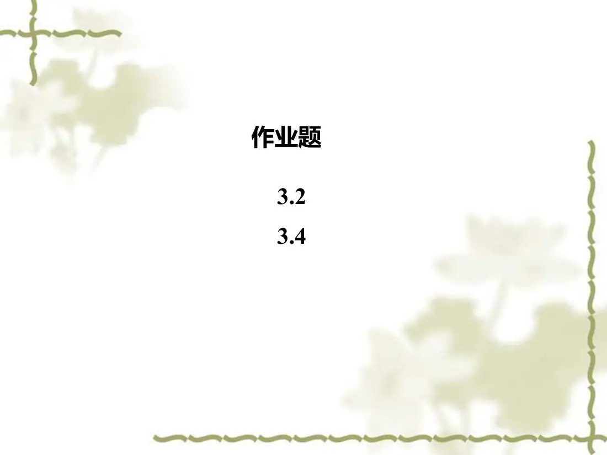
