# 《数字电路与逻辑设计B》第4章 组合逻辑电路（课件）

原件的每一页，下面附识别出的文字。

### 第4章 组合逻辑电路

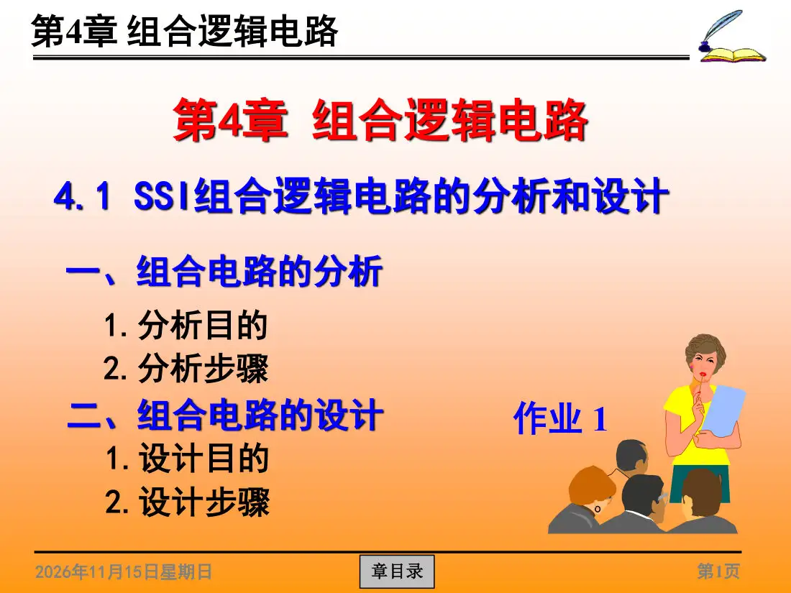

原文：

第4章 组合逻辑电路

4.1 SSI组合逻辑电路的分析和设计

一、组合电路的分析

1.分析目的

2.分析步骤

二、组合电路的设计

1.设计目的

2.设计步骤

作业 1

第4章组合逻辑电路

く

2026年11月15日星期日

章目录

第1页

### 4.2 MSI中规模集成组合逻辑电一、编码器 路

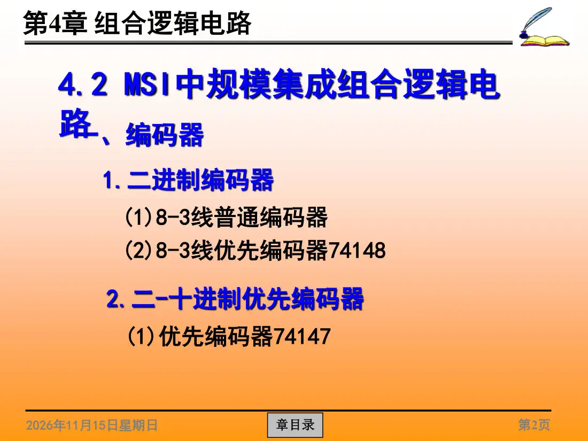

原文：

4.2 MSI中规模集成组合逻辑电一、编码器 路

1.二进制编码器

(1)8-3线普通编码器

(2)8-3线优先编码器74148

2.二-十进制优先编码器

(1)优先编码器74147

第4章 组合逻辑电路

く

2026年11月15日星期日

章目录

第2页

### 二、译码器

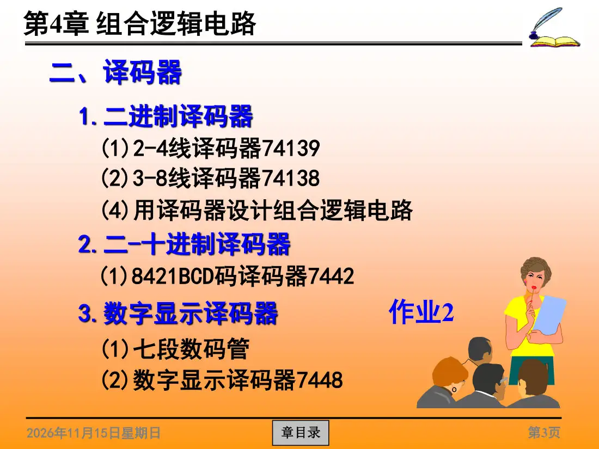

原文：

二、译码器

1.二进制译码器

(1)2-4线译码器74139

(2)3-8线译码器74138

(4)用译码器设计组合逻辑电路

2.二-十进制译码器

(1)8421BCD码译码器7442

3.数字显示译码器

(1)七段数码管

(2)数字显示译码器7448

作业2

第4章组合逻辑电路

く

2026年11月15日星期日

章目录

第3页

### 三、数据选择器

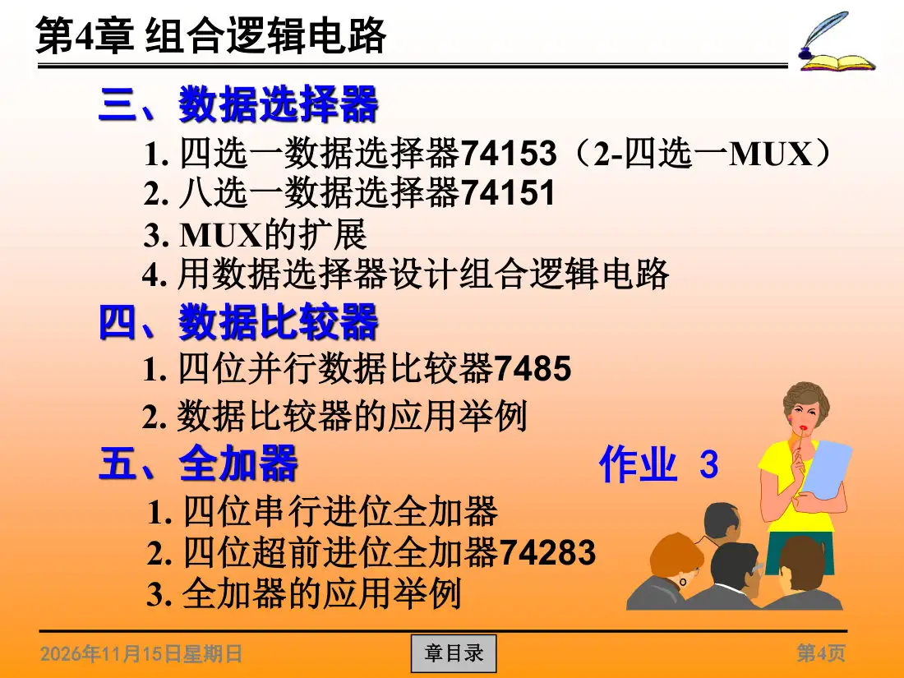

原文：

三、数据选择器

1. 四选一数据选择器74153（2-四选一MUX）

2. 八选一数据选择器74151

3. MUX的扩展

4. 用数据选择器设计组合逻辑电路

四、数据比较器

1. 四位并行数据比较器7485

2. 数据比较器的应用举例

五、全加器

1. 四位串行进位全加器

2. 四位超前进位全加器74283

3. 全加器的应用举例

作业 3

第4章组合逻辑电路

2026年11月15日星期日

章目录

第4页

### 4.3 竞争和冒险

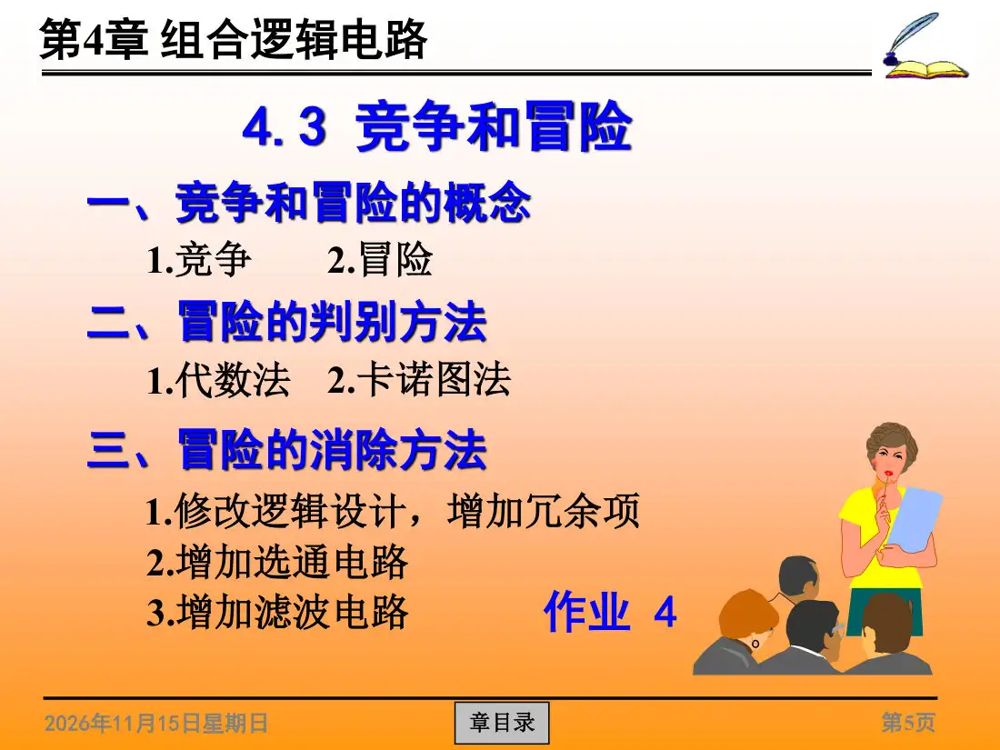

原文：

4.3 竞争和冒险

一、竞争和冒险的概念

1.竞争 2.冒险

二、冒险的判别方法

1.代数法 2.卡诺图法

三、冒险的消除方法

1.修改逻辑设计，增加冗余项

2.增加选通电路

3.增加滤波电路

作业 4

第4章组合逻辑电路

く

2026年11月15日星期日

章目录

第5页

### 第4章组合逻辑电路

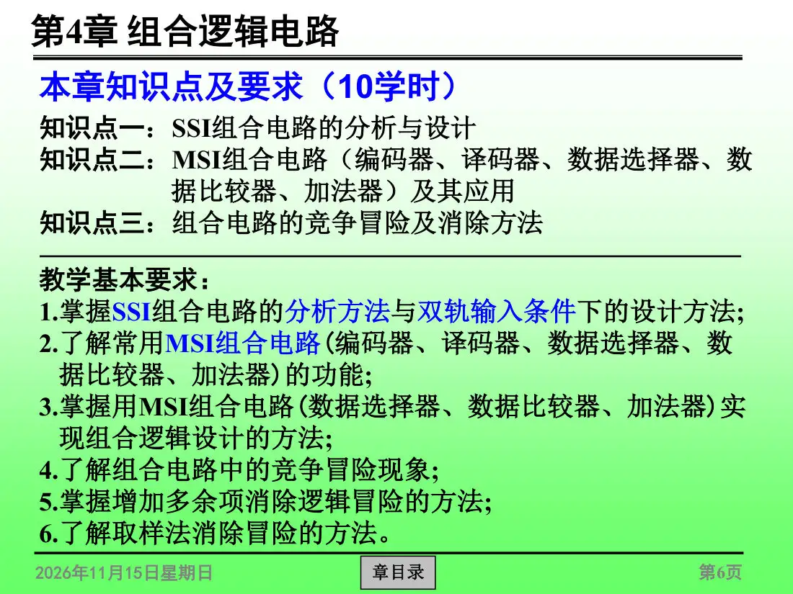

原文：

第4章组合逻辑电路

本章知识点及要求（10学时）

知识点一：SSI组合电路的分析与设计

知识点二：MSI组合电路（编码器、译码器、数据选择器、数据比较器、加法器）及其应用

知识点三：组合电路的竞争冒险及消除方法

教学基本要求：

1.掌握SSI组合电路的分析方法与双轨输入条件下的设计方法;

2.了解常用MSI组合电路(编码器、译码器、数据选择器、数据比较器、加法器)的功能;

3.掌握用MSI组合电路(数据选择器、数据比较器、加法器)实现组合逻辑设计的方法;

4.了解组合电路中的竞争冒险现象;

5.掌握增加多余项消除逻辑冒险的方法;

6.了解取样法消除冒险的方法。

2026年11月15日星期日

章目录

第6页

### 第4章组合逻辑电路

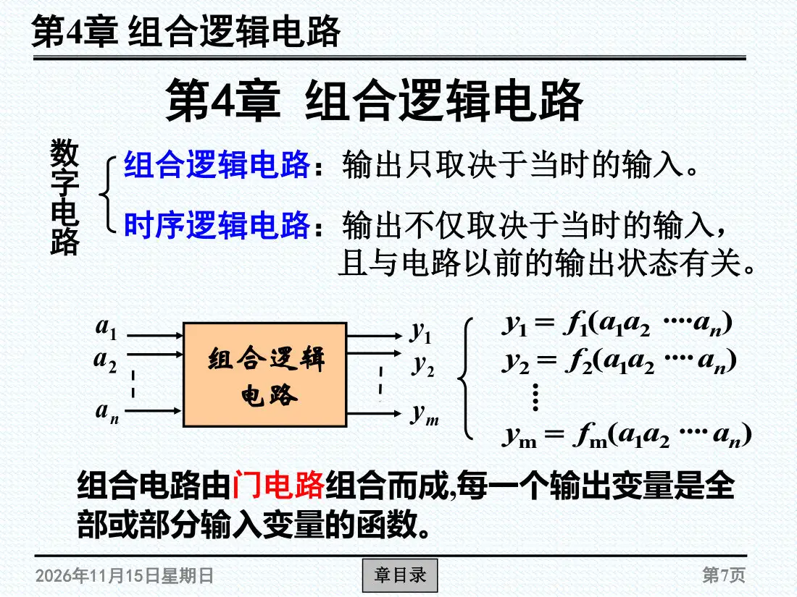

原文：

第4章组合逻辑电路

第4章 组合逻辑电路

数

字

电

路

组合逻辑电路：输出只取决于当时的输入。

时序逻辑电路： 输出不仅取决于当时的输入，且与电路以前的输出状态有关。

$$
\begin{array}{c} a _ {1} \\ a _ {2} \\ a _ {n} \end{array} \xrightarrow {} \left[ \begin{array}{c} \end{array} \right.
$$

组合逻辑电路

$$
\left[ \begin{array}{c} y _ {1} \\ y _ {2} \\ y _ {m} \end{array} \right]
$$

$$
\begin{array}{c} y _ {1} = f _ {1} (a _ {1} a _ {2} \dots a _ {n}) \\ y _ {2} = f _ {2} (a _ {1} a _ {2} \dots a _ {n}) \\ \vdots \\ y _ {\mathrm{m}} = f _ {\mathrm{m}} (a _ {1} a _ {2} \dots a _ {n}) \end{array}
$$

组合电路由门电路组合而成,每一个输出变量是全部或部分输入变量的函数。

2026年11月15日星期日

章目录

第7页

### 组合电路的研究内容：

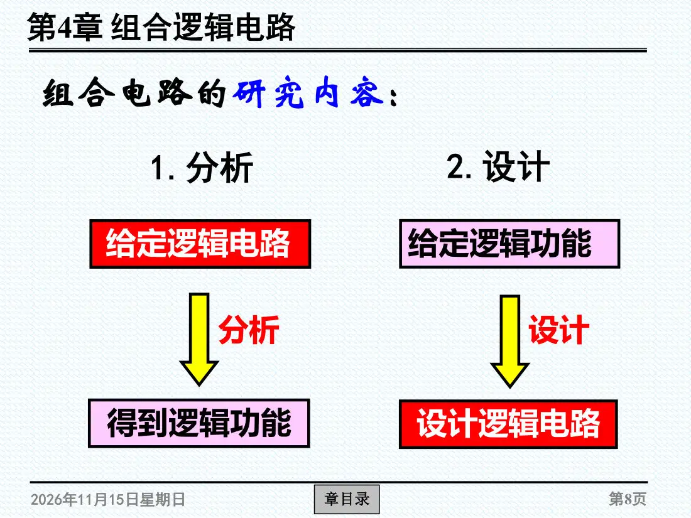

原文：

组合电路的研究内容：

1.分析

给定逻辑电路

分析

得到逻辑功能

2.设计

给定逻辑功能

设计

设计逻辑电路

第4章组合逻辑电路

2026年11月15日星期日

章目录

第8页

### 4.1 SSI构成的组合电路分析和设计

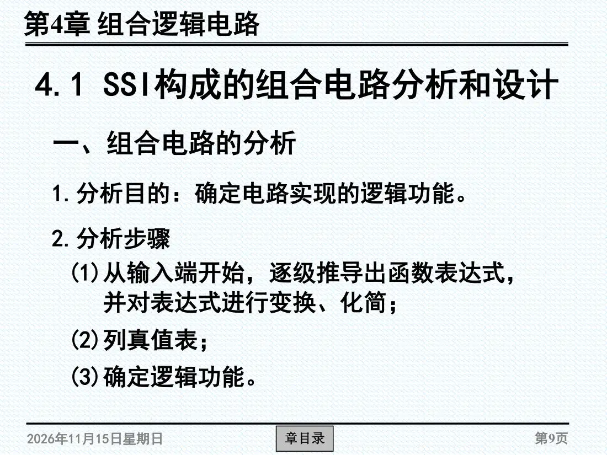

原文：

4.1 SSI构成的组合电路分析和设计

组合电路的分析

1.分析目的：确定电路实现的逻辑功能。

2.分析步骤

(1)从输入端开始，逐级推导出函数表达式，并对表达式进行变换、化简；

(2)列真值表；

(3)确定逻辑功能。

第4章组合逻辑电路

2026年11月15日星期日

章目录

第9页

### 第4章组合逻辑电路 组合电路的分析

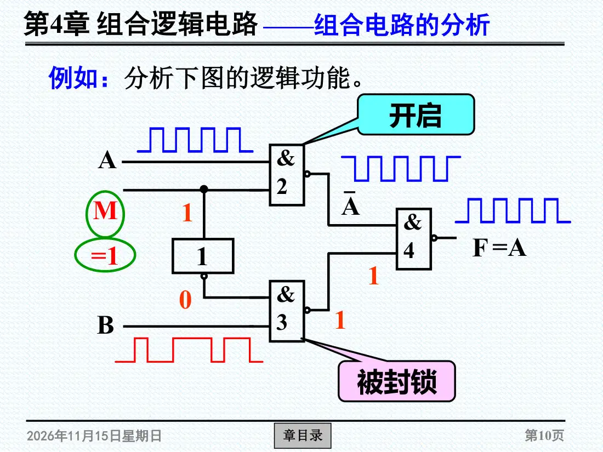

原文：

第4章组合逻辑电路 组合电路的分析

例如：分析下图的逻辑功能。

2026年11月15日星期日

章目录

第10页

### 第4章组合逻辑电路 组合电路的分析

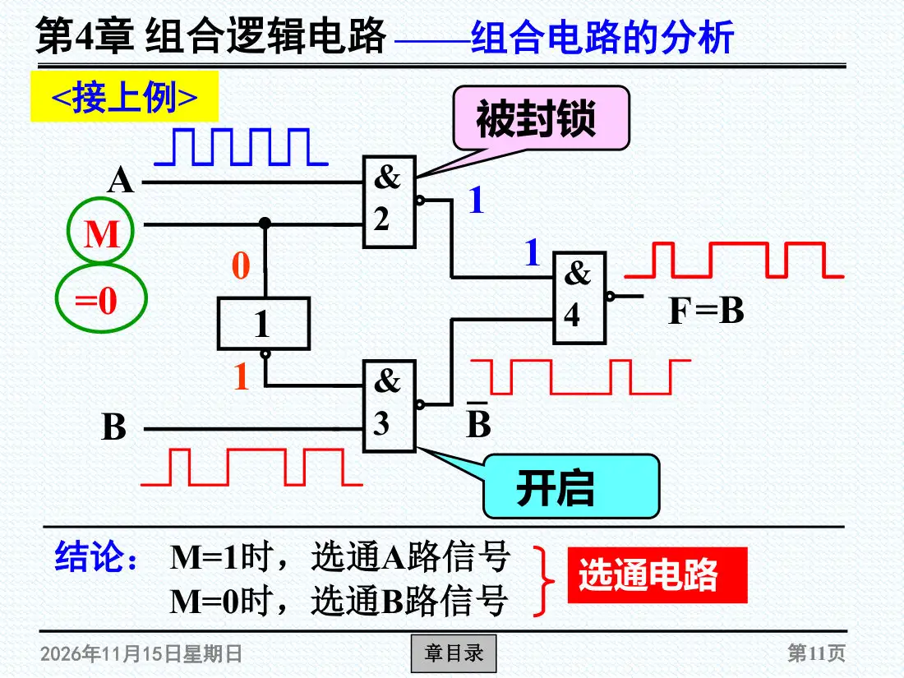

原文：

第4章组合逻辑电路 组合电路的分析

<接上例>

被封锁

结论： M=1时，选通A路信号M=0时，选通B路信号

选通电路

2026年11月15日星期日

章目录

第11页

### 第4章组合逻辑电路 组合电路的分析

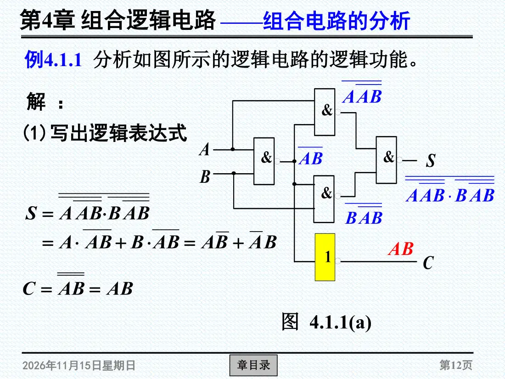

原文：

第4章组合逻辑电路 组合电路的分析

例4.1.1 分析如图所示的逻辑电路的逻辑功能。

解

(1)写出逻辑表达式

$$
= A \cdot \overline {{A B}} + B \cdot \overline {{A B}} = A \overline {{B}} + \overline {{A}} B
$$

$$
C = \overline {{\overline {{A B}}}} = A B
$$

2026年11月15日星期日

章目录

第12页

### 第4章组合逻辑电路 组合电路的分析

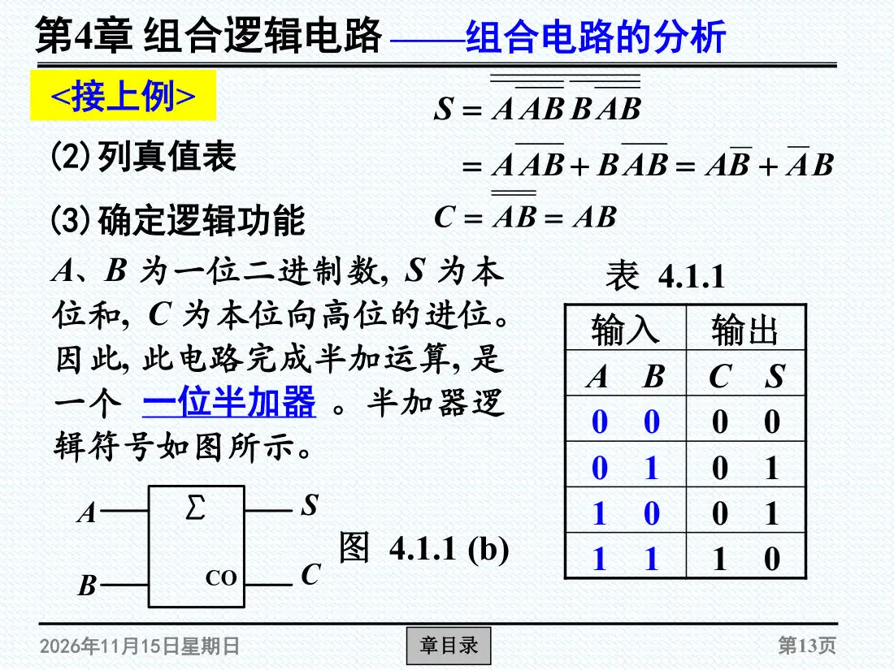

原文：

第4章组合逻辑电路 组合电路的分析

<接上例>

(2)列真值表

(3)确定逻辑功能

$$
\begin{array}{r l} & S = \overline {{A}} \overline {{A B}} \overline {{B}} \overline {{A B}} \\ & = A \overline {{A B}} + B \overline {{A B}} = A \overline {{B}} + \overline {{A}} B \\ & C = \overline {{A B}} = A B \end{array}
$$

A、B为一位二进制数, S 为本位和, C 为本位向高位的进位。因此, 此电路完成半加运算, 是一个 。半加器逻一位半加器辑符号如图所示。

$$
\begin{array}{c c c} \Sigma & S \\ B & \text { co } & C \end{array}
$$

图 4.1.1 (b)

表 4.1.1

<table><tr><td colspan="2">输入</td><td colspan="2">输出</td></tr><tr><td>A</td><td>B</td><td>C</td><td>S</td></tr><tr><td>0</td><td>0</td><td>0</td><td>0</td></tr><tr><td>0</td><td>1</td><td>0</td><td>1</td></tr><tr><td>1</td><td>0</td><td>0</td><td>1</td></tr><tr><td>1</td><td>1</td><td>1</td><td>0</td></tr></table>

2026年11月15日星期日

章目录

第13页

### 第4章组合逻辑电路 组合电路的分析

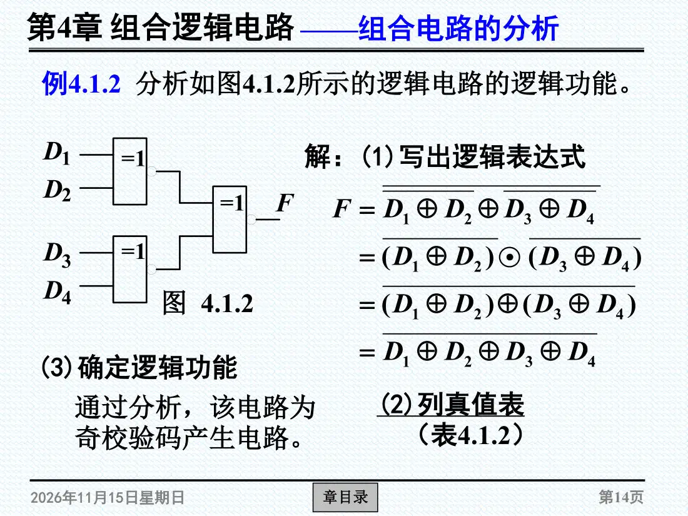

原文：

第4章组合逻辑电路 组合电路的分析

例4.1.2 分析如图4.1.2所示的逻辑电路的逻辑功能。

(3)确定逻辑功能

通过分析，该电路为奇校验码产生电路。

解：(1)写出逻辑表达式

$$
\begin{array}{l} \boldsymbol {F} = \overline {{\boldsymbol {D _ {1}} \oplus \boldsymbol {D _ {2}}}} \oplus \overline {{\boldsymbol {D _ {3}} \oplus \boldsymbol {D _ {4}}}} \\ = \overline {{(\boldsymbol {D _ {1}} \oplus \boldsymbol {D _ {2}})}} \odot \overline {{(\boldsymbol {D _ {3}} \oplus \boldsymbol {D _ {4}})}} \\ = \overline {{(\boldsymbol {D _ {1}} \oplus \boldsymbol {D _ {2}}) \oplus (\boldsymbol {D _ {3}} \oplus \boldsymbol {D _ {4}})}} \\ = \overline {{\boldsymbol {D _ {1}} \oplus \boldsymbol {D _ {2}} \oplus \boldsymbol {D _ {3}} \oplus \boldsymbol {D _ {4}}}} \end{array}
$$

(2)列真值表（表4.1.2）

2026年11月15日星期日

章目录

第14页

### 第4章组合逻辑电路 组合电路的分析

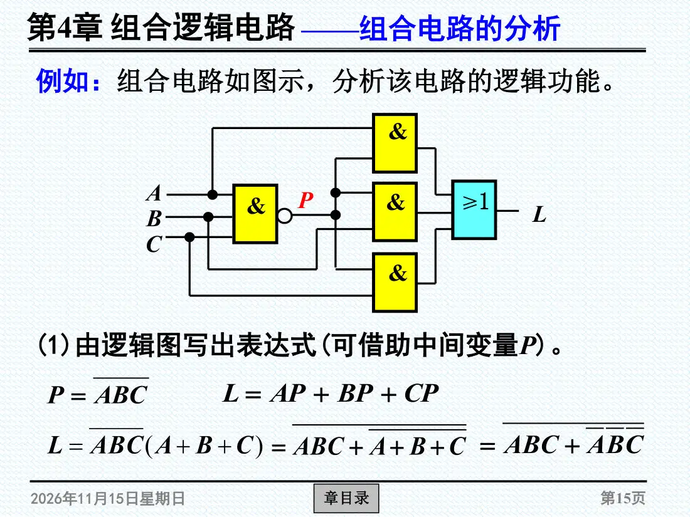

原文：

第4章组合逻辑电路 组合电路的分析

例如：组合电路如图示，分析该电路的逻辑功能。

(1)由逻辑图写出表达式(可借助中间变量P)。

$$
P = \overline {{A B C}}
$$

$$
L = A P + B P + C P
$$

$$
L = A B C (A + B + C) = A B C + \overline {{A + B + C}} = A B C + A B C
$$

2026年11月15日星期日

章目录

第15页

### 第4章 组合逻辑电路 组合电路的分析

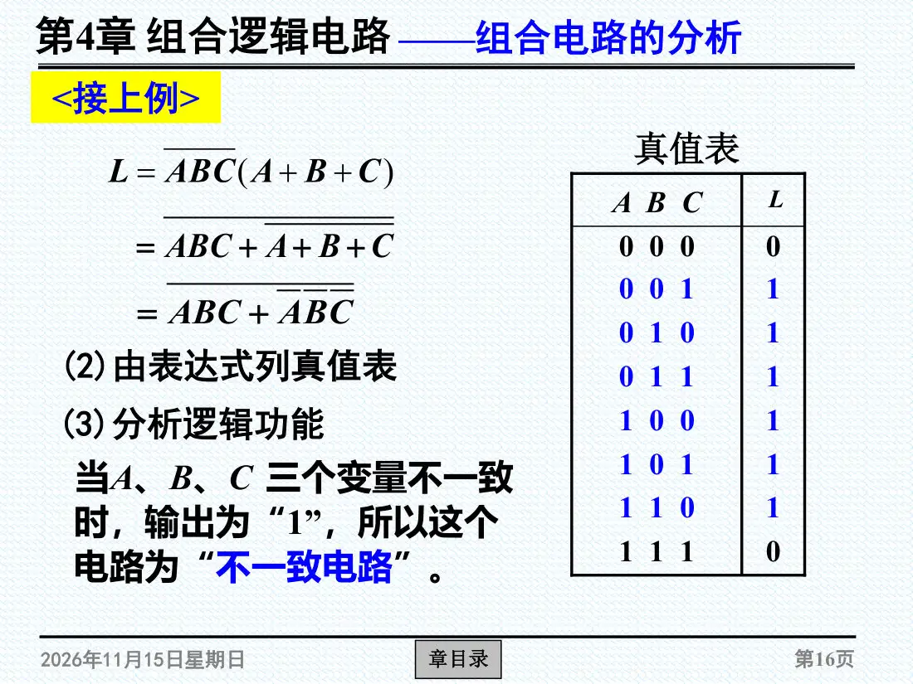

原文：

第4章 组合逻辑电路 组合电路的分析

<接上例>

$$
\begin{array}{r l} & L = \overline {{A B C}} (A + B + C) \\ & = \overline {{A B C + A + B + C}} \\ & = \overline {{A B C + A B C}} \end{array}
$$

(2)由表达式列真值表

(3)分析逻辑功能当A、B、C 三个变量不一致时，输出为“1”，所以这个电路为“不一致电路”

真值表

<table><tr><td>A B C</td><td>L</td></tr><tr><td>0 0 0</td><td>0</td></tr><tr><td>0 0 1</td><td>1</td></tr><tr><td>0 1 0</td><td>1</td></tr><tr><td>0 1 1</td><td>1</td></tr><tr><td>1 0 0</td><td>1</td></tr><tr><td>1 0 1</td><td>1</td></tr><tr><td>1 1 0</td><td>1</td></tr><tr><td>1 1 1</td><td>0</td></tr></table>

2026年11月15日星期日

章目录

第16页

### 第4章组合逻辑电路 组合电路的分析

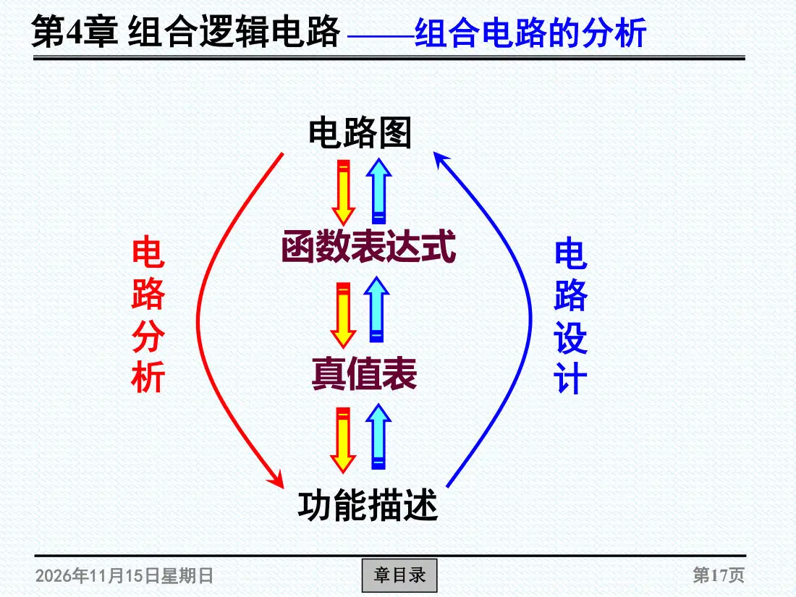

原文：

第4章组合逻辑电路 组合电路的分析

电路图

电

路

设

计

电

路

分

析

功能描述

2026年11月15日星期日

章目录

第17页

### 第4章组合逻辑电路 组合电路的设计

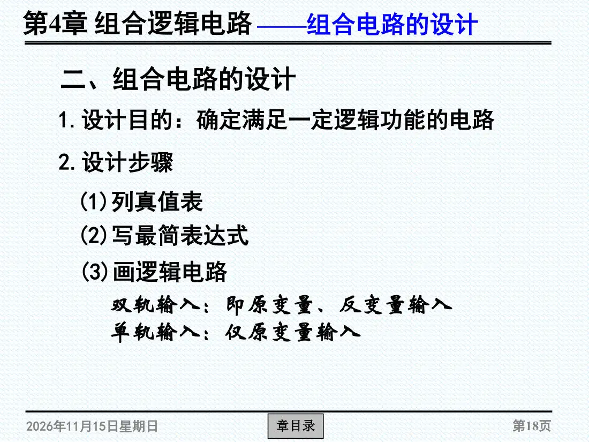

原文：

第4章组合逻辑电路 组合电路的设计

二、组合电路的设计

1.设计目的：确定满足一定逻辑功能的电路

2.设计步骤

(1)列真值表

(2)写最简表达式

(3)画逻辑电路

双轨输入：即原变量、反变量输入单轨输入：仅原变量输入

2026年11月15日星期日

章目录

第18页

### 第4章组合逻辑电路 组合电路的设计

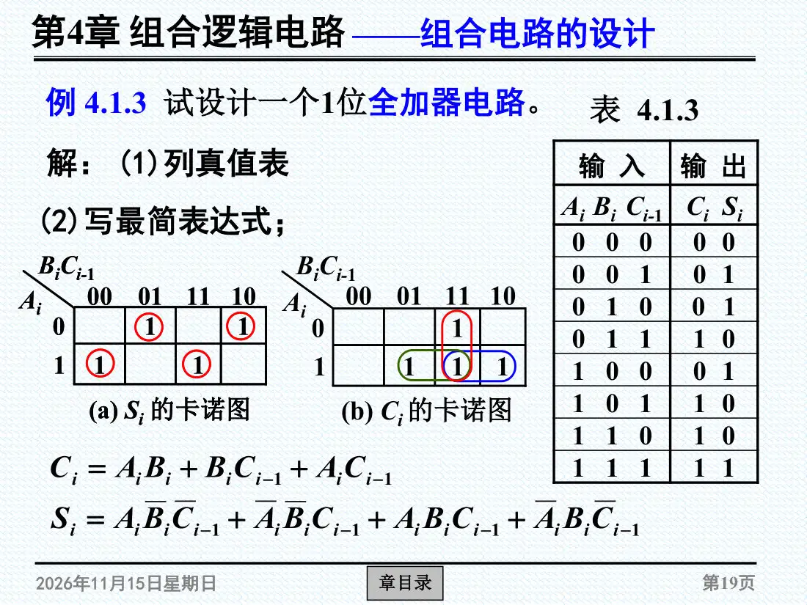

原文：

第4章组合逻辑电路 组合电路的设计

例 4.1.3 试设计一个1位全加器电路。 表 4.1.3

解： (1)列真值表

(2)写最简表达式；

$$
C _ {i} = A _ {i} B _ {i} + B _ {i} C _ {i - 1} + A _ {i} C _ {i - 1}
$$

<table><tr><td colspan="3">输入</td><td colspan="2">输出</td></tr><tr><td> $A_i$ </td><td> $B_i$ </td><td> $C_{i-1}$ </td><td> $C_i$ </td><td> $S_i$ </td></tr><tr><td>0</td><td>0</td><td>0</td><td>0</td><td>0</td></tr><tr><td>0</td><td>0</td><td>1</td><td>0</td><td>1</td></tr><tr><td>0</td><td>1</td><td>0</td><td>0</td><td>1</td></tr><tr><td>0</td><td>1</td><td>1</td><td>1</td><td>0</td></tr><tr><td>1</td><td>0</td><td>0</td><td>0</td><td>1</td></tr><tr><td>1</td><td>0</td><td>1</td><td>1</td><td>0</td></tr><tr><td>1</td><td>1</td><td>0</td><td>1</td><td>0</td></tr><tr><td>1</td><td>1</td><td>1</td><td>1</td><td>1</td></tr></table>

$$
S _ {i} = A _ {i} \overline {{B}} _ {i} \overline {{C}} _ {i - 1} + \overline {{A}} _ {i} \overline {{B}} _ {i} C _ {i - 1} + A _ {i} B _ {i} C _ {i - 1} + \overline {{A}} _ {i} B _ {i} \overline {{C}} _ {i - 1}
$$

2026年11月15日星期日

章目录

第19页

### 第4章组合逻辑电路 组合电路的设计

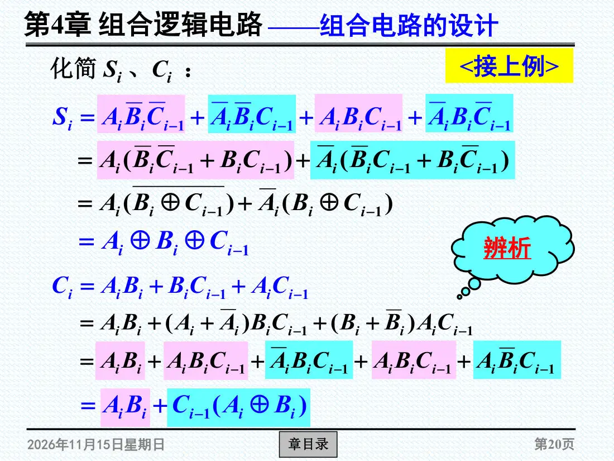

原文：

第4章组合逻辑电路 组合电路的设计

化简 $S _ { i } \setminus C _ { i }$

<接上例>

$$
\begin{array}{r l} S _ {i} & = A _ {i} \overline {{B}} _ {i} \overline {{C}} _ {i - 1} + \overline {{A}} _ {i} \overline {{B}} _ {i} C _ {i - 1} + A _ {i} B _ {i} C _ {i - 1} + \overline {{A}} _ {i} B _ {i} \overline {{C}} _ {i - 1} \\ & = A _ {i} (\overline {{B}} _ {i} \overline {{C}} _ {i - 1} + B _ {i} C _ {i - 1}) + \overline {{A}} _ {i} (\overline {{B}} _ {i} C _ {i - 1} + B _ {i} \overline {{C}} _ {i - 1}) \\ & = A _ {i} (\overline {{B}} _ {i} \oplus C _ {i - 1}) + \overline {{A}} _ {i} (B _ {i} \oplus C _ {i - 1}) \\ & = A _ {i} \oplus B _ {i} \oplus C _ {i - 1} \end{array}
$$

辨析

$$
\begin{array}{r l} & C _ {i} = A _ {i} B _ {i} + B _ {i} C _ {i - 1} + A _ {i} C _ {i - 1} \\ & \quad = A _ {i} B _ {i} + (A _ {i} + \overline {{A}} _ {i}) B _ {i} C _ {i - 1} + (B _ {i} + \overline {{B}} _ {i}) A _ {i} C _ {i - 1} \\ & \quad = A _ {i} B _ {i} + A _ {i} B _ {i} C _ {i - 1} + \overline {{A}} _ {i} B _ {i} C _ {i - 1} + A _ {i} B _ {i} C _ {i - 1} + A _ {i} \overline {{B}} _ {i} C _ {i - 1} \\ & \quad = A _ {i} B _ {i} + C _ {i - 1} (A _ {i} \oplus B _ {i}) \end{array}
$$

2026年11月15日星期日

章目录

第20页

### 第4章组合逻辑电路 组合电路的设计

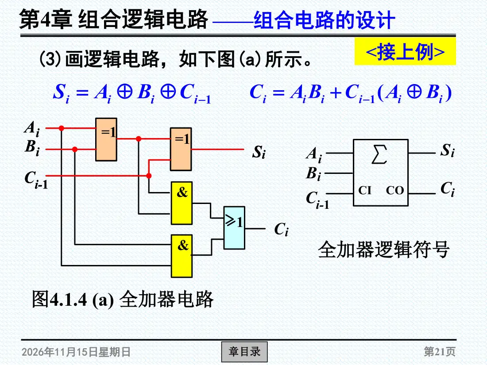

原文：

第4章组合逻辑电路 组合电路的设计

(3)画逻辑电路，如下图(a)所示。

<接上例>

$$
S _ {i} = A _ {i} \oplus B _ {i} \oplus C _ {i - 1} \qquad C _ {i} = A _ {i} B _ {i} + C _ {i - 1} (A _ {i} \oplus B _ {i})
$$

全加器逻辑符号

2026年11月15日星期日

章目录

第21页

### 第4章组合逻辑电路 组合电路的设计

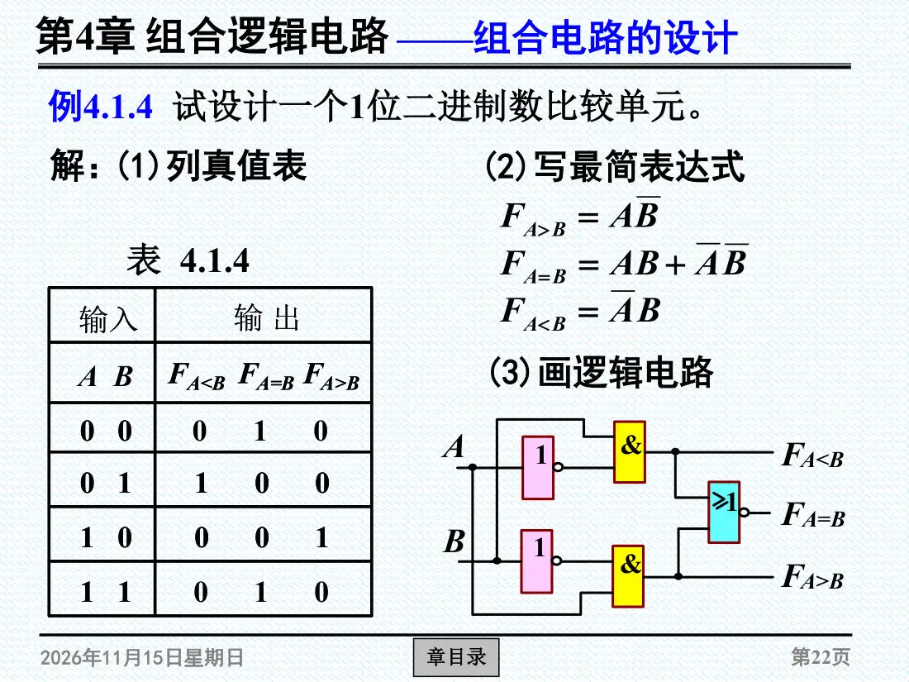

原文：

第4章组合逻辑电路 组合电路的设计

例4.1.4 试设计一个1位二进制数比较单元。

解：(1) 列真值表

表 4.1.4

<table><tr><td>输入</td><td>输出</td></tr><tr><td>A B</td><td> $F_{A<B}$   $F_{A=B}$   $F_{A>B}$ </td></tr><tr><td>0 0</td><td>0 1 0</td></tr><tr><td>0 1</td><td>1 0 0</td></tr><tr><td>1 0</td><td>0 0 1</td></tr><tr><td>1 1</td><td>0 1 0</td></tr></table>

(2)写最简表达式

$$
\begin{array}{l} F _ {A > B} = A \overline {{B}} \\ F _ {A = B} = A B + \overline {{A}} \overline {{B}} \\ F _ {A <   B} = \overline {{A}} B \end{array}
$$

(3)画逻辑电路

2026年11月15日星期日

章目录

第22页

### 第4章组合逻辑电路 组合电路的设计

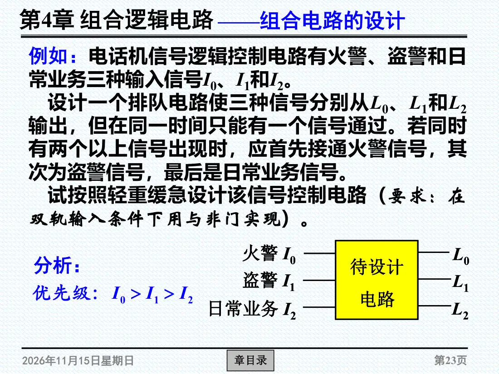

原文：

第4章组合逻辑电路 组合电路的设计

例如：电话机信号逻辑控制电路有火警、盗警和日常业务三种输入信号 $I _ { 0 } .$ 、 $I _ { 1 }$ 和 $I _ { 2 }$ 。

设计一个排队电路使三种信号分别从 $L _ { 0 }$ $L _ { 1 }$ 和 $L _ { 2 }$ 输出，但在同一时间只能有一个信号通过。若同时有两个以上信号出现时，应首先接通火警信号，其次为盗警信号，最后是日常业务信号。

试按照轻重缓急设计该信号控制电路（要求：在双轨输入条件下用与非门实现）。

分析：

优先级： $I _ { 0 } > I _ { 1 } > I _ { 2 }$

$$
I _ {0}
$$

$$
I _ {1}
$$

$$
I _ {2}
$$

待设计电路

2026年11月15日星期日

章目录

第23页

### 第4章组合逻辑电路 组合电路的设计

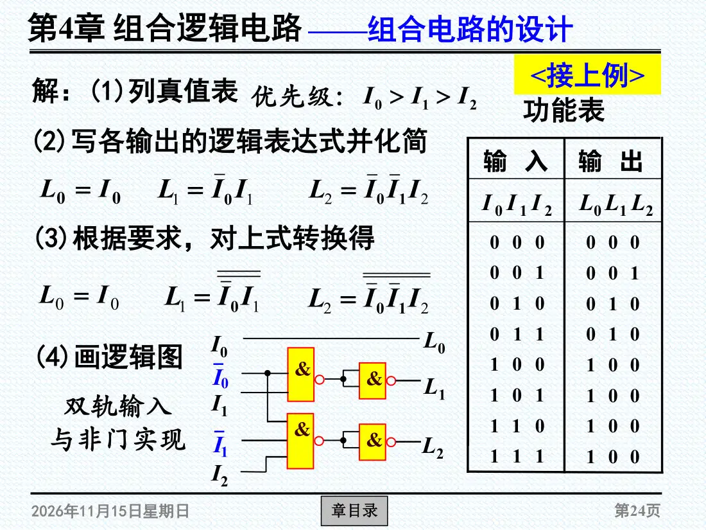

原文：

第4章组合逻辑电路 组合电路的设计

解：(1)列真值表 优先级： $I _ { 0 } > I _ { 1 } > I _ { 2 }$

(2)写各输出的逻辑表达式并化简

$$
L _ {0} = I _ {0} \quad L _ {1} = \bar {I} _ {0} I _ {1} \quad L _ {2} = \bar {I} _ {0} \bar {I} _ {1} I _ {2}
$$

(3)根据要求，对上式转换得

$$
L _ {0} = I _ {0} \quad L _ {1} = \overline {{\overline {{\overline {{I}} _ {0} I _ {1}}}}} \quad L _ {2} = \overline {{\overline {{\overline {{I}} _ {0} \overline {{I}} _ {1} I _ {2}}}}}
$$

(4)画逻辑图

双轨输入与非门实现<接上例>

功能表

<table><tr><td>输入</td><td>输出</td></tr><tr><td> $I_0I_1I_2$ </td><td> $L_0L_1L_2$ </td></tr><tr><td>0 0 0</td><td>0 0 0</td></tr><tr><td>0 0 1</td><td>0 0 1</td></tr><tr><td>0 1 0</td><td>0 1 0</td></tr><tr><td>0 1 1</td><td>0 1 0</td></tr><tr><td>1 0 0</td><td>1 0 0</td></tr><tr><td>1 0 1</td><td>1 0 0</td></tr><tr><td>1 1 0</td><td>1 0 0</td></tr><tr><td>1 1 1</td><td>1 0 0</td></tr></table>

2026年11月15日星期日

章目录

第24页

### 第4章组合逻辑电路 组合电路的设计

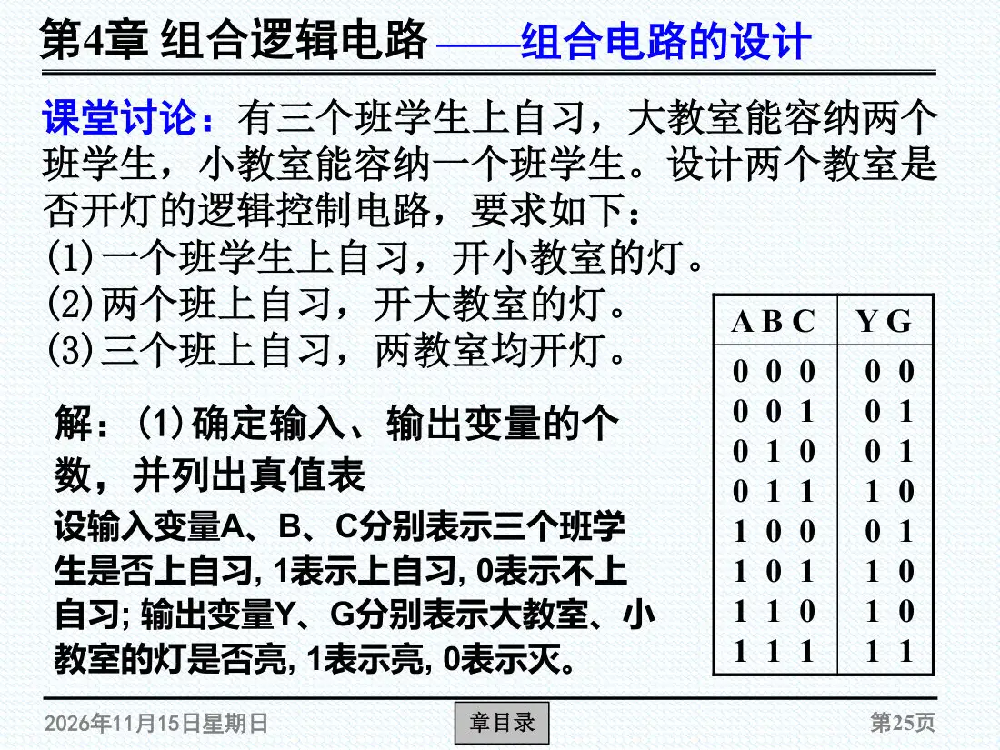

原文：

第4章组合逻辑电路 组合电路的设计

课堂讨论：有三个班学生上自习，大教室能容纳两个班学生，小教室能容纳一个班学生。设计两个教室是否开灯的逻辑控制电路，要求如下：

(1)一个班学生上自习，开小教室的灯。

(2)两个班上自习，开大教室的灯。

(3)三个班上自习，两教室均开灯。

解：(1)确定输入、输出变量的个数，并列出真值表

设输入变量A、B、C分别表示三个班学生是否上自习, 1表示上自习, 0表示不上自习; 输出变量Y、G分别表示大教室、小教室的灯是否亮, 1表示亮, 0表示灭。

<table><tr><td>ABC</td><td>YG</td></tr><tr><td>0 0 0 0 1 0 1 0 1 0 1 0 1 0 1 1</td><td>0 0 0 1 0 1 0 1 0 1 0 1 1</td></tr></table>

2026年11月15日星期日

章目录

第25页

### 第4章组合逻辑电路 组合电路的设计

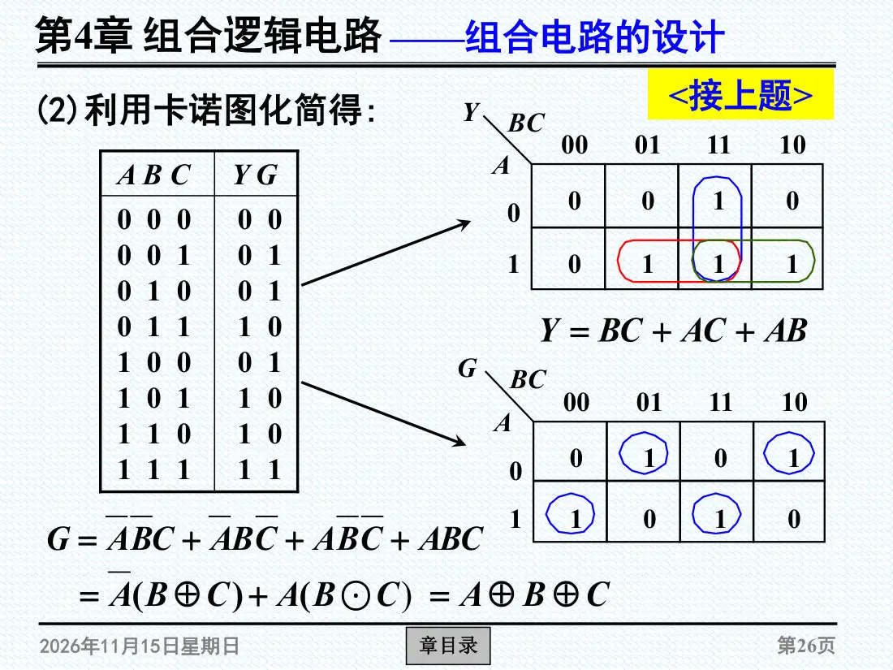

原文：

第4章组合逻辑电路 组合电路的设计

(2)利用卡诺图化简得:

$$
\begin{array}{c c c} \hline A & B & C \\ \hline 0 & 0 & 0 \\ 0 & 0 & 1 \\ 0 & 1 & 0 \\ 0 & 1 & 1 \\ 1 & 0 & 0 \\ 1 & 0 & 1 \\ 1 & 1 & 0 \\ 1 & 1 & 1 \end{array} \quad \begin{array}{c c c} \hline Y & G \\ \hline 0 & 0 \\ 0 & 1 \\ 0 & 1 \\ 1 & 0 \\ 0 & 1 \\ 1 & 0 \\ 1 & 0 \\ 1 & 1 \end{array}
$$

<接上题>

$$
\begin{array}{c c c c c} Y & 0 0 & 0 1 & 1 1 & 1 0 \\ \hline A & 0 & 0 & 1 & 0 \\ \hline 0 & 0 & 1 & 1 & 1 \\ \hline 1 & 0 & 1 & 1 & 1 \end{array}
$$

$$
Y = B C + A C + A B
$$

<table><tr><td rowspan="3">BC A</td><td>00</td><td>01</td><td>11</td><td>10</td></tr><tr><td>0</td><td>1</td><td>0</td><td>1</td></tr><tr><td>1</td><td>0</td><td>1</td><td>0</td></tr></table>

$$
\begin{array}{r l} G & = \overline {{A}} \overline {{B}} C + \overline {{A}} B \overline {{C}} + A \overline {{B}} \overline {{C}} + A B C ^ {- 1} \\ & = \overline {{A}} (B \oplus C) + A (B \odot C) = A \oplus B \oplus C \end{array}
$$

2026年11月15日星期日

章目录

第26页

### 第4章组合逻辑电路 组合电路的设计接上题>

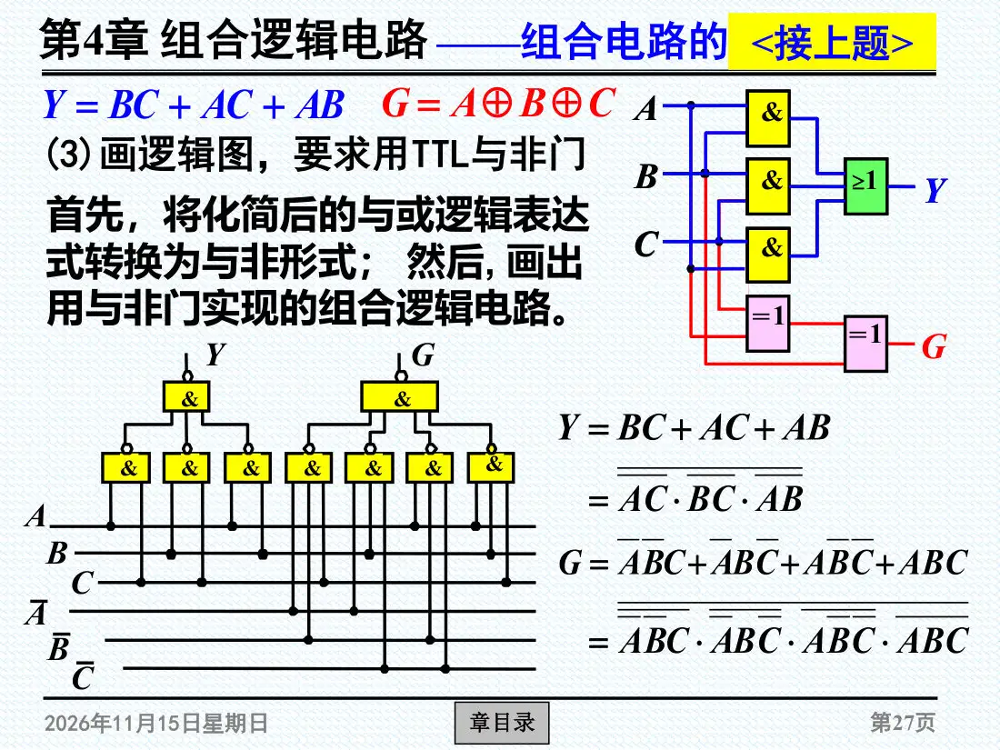

原文：

第4章组合逻辑电路 组合电路的设计<接上题>

$$
Y = B C + A C + A B \quad G = A \oplus B \oplus C
$$

(3)画逻辑图，要求用TTL与非门首先，将化简后的与或逻辑表达式转换为与非形式； 然后, 画出用与非门实现的组合逻辑电路。

$$
\begin{array}{r l} & {Y = B C + A C + A B} \\ & {\qquad = \overline {{A C}} \cdot \overline {{B C}} \cdot \overline {{A B}}} \\ & {G = \overline {{A B}} C + \overline {{A B}} \overline {{C}} + A \overline {{B}} \overline {{C}} + A B C} \\ & {\qquad = \overline {{\overline {{A B}} C}} \cdot \overline {{\overline {{A B}} C}} \cdot \overline {{A B}} \overline {{C}} \cdot \overline {{A B C}}} \end{array}
$$

2026年11月15日星期日

章目录

第27页

### 第4章组合逻辑电路 组合电路的设计

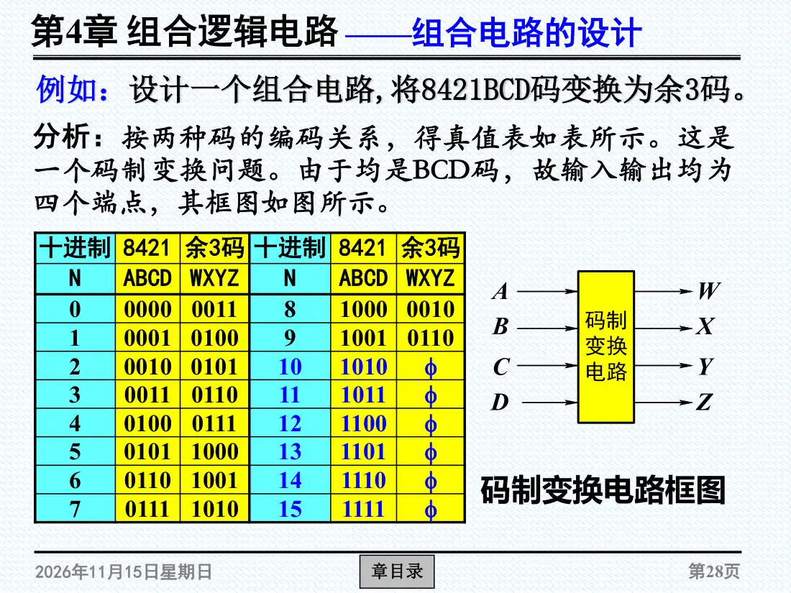

原文：

第4章组合逻辑电路 组合电路的设计

例如：设计一个组合电路,将8421BCD码变换为余3码。

分析：按两种码的编码关系，得真值表如表所示。这是一个码制变换问题。由于均是BCD码，故输入输出均为四个端点，其框图如图所示。

<table><tr><td>十进制</td><td>8421</td><td>余3码</td><td>十进制</td><td>8421</td><td>余3码</td></tr><tr><td>N</td><td>ABCD</td><td>WXYZ</td><td>N</td><td>ABCD</td><td>WXYZ</td></tr><tr><td>0</td><td>0000</td><td>0011</td><td>8</td><td>1000</td><td>0010</td></tr><tr><td>1</td><td>0001</td><td>0100</td><td>9</td><td>1001</td><td>0110</td></tr><tr><td>2</td><td>0010</td><td>0101</td><td>10</td><td>1010</td><td> $\phi$ </td></tr><tr><td>3</td><td>0011</td><td>0110</td><td>11</td><td>1011</td><td> $\phi$ </td></tr><tr><td>4</td><td>0100</td><td>0111</td><td>12</td><td>1100</td><td> $\phi$ </td></tr><tr><td>5</td><td>0101</td><td>1000</td><td>13</td><td>1101</td><td> $\phi$ </td></tr><tr><td>6</td><td>0110</td><td>1001</td><td>14</td><td>1110</td><td> $\phi$ </td></tr><tr><td>7</td><td>0111</td><td>1010</td><td>15</td><td>1111</td><td> $\phi$ </td></tr></table>

码制变换电路框图

2026年11月15日星期日

章目录

第28页

### 第4章组合逻辑电路 组合电路的设计接上题>

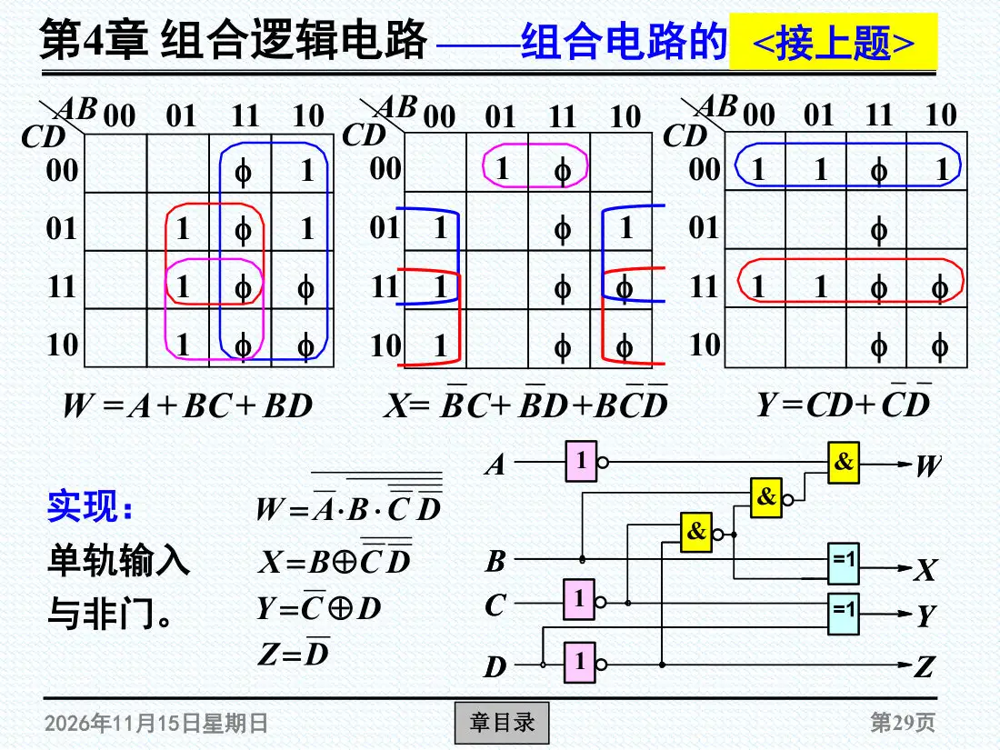

原文：

第4章组合逻辑电路 组合电路的设计<接上题>

<table><tr><td>CD\AB 00</td><td>01</td><td>11</td><td>10</td></tr><tr><td>00</td><td></td><td>φ</td><td>1</td></tr><tr><td>01</td><td>1</td><td>φ</td><td>1</td></tr><tr><td>11</td><td>1</td><td>φ</td><td>φ</td></tr><tr><td>10</td><td>1</td><td>φ</td><td>φ</td></tr></table>

<table><tr><td>CD\AB</td><td>00</td><td>01</td><td>11</td><td>10</td></tr><tr><td>00</td><td></td><td>1</td><td> $\phi$ </td><td></td></tr><tr><td>01</td><td>1</td><td></td><td> $\phi$ </td><td>1</td></tr><tr><td>11</td><td>1</td><td></td><td> $\phi$ </td><td> $\phi$ </td></tr><tr><td>10</td><td>1</td><td></td><td> $\phi$ </td><td> $\phi$ </td></tr></table>

$$
W = A + B C + B D
$$

$$
X = \bar {B} C + \bar {B} D + B \bar {C} \bar {D}
$$

实现：单轨输入与非门。

$$
\begin{array}{l} W = \overline {{A}} \cdot \overline {{B}} \cdot \overline {{C}} \overline {{D}} \\ X = B \oplus \overline {{C}} \overline {{D}} \\ Y = \overline {{C}} \oplus D \\ Z = \overline {{D}} \end{array}
$$

<table><tr><td>CD\AB</td><td>00</td><td>01</td><td>11</td><td>10</td></tr><tr><td>00</td><td>1</td><td>1</td><td> $\phi$ </td><td>1</td></tr><tr><td>01</td><td></td><td></td><td> $\phi$ </td><td></td></tr><tr><td>11</td><td>1</td><td>1</td><td> $\phi$ </td><td> $\phi$ </td></tr><tr><td>10</td><td></td><td></td><td> $\phi$ </td><td> $\phi$ </td></tr></table>

$$
Y = C D + \bar {C} \bar {D}
$$

2026年11月15日星期日

章目录

第29页

### 第4章 组合逻辑电路——集成逻辑门使用中的实际问题

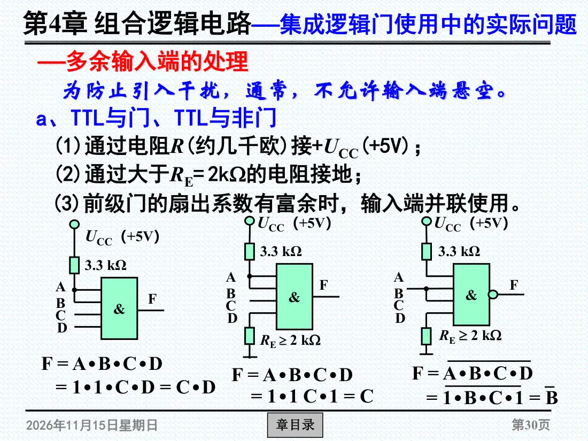

原文：

第4章 组合逻辑电路——集成逻辑门使用中的实际问题

——多余输入端的处理

为防止引入干扰，通常，不允许输入端悬空。

a、TTL与门、TTL与非门

(1)通过电阻R(约几千欧)接+ $\cdot U _ { C C } ( + 5 V )$

(2)通过大于 $R _ { \mathrm { E } } = 2 { \bf k } \Omega$ 的电阻接地；

(3)前级门的扇出系数有富余时，输入端并联使用。

$$
\begin{array}{r l} \mathbf {F} & = \mathbf {A} \cdot \mathbf {B} \cdot \mathbf {C} \cdot \mathbf {D} \\ & = 1 \cdot 1 \cdot \mathbf {C} \cdot \mathbf {D} = \mathbf {C} \cdot \mathbf {D} \end{array}
$$

$$
\begin{array}{r l} \mathbf {F} & = \mathbf {A} \cdot \mathbf {B} \cdot \mathbf {C} \cdot \mathbf {D} \\ & = 1 \cdot 1 \mathbf {C} \cdot 1 = \mathbf {C} \end{array}
$$

$$
\begin{array}{r l} & \mathbf {F} = \mathbf {A} \bullet \mathbf {B} \bullet \mathbf {C} \bullet \mathbf {D} \\ & = \overline {{\mathbf {1} \bullet \mathbf {B} \bullet \mathbf {C} \bullet \mathbf {1}}} = \overline {{\mathbf {B}}} \end{array}
$$

2026年11月15日星期日

章目录

第30页

### 第4章 组合逻辑电路——集成逻辑门使用中的实际问题

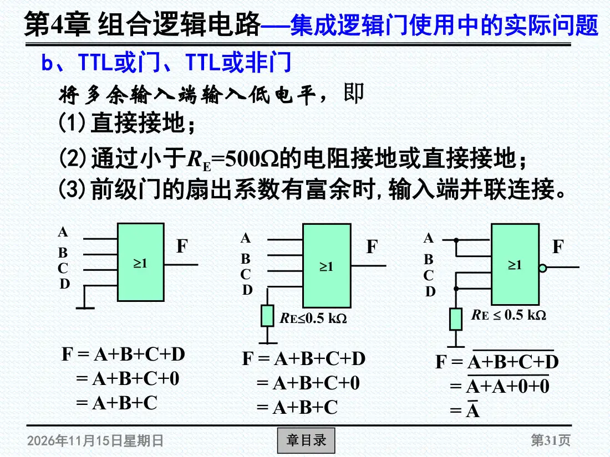

原文：

第4章 组合逻辑电路——集成逻辑门使用中的实际问题

b、TTL或门、TTL或非门

将多余输入端输入低电平，即

(1)直接接地；

(2)通过小于 $R _ { \mathrm { E } } { = } 5 0 0 \Omega$ 的电阻接地或直接接地；

(3)前级门的扇出系数有富余时,输入端并联连接。

$$
\begin{array}{c} \text { A } \\ \text { B } \\ \text { C } \\ \text { D } \end{array} \boxed {\geq 1} \quad \text { F }
$$

$$
\begin{array}{c} \text { A } \\ \text { B } \\ \text { C } \\ \text { D } \end{array} \quad \begin{array}{c} \text { ≥1 } \\ \text { F } \\ \text { RE≤0.5kΩ } \end{array}
$$

$$
\begin{array}{c} \text { A } \\ \text { B } \\ \text { C } \\ \text { D } \end{array} \boxed {\geq 1} \boxed {F}
$$

$$
\begin{array}{r l} & {\mathbf {F} = \mathbf {A} + \mathbf {B} + \mathbf {C} + \mathbf {D}} \\ & {\quad = \mathbf {A} + \mathbf {B} + \mathbf {C} + \mathbf {0}} \\ & {\quad = \mathbf {A} + \mathbf {B} + \mathbf {C}} \end{array}
$$

$$
\begin{array}{r l} & {\mathbf {F} = \mathbf {A} + \mathbf {B} + \mathbf {C} + \mathbf {D}} \\ & {\quad = \mathbf {A} + \mathbf {B} + \mathbf {C} + \mathbf {0}} \\ & {\quad = \mathbf {A} + \mathbf {B} + \mathbf {C}} \end{array}
$$

$$
\begin{array}{r l} & {\mathbf {F} = \overline {{\mathbf {A} + \mathbf {B} + \mathbf {C} + \mathbf {D}}}} \\ & {= \overline {{\mathbf {A} + \mathbf {A} + \mathbf {0} + \mathbf {0}}}} \\ & {= \overline {{\mathbf {A}}}} \end{array}
$$

2026年11月15日星期日

章目录

第31页

### 第4章 组合逻辑电路——集成逻辑门使用中的实际问题

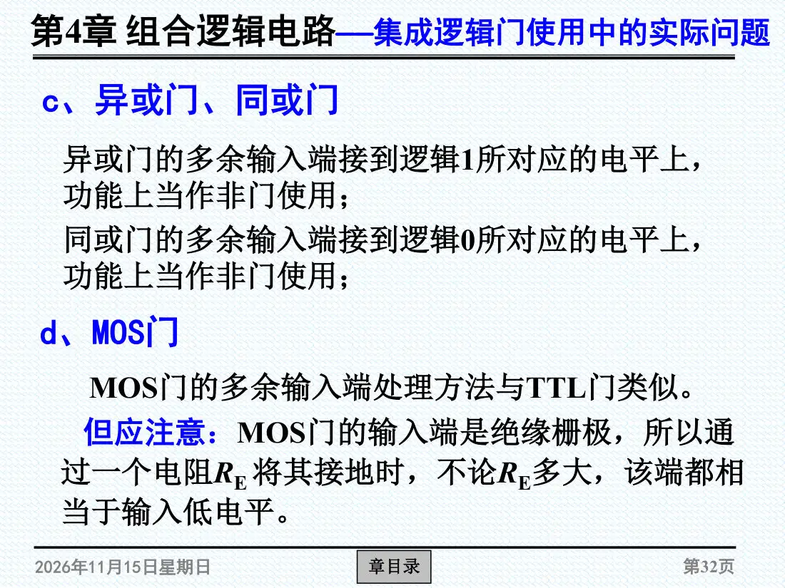

原文：

第4章 组合逻辑电路——集成逻辑门使用中的实际问题

异或门、同或门

异或门的多余输入端接到逻辑1所对应的电平上，功能上当作非门使用；

同或门的多余输入端接到逻辑0所对应的电平上，功能上当作非门使用；

d、MOS门

MOS门的多余输入端处理方法与TTL门类似。

但应注意：MOS门的输入端是绝缘栅极，所以通过一个电阻 $R _ { \mathrm { { E } } }$ 将其接地时，不论 $R _ { \mathrm { E } }$ 多大，该端都相当于输入低电平。

2026年11月15日星期日

章目录

第32页

### 第4章组合逻辑电路 组合电路的设计

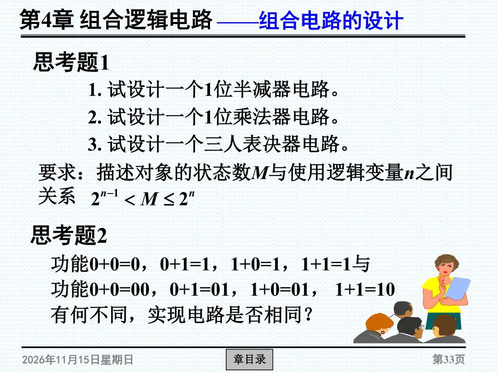

原文：

第4章组合逻辑电路 组合电路的设计

思考题1

1. 试设计一个1位半减器电路。

2. 试设计一个1位乘法器电路。

3. 试设计一个三人表决器电路。

要求：描述对象的状态数M与使用逻辑变量n之间关系 $2 ^ { n - 1 } < M \leq 2 ^ { n }$

思考题2

功能0+0=0，0+1=1，1+0=1，1+1=1与功能0+0=00，0+1=01，1+0=01， 1+1=10有何不同，实现电路是否相同？

2026年11月15日星期日

章目录

第33页

### 第4章组合逻辑电路

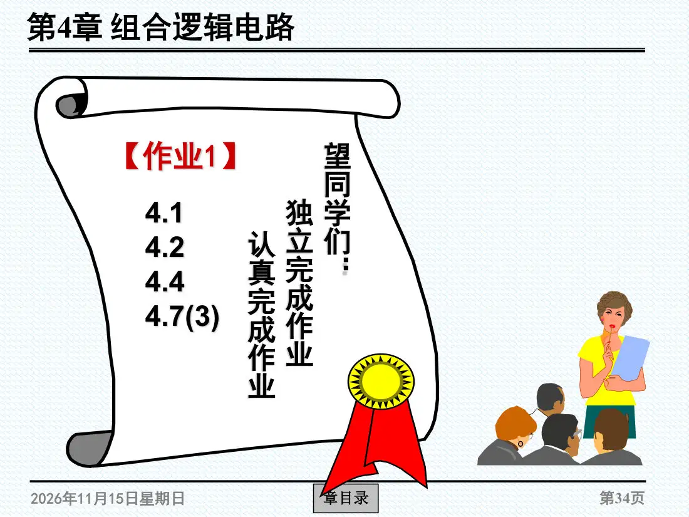

原文：

第4章组合逻辑电路

望同学们：

【作业1】

独立完成作业

认真完成作业

4.1

4.2

4.4

4.7(3)

2026年11月15日星期日

章目录

第34页

### 第4章组合逻辑电路

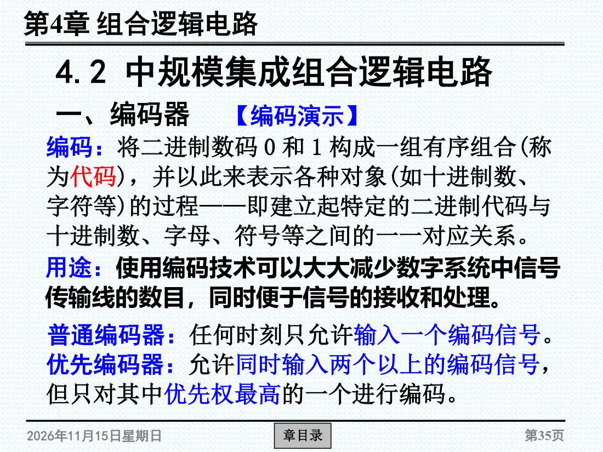

原文：

第4章组合逻辑电路

4.2 中规模集成组合逻辑电路

一、 编码器 【编码演示】

编码：将二进制数码 0 和 1 构成一组有序组合(称为代码)，并以此来表示各种对象(如十进制数、字符等)的过程——即建立起特定的二进制代码与十进制数、字母、符号等之间的一一对应关系。

用途：使用编码技术可以大大减少数字系统中信号传输线的数目，同时便于信号的接收和处理。

普通编码器：任何时刻只允许输入一个编码信号。

优先编码器：允许同时输入两个以上的编码信号，但只对其中优先权最高的一个进行编码。

2026年11月15日星期日

章目录

第35页

### 第4章组合逻辑电路

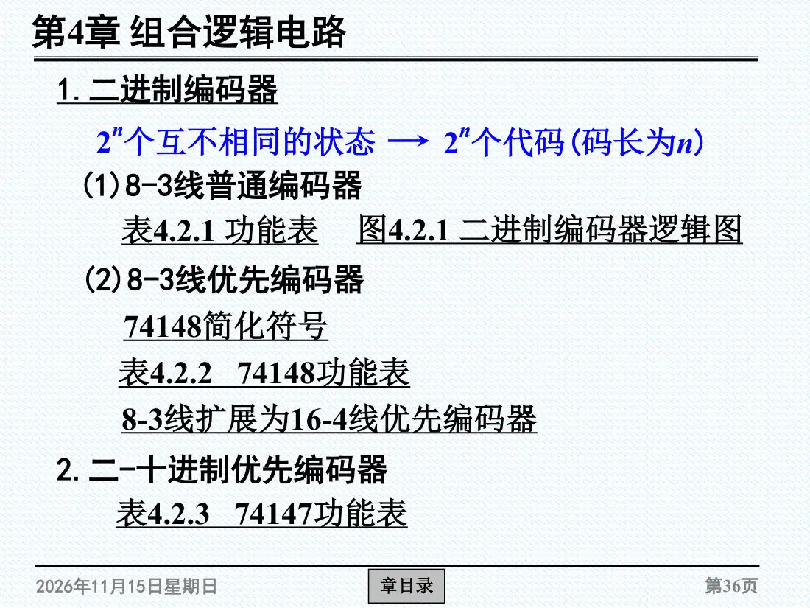

原文：

第4章组合逻辑电路

1.二进制编码器

2n个互不相同的状态 2n个代码(码长为n)

(1)8-3线普通编码器

图4.2.1 二进制编码器逻辑图表4.2.1 功能表

(2)8-3线优先编码器

74148简化符号

表4.2.2 74148功能表

8-3线扩展为16-4线优先编码器

2.二-十进制优先编码器

表4.2.3 74147功能表

2026年11月15日星期日

章目录

第36页

### 第4章组合逻辑电路

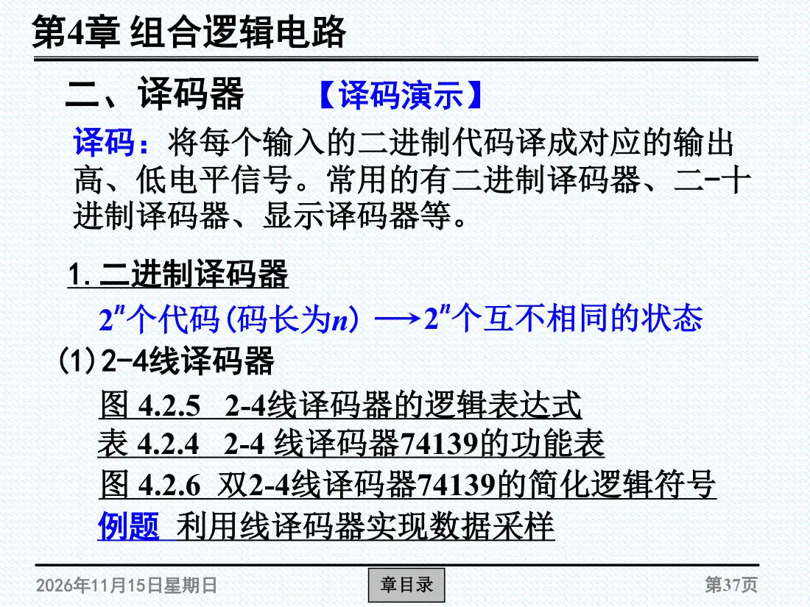

原文：

第4章组合逻辑电路

译码器 【译码演示】

译码：将每个输入的二进制代码译成对应的输出高、低电平信号。常用的有二进制译码器、二-十进制译码器、显示译码器等。

1.二进制译码器

2n个代码(码长为n) 2n个互不相同的状态

(1)2-4线译码器

图 4.2.5 2-4线译码器的逻辑表达式

表 4.2.4 2-4 线译码器74139的功能表

图 4.2.6 双2-4线译码器74139的简化逻辑符号例题 利用线译码器实现数据采样

2026年11月15日星期日

章目录

第37页

### 第4章组合逻辑电路

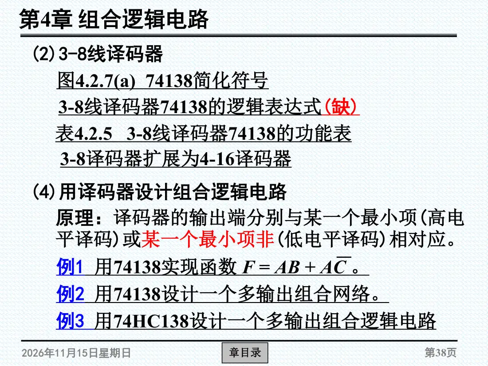

原文：

第4章组合逻辑电路

(2)3 -8线译码器

图4.2.7(a) 74138简化符号3-8线译码器74138的逻辑表达式(缺)表4.2.5 3-8线译码器74138的功能表3-8译码器扩展为4-16译码器

(4)用译码器设计组合逻辑电路

原理：译码器的输出端分别与某一个最小项(高电平译码)或某一个最小项非(低电平译码)相对应。

例1 用74138实现函数 $F = A B + A C$

例2 用74138设计一个多输出组合网络。

例3 用74HC138设计一个多输出组合逻辑电路

2026年11月15日星期日

章目录

第38页

### 第4章组合逻辑电路

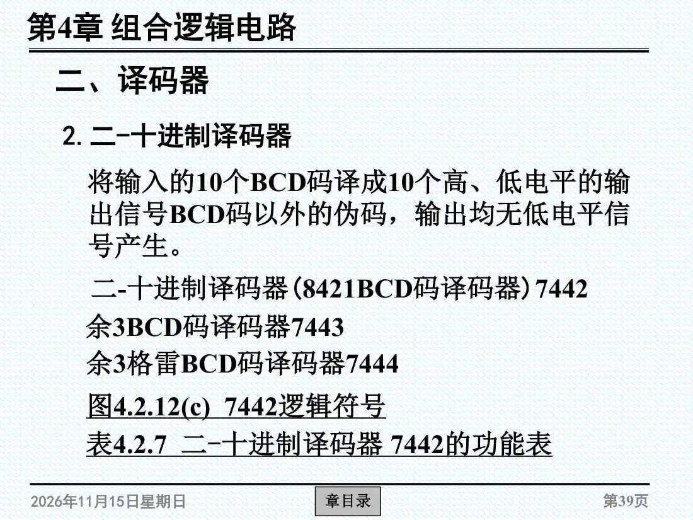

原文：

第4章组合逻辑电路

二、 译码器

2.二-十进制译码器

将输入的10个BCD码译成10个高、低电平的输出信号BCD码以外的伪码，输出均无低电平信号产生。

二-十进制译码器(8421BCD码译码器)7442

余3BCD码译码器7443

余3格雷BCD码译码器7444

图4.2.12(c) 7442逻辑符号

表4.2.7 二-十进制译码器 7442的功能表

2026年11月15日星期日

章目录

第39页

### 第4章组合逻辑电路

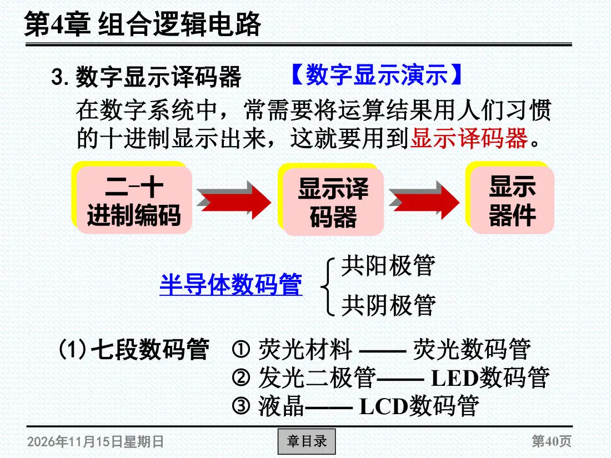

原文：

第4章组合逻辑电路

3.数字显示译码器 【数字显示演示】

在数字系统中，常需要将运算结果用人们习惯的十进制显示出来，这就要用到显示译码器。

二-十进制编码

显示译码器显示器件

半导体数码管

共阳极管

共阴极管

(1)七段数码管

 荧光材料 —— 荧光数码管

 发光二极管— LED数码管

 液晶— — LCD数码管

2026年11月15日星期日

章目录

第40页

### 第4章组合逻辑电路

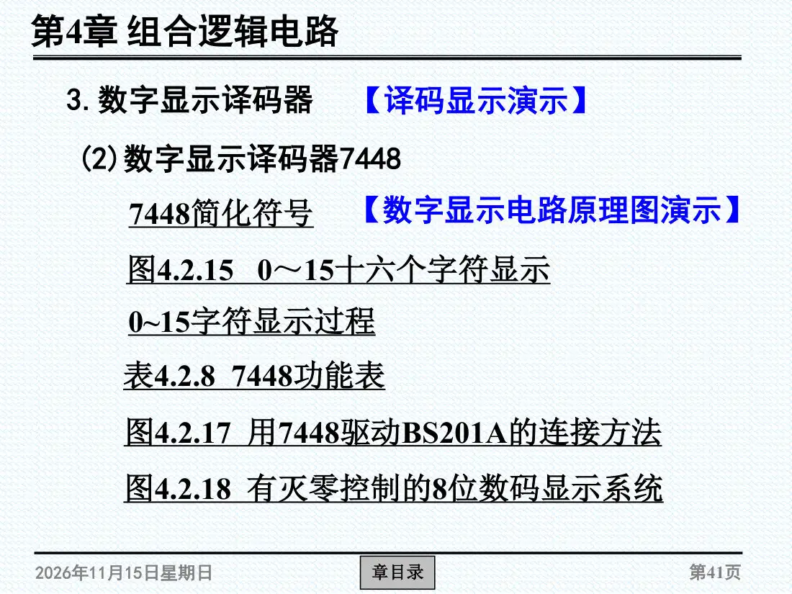

原文：

第4章组合逻辑电路

3.数字显示译码器 【译码显示演示】

(2)数字显示译码器74487448简化符号 【数字显示电路原理图演示】图4.2.15 0～15十六个字符显示0\~15字符显示过程表4.2.8 7448功能表图4.2.17 用7448驱动BS201A的连接方法图4.2.18 有灭零控制的8位数码显示系统

2026年11月15日星期日

章目录

第41页

### 第4章组合逻辑电路

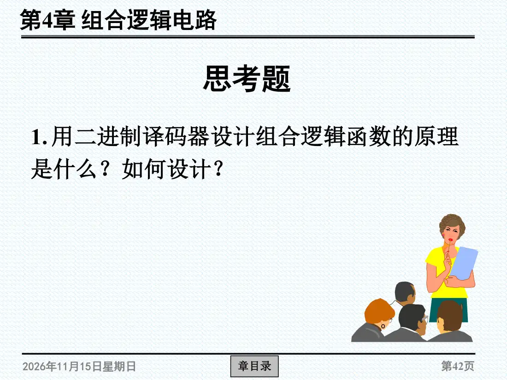

原文：

第4章组合逻辑电路

思考题

1.用二进制译码器设计组合逻辑函数的原理是什么？如何设计？

2026年11月15日星期日

章目录

第42页

### 第4章组合逻辑电路

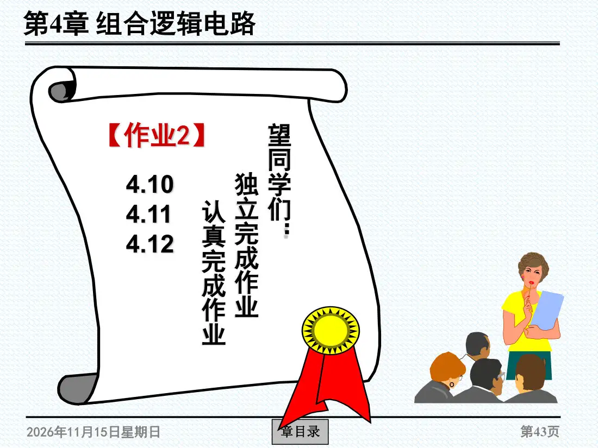

原文：

第4章组合逻辑电路

望同学们：

【作业2】

独立完成作业

认真完成作业

4.10

4.11

4.12

2026年11月15日星期日

章目录

第43页

### 第4章 组合逻辑电路 ——中规模集成组合逻辑电路

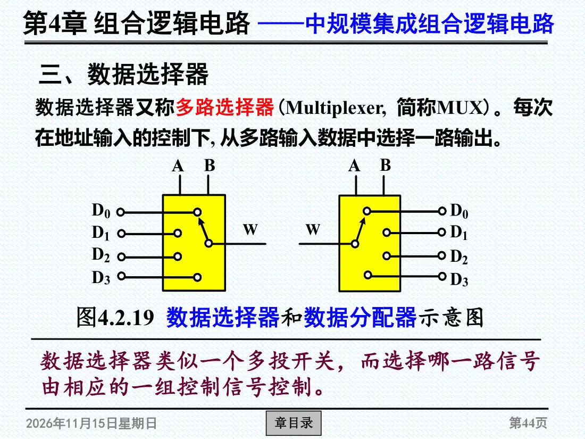

原文：

第4章 组合逻辑电路 ——中规模集成组合逻辑电路

三、数据选择器

数据选择器又称多路选择器(Multiplexer, 简称MUX)。每次在地址输入的控制下,从多路输入数据中选择一路输出。

数据选择器类似一个多投开关，而选择哪一路信号由相应的一组控制信号控制。

2026年11月15日星期日

章目录

第44页

### 第4章 组合逻辑电路 ——中规模集成组合逻辑电路

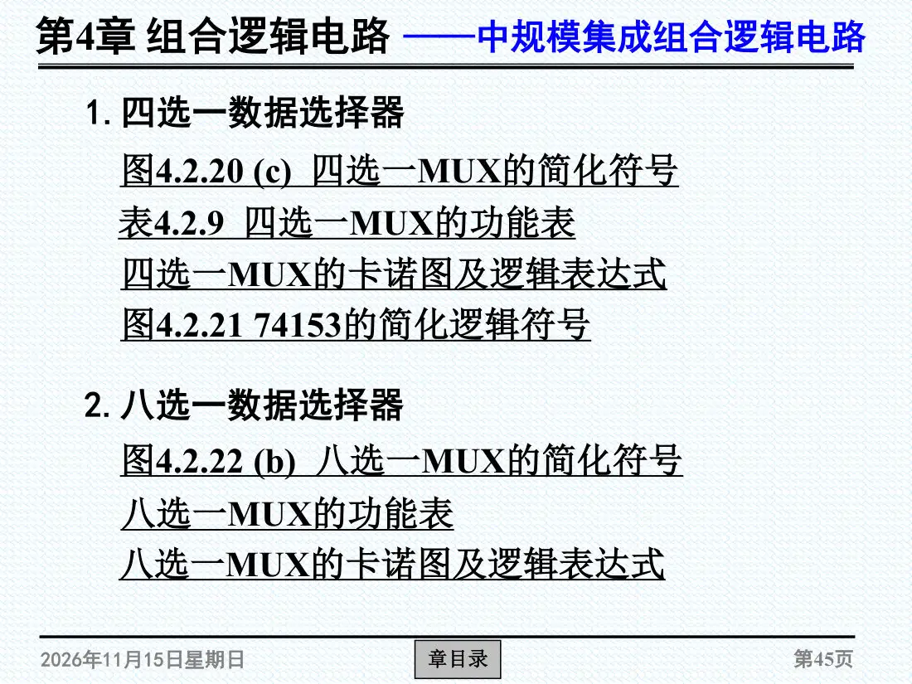

原文：

第4章 组合逻辑电路 ——中规模集成组合逻辑电路

1.四选一数据选择器

图4.2.20 (c) 四选一MUX的简化符号表4.2.9 四选一MUX的功能表四选一MUX的卡诺图及逻辑表达式图4.2.21 74153的简化逻辑符号

2.八选一数据选择器

图4.2.22 (b) 八选一MUX的简化符号八选一MUX的功能表八选一MUX的卡诺图及逻辑表达式

2026年11月15日星期日

章目录

第45页

### 第4章 组合逻辑电路 ——中规模集成组合逻辑电路

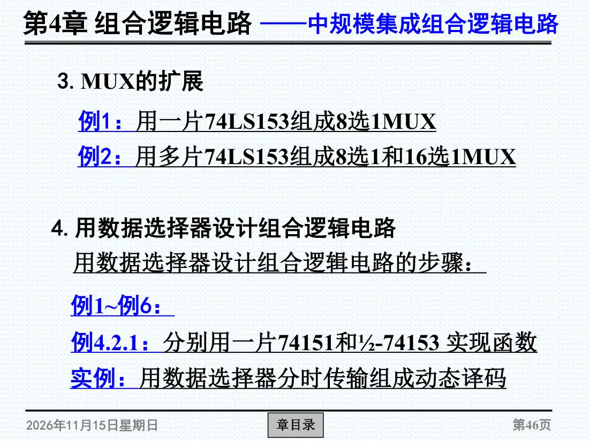

原文：

第4章 组合逻辑电路 ——中规模集成组合逻辑电路

3.MUX的扩展

例1：用一片74LS153组成8选1MUX

例2：用多片74LS153组成8选1和16选1MUX

4.用数据选择器设计组合逻辑电路

用数据选择器设计组合逻辑电路的步骤：

例1\~例6：

例4.2.1：分别用一片74151和½-74153 实现函数

实例：用数据选择器分时传输组成动态译码

2026年11月15日星期日

章目录

第46页

### 第4章组合逻辑电路 ——数据比较器

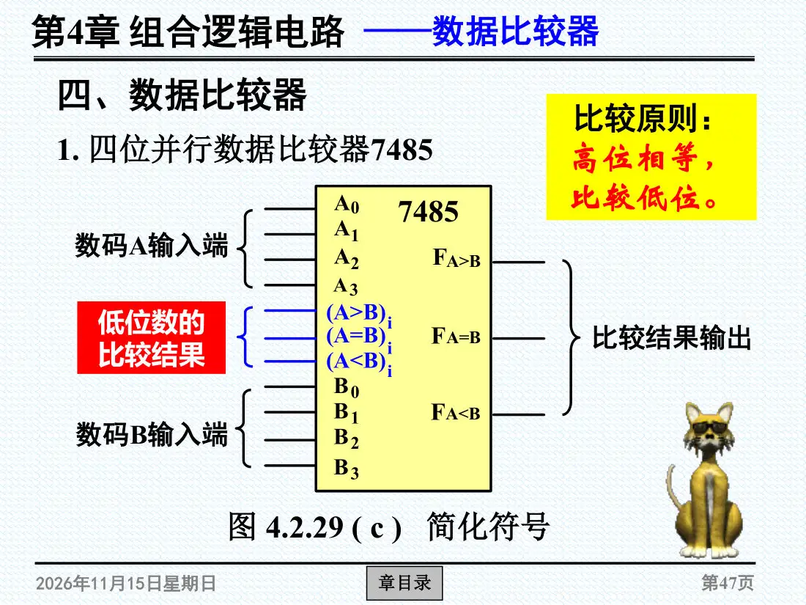

原文：

第4章组合逻辑电路 ——数据比较器

四、数据比较器

1. 四位并行数据比较器7485

数码A输入端

低位数的比较结果

数码B输入端

$$
\left. \begin{array}{c c} \text {A} _ {0} & 7 4 8 5 \\ \text {A} _ {1} & \\ \text {A} _ {2} & F _ {\mathrm{A>B}} \\ \text {A} _ {3} & \\ \text {(A>B)} _ {\mathrm{i}} & \\ \text {(A=B)} _ {\mathrm{i}} & F _ {\mathrm{A=B}} \\ \text {(A< B)} _ {\mathrm{i}} & \\ B _ {0} & \\ B _ {1} & F _ {\mathrm{A< B}} \\ B _ {2} & \\ B _ {3} & \end{array} \right\}
$$

图 4.2.29 ( c ) 简化符号

比较原则：高位相等，比较低位。

比较结果输出

2026年11月15日星期日

章目录

第47页

### 第4章组合逻辑电路 ——数据比较器

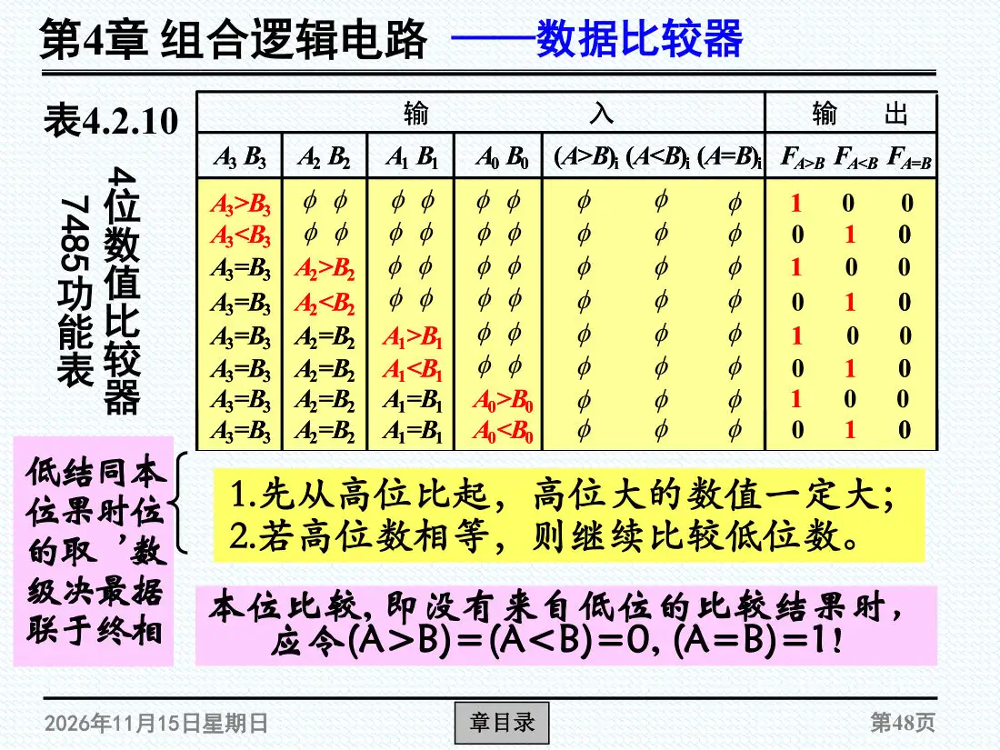

原文：

第4章组合逻辑电路 ——数据比较器

表4.2.10

4位

数

值

比

较

器7485功

能

表

本位数据相同时，最终结果取决于低位的级联 低

位

的

级

联

<table><tr><td colspan="7">输入</td><td colspan="3">输出</td></tr><tr><td> $A_3 B_3$ </td><td> $A_2 B_2$ </td><td> $A_1 B_1$ </td><td> $A_0 B_0$ </td><td colspan="3"> $(A>B)_i$   $(A\( F_{A>B}$   $F_{A<B}$   $F_{A=B}$ </td><td> $F_{A>B}$ </td><td> $F_{A<B}$ </td><td> $F_{A=B}$ </td></tr><tr><td> $A_3>B_3$ </td><td> $\phi$   $\phi$ </td><td> $\phi$   $\phi$ </td><td> $\phi$   $\phi$ </td><td> $\phi$ </td><td> $\phi$ </td><td> $\phi$ </td><td>1</td><td>0</td><td>0</td></tr><tr><td> $A_3\( \phi$   $\phi$   $\phi$   $\phi$   $\phi$   $\phi$   $\phi$  010</td><td> $\phi$   $\phi$ </td><td> $\phi$   $\phi$ </td><td> $\phi$   $\phi$ </td><td> $\phi$ </td><td> $\phi$ </td><td> $\phi$ </td><td>0</td><td>1</td><td>0</td></tr><tr><td> $A_3=B_3$ </td><td> $A_2>B_2$ </td><td> $\phi$   $\phi$ </td><td> $\phi$   $\phi$ </td><td> $\phi$ </td><td> $\phi$ </td><td> $\phi$ </td><td>1</td><td>0</td><td>0</td></tr><tr><td> $A_3=B_3$ </td><td> $A_2\( \phi$   $\phi$   $\phi$   $\phi$   $\phi$   $\phi$  010</td><td> $\phi$   $\phi$ </td><td> $\phi$   $\phi$ </td><td> $\phi$ </td><td> $\phi$ </td><td> $\phi$ </td><td>0</td><td>1</td><td>0</td></tr><tr><td> $A_3=B_3$ </td><td> $A_2=B_2$ </td><td> $A_1>B_1$ </td><td> $\phi$   $\phi$ </td><td> $\phi$ </td><td> $\phi$ </td><td> $\phi$ </td><td>1</td><td>0</td><td>0</td></tr><tr><td> $A_3=B_3$ </td><td> $A_2=B_2$ </td><td> $A_1\( \phi$   $\phi$   $\phi$   $\phi$  010</td><td> $\phi$   $\phi$ </td><td> $\phi$ </td><td> $\phi$ </td><td> $\phi$ </td><td>0</td><td>1</td><td>0</td></tr><tr><td> $A_3=B_3$ </td><td> $A_2=B_2$ </td><td> $A_1=B_1$ </td><td> $A_0>B_0$ </td><td> $\phi$ </td><td> $\phi$ </td><td> $\phi$ </td><td>1</td><td>0</td><td>0</td></tr><tr><td> $A_3=B_3$ </td><td> $A_2=B_2$ </td><td> $A_1=B_1$ </td><td> $A_0\( \phi$   $\phi$   $\phi$  010</td><td> $\phi$ </td><td> $\phi$ </td><td> $\phi$ </td><td>0</td><td>1</td><td>0</td></tr></table>

1.先从高位比起，高位大的数值一定大；2.若高位数相等，则继续比较低位数。

本位比较, 即没有来自低位的比较结果时，应令 $( A \div B ) = ( A < B ) = 0 , ( A = B ) = 1 1$

2026年11月15日星期日

章目录

第48页

### 第4章组合逻辑电路 ——数据比较器

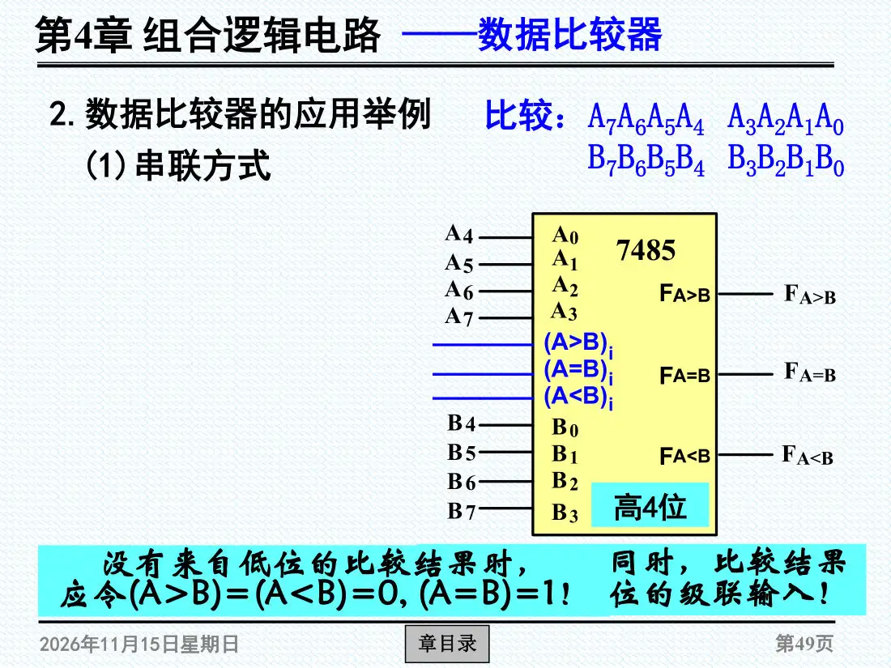

原文：

第4章组合逻辑电路 ——数据比较器

2.数据比较器的应用举例 比较： $\mathrm { A _ { 7 } A _ { 6 } A _ { 5 } A _ { 4 } } \mathrm { A _ { 3 } A _ { 2 } A _ { 1 } A _ { 0 } }$ (1)串联方式 $\mathrm { B } _ { 7 } \mathrm { B } _ { 6 } \mathrm { B } _ { 5 } \mathrm { B } _ { 4 }$ B3B2B1B0

$$
\begin{array}{c c c} \text {A4} & \text {A0} & 7 4 8 5 \\ \text {A5} & \text {A1} & \\ \text {A6} & \text {A2} & F _ {\text {A>B}} \\ \text {A7} & \text {A3} & \\ \hline & (\text {A>B}) _ {i} & \\ \hline & (\text {A=B}) _ {i} & F _ {\text {A=B}} \\ \hline & (\text {A< B}) _ {i} & \\ \hline \text {B4} & \text {B0} & \\ \text {B5} & \text {B1} & F _ {\text {A< B}} \\ \text {B6} & \text {B2} & \\ \text {B7} & \text {B3} & \text {高4位} \end{array}
$$

高位数没有来自低位的比较结果时， 同时，比较结果应令 $( \mathbb { A } > \mathbb { B } ) = ( \mathbb { A } < \mathbb { B } ) = 0 , ( \mathbb { A } = \mathbb { B } ) = 1 !$ 位的级联输入！

2026年11月15日星期日

章目录

第49页

### 第4章组合逻辑电路 ——数据比较器

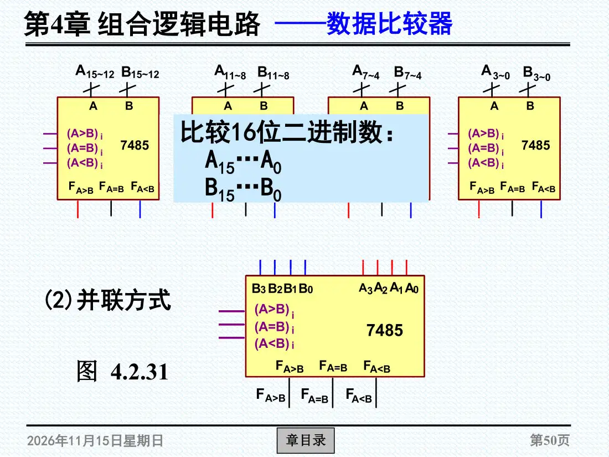

原文：

第4章组合逻辑电路 ——数据比较器

比较16位二进制数：

(2)并联方式

图 4.2.31

2026年11月15日星期日

章目录

第50页

### 第4章组合逻辑电路 数据比较器

原文：

第4章组合逻辑电路 数据比较器

例：设计一个比较器，完成三个 4 位数:

A(a3a2a1a0)、 B(b3b2b1b0)、C(c3c2c1c0)的比较，并能判断：

(1)三个数是否相等。

(2)若不相等，A数是最大还是最小?

比较原则分析：

先将A与B比较；然后，A与C比较：

若A=B, A=C，则A=B=C；

若A>B, A>C，则A最大；

若A<B, A<C，则A最小。

可以用两片74LS85实现。

2026年11月15日星期日

章目录

第51页

### 第4章组合逻辑电路 ——数据比较器

原文：

第4章组合逻辑电路 ——数据比较器

A最大

A最小

2026年11月15日星期日

章目录

第52页

### 第4章组合逻辑电路 —— 数据比较器

原文：

第4章组合逻辑电路 —— 数据比较器

课堂讨论：用7485构成4位二进制数的判别电路。当二进制数$\mathrm { A } _ { 3 } \mathrm { A } _ { 2 } \mathrm { A } _ { 1 } \mathrm { A } _ { 0 } \geq \left( 1 0 1 0 \right) _ { 2 }$ 时，判别电路输出 F为1，否则输出 F为0。

分析：将输入二进制数 $\mathsf { A } _ { 3 } \mathsf { A } _ { 2 } \mathsf { A } _ { 1 } \mathsf { A } _ { 0 }$ 与(1001)2进行比较，即将7485的A输入端接 $\mathsf { A } _ { 3 } \mathsf { A } _ { 2 } \mathsf { A } _ { 1 } \mathsf { A } _ { 0 }$ B输入端接(1001)

$\mathrm { A } _ { 3 } \mathrm { A } _ { 2 } \mathrm { A } _ { 1 } \mathrm { A } _ { 0 } \geq \left( 1 0 1 0 \right) _ { 2 }$ 时，比较器$A > B$ 端输出为1。因此, 可用 $A > B$ 端作为判别电路的输出 F。

2026年11月15日星期日

章目录

第53页

### 第4章组合逻辑电路 ——全加器

原文：

第4章组合逻辑电路 ——全加器

五、全加器

1.四位串行进位全加器

图 4.2.33

$$
\begin{array}{ccccccc} &  & \mathsf {A} _ {3} & \mathsf {A} _ {2} & \mathsf {A} _ {1} & \mathsf {A} _ {0} \\ + &  & \mathsf {B} _ {3} & \mathsf {B} _ {2} & \mathsf {B} _ {1} & \mathsf {B} _ {0} \\ \text {CO} &  & \text {C}_{2} & \text {C}_{1} & \text {C}_{0} & 0 \\ \hline  &  & \mathsf {S}_{3} & \mathsf {S}_{2} & \mathsf {S}_{1} & \mathsf {S}_{0} \\ \end{array}
$$

$$
\begin{array}{c} \sum_ {A _ {0}} \\ B _ {0} \\ \text {CI CO} \end{array} \begin{array}{c} S _ {0} \\ A _ {1} \\ B _ {1} \\ C _ {0} \end{array} \begin{array}{c} \sum_ {C _ {1}} \\ C _ {1} \end{array}
$$

特点：简单、慢

完成一次加法运算要经过4个全加器的传输延迟时间。

2026年11月15日星期日

章目录

第54页

### 第4章组合逻辑电路 ——全加器

原文：

第4章组合逻辑电路 ——全加器

2.四位超前进位全加器 74283

基本原理：第i 位加的进位信号CI是两个第i位加数以前各位(0\~i−1)的函数，可在相加前由A, B两数确定，不需逐级计算。

速度快，每一位的和S及最后的进位CI基本同时产生。

<table><tr><td colspan="3">输入</td><td colspan="2">输出</td></tr><tr><td> $A_i$ </td><td> $B_i$ </td><td> $CI_i$ </td><td> $S_i$ </td><td> $CO_i$ </td></tr><tr><td>0</td><td>0</td><td>0</td><td>0</td><td>0</td></tr><tr><td>0</td><td>0</td><td>1</td><td>1</td><td>0</td></tr><tr><td>0</td><td>1</td><td>0</td><td>1</td><td>0</td></tr><tr><td>0</td><td>1</td><td>1</td><td>0</td><td>1</td></tr><tr><td>1</td><td>0</td><td>0</td><td>1</td><td>0</td></tr><tr><td>1</td><td>0</td><td>1</td><td>0</td><td>1</td></tr><tr><td>1</td><td>1</td><td>0</td><td>0</td><td>1</td></tr><tr><td>1</td><td>1</td><td>1</td><td>1</td><td>1</td></tr></table>

2026年11月15日星期日

章目录

第55页

### 第4章组合逻辑电路 ——全加器

原文：

第4章组合逻辑电路 ——全加器

由于全加器 $S _ { i } = A _ { i } \oplus B _ { i } \oplus C _ { i - 1 }$ 和 $C _ { i } = A _ { i } B _ { i } + A _ { i } C _ { i - 1 } + B _ { i } C _ { i - 1 }$ 则 $\left\{ \begin{array} { l l } { S _ { 0 } = A _ { 0 } \bigoplus B _ { 0 } \bigoplus C I = f _ { 0 } ( A _ { 0 } , B _ { 0 } , C I ) } \\ { \qquad \quad } \\ { C _ { 0 } = A _ { 0 } B _ { 0 } + A _ { 0 } C I + B _ { 0 } C I = g _ { 0 } ( A _ { 0 } , B _ { 0 } , C I ) } \end{array} \right.$ S = A ⊕B ⊕C = f(A ,B ,C ) = f (A ,B , g ( A ,B ,CI )) = f (A ,B , A ,B ,CI ) C1 = A1B1+A1C0+B1C0 = g0(A1,B1,C0 ) = g (A ,B ,A ,B ,CI ) S3 = f3(A3,A2,A1,A0, B3,B2,B1,B0,CI ) C3 = g3(A3,A2,A1,A0, B3,B2,B1,B0,CI )

2026年11月15日星期日

章目录

第56页

### 第4章组合逻辑电路 ——全加器

原文：

第4章组合逻辑电路 ——全加器

$$
\begin{array}{cccc} & \mathsf {A} _ {3} & \mathsf {A} _ {2} & \mathsf {A} _ {1} & \mathsf {A} _ {0} \\ + & \mathsf {B} _ {3} & \mathsf {B} _ {2} & \mathsf {B} _ {1} & \mathsf {B} _ {0} \\ \text {CO} & \text {C}_{2} & \text {C}_{1} & \text {C}_{0} & \text {CI} \\ \hline  & \text {\bf S}_{3} & \text {\bf S}_{2} & \text {\bf S}_{1} & \text{\bf S}_{0} \\ \end{array}
$$

$$
\begin{array}{c c} \text {A0} & \\ \text {A1} & \mathrm{S0} \\ \text {A2} & \\ \text {A3} & \mathrm{S1} \\ \text {CI 74283} & \mathrm{S2} \\ \text {B0} & \mathrm{S3} \\ \text {B1} & \\ \text {B2} & \mathrm{CO} \\ \text {B3} & \end{array}
$$

图 4.2.34 ( c ) 简化符号

2026年11月15日星期日

章目录

第57页

### 第4章组合逻辑电路 ——全加器

原文：

第4章组合逻辑电路 ——全加器

3.全加器的应用举例

例 4.2.2 已知BCD码 $( A _ { 3 } A _ { 2 } A _ { 1 } A _ { 0 } \cdot a _ { 3 } a _ { 2 } a _ { 1 } a _ { 0 } )$ 8421BCD试设计一个电路将该数四舍五入。

解：当小数部分大于4时, 整数部分应加 1, 即

$$
\begin{array}{ccc} & A _ {3} & A _ {2} & A _ {1} & A _ {0} \\ + &  &  &  & 1 \\ \hline C O & S _ {3} & S _ {2} & S _ {1} & S _ {0} \\ \end{array}
$$

注:当相加结果 $\mathrm { S } _ { 3 } \mathrm { S } _ { 2 } \mathrm { S } _ { 1 } \mathrm { S } _ { 0 }$ 为1010时,应修正!

因为1010不是 $( 1 0 ) _ { 1 0 }$ 的8421BCD码表示形式,正确结果应为 0001 0000,所以

$$
\begin{array}{r} {1 0 1 0} \\ {+ 0 1 1 0} \\ \hline {0 0 0 1 0 0 0 0} \end{array} \quad \begin{array}{l l} {- \text {非法码}} \\ {- \text {加6修正}} \end{array}
$$

电路分析如下：

2026年11月15日星期日

章目录

第58页

### 第4章组合逻辑电路 ——全加器

原文：

第4章组合逻辑电路 ——全加器

$$
\begin{array}{c} \text {A0} \\ \text {A1} \\ \text {A2} \\ \text {A3} \\ \text {CI} \\ 7 4 2 8 3 \\ \text {B0} \\ \text {B1} \\ \text {B2} \\ \text {B3} \end{array} \begin{array}{c} \text {S0} \\ \text {S1} \\ \text {S2} \\ \text {S3} \\ \text {CO} \end{array} \begin{array}{c} \text {F0} \\ \text {F1} \\ \text {F2} \\ \text {F3} \end{array}
$$

图 4.2.35

$$
E = A _ {3} A _ {0}
$$

增加按键、编码器74147、显示译码器7448、数码管可以构成一个实用的按键显示电路。

2026年11月15日星期日

章目录

第59页

### 第4章组合逻辑电路

原文：

第4章组合逻辑电路

课堂练习：将BCD的8421码转换为余3码。

$$
Y _ {3} Y _ {2} Y _ {1} Y _ {0} = D C B A + 0 0 1 1
$$

<table><tr><td colspan="4">输入</td><td colspan="4">输出</td></tr><tr><td>D</td><td>C</td><td>B</td><td>A</td><td> $Y_3$ </td><td> $Y_2$ </td><td> $Y_1$ </td><td> $Y_0$ </td></tr><tr><td>0</td><td>0</td><td>0</td><td>0</td><td>0</td><td>0</td><td>1</td><td>1</td></tr><tr><td>0</td><td>0</td><td>0</td><td>1</td><td>0</td><td>1</td><td>0</td><td>0</td></tr><tr><td>0</td><td>0</td><td>1</td><td>0</td><td>0</td><td>1</td><td>0</td><td>1</td></tr><tr><td>0</td><td>0</td><td>1</td><td>1</td><td>0</td><td>1</td><td>1</td><td>0</td></tr><tr><td>0</td><td>1</td><td>0</td><td>0</td><td>0</td><td>1</td><td>1</td><td>1</td></tr><tr><td>0</td><td>1</td><td>0</td><td>1</td><td>1</td><td>0</td><td>0</td><td>0</td></tr><tr><td>0</td><td>1</td><td>1</td><td>0</td><td>1</td><td>0</td><td>0</td><td>1</td></tr><tr><td>0</td><td>1</td><td>1</td><td>1</td><td>1</td><td>0</td><td>1</td><td>0</td></tr><tr><td>1</td><td>0</td><td>0</td><td>0</td><td>1</td><td>0</td><td>1</td><td>1</td></tr><tr><td>1</td><td>0</td><td>0</td><td>1</td><td>1</td><td>1</td><td>0</td><td>0</td></tr></table>

2026年11月15日星期日

章目录

第60页

### 第4章组合逻辑电路

原文：

第4章组合逻辑电路

思考题

1.利用数据选择器设计组合电路的步骤是什么？

2026年11月15日星期日

章目录

第61页

### 第4章组合逻辑电路

原文：

第4章组合逻辑电路

望同学们：

独立完成作业

【作业3】

认真完成作业

4.14(1)

4.14(4)

4.15(1)

4.17

4.21

2026年11月15日星期日

章目录

第62页

### 第4章组合逻辑电路 竞争和冒险的概念

原文：

第4章组合逻辑电路 竞争和冒险的概念

4.3 竞争和冒险

竞争和冒险的概念

1.竞争

由于集成逻辑门和连线有一定的延迟,竞争现象一：致使同一输入信号经过不同路径到达输出逻辑门输入端的时间不同（1个输入信号变化）；多个输入信号同时变化时,由于其变换变换竞争现象二：快慢不同, 致使这些输入信快慢不同 号到达输出逻辑门输入端的时间不同（2个或2个以上输入信号变化）。

2026年11月15日星期日

章目录

第63页

### 第4章组合逻辑电路 竞争和冒险的概念

原文：

第4章组合逻辑电路 竞争和冒险的概念

竞争和冒险的概念

2.冒险

逻辑冒险：输入信号经过不同的路径延时而(1)冒险的概念引起的冒险。某个瞬间出现的非预期信号的现象，是由变量功能冒险：多个信号同时变化的瞬间，由于 竞争引起的。信号稳定时，不会出现冒险；但变化快慢不同而引起的冒险。当信号出现跳变时，可能会出现冒险。

(2)冒险的分类

① 按产生短暂尖峰的原因逻辑冒险和功能冒险

② 按短暂尖峰极性 “1”型冒险和“0”型冒险

2026年11月15日星期日

章目录

第64页

### 第4章组合逻辑电路 冒险的判别方法

原文：

第4章组合逻辑电路 冒险的判别方法

二、冒险的判别方法1——代数法

$$
\begin{array}{c} \text {A} \\ \overline {{\text {A}}} \end{array} \boxed {\&} \boxed {F}
$$

代数判别方法：

(a) $6 6 < 3 3$ 型冒险

(1)找出具有竞争能力的变量；

$$
\begin{array}{c} A \\ \overline {{A}} \end{array} \boxed {\geq 1} \xrightarrow {F}
$$

(2)逐次改变其它变量，判断是否存在冒险?是何种冒险?

(b) $" 0 ^ { 5 9 }$ 型冒险

$F = A { \overline { { A } } }$ （“1”型逻辑冒险）或-与表达式

$F = A + { \overline { { A } } }$ $^ { 6 6 } 0 ^ { 9 }$ 型逻辑冒险） 与-或表达式

2026年11月15日星期日

章目录

第65页

### 第4章组合逻辑电路 冒险的判别方法

原文：

第4章组合逻辑电路 冒险的判别方法

例4.3.1 判别函数 $F = A { \overline { { B } } } + A C + B C$ 是否存在逻辑冒险现象？

分析：变量 $A , B , C$ 具有竞争能力，并且

当 $B { = } 0 , C { = } 1$ 时， $F = A + A$

当 $A { = } 1 , C { = } 0$ 时， $F = B + \overline { { B } }$

当 $A / = 0 , B / = 1$ 时， $F = C + { \overline { { C } } }$ 。

因此, 该函数可能存在0型逻辑冒险现象。

例4.3.2 判别函数 $F ^ { - } ( A { + } C ) \cdot ( B { + } \overline { c } ) \cdot ( A { + } B )$ 是否存在逻辑冒险现象？

分析：变量 A、 C 具有竞争能力，并且当 当 $A = B = 0$ 时， 时， $\scriptstyle { F = C } \ { \overline { { C } } }$ 可能存在1型逻辑冒险。$B { = } C { = } 0$ $F = A { \overline { { A } } }$ 可能存在1型逻辑冒险。

2026年11月15日星期日

章目录

第66页

### 第4章组合逻辑电路

原文：

第4章组合逻辑电路

二、冒险的判别方法2— 卡诺图法

例如： $F = A C + B C$

$$
\begin{array}{c c c c c} \hline B C & 0 0 & 0 1 & 1 1 & 1 0 \\ A & 0 & 0 & 0 & 1 \\ \hline 0 & 0 & 1 & 1 & 1 \\ \hline 1 & 0 & \end{array}
$$

ABC:101↔111F=AC+BC=1·1+B·0=1B跳变，但无冒险

$$
\begin{array}{r l} & {\mathrm{ABC:010} \leftrightarrow 1 1 0} \\ & {\mathrm {F = AC + B \overline {{C}}}} \\ & {\quad = \mathrm{A} \cdot 0 + 1 \cdot 1 = 1} \\ & {\mathrm{A跳变，但无冒险}} \end{array}
$$

ABC:111↔110F=C+C=0C跳变，有冒险现象

可见，输入信号出现跳变时，有可能发生逻辑冒险！

2026年11月15日星期日

章目录

第67页

### 第4章 组合逻辑电路 ——冒险的判别方法

原文：

第4章 组合逻辑电路 ——冒险的判别方法

卡诺图法判别冒险现象

$$
F = \overline {{{A}}} B + A C = \overline {{{A}}} + A
$$

A变化时将产生 0型冒险

$$
F = (A + C) (\overline {{A}} + B) = \overline {{A}} A
$$

A变化时将产生1型冒险

卡诺圈0相竞争

竞争冒险——圈1卡诺图判别方法：

冒险;均无

卡诺图中的卡诺圈相切，则有竞争冒险。

2026年11月15日星期日

章目录

第68页

### 第4章 组合逻辑电路 ——冒险的判别方法

原文：

第4章 组合逻辑电路 ——冒险的判别方法

课堂讨论：判断图所示卡诺图的逻辑冒险情况。

(a)两个卡诺圈相切,产生 冒险,相切处A=0,C=1,B 变量变化时产生冒险;

(b)卡诺圈相交,无冒险;

(c)卡诺圈对顶,无冒险;

(d)卡诺图相顶,无冒险;

(e)卡诺圈 $A B \bar { C }$ 与ÃD相切,当 B=D=1,C=0 时，变量A变化时将产生冒险。

2026年11月15日星期日

章目录

第69页

### 第4章 组合逻辑电路 ——冒险的判别方法

原文：

第4章 组合逻辑电路 ——冒险的判别方法

例1: 判别函数 $F = A C + B C + A C$ 是否存在冒险现象？

相切

A=B=1,仅C变化 F=AC+BC =C+C

结论：该函数在A=B=1时，可能存在0型逻辑冒险！

逻辑相邻，即几何相邻或对称相邻的“1”格或 $^ { 6 6 } \textcircled { \mathbf { 0 } } ^ { 9 }$ 格被两个卡诺圈分别独自包围时，称卡诺圈相切。

2026年11月15日星期日

章目录

第70页

### 第4章组合逻辑电路 冒险的判别方法

原文：

第4章组合逻辑电路 冒险的判别方法

例2: 判别函数 $F { = } A C { + } B C$ 是否存在冒险现象？若有,具体为何种冒险现象？

<table><tr><td>A\BC</td><td>00</td><td>01</td><td>11</td><td>10</td></tr><tr><td>0</td><td></td><td></td><td></td><td>1</td></tr><tr><td>1</td><td></td><td>1←→</td><td>1←→</td><td>1</td></tr></table>

仅B变化

$$
F = A C + B \overline {{C}} = 1 \cdot 1 + B \cdot \overline {{1}} = 1
$$

即，变量取值在卡诺圈内变化, 不存在逻辑冒险首先, 两个1卡诺圈相切,可能存在0型逻辑冒险

仅C变化

$$
F = A C + B \overline {{C}} = C + \overline {{C}}
$$

此时，变量取值在卡诺圈相切处跳变时，而这个相切部分又没有被另外的卡诺圈包围，则可能存在逻辑冒险。

即 $1 0 1  1 1 1$ 或 $\mathbf { 0 1 0 < } \mathbf { \mathrm { > } } \mathbf { 1 1 0 }$ 时不存在冒险。

2026年11月15日星期日

章目录

第71页

### 第4章组合逻辑电路 —— 冒险的判别方法

原文：

第4章组合逻辑电路 —— 冒险的判别方法

接上例 然后，当 $A B C / \lambda 1 0 1  1 1 0$ 时：

$$
\begin{array}{c c c c c} \hline B C & 0 0 & 0 1 & 1 1 & 1 0 \\ A & 0 & 0 & 0 & 0 \\ \hline 1 & 0 & \text {   1   } & \text {   1   } & \text {   1   } \\ \hline \end{array}
$$

同理,当ABC从111 → 010时,也会出现0型功能冒险$\begin{array} { r } { \ K { ( 1 , 1 , 1 ) } \ _ { \atop { F ( \overline { { \Omega } } , 0 , 1 ) } } = F ( 1 , 1 , \mathbf { 0 } ) ; } \\ { \ \smile \ F ( 1 , \mathbf { 0 } , \mathbf { 0 } ) } \end{array}$

2. 2个变量B和C同时变化,A=1不变, 从而决定B,C变化可能走的途径；

3. A对应的(输出值)卡诺圈中有“0”也有“1”。

4. A,B,C 变化前后的稳态输 出值均为1。

所以, 可能存在0型功能冒险

2026年11月15日星期日

章目录

第72页

### 第4章 组合逻辑电路 ——冒险的判别方法

原文：

第4章 组合逻辑电路 ——冒险的判别方法

例3: $F = B C + \overline { A } \overline { B } + A C D$ 是否存在逻辑冒险?

当 $A C = 0 0$ 时，或当 $B C D = 0 1 1$ 时， 时，或当 $A B D = 1 1 1$ 可能存在0型逻辑冒险。

2026年11月15日星期日

章目录

第73页

### 第4章组合逻辑电路 冒险的判别方法

原文：

第4章组合逻辑电路 冒险的判别方法

例4：如下所示组合网络中, 当ABCD 从0100向1101变化时和ABCD 从1000向1101变化时，是否会出现冒险？若有冒险，试采用增加多余项方法消除冒险现象。

逻辑冒险：输入信号经过不同的路径延时而引起的冒险。

功能冒险：多个信号同时变化的瞬间，由于变化快慢不同而引起的冒险。

2026年11月15日星期日

章目录

第74页

### 第4章组合逻辑电路 冒险的判别方法

原文：

第4章组合逻辑电路 冒险的判别方法

分析 1. 当 ABCD 从 0100 → 1101变化时

F(0, $F ( \mathbf { 0 } , 1 , \mathbf { 0 } , \mathbf { 0 } ) = F ( 1 , 1 , \mathbf { 0 } , 1 )$ $F ( \mathbf { \theta } , \mathbf { \theta } , \mathbf { 0 } ) ^ { - 1 }$

2.有2个变量 $D , A$ 同时变化；

3. 2个不变变量B,C对应的卡诺 圈中有 $^ { 6 6 } 0 ^ { 9 3 }$ 也有“1”, 但输入 变化前后的输出稳态值为“1”

$$
\boldsymbol {F} = \bar {\boldsymbol {C}} \bar {\boldsymbol {D}} + \boldsymbol {B} \bar {\boldsymbol {D}} + \boldsymbol {A} \boldsymbol {D}
$$

所以, 0100 →1101变化时电路中。 可能存在功能冒险。同时,卡诺圈相切, 且信号变化时跨越相切的卡诺圈，而相切部分又没被其它卡诺圈包围，故也可能存在逻辑冒险。

2026年11月15日星期日

章目录

第75页

### 第4章组合逻辑电路 冒险的判别方法

原文：

第4章组合逻辑电路 冒险的判别方法

分析2.当 ABCD 从 1000 →1101 变化时：

<table><tr><td>AB\CD</td><td>00</td><td>01</td><td>11</td><td>10</td></tr><tr><td>00</td><td>1</td><td>0</td><td>0</td><td>0</td></tr><tr><td>01</td><td>1</td><td>0</td><td>0</td><td>1</td></tr><tr><td>11</td><td>1</td><td>1</td><td>1</td><td>1</td></tr><tr><td>10</td><td>1</td><td>1</td><td>1</td><td>0</td></tr></table>

$$
\boldsymbol {F} = \bar {\boldsymbol {C}} \bar {\boldsymbol {D}} + \boldsymbol {B} \bar {\boldsymbol {D}} + \boldsymbol {A} \boldsymbol {D}
$$

F(1,1,0,0) $F ( 1 , 0 , 0 , 0 ) = F ( 1 , 1 , 0 , 1 )$ $F ( \mathbf { \delta \phi } , \mathbf { 0 } , \mathbf { \phi } , \mathbf { \phi } )$

2. 有2个变量B, D同时变化；

3. 2个不变变量 $A , { \overline { { C } } }$ 对应的卡诺圈中全部为“1”，而输入变化前后的输出稳态值也为“1”。

所以, 1000 →1101时电路中不存在功能冒险。

同时,卡诺圈相切, 且信号变化时跨越相切的卡诺圈,而相切部分又没被其它卡诺圈包围, 故可能存在逻辑冒险。

2026年11月15日星期日

章目录

第76页

### 第4章 组合逻辑电路 ——冒险的判别方法

原文：

第4章 组合逻辑电路 ——冒险的判别方法

课堂讨论：输入出现下列变化时，组合逻辑输出是否会出现冒险？为何种冒险？

<table><tr><td>AB\CD</td><td>00</td><td>01</td><td>11</td><td>10</td></tr><tr><td>00</td><td></td><td></td><td>1</td><td></td></tr><tr><td>01</td><td>1</td><td></td><td>1</td><td>1</td></tr><tr><td>11</td><td>1</td><td>1</td><td>1</td><td>1</td></tr><tr><td>10</td><td>1</td><td>1</td><td>1</td><td></td></tr></table>

0型功能冒险 无逻辑冒险无功能冒险 0型逻辑冒险无功能冒险 0型逻辑冒险无功能冒险 0型逻辑冒险无功能冒险 无逻辑冒险0型功能冒险 0型逻辑冒险

2026年11月15日星期日

章目录

第77页

### 第4章 组合逻辑电路 ——冒险的消除方法

原文：

第4章 组合逻辑电路 ——冒险的消除方法

三、冒险的消除方法1— 修改逻辑设计，增加多余项

如下图所示，化简得到 $F { = } A C { + } \overline { { A } } B$ 。在 $B { = } C { = } 1$ 时， $F { = } A { + } A$ 将产生“0”冒险。

若增加多余项BC，则当 $B { = } C { = } 1$ 时，F 恒为1，消除了冒险— 在卡诺圈相切处增加了一个冗余的

BC 圈，即可消除相切部分的影响。

$$
\begin{array}{r l} \boldsymbol {F} & = \boldsymbol {A C} + \overline {{\boldsymbol {A}}} \boldsymbol {B} \\ & = \boldsymbol {A C} + \overline {{\boldsymbol {A}}} \boldsymbol {B} + \boldsymbol {B C} \end{array}
$$

可见，增加多余项可消去逻辑冒险！

2026年11月15日星期日

章目录

第78页

### 第4章 组合逻辑电路 ——冒险的消除方法

原文：

第4章 组合逻辑电路 ——冒险的消除方法

例4.3.5 $F = B C + A B + A C D$ 。试用增加多余项的方法消除逻辑冒险。

$$
\begin{array}{r l} & F = B \overline {{C}} + \overline {{A}} \overline {{B}} + A C D \\ & + \underbrace {\overline {{A}} \overline {{C}} + A B D + \overline {{B}} C D} _ {\text {冗余项}} \end{array}
$$

2026年11月15日星期日

章目录

第79页

### 第4章 组合逻辑电路 ——冒险的消除方法

原文：

第4章 组合逻辑电路 ——冒险的消除方法

三、冒险的消除方法2——增加滤波电路

对输出波形边沿要求不高时采用！

组合路

输出端并联电容器

由于冒险脉冲很窄，如果逻辑电路在较慢速度下工作，可以在输出端并联一个加速电容器，既A可消去逻辑冒险 ，也可消除功能冒险。

由于外加电容会影响电路的工作速度，故电容量的选取要合适，通常靠试验来调试确定。F

2026年11月15日星期日

章目录

第80页

### 第4章组合逻辑电路 冒险的消除方法

原文：

第4章组合逻辑电路 冒险的消除方法

三、冒险的消除方法3— 增加选通脉冲

可见, 有 $^ { 6 6 } \textcircled { \bullet } ^ { 9 9 }$ 冒

冒险信号仅发生在输入信号变化的瞬间，且冒险脉险冲很窄，因此，若待电路稳定后，再发出选通信号，可消除逻辑冒险和功能冒险— 取样法

2026年11月15日星期日

章目录

第81页

### 第4章 组合逻辑电路 ——冒险的消除方法

原文：

第4章 组合逻辑电路 ——冒险的消除方法

如何合理设置取样(选通)脉冲？

① 取样脉冲的宽度和产生的时间有一定的要求;

② 取样脉冲的位置及极性选取原则 ：

a. 取样时刻(有效电平期间)，输出稳态电平;

b. 非取样时刻(无效电平期间) ，输出低电平。

【注意】应在电路稳定后再加入取样脉冲, 以保证该取样脉冲作用期间输出的信号有效, 这样才可避免毛刺影响输出波形，即消除冒险。

举例1： SSI器件 + 取样脉冲.

举例2： MSI器件 + 取样脉冲.

2026年11月15日星期日

章目录

第82页

### 第4章组合逻辑电路

原文：

第4章组合逻辑电路

【三种冒险消除方法的比较】

增加冗余项：只能消除逻辑冒险，不能消除功能冒险；适用范围有限。

滤波法：加滤波电容使输出信号变坏,导致输出波形的前后沿变坏。当对波形要求较严格时, 应再加整形电路;不宜在中间级使用;可作为实验调试阶段采用的应急措施。

取样法：对逻辑冒险及功能冒险都有效。大多数中规模集成模块都设有使能端，可以将取样信号作用于该端，待电路稳定后才使输出有效。

“与”门及“与非”门加正取样脉冲。

“或”门及“或非”门加负取样脉冲。

2026年11月15日星期日

章目录

第83页

### 第4章 组合逻辑电路 ——冒险的消除方法

原文：

第4章 组合逻辑电路 ——冒险的消除方法

思考题

1. 解释功能：变量竞争、冒险。

2. 逻辑冒险产生的原因是什么？如何消除？

3. 功能冒险产生的原因是什么？如何消除？

2026年11月15日星期日

章目录

第84页

### 第4章组合逻辑电路

原文：

第4章组合逻辑电路

望同学们：

独立完成作业

【作业4】

认真完成作业

4.14(1)

4.14(4)

4.15(1)

4.17

4.22

2026年11月15日星期日

章目录

第85页

### 第4章组合逻辑电路

原文：

第4章组合逻辑电路

多位二进制数求和

$$
\begin{array}{c c c c} & \mathsf {A} _ {2} & \mathsf {A} _ {1} \\ + & \mathsf {B} _ {2} & \mathsf {B} _ {1} \\ & \mathsf {C} _ {1} & \mathsf {C} _ {0} \\ \hline \mathsf {C} _ {2} & \mathsf {S} _ {2} & \mathsf {S} _ {1} \end{array} \begin{array}{c c c c} & \mathsf {A} _ {0} \\ & \mathsf {B} _ {0} \\ & \mathsf {S} _ {0} \end{array}
$$

B 加 数

C 进 位

S 和

全加运算

半加运算

2026年11月15日星期日

章目录

第86页

### 第4章组合逻辑电路

原文：

第4章组合逻辑电路

$$
F = D _ {1} \oplus D _ {2} \oplus D _ {3} \oplus D _ {4}
$$

表4.1.2（例4.1.2）
<table><tr><td colspan="4">输入</td><td>输出</td></tr><tr><td> $D_1$ </td><td> $D_2$ </td><td> $D_3$ </td><td> $D_4$ </td><td>F</td></tr><tr><td>0</td><td>0</td><td>0</td><td>0</td><td>1</td></tr><tr><td>0</td><td>0</td><td>0</td><td>1</td><td>0</td></tr><tr><td>0</td><td>0</td><td>1</td><td>0</td><td>0</td></tr><tr><td>0</td><td>0</td><td>1</td><td>1</td><td>1</td></tr><tr><td>0</td><td>1</td><td>0</td><td>0</td><td>0</td></tr><tr><td>0</td><td>1</td><td>0</td><td>1</td><td>1</td></tr><tr><td>0</td><td>1</td><td>1</td><td>0</td><td>1</td></tr><tr><td>0</td><td>1</td><td>1</td><td>1</td><td>0</td></tr></table>

<table><tr><td colspan="4">输入</td><td>输出</td></tr><tr><td> $D_1$ </td><td> $D_2$ </td><td> $D_3$ </td><td> $D_4$ </td><td>F</td></tr><tr><td>1</td><td>0</td><td>0</td><td>0</td><td>0</td></tr><tr><td>1</td><td>0</td><td>0</td><td>1</td><td>1</td></tr><tr><td>1</td><td>0</td><td>1</td><td>0</td><td>1</td></tr><tr><td>1</td><td>0</td><td>1</td><td>1</td><td>0</td></tr><tr><td>1</td><td>1</td><td>0</td><td>0</td><td>1</td></tr><tr><td>1</td><td>1</td><td>0</td><td>1</td><td>0</td></tr><tr><td>1</td><td>1</td><td>1</td><td>0</td><td>0</td></tr><tr><td>1</td><td>1</td><td>1</td><td>1</td><td>1</td></tr></table>

2026年11月15日星期日

章目录

第87页

### 第4章组合逻辑电路

原文：

第4章组合逻辑电路

辨析题——下面推导过程是否正确？

$$
\begin{array}{r l} & {\mathbf {C _ {i}} = \mathbf {A _ {i}} \mathbf {B _ {i}} + \mathbf {B _ {i}} \mathbf {C _ {i - 1}} + \mathbf {A _ {i}} \mathbf {C _ {i - 1}} = \mathbf {A _ {i}} \mathbf {B _ {i}} + \mathbf {C _ {i - 1}} (\mathbf {A _ {i}} + \mathbf {B _ {i}})} \\ & {\quad = \mathbf {A _ {i}} \mathbf {B _ {i}} + (\mathbf {A _ {i}} + \overline {{\mathbf {A _ {i}}}}) \mathbf {B _ {i}} \mathbf {C _ {i - 1}} + (\mathbf {B _ {i}} + \overline {{\mathbf {B _ {i}}}}) \mathbf {A _ {i}} \mathbf {C _ {i - 1}}} \\ & {\quad = \mathbf {A _ {i}} \mathbf {B _ {i}} + \mathbf {A _ {i}} \mathbf {B _ {i}} \mathbf {C _ {i - 1}} + \overline {{\mathbf {A _ {i}}}} \mathbf {B _ {i}} \mathbf {C _ {i - 1}} + \mathbf {A _ {i}} \mathbf {B _ {i}} \mathbf {C _ {i - 1}} + \mathbf {A _ {i}} \overline {{\mathbf {B _ {i}}}} \mathbf {C _ {i - 1}}} \\ & {\quad = \mathbf {A _ {i}} \mathbf {B _ {i}} + \mathbf {C _ {i - 1}} (\mathbf {A _ {i}} \oplus \mathbf {B _ {i}})} \end{array}
$$

故 $\mathbf { A _ { i } } + \mathbf { B _ { i } } = \mathbf { A _ { i } } \oplus \mathbf { B _ { j } }$

逻辑代数中无减法、除法运算！故上述论断错误。

2026年11月15日星期日

章目录

第88页

### 第4章组合逻辑电路

原文：

第4章组合逻辑电路

补充

两个卡诺圈若相切，说明可以由两卡诺圈对应的合并项生成多余项，且多余项即为最大相切部分对应的合并项。

发生冒险的条件即为最大相切部分取值相同的变量的取值，此时可保证出现原、反变量相加或相乘的表达式。

$A B + A C = A B + A C + B C$ ，相切部分对应的合并项为BC，当B=C=1时，会出现

2026年11月15日星期日

章目录

第89页

### 第4章组合逻辑电路

原文：

第4章组合逻辑电路

3位二进制编码器逻辑图

2026年11月15日星期日

章目录

第90页

### 第4章组合逻辑电路

原文：

第4章组合逻辑电路

表4.2.13位二进制编码器功能表

利用无关项化简, 得：

$$
\begin{array}{l} \boldsymbol {A} = \boldsymbol {I} _ {4} + \boldsymbol {I} _ {5} + \boldsymbol {I} _ {6} + \boldsymbol {I} _ {7} \\ \boldsymbol {B} = \boldsymbol {I} _ {2} + \boldsymbol {I} _ {3} + \boldsymbol {I} _ {6} + \boldsymbol {I} _ {7} \\ \boldsymbol {C} = \boldsymbol {I} _ {1} + \boldsymbol {I} _ {3} + \boldsymbol {I} _ {5} + \boldsymbol {I} _ {7} \end{array}
$$

<table><tr><td colspan="8">输入</td><td colspan="3">输出</td></tr><tr><td> $I_0$ </td><td> $I_1$ </td><td> $I_2$ </td><td> $I_3$ </td><td> $I_4$ </td><td> $I_5$ </td><td> $I_6$ </td><td> $I_7$ </td><td>A</td><td>B</td><td>C</td></tr><tr><td>1</td><td>0</td><td>0</td><td>0</td><td>0</td><td>0</td><td>0</td><td>0</td><td>0</td><td>0</td><td>0</td></tr><tr><td>0</td><td>1</td><td>0</td><td>0</td><td>0</td><td>0</td><td>0</td><td>0</td><td>0</td><td>0</td><td>1</td></tr><tr><td>0</td><td>0</td><td>1</td><td>0</td><td>0</td><td>0</td><td>0</td><td>0</td><td>0</td><td>1</td><td>0</td></tr><tr><td>0</td><td>0</td><td>0</td><td>1</td><td>0</td><td>0</td><td>0</td><td>0</td><td>0</td><td>1</td><td>1</td></tr><tr><td>0</td><td>0</td><td>0</td><td>0</td><td>1</td><td>0</td><td>0</td><td>0</td><td>1</td><td>0</td><td>0</td></tr><tr><td>0</td><td>0</td><td>0</td><td>0</td><td>0</td><td>1</td><td>0</td><td>0</td><td>1</td><td>0</td><td>1</td></tr><tr><td>0</td><td>0</td><td>0</td><td>0</td><td>0</td><td>0</td><td>1</td><td>0</td><td>1</td><td>1</td><td>0</td></tr><tr><td>0</td><td>0</td><td>0</td><td>0</td><td>0</td><td>0</td><td>0</td><td>1</td><td>1</td><td>1</td><td>1</td></tr></table>

⚫ 输入端高电平（即逻辑“1”）有效

⚫编码为输入端十进制下标的自然二进制码

2026年11月15日星期日

章目录

第91页

### 第4章组合逻辑电路

原文：

第4章组合逻辑电路

8-3线优先编码器74148简化符号

输入端

EN(Enable)：输入使能端

输出使能端

输出端

输出有效标志端

74148各输入端、输出端都是低电平有效。

2026年11月15日星期日

章目录

第92页

### 第4章组合逻辑电路

原文：

第4章组合逻辑电路

表4.2.2 8-3线优先编码器74148功能表
<table><tr><td>使能输入</td><td colspan="8">输入</td><td colspan="3">输出</td></tr><tr><td> $\overline{EN}$ </td><td> $\overline{I}_{7}$ </td><td> $\overline{I}_{6}$ </td><td> $\overline{I}_{5}$ </td><td> $\overline{I}_{4}$ </td><td> $\overline{I}_{3}$ </td><td> $\overline{I}_{2}$ </td><td> $\overline{I}_{1}$ </td><td> $\overline{I}_{0}$ </td><td> $\overline{Y}_{2}$ </td><td> $\overline{Y}_{1}$ </td><td> $\overline{Y}_{0}$ </td></tr><tr><td>1</td><td> $\phi$ </td><td> $\phi$ </td><td> $\phi$ </td><td> $\phi$ </td><td> $\phi$ </td><td> $\phi$ </td><td> $\phi$ </td><td> $\phi$ </td><td>1</td><td>1</td><td>1</td></tr><tr><td>0</td><td>1</td><td>1</td><td>1</td><td>1</td><td>1</td><td>1</td><td>1</td><td>1</td><td>1</td><td>1</td><td>1</td></tr><tr><td>0</td><td>0</td><td> $\phi$ </td><td> $\phi$ </td><td> $\phi$ </td><td> $\phi$ </td><td> $\phi$ </td><td> $\phi$ </td><td> $\phi$ </td><td>0</td><td>0</td><td>0</td></tr><tr><td>0</td><td>1</td><td>0</td><td> $\phi$ </td><td> $\phi$ </td><td> $\phi$ </td><td> $\phi$ </td><td> $\phi$ </td><td> $\phi$ </td><td>0</td><td>0</td><td>1</td></tr><tr><td>0</td><td>1</td><td>1</td><td>0</td><td> $\phi$ </td><td> $\phi$ </td><td> $\phi$ </td><td> $\phi$ </td><td> $\phi$ </td><td>0</td><td>1</td><td>0</td></tr><tr><td>0</td><td>1</td><td>1</td><td>1</td><td>0</td><td> $\phi$ </td><td> $\phi$ </td><td> $\phi$ </td><td> $\phi$ </td><td>0</td><td>1</td><td>1</td></tr><tr><td>0</td><td>1</td><td>1</td><td>1</td><td>1</td><td>0</td><td> $\phi$ </td><td> $\phi$ </td><td> $\phi$ </td><td>1</td><td>0</td><td>0</td></tr><tr><td>0</td><td>1</td><td>1</td><td>1</td><td>1</td><td>1</td><td>0</td><td> $\phi$ </td><td> $\phi$ </td><td>1</td><td>0</td><td>1</td></tr><tr><td>0</td><td>1</td><td>1</td><td>1</td><td>1</td><td>1</td><td>1</td><td>0</td><td> $\phi$ </td><td>1</td><td>1</td><td>0</td></tr><tr><td>0</td><td>1</td><td>1</td><td>1</td><td>1</td><td>1</td><td>1</td><td>1</td><td>0</td><td>1</td><td>1</td><td>1</td></tr></table>

输入端低电平有效。 ⚫ 优先级： $\overline { { I } } _ { 7 } > . . . > \overline { { I } } _ { 0 }$

2026年11月15日星期日

章目录

第93页

### 第4章组合逻辑电路

原文：

第4章组合逻辑电路

$$
\overline {{Y}} _ {\mathrm{EX}} \overline {{Y}} _ {\mathrm{EN}}
$$

8-3线扩展为16-4线优先编码器

第(1)片 $\overline { { Y } } _ { E X } = 0$ 优先级时, 表示对输入 $A _ { 1 5 } \sim A _ { 8 }$ 的编码输出的低 3位应是两片74148 输出 $\mathbf { \bar { Y } } _ { 2 } \mathbf { \bar { Y } } _ { 1 } \mathbf { \bar { Y } } _ { \mathbf { 0 } }$ 低的“与”。

$$
\begin{array}{c c} \text {I} _ {7} & \overline {{\mathrm{I}}} _ {6} \\ \overline {{\mathrm{I}}} _ {5} & \overline {{\mathrm{I}}} _ {4} \\ \overline {{\mathrm{I}}} _ {3} & \overline {{\mathrm{I}}} _ {2} \\ \overline {{\mathrm{I}}} _ {1} & \overline {{\mathrm{I}}} _ {0} \\ \text {EN} & 7 4 \mathrm{HC} 1 4 8 (1) \\ \overline {{\mathrm{Y}}} _ {\mathrm{EN}} & \\ \overline {{\mathrm{Y}}} _ {\mathrm{EX}} & \overline {{\mathrm{Y}}} _ {2} \\ \overline {{\mathrm{Y}}} _ {1} & \overline {{\mathrm{Y}}} _ {0} \end{array}
$$

第(1)片有高优先权,只有(1)无编码输入时,(2)才允许工作.

2026年11月15日星期日

章目录

第94页

### 第4章组合逻辑电路

原文：

第4章组合逻辑电路

74147功能表

表4.2.3二-十进制优先编码器

不需功能扩展端

<table><tr><td colspan="9">输入</td><td colspan="4">输出</td></tr><tr><td> $\overline{I}_{1}$ </td><td> $\overline{I}_{2}$ </td><td> $\overline{I}_{3}$ </td><td> $\overline{I}_{4}$ </td><td> $\overline{I}_{5}$ </td><td> $\overline{I}_{6}$ </td><td> $\overline{I}_{7}$ </td><td> $\overline{I}_{8}$ </td><td> $\overline{I}_{9}$ </td><td> $\overline{Y}_{3}$ </td><td> $\overline{Y}_{2}$ </td><td> $\overline{Y}_{1}$ </td><td> $\overline{Y}_{0}$ </td></tr><tr><td>0</td><td>1</td><td>1</td><td>1</td><td>1</td><td>1</td><td>1</td><td>1</td><td>1</td><td>1</td><td>1</td><td>1</td><td>0</td></tr><tr><td> $\phi$ </td><td>0</td><td>1</td><td>1</td><td>1</td><td>1</td><td>1</td><td>1</td><td>1</td><td>1</td><td>1</td><td>1</td><td>0</td></tr><tr><td> $\phi$ </td><td> $\phi$ </td><td>0</td><td>1</td><td>1</td><td>1</td><td>1</td><td>1</td><td>1</td><td>1</td><td>1</td><td>1</td><td>0</td></tr><tr><td> $\phi$ </td><td> $\phi$ </td><td> $\phi$ </td><td>0</td><td>1</td><td>1</td><td>1</td><td>1</td><td>1</td><td>1</td><td>1</td><td>0</td><td>1</td></tr><tr><td> $\phi$ </td><td> $\phi$ </td><td> $\phi$ </td><td> $\phi$ </td><td>0</td><td>1</td><td>1</td><td>1</td><td>1</td><td>1</td><td>0</td><td>1</td><td>0</td></tr><tr><td> $\phi$ </td><td> $\phi$ </td><td> $\phi$ </td><td> $\phi$ </td><td> $\phi$ </td><td>0</td><td>1</td><td>1</td><td>1</td><td>1</td><td>0</td><td>0</td><td>1</td></tr><tr><td> $\phi$ </td><td> $\phi$ </td><td> $\phi$ </td><td> $\phi$ </td><td> $\phi$ </td><td> $\phi$ </td><td>0</td><td>1</td><td>1</td><td>1</td><td>0</td><td>0</td><td>0</td></tr><tr><td> $\phi$ </td><td> $\phi$ </td><td> $\phi$ </td><td> $\phi$ </td><td> $\phi$ </td><td> $\phi$ </td><td> $\phi$ </td><td>0</td><td>1</td><td>0</td><td>1</td><td>1</td><td>1</td></tr><tr><td> $\phi$ </td><td> $\phi$ </td><td> $\phi$ </td><td> $\phi$ </td><td> $\phi$ </td><td> $\phi$ </td><td> $\phi$ </td><td> $\phi$ </td><td>0</td><td>0</td><td>1</td><td>1</td><td>0</td></tr><tr><td>1</td><td>1</td><td>1</td><td>1</td><td>1</td><td>1</td><td>1</td><td>1</td><td>1</td><td>1</td><td>1</td><td>1</td><td>1</td></tr></table>

⚫输入端低电平(即逻辑“0”)有效

⚫编码为输入端十进制下标的8421BCD码的反码

2026年11月15日星期日

章目录

第95页

### 第4章组合逻辑电路

原文：

第4章组合逻辑电路

使能端

EN

2-4线译码器逻辑图

$$
\begin{array}{c c} \text {A} _ {0} & \overline {{\mathrm{Y}}} _ {0} \\ \text {A} _ {1} & \overline {{\mathrm{Y}}} _ {1} \\ \text {2 / 4} & \overline {{\mathrm{Y}}} _ {2} \\ \overline {{\text {EN}}} & \overline {{\mathrm{Y}}} _ {3} \end{array}
$$

地址输入端

译码输出端

器件工作时：

$$
\overline {{Y}} _ {0} (A _ {1}, A _ {0}) = \overline {{\overline {{A _ {1}}} \overline {{A _ {0}}}}} = \overline {{m}} _ {0}
$$

$$
\overline {{Y}} _ {1} (A _ {1}, A _ {0}) = \overline {{A _ {1}}} A _ {0} = \overline {{m}} _ {1}
$$

器件不工作 $E N = 1 , Y _ { i } = 1 ( i = 0 , 1 , 2 , 3 )$

$$
\bar {Y} _ {2} (A _ {1}, A _ {0}) = A _ {1} \overline {{A _ {0}}} = \bar {m} _ {2}
$$

$$
\bar {Y} _ {3} (A _ {1}, A _ {0}) = \overline {{A _ {1} A _ {0}}} = \bar {m} _ {3}
$$

器件工作 $\overline { { E N } } = 0 , \overline { { Y } } _ { i } ( A _ { 1 } , A _ { 0 } ) = \overline { { m } } _ { i } ( i = 0 , 1 , 2 , 3 )$

2026年11月15日星期日

章目录

第96页

### 第4章组合逻辑电路

原文：

第4章组合逻辑电路

74139功能表

$E N = 0$ 时，

$$
\overline {{Y}} _ {i} (A _ {1}, A _ {0}) = \overline {{m}} _ {i}
$$

$$
(i = 0, 1, 2, 3)
$$

表4.2.4 2-4线译码器
<table><tr><td>使能输入</td><td colspan="2">输入</td><td colspan="4">输出</td></tr><tr><td> $\overline{EN}$ </td><td> $A_1$ </td><td> $A_0$ </td><td> $\overline{Y}_0$ </td><td> $\overline{Y}_1$ </td><td> $\overline{Y}_2$ </td><td> $\overline{Y}_3$ </td></tr><tr><td>1</td><td> $\phi$ </td><td> $\phi$ </td><td>1</td><td>1</td><td>1</td><td>1</td></tr><tr><td>0</td><td>0</td><td>0</td><td>0</td><td>1</td><td>1</td><td>1</td></tr><tr><td>0</td><td>0</td><td>1</td><td>1</td><td>0</td><td>1</td><td>1</td></tr><tr><td>0</td><td>1</td><td>0</td><td>1</td><td>1</td><td>0</td><td>1</td></tr><tr><td>0</td><td>1</td><td>1</td><td>1</td><td>1</td><td>1</td><td>0</td></tr></table>

$\bar { E N } { = } 0$ 时, 以输入的一组二进制数对应的十进制数为下标的输出端被选中(输出0, 低电平有效)

2026年11月15日星期日

章目录

第97页

### 第4章组合逻辑电路

原文：

第4章组合逻辑电路

$$
\begin{array}{l} \text {第一组地址} \\ \text {使能端1} \\ \text {第二组地址} \\ \text {使能端2} \end{array} \left\{ \begin{array}{l l} 1 A _ {0} & 1 \overline {{Y}} _ {0} \\ 1 A _ {1} & 1 \overline {{Y}} _ {1} \\ 1 \overline {{E N}} & 1 \overline {{Y}} _ {2} \\ 7 4 1 3 9 & 1 \overline {{Y}} _ {3} \\ 2 A _ {0} & 2 \overline {{Y}} _ {0} \\ 2 A _ {1} & 2 \overline {{Y}} _ {1} \\ 2 \overline {{E N}} & 2 \overline {{Y}} _ {2} \\ 2 \overline {{Y}} _ {3} \end{array} \right. \left\{ \begin{array}{l l} \text {第一组输出} \\ \text {第二组输出} \end{array} \right.
$$

图4.2.6 双2-4线译码器74139的简化逻辑符号

2026年11月15日星期日

章目录

第98页

### 第4章组合逻辑电路

原文：

第4章组合逻辑电路

$$
\begin{array}{l} \text {地址输入端} \\ \text {使能端} \\ E _ {1} = 1 \\ \overline {{E}} _ {2 A} = \overline {{E}} _ {2 B} = 0 \end{array} \boxed {7 4 1 3 8} \left. \begin{array}{l l} A _ {0} & \overline {{Y}} _ {0} \\ A _ {1} & \overline {{Y}} _ {1} \\ A _ {2} & \overline {{Y}} _ {2} \\ E _ {1} & \overline {{Y}} _ {3} \\ \overline {{E}} _ {2 A} & \overline {{Y}} _ {4} \\ \overline {{E}} _ {2 B} & \overline {{Y}} _ {5} \\ \end{array} \right\} \text {译码输出端}
$$

图4.2.7(a) 3-8线译码器74138简化逻辑符号

2026年11月15日星期日

章目录

第99页

### 第4章组合逻辑电路

原文：

第4章组合逻辑电路

例题：利用线译码器, 将采样数据分时地送入计算机。

以A0A1=00为例

2026年11月15日星期日

章目录

第100页

### 第4章组合逻辑电路

原文：

第4章组合逻辑电路

<table><tr><td rowspan="12">3-8线译码器74138功能表不工作</td><td>使能输入</td><td>输入</td><td>输出</td></tr><tr><td> $E_1 \overline{E}_{2A} + \overline{E}_{2B}$ </td><td> $A_2 A_1 A_0$ </td><td> $\overline{Y}_0 \overline{Y}_1 \overline{Y}_2 \overline{Y}_3 \overline{Y}_4 \overline{Y}_5 \overline{Y}_6 \overline{Y}_7$ </td></tr><tr><td> $\phi \ 1$ </td><td> $\phi \ \phi \ \phi$ </td><td>1 1 1 1 1 1 1 1</td></tr><tr><td>0  $\phi$ </td><td> $\phi \ \phi \ \phi$ </td><td>1 1 1 1 1 1 1 1</td></tr><tr><td>1 0</td><td>0 0 0</td><td>0 1 1 1 1 1 1 1</td></tr><tr><td>1 0</td><td>0 0 1</td><td>1 0 1 1 1 1 1 1</td></tr><tr><td>1 0</td><td>0 1 0</td><td>1 1 0 1 1 1 1 1</td></tr><tr><td>1 0</td><td>0 1 1</td><td>1 1 1 0 1 1 1 1</td></tr><tr><td>1 0</td><td>1 0 0</td><td>1 1 1 1 0 1 1 1</td></tr><tr><td>1 0</td><td>1 0 1</td><td>1 1 1 1 1 0 1 1</td></tr><tr><td>1 0</td><td>1 1 0</td><td>1 1 1 1 1 1 0 1</td></tr><tr><td>1 0</td><td>1 1 1</td><td>1 1 1 1 1 1 1 0</td></tr></table>

2026年11月15日星期日

章目录

第101页

### 第4章组合逻辑电路

原文：

第4章组合逻辑电路

2026年11月15日星期日

章目录

第102页

### 第4章组合逻辑电路

原文：

第4章组合逻辑电路

2026年11月15日星期日

章目录

第103页

### 第4章组合逻辑电路

原文：

第4章组合逻辑电路

2026年11月15日星期日

章目录

第104页

### 第4章组合逻辑电路

原文：

第4章组合逻辑电路

3-8译码器扩展为4-16译码器

2026年11月15日星期日

章目录

第105页

### 第4章组合逻辑电路

原文：

第4章组合逻辑电路

例1 用74138实现函数 $F = A B + A C$ 。

$$
\begin{array}{r l} F (A, B, C) & = A B + A \overline {{C}} = m _ {4} + m _ {6} + m _ {7} \\ & = \overline {{m _ {4} + m _ {6} + m _ {7}}} = \overline {{m _ {4} \cdot m _ {6} \cdot m _ {7}}} \\ & = \overline {{Y _ {4} \cdot Y _ {6} \cdot Y _ {7}}} \quad \text {图 4.2.10 (a)} \end{array}
$$

$$
\begin{array}{r l} \text {另,} F (A, B, C) & = A B + A \overline {{C}} = m _ {1} + m _ {3} + m _ {7} \\ & = \overline {{m _ {1} + m _ {3} + m _ {7}}} \\ & = \overline {{\overline {{Y _ {1}}} \cdot \overline {{Y _ {3}}} \cdot \overline {{Y _ {7}}}}} \end{array} \tag {4.2.10(b}
$$

2026年11月15日星期日

章目录

第106页

### 第4章组合逻辑电路

原文：

第4章组合逻辑电路

例2 用74138设计一个多输出组合网络, 它的输入为A、B、C三个变量，输出为下面三个函数。

$$
\left\{ \begin{array}{l} F _ {1} = A C + \overline {{B}} C \\ F _ {2} = A + \overline {{C}} \\ F _ {3} = A + B + C \end{array} \right.
$$

解： 若 $F = \sum m _ { i }$ ，则 $\overline { { F } } = \sum m _ { k }$ (k为 $\mathbf { 0 } \sim ( 2 ^ { n } - 1 )$ 中除了i以外的所有正整数）

$$
\begin{array}{r} F _ {2} (A, B, C) = \frac {A + \overline {{C}} = m _ {0} + m _ {2} + m _ {4} + m _ {5}}{= \overline {{m _ {0} + m _ {2}}} + m _ {4} + m _ {5} + m _ {6} + m _ {7}} + m _ {6} + m _ {7} \\ = \overline {{m _ {1} + m _ {3}}} = \overline {{m _ {1}}} \overline {{m _ {3}}} = \overline {{Y _ {1}}} \overline {{Y _ {3}}} \end{array}
$$

$$
F _ {3} (A, B, C) = A + B + C = \overline {{A}} \overline {{B}} \overline {{C}} = \overline {{m}} _ {0} = \overline {{Y}} _ {0}
$$

图 4.2.11

2026年11月15日星期日

章目录

第107页

### 第4章组合逻辑电路

原文：

第4章组合逻辑电路

课堂练习：利用74HC138设计一个多输出的组合逻辑电路，输出逻辑函数式为：

$$
Z _ {1} = A \overline {{C}} + \overline {{A}} B C + A \overline {{B}} C
$$

$$
Z _ {2} = B C + \overline {{A}} \overline {{B}} C
$$

$$
Z _ {3} = \overline {{A}} B + A \overline {{B}} C
$$

$$
Z _ {4} = \overline {{A}} B \overline {{C}} + \overline {{B}} \overline {{C}} + A B C
$$

$$
Z _ {1} = \sum m (3, 4, 5, 6)
$$

$$
Z _ {2} = \sum m (1, 3, 7)
$$

$$
Z _ {1} = \sum m (3, 4, 5, 6) = \overline {{m}} _ {3} \overline {{m}} _ {4} \overline {{m}} _ {5} \overline {{m}} _ {6}
$$

$$
Z _ {3} = \sum m (2, 3, 5)
$$

$$
Z _ {2} = \sum m (1, 3, 7) = \overline {{m}} _ {1} \overline {{m}} _ {3} \overline {{m}} _ {7}
$$

$$
Z _ {4} = \sum m (0, 2, 4, 7)
$$

$$
Z _ {3} = \sum m (2, 3, 5) = \overline {{m}} _ {2} \overline {{m}} _ {3} \overline {{m}} _ {5}
$$

$$
Z _ {4} = \sum m (0, 2, 4, 7) = \bar {m} _ {0} \overline {{m}} _ {2} \overline {{m}} _ {4} \overline {{m}} _ {7}
$$

2026年11月15日星期日

章目录

第108页

### 第4章组合逻辑电路

原文：

第4章组合逻辑电路

2026年11月15日星期日

章目录

第109页

### 第4章组合逻辑电路

原文：

第4章组合逻辑电路

7442的功能表

表4.2.7二-十进制译码器

<table><tr><td colspan="4">输入</td><td colspan="11">输出</td></tr><tr><td> $A_3$ </td><td> $A_2$ </td><td> $A_1$ </td><td> $A_0$ </td><td> $\overline{Y}_0$ </td><td> $\overline{Y}_1$ </td><td> $\overline{Y}_2$ </td><td> $\overline{Y}_3$ </td><td> $\overline{Y}_4$ </td><td> $\overline{Y}_5$ </td><td> $\overline{Y}_6$ </td><td> $\overline{Y}_7$ </td><td> $\overline{Y}_8$ </td><td> $\overline{Y}_9$ </td><td></td></tr><tr><td>0</td><td>0</td><td>0</td><td>0</td><td>0</td><td>1</td><td>1</td><td>1</td><td>1</td><td>1</td><td>1</td><td>1</td><td>1</td><td>1</td><td></td></tr><tr><td>0</td><td>0</td><td>0</td><td>1</td><td>1</td><td>0</td><td>1</td><td>1</td><td>1</td><td>1</td><td>1</td><td>1</td><td>1</td><td>1</td><td></td></tr><tr><td>0</td><td>0</td><td>1</td><td>0</td><td>1</td><td>1</td><td>0</td><td>1</td><td>1</td><td>1</td><td>1</td><td>1</td><td>1</td><td>1</td><td></td></tr><tr><td>0</td><td>0</td><td>1</td><td>1</td><td>1</td><td>1</td><td>1</td><td>0</td><td>1</td><td>1</td><td>1</td><td>1</td><td>1</td><td>1</td><td></td></tr><tr><td>0</td><td>1</td><td>0</td><td>0</td><td>1</td><td>1</td><td>1</td><td>1</td><td>0</td><td>1</td><td>1</td><td>1</td><td>1</td><td>1</td><td></td></tr><tr><td>0</td><td>1</td><td>0</td><td>1</td><td>1</td><td>1</td><td>1</td><td>1</td><td>1</td><td>0</td><td>1</td><td>1</td><td>1</td><td>1</td><td></td></tr><tr><td>0</td><td>1</td><td>1</td><td>0</td><td>1</td><td>1</td><td>1</td><td>1</td><td>1</td><td>1</td><td>0</td><td>1</td><td>1</td><td>1</td><td></td></tr><tr><td>0</td><td>1</td><td>1</td><td>1</td><td>1</td><td>1</td><td>1</td><td>1</td><td>1</td><td>1</td><td>1</td><td>0</td><td>1</td><td>1</td><td></td></tr><tr><td>1</td><td>0</td><td>0</td><td>0</td><td>1</td><td>1</td><td>1</td><td>1</td><td>1</td><td>1</td><td>1</td><td>1</td><td>0</td><td>1</td><td></td></tr><tr><td>1</td><td>0</td><td>0</td><td>1</td><td>1</td><td>1</td><td>1</td><td>1</td><td>1</td><td>1</td><td>1</td><td>1</td><td>1</td><td>0</td><td></td></tr></table>

2026年11月15日星期日

章目录

第110页

### 第4章组合逻辑电路

原文：

第4章组合逻辑电路

2026年11月15日星期日

章目录

第111页

### 第4章组合逻辑电路

原文：

第4章组合逻辑电路

显示译码器7448简化符号

8421BCD输入端

灯光测试输入端

熄灭输入/ (串行)灭零输出端

(串行)灭零输入端

段

输

出

端

2026年11月15日星期日

章目录

第112页

### 第4章组合逻辑电路

原文：

第4章组合逻辑电路

0\~15字符显示过

段: a b c d e f g程

$$
\begin{array}{c c c c c c c c} \mathbf {0}: & \mathbf {1} & \mathbf {1} & \mathbf {1} & \mathbf {1} & \mathbf {1} & \mathbf {1} & \mathbf {0} \\ \mathbf {1}: & \mathbf {0} & \mathbf {1} & \mathbf {1} & \mathbf {0} & \mathbf {0} & \mathbf {0} & \mathbf {0} \\ \mathbf {2}: & \mathbf {1} & \mathbf {1} & \mathbf {0} & \mathbf {1} & \mathbf {1} & \mathbf {0} & \mathbf {1} \\ & & & & \wr \end{array}
$$

$$
\begin{array}{c c c c c c c c} 9: & 1 & 1 & 1 & 1 & 0 & 1 & 1 \\ 1 0: & 0 & 0 & 0 & 1 & 1 & 0 & 1 \\ 1 1: & 0 & 0 & 1 & 1 & 0 & 0 & 1 \\ 1 2: & 0 & 1 & 0 & 0 & 0 & 1 & 1 \\ 1 3: & 1 & 0 & 0 & 1 & 0 & 1 & 1 \\ 1 4: & 0 & 0 & 0 & 1 & 1 & 1 & 1 \\ 1 5: & 0 & 0 & 0 & 0 & 0 & 0 & 0 \end{array}
$$

$$
\begin{array}{c c c} a & \\ f & g & b \\ e & c \end{array}
$$

d

$$
\begin{array}{c} \text {LDE符号} \\ \text {abcdefg} \\ \hline a \\ f \mid g \mid b \\ e \mid c \\ d \end{array}
$$

七段显示器件的工作原理

2026年11月15日星期日

章目录

第113页

### 第4章组合逻辑电路

原文：

第4章组合逻辑电路

2026年11月15日星期日

章目录

第114页

### 第4章组合逻辑电路

原文：

第4章组合逻辑电路

<table><tr><td rowspan="3"></td><td rowspan="3">功能或十进制数</td><td colspan="3">输入</td><td rowspan="3"> $\overline{BI/RBO}$ </td><td colspan="5">输出</td><td>说明</td></tr><tr><td rowspan="2"> $\overline{LT}$ </td><td rowspan="2"> $\overline{RBI}$ </td><td rowspan="2"> $A_3 A_2 A_1 A_0$ </td><td rowspan="2"> $Y_a$ </td><td rowspan="2"> $Y_b$ </td><td rowspan="2"> $Y_c$ </td><td rowspan="2"> $Y_d$ </td><td rowspan="2"> $Y_e$ </td><td rowspan="2"> $Y_f$ </td></tr><tr></tr><tr><td>表4.2.87448功能表</td><td colspan="11">熄灭输入 $\overline{BI/RBO}$ :该控制端有时作为输入,有时作为输出。当 $\overline{BI/RBO}$ 用作输入且 $\overline{BI}=0$ 时,无论其他输入端是什么电平,所有各段输出a~g为0,所以字形熄灭。</td></tr><tr><td rowspan="5">D.P</td><td rowspan="5" colspan="5"> $\overline{LT}$ :灯光测试输入端 $\overline{BI/RBO}$ :熄灭输入/串行灭零输出端 $\overline{RBI}$ :串行灭零输入端</td><td colspan="3">A3</td><td colspan="3">Yc</td></tr><tr><td colspan="3"> $\overline{LT}$ </td><td colspan="3">Yd</td></tr><tr><td colspan="3"> $\overline{BI/RBO}$ </td><td colspan="3">Ye</td></tr><tr><td rowspan="2" colspan="3"> $\overline{RBI}$ </td><td colspan="3">Yf</td></tr><tr><td colspan="3">Yg</td></tr></table>

2026年11月15日星期日

章目录

第115页

### 第4章组合逻辑电路

原文：

第4章组合逻辑电路

2026年11月15日星期日

章目录

第116页

### 第4章组合逻辑电路

原文：

第4章组合逻辑电路

半导体二极管 BS201A

2026年11月15日星期日

章目录

第117页

### 第4章组合逻辑电路

原文：

第4章组合逻辑电路

0 0 0 0. 6 0 0

2026年11月15日星期日

章目录

第118页

### 第4章组合逻辑电路

原文：

第4章组合逻辑电路

2026年11月15日星期日

章目录

第119页

### 第4章组合逻辑电路

原文：

第4章组合逻辑电路

表4.2.9 四选一MUX的功能表

地址输入端

数

据

输

入

端使能端

$$
\left\{ \begin{array}{c c} & \mathrm{A} _ {0} \\ & \mathrm{A} _ {1} \\ & \mathrm{D} _ {0} \\ & \mathrm{D} _ {1} \\ & \mathrm{D} _ {2} \\ & \mathrm{D} _ {3} \\ & \overline {{\mathrm{EN}}} \end{array} \right. \text {四选一}
$$

输

出

端

图4.2.20 (c)简化符号
<table><tr><td>使能输入</td><td colspan="2">输入</td><td>输出</td></tr><tr><td> $\overline{EN}$ </td><td> $A_1$ </td><td> $A_0$ </td><td>Y</td></tr><tr><td>1</td><td> $\phi$ </td><td> $\phi$ </td><td>0</td></tr><tr><td>0</td><td>0</td><td>0</td><td> $D_0$ </td></tr><tr><td>0</td><td>0</td><td>1</td><td> $D_1$ </td></tr><tr><td>0</td><td>1</td><td>0</td><td> $D_2$ </td></tr><tr><td>0</td><td>1</td><td>1</td><td> $D_3$ </td></tr></table>

EN=0 时，器件工作，得到一组二进制输入对应的十进制输出，以此数作为下标的D端被选中。

$$
\overline {{{E N}}} = 0 \text {时,} Y = \overline {{{A}}} _ {1} \overline {{{A}}} _ {0} D _ {0} + \overline {{{A}}} _ {1} A _ {0} D _ {1} + A _ {1} \overline {{{A}}} _ {0} D _ {2} + A _ {1} A _ {0} D _ {3}
$$

2026年11月15日星期日

章目录

第120页

### 第4章组合逻辑电路

原文：

第4章组合逻辑电路

四选一MUX的卡诺图

四选一MUX的逻辑表达式

$$
\begin{array}{l} \overline {{E N}} = 0, Y = \overline {{A}} _ {1} \overline {{A}} _ {0} D _ {0} + \overline {{A}} _ {1} A _ {0} D _ {1} + A _ {1} \overline {{A}} _ {0} D _ {2} + A _ {1} A _ {0} D _ {3} = \sum_ {i = 0} ^ {3} m _ {i} D _ {i} \\ \overline {{E N}} = 1, Y = 0; \end{array}
$$

2026年11月15日星期日

章目录

第121页

### 第4章组合逻辑电路

原文：

第4章组合逻辑电路

2026年11月15日星期日

章目录

第122页

### 第4章组合逻辑电路

原文：

第4章组合逻辑电路

使能端 地址 输入端

输

出

数

据

输

入

端

图4.2.22 (b) 简化符号 八选一MUX的功能表
<table><tr><td>使能输入</td><td>输入</td><td>输出</td></tr><tr><td> $\overline{EN}$ </td><td> $A_2$   $A_1$   $A_0$ </td><td>Y</td></tr><tr><td>1</td><td> $\phi$   $\phi$   $\phi$ </td><td>0</td></tr><tr><td>0</td><td>0 0 0</td><td> $D_0$ </td></tr><tr><td>0</td><td>0 0 1</td><td> $D_1$ </td></tr><tr><td>0</td><td>0 1 0</td><td> $D_2$ </td></tr><tr><td>0</td><td>0 1 1</td><td> $D_3$ </td></tr><tr><td>0</td><td>1 0 0</td><td> $D_4$ </td></tr><tr><td>0</td><td>1 0 1</td><td> $D_5$ </td></tr><tr><td>0</td><td>1 1 0</td><td> $D_6$ </td></tr><tr><td>0</td><td>1 1 1</td><td> $D_7$ </td></tr></table>

2026年11月15日星期日

章目录

第123页

### 第4章组合逻辑电路

原文：

第4章组合逻辑电路

八选一MUX的卡诺图

八选一MUX的逻辑表达式

图4.2.24 ( a )

$$
\begin{array}{r l} & {\overline {{E N}} = 1, Y = 0;} \\ & {\overline {{E N}} = 0, Y = \overline {{A _ {2}}} \overline {{A _ {1}}} \overline {{A _ {0}}} D _ {0} + \overline {{A _ {2}}} \overline {{A _ {1}}} A _ {0} D _ {1} + \overline {{A _ {2}}} A _ {1} \overline {{A _ {0}}} D _ {2} + \overline {{A _ {2}}} A _ {1} A _ {0} D _ {3}} \\ & {\quad + A _ {2} \overline {{A _ {1}}} \overline {{A _ {0}}} D _ {4} + A _ {2} \overline {{A _ {1}}} A _ {0} D _ {5} + A _ {2} A _ {1} \overline {{A _ {0}}} D _ {6} + A _ {2} A _ {1} A _ {0} D _ {7}} \\ & {\quad = \sum_ {i = 0} ^ {7} m _ {i} D _ {i}} \end{array}
$$

2026年11月15日星期日

章目录

第124页

### 第4章组合逻辑电路

原文：

第4章组合逻辑电路

<table><tr><td> $F_{A>B}$ </td><td> $A_3$ </td><td> $A_2$ </td><td> $A_1$ </td><td> $A_0$ </td></tr><tr><td>0</td><td>0</td><td>0</td><td>0</td><td>0</td></tr><tr><td></td><td colspan="4">⋮</td></tr><tr><td>1</td><td>0</td><td>0</td><td>0</td><td>0</td></tr><tr><td></td><td colspan="4">⋮</td></tr><tr><td>1</td><td>1</td><td>0</td><td>0</td><td>0</td></tr><tr><td>1</td><td>1</td><td>0</td><td>0</td><td>1</td></tr><tr><td>1</td><td>1</td><td>0</td><td>1</td><td>0</td></tr><tr><td>1</td><td>1</td><td>0</td><td>1</td><td>1</td></tr><tr><td>1</td><td>1</td><td>1</td><td>0</td><td>0</td></tr><tr><td>1</td><td>1</td><td>1</td><td>0</td><td>1</td></tr><tr><td>1</td><td>1</td><td>1</td><td>1</td><td>0</td></tr><tr><td>1</td><td>1</td><td>1</td><td>1</td><td>1</td></tr></table>
→须+0110修正

<table><tr><td rowspan="2"> $A_{3}A_{2}$ </td><td colspan="4"> $A_{1}A_{0}$ </td></tr><tr><td>00</td><td>01</td><td>11</td><td>10</td></tr><tr><td>00</td><td></td><td></td><td></td><td></td></tr><tr><td>01</td><td></td><td></td><td></td><td></td></tr><tr><td>11</td><td> $\phi$ </td><td> $\phi$ </td><td> $\phi$ </td><td> $\phi$ </td></tr><tr><td>10</td><td></td><td>1</td><td> $\phi$ </td><td> $\phi$ </td></tr></table>

$$
E \left(F _ {\mathrm{A} > \mathrm{B}} = 1\right)
$$

$$
E = A _ {3} A _ {0}
$$

2026年11月15日星期日

章目录

第125页

### 第4章组合逻辑电路

原文：

第4章组合逻辑电路

理想输出

$$
F = 1
$$

A(e)

有冒险的输出F′取样脉冲

冒险消除后输出F＊

电路内部达到稳定状态(即原反变量不再相等，即中间取值组合消失)时，进行取样。

2026年11月15日星期日

章目录

第126页

### 第4章组合逻辑电路

原文：

第4章组合逻辑电路

正确输出F

有冒险时输出F'（假设）

取样脉冲CP

避开冒险后 的输出F\*

由图可见: (1)取样脉冲的“头”部必须安排在输出的稳态部分；(2)加取样脉冲后，原来的电平输出信号变成了归0脉冲信号, 且其脉宽与取样脉冲的相

2026年11月15日星期日

章目录

第127页

### 第4章组合逻辑电路

原文：

第4章组合逻辑电路

用取样法避免冒险

$$
\begin{array}{r} \boldsymbol {F} = \overline {{A B + C D}} + \mathbf {0} \\ = \overline {{A B + C D}} \end{array}
$$

2026年11月15日星期日

章目录

第128页

### 第4章组合逻辑电路

原文：

第4章组合逻辑电路

例8 已知 $\mathbf { F } = \mathbf { \bar { A } } \mathbf { B } + \mathbf { A } \mathbf { C }$ 用74138实现该函数， 电路图如下所示。试分析电路是否存在逻辑冒险，若存在，加取样脉冲避免之。

解：函数F的卡诺图如下所示：

<table><tr><td>A\BC</td><td>00</td><td>01</td><td>11</td><td>10</td></tr><tr><td>0</td><td></td><td></td><td>1</td><td>1</td></tr><tr><td>1</td><td></td><td>1</td><td>1</td><td></td></tr></table>

由电路图写表达式时，不能化简!

由图可知，该电路可能 会出现0型逻辑冒险。

2026年11月15日星期日

章目录

第129页

### 第4章组合逻辑电路

原文：

第4章组合逻辑电路

2026年11月15日星期日

章目录

第130页

### 第4章 组合逻辑电路 ——竞争和冒险的概念

原文：

第4章 组合逻辑电路 ——竞争和冒险的概念

竞争现象说明

10nS¤

¤：延迟时间

竞争现象一

2026年11月15日星期日

章目录

第131页

### 第4章组合逻辑电路 竞争和冒险的概念

原文：

第4章组合逻辑电路 竞争和冒险的概念

竞争现象一说明

1 10nS¤

¤：延迟时间

竞争现象一

2026年11月15日星期日

章目录

第132页

### 第4章组合逻辑电路 竞争和冒险的概念

原文：

第4章组合逻辑电路 竞争和冒险的概念

竞争现象二说明

¤：延迟时间

5 13nS¤

竞争现象二

2026年11月15日星期日

章目录

第133页

### 第4章组合逻辑电路 —— 竞争和冒险的概念

原文：

第4章组合逻辑电路 —— 竞争和冒险的概念

竞争现象二中路径延迟时间说明（1）

竞争现象二

路径延迟时间的不同, 可等效为变量变化快慢的不同。

2026年11月15日星期日

章目录

第134页

### 第4章组合逻辑电路 —— 竞争和冒险的概念

原文：

第4章组合逻辑电路 —— 竞争和冒险的概念

竞争现象二中路径延迟时间说明（2）

竞争现象二

路径延迟时间的不同,可等效为变量变化快慢的不同。

2026年11月15日星期日

章目录

第135页

### 第4章组合逻辑电路 竞争和冒险的概念

原文：

第4章组合逻辑电路 竞争和冒险的概念

2026年11月15日星期日

章目录

第136页

### 第4章组合逻辑电路 数据选择器

原文：

第4章组合逻辑电路 数据选择器

例1：用一片74LS153组成一个八选一MUX:

分析：74153为 2-四选一MUX。

A =0 : 片(1)工作；

A =1 : 片(2)工作。

(低位)

（ 3位）

2026年11月15日星期日

章目录

第137页

### 四选一扩为十六选

原文：

四选一扩为十六选

第4章组合逻辑电路 数据选择器

例2：用多片74LS153组成8选1和16选1MUX。可见,不用使能端也能进行扩展.

四选一扩为八选一

2026年11月15日星期日

章目录

第138页

### 第4章 组合逻辑电路 ——数据选择器

原文：

第4章 组合逻辑电路 ——数据选择器

用数据选择器设计组合逻辑电路的步骤：

(1)降维；(可选）

(2)逻辑式或卡诺图比对，得选择器输入端数据；

(3)画逻辑图。

例1 例2 例3 例4

例如：对于四变量函数，经一次降维后可用八选MUX实现，两次降维后可用四选一MUX实现。

例5 例6 例4.2.1

2026年11月15日星期日

章目录

第139页

### 第4章组合逻辑电路 —— 数据选择器

原文：

第4章组合逻辑电路 —— 数据选择器

例1：利用四选一选择器实现如下逻辑函数：

$$
Y = R A G + R A G + R A G + A G
$$

变换得： $Y = \overline { { R } } ( \overline { { G \varDelta } } ) + \overline { { R } } ( \overline { { G } } \varDelta ) + R ( G \overline { { \varDelta } } ) + 1 \cdot ( G \varDelta )$ 若选GA为地址 $A _ { 1 } A _ { 0 }$ ，则与四选一MUX的逻辑式比较：

$$
W = D _ {0} \left(\overline {{A _ {1}}} \overline {{A _ {0}}}\right) + D _ {1} \left(\overline {{A _ {1}}} A _ {0}\right) + D _ {2} \left(A _ {1} \overline {{A _ {0}}}\right) + D _ {3} \left(A _ {1} A _ {0}\right)
$$

$$
\left\{ \begin{array}{l} G = A _ {1} \\ A = A _ {0} \\ \text {和} \\ D _ {0} = D _ {1} = \overline {{R}} \\ D _ {2} = R \\ D _ {3} = 1 \end{array} \right.
$$

2026年11月15日星期日

章目录

第140页

### 第4章组合逻辑电路 数据选择器

原文：

第4章组合逻辑电路 数据选择器

例2：用4选1数据选择器实现交通灯监测电路。

$$
= \bar {R} (\bar {A} \bar {G}) + R (\bar {A} G) + R (A \bar {G}) + 1 \cdot (A G)
$$

选用½74153

$$
Y _ {1} = S _ {1} \left(D _ {0} \left(\bar {A} _ {1} \bar {A} _ {0}\right) + D _ {1} \left(\bar {A} _ {1} A _ {0}\right) + D _ {2} \left(A _ {1} \bar {A} _ {0}\right) + D _ {3} \left(A _ {1} A _ {0}\right)\right)
$$

R A

对比得：

$$
A = A _ {1}, G = A _ {0}
$$

正常工作状态

故障状态

2026年11月15日星期日

章目录

第141页

### 第4章组合逻辑电路 数据选择器

原文：

第4章组合逻辑电路 数据选择器

例3: 运用数据选择器产生 8 位序列01101001 。

解：利用1片八选一数据选择器，只需设置

$$
D _ {0} = D _ {3} = D _ {5} = D _ {6} = 0, \quad D _ {1} = D _ {2} = D _ {4} = D _ {7} = 1,
$$

即可产生 01101001 序列。

数据选择器产生序列信号

2026年11月15日星期日

章目录

第142页

### 第4章组合逻辑电路 数据选择器

原文：

第4章组合逻辑电路 数据选择器

例4：用74151设计函数 $\mathbf { F } = \mathbf { A B } + \mathbf { A C }$

(1)若 C, B, A分别接分析： $\mathbf { A } _ { 0 } , \mathbf { A } _ { 1 } , \mathbf { A } _ { 2 }$ 得到两个卡诺图, 则相应电路如图所示：

2026年11月15日星期日

章目录

第143页

### 第4章组合逻辑电路 数据选择器

原文：

第4章组合逻辑电路 数据选择器

(2)若 C, B, A分别接 $\mathbf { A } _ { 2 } , \mathbf { A } _ { 1 } , \mathbf { A } _ { 0 } ,$ 得到两卡 接上例诺图，则相应的电路图如图所示：

$$
\begin{array}{c c c c c} \hline A _ {1} A _ {0} & 0 0 & 0 1 & 1 1 & 1 0 \\ \hline A _ {2} & 0 & D _ {0} & D _ {1} & D _ {3} & D _ {2} \\ 0 & D _ {4} & D _ {5} & D _ {7} & D _ {6} \end{array}
$$

可见，选择地址不同，所得电路不同！

2026年11月15日星期日

章目录

第144页

### 第4章组合逻辑电路 数据选择器

原文：

第4章组合逻辑电路 数据选择器

例5: 用卡诺图设计四选一数据选择器，实现如下逻辑函数： $F { = } \zeta ( 0 , 1 , 5 , 6 , 7 , 9 , 1 0 , 1 4 , 1 5 )$

选AB变量为地址解: $A _ { 1 } A _ { 0 }$ , 则变量CD为数据输入端。

由此得到：

$$
\begin{array}{l} D _ {0} = \overline {{C}} \\ D _ {1} = C + D \\ D _ {3} = C \\ D _ {2} = C \oplus D \end{array}
$$

$$
\begin{array}{c} \text { A } _ {1} ^ {D _ {0}} \quad \text { D } _ {1} \quad \text { D } _ {2} \quad \frac {\text { D } _ {3}}{\text { EN }} \\ \text { A } _ {0} ^ {1 / 2 - 7 4 1 5 3} \end{array}
$$

2026年11月15日星期日

章目录

第145页

### 第4章 组合逻辑电路 ——数据选择器

原文：

C

第4章 组合逻辑电路 ——数据选择器

例6：用一片74153设计一个1位全加器 。

解：1/2-74153和1位全加器的诺图分别如下：

2026年11月15日星期日

章目录

第146页

### 第4章组合逻辑电路 数据选择器

原文：

第4章组合逻辑电路 数据选择器

接上例

$$
\begin{array}{r l} & {\text {四选一MUX卡诺图}} \\ & {\left\{ \begin{array}{l l} {A _ {i} \boxed {B _ {i} 0 1}} \\ {0 \boxed {C _ {i - 1} \overline {{C}} _ {i - 1}}} \\ {1 \boxed {\overline {{C}} _ {i - 1} C _ {i - 1}}} \end{array} \right. \xrightarrow [ ]{\text {对比得}} D _ {0} = D _ {3} = C _ {i - 1}} \\ & {\left\{ \begin{array}{l l} {A _ {i} \boxed {B _ {i} 0 1}} \\ {0 \boxed {0 C _ {i - 1}}} \\ {1 \boxed {C _ {i - 1} 1}} \end{array} \right. \xrightarrow [ ]{\text {对比得}} D _ {0} = 0,} \\ & {\boxed {D _ {0} = D _ {2} = C _ {i - 1}}} \\ & {\boxed {D _ {1} = D _ {2} = C _ {i - 1}}} \\ & {\boxed {D _ {3} = 1}} \end{array}
$$

再将 $A _ { \mathrm { i } } , B _ { \mathrm { i } }$ 分别接74153的 $A _ { 1 } , A _ { 0 } ,$ 得图 4.2.27

2026年11月15日星期日

章目录

第147页

### 第4章组合逻辑电路 数据选择器

原文：

第4章组合逻辑电路 数据选择器

接上例

1位全加器

$$
D _ {0} = D _ {3} = C _ {\mathrm{i-1}}
$$

$$
D _ {1} = D _ {2} = \overline {{C}} _ {\mathrm{i-1}}
$$

$$
D _ {0} = 0,
$$

$$
\begin{array}{l} D _ {1} = D _ {2} = C _ {\mathrm{i-1}} \\ D _ {3} = 1 \end{array}
$$

图 4.2.27

2026年11月15日星期日

章目录

第148页

### 第4章组合逻辑电路 数据选择器

原文：

第4章组合逻辑电路 数据选择器

例4.2.1：分别用一片74151和½-74153 实现函数

$$
\boldsymbol {F} = \overline {{\boldsymbol {A}}} \overline {{\boldsymbol {B}}} \overline {{\boldsymbol {C}}} + \overline {{\boldsymbol {A}}} \boldsymbol {B} \boldsymbol {C} + \boldsymbol {A} \boldsymbol {B} \overline {{\boldsymbol {D}}} + \boldsymbol {A} \overline {{\boldsymbol {B}}} \boldsymbol {D} + \boldsymbol {A} \boldsymbol {C} \overline {{\boldsymbol {D}}}
$$

解：采用降维法 ( a )
<table><tr><td>AB\CD</td><td>00</td><td>01</td><td>11</td><td>10</td></tr><tr><td>00</td><td>1</td><td>1</td><td></td><td></td></tr><tr><td>01</td><td></td><td></td><td>1</td><td>1</td></tr><tr><td>11</td><td>1</td><td></td><td></td><td>1</td></tr><tr><td>10</td><td></td><td>1</td><td>1</td><td>1</td></tr></table>
降1维 可用八选一 MUX实现

2026年11月15日星期日

章目录

第149页

### 第4章组合逻辑电路 数据选择器

原文：

第4章组合逻辑电路 数据选择器

用74151实现 ：A, B, C 分别接 $\mathbf { A } _ { 2 } , \mathbf { A } _ { 1 } , \mathbf { A _ { 0 } }$ 再与74151的卡诺图比对，得74151数据输入端为：

接上例

$$
\mathbf {D} _ {0} = \mathbf {D} _ {3} = \mathbf {D} _ {5} = 1, \quad \mathbf {D} _ {1} = \mathbf {D} _ {2} = 0, \quad \mathbf {D} _ {4} = \mathbf {D}, \quad \mathbf {D} _ {6} = \mathbf {D} _ {7} = \overline {{\mathbf {D}}}
$$

$$
\begin{array}{c c c c c} \hline A _ {1} A _ {0} & 0 0 & 0 1 & 1 1 & 1 0 \\ A _ {2} & 0 & D _ {0} & D _ {1} & D _ {3} & D _ {2} \\ 0 & D _ {4} & D _ {5} & D _ {7} & D _ {6} \end{array}
$$

<table><tr><td>A\BC</td><td>00</td><td>01</td><td>11</td><td>10</td></tr><tr><td>0</td><td>1</td><td>0</td><td>1</td><td>0</td></tr><tr><td>1</td><td>D</td><td>1</td><td> $\overline{D}$ </td><td> $\overline{D}$ </td></tr></table>

$$
\begin{array}{c} \overline {{\mathrm{EN}}} \\ \text { A0 } \\ \text { A1 } \\ \text { A2 } \\ \text { D0 } \\ \text { D1 } \\ \text { D2 } \\ \text { D3 } \\ \text { D4 } \\ \text { D5 } \\ \text { D6 } \\ \text { D7 } \end{array} 7 4 1 5 1 \quad \text { Y } \quad \text { F }
$$

图 4.2.28 ( c )

2026年11月15日星期日

章目录

第150页

### 第4章组合逻辑电路 数据选择器

原文：

第4章组合逻辑电路 数据选择器

用74153实现：A, B 分别接½-74153的 $\mathbf { A _ { 1 } } , \mathbf { A _ { 0 } }$ 接上例再与74153的卡诺图比对，得½-74153数据输入端为：

$$
\mathbf {D} _ {0} = \overline {{\mathbf {C}}}, \quad \mathbf {D} _ {1} = \mathbf {C}, \quad \mathbf {D} _ {2} = \mathbf {C} + \mathbf {D}, \quad \mathbf {D} _ {3} = \overline {{\mathbf {D}}}
$$

$$
\begin{array}{c c c} \hline A _ {0} & 0 & 1 \\ A _ {1} & 0 & D _ {0} \\ 0 & D _ {0} & D _ {1} \\ 1 & D _ {2} & D _ {3} \end{array}
$$

$$
\begin{array}{c c c} \text {   A   } & 0 & 1 \\ \hline B & \overline {{C}} & C \\ 0 & \overline {{C}} + D & \overline {{D}} \\ \hline 1 & \end{array}
$$

$$
\begin{array}{c} \text { A0 } \\ \text { A1 } \\ \text { D0 } \frac {1}{2} 7 4 1 5 3 \\ \text { D1 } \\ \text { D2 } \\ \text { D3 } \\ \overline {{\text { EN }}} \end{array} \quad \text { Y } \quad \text { F }
$$

图4.2.28 (d)

2026年11月15日星期日

章目录

第151页

### 第4章组合逻辑电路 数据选择器

原文：

第4章组合逻辑电路 数据选择器

用数据选择器分时传输组成动态译码

千位百位十位个位

功能 当地址量变化周期大于25次秒，人眼则无明显闪烁感。

2026年11月15日星期日

章目录

第152页
