# 《数字电路与逻辑设计B》第4章 触发器（课件）

原件的每一页，下面附识别出的文字。

### 第四章 触发器

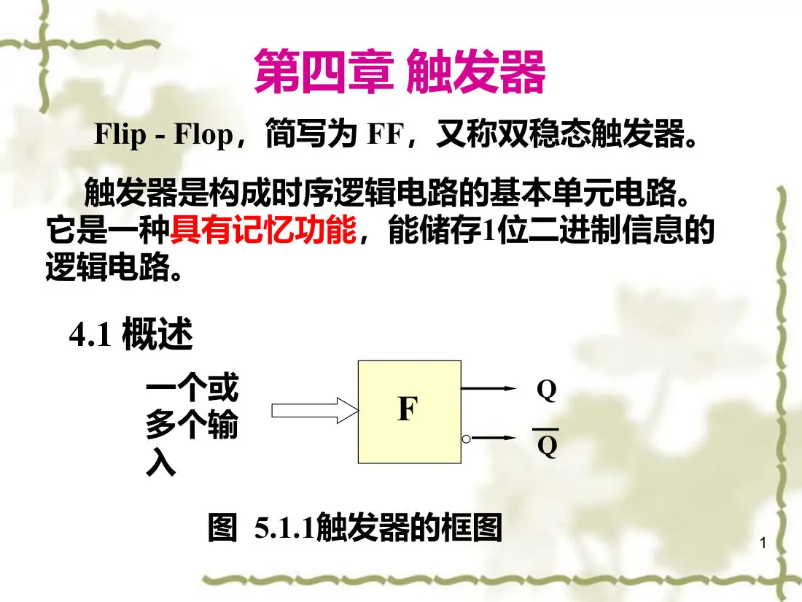

原文：

第四章 触发器

Flip - Flop，简写为 FF，又称双稳态触发器。

触发器是构成时序逻辑电路的基本单元电路。它是一种具有记忆功能，能储存1位二进制信息的逻辑电路。

4.1 概述

### 一、触发器的特点：

原文：

一、触发器的特点：

(1) 具有两种不同的稳定状态: “0” 或 “1”。

(2) 去掉输入信号后, 触发器的状态能长期保存。即具有记忆功能。

(3) 在新的信号作用下, 一种稳定状态能翻转到另一种稳定状态——即具有翻转功能。

2

### 二、触发器的分类

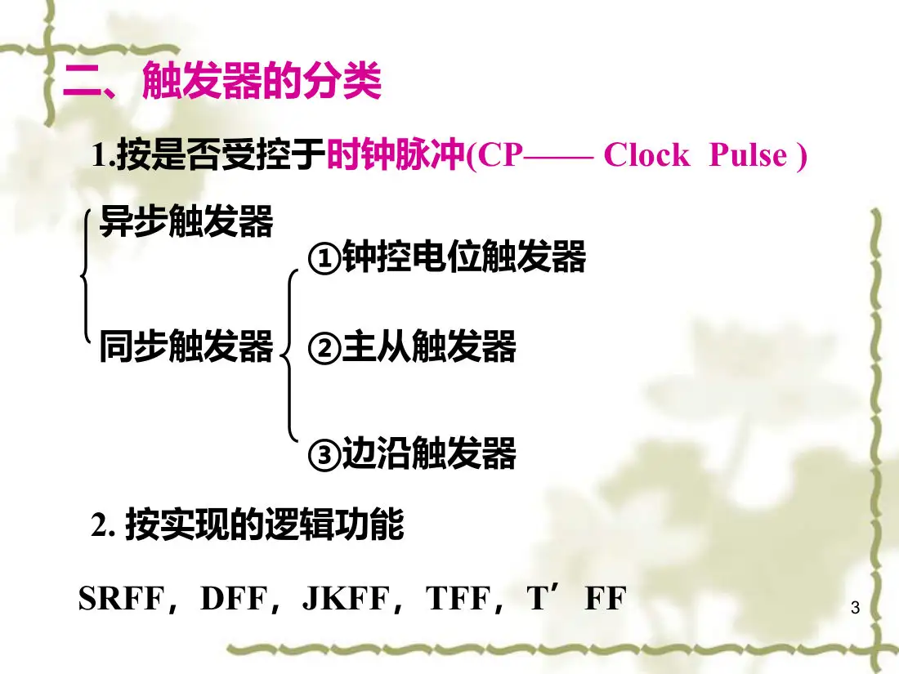

原文：

二、触发器的分类

1. 按是否受控于时钟脉冲(CP——Clock Pulse)

异步触发器

①钟控电位触发器

同步触发器

②主从触发器

③边沿触发器

2. 按实现的逻辑功能

SRFF, DFF, JKFF, TFF, T' FF

3

### Basic Flip - Flop

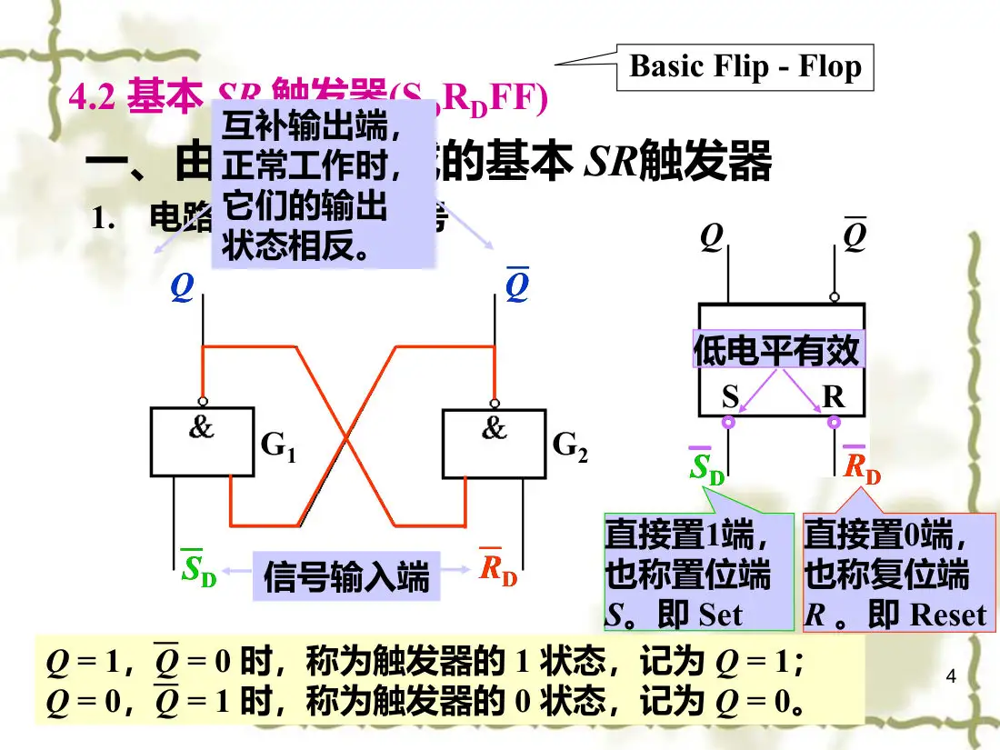

原文：

Basic Flip - Flop

4.2 基本 SR 触发器(S, R $_{D}$ FF)
互补输出端，
一、由正常工作时，的基本 SR 触发器

1. 电路 它们的输出状态相反。

号

直接置1端，也称置位端S。即Set直接置0端，也称复位端R。即 Reset

$Q = 1$ ， $\overline{Q} = 0$ 时，称为触发器的1状态，记为 $Q = 1$

$Q = 0$ ， $\overline{Q} = 1$ 时，称为触发器的0状态，记为 $Q = 0$ 。

### 2. 工作原理及逻辑功能

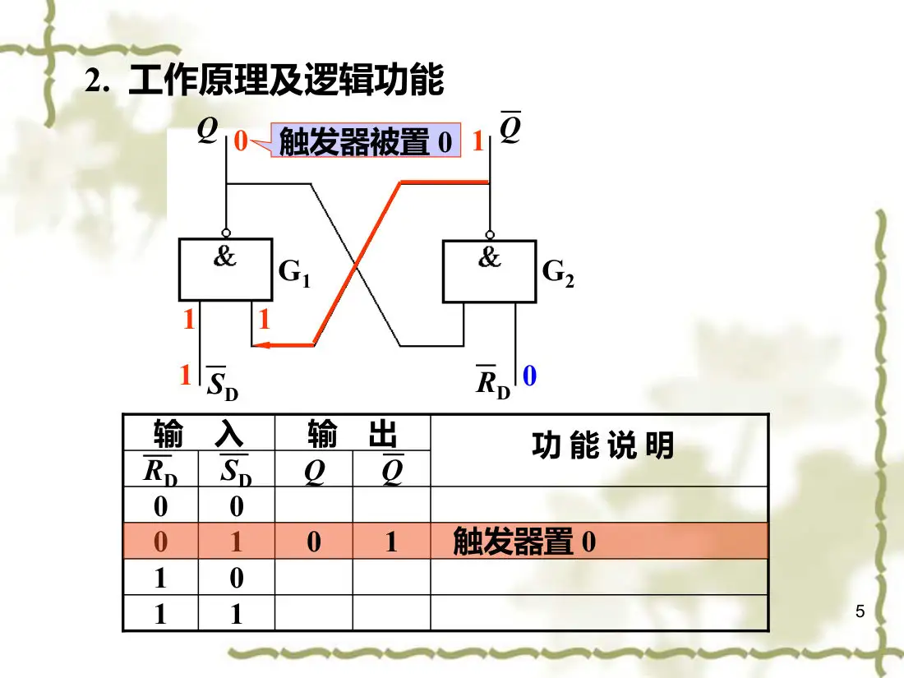

原文：

2. 工作原理及逻辑功能

触发器被置0

<table><tr><td colspan="2">输入</td><td colspan="2">输出</td><td rowspan="2">功能说明</td></tr><tr><td> $\overline{R}_{D}$ </td><td> $\overline{S}_{D}$ </td><td>Q</td><td> $\overline{Q}$ </td></tr><tr><td>0</td><td>0</td><td></td><td></td><td></td></tr><tr><td>0</td><td>1</td><td>0</td><td>1</td><td>触发器置0</td></tr><tr><td>1</td><td>0</td><td></td><td></td><td></td></tr><tr><td>1</td><td>1</td><td></td><td></td><td></td></tr></table>

5

### 2. 工作原理及逻辑功能

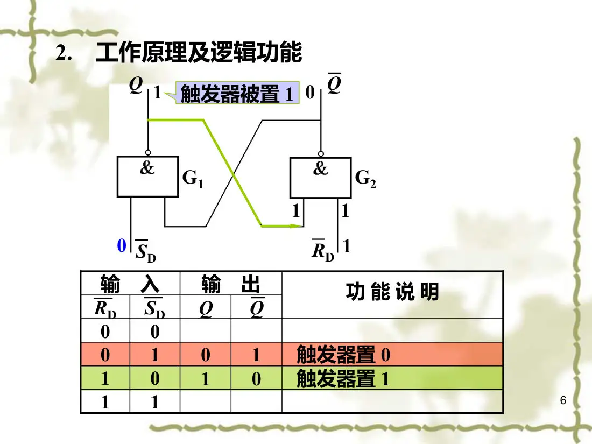

原文：

2. 工作原理及逻辑功能

触发器被置1

<table><tr><td colspan="2">输入</td><td colspan="2">输出</td><td rowspan="2">功能说明</td></tr><tr><td> $\overline{R}_{\text{D}}$ </td><td> $\overline{S}_{\text{D}}$ </td><td>Q</td><td> $\overline{Q}$ </td></tr><tr><td>0</td><td>0</td><td></td><td></td><td></td></tr><tr><td>0</td><td>1</td><td>0</td><td>1</td><td>触发器置 0</td></tr><tr><td>1</td><td>0</td><td>1</td><td>0</td><td>触发器置 1</td></tr><tr><td>1</td><td>1</td><td></td><td></td><td></td></tr></table>

6

### 2. 工作原理及逻辑功能

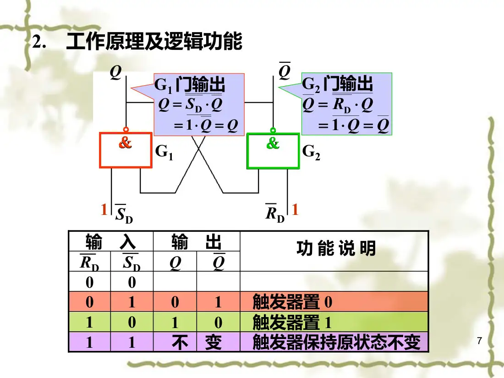

原文：

2. 工作原理及逻辑功能

<table><tr><td colspan="2">输入</td><td colspan="2">输出</td><td rowspan="2">功能说明</td></tr><tr><td> $\overline{R}_{D}$ </td><td> $\overline{S}_{D}$ </td><td>Q</td><td> $\overline{Q}$ </td></tr><tr><td>0</td><td>0</td><td></td><td></td><td></td></tr><tr><td>0</td><td>1</td><td>0</td><td>1</td><td>触发器置0</td></tr><tr><td>1</td><td>0</td><td>1</td><td>0</td><td>触发器置1</td></tr><tr><td>1</td><td>1</td><td>不</td><td>变</td><td>触发器保持原状态不变</td></tr></table>

7

### 2. 工作原理及逻辑功能

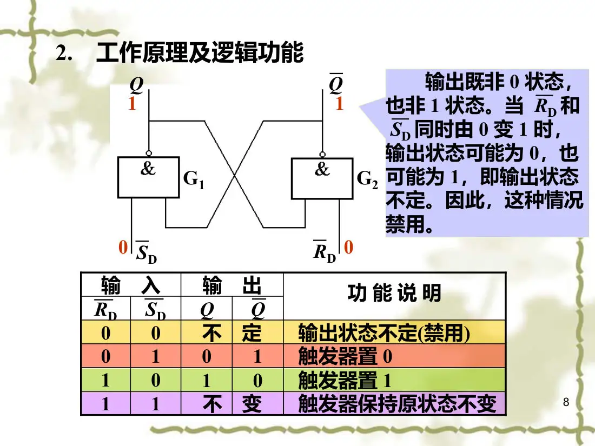

原文：

2. 工作原理及逻辑功能

输出既非 0 状态，也非 1 状态。当 $\overline{R}_{D}$ 和 $\overline{S}_{D}$ 同时由 0 变 1 时，输出状态可能为 0，也可能为 1，即输出状态不定。因此，这种情况禁用。

<table><tr><td colspan="2">输入</td><td colspan="2">输出</td><td rowspan="2">功能说明</td></tr><tr><td> $\overline{R}_{\text{D}}$ </td><td> $\overline{S}_{\text{D}}$ </td><td>Q</td><td> $\overline{Q}$ </td></tr><tr><td>0</td><td>0</td><td>不</td><td>定</td><td>输出状态不定(禁用)</td></tr><tr><td>0</td><td>1</td><td>0</td><td>1</td><td>触发器置0</td></tr><tr><td>1</td><td>0</td><td>1</td><td>0</td><td>触发器置1</td></tr><tr><td>1</td><td>1</td><td>不</td><td>变</td><td>触发器保持原状态不变</td></tr></table>

8

### 3. 逻辑功能的表示方法

原文：

3. 逻辑功能的表示方法

现态 指触发器在输入信号变化前的状态，也称当前状态。用 $Q^n$ 表示。

次态 指触发器在输入信号变化后的状态，也称下一状态。用 $Q^{n+1}$ 表示。

9

### (1)状态转移表

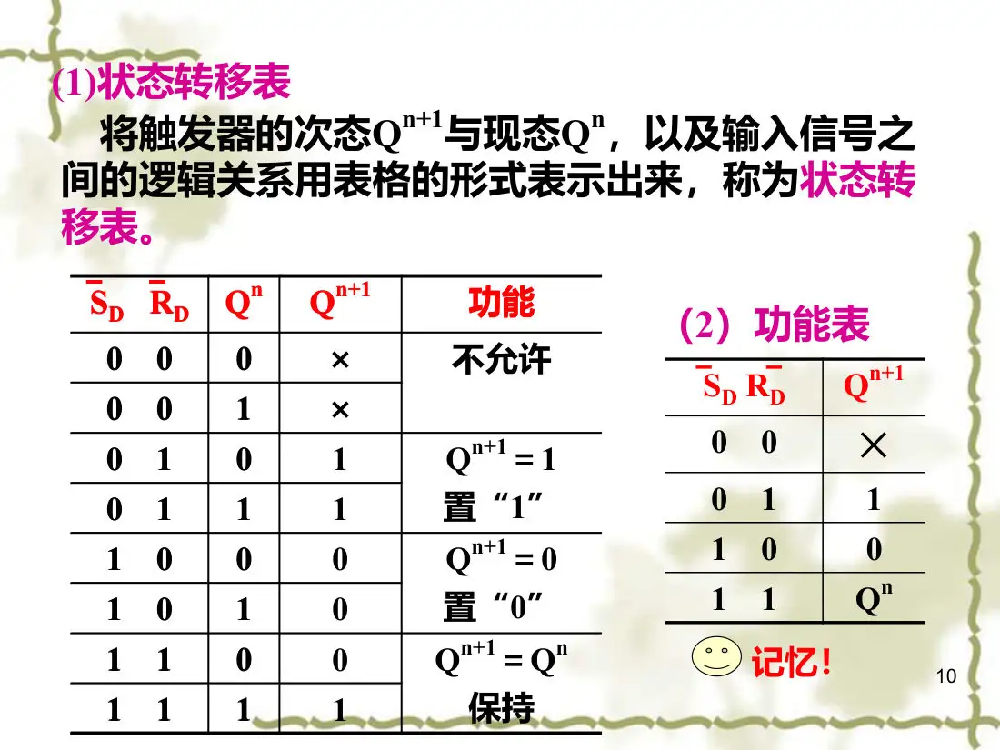

原文：

(1)状态转移表

将触发器的次态 $Q^{n+1}$ 与现态 $Q^n$ ，以及输入信号之间的逻辑关系用表格的形式表示出来，称为状态转移表。

<table><tr><td> $\overline{S}_{D}$   $\overline{R}_{D}$ </td><td> $Q^{n}$ </td><td> $Q^{n+1}$ </td><td>功能</td></tr><tr><td>0 0</td><td>0</td><td>×</td><td rowspan="2">不允许</td></tr><tr><td>0 0</td><td>1</td><td>×</td></tr><tr><td>0 1</td><td>0</td><td>1</td><td rowspan="2"> $Q^{n+1}=1$ 置“1”</td></tr><tr><td>0 1</td><td>1</td><td>1</td></tr><tr><td>1 0</td><td>0</td><td>0</td><td rowspan="2"> $Q^{n+1}=0$ 置“0”</td></tr><tr><td>1 0</td><td>1</td><td>0</td></tr><tr><td>1 1</td><td>0</td><td>0</td><td rowspan="2"> $Q^{n+1}=Q^{n}$ 保持</td></tr><tr><td>1 1</td><td>1</td><td>1</td></tr></table>

(2) 功能表
<table><tr><td> $\overline{S}_{D}$   $R_{D}^{-}$ </td><td> $Q^{n+1}$ </td></tr><tr><td>0 0</td><td>×</td></tr><tr><td>0 1</td><td>1</td></tr><tr><td>1 0</td><td>0</td></tr><tr><td>1 1</td><td> $Q^{n}$ </td></tr></table>

记忆!

10

### (3)次态方程

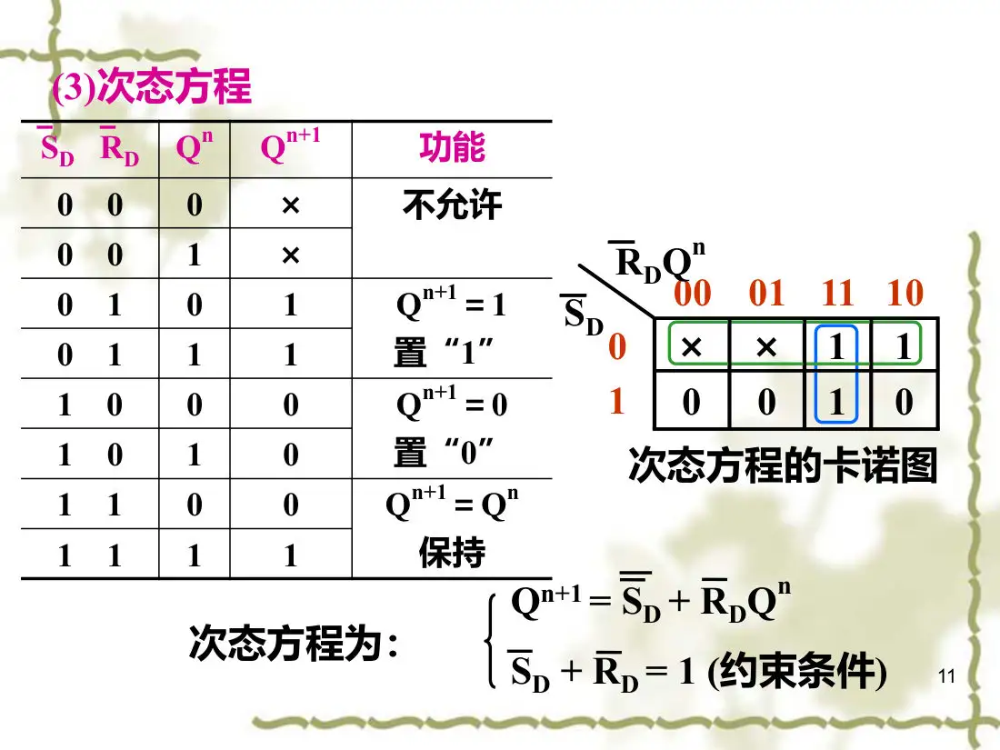

原文：

(3)次态方程

<table><tr><td> $\overline{S}_{D}$   $\overline{R}_{D}$ </td><td> $Q^{n}$ </td><td> $Q^{n+1}$ </td><td>功能</td></tr><tr><td>0 0</td><td>0</td><td>×</td><td rowspan="2">不允许</td></tr><tr><td>0 0</td><td>1</td><td>×</td></tr><tr><td>0 1</td><td>0</td><td>1</td><td rowspan="2"> $Q^{n+1}=1$ 置“1”</td></tr><tr><td>0 1</td><td>1</td><td>1</td></tr><tr><td>1 0</td><td>0</td><td>0</td><td rowspan="2"> $Q^{n+1}=0$ 置“0”</td></tr><tr><td>1 0</td><td>1</td><td>0</td></tr><tr><td>1 1</td><td>0</td><td>0</td><td rowspan="2"> $Q^{n+1}=Q^{n}$ 保持</td></tr><tr><td>1 1</td><td>1</td><td>1</td></tr></table>

次态方程的卡诺图

次态方程为： $\left\{\begin{aligned}Q^{n+1}&=\overline{S}_{D}+\overline{R}_{D}Q^{n}\\ \overline{S}_{D}&+\overline{R}_{D}=1\end{aligned}\right.$ (约束条件)

11

### (4)激励表

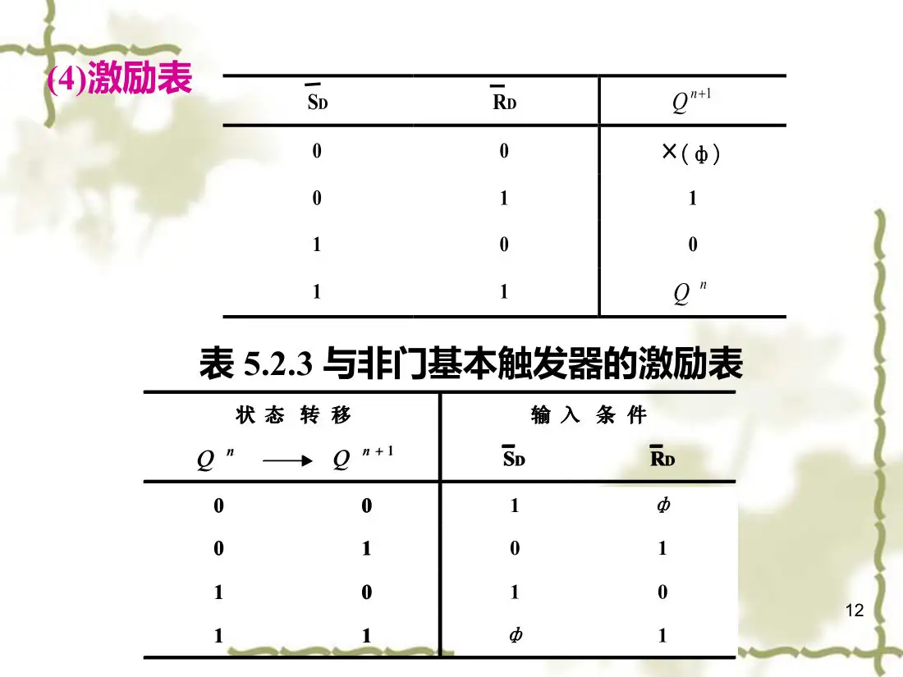

原文：

(4)激励表

<table><tr><td> $\overline{\mathbf{S}}_{\mathbf{D}}$ </td><td> $\overline{\mathbf{R}}_{\mathbf{D}}$ </td><td> $Q^{n+1}$ </td></tr><tr><td>0</td><td>0</td><td> $×(φ)$ </td></tr><tr><td>0</td><td>1</td><td>1</td></tr><tr><td>1</td><td>0</td><td>0</td></tr><tr><td>1</td><td>1</td><td> $Q^{n}$ </td></tr></table>

表 5.2.3 与非门基本触发器的激励表
<table><tr><td rowspan="2" colspan="2">状态转移 $Q^{n} \longrightarrow Q^{n+1}$ </td><td colspan="2">输入条件</td></tr><tr><td> $\overline{\mathbf{S}}_{\mathbf{D}}$ </td><td> $\overline{\mathbf{R}}_{\mathbf{D}}$ </td></tr><tr><td>0</td><td>0</td><td>1</td><td> $\phi$ </td></tr><tr><td>0</td><td>1</td><td>0</td><td>1</td></tr><tr><td>1</td><td>0</td><td>1</td><td>0</td></tr><tr><td>1</td><td>1</td><td> $\phi$ </td><td>1</td></tr></table>

$\phi$

12

### (5) 状态转移图（状态图）

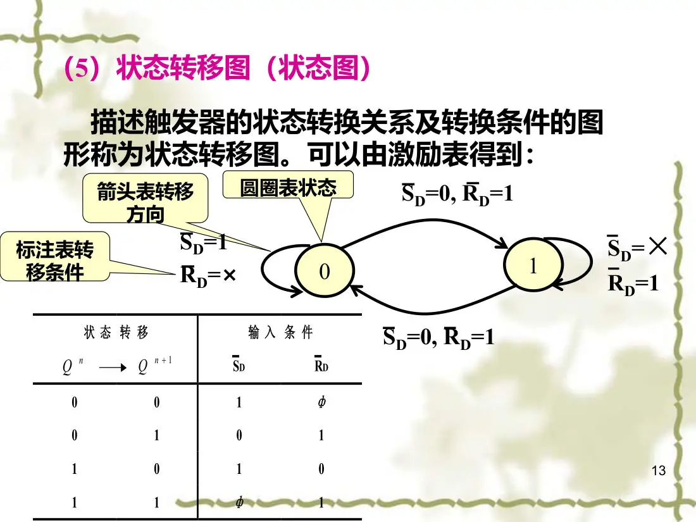

原文：

(5) 状态转移图（状态图）

描述触发器的状态转换关系及转换条件的图形称为状态转移图。可以由激励表得到：

箭头表转移方向

标注表转移条件 圆圈表状态

$$
\begin{array}{l} \overline {{\mathbf {S}}} _ {\mathbf {D}} = \mathsf {X} \\ \overline {{\mathbf {R}}} _ {\mathbf {D}} = \mathbf {1} \end{array}
$$

$$
\mathbf {\overline {{S}}} _ {\mathbf {D}} = \mathbf {0}, \mathbf {\overline {{R}}} _ {\mathbf {D}} = \mathbf {1}
$$

<table><tr><td rowspan="2" colspan="2">状态转移 $Q^{n} \longrightarrow Q^{n+1}$ </td><td colspan="2">输入条件</td></tr><tr><td> $\overline{\mathbf{S}}_{\mathbf{D}}$ </td><td> $\overline{\mathbf{R}}_{\mathbf{D}}$ </td></tr><tr><td>0</td><td>0</td><td>1</td><td> $\phi$ </td></tr><tr><td>0</td><td>1</td><td>0</td><td>1</td></tr><tr><td>1</td><td>0</td><td>1</td><td>0</td></tr><tr><td>1</td><td>1</td><td> $\phi$ </td><td>1</td></tr></table>

13

### (6) 波形图

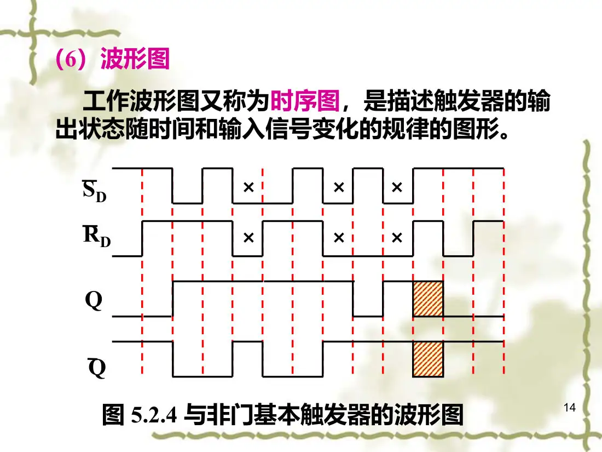

原文：

(6) 波形图

工作波形图又称为时序图，是描述触发器的输出状态随时间和输入信号变化的规律的图形。

14

### 4.2.2 由或非门组成的基本SRFF

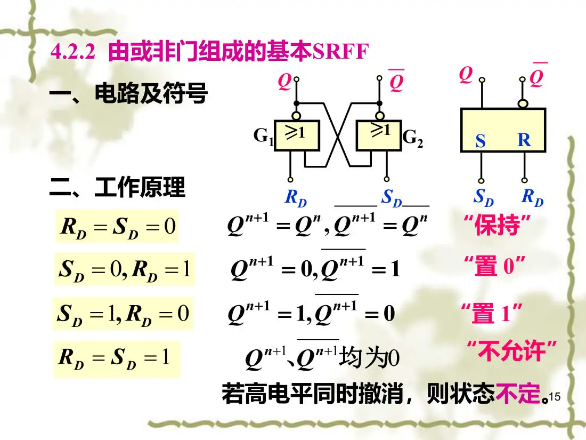

原文：

4.2.2 由或非门组成的基本SRFF

一、电路及符号

二、工作原理

$$
\boldsymbol {R} _ {D} = \boldsymbol {S} _ {D} = 0
$$

$$
\boldsymbol {S} _ {D} = 0, \boldsymbol {R} _ {D} = 1
$$

$$
\boldsymbol {S} _ {D} = 1, \boldsymbol {R} _ {D} = 0
$$

$$
\boldsymbol {R} _ {D} = \boldsymbol {S} _ {D} = 1
$$

$R_{D}$ \_\_\_\_ $S_{D}$

$$
Q ^ {n + 1} = Q ^ {n}, Q ^ {n + 1} = Q ^ {n}
$$

$$
Q ^ {n + 1} = 0, Q ^ {n + 1} = 1
$$

$$
Q ^ {n + 1} = 1, Q ^ {n + 1} = 0
$$

$Q^{n + 1}, Q^{n + 1}$ 均为0

“保持”

“置0”

“置1”

“不允许”

若高电平同时撤消，则状态不定。 $^{15}$

### 三、转移表和次态方程

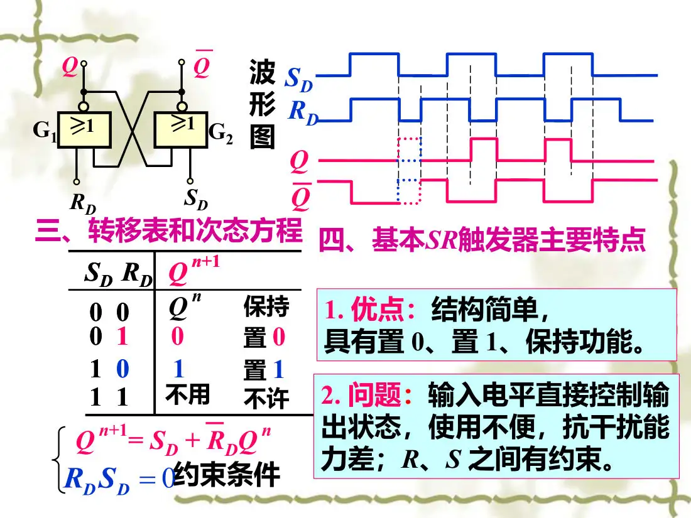

原文：

三、转移表和次态方程

<table><tr><td> $S_D$   $R_D$ </td><td colspan="2"> $Q^{n+1}$ </td></tr><tr><td>0 0</td><td> $Q^n$ </td><td>保持</td></tr><tr><td>0 1</td><td>0</td><td>置0</td></tr><tr><td>1 0</td><td>1</td><td>置1</td></tr><tr><td>1 1</td><td>不用</td><td>不许</td></tr></table>

$\left\{ \begin{array}{l} Q^{n + 1} = S_D + \overline{R}_DQ^n \\ R_D S_D = 0 \end{array} \right.$ 约束条件

四、基本SR触发器主要特点

1. 优点：结构简单，具有置0、置1、保持功能。

2. 问题：输入电平直接控制输出状态，使用不便，抗干扰能力差；R、S 之间有约束。

### 4.3 钟控电位触发器

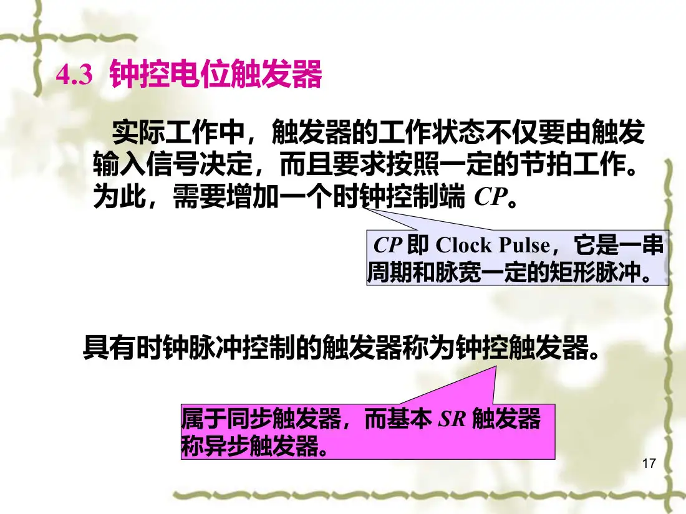

原文：

4.3 钟控电位触发器

实际工作中，触发器的工作状态不仅要由触发输入信号决定，而且要求按照一定的节拍工作。为此，需要增加一个时钟控制端 CP。

CP 即 Clock Pulse，它是一串周期和脉宽一定的矩形脉冲。

具有时钟脉冲控制的触发器称为钟控触发器。

属于同步触发器，而基本 SR 触发器称异步触发器。

17

### 5.3.1 钟控SR 触发器

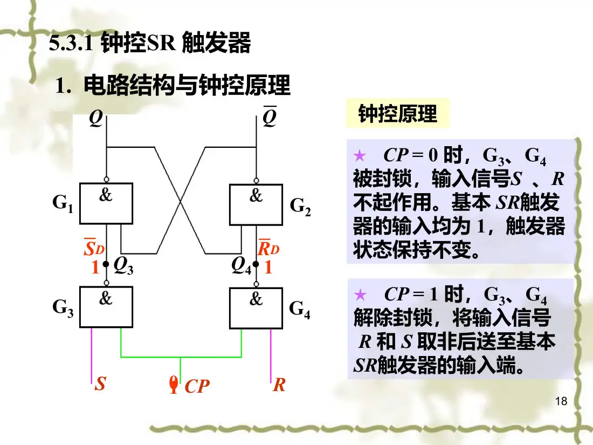

原文：

5.3.1 钟控SR 触发器

1. 电路结构与钟控原理

钟控原理

★ CP = 0 时， $G_{3}$ 、 $G_{4}$ 被封锁，输入信号 S 、 R 不起作用。基本 SR 触发器的输入均为 1，触发器状态保持不变。

★ CP = 1 时， $G_{3}$ 、 $G_{4}$ 解除封锁，将输入信号
R 和 S 取非后送至基本
SR 触发器的输入端。

18

### 19

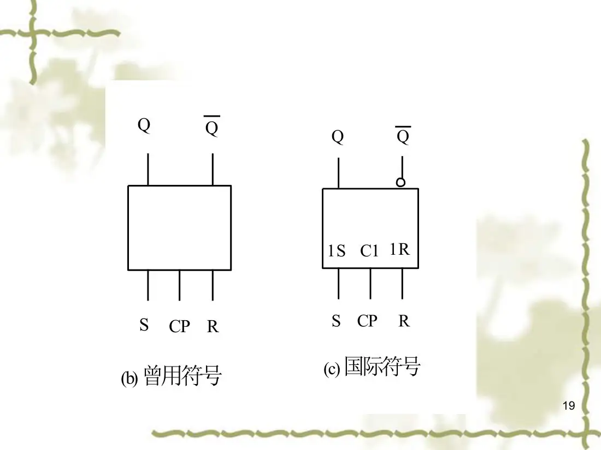

原文：

19

### 2. 逻辑功能

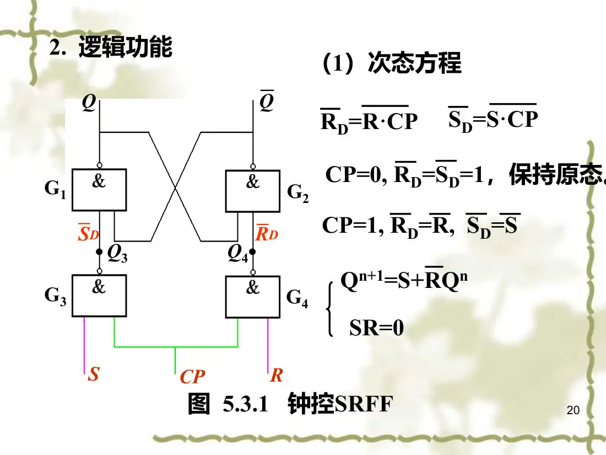

原文：

2. 逻辑功能

(1) 次态方程

$$
\overline {{\mathbf {R}}} _ {\mathbf {D}} = \overline {{\mathbf {R} \cdot \mathbf {C P}}} \quad \overline {{\mathbf {S}}} _ {\mathbf {D}} = \overline {{\mathbf {S} \cdot \mathbf {C P}}}
$$

CP=0, $\overline{R}_{D}=\overline{S}_{D}=1$ ，保持原态。

$$
\mathbf {C P} = \mathbf {1}, \overline {{\mathbf {R}}} _ {\mathbf {D}} = \overline {{\mathbf {R}}}, \overline {{\mathbf {S}}} _ {\mathbf {D}} = \overline {{\mathbf {S}}}
$$

$$
\left\{ \begin{array}{l} \mathbf {Q} ^ {\mathrm{n+1}} = \mathbf {S} + \overline {{\mathbf {R}}} \mathbf {Q} ^ {\mathrm{n}} \\ \mathbf {S R} = \mathbf {0} \end{array} \right.
$$

20

### (2) 功能表

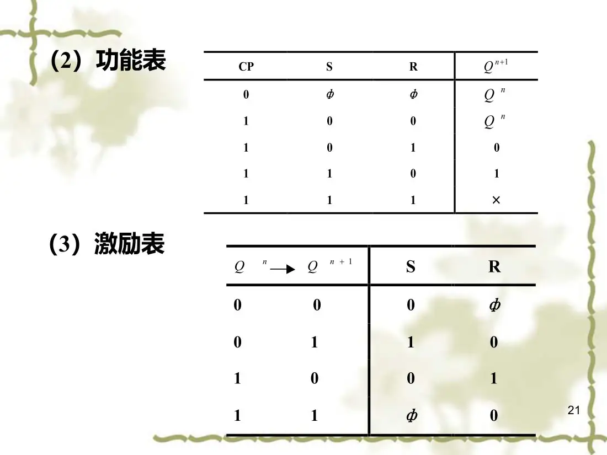

原文：

<table><tr><td>CP</td><td>S</td><td>R</td><td> $Q^{n+1}$ </td></tr><tr><td>0</td><td> $\phi$ </td><td> $\phi$ </td><td> $Q^n$ </td></tr><tr><td>1</td><td>0</td><td>0</td><td> $Q^n$ </td></tr><tr><td>1</td><td>0</td><td>1</td><td>0</td></tr><tr><td>1</td><td>1</td><td>0</td><td>1</td></tr><tr><td>1</td><td>1</td><td>1</td><td>×</td></tr></table>

(2) 功能表

(3) 激励表

### (3)波形图

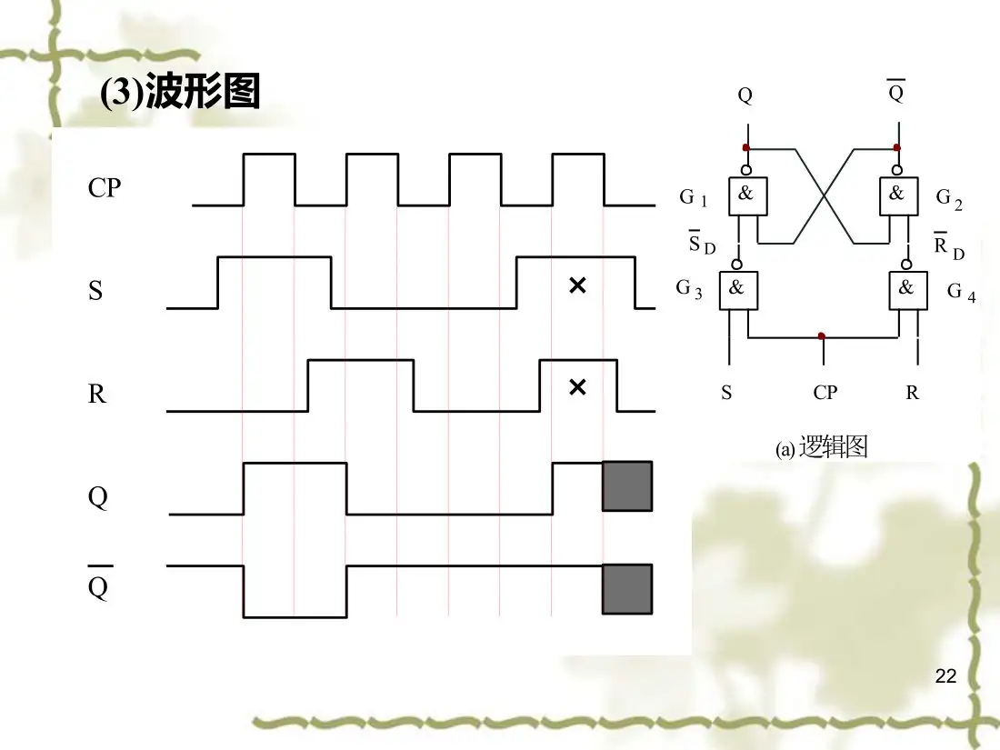

原文：

(3)波形图

22

### 4.3.2 钟控 $D$ 触发器

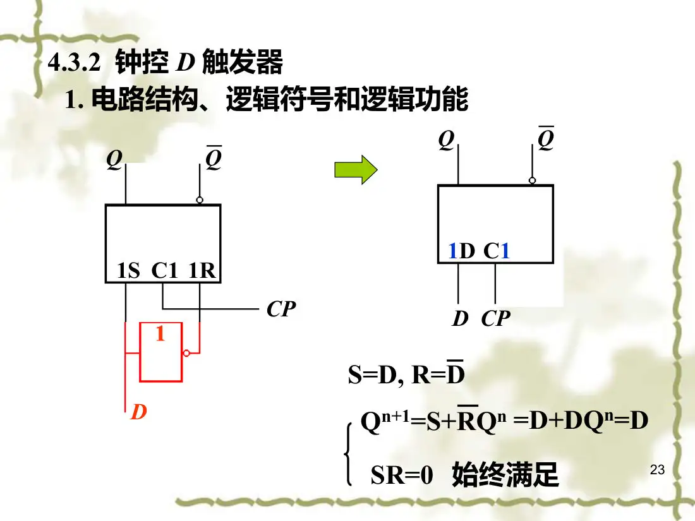

原文：

4.3.2 钟控 $D$ 触发器

1. 电路结构、逻辑符号和逻辑功能

$$
\mathbf {S} = \mathbf {D}, \mathbf {R} = \overline {{\mathbf {D}}}
$$

$$
\left\{ \begin{array}{l l} \mathbf {Q} ^ {\mathrm{n+1}} = \mathbf {S} + \overline {{\mathbf {R}}} \mathbf {Q} ^ {\mathrm{n}} = \mathbf {D} + \mathbf {D Q} ^ {\mathrm{n}} = \mathbf {D} \\ \mathbf {S R} = 0 \quad \text {始终满足} \end{array} \right.
$$

23

### 2. D 触发器的次态方程、功能表、激励表和状态转换图

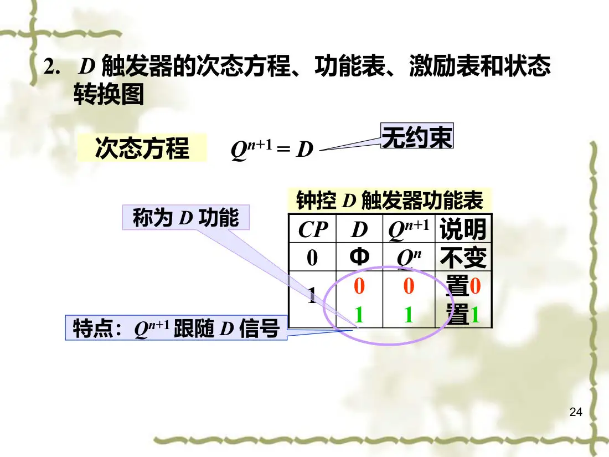

原文：

2. D 触发器的次态方程、功能表、激励表和状态转换图

次态方程

$$
Q ^ {n + 1} = D
$$

无约束

称为 $D$ 功能

特点: $Q^{n+1}$ 跟随 $D$ 信号

钟控 D 触发器功能表

<table><tr><td>CP</td><td>D</td><td> $Q^{n+1}$ </td><td>说明</td></tr><tr><td>0</td><td>Φ</td><td> $Q^n$ </td><td>不变</td></tr><tr><td rowspan="2">1</td><td>0</td><td>0</td><td>置0</td></tr><tr><td>1</td><td>1</td><td>置1</td></tr></table>

24

### D 触发器激励表

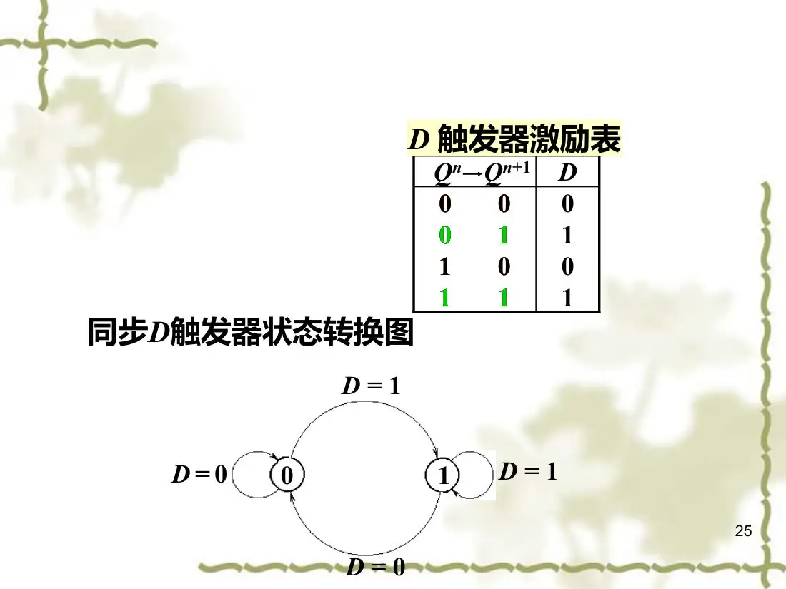

原文：

D 触发器激励表

$$
\left| \begin{array}{c c} Q ^ {n} \to Q ^ {n + 1} & D \\ \hline 0 & 0 \\ 0 & 1 \\ 1 & 0 \\ 1 & 1 \end{array} \right|
$$

25

### 解：

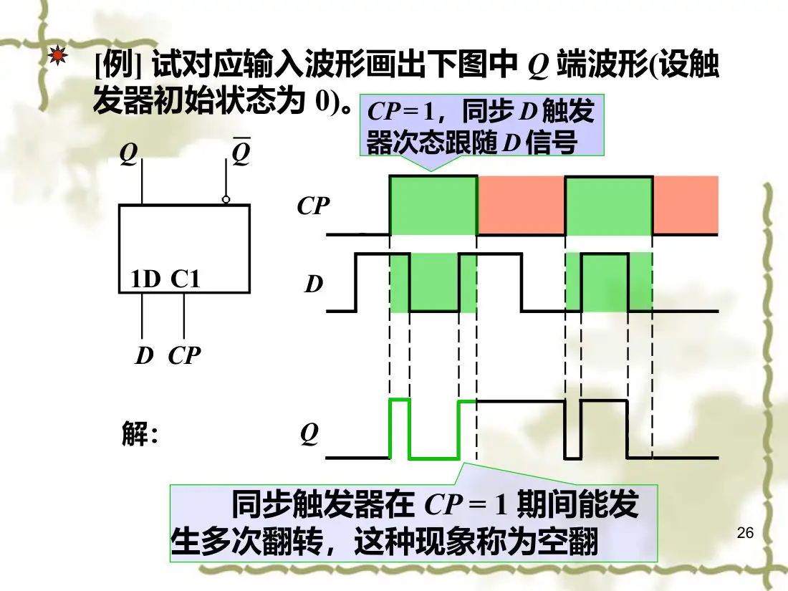

原文：

[例] 试对应输入波形画出下图中 Q 端波形(设触发器初始状态为 0)。CP=1，同步 D 触发

解：

同步触发器在 $CP = 1$ 期间能发生多次翻转，这种现象称为空翻

26

### 例：因干扰而引起的误动作，波形图如下

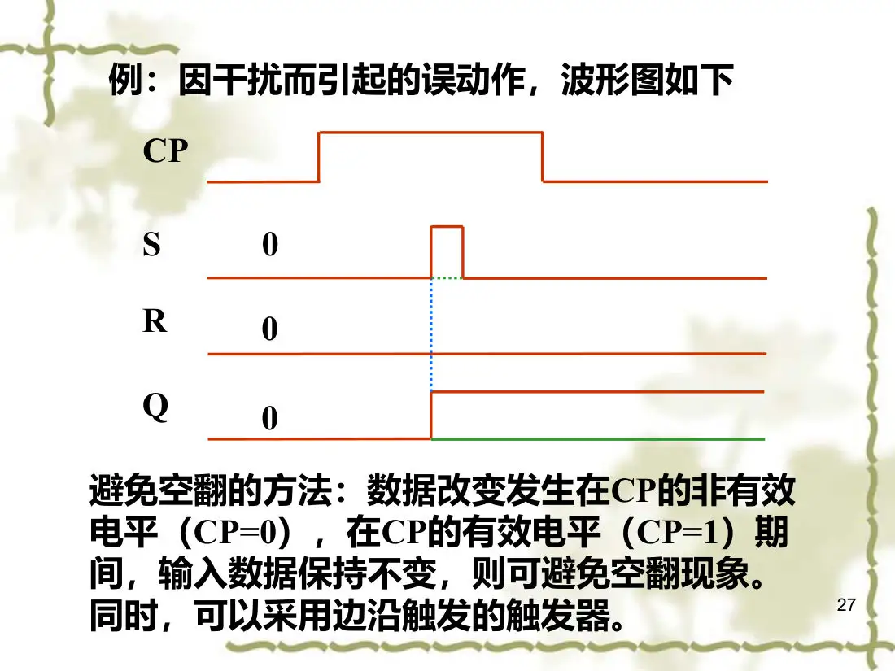

原文：

例：因干扰而引起的误动作，波形图如下

避免空翻的方法：数据改变发生在CP的非有效电平（CP=0），在CP的有效电平（CP=1）期间，输入数据保持不变，则可避免空翻现象。同时，可以采用边沿触发的触发器。

27

### 第 28 页

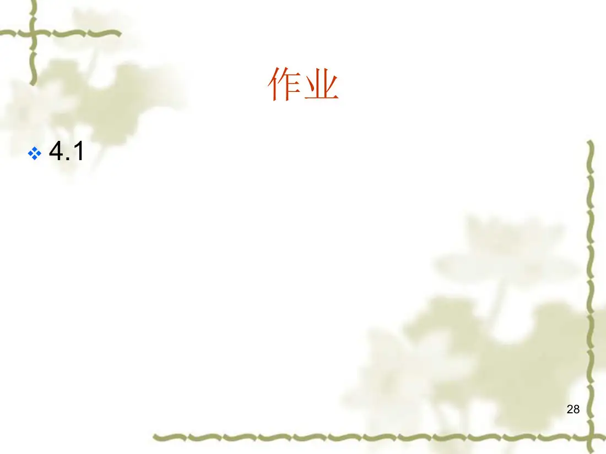
