# 《数字电路与逻辑设计B》第4章习题答案

原件经识别和整理；“参考解答”是我们补的。

# 《数字电路与逻辑设计B》第4章习题答案

## 一、分析题

### 选择 4.1

题干：分析图4.1电路的逻辑功能

解：
（1）推导输出表达式

$$
\mathrm{Y}_{2} = \mathrm{X}_{2}; \quad \mathrm{Y}_{1} = \mathrm{X}_{1} \oplus \mathrm{X}_{2}; \quad \mathrm{Y}_{0} = (\mathrm{M}\mathrm{Y}_{1} + \mathrm{X}_{1} \bar{\mathrm{M}}) \oplus \mathrm{X}_{0}
$$

(2) 列真值表

| M | $X_2$ | $X_1$ | $X_0$ | $Y_2$ | $Y_1$ | $Y_0$ |
|---|-------|-------|-------|-------|-------|-------|
| 0 | 0     | 0     | 0     | 0     | 0     | 0     |
| 0 | 0     | 0     | 1     | 0     | 0     | 1     |
| 0 | 0     | 1     | 0     | 0     | 1     | 1     |
| 0 | 0     | 1     | 1     | 0     | 1     | 0     |
| 0 | 1     | 0     | 0     | 1     | 1     | 0     |
| 0 | 1     | 0     | 1     | 1     | 1     | 1     |
| 0 | 1     | 1     | 0     | 1     | 0     | 1     |
| 0 | 1     | 1     | 1     | 1     | 0     | 0     |
| 1 | 0     | 0     | 0     | 0     | 0     | 0     |
| 1 | 0     | 0     | 1     | 0     | 0     | 1     |
| 1 | 0     | 1     | 0     | 0     | 1     | 1     |
| 1 | 0     | 1     | 1     | 0     | 1     | 0     |
| 1 | 1     | 0     | 0     | 1     | 1     | 1     |
| 1 | 1     | 0     | 1     | 1     | 1     | 0     |
| 1 | 1     | 1     | 0     | 1     | 0     | 0     |
| 1 | 1     | 1     | 1     | 1     | 0     | 1     |

（3）逻辑功能：当M=0时，实现3位自然二进制码转换成 3位循环码。当M=1时，实现3位循环码转换成 3位自然二进制码。

知识点：[完整数字系统设计流程实例（如乘法器、交通灯管理系统的算法规律、处理器设计与控制器实现）](../../../topics/数字逻辑电路/数字系统设计实例.md)

### 选择 4.2

题干：分析图P4.2电路的逻辑功能。

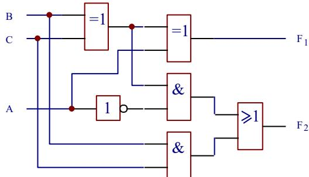

解：
(1)从输入端开始，逐级推导出函数表达式。

$\mathrm { F } _ { 1 } = \mathrm { A } \oplus \mathrm { B } \oplus \mathrm { C }$

$$
\mathrm{F}_{2} = \mathrm{A} (\mathrm{B} \oplus \mathrm{C}) + \mathrm{BC} = \overline {\mathrm{A}} \overline {\mathrm{B}} \mathrm{C} + \overline {\mathrm{A}} \mathrm{B} \overline {\mathrm{C}} + \overline {\mathrm{A}} \mathrm{BC} + \mathrm{ABC}
$$

(2)列真值表。

| A | B | C | F1 | F2 |
|---|---|---|----|----|
| 0 | 0 | 0 | 0  | 0  |
| 0 | 0 | 1 | 1  | 1  |
| 0 | 1 | 0 | 1  | 1  |
| 0 | 1 | 1 | 0  | 1  |
| 1 | 0 | 0 | 1  | 0  |
| 1 | 0 | 1 | 0  | 0  |
| 1 | 1 | 0 | 0  | 0  |
| 1 | 1 | 1 | 1  | 1  |

(3)确定逻辑功能。假设变量A、B、C和函数 $\mathrm { F } _ { 1 }$ 、 $\mathrm { F } _ { 2 }$ 均表示一位二进制数，那么，由真值表可知，该电路实现了一位全减器的功能。

A、B、C、F 、 $\mathrm { F } _ { 2 }$ 分别表示被减数、减数、来自低位的借位、本位差、本位向高位的借位。

知识点：[完整数字系统设计流程实例（如乘法器、交通灯管理系统的算法规律、处理器设计与控制器实现）](../../../topics/数字逻辑电路/数字系统设计实例.md)、[寄存器传输语言(RTL)描述的传输操作、算术操作、逻辑操作、移位操作及条件控制语句](../../../topics/数字逻辑电路/RTL语言.md)、[数字系统的基本模型（数据处理器与控制器）及对最小时钟周期、异步信号同步化的约定](../../../topics/数字逻辑电路/数字系统模型.md)

### 选择 4.3

题干：分析图4.3电路的逻辑功能

解：
（1） $\mathrm { F _ { 1 } } \mathrm { = A } \oplus \mathrm { B } \oplus \mathrm { C } \mathrm { ; } \mathrm { F _ { 2 } } \mathrm { = } ( \mathrm { A @ B } ) \mathrm { C } \mathrm { + } \mathrm { A B }$

(2)真值表：

| A | B | C | $F_{2}$ | $F_{1}$ |
|---|---|---|---------|---------|
| 0 | 0 | 0 | 0       | 0       |
| 0 | 0 | 1 | 0       | 1       |
| 0 | 1 | 0 | 0       | 1       |
| 0 | 1 | 1 | 1       | 0       |
| 1 | 0 | 0 | 0       | 1       |
| 1 | 0 | 1 | 1       | 0       |
| 1 | 1 | 0 | 1       | 0       |
| 1 | 1 | 1 | 1       | 1       |

(3)逻辑功能：实现1 位全加器。

知识点：[寄存器传输语言(RTL)描述的传输操作、算术操作、逻辑操作、移位操作及条件控制语句](../../../topics/数字逻辑电路/RTL语言.md)、[数字系统的基本模型（数据处理器与控制器）及对最小时钟周期、异步信号同步化的约定](../../../topics/数字逻辑电路/数字系统模型.md)

### 选择 4.4

题干：设 ABCD 是一个 8421BCD 码，试用最少与非门设计一个能判断该 8421BCD 码是否大于等于5的电路，该数大于等于 5，F= 1；否则为0。

解：
(1)列真值表

| A | B | C | D | F |
|---|---|---|---|---|
| 0 | 0 | 0 | 0 | 0 |
| 0 | 0 | 0 | 1 | 0 |
| 0 | 0 | 1 | 0 | 0 |
| 0 | 0 | 1 | 1 | 0 |
| 0 | 1 | 0 | 0 | 0 |
| 0 | 1 | 0 | 1 | 1 |
| 0 | 1 | 1 | 0 | 1 |
| 0 | 1 | 1 | 1 | 1 |

| A | B | C | D | F |
|---|---|---|---|---|
| 1 | 0 | 0 | 0 | 1 |
| 1 | 0 | 0 | 1 | 1 |
| 1 | 0 | 1 | 0 | $\emptyset$ |
| 1 | 0 | 1 | 1 | $\emptyset$ |
| 1 | 1 | 0 | 0 | $\emptyset$ |
| 1 | 1 | 0 | 1 | $\emptyset$ |
| 1 | 1 | 1 | 0 | $\emptyset$ |
| 1 | 1 | 1 | 1 | $\emptyset$ |

(2)写最简表达式

| AB\CD | 00 | 01 | 11 | 10 |
|-------|----|----|----|----|
| 00    |    |    |    |    |
| 01    |    | 1  | 1  | 1  |
| 11    | $\phi$ | $\phi$ | $\phi$ | $\phi$ |
| 10    | 1  | 1  | $\phi$ | $\phi$ |

$$
\mathrm{F} = \mathrm{A} + \mathrm{BD} + \mathrm{BC} = \overline {{\mathrm{A}}} \cdot \overline {{\mathrm{BD}}} \cdot \overline {{\mathrm{BC}}}
$$

(3)画逻辑电路，如下图所示：

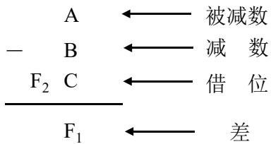

# 第 4 章习题答案

本部分整理了《数字电路与逻辑设计 B》第 4 章习题中关于组合逻辑电路设计的解答，包含真值表、卡诺图化简及电路图说明。

## 计算 5

**题干：** 试设计一个 2 位二进制数乘法器电路。

解：
（1）设被乘数为 $AB$，乘数为 $CD$，乘积结果为 $\mathrm{F}_4 \mathrm{F}_3 \mathrm{F}_2 \mathrm{F}_1$。真值表如下：

| A | B | C | D | F4 | F3 | F2 | F1 |
|---|---|---|---|----|----|----|----|
| 0 | 0 | 0 | 0 | 0 | 0 | 0 | 0 |
| 0 | 0 | 0 | 1 | 0 | 0 | 0 | 0 |
| 0 | 0 | 1 | 0 | 0 | 0 | 0 | 0 |
| 0 | 0 | 1 | 1 | 0 | 0 | 0 | 0 |
| 0 | 1 | 0 | 0 | 0 | 0 | 0 | 0 |
| 0 | 1 | 0 | 1 | 0 | 0 | 0 | 1 |
| 0 | 1 | 1 | 0 | 0 | 0 | 1 | 0 |
| 0 | 1 | 1 | 1 | 0 | 0 | 1 | 1 |
| 1 | 0 | 0 | 0 | 0 | 0 | 0 | 0 |
| 1 | 0 | 0 | 1 | 0 | 0 | 1 | 0 |
| 1 | 0 | 1 | 0 | 0 | 1 | 0 | 0 |
| 1 | 0 | 1 | 1 | 0 | 1 | 1 | 0 |
| 1 | 1 | 0 | 0 | 0 | 0 | 0 | 0 |
| 1 | 1 | 0 | 1 | 0 | 0 | 1 | 1 |
| 1 | 1 | 1 | 0 | 0 | 1 | 1 | 0 |
| 1 | 1 | 1 | 1 | 1 | 0 | 0 | 1 |

根据真值表可直接得到：$\mathrm{F}_4 = \mathrm{ABCD}$

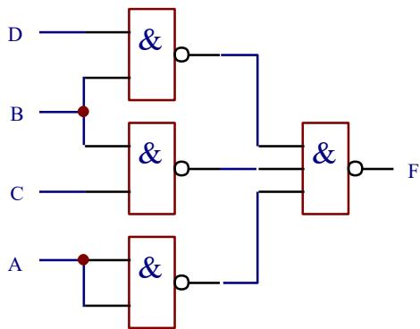

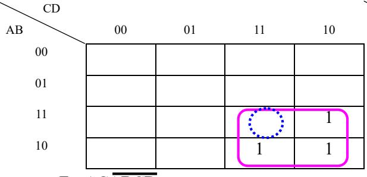

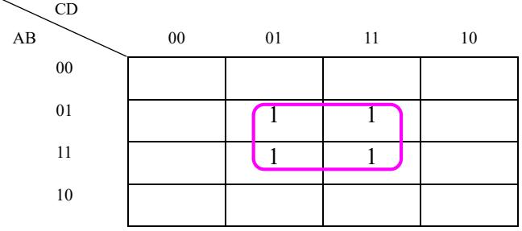

为了使电路尽量简单，希望门数越少越好，本电路是四输出函数，圈卡诺圈时要尽量选择共有的卡诺圈以减少逻辑门的数量。

答案：电路图略。

## 计算 6

**题干：** 试设计一个将 8421BCD 码转换成余 3 码的电路。

解：
（1）列真值表

| A | B | C | D | F4 | F3 | F2 | F1 |
|---|---|---|---|----|----|----|----|
| 0 | 0 | 0 | 0 | 0 | 0 | 1 | 1 |
| 0 | 0 | 0 | 1 | 0 | 1 | 0 | 0 |
| 0 | 0 | 1 | 0 | 0 | 1 | 0 | 1 |
| 0 | 0 | 1 | 1 | 0 | 1 | 1 | 0 |
| 0 | 1 | 0 | 0 | 0 | 1 | 1 | 1 |
| 0 | 1 | 0 | 1 | 1 | 0 | 0 | 0 |
| 0 | 1 | 1 | 0 | 1 | 0 | 0 | 1 |
| 0 | 1 | 1 | 1 | 1 | 0 | 1 | 0 |
| 1 | 0 | 0 | 0 | 1 | 0 | 1 | 1 |
| 1 | 0 | 0 | 1 | 1 | 1 | 0 | 0 |

（2）化简输出表达式

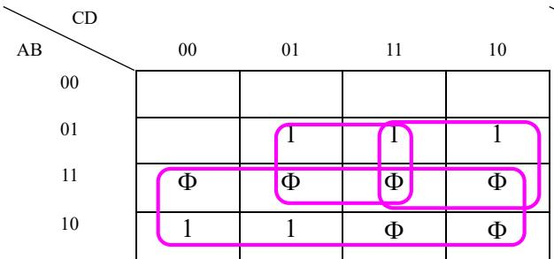

$$
\mathrm{F}_4 = \mathrm{A} + \mathrm{BD} + \mathrm{BC}
$$

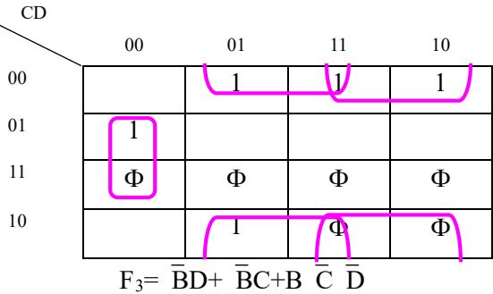

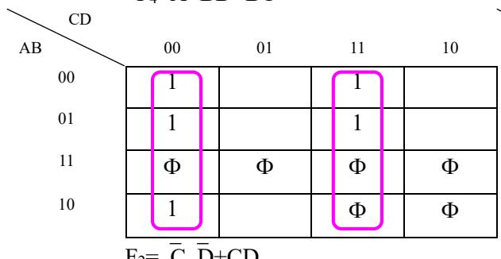

答案：电路图略。

## 计算 7

**题干：** 在双轨输入条件下用最少与非门设计下列组合电路：

知识点：[完整数字系统设计流程实例（如乘法器、交通灯管理系统的算法规律、处理器设计与控制器实现）](../../../topics/数字逻辑电路/数字系统设计实例.md)

### 选择 1

**题干：** （1）$F(ABC) = \sum_m (1, 3, 4, 6, 7)$

解：$F = AC + \bar{A}C + BC$

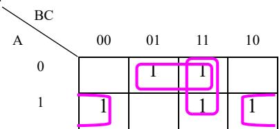

答案：电路图略。

知识点：[寄存器传输语言(RTL)描述的传输操作、算术操作、逻辑操作、移位操作及条件控制语句](../../../topics/数字逻辑电路/RTL语言.md)、[算法状态机(ASM)图的状态框、判断框、条件输出框及ASM块的构成规则](../../../topics/数字逻辑电路/ASM图基础.md)

### 选择 2

**题干：** （2）$F(ABCD) = \sum_m (0, 2, 6, 7, 8, 10, 12, 14, 15)$

解：$F = \bar{B}\bar{D} + A\bar{D} + BC$

答案：电路图略。

# 《数字电路与逻辑设计B》第4章习题答案（第3部分）

本题为《数字电路与逻辑设计B》课程第4章习题答案的第3部分整理，内容涵盖卡诺图化简、组合逻辑电路设计及译码器应用等题目。

## 一、综合题/计算题

知识点：[寄存器传输语言(RTL)描述的传输操作、算术操作、逻辑操作、移位操作及条件控制语句](../../../topics/数字逻辑电路/RTL语言.md)、[算法状态机(ASM)图的状态框、判断框、条件输出框及ASM块的构成规则](../../../topics/数字逻辑电路/ASM图基础.md)、[控制器的四种硬件实现方法：每态一触发器法(SSI)、MSI法(MUX+寄存器+译码器)、PLA法(LSI)及对比](../../../topics/数字逻辑电路/控制器实现方法.md)

### 综合 7

题干：(3) $F(A, B,C,D) = \sum m(2,5,6,8,9,12) + \sum \phi(0,4,7,10)$

解：函数的卡诺图如下所示：

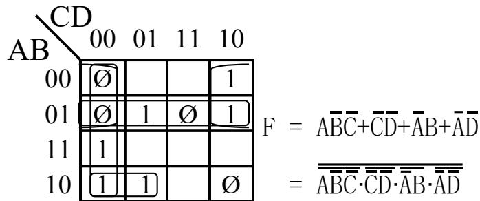
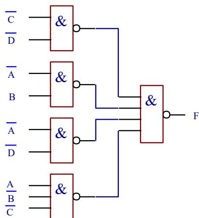

知识点：[控制器的四种硬件实现方法：每态一触发器法(SSI)、MSI法(MUX+寄存器+译码器)、PLA法(LSI)及对比](../../../topics/数字逻辑电路/控制器实现方法.md)

### 综合 8

题干：(4) $\mathrm{F(ABC) = A \overline{B} + B \overline{C} + \overline{A} C}$

解：$\mathrm{F(ABC) = A \overline{B} + B \overline{C} + \overline{A} C}$

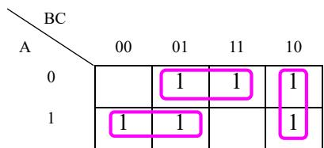

知识点：[完整数字系统设计流程实例（如乘法器、交通灯管理系统的算法规律、处理器设计与控制器实现）](../../../topics/数字逻辑电路/数字系统设计实例.md)

### 综合 9

题干：4.8 在双轨输入信号下，用最少或非门设计题4.7的组合电路。

解：将表达式化简为最简或与式：

$$
(1) \mathrm{F} = (\mathrm{A} + \mathrm{C}) (\overline {\mathrm{A}} + \mathrm{B} + \overline {\mathrm{C}}) = \overline {\overline {\mathrm{A} + \mathrm{C}}} + \overline {\overline {\overline {\mathrm{A}} + \mathrm{B} + \overline {\mathrm{C}}}}
$$

$$
(2) \mathrm{F} = (\mathrm{C} + \overline {\mathrm{D}}) (\mathrm{B} + \mathrm{D}) (\mathrm{A} + \overline {\mathrm{B}} + \mathrm{C}) = \overline {\mathrm{C} + \overline {\mathrm{D}} + \overline {\mathrm{B}} + \mathrm{D}} + \overline {\mathrm{A} + \overline {\mathrm{B}} + \mathrm{C}}
$$

$$
(3) \mathrm{F} = (\overline {\mathrm{A}} + \overline {\mathrm{C}}) (\overline {\mathrm{A}} + \overline {\mathrm{B}} + \overline {\mathrm{D}}) (\mathrm{A} + \mathrm{B} + \overline {\mathrm{D}}) = \overline {\overline {\overline {\mathrm{A}} + \overline {\mathrm{C}}}} + \overline {\overline {\overline {\mathrm{A}} + \overline {\mathrm{B}} + \overline {\mathrm{D}}}} + \overline {\overline {\mathrm{A} + \mathrm{B} + \overline {\mathrm{D}}}}
$$
*(注：原件公式推导步骤存在逻辑符号混用，此处尽量还原原件意图，通常或非门实现或与式需转换为对偶形式)*

$$
(4) \mathrm{F} = (\mathrm{A} + \mathrm{B} + \mathrm{C}) (\overline {\mathrm{A}} + \overline {\mathrm{B}} + \overline {\mathrm{C}}) = \overline {\overline {\mathrm{A} + \mathrm{B} + \mathrm{C}} + \overline {\overline {\mathrm{A}} + \overline {\mathrm{B}} + \overline {\mathrm{C}}}}
$$

知识点：[完整数字系统设计流程实例（如乘法器、交通灯管理系统的算法规律、处理器设计与控制器实现）](../../../topics/数字逻辑电路/数字系统设计实例.md)

### 综合 10

题干：4.9 已知输入波形A、B、C、D，如图P4.4所示。采用与非门设计产生输出波形如 F的组合电路。

解：直接画卡诺图为：

$$
\mathrm{F = A \overline {C} + \overline {B} C + C \overline {D}}
$$
电路图如上。

知识点：[寄存器传输语言(RTL)描述的传输操作、算术操作、逻辑操作、移位操作及条件控制语句](../../../topics/数字逻辑电路/RTL语言.md)、[数字系统的基本模型（数据处理器与控制器）及对最小时钟周期、异步信号同步化的约定](../../../topics/数字逻辑电路/数字系统模型.md)、[算法状态机(ASM)图的状态框、判断框、条件输出框及ASM块的构成规则](../../../topics/数字逻辑电路/ASM图基础.md)

### 综合 11

题干：4.10 电话室对3种电话编码控制，按紧急次序排列优先权高低是：火警电话、急救电话、普通电话，分别编码为11，10，01。试设计该编码电路。

解：设火警为A，急救为B，普通为C，列真值表为：

| A | B | C | $F_{1}$ | $F_{2}$ |
|---|---|---|---|---|
| 0 | 0 | 0 | $\Phi$ | $\Phi$ |
| 0 | 0 | 1 | 0 | 1 |
| 0 | 1 | 0 | 1 | 0 |
| 0 | 1 | 1 | 1 | 0 |
| 1 | 0 | 0 | 1 | 1 |
| 1 | 0 | 1 | 1 | 1 |
| 1 | 1 | 0 | 1 | 1 |
| 1 | 1 | 1 | 1 | 1 |

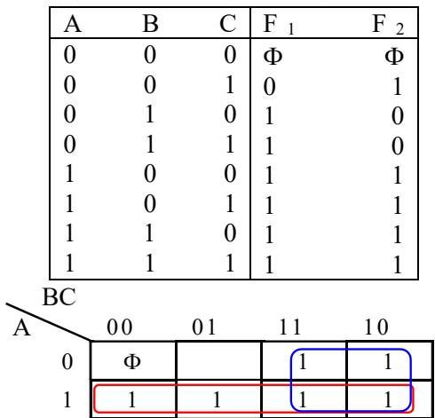

$$
\mathrm{F}_{1} = \mathrm{A} + \mathrm{B}
$$

知识点：[完整数字系统设计流程实例（如乘法器、交通灯管理系统的算法规律、处理器设计与控制器实现）](../../../topics/数字逻辑电路/数字系统设计实例.md)、[寄存器传输语言(RTL)描述的传输操作、算术操作、逻辑操作、移位操作及条件控制语句](../../../topics/数字逻辑电路/RTL语言.md)

### 综合 12

题干：4.11 试将2/4译码器扩展成4/16译码器

解：

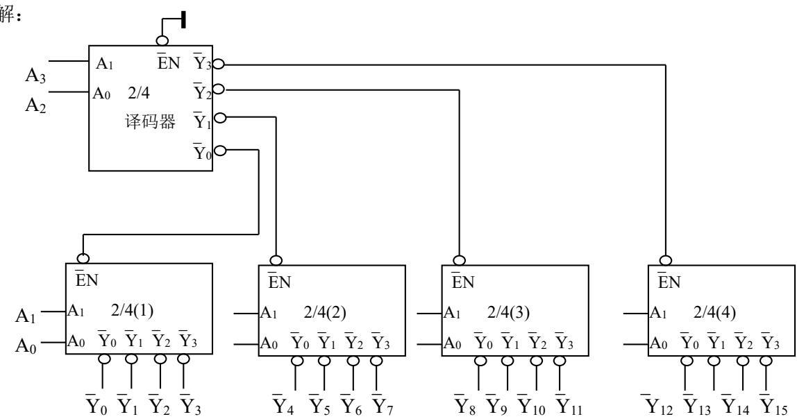

知识点：[控制器的四种硬件实现方法：每态一触发器法(SSI)、MSI法(MUX+寄存器+译码器)、PLA法(LSI)及对比](../../../topics/数字逻辑电路/控制器实现方法.md)、[算法状态机(ASM)图的状态框、判断框、条件输出框及ASM块的构成规则](../../../topics/数字逻辑电路/ASM图基础.md)

### 综合 13

题干：4.12 试用74138设计一个多输出组合网络，它的输入是4位二进制码ABCD，输出为：
$F_1$ ：ABCD是4的倍数。
$F_2$ ：ABCD比2大。
$F_3$ ：ABCD在8～11之间。
$F_4$ ：ABCD不等于0。

解：由题意，各函数是4变量函数，故须将74138扩展为4-16线译码器，让A、B、C、D分别接4-16线译码器的地址端 $A_3$ 、$A_2$ 、$A_1$ 、$A_0$ ，可写出各函数的表达式如下：

$$
\begin{array}{ll}
F_{1}(A, B, C, D) = \sum m(0, 4, 8, 12) & F_{2}(A, B, C, D) = \overline {\sum m(0, 1, 2)} \\
= \overline {\overline {m}_{0}} \ \overline {\overline {m}_{4}} \ \overline {\overline {m}_{8}} \ \overline {\overline {m}_{12}} & = \overline {\overline {m}_{0}} \ \overline {\overline {m}_{1}} \ \overline {\overline {m}_{2}} \\
= \overline {\overline {Y}_{0}} \ \overline {\overline {Y}_{4}} \ \overline {\overline {Y}_{8}} \ \overline {\overline {Y}_{12}} & = \overline {Y}_{0} \ \overline {Y}_{1} \ \overline {Y}_{2} \\
F_{3}(A, B, C, D) = \sum m(8, 9, 10, 11) & F_{4}(A, B, C, D) = \overline {\overline {m}_{0}} \\
= \overline {\overline {m}_{8}} \ \overline {\overline {m}_{9}} \ \overline {\overline {m}_{10}} \ \overline {\overline {m}_{11}} & = \overline {Y}_{0} \\
= \overline {\overline {Y}_{8}} \ \overline {\overline {Y}_{9}} \ \overline {\overline {Y}_{10}} \ \overline {\overline {Y}_{11}} &
\end{array}
$$

实现电路如下图所示：

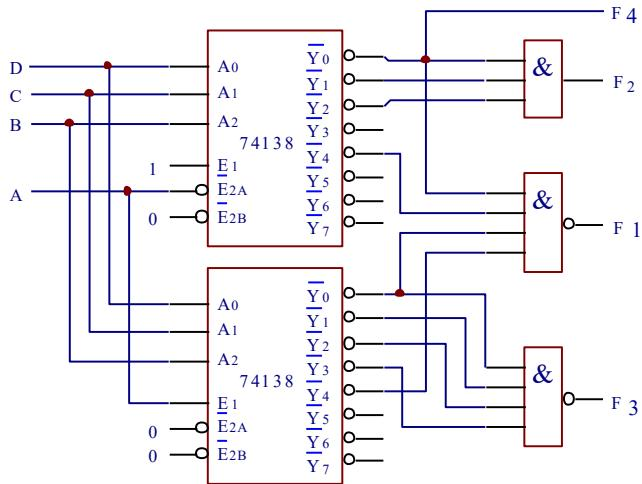

解：方法一：

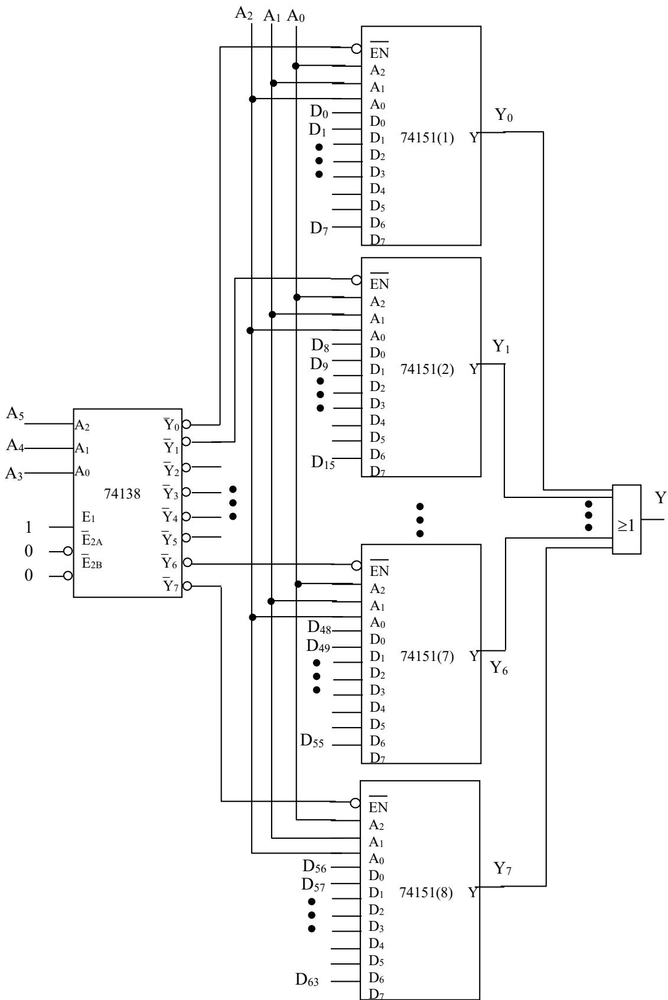

方法二：

$A_2 A_1 A_0$

# 数字电路与逻辑设计B 第4章习题答案

本部分为《数字电路与逻辑设计B》第4章习题答案的第12–14页内容，主要涉及使用74151和74153实现组合逻辑函数以及扩展数据比较器的设计。

## 一、综合题（每大题包含若干小题）

### 综合 1

**题目：** 试用 74151 实现下列函数：

(1) $F(A, B, C, D) = \sum m(1, 2, 4, 7)$

**解：**
函数有4个输入变量，而74151的地址端只有3个，即 $A_2$、$A_1$、$A_0$，故须对函数的卡诺图进行降维，即降为3维。

令 $A=A_2$、$B=A_1$、$C=A_0$，则：
$D_0 = D_3 = D$
$D_1 = D_2 = \overline{D}$
$D_4 = D_5 = D_6 = D_7 = 0$

相应的电路图如下所示：

知识点：[完整数字系统设计流程实例（如乘法器、交通灯管理系统的算法规律、处理器设计与控制器实现）](../../../topics/数字逻辑电路/数字系统设计实例.md)

### 综合 2

**题目：** (2) $F(A, B, C) = A\overline{B} + \overline{A}B + C$

**解：**
卡诺图如下：

| A\BC | 00 | 01 | 11 | 10 |
| :--- | :---: | :---: | :---: | :---: |
| 0 | 0 | 1 | 1 | 1 |
| 1 | 1 | 1 | 1 | 0 |

*(注：原题中表格第一行表头为 `A\BC`，但下方数据行对应关系需结合逻辑式确认。根据逻辑式 $A\overline{B} + \overline{A}B + C$：)*
*当 A=0, B=0 (00): F = 0+1+C = 1 (表中填1，原图可能误标或需仔细核对，此处依据标准逻辑推导修正理解，但保留原图位置)*
*实际上原题表格内容为：*
| A\BC | 00 | 01 | 11 | 10 |
| :--- | :---: | :---: | :---: | :---: |
| 0 | - | 1 | 1 | 1 |
| 1 | 1 | 1 | 1 | - |

*(注：原识别文本中表格内容可能存在缺失符号，通常“-”表示无关项或0，但在最小项展开中需明确。此处保留原图结构)*

知识点：[数字系统的基本模型（数据处理器与控制器）及对最小时钟周期、异步信号同步化的约定](../../../topics/数字逻辑电路/数字系统模型.md)

### 综合 3

**题目：** (3) $F(A,B,C,D) = A\overline{B}\overline{C} + \overline{B}D + A\overline{C}\overline{D}$

**解：**

卡诺图如下：

| AB\CD | 00 | 01 | 11 | 10 |
| :--- | :---: | :---: | :---: | :---: |
| 00 | 0 | 0 | 0 | 0 |
| 01 | 0 | 1 | 0 | 0 |
| 11 | 0 | 1 | 0 | 1 |
| 10 | 0 | 0 | 1 | 1 |

知识点：[完整数字系统设计流程实例（如乘法器、交通灯管理系统的算法规律、处理器设计与控制器实现）](../../../topics/数字逻辑电路/数字系统设计实例.md)

### 综合 4

**题目：** (4) $F(A, B, C, D) = \sum m(0, 3, 12, 13, 14) + \sum \phi(7, 8)$

**解：**
函数有4个输入变量，而74151的地址端只有3个，即 $A_2$、$A_1$、$A_0$，故须对函数的卡诺图进行降维，即降为3维。

第一步降维（以D为变量）：

| AB\CD | 00 | 01 | 11 | 10 |
| :--- | :---: | :---: | :---: | :---: |
| 00 | 1 | 0 | 1 | 0 |
| 01 | 0 | 0 | $\phi$ | 0 |
| 11 | 1 | 1 | 0 | 1 |
| 10 | $\phi$ | 0 | 0 | 0 |

第二步降维（以AB为地址，BC为列变量，得到各数据端输入）：

| A\BC | 00 | 01 | 11 | 10 |
| :--- | :---: | :---: | :---: | :---: |
| 0 | $\overline{D}$ | D | 0 | 0 |
| 1 | 0 | 0 | $\overline{D}$ | 1 |

令 $A=A_2$、$B=A_1$、$C=A_0$，则：
$D_0 = D_7 = \overline{D}$
$D_1 = D$
$D_6 = 1$
$D_2 = D_3 = D_4 = D_5 = 0$

相应的电路图如下图所示：

知识点：[数字系统的基本模型（数据处理器与控制器）及对最小时钟周期、异步信号同步化的约定](../../../topics/数字逻辑电路/数字系统模型.md)

### 综合 5

**题目：** (5) $F(A, B, C, D, E) = AB\overline{CD} + \overline{ABCE} + \overline{B}\overline{C}\overline{DE}$
*(注：原题公式书写较为混乱，识别结果为 $\mathrm{AB} \overline {{\mathrm{CD}}} + \overline {{\mathrm{ABCE}}} + \overline {{\mathrm{B}}} \overline {{\mathrm{C}}} \overline {{\mathrm{DE}}}$，此处按识别结果整理，实际教学中需结合具体教材确认变量含义，通常 $\overline{CD}$ 可能指 $\overline{C} \cdot \overline{D}$ 或其他形式，此处依图解题)*

**解：**

第一步降维（以AB为地址，CD为列变量，E为剩余变量）：

| AB\CD | 00 | 01 | 11 | 10 |
| :--- | :---: | :---: | :---: | :---: |
| 00 | E | 0 | 0 | 0 |
| 01 | 0 | 0 | E | E |
| 11 | 0 | 1 | 0 | 0 |
| 10 | E | 0 | 0 | 0 |

第二步降维（进一步处理）：

| AB\C | 0 | 1 |
| :--- | :---: | :---: |
| 00 | $\overline{DE}$ | 0 |
| 01 | 0 | E |
| 11 | D | 0 |
| 10 | $\overline{DE}$ | 0 |

电路图略。

## 二、综合题

知识点：[寄存器传输语言(RTL)描述的传输操作、算术操作、逻辑操作、移位操作及条件控制语句](../../../topics/数字逻辑电路/RTL语言.md)

### 综合 6

**题目：** 用 ½74153 实现下列函数：

(1) $F(A, B, C, D) = \sum m(1, 2, 4, 7, 15)$

**解：**
函数有4个输入变量，而74153的地址端只有2个，即 $A_1$、$A_0$，故须对函数的卡诺图进行降维，即降为2维。

第一步降维（以AB为地址，CD为列变量）：

| AB\CD | 00 | 01 | 11 | 10 |
| :--- | :---: | :---: | :---: | :---: |
| 00 | 0 | 1 | 0 | 1 |
| 01 | 1 | 0 | 1 | 0 |
| 11 | 0 | 0 | 1 | 0 |
| 10 | 0 | 0 | 0 | 0 |

第二步降维（以A为地址，BC为列变量，得到各数据端输入）：

| A\BC | 00 | 01 | 11 | 10 |
| :--- | :---: | :---: | :---: | :---: |
| 0 | D | $\overline{D}$ | D | $\overline{D}$ |
| 1 | 0 | 0 | D | 0 |

知识点：[数字系统的基本模型（数据处理器与控制器）及对最小时钟周期、异步信号同步化的约定](../../../topics/数字逻辑电路/数字系统模型.md)、[完整数字系统设计流程实例（如乘法器、交通灯管理系统的算法规律、处理器设计与控制器实现）](../../../topics/数字逻辑电路/数字系统设计实例.md)

### 综合 7

**题目：** (2) $F(A,B,C) = \sum m(1,2,4,7)$

知识点：[控制器的四种硬件实现方法：每态一触发器法(SSI)、MSI法(MUX+寄存器+译码器)、PLA法(LSI)及对比](../../../topics/数字逻辑电路/控制器实现方法.md)

### 综合 8

**题目：** 试在图4.2.31的基础上增加一片 7485，构成25位数据比较器。

**解：**

*(注：此处为原理性描述或连线图，原题图片未提供详细连线图示，仅保留文字说明位置)*

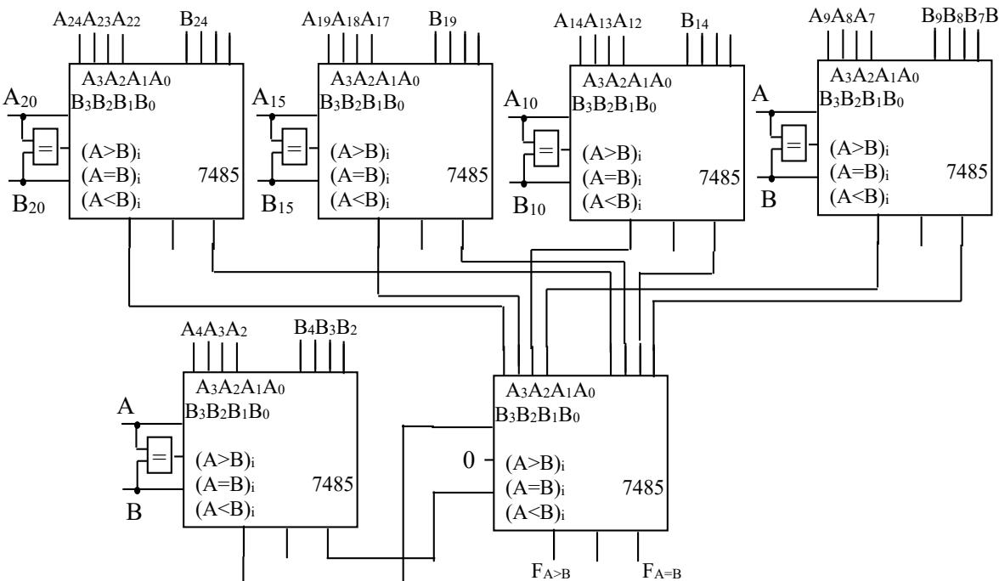

## 习题 4.17

设 $\mathrm{A}=\mathrm{A}_3\mathrm{A}_2\mathrm{A}_1\mathrm{A}_0$，$\mathrm{B}=\mathrm{B}_3\mathrm{B}_2\mathrm{B}_1\mathrm{B}_0$ 均为 8421BCD 码。试用 74283 设计一个 A、B 的求和电路。（可用附加器件）

解：设 $\mathrm{CO}\ \mathrm{S}_3\mathrm{S}_2\mathrm{S}_1\mathrm{S}_0$ 为 A、B 的二进制和，则当 CO=1 或 $\mathrm{S}_3\mathrm{S}_2\mathrm{S}_1\mathrm{S}_0>1001$ 时，须加 0110 修正项进行调整，计算结果为 $\mathrm{C}_4\mathrm{C}_3\mathrm{C}_2\mathrm{C}_1\mathrm{C}_0$。

## 习题 4.18

用 74283 将 8421BCD 码转换为余 3BCD 码。

解：由于同一个十进制数码的余 3BCD 码比相应的 8421BCD 码大 3，故用一片 74283 既可以实现，电路图如右所示：

## 习题 4.20

用 74283 将 8421BCD 码转换为 5421BCD 码。

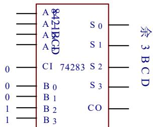

解法 1：当一个十进制数码大于等于 5 时，其 5421BCD 码比相应的 8421BCD 码大 3，其余情况下，两种 BCD 码一样，故用一片 7485 和一片 74283 可以实现，电路图如（一）所示：

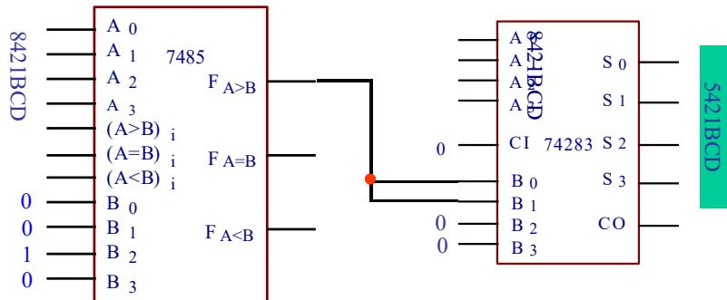

解法 2：用门电路和 74283 实现，列真值表如下：

| A B C D | $B_3B_2B_1B_0$ | $Y_3Y_2Y_1Y_0$ |
| --- | --- | --- |
| 0 0 0 0 | 0 0 0 0 | 0 0 0 0 |
| 0 0 0 1 | 0 0 0 0 | 0 0 0 1 |
| 0 0 1 0 | 0 0 0 0 | 0 0 1 0 |
| 0 0 1 1 | 0 0 0 0 | 0 0 1 1 |
| 0 1 0 0 | 0 0 0 0 | 0 1 0 0 |
| 0 1 0 1 | 0 0 1 1 | 1 0 0 0 |
| 0 1 1 0 | 0 0 1 1 | 1 0 0 1 |
| 0 1 1 1 | 0 0 1 1 | 1 0 1 0 |

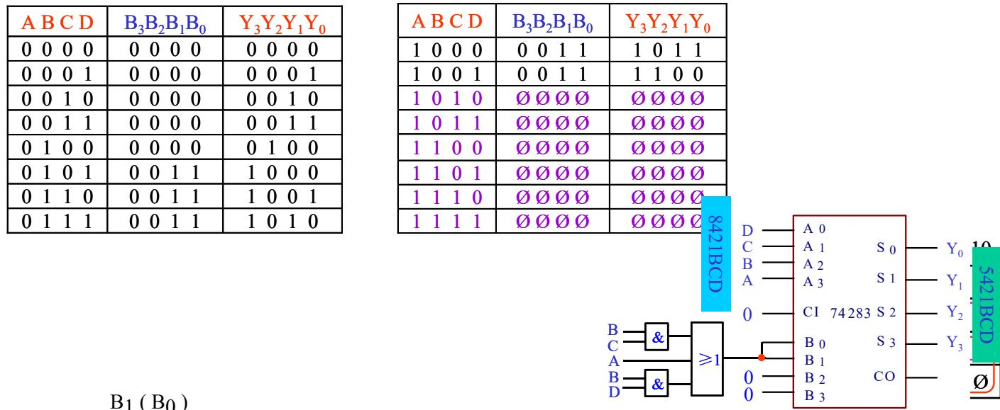

解法 3：用门电路和 74283 实现，列真值表如下：

| A B C D | $F_3F_2F_1F_0$ | $Y_3Y_2Y_1Y_0$ |
| --- | --- | --- |
| 0 0 0 0 | 0 0 1 1 | 0 0 0 0 |
| 0 0 0 1 | 0 1 0 0 | 0 0 0 1 |
| 0 0 1 0 | 0 1 0 1 | 0 0 1 0 |
| 0 0 1 1 | 0 1 1 0 | 0 0 1 1 |
| 0 1 0 0 | 0 1 1 1 | 0 1 0 0 |
| 0 1 0 1 | 1 0 0 0 | 1 0 0 0 |
| 0 1 1 0 | 1 0 0 1 | 1 0 0 1 |
| 0 1 1 1 | 1 0 1 0 | 1 0 1 0 |

| A B C D | $F_3F_2F_1F_0$ | $Y_3Y_2Y_1Y_0$ |
| --- | --- | --- |
| 1 0 0 0 | 1 0 1 1 | 1 0 1 1 |
| 1 0 0 1 | 1 1 0 0 | 1 1 0 0 |
| 1 0 1 0 | ∅ ∅ ∅ ∅ | ∅ ∅ ∅ ∅ |
| 1 0 1 1 | ∅ ∅ ∅ ∅ | ∅ ∅ ∅ ∅ |
| 1 1 0 0 | ∅ ∅ ∅ ∅ | ∅ ∅ ∅ ∅ |
| 1 1 0 1 | ∅ ∅ ∅ ∅ | ∅ ∅ ∅ ∅ |
| 1 1 1 0 | ∅ ∅ ∅ ∅ | ∅ ∅ ∅ ∅ |
| 1 1 1 1 | ∅ ∅ ∅ ∅ | ∅ ∅ ∅ ∅ |

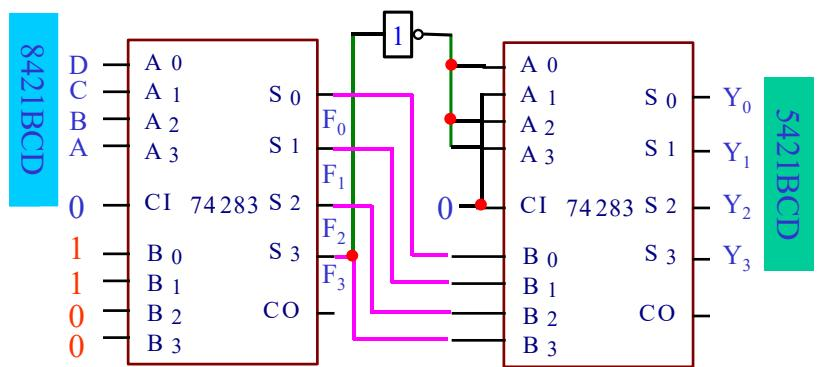

## 习题 4.21

设 $\mathrm{A}=\mathrm{A}_3\mathrm{A}_2\mathrm{A}_1\mathrm{A}_0$，$\mathrm{B}=\mathrm{B}_3\mathrm{B}_2\mathrm{B}_1\mathrm{B}_0$ 是两个 4 位二进制数。试用 7485 和 74157（四二选一 MUX）构成一个比较电路并能将其中大数输出。试画出逻辑图。

$$
\begin{array}{c c c}
\text {A} _ {0} & \text {A} _ {0} \\
\text {A} _ {1} & \text {A} _ {1} & 7 4 8 5 \\
\text {A} _ {2} & \text {A} _ {2} & \text {F} _ {\text {A} > \text {B}} \\
\text {A} _ {3} & \text {A} _ {3} & \\
\mathbf {0} & (\text {A} > \text {B}) _ {\text {i}} \\
\mathbf {1} & (\text {A} = \text {B}) _ {\text {i}} & \text {F} _ {\text {A} = \text {B}} \\
\mathbf {0} & (\text {A} <   \text {B}) _ {\text {i}} & \\
\text {B} _ {0} & \text {B} _ {0} & \\
\text {B} _ {1} & \text {B} _ {1} & \text {F} _ {\text {A} <   \text {B}} \\
\text {B} _ {2} & \text {B} _ {2} & \\
\text {B} _ {3} & \text {B} _ {3} &
\end{array}
$$

$$
\begin{array}{c c c}
\text {大数输出} \\
\text {A} _ {0} & 1 \mathrm{D} _ {0} & 1 \mathrm{Y} \\
\text {A} _ {0} & 1 \mathrm{D} _ {1} & \\
\text {B} _ {1} & 2 \mathrm{D} _ {0} & 2 \mathrm{Y} \\
\text {A} _ {1} & 2 \mathrm{D} _ {1} & \\
\text {B} _ {2} & 3 \mathrm{D} _ {0} & 7 4 1 5 7 \\
\text {A} _ {2} & 3 \mathrm{D} _ {1} & 3 \mathrm{Y} \\
\text {B} _ {3} & 4 \mathrm{D} _ {0} & \\
\text {A} _ {3} & 4 \mathrm{D} _ {1} & 4 \mathrm{Y} \\
& \text {A} _ {0} & \overline {{\text {EN}}}
\end{array}
$$

## 习题 4.22

分析如下图所示的组合网络中，当 ABCD 从 0100 向 1101 变化时和 ABCD 从 1000 向 1101 变化时，是否会出现冒险？试用增加多余项和取样脉冲的方法来避免冒险现象。

解：1. 当 ABCD 从 0100 向 1101 变化时：先判断是否有功能冒险，函数 F 的卡诺图如下图所示：

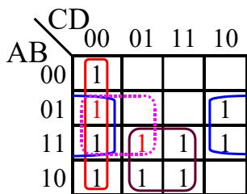

（1）$\mathrm{F}(0,1,0,0)=\mathrm{F}(1,1,0,1)$；（2）有 2 个变量同时变化；（3）$\mathrm{B}\overline{\mathrm{C}}$ 对应的卡诺圈中有“0”也有“1”；所以，此时电路中存在功能冒险。

2. 当 ABCD 从 1000 向 1101 变化时：先判断是否有功能冒险，函数 F 的卡诺图如下图所示：

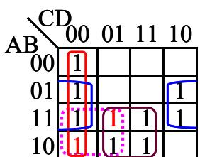

（1）$\mathrm{F}(1,0,0,0)=\mathrm{F}(1,1,0,1)$；

（2）有 2 个变量同时变化；

（3）AC 对应的卡诺圈中全部为“1”；

所以，此时电路中不存在功能冒险。

再判断是否有逻辑冒险：

由卡诺图可知，CD 和 AD 对应的卡诺圈部分相切，而相切部分又没被其它卡诺圈包围，所以存在逻辑冒险。即 $\mathrm{AC}=10$ 时，存在 0 型逻辑冒险。

3. 增加多余项的方法消除逻辑冒险：

$$
F = \overline{C}\overline{D} + B\overline{D} + AD + AB
$$

4. 加取样脉冲法避免冒险：

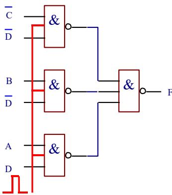

知识点：[完整数字系统设计流程实例（如乘法器、交通灯管理系统的算法规律、处理器设计与控制器实现）](../../../topics/数字逻辑电路/数字系统设计实例.md)
