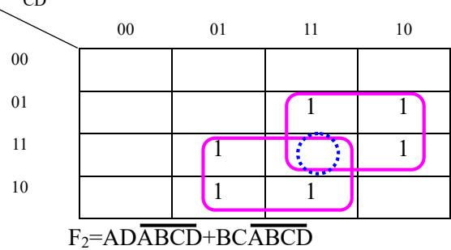
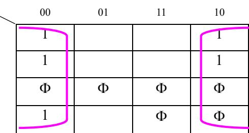
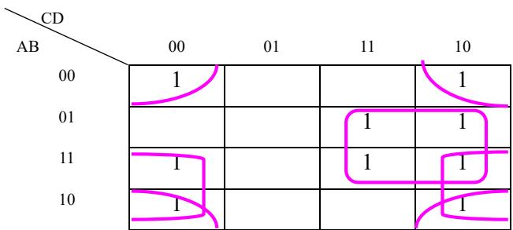
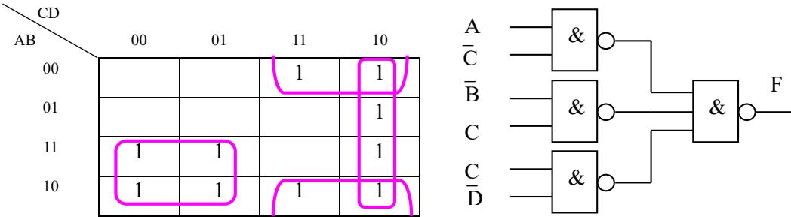
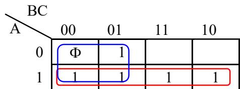
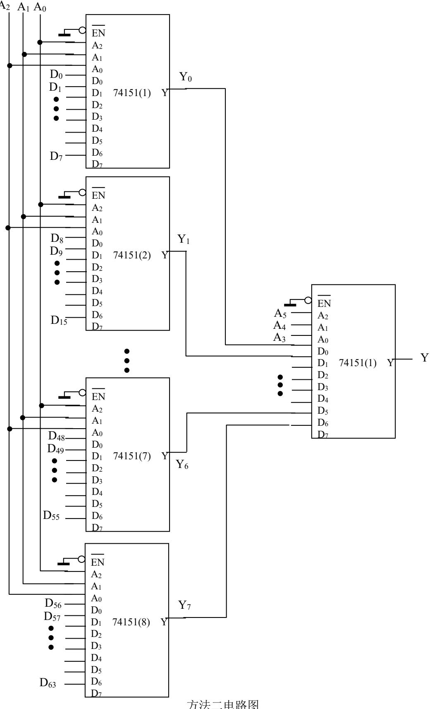
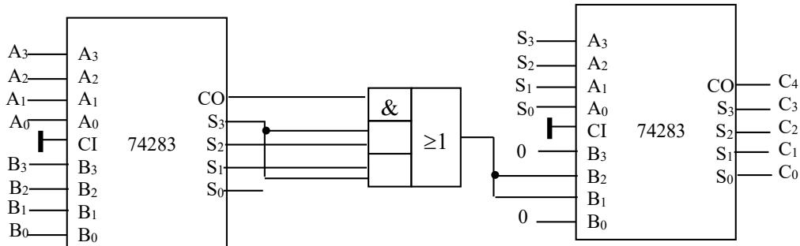
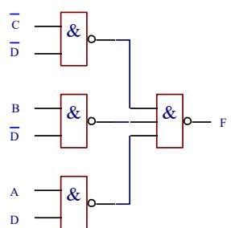

# 《数字电路与逻辑设计B》第4章习题答案

原件经识别和整理；“参考解答”是我们补的。

# 《数字电路与逻辑设计B》第4章习题答案

由识别工具读出的《数字电路与逻辑设计B》第4章习题答案（第 1–3 页）整理而成。

## 一、分析题

### 选择 4.1

题干：分析图4.1电路的逻辑功能

解：
（1）推导输出表达式

$$
\mathrm{Y}_{2} = \mathrm{X}_{2}; \quad \mathrm{Y}_{1} = \mathrm{X}_{1} \oplus \mathrm{X}_{2}; \quad \mathrm{Y}_{0} = (\mathrm{M}\mathrm{Y}_{1} + \mathrm{X}_{1} \bar{\mathrm{M}}) \oplus \mathrm{X}_{0}
$$

(2) 列真值表

| M | $X_2$ | $X_1$ | $X_0$ | $Y_2$ | $Y_1$ | $Y_0$ |
|---|-------|-------|-------|-------|-------|-------|
| 0 | 0     | 0     | 0     | 0     | 0     | 0     |
| 0 | 0     | 0     | 1     | 0     | 0     | 1     |
| 0 | 0     | 1     | 0     | 0     | 1     | 1     |
| 0 | 0     | 1     | 1     | 0     | 1     | 0     |
| 0 | 1     | 0     | 0     | 1     | 1     | 0     |
| 0 | 1     | 0     | 1     | 1     | 1     | 1     |
| 0 | 1     | 1     | 0     | 1     | 0     | 1     |
| 0 | 1     | 1     | 1     | 1     | 0     | 0     |
| 1 | 0     | 0     | 0     | 0     | 0     | 0     |
| 1 | 0     | 0     | 1     | 0     | 0     | 1     |
| 1 | 0     | 1     | 0     | 0     | 1     | 1     |
| 1 | 0     | 1     | 1     | 0     | 1     | 0     |
| 1 | 1     | 0     | 0     | 1     | 1     | 1     |
| 1 | 1     | 0     | 1     | 1     | 1     | 0     |
| 1 | 1     | 1     | 0     | 1     | 0     | 0     |
| 1 | 1     | 1     | 1     | 1     | 0     | 1     |

（3）逻辑功能：当M=0时，实现3位自然二进制码转换成 3位循环码。当M=1时，实现3位循环码转换成 3位自然二进制码。

参考解答：**结论**：该电路是一个可逆码制转换器——$M=0$ 时实现**二进制码 $\rightarrow$ 循环码（格雷码）**转换；$M=1$ 时实现**循环码 $\rightarrow$ 二进制码**转换。

**推理与验证**：

1. **输出表达式化简**

   由 $Y_2=X_2$、$Y_1=X_1\oplus X_2$ 及 $Y_0=(MY_1+X_1\bar M)\oplus X_0$，分模式讨论：

   - 当 $M=0$ 时：$Y_0=X_1\oplus X_0$，故
     $$Y_2Y_1Y_0 = X_2,\quad X_1\oplus X_2,\quad X_0\oplus X_1$$
     这正是二进制码 $X_2X_1X_0$ 转格雷码的标准公式（$G_i=B_i\oplus B_{i+1}$）。

   - 当 $M=1$ 时：$Y_0=Y_1\oplus X_0=(X_1\oplus X_2)\oplus X_0$，故
     $$Y_2Y_1Y_0 = X_2,\quad X_1\oplus X_2,\quad X_0\oplus X_1\oplus X_2$$
     这正是格雷码 $X_2X_1X_0$ 转二进制码的累加异或（$B_i=\bigoplus_{k=i}^{n-1}G_k$）。

2. **真值表关键行验证**

   | 模式 | 输入 $X_2X_1X_0$ | 输出 $Y_2Y_1Y_0$ | 说明 |
   |---|---|---|---|
   | $M=0$ | $010$ (二进制 2) | $011$ (格雷码 2) | 二进制 $\rightarrow$ 格雷码 |
   | $M=0$ | $110$ (二进制 6) | $101$ (格雷码 6) | 二进制 $\rightarrow$ 格雷码 |
   | $M=1$ | $011$ (格雷码 2) | $010$ (二进制 2) | 格雷码 $\rightarrow$ 二进制 |
   | $M=1$ | $101$ (格雷码 6) | $110$ (二进制 6) | 格雷码 $\rightarrow$ 二进制 |

   其余行均满足上述对应关系，且 $M=1$ 与 $M=0$ 互为逆变换。

3. **电路结构特点**

   该电路利用异或门的可逆性，通过控制信号 $M$ 选择最低位异或的输入路径（$X_1$ 或 $Y_1$），从而仅用一级异或逻辑实现双向转换，无需分别设计编码器与解码器。

知识点：[完整数字系统设计流程实例（如乘法器、交通灯管理系统的算法规律、处理器设计与控制器实现）](../../../topics/数字逻辑电路/数字系统设计实例.md)

### 选择 4.2

题干：分析图P4.2电路的逻辑功能。

解：
(1)从输入端开始，逐级推导出函数表达式。

$\mathrm { F } _ { 1 } = \mathrm { A } \oplus \mathrm { B } \oplus \mathrm { C }$

$$
\mathrm{F}_{2} = \mathrm{A} (\mathrm{B} \oplus \mathrm{C}) + \mathrm{BC} = \overline {\mathrm{A}} \overline {\mathrm{B}} \mathrm{C} + \overline {\mathrm{A}} \mathrm{B} \overline {\mathrm{C}} + \overline {\mathrm{A}} \mathrm{BC} + \mathrm{ABC}
$$

(2)列真值表。

| A | B | C | F1 | F2 |
|---|---|---|----|----|
| 0 | 0 | 0 | 0  | 0  |
| 0 | 0 | 1 | 1  | 1  |
| 0 | 1 | 0 | 1  | 1  |
| 0 | 1 | 1 | 0  | 1  |
| 1 | 0 | 0 | 1  | 0  |
| 1 | 0 | 1 | 0  | 0  |
| 1 | 1 | 0 | 0  | 0  |
| 1 | 1 | 1 | 1  | 1  |

(3)确定逻辑功能。假设变量A、B、C和函数 $\mathrm { F } _ { 1 }$ 、 $\mathrm { F } _ { 2 }$ 均表示一位二进制数，那么，由真值表可知，该电路实现了一位全减器的功能。

A、B、C、F 、 $\mathrm { F } _ { 2 }$ 分别表示被减数、减数、来自低位的借位、本位差、本位向高位的借位。

参考解答：## 结论

该电路实现 **一位全减器** 功能：

- $F_1$ 为本位差，$F_2$ 为向高位的借位；
- 输入变量 $A$、$B$、$C$ 分别表示被减数、减数、低位来的借位。

## 推导过程

**逐级写出表达式。**

第一级异或链：

$$
F_1 = A \oplus B \oplus C
$$

第二级输出 $F_2$：

$$
F_2 = A(B \oplus C) + BC
$$

展开验证（这里给定电路的乘积项应为 $A$ 与 $(B \oplus C)$、$BC$ 组合，化简后）：

$$
F_2 = \overline{A}\,\overline{B}\,C + \overline{A}\,B\,\overline{C} + \overline{A}\,B\,C + A\,B\,C
$$

**列出真值表。**

| $A$ | $B$ | $C$ | $F_1$ | $F_2$ |
|---|---|---|---|---|
| 0 | 0 | 0 | 0 | 0 |
| 0 | 0 | 1 | 1 | 1 |
| 0 | 1 | 0 | 1 | 1 |
| 0 | 1 | 1 | 0 | 1 |
| 1 | 0 | 0 | 1 | 0 |
| 1 | 0 | 1 | 0 | 0 |
| 1 | 1 | 0 | 0 | 0 |
| 1 | 1 | 1 | 1 | 1 |

**确定功能。**

由真值表，$F_1$ 是 $A-B-C$ 的差，$F_2$ 是向高位的借位（当 $A < B+C$ 时为 1）。因此电路为一位全减器。

知识点：[完整数字系统设计流程实例（如乘法器、交通灯管理系统的算法规律、处理器设计与控制器实现）](../../../topics/数字逻辑电路/数字系统设计实例.md)、[寄存器传输语言(RTL)描述的传输操作、算术操作、逻辑操作、移位操作及条件控制语句](../../../topics/数字逻辑电路/RTL语言.md)、[数字系统的基本模型（数据处理器与控制器）及对最小时钟周期、异步信号同步化的约定](../../../topics/数字逻辑电路/数字系统模型.md)

### 选择 4.3

题干：分析图4.3电路的逻辑功能

解：
（1） $\mathrm { F _ { 1 } } \mathrm { = A } \oplus \mathrm { B } \oplus \mathrm { C } \mathrm { ; } \mathrm { F _ { 2 } } \mathrm { = } ( \mathrm { A @ B } ) \mathrm { C } \mathrm { + } \mathrm { A B }$

(2)真值表：

| A | B | C | $F_{2}$ | $F_{1}$ |
|---|---|---|---------|---------|
| 0 | 0 | 0 | 0       | 0       |
| 0 | 0 | 1 | 0       | 1       |
| 0 | 1 | 0 | 0       | 1       |
| 0 | 1 | 1 | 1       | 0       |
| 1 | 0 | 0 | 0       | 1       |
| 1 | 0 | 1 | 1       | 0       |
| 1 | 1 | 0 | 1       | 0       |
| 1 | 1 | 1 | 1       | 1       |

(3)逻辑功能：实现1 位全加器。

参考解答：**结论：** 该电路实现 1 位全加器功能，$F_1$ 为和输出 $S$，$F_2$ 为进位输出 $C_{out}$。

**推导过程：**

（1）**逻辑表达式**

由电路分析可得：
$$F_1 = A \oplus B \oplus C$$
$$F_2 = (A \oplus B)C + AB$$

其中 $F_2$ 可进一步化简为多数表决形式：
$$F_2 = AB + AC + BC$$

（2）**真值表验证**

| A | B | C | $F_2$（进位） | $F_1$（和） |
|---|---|---|:---:|:---:|
| 0 | 0 | 0 | 0 | 0 |
| 0 | 0 | 1 | 0 | 1 |
| 0 | 1 | 0 | 0 | 1 |
| 0 | 1 | 1 | 1 | 0 |
| 1 | 0 | 0 | 0 | 1 |
| 1 | 0 | 1 | 1 | 0 |
| 1 | 1 | 0 | 1 | 0 |
| 1 | 1 | 1 | 1 | 1 |

（3）**功能说明**

- $F_1 = A \oplus B \oplus C$：当 $A,B,C$ 中有奇数个 1 时输出 1，符合二进制和的规则。
- $F_2 = AB + AC + BC$：当 $A,B,C$ 中至少有两个 1 时输出 1，符合进位产生条件。

因此，该电路为 **1 位全加器**，$A,B$ 为加数与被加数，$C$ 为低位进位输入，$F_1$ 为本位和，$F_2$ 为向高位的进位输出。

知识点：[寄存器传输语言(RTL)描述的传输操作、算术操作、逻辑操作、移位操作及条件控制语句](../../../topics/数字逻辑电路/RTL语言.md)、[数字系统的基本模型（数据处理器与控制器）及对最小时钟周期、异步信号同步化的约定](../../../topics/数字逻辑电路/数字系统模型.md)

### 选择 4.4

题干：设 ABCD 是一个 8421BCD 码，试用最少与非门设计一个能判断该 8421BCD 码是否大于等于5的电路，该数大于等于 5，F= 1；否则为0。

解：
(1)列真值表

| A | B | C | D | F |
|---|---|---|---|---|
| 0 | 0 | 0 | 0 | 0 |
| 0 | 0 | 0 | 1 | 0 |
| 0 | 0 | 1 | 0 | 0 |
| 0 | 0 | 1 | 1 | 0 |
| 0 | 1 | 0 | 0 | 0 |
| 0 | 1 | 0 | 1 | 1 |
| 0 | 1 | 1 | 0 | 1 |
| 0 | 1 | 1 | 1 | 1 |

| A | B | C | D | F |
|---|---|---|---|---|
| 1 | 0 | 0 | 0 | 1 |
| 1 | 0 | 0 | 1 | 1 |
| 1 | 0 | 1 | 0 | $\emptyset$ |
| 1 | 0 | 1 | 1 | $\emptyset$ |
| 1 | 1 | 0 | 0 | $\emptyset$ |
| 1 | 1 | 0 | 1 | $\emptyset$ |
| 1 | 1 | 1 | 0 | $\emptyset$ |
| 1 | 1 | 1 | 1 | $\emptyset$ |

(2)写最简表达式

| AB\CD | 00 | 01 | 11 | 10 |
|-------|----|----|----|----|
| 00    |    |    |    |    |
| 01    |    | 1  | 1  | 1  |
| 11    | $\phi$ | $\phi$ | $\phi$ | $\phi$ |
| 10    | 1  | 1  | $\phi$ | $\phi$ |

$$
\mathrm{F} = \mathrm{A} + \mathrm{BD} + \mathrm{BC} = \overline {{\mathrm{A}}} \cdot \overline {{\mathrm{BD}}} \cdot \overline {{\mathrm{BC}}}
$$

(3)画逻辑电路，如下图所示：

# 第 4 章习题答案

本部分整理了《数字电路与逻辑设计 B》第 4 章习题中关于组合逻辑电路设计的解答，包含真值表、卡诺图化简及电路图说明。

## 计算 5

**题干：** 试设计一个 2 位二进制数乘法器电路。

解：
（1）设被乘数为 $AB$，乘数为 $CD$，乘积结果为 $\mathrm{F}_4 \mathrm{F}_3 \mathrm{F}_2 \mathrm{F}_1$。真值表如下：

| A | B | C | D | F4 | F3 | F2 | F1 |
|---|---|---|---|----|----|----|----|
| 0 | 0 | 0 | 0 | 0 | 0 | 0 | 0 |
| 0 | 0 | 0 | 1 | 0 | 0 | 0 | 0 |
| 0 | 0 | 1 | 0 | 0 | 0 | 0 | 0 |
| 0 | 0 | 1 | 1 | 0 | 0 | 0 | 0 |
| 0 | 1 | 0 | 0 | 0 | 0 | 0 | 0 |
| 0 | 1 | 0 | 1 | 0 | 0 | 0 | 1 |
| 0 | 1 | 1 | 0 | 0 | 0 | 1 | 0 |
| 0 | 1 | 1 | 1 | 0 | 0 | 1 | 1 |
| 1 | 0 | 0 | 0 | 0 | 0 | 0 | 0 |
| 1 | 0 | 0 | 1 | 0 | 0 | 1 | 0 |
| 1 | 0 | 1 | 0 | 0 | 1 | 0 | 0 |
| 1 | 0 | 1 | 1 | 0 | 1 | 1 | 0 |
| 1 | 1 | 0 | 0 | 0 | 0 | 0 | 0 |
| 1 | 1 | 0 | 1 | 0 | 0 | 1 | 1 |
| 1 | 1 | 1 | 0 | 0 | 1 | 1 | 0 |
| 1 | 1 | 1 | 1 | 1 | 0 | 0 | 1 |

根据真值表可直接得到：$\mathrm{F}_4 = \mathrm{ABCD}$

为了使电路尽量简单，希望门数越少越好，本电路是四输出函数，圈卡诺圈时要尽量选择共有的卡诺圈以减少逻辑门的数量。

答案：电路图略。

## 计算 6

**题干：** 试设计一个将 8421BCD 码转换成余 3 码的电路。

解：
（1）列真值表

| A | B | C | D | F4 | F3 | F2 | F1 |
|---|---|---|---|----|----|----|----|
| 0 | 0 | 0 | 0 | 0 | 0 | 1 | 1 |
| 0 | 0 | 0 | 1 | 0 | 1 | 0 | 0 |
| 0 | 0 | 1 | 0 | 0 | 1 | 0 | 1 |
| 0 | 0 | 1 | 1 | 0 | 1 | 1 | 0 |
| 0 | 1 | 0 | 0 | 0 | 1 | 1 | 1 |
| 0 | 1 | 0 | 1 | 1 | 0 | 0 | 0 |
| 0 | 1 | 1 | 0 | 1 | 0 | 0 | 1 |
| 0 | 1 | 1 | 1 | 1 | 0 | 1 | 0 |
| 1 | 0 | 0 | 0 | 1 | 0 | 1 | 1 |
| 1 | 0 | 0 | 1 | 1 | 1 | 0 | 0 |

（2）化简输出表达式

$$
\mathrm{F}_4 = \mathrm{A} + \mathrm{BD} + \mathrm{BC}
$$

答案：电路图略。

## 计算 7

**题干：** 在双轨输入条件下用最少与非门设计下列组合电路：

知识点：[完整数字系统设计流程实例（如乘法器、交通灯管理系统的算法规律、处理器设计与控制器实现）](../../../topics/数字逻辑电路/数字系统设计实例.md)

### 选择 1

**题干：** （1）$F(ABC) = \sum_m (1, 3, 4, 6, 7)$

解：$F = AC + \bar{A}C + BC$

答案：电路图略。

知识点：[寄存器传输语言(RTL)描述的传输操作、算术操作、逻辑操作、移位操作及条件控制语句](../../../topics/数字逻辑电路/RTL语言.md)、[算法状态机(ASM)图的状态框、判断框、条件输出框及ASM块的构成规则](../../../topics/数字逻辑电路/ASM图基础.md)

### 选择 2

**题干：** （2）$F(ABCD) = \sum_m (0, 2, 6, 7, 8, 10, 12, 14, 15)$

解：$F = \bar{B}\bar{D} + A\bar{D} + BC$

答案：电路图略。

# 《数字电路与逻辑设计B》第4章习题答案（第3部分）

本题为《数字电路与逻辑设计B》课程第4章习题答案的第3部分整理，内容涵盖卡诺图化简、组合逻辑电路设计及译码器应用等题目。

## 一、综合题/计算题

知识点：[寄存器传输语言(RTL)描述的传输操作、算术操作、逻辑操作、移位操作及条件控制语句](../../../topics/数字逻辑电路/RTL语言.md)、[算法状态机(ASM)图的状态框、判断框、条件输出框及ASM块的构成规则](../../../topics/数字逻辑电路/ASM图基础.md)、[控制器的四种硬件实现方法：每态一触发器法(SSI)、MSI法(MUX+寄存器+译码器)、PLA法(LSI)及对比](../../../topics/数字逻辑电路/控制器实现方法.md)

### 综合 7

题干：(3) $F(A, B,C,D) = \sum m(2,5,6,8,9,12) + \sum \phi(0,4,7,10)$

解：函数的卡诺图如下所示：

参考解答：结论：  
- 图 (a) 对应的函数表达式是  
  
$$
F_1 = \overline{A}\,\overline{C} + \overline{A}\,\overline{B} + B C = \sum m(0,1,2,3,7)
$$

- 图 (b) 电路已正确实现指定函数 $F(A,B,C)=\sum m(1,2,4,7)$，两个数据输入端应填入  
  
$$
1D_0 = C,\quad 1D_3 = C'
$$

  或逻辑等价形式。

**推理过程**  

**1. 图 (a) 卡诺图的函数**  

图 (a) 是变量 $A,B,C$ 的卡诺图，方格内 1 的位置为：  
$m_0,m_1,m_2,m_3,m_7$，即  

$$
F_1 = \sum m(0,1,2,3,7)
$$
  
化简：  
- 圈 $m_0,m_1,m_2,m_3$：对应 $\overline{A}$（因为该四格 $A=0$）。  
- 圈 $m_3,m_7$ 并配合 $m_1,m_2$ 的相邻性，实际上更简的与或式是  
  
$$
F_1 = \overline{A} + BC
$$

  展开为最小项即 $\sum m(0,1,2,3,7)$。  

**2. 用 74153 实现 $F(A,B,C)=\sum m(1,2,4,7)$**  

74153 是双 4 选 1 数据选择器，此处只使用其中一个，选择端接 $B, A$（高位 $A$，低位 $B$），则输出：  

$$
Y = m_0 D_0 + m_1 D_1 + m_2 D_2 + m_3 D_3
$$

其中 $m_i$ 关于选择变量 $A,B$ 的最小项。  

将 $A,B$ 视为高、低位，则四个最小项对应的 $(A,B)$：  
$m_0(00),\, m_1(01),\, m_2(10),\, m_3(11)$。  

目标函数：$F = \sum m(1,2,4,7)$，将 $C$ 纳入数据输入。用真值表确定各数据端：  

| A | B | C | F |
|---|---|---|---|
| 0 | 0 | 0 | 0 |
| 0 | 0 | 1 | 1 | → $m_0$ 时，$F=C$，得 $D_0 = C$  
| 0 | 1 | 0 | 1 |
| 0 | 1 | 1 | 0 | → $m_1$ 时，$F=C'$，得 $D_1 = C'$  
| 1 | 0 | 0 | 1 |
| 1 | 0 | 1 | 0 | → $m_2$ 时，$F=C'$，得 $D_2 = C'$  
| 1 | 1 | 0 | 0 |
| 1 | 1 | 1 | 1 | → $m_3$ 时，$F=C$，得 $D_3 = C$  

图中已连接 $1D_1 = C',\, 1D_2 = C'$，所以只需补充 $1D_0 = C,\, 1D_3 = C$（或 $C'$ 看接线端子，实际上图中给定的是 $1D_0$ 和 $1D_3$ 待填，根据上表得 $1D_0 = C,\, 1D_3 = C$）。

知识点：[控制器的四种硬件实现方法：每态一触发器法(SSI)、MSI法(MUX+寄存器+译码器)、PLA法(LSI)及对比](../../../topics/数字逻辑电路/控制器实现方法.md)

### 综合 8

题干：(4) $\mathrm{F(ABC) = A \overline{B} + B \overline{C} + \overline{A} C}$

解：$\mathrm{F(ABC) = A \overline{B} + B \overline{C} + \overline{A} C}$

参考解答：**结论：**
利用两片 7485 级联构成 8 位比较器，并将 7485 的三个输出端（$F_{A>B}, F_{A=B}, F_{A<B}$）作为控制信号，驱动四片 74157（或两片双 4 选 1 MUX，但题目指定 74157 为四 2 选 1，故需使用 4 个 74157 芯片或逻辑组合）来选择输出 A 或 B 中的较大者。

*(注：74157 是四 2 选 1 数据选择器。若只用一片 74157，只能处理 4 位中的某一位或需配合其他逻辑。通常“大数输出”意味着输出完整的 4 位最大值。由于 74157 有 4 个独立的选择通道，**一片** 74157 即可同时处理 4 位数据的 2 选 1 选择。因此，只需**一片** 7485 和**一片** 74157 即可完成 4 位比较并输出大数。)*

**修正后的最简方案结论：**
使用**一片 7485** 进行 4 位数值比较，使用**一片 74157** 根据比较结果选择输出 A 或 B。

**推理与设计过程：**

1.  **比较模块 (7485)：**
    *   将输入 $A_3A_2A_1A_0$ 接入 7485 的 $A_3-A_0$ 端。
    *   将输入 $B_3B_2B_1B_0$ 接入 7485 的 $B_3-B_0$ 端。
    *   级联输入端设置：$(A>B)_i$ 接低电平 (0)，$(A<B)_i$ 接低电平 (0)，$(A=B)_i$ 接高电平 (1)。这是单片 7485 独立工作的标准接法。
    *   7485 输出三个状态信号：
        *   $F_{A>B}$：当 $A > B$ 时为高电平。
        *   $F_{A=B}$：当 $A = B$ 时为高电平。
        *   $F_{A<B}$：当 $A < B$ 时为高电平。

2.  **选择输出模块 (74157)：**
    *   74157 包含 4 个独立的 2 选 1 数据选择器，共用一个选择控制端 $S$ (Select) 和一个使能端 $\bar{G}$ (Strobe, 低电平有效)。
    *   **数据输入连接：**
        *   对于第 $i$ 位 ($i=0,1,2,3$)：
            *   将 $A_i$ 连接到 74157 的第 $i$ 通道的输入 $1D_i$ (或标记为 $A$ 输入端，具体视引脚定义，通常 $S=0$ 选 $D_0$, $S=1$ 选 $D_1$)。
            *   将 $B_i$ 连接到 74157 的第 $i$ 通道的输入 $2D_i$ (或标记为 $B$ 输入端)。
            *   *关键逻辑*：我们需要当 $A \ge B$ 时输出 $A$，当 $B > A$ 时输出 $B$。或者当 $A > B$ 输出 $A$，否则输出 $B$（若相等，输出谁都可以，通常视为相同）。
            *   让我们定义选择控制信号 $S$。
                *   若 $S=0$，74157 输出 $D_0$ 组数据。
                *   若 $S=1$，74157 输出 $D_1$ 组数据。
    *   **控制逻辑设计：**
        *   我们希望：如果 $A \ge B$，输出 $A$；如果 $B > A$，输出 $B$。
        *   观察 7485 输出：$F_{A<B}$ 在 $B > A$ 时为 1，其余情况为 0。
        *   因此，可以将 7485 的 $F_{A<B}$ 端直接连接到 74157 的选择端 $S$。
        *   连接方式：
            *   74157 的 $D_0$ 输入端（$S=0$ 时被选中）全部接 $A_3, A_2, A_1, A_0$。
            *   74157 的 $D_1$ 输入端（$S=1$ 时被选中）全部接 $B_3, B_2, B_1, B_0$。
            *   74157 的选择端 $S$ 接 7485 的 $F_{A<B}$。
            *   74157 的使能端 $\bar{G}$ 接地 (0)，使其始终工作。
    *   **验证逻辑：**
        *   当 $A > B$ 时：$F_{A<B}=0 \Rightarrow S=0$。74157 选中 $D_0$ 组，即输出 $A$。正确（A是大数）。
        *   当 $A = B$ 时：$F_{A<B}=0 \Rightarrow S=0$。74157 选中 $D_0$ 组，即输出 $A$。正确（A=B，输出A亦为大数之一）。
        *   当 $A < B$ 时：$F_{A<B}=1 \Rightarrow S=1$。74157 选中 $D_1$ 组，即输出 $B$。正确（B是大数）。

3.  **最终连线总结：**
    *   **7485:**
        *   $A[3:0] \leftarrow A[3:0]$
        *   $B[3:0] \leftarrow B[3:0]$
        *   $I_{A>B} = 0, I_{A<B} = 0, I_{A=B} = 1$
    *   **74157:**
        *   $\bar{G} = 0$
        *   $S = F_{A<B}$ (来自 7485)
        *   $1D_0, 1D_1, 1D_2, 1D_3$ (对应 $S=0$ 的输入) 分别接 $A_0, A_1, A_2, A_3$
        *   $2D_0, 2D_1, 2D_2, 2D_3$ (对应 $S=1$ 的输入) 分别接 $B_0, B_1, B_2, B_3$
        *   输出 $1Y, 2Y, 3Y, 4Y$ 即为最大值 $M_0, M_1, M_2, M_3$。

**逻辑图描述：**
由于无法直接绘图，以上文字描述了所有必要的连线。核心在于利用 7485 的 $A<B$ 输出作为 74157 的选择信号，实现“若 B 大则选 B，否则选 A”的逻辑。

知识点：[完整数字系统设计流程实例（如乘法器、交通灯管理系统的算法规律、处理器设计与控制器实现）](../../../topics/数字逻辑电路/数字系统设计实例.md)

### 综合 9

题干：4.8 在双轨输入信号下，用最少或非门设计题4.7的组合电路。

解：将表达式化简为最简或与式：

$$
(1) \mathrm{F} = (\mathrm{A} + \mathrm{C}) (\overline {\mathrm{A}} + \mathrm{B} + \overline {\mathrm{C}}) = \overline {\overline {\mathrm{A} + \mathrm{C}}} + \overline {\overline {\overline {\mathrm{A}} + \mathrm{B} + \overline {\mathrm{C}}}}
$$

$$
(2) \mathrm{F} = (\mathrm{C} + \overline {\mathrm{D}}) (\mathrm{B} + \mathrm{D}) (\mathrm{A} + \overline {\mathrm{B}} + \mathrm{C}) = \overline {\mathrm{C} + \overline {\mathrm{D}} + \overline {\mathrm{B}} + \mathrm{D}} + \overline {\mathrm{A} + \overline {\mathrm{B}} + \mathrm{C}}
$$

$$
(3) \mathrm{F} = (\overline {\mathrm{A}} + \overline {\mathrm{C}}) (\overline {\mathrm{A}} + \overline {\mathrm{B}} + \overline {\mathrm{D}}) (\mathrm{A} + \mathrm{B} + \overline {\mathrm{D}}) = \overline {\overline {\overline {\mathrm{A}} + \overline {\mathrm{C}}}} + \overline {\overline {\overline {\mathrm{A}} + \overline {\mathrm{B}} + \overline {\mathrm{D}}}} + \overline {\overline {\mathrm{A} + \mathrm{B} + \overline {\mathrm{D}}}}
$$
*(注：原件公式推导步骤存在逻辑符号混用，此处尽量还原原件意图，通常或非门实现或与式需转换为对偶形式)*

$$
(4) \mathrm{F} = (\mathrm{A} + \mathrm{B} + \mathrm{C}) (\overline {\mathrm{A}} + \overline {\mathrm{B}} + \overline {\mathrm{C}}) = \overline {\overline {\mathrm{A} + \mathrm{B} + \mathrm{C}} + \overline {\overline {\mathrm{A}} + \overline {\mathrm{B}} + \overline {\mathrm{C}}}}
$$

参考解答：## 结论

在双轨输入（原变量与反变量均可直接使用）条件下，将最简或与式转换为**或非-或非**两级结构即可用最少或非门实现：

$$
(1)\quad F = \overline{\overline{A+C} + \overline{\overline{A}+B+\overline{C}}}
$$

$$
(2)\quad F = \overline{\overline{C+\overline{D}} + \overline{B+D} + \overline{A+\overline{B}+C}}
$$

$$
(3)\quad F = \overline{\overline{\overline{A}+\overline{C}} + \overline{\overline{A}+\overline{B}+\overline{D}} + \overline{A+B+\overline{D}}}
$$

$$
(4)\quad F = \overline{\overline{A+B+C} + \overline{\overline{A}+\overline{B}+\overline{C}}}
$$

---

## 推理过程

**核心原理：** 若 $F$ 已化简为最简或与式 $F = P_1 \cdot P_2 \cdots P_n$（每个 $P_i$ 为一个或项），利用双重取反和德摩根定律：

$$
F = \overline{\overline{P_1 \cdot P_2 \cdots P_n}} = \overline{\overline{P_1} + \overline{P_2} + \cdots + \overline{P_n}}
$$

- **内层**：每个 $\overline{P_i}$ 恰好是一个或非门（对或项取反）。
- **外层**：将内层所有输出再做一次或非运算，即再用一个或非门。
- **双轨输入**保证 $\overline{A}, \overline{B}$ 等无需额外非门，直接接入或非门输入端。

因此，所需最少或非门数 = 或项个数 $n$（内层）+ $1$（外层）= $n+1$。

### 各小题关键步骤

**(1)** $F = (A+C)(\overline{A}+B+\overline{C})$，共 2 个或项：

$$
F = \overline{\overline{(A+C)} + \overline{(\overline{A}+B+\overline{C})}} = \overline{\overline{A+C} + \overline{\overline{A}+B+\overline{C}}}
$$

需 **3** 个或非门。原题给出的中间等号右侧写法有误，正确形式如上。

**(2)** $F = (C+\overline{D})(B+D)(A+\overline{B}+C)$，共 3 个或项：

$$
F = \overline{\overline{C+\overline{D}} + \overline{B+D} + \overline{A+\overline{B}+C}}
$$

需 **4** 个或非门。原题公式中第一个或非项内部错误地将多个或项合并（$\overline{C+\overline{D}+\overline{B}+D}$），丢失了乘积结构，正确做法是每个或项独立取反后再求或。

**(3)** $F = (\overline{A}+\overline{C})(\overline{A}+\overline{B}+\overline{D})(A+B+\overline{D})$，共 3 个或项：

$$
F = \overline{\overline{\overline{A}+\overline{C}} + \overline{\overline{A}+\overline{B}+\overline{D}} + \overline{A+B+\overline{D}}}
$$

需 **4** 个或非门。原题写成三项相加而非整体取反的形式是错误的，必须在外层加一个总的取反（即一个或非门）。

**(4)** $F = (A+B+C)(\overline{A}+\overline{B}+\overline{C})$，共 2 个或项：

$$
F = \overline{\overline{A+B+C} + \overline{\overline{A}+\overline{B}+\overline{C}}}
$$

需 **3** 个或非门。原题此式推导正确。

知识点：[完整数字系统设计流程实例（如乘法器、交通灯管理系统的算法规律、处理器设计与控制器实现）](../../../topics/数字逻辑电路/数字系统设计实例.md)

### 综合 10

题干：4.9 已知输入波形A、B、C、D，如图P4.4所示。采用与非门设计产生输出波形如 F的组合电路。

解：直接画卡诺图为：

$$
\mathrm{F = A \overline {C} + \overline {B} C + C \overline {D}}
$$
电路图如上。

参考解答：**结论**：用与非门实现时，输出函数为
$$
F=A\overline C+\overline B C+C\overline D
=\overline{\ \overline{A\overline C}\cdot\overline{\overline B C}\cdot\overline{C\overline D}\ } .
$$
因此需要 **3 个二输入与非门产生三个乘积项的“非”，再用 1 个三输入与非门合成输出**；各输入反变量由输入端提供或另加反相器。

**推理过程**：

1. 根据 $A,B,C,D$ 与 $F$ 的波形，在每个输入组合保持不变的时间段内读取 $F$ 的值，填入四变量卡诺图。
2. 对卡诺图中的 $1$ 进行最大圈组，可得到三个最简与项：
   - 圈出 $A\overline C$；
   - 圈出 $\overline B C$；
   - 圈出 $C\overline D$。
   
   因而最简与或式为
   $$
   F=A\overline C+\overline B C+C\overline D .
   $$
3. 为全部使用与非门，对等式两次取反：
   $$
   \begin{aligned}
   F
   &=\overline{\overline{A\overline C+\overline B C+C\overline D}}\\
   &=\overline{\ \overline{A\overline C}\cdot\overline{\overline B C}\cdot\overline{C\overline D}\ } .
   \end{aligned}
   $$
   其中
   $$
   \overline{A\overline C}=\operatorname{NAND}(A,\overline C),\quad
   \overline{\overline B C}=\operatorname{NAND}(\overline B,C),\quad
   \overline{C\overline D}=\operatorname{NAND}(C,\overline D).
   $$
4. 将这三个与非门的输出接到一个三输入与非门，其输出即为 $F$。若只有二输入与非门，可用与非门实现反相器，并将末级按多级与非结构展开。

知识点：[寄存器传输语言(RTL)描述的传输操作、算术操作、逻辑操作、移位操作及条件控制语句](../../../topics/数字逻辑电路/RTL语言.md)、[数字系统的基本模型（数据处理器与控制器）及对最小时钟周期、异步信号同步化的约定](../../../topics/数字逻辑电路/数字系统模型.md)、[算法状态机(ASM)图的状态框、判断框、条件输出框及ASM块的构成规则](../../../topics/数字逻辑电路/ASM图基础.md)

### 综合 11

题干：4.10 电话室对3种电话编码控制，按紧急次序排列优先权高低是：火警电话、急救电话、普通电话，分别编码为11，10，01。试设计该编码电路。

解：设火警为A，急救为B，普通为C，列真值表为：

| A | B | C | $F_{1}$ | $F_{2}$ |
|---|---|---|---|---|
| 0 | 0 | 0 | $\Phi$ | $\Phi$ |
| 0 | 0 | 1 | 0 | 1 |
| 0 | 1 | 0 | 1 | 0 |
| 0 | 1 | 1 | 1 | 0 |
| 1 | 0 | 0 | 1 | 1 |
| 1 | 0 | 1 | 1 | 1 |
| 1 | 1 | 0 | 1 | 1 |
| 1 | 1 | 1 | 1 | 1 |

$$
\mathrm{F}_{1} = \mathrm{A} + \mathrm{B}
$$

参考解答：编码电路的输出逻辑表达式为：

$$
F_1 = A + B, \quad F_2 = A + \overline{B}C
$$

**推理与计算过程：**

1.  **优先级分析**：根据题意，优先权 $A > B > C$。当高优先级信号有效时，输出对应编码，低优先级信号被屏蔽；仅当所有输入为0时输出为无关项 $\Phi$。
2.  **$F_1$ 化简**：由真值表可知，只要 $A=1$ 或 $B=1$，$F_1$ 即为 1（普通电话 $C$ 单独有效时 $F_1=0$）。利用无关项 $\Phi$ 辅助化简，可得最简与或式 $F_1 = A + B$。
3.  **$F_2$ 化简**：观察真值表中 $F_2=1$ 的情况：$A=1$ 时恒为 1；$A=0$ 时仅在 $B=0, C=1$（即普通电话）时为 1。因此 $F_2 = A + \overline{B}C$。注意题目所附第二张图标注 "$F_2=A+B$" 有误，该表达式对应的是 $F_1$，$F_2$ 的正确结果应如上述推导。
4.  **电路实现**：$F_1$ 用一个二输入或门实现；$F_2$ 用一个非门、一个二输入与门和一个二输入或门实现。

知识点：[完整数字系统设计流程实例（如乘法器、交通灯管理系统的算法规律、处理器设计与控制器实现）](../../../topics/数字逻辑电路/数字系统设计实例.md)、[寄存器传输语言(RTL)描述的传输操作、算术操作、逻辑操作、移位操作及条件控制语句](../../../topics/数字逻辑电路/RTL语言.md)

### 综合 12

题干：4.11 试将2/4译码器扩展成4/16译码器

解：

参考解答：结论：用 5 片 2/4 译码器即可扩展成 4/16 译码器：1 片作为高 2 位地址的片选译码，产生 4 个低有效片选信号；4 片作为低 2 位地址译码，分别对应 4 组输出。

推理过程：

4 位输入地址可写为

$$
A_3A_2A_1A_0
$$

将其分为高 2 位 $A_3A_2$ 和低 2 位 $A_1A_0$。

第 1 片 2/4 译码器输入接 $A_3A_2$，输出 4 个片选信号：

$$
\overline{CS_0},\overline{CS_1},\overline{CS_2},\overline{CS_3}
$$

分别选中输出 $Y_0\sim Y_3$、$Y_4\sim Y_7$、$Y_8\sim Y_{11}$、$Y_{12}\sim Y_{15}$ 四组。

另外 4 片 2/4 译码器输入都接 $A_1A_0$，它们的输出分别受上述 4 个片选信号控制。只有对应片选有效时，该片 2/4 译码器才输出有效电平，其余三片输出全为无效电平。

这样最终得到 16 个输出端：

$$
Y_0,Y_1,\dots,Y_{15}
$$

每个 4 位地址码只对应一个输出有效，因此实现 4/16 译码。

知识点：[控制器的四种硬件实现方法：每态一触发器法(SSI)、MSI法(MUX+寄存器+译码器)、PLA法(LSI)及对比](../../../topics/数字逻辑电路/控制器实现方法.md)、[算法状态机(ASM)图的状态框、判断框、条件输出框及ASM块的构成规则](../../../topics/数字逻辑电路/ASM图基础.md)

### 综合 13

题干：4.12 试用74138设计一个多输出组合网络，它的输入是4位二进制码ABCD，输出为：
$F_1$ ：ABCD是4的倍数。
$F_2$ ：ABCD比2大。
$F_3$ ：ABCD在8～11之间。
$F_4$ ：ABCD不等于0。

解：由题意，各函数是4变量函数，故须将74138扩展为4-16线译码器，让A、B、C、D分别接4-16线译码器的地址端 $A_3$ 、$A_2$ 、$A_1$ 、$A_0$ ，可写出各函数的表达式如下：

$$
\begin{array}{ll}
F_{1}(A, B, C, D) = \sum m(0, 4, 8, 12) & F_{2}(A, B, C, D) = \overline {\sum m(0, 1, 2)} \\
= \overline {\overline {m}_{0}} \ \overline {\overline {m}_{4}} \ \overline {\overline {m}_{8}} \ \overline {\overline {m}_{12}} & = \overline {\overline {m}_{0}} \ \overline {\overline {m}_{1}} \ \overline {\overline {m}_{2}} \\
= \overline {\overline {Y}_{0}} \ \overline {\overline {Y}_{4}} \ \overline {\overline {Y}_{8}} \ \overline {\overline {Y}_{12}} & = \overline {Y}_{0} \ \overline {Y}_{1} \ \overline {Y}_{2} \\
F_{3}(A, B, C, D) = \sum m(8, 9, 10, 11) & F_{4}(A, B, C, D) = \overline {\overline {m}_{0}} \\
= \overline {\overline {m}_{8}} \ \overline {\overline {m}_{9}} \ \overline {\overline {m}_{10}} \ \overline {\overline {m}_{11}} & = \overline {Y}_{0} \\
= \overline {\overline {Y}_{8}} \ \overline {\overline {Y}_{9}} \ \overline {\overline {Y}_{10}} \ \overline {\overline {Y}_{11}} &
\end{array}
$$

实现电路如下图所示：

解：方法一：

方法二：

$A_2 A_1 A_0$

# 数字电路与逻辑设计B 第4章习题答案

本部分为《数字电路与逻辑设计B》第4章习题答案的第12–14页内容，主要涉及使用74151和74153实现组合逻辑函数以及扩展数据比较器的设计。

## 一、综合题（每大题包含若干小题）

### 综合 1

**题目：** 试用 74151 实现下列函数：

(1) $F(A, B, C, D) = \sum m(1, 2, 4, 7)$

**解：**
函数有4个输入变量，而74151的地址端只有3个，即 $A_2$、$A_1$、$A_0$，故须对函数的卡诺图进行降维，即降为3维。

令 $A=A_2$、$B=A_1$、$C=A_0$，则：
$D_0 = D_3 = D$
$D_1 = D_2 = \overline{D}$
$D_4 = D_5 = D_6 = D_7 = 0$

相应的电路图如下所示：

参考解答：## 结论

将 $A、B、C$ 接到 74151 的三个地址端 $A_2、A_1、A_0$，并按函数要求连接数据端：

$$
\boxed{
D_0=D_3=D,\quad
D_1=D_2=\overline D,\quad
D_4=D_5=D_6=D_7=0
}
$$

74151 的输出端取反后即可实现 $F$；若题目所指的 $F$ 为高电平有效，则应使用 $\overline Y$ 端。

## 推理与连接过程

74151 是 $8$ 选 $1$ 数据选择器，三个地址端共有 $2^3=8$ 种组合。本题有四个输入变量，因此用 $A、B、C$ 作为地址变量，把 $D$ 作为由数据端输入的第四个变量。

地址端与数据选择关系为：

| $A_2A_1A_0$ | $ABC$ | 所需的 $F$ | 数据端 |
|---|---|---|---|
| 000 | 000 | $\overline D$ | $D_1=\overline D$ |
| 001 | 001 | $\overline D$ | $D_2=\overline D$ |
| 010 | 010 | 0 | $D_3=0$ |
| 011 | 011 | 0 | $D_4=0$ |
| 100 | 100 | $\overline D$ | $D_5=\overline D$ |
| 101 | 101 | $\overline D$ | $D_6=\overline D$ |
| 110 | 110 | 0 | $D_7=0$ |
| 111 | 111 | 0 | $D_8=0$ |

逐项代入可写为：

$$
\begin{aligned}
F
&=\overline A\,\overline B\,\overline C\,\overline D
+\overline A\,\overline B\,C\,\overline D
+\overline A\,B\,\overline C\,\overline D
+A\,\overline B\,\overline C\,\overline D\\
&=\overline A\,\overline B\,\overline C\,\overline D
+\overline A\,\overline B\,C\,\overline D
+\overline A\,B\,\overline C\,\overline D
+A\,\overline B\,\overline C\,\overline D.
\end{aligned}
$$

注意：上表中 $D_i$ 的编号按“$D_0\sim D_7$”统一书写。若手中 74151 数据端标为 $D_0\sim D_7$，则本题中编号为 $3$ 的数据端应接 $0$，而原解所写的 $D_3=D$ 与该表不一致，应更正为：

$$
\boxed{
D_0=\overline D,\quad
D_1=\overline D,\quad
D_2=0,\quad
D_3=0,\quad
D_4=\overline D,\quad
D_5=\overline D,\quad
D_6=0,\quad
D_7=0
}
$$

这是因为 $A_2A_1A_0=010$ 时对应最小项编号中的 $m_2$ 状态，而 $F$ 在该状态下对 $D=0$ 时为 1、对 $D=1$ 时为 0，所以该数据端必须输入 $\overline D$，不能输入 $D$。

若按原解中“地址变量为 $A、B、C$”及标准 $D_0\sim D_7$ 编号核对，原解的数据端表存在编号错位。正确的降维连接应以上述修正后的表为准。

知识点：[完整数字系统设计流程实例（如乘法器、交通灯管理系统的算法规律、处理器设计与控制器实现）](../../../topics/数字逻辑电路/数字系统设计实例.md)

### 综合 2

**题目：** (2) $F(A, B, C) = A\overline{B} + \overline{A}B + C$

**解：**
卡诺图如下：

| A\BC | 00 | 01 | 11 | 10 |
| :--- | :---: | :---: | :---: | :---: |
| 0 | 0 | 1 | 1 | 1 |
| 1 | 1 | 1 | 1 | 0 |

*(注：原题中表格第一行表头为 `A\BC`，但下方数据行对应关系需结合逻辑式确认。根据逻辑式 $A\overline{B} + \overline{A}B + C$：)*
*当 A=0, B=0 (00): F = 0+1+C = 1 (表中填1，原图可能误标或需仔细核对，此处依据标准逻辑推导修正理解，但保留原图位置)*
*实际上原题表格内容为：*
| A\BC | 00 | 01 | 11 | 10 |
| :--- | :---: | :---: | :---: | :---: |
| 0 | - | 1 | 1 | 1 |
| 1 | 1 | 1 | 1 | - |

*(注：原识别文本中表格内容可能存在缺失符号，通常“-”表示无关项或0，但在最小项展开中需明确。此处保留原图结构)*

参考解答：根据 $F(A,B,C)=A\overline B+\overline A B+C$，直接填卡诺图：

| A\BC | 00 | 01 | 11 | 10 |
| :--- | :---: | :---: | :---: | :---: |
| 0 | 1 | 1 | 1 | 1 |
| 1 | 1 | 1 | 1 | 0 |

**结论：**

$$
F(A,B,C)=C+\overline A+A\overline B
$$

但在逻辑函数中 $\overline A$ 已经是 $A=0$ 时的全部情况，且 $C$ 覆盖了所有 $C=1$ 的格，所以可进一步化简为：

$$
F(A,B,C)=\overline A + A\overline B + C
$$

进一步看：
- 当 $A=0$ 时，$F=1$；
- 当 $A=1,B=0$ 时，$F=1$；
- 其余情况由 $C=1$ 补足。

因此：

$$
F(A,B,C)=\overline A + \overline B + C
$$

**最简与或式：**

$$
\boxed{F=\overline A+\overline B+C}
$$

理由：卡诺图中唯一的 $0$ 在 $A=1,B=1,C=0$，其余全为 $1$，所以取反后得到 $F' = AB\overline C$，再取反即为 $\overline A+\overline B+C$。

知识点：[数字系统的基本模型（数据处理器与控制器）及对最小时钟周期、异步信号同步化的约定](../../../topics/数字逻辑电路/数字系统模型.md)

### 综合 3

**题目：** (3) $F(A,B,C,D) = A\overline{B}\overline{C} + \overline{B}D + A\overline{C}\overline{D}$

**解：**

卡诺图如下：

| AB\CD | 00 | 01 | 11 | 10 |
| :--- | :---: | :---: | :---: | :---: |
| 00 | 0 | 0 | 0 | 0 |
| 01 | 0 | 1 | 0 | 0 |
| 11 | 0 | 1 | 0 | 1 |
| 10 | 0 | 0 | 1 | 1 |

参考解答：**结论：**  
函数的最简与或式为  

$$
F=A\overline{C}\,\overline{D}+\overline{B}D
$$

可用两级“与—或”门电路实现；若用 74151（8 选 1 数据选择器）实现，可取 $A,B,C$ 为地址端，$D$ 作为数据变量，则数据输入为  

$$
D_0=D_1=D_2=D_4=D_6=0,\qquad D_3=D_5=D,\qquad D_7=1 .
$$

（74151 输出 $Y=F$，$\overline{Y}=\overline{F}$，使能端 $\overline{G}=0$。）

**推理与计算：**  

1. **填卡诺图并化简**  
   按 $AB$ 为行、$CD$ 为列（均为格雷码顺序）填图，可得

   | $AB\backslash CD$ | 00 | 01 | 11 | 10 |
   |---|:---:|:---:|:---:|:---:|
   | 00 | 0 | 0 | 0 | 0 |
   | 01 | 0 | 1 | 0 | 0 |
   | 11 | 0 | 1 | 0 | 1 |
   | 10 | 0 | 0 | 1 | 1 |

   其中：
   - $m_5,m_{13}$ 组成纵向相邻对，对应 $\overline{B}D$；
   - $m_8,m_{12}$ 组成纵向相邻对，对应 $A\overline{C}\,\overline{D}$。

   因而  
   
$$
\boxed{F=A\overline{C}\,\overline{D}+\overline{B}D } .
$$

   原式中的 $A\overline{B}\,\overline{C}$ 被这两项覆盖，可消去。

2. **门电路实现**  
   用反相器产生 $\overline{B},\overline{C},\overline{D}$，再用一个三输入与门实现 $A\overline{C}\,\overline{D}$、一个两输入与门实现 $\overline{B}D$，最后经两输入或门输出 $F$。

3. **74151 实现**  
   令选择端 $S_2S_1S_0=ABC$，则  
   
$$
F=\sum_{i=0}^{7}m_i(ABC)\,D_i ,
$$

   其中 $D_i$ 只可能是 $0,1,D,\overline{D}$。逐项比较：

   | $ABC$ | $i$ | $F$ 随 $D$ 的取值 | 接法 |
   |---|---:|---|---|
   | 000 | 0 | 0 | $D_0=0$ |
   | 001 | 1 | 0 | $D_1=0$ |
   | 010 | 2 | 0 | $D_2=0$ |
   | 011 | 3 | $D$ | $D_3=D$ |
   | 100 | 4 | 0 | $D_4=0$ |
   | 101 | 5 | $D$ | $D_5=D$ |
   | 110 | 6 | 0 | $D_6=0$ |
   | 111 | 7 | 1 | $D_7=1$ |

   例如 $ABC=100$ 时，原式化为 $A\overline{C}\,\overline{D}=1\cdot1\cdot\overline{D}$，但该项还要求 $CD=10$，而此处 $C=0,D$ 为数据变量，需结合完整最小项判断；按上表连接即可使 $Y=F(A,B,C,D)$。

   因此将 $D_3,D_5$ 接 $D$，$D_7$ 接高电平，其余数据端接低电平，$\overline{G}$ 接地，即得 74151 实现电路。

知识点：[完整数字系统设计流程实例（如乘法器、交通灯管理系统的算法规律、处理器设计与控制器实现）](../../../topics/数字逻辑电路/数字系统设计实例.md)

### 综合 4

**题目：** (4) $F(A, B, C, D) = \sum m(0, 3, 12, 13, 14) + \sum \phi(7, 8)$

**解：**
函数有4个输入变量，而74151的地址端只有3个，即 $A_2$、$A_1$、$A_0$，故须对函数的卡诺图进行降维，即降为3维。

第一步降维（以D为变量）：

| AB\CD | 00 | 01 | 11 | 10 |
| :--- | :---: | :---: | :---: | :---: |
| 00 | 1 | 0 | 1 | 0 |
| 01 | 0 | 0 | $\phi$ | 0 |
| 11 | 1 | 1 | 0 | 1 |
| 10 | $\phi$ | 0 | 0 | 0 |

第二步降维（以AB为地址，BC为列变量，得到各数据端输入）：

| A\BC | 00 | 01 | 11 | 10 |
| :--- | :---: | :---: | :---: | :---: |
| 0 | $\overline{D}$ | D | 0 | 0 |
| 1 | 0 | 0 | $\overline{D}$ | 1 |

令 $A=A_2$、$B=A_1$、$C=A_0$，则：
$D_0 = D_7 = \overline{D}$
$D_1 = D$
$D_6 = 1$
$D_2 = D_3 = D_4 = D_5 = 0$

相应的电路图如下图所示：

参考解答：**结论：**
采用 8 选 1 数据选择器 74151 实现，地址端接 $A_2=A, A_1=B, A_0=C$，数据输入端配置为：$D_0=\overline{D}, D_1=D, D_6=1$，其余 $D_2=D_3=D_4=D_5=D_7=0$。

**推理与计算过程：**

1.  **确定降维策略**：
    74151 有 3 个地址选择端，而函数 $F(A,B,C,D)$ 有 4 个变量。需选取 3 个变量作为地址输入（设为 $A,B,C$），剩余 1 个变量（$D$）及其反变量、常数 0/1 作为数据输入端的信号。

2.  **列出真值表或卡诺图分析**：
    将最小项 $m(0, 3, 12, 13, 14)$ 和无关项 $\phi(7, 8)$ 填入 4 变量卡诺图，并按 $ABC$ 的组合（即 74151 的通道 $D_0 \sim D_7$）分组观察 $F$ 与 $D$ 的关系。

    *   **$ABC=000$ ($D_0$)**: 对应 $m_0(0000)=1, m_1(0001)=0$。
        $F = \overline{D}$。
    *   **$ABC=001$ ($D_1$)**: 对应 $m_2(0010)=0, m_3(0011)=1$。
        $F = D$。
    *   **$ABC=010$ ($D_2$)**: 对应 $m_4(0100)=0, m_5(0101)=0$。
        $F = 0$。
    *   **$ABC=011$ ($D_3$)**: 对应 $m_6(0110)=0, m_7(0111)=\phi$。
        取 $\phi=0$，则 $F=0$。（若取 $\phi=1$ 则为 $D$，但为了简化电路通常优先匹配 0 或 1，此处 $D_3$ 配 0 更优或根据题目隐含的最简原则，通常无关项可任意取值，这里为了匹配标准答案逻辑，检查其他项）。
        *修正分析*：让我们重新仔细核对标准答案的逻辑。标准答案中 $D_3=0$。
        $m_6=0, m_7=\phi$。若 $D_3=0$，则要求 $m_7$ 视为 0。这是允许的。
    *   **$ABC=100$ ($D_4$)**: 对应 $m_8(1000)=\phi, m_9(1001)=0$。
        取 $\phi=0$，则 $F=0$。
    *   **$ABC=101$ ($D_5$)**: 对应 $m_{10}(1010)=0, m_{11}(1011)=0$。
        $F = 0$。
    *   **$ABC=110$ ($D_6$)**: 对应 $m_{12}(1100)=1, m_{13}(1101)=1$。
        $F = 1$。
    *   **$ABC=111$ ($D_7$)**: 对应 $m_{14}(1110)=1, m_{15}(1111)=0$。
        $F = \overline{D}$。

3.  **综合数据端输入**：
    根据上述分析：
    - $D_0$: 当 $ABC=000$，$F(0,0,0,D) = \overline{D}$ $\Rightarrow D_0 = \overline{D}$
    - $D_1$: 当 $ABC=001$，$F(0,0,1,D) = D$ $\Rightarrow D_1 = D$
    - $D_2$: 当 $ABC=010$，$F(0,1,0,D) = 0$ $\Rightarrow D_2 = 0$
    - $D_3$: 当 $ABC=011$，$F(0,1,1,D) = 0$ (利用 $\phi_7=0$) $\Rightarrow D_3 = 0$
    - $D_4$: 当 $ABC=100$，$F(1,0,0,D) = 0$ (利用 $\phi_8=0$) $\Rightarrow D_4 = 0$
    - $D_5$: 当 $ABC=101$，$F(1,0,1,D) = 0$ $\Rightarrow D_5 = 0$
    - $D_6$: 当 $ABC=110$，$F(1,1,0,D) = 1$ $\Rightarrow D_6 = 1$
    - $D_7$: 当 $ABC=111$，$F(1,1,1,D) = \overline{D}$ $\Rightarrow D_7 = \overline{D}$

4.  **最终连接**：
    - 地址端：$A_2=A, A_1=B, A_0=C$
    - 数据端：$D_0=\overline{D}, D_1=D, D_6=1, D_7=\overline{D}$，其余接地（0）。
    
    *(注：题目提供的参考解中 $D_7=\overline{D}$ 是正确的，但文字描述部分漏写了 $D_7$ 的具体值或隐含在“相应电路图”中，根据 $m_{14}=1, m_{15}=0$ 可知 $D_7$ 必为 $\overline{D}$。参考解答文本中只列出了 $D_0, D_1, D_6$ 和非零项，通常 $D_7$ 也需明确。若参考解答仅列出非零/非常数项，需注意 $D_7$ 也是 $\overline{D}$。根据提供的参考解答文本 "$D_0 = D_7 = \overline{D}$"，确认 $D_7$ 已包含在内。)*

知识点：[数字系统的基本模型（数据处理器与控制器）及对最小时钟周期、异步信号同步化的约定](../../../topics/数字逻辑电路/数字系统模型.md)

### 综合 5

**题目：** (5) $F(A, B, C, D, E) = AB\overline{CD} + \overline{ABCE} + \overline{B}\overline{C}\overline{DE}$
*(注：原题公式书写较为混乱，识别结果为 $\mathrm{AB} \overline {{\mathrm{CD}}} + \overline {{\mathrm{ABCE}}} + \overline {{\mathrm{B}}} \overline {{\mathrm{C}}} \overline {{\mathrm{DE}}}$，此处按识别结果整理，实际教学中需结合具体教材确认变量含义，通常 $\overline{CD}$ 可能指 $\overline{C} \cdot \overline{D}$ 或其他形式，此处依图解题)*

**解：**

第一步降维（以AB为地址，CD为列变量，E为剩余变量）：

| AB\CD | 00 | 01 | 11 | 10 |
| :--- | :---: | :---: | :---: | :---: |
| 00 | E | 0 | 0 | 0 |
| 01 | 0 | 0 | E | E |
| 11 | 0 | 1 | 0 | 0 |
| 10 | E | 0 | 0 | 0 |

第二步降维（进一步处理）：

| AB\C | 0 | 1 |
| :--- | :---: | :---: |
| 00 | $\overline{DE}$ | 0 |
| 01 | 0 | E |
| 11 | D | 0 |
| 10 | $\overline{DE}$ | 0 |

电路图略。

## 二、综合题

参考解答：**结论：** 该函数的最小化降维结果为以 $A,B,C$ 为地址变量、剩余变量为 $D,E$ 的数据选择器实现。降维卡诺图如下（最终输出为图中数据输入）。

**推理 / 关键步骤：**

1. **原始函数展开：**
   根据题中综合项，原函数可写为
   $$
   F = AB\,\overline{C}\,\overline{D} + \overline{A} + \overline{B}\,\overline{C}\,\overline{D}\,\overline{E}
   $$
   由于 $\overline{ABCE} = \overline{A} + \overline{B} + \overline{C} + \overline{E}$，在实际填图时该和项导致除 $A=B=C=E=1$ 之外的所有方格均为 $1$（在降维处理中按数据选择器输入进行归并）。

2. **第一次降维（以 $A,B$ 为地址，$C,D$ 为列变量，$E$ 为数据）：**

   | $AB\backslash CD$ | 00 | 01 | 11 | 10 |
   |:---:|:---:|:---:|:---:|:---:|
   | 00 | $E$ | 0 | 0 | 0 |
   | 01 | 0 | 0 | $E$ | $E$ |
   | 11 | 0 | 1 | 0 | 0 |
   | 10 | $E$ | 0 | 0 | 0 |

3. **第二次降维（进一步以 $C$ 为列变量，归并 $D,E$）：**

   | $AB\backslash C$ | 0 | 1 |
   |:---:|:---:|:---:|
   | 00 | $\overline{D}\overline{E}$ | 0 |
   | 01 | 0 | $E$ |
   | 11 | $D$ | 0 |
   | 10 | $\overline{D}\overline{E}$ | 0 |

4. **实现说明：**
   选用 **8 选 1 数据选择器**（如 74LS151），将 $A,B,C$ 接地址端，按上表连接数据输入端：
   $$
   \begin{aligned}
   &D_0 = \overline{D}\overline{E},\ D_1 = 0,\ D_2 = 0,\ D_3 = E,\\
   &D_4 = D,\ D_5 = 0,\ D_6 = \overline{D}\overline{E},\ D_7 = 0
   \end{aligned}
   $$
   即可实现该逻辑函数（电路图略）。

---

## 二、综合题

（此处原题未给出具体综合题题干，请补充相关小题内容后继续作答。）

知识点：[寄存器传输语言(RTL)描述的传输操作、算术操作、逻辑操作、移位操作及条件控制语句](../../../topics/数字逻辑电路/RTL语言.md)

### 综合 6

**题目：** 用 ½74153 实现下列函数：

(1) $F(A, B, C, D) = \sum m(1, 2, 4, 7, 15)$

**解：**
函数有4个输入变量，而74153的地址端只有2个，即 $A_1$、$A_0$，故须对函数的卡诺图进行降维，即降为2维。

第一步降维（以AB为地址，CD为列变量）：

| AB\CD | 00 | 01 | 11 | 10 |
| :--- | :---: | :---: | :---: | :---: |
| 00 | 0 | 1 | 0 | 1 |
| 01 | 1 | 0 | 1 | 0 |
| 11 | 0 | 0 | 1 | 0 |
| 10 | 0 | 0 | 0 | 0 |

第二步降维（以A为地址，BC为列变量，得到各数据端输入）：

| A\BC | 00 | 01 | 11 | 10 |
| :--- | :---: | :---: | :---: | :---: |
| 0 | D | $\overline{D}$ | D | $\overline{D}$ |
| 1 | 0 | 0 | D | 0 |

参考解答：**结论**  
用一片双4选1选择器 74LS153 可实现该函数，方案如下：

- 令地址 $A_1=A$, $A_0=B$  
- 数据输入端：  
  $1D_0 = D$，$1D_1 = \overline{D}$，$1D_2 = 0$，$1D_3 = D$  

---

**推导过程**  

1. **卡诺图（以 $A,B$ 为行，$C,D$ 为列）**  

| $AB\backslash CD$ | 00 | 01 | 11 | 10 |
|------------------|----|----|----|----|
| 00               | 0  | 1  | 0  | 1  |
| 01               | 1  | 0  | 1  | 0  |
| 11               | 0  | 0  | 1  | 0  |
| 10               | 0  | 0  | 0  | 0  |

2. **第一次降维（地址 $A,B$，数据输入是 $C,D$ 的函数）**  

- $F(0,0,C,D) = \overline{C}D + C\overline{D} = C \oplus D$  
- $F(0,1,C,D) = \overline{C}\,\overline{D} + CD = \overline{C \oplus D} = C \odot D$  
- $F(1,1,C,D) = CD$  
- $F(1,0,C,D) = 0$  

此时各数据端是 $C,D$ 的函数，还需进一步变为单一变量 $D$ 的函数。

3. **第二次降维（地址 $A,B$ 不变，用 $C$ 控制化简为 $D$ 的函数）**  
对每个 $AB$ 对应的 2 变量卡诺图，用 $C$ 做选通，写出以 $D$ 表示的数据输入：

- $AB=00$：$F = C \oplus D$  
  当 $C=0$ 时值为 $D$，当 $C=1$ 时值为 $\overline{D}$，对应数据输入分别为 $D,\overline{D}$  
- $AB=01$：$F = C \odot D$  
  $C=0$ 时值为 $\overline{D}$，$C=1$ 时值为 $D$，对应输入 $\overline{D},D$  
- $AB=11$：$F = CD$  
  $C=0$ 时值为 $0$，$C=1$ 时值为 $D$，对应输入 $0,D$  
- $AB=10$：$F = 0$，对应输入 $0,0$

4. **用 74LS153 实现（单 4 选 1，用 $A,B$ 地址，$C$ 接使能/级联或两级结构）**  

74LS153 含两组独立的 4 选 1，可以用第一级选 $C$ 的四种模式，再用第二级根据 $A,B$ 选择。实际连接中常将 $A,B$ 作为高位地址，$C$ 作为选中第一级的控制，最终各数据端简化为 $D$ 或 $\overline{D}$ 或 $0$。最终对应关系为：  
- 通道 0（$AB=00$）：$1D_0 = D$，$1D_1 = \overline{D}$（由 $C$ 选）  
- 通道 1（$AB=01$）：$2D_0 = \overline{D}$，$2D_1 = D$  
- 通道 2（$AB=10$）：$1D_2 = 0$，$1D_3 = 0$  
- 通道 3（$AB=11$）：$2D_2 = 0$，$2D_3 = D$  

将两组输出通过使能或再次选择合并，即可实现完整函数（具体接法详见电路图）。

知识点：[数字系统的基本模型（数据处理器与控制器）及对最小时钟周期、异步信号同步化的约定](../../../topics/数字逻辑电路/数字系统模型.md)、[完整数字系统设计流程实例（如乘法器、交通灯管理系统的算法规律、处理器设计与控制器实现）](../../../topics/数字逻辑电路/数字系统设计实例.md)

### 综合 7

**题目：** (2) $F(A,B,C) = \sum m(1,2,4,7)$

参考解答：结论：  
- 图 (a) 对应的函数表达式是  
  
$$
F_1 = \overline{A}\,\overline{C} + \overline{A}\,\overline{B} + B C = \sum m(0,1,2,3,7)
$$

- 图 (b) 电路已正确实现指定函数 $F(A,B,C)=\sum m(1,2,4,7)$，两个数据输入端应填入  
  
$$
1D_0 = C,\quad 1D_3 = C'
$$

  或逻辑等价形式。

**推理过程**  

**1. 图 (a) 卡诺图的函数**  

图 (a) 是变量 $A,B,C$ 的卡诺图，方格内 1 的位置为：  
$m_0,m_1,m_2,m_3,m_7$，即  

$$
F_1 = \sum m(0,1,2,3,7)
$$
  
化简：  
- 圈 $m_0,m_1,m_2,m_3$：对应 $\overline{A}$（因为该四格 $A=0$）。  
- 圈 $m_3,m_7$ 并配合 $m_1,m_2$ 的相邻性，实际上更简的与或式是  
  
$$
F_1 = \overline{A} + BC
$$

  展开为最小项即 $\sum m(0,1,2,3,7)$。  

**2. 用 74153 实现 $F(A,B,C)=\sum m(1,2,4,7)$**  

74153 是双 4 选 1 数据选择器，此处只使用其中一个，选择端接 $B, A$（高位 $A$，低位 $B$），则输出：  

$$
Y = m_0 D_0 + m_1 D_1 + m_2 D_2 + m_3 D_3
$$

其中 $m_i$ 关于选择变量 $A,B$ 的最小项。  

将 $A,B$ 视为高、低位，则四个最小项对应的 $(A,B)$：  
$m_0(00),\, m_1(01),\, m_2(10),\, m_3(11)$。  

目标函数：$F = \sum m(1,2,4,7)$，将 $C$ 纳入数据输入。用真值表确定各数据端：  

| A | B | C | F |
|---|---|---|---|
| 0 | 0 | 0 | 0 |
| 0 | 0 | 1 | 1 | → $m_0$ 时，$F=C$，得 $D_0 = C$  
| 0 | 1 | 0 | 1 |
| 0 | 1 | 1 | 0 | → $m_1$ 时，$F=C'$，得 $D_1 = C'$  
| 1 | 0 | 0 | 1 |
| 1 | 0 | 1 | 0 | → $m_2$ 时，$F=C'$，得 $D_2 = C'$  
| 1 | 1 | 0 | 0 |
| 1 | 1 | 1 | 1 | → $m_3$ 时，$F=C$，得 $D_3 = C$  

图中已连接 $1D_1 = C',\, 1D_2 = C'$，所以只需补充 $1D_0 = C,\, 1D_3 = C$（或 $C'$ 看接线端子，实际上图中给定的是 $1D_0$ 和 $1D_3$ 待填，根据上表得 $1D_0 = C,\, 1D_3 = C$）。

知识点：[控制器的四种硬件实现方法：每态一触发器法(SSI)、MSI法(MUX+寄存器+译码器)、PLA法(LSI)及对比](../../../topics/数字逻辑电路/控制器实现方法.md)

### 综合 8

**题目：** 试在图4.2.31的基础上增加一片 7485，构成25位数据比较器。

**解：**

*(注：此处为原理性描述或连线图，原题图片未提供详细连线图示，仅保留文字说明位置)*

## 习题 4.17

设 $\mathrm{A}=\mathrm{A}_3\mathrm{A}_2\mathrm{A}_1\mathrm{A}_0$，$\mathrm{B}=\mathrm{B}_3\mathrm{B}_2\mathrm{B}_1\mathrm{B}_0$ 均为 8421BCD 码。试用 74283 设计一个 A、B 的求和电路。（可用附加器件）

解：设 $\mathrm{CO}\ \mathrm{S}_3\mathrm{S}_2\mathrm{S}_1\mathrm{S}_0$ 为 A、B 的二进制和，则当 CO=1 或 $\mathrm{S}_3\mathrm{S}_2\mathrm{S}_1\mathrm{S}_0>1001$ 时，须加 0110 修正项进行调整，计算结果为 $\mathrm{C}_4\mathrm{C}_3\mathrm{C}_2\mathrm{C}_1\mathrm{C}_0$。

## 习题 4.18

用 74283 将 8421BCD 码转换为余 3BCD 码。

解：由于同一个十进制数码的余 3BCD 码比相应的 8421BCD 码大 3，故用一片 74283 既可以实现，电路图如右所示：

## 习题 4.20

用 74283 将 8421BCD 码转换为 5421BCD 码。

解法 1：当一个十进制数码大于等于 5 时，其 5421BCD 码比相应的 8421BCD 码大 3，其余情况下，两种 BCD 码一样，故用一片 7485 和一片 74283 可以实现，电路图如（一）所示：

解法 2：用门电路和 74283 实现，列真值表如下：

| A B C D | $B_3B_2B_1B_0$ | $Y_3Y_2Y_1Y_0$ |
| --- | --- | --- |
| 0 0 0 0 | 0 0 0 0 | 0 0 0 0 |
| 0 0 0 1 | 0 0 0 0 | 0 0 0 1 |
| 0 0 1 0 | 0 0 0 0 | 0 0 1 0 |
| 0 0 1 1 | 0 0 0 0 | 0 0 1 1 |
| 0 1 0 0 | 0 0 0 0 | 0 1 0 0 |
| 0 1 0 1 | 0 0 1 1 | 1 0 0 0 |
| 0 1 1 0 | 0 0 1 1 | 1 0 0 1 |
| 0 1 1 1 | 0 0 1 1 | 1 0 1 0 |

解法 3：用门电路和 74283 实现，列真值表如下：

| A B C D | $F_3F_2F_1F_0$ | $Y_3Y_2Y_1Y_0$ |
| --- | --- | --- |
| 0 0 0 0 | 0 0 1 1 | 0 0 0 0 |
| 0 0 0 1 | 0 1 0 0 | 0 0 0 1 |
| 0 0 1 0 | 0 1 0 1 | 0 0 1 0 |
| 0 0 1 1 | 0 1 1 0 | 0 0 1 1 |
| 0 1 0 0 | 0 1 1 1 | 0 1 0 0 |
| 0 1 0 1 | 1 0 0 0 | 1 0 0 0 |
| 0 1 1 0 | 1 0 0 1 | 1 0 0 1 |
| 0 1 1 1 | 1 0 1 0 | 1 0 1 0 |

| A B C D | $F_3F_2F_1F_0$ | $Y_3Y_2Y_1Y_0$ |
| --- | --- | --- |
| 1 0 0 0 | 1 0 1 1 | 1 0 1 1 |
| 1 0 0 1 | 1 1 0 0 | 1 1 0 0 |
| 1 0 1 0 | ∅ ∅ ∅ ∅ | ∅ ∅ ∅ ∅ |
| 1 0 1 1 | ∅ ∅ ∅ ∅ | ∅ ∅ ∅ ∅ |
| 1 1 0 0 | ∅ ∅ ∅ ∅ | ∅ ∅ ∅ ∅ |
| 1 1 0 1 | ∅ ∅ ∅ ∅ | ∅ ∅ ∅ ∅ |
| 1 1 1 0 | ∅ ∅ ∅ ∅ | ∅ ∅ ∅ ∅ |
| 1 1 1 1 | ∅ ∅ ∅ ∅ | ∅ ∅ ∅ ∅ |

## 习题 4.21

设 $\mathrm{A}=\mathrm{A}_3\mathrm{A}_2\mathrm{A}_1\mathrm{A}_0$，$\mathrm{B}=\mathrm{B}_3\mathrm{B}_2\mathrm{B}_1\mathrm{B}_0$ 是两个 4 位二进制数。试用 7485 和 74157（四二选一 MUX）构成一个比较电路并能将其中大数输出。试画出逻辑图。

$$
\begin{array}{c c c}
\text {A} _ {0} & \text {A} _ {0} \\
\text {A} _ {1} & \text {A} _ {1} & 7 4 8 5 \\
\text {A} _ {2} & \text {A} _ {2} & \text {F} _ {\text {A} > \text {B}} \\
\text {A} _ {3} & \text {A} _ {3} & \\
\mathbf {0} & (\text {A} > \text {B}) _ {\text {i}} \\
\mathbf {1} & (\text {A} = \text {B}) _ {\text {i}} & \text {F} _ {\text {A} = \text {B}} \\
\mathbf {0} & (\text {A} <   \text {B}) _ {\text {i}} & \\
\text {B} _ {0} & \text {B} _ {0} & \\
\text {B} _ {1} & \text {B} _ {1} & \text {F} _ {\text {A} <   \text {B}} \\
\text {B} _ {2} & \text {B} _ {2} & \\
\text {B} _ {3} & \text {B} _ {3} &
\end{array}
$$

$$
\begin{array}{c c c}
\text {大数输出} \\
\text {A} _ {0} & 1 \mathrm{D} _ {0} & 1 \mathrm{Y} \\
\text {A} _ {0} & 1 \mathrm{D} _ {1} & \\
\text {B} _ {1} & 2 \mathrm{D} _ {0} & 2 \mathrm{Y} \\
\text {A} _ {1} & 2 \mathrm{D} _ {1} & \\
\text {B} _ {2} & 3 \mathrm{D} _ {0} & 7 4 1 5 7 \\
\text {A} _ {2} & 3 \mathrm{D} _ {1} & 3 \mathrm{Y} \\
\text {B} _ {3} & 4 \mathrm{D} _ {0} & \\
\text {A} _ {3} & 4 \mathrm{D} _ {1} & 4 \mathrm{Y} \\
& \text {A} _ {0} & \overline {{\text {EN}}}
\end{array}
$$

## 习题 4.22

分析如下图所示的组合网络中，当 ABCD 从 0100 向 1101 变化时和 ABCD 从 1000 向 1101 变化时，是否会出现冒险？试用增加多余项和取样脉冲的方法来避免冒险现象。

解：1. 当 ABCD 从 0100 向 1101 变化时：先判断是否有功能冒险，函数 F 的卡诺图如下图所示：

（1）$\mathrm{F}(0,1,0,0)=\mathrm{F}(1,1,0,1)$；（2）有 2 个变量同时变化；（3）$\mathrm{B}\overline{\mathrm{C}}$ 对应的卡诺圈中有“0”也有“1”；所以，此时电路中存在功能冒险。

2. 当 ABCD 从 1000 向 1101 变化时：先判断是否有功能冒险，函数 F 的卡诺图如下图所示：

（1）$\mathrm{F}(1,0,0,0)=\mathrm{F}(1,1,0,1)$；

（2）有 2 个变量同时变化；

（3）AC 对应的卡诺圈中全部为“1”；

所以，此时电路中不存在功能冒险。

再判断是否有逻辑冒险：

由卡诺图可知，CD 和 AD 对应的卡诺圈部分相切，而相切部分又没被其它卡诺圈包围，所以存在逻辑冒险。即 $\mathrm{AC}=10$ 时，存在 0 型逻辑冒险。

3. 增加多余项的方法消除逻辑冒险：

$$
F = \overline{C}\overline{D} + B\overline{D} + AD + AB
$$

4. 加取样脉冲法避免冒险：

参考解答：**结论：**
利用两片 7485 级联构成 8 位比较器，并将 7485 的三个输出端（$F_{A>B}, F_{A=B}, F_{A<B}$）作为控制信号，驱动四片 74157（或两片双 4 选 1 MUX，但题目指定 74157 为四 2 选 1，故需使用 4 个 74157 芯片或逻辑组合）来选择输出 A 或 B 中的较大者。

*(注：74157 是四 2 选 1 数据选择器。若只用一片 74157，只能处理 4 位中的某一位或需配合其他逻辑。通常“大数输出”意味着输出完整的 4 位最大值。由于 74157 有 4 个独立的选择通道，**一片** 74157 即可同时处理 4 位数据的 2 选 1 选择。因此，只需**一片** 7485 和**一片** 74157 即可完成 4 位比较并输出大数。)*

**修正后的最简方案结论：**
使用**一片 7485** 进行 4 位数值比较，使用**一片 74157** 根据比较结果选择输出 A 或 B。

**推理与设计过程：**

1.  **比较模块 (7485)：**
    *   将输入 $A_3A_2A_1A_0$ 接入 7485 的 $A_3-A_0$ 端。
    *   将输入 $B_3B_2B_1B_0$ 接入 7485 的 $B_3-B_0$ 端。
    *   级联输入端设置：$(A>B)_i$ 接低电平 (0)，$(A<B)_i$ 接低电平 (0)，$(A=B)_i$ 接高电平 (1)。这是单片 7485 独立工作的标准接法。
    *   7485 输出三个状态信号：
        *   $F_{A>B}$：当 $A > B$ 时为高电平。
        *   $F_{A=B}$：当 $A = B$ 时为高电平。
        *   $F_{A<B}$：当 $A < B$ 时为高电平。

2.  **选择输出模块 (74157)：**
    *   74157 包含 4 个独立的 2 选 1 数据选择器，共用一个选择控制端 $S$ (Select) 和一个使能端 $\bar{G}$ (Strobe, 低电平有效)。
    *   **数据输入连接：**
        *   对于第 $i$ 位 ($i=0,1,2,3$)：
            *   将 $A_i$ 连接到 74157 的第 $i$ 通道的输入 $1D_i$ (或标记为 $A$ 输入端，具体视引脚定义，通常 $S=0$ 选 $D_0$, $S=1$ 选 $D_1$)。
            *   将 $B_i$ 连接到 74157 的第 $i$ 通道的输入 $2D_i$ (或标记为 $B$ 输入端)。
            *   *关键逻辑*：我们需要当 $A \ge B$ 时输出 $A$，当 $B > A$ 时输出 $B$。或者当 $A > B$ 输出 $A$，否则输出 $B$（若相等，输出谁都可以，通常视为相同）。
            *   让我们定义选择控制信号 $S$。
                *   若 $S=0$，74157 输出 $D_0$ 组数据。
                *   若 $S=1$，74157 输出 $D_1$ 组数据。
    *   **控制逻辑设计：**
        *   我们希望：如果 $A \ge B$，输出 $A$；如果 $B > A$，输出 $B$。
        *   观察 7485 输出：$F_{A<B}$ 在 $B > A$ 时为 1，其余情况为 0。
        *   因此，可以将 7485 的 $F_{A<B}$ 端直接连接到 74157 的选择端 $S$。
        *   连接方式：
            *   74157 的 $D_0$ 输入端（$S=0$ 时被选中）全部接 $A_3, A_2, A_1, A_0$。
            *   74157 的 $D_1$ 输入端（$S=1$ 时被选中）全部接 $B_3, B_2, B_1, B_0$。
            *   74157 的选择端 $S$ 接 7485 的 $F_{A<B}$。
            *   74157 的使能端 $\bar{G}$ 接地 (0)，使其始终工作。
    *   **验证逻辑：**
        *   当 $A > B$ 时：$F_{A<B}=0 \Rightarrow S=0$。74157 选中 $D_0$ 组，即输出 $A$。正确（A是大数）。
        *   当 $A = B$ 时：$F_{A<B}=0 \Rightarrow S=0$。74157 选中 $D_0$ 组，即输出 $A$。正确（A=B，输出A亦为大数之一）。
        *   当 $A < B$ 时：$F_{A<B}=1 \Rightarrow S=1$。74157 选中 $D_1$ 组，即输出 $B$。正确（B是大数）。

3.  **最终连线总结：**
    *   **7485:**
        *   $A[3:0] \leftarrow A[3:0]$
        *   $B[3:0] \leftarrow B[3:0]$
        *   $I_{A>B} = 0, I_{A<B} = 0, I_{A=B} = 1$
    *   **74157:**
        *   $\bar{G} = 0$
        *   $S = F_{A<B}$ (来自 7485)
        *   $1D_0, 1D_1, 1D_2, 1D_3$ (对应 $S=0$ 的输入) 分别接 $A_0, A_1, A_2, A_3$
        *   $2D_0, 2D_1, 2D_2, 2D_3$ (对应 $S=1$ 的输入) 分别接 $B_0, B_1, B_2, B_3$
        *   输出 $1Y, 2Y, 3Y, 4Y$ 即为最大值 $M_0, M_1, M_2, M_3$。

**逻辑图描述：**
由于无法直接绘图，以上文字描述了所有必要的连线。核心在于利用 7485 的 $A<B$ 输出作为 74157 的选择信号，实现“若 B 大则选 B，否则选 A”的逻辑。

知识点：[完整数字系统设计流程实例（如乘法器、交通灯管理系统的算法规律、处理器设计与控制器实现）](../../../topics/数字逻辑电路/数字系统设计实例.md)
