# 《数字电路与逻辑设计B》第5章 常用触发器（课件）

原件的每一页，下面附识别出的文字。

### 5.4 常用触发器

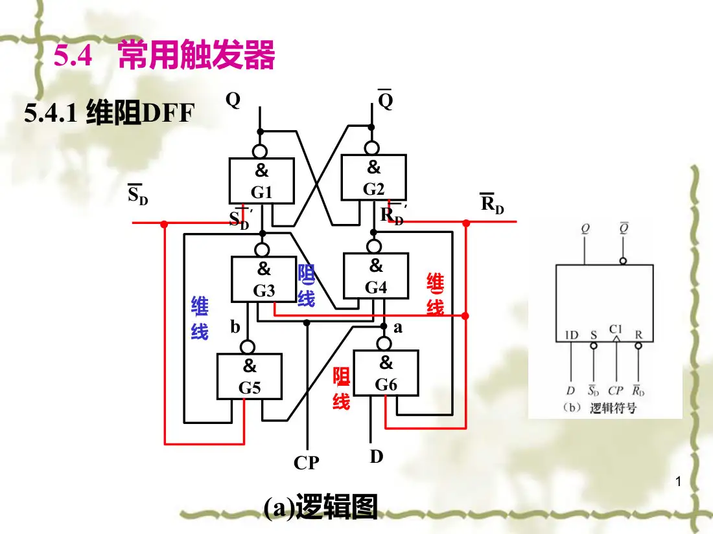

原文：

5.4 常用触发器

5.4.1 维阻DFF

### 功能分析:

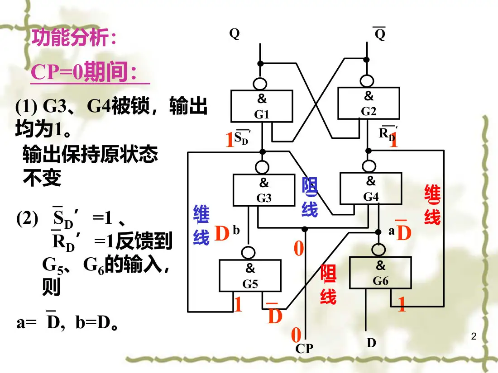

原文：

功能分析:

CP=0期间：

(1) G3、G4被锁，输出均为1。

输出保持原状态不变

(2) $\overline{\mathbf{S}}_{\mathbf{D}}^{\prime} = 1$ 、 $\overline{\mathbf{R}}_{\mathbf{D}}^{\prime} = 1$ 反馈到 $\mathrm{G}_{5}$ 、 $\mathrm{G}_{6}$ 的输入，则 $\mathrm{a} = \overline{\mathrm{D}}, \mathrm{b} = \mathrm{D}_{\circ}$

### CP上升沿到达时:

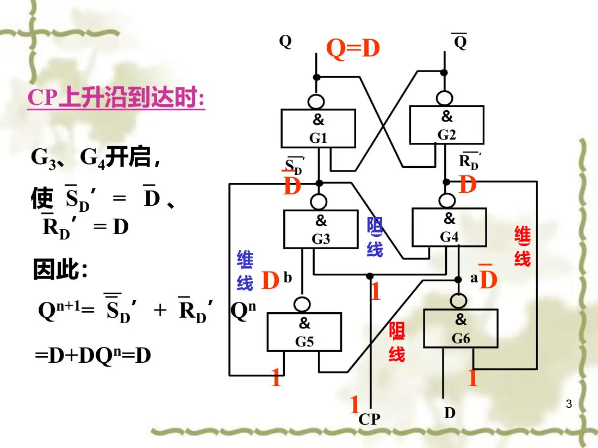

原文：

CP上升沿到达时:

$\mathrm{G}_{3}$ 、 $\mathrm{G}_{4}$ 开启，使 $\overline{\mathbf{S}}_{\mathbf{D}}^{\prime} = \overline{\mathbf{D}}$ $\overline{\mathbf{R}}_{\mathbf{D}}^{\prime} = \mathbf{D}$

因此：

$$
\begin{array}{l} \mathbf {Q} ^ {\mathrm{n+1}} = \overline {{\overline {{\mathbf {S}}}}} _ {\mathbf {D}} ^ {\prime} + \overline {{\mathbf {R}}} _ {\mathbf {D}} ^ {\prime} \\ = \mathbf {D} + \mathbf {D Q} ^ {\mathrm{n}} = \mathbf {D} \end{array}
$$

### CP上升沿过后（设Q=1）

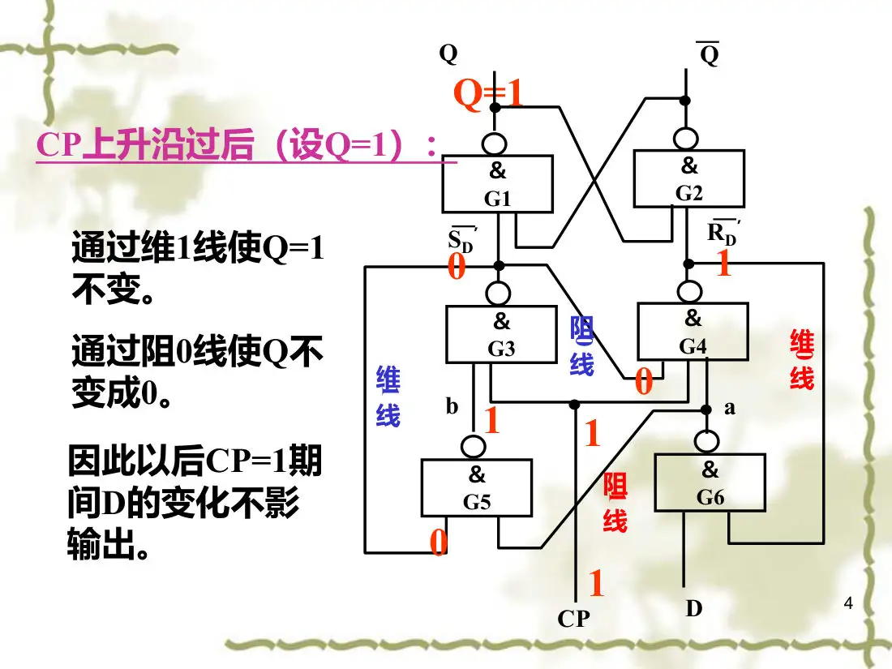

原文：

CP上升沿过后（设Q=1）

通过维1线使Q=1不变。

通过阻0线使Q不变成0。

因此以后CP=1期间D的变化不影响输出。

### CP上升沿过后（设Q=0）

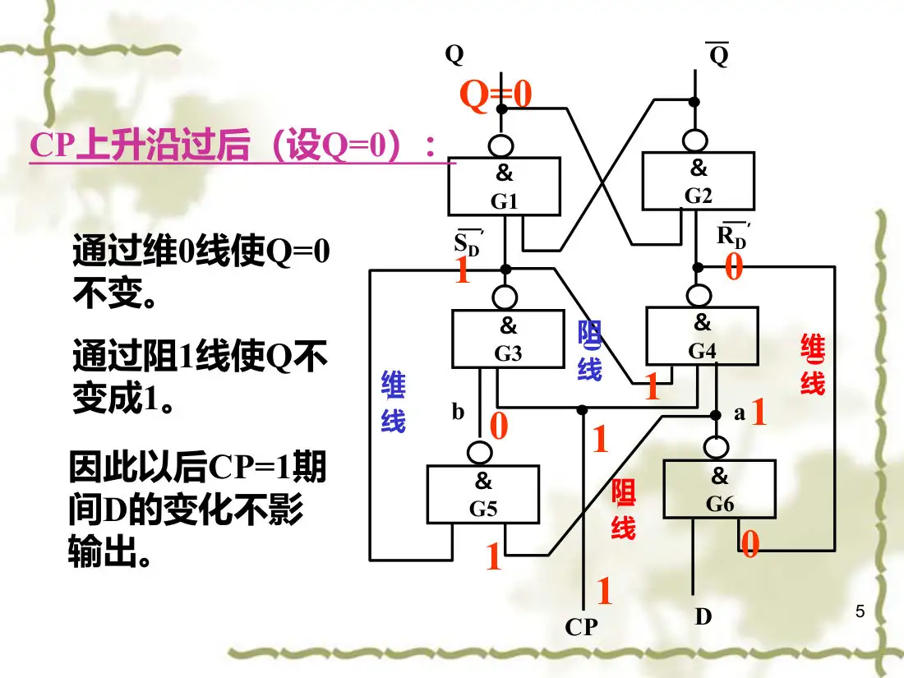

原文：

CP上升沿过后（设Q=0）

通过维0线使Q=0不变。

通过阻1线使Q不变成1。

因此以后CP=1期间D的变化不影响输出。

### 第 6 页

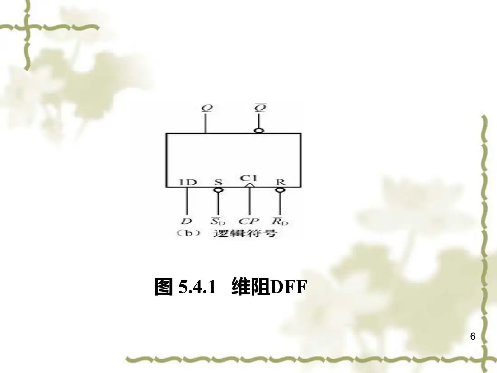

原文：

6

### 维阻D触发器功能表

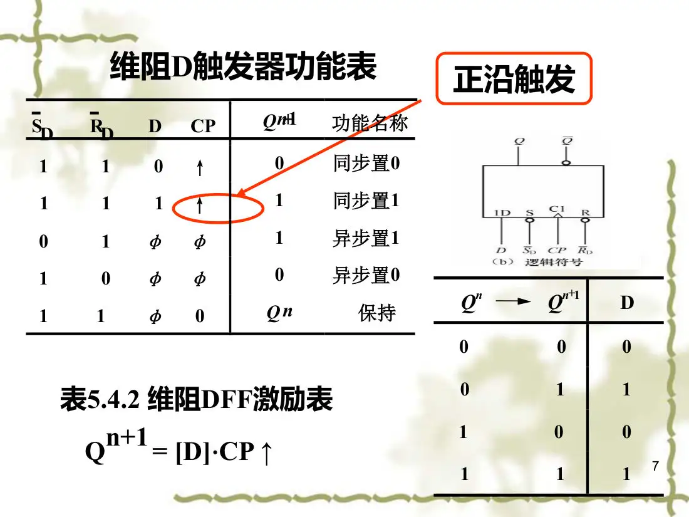

原文：

维阻D触发器功能表

<table><tr><td> $\overline{S}_{D}$ </td><td> $\overline{R}_{D}$ </td><td>D</td><td>CP</td><td>Qn1</td><td>功能名称</td></tr><tr><td>1</td><td>1</td><td>0</td><td>↑</td><td>0</td><td>同步置0</td></tr><tr><td>1</td><td>1</td><td>1</td><td>↑</td><td>1</td><td>同步置1</td></tr><tr><td>0</td><td>1</td><td> $\phi$ </td><td> $\phi$ </td><td>1</td><td>异步置1</td></tr><tr><td>1</td><td>0</td><td> $\phi$ </td><td> $\phi$ </td><td>0</td><td>异步置0</td></tr><tr><td>1</td><td>1</td><td> $\phi$ </td><td>0</td><td>Qn</td><td>保持</td></tr></table>

表5.4.2 维阻DFF激励表

$$
\mathbf {Q} ^ {\mathbf {n + 1}} = [ \mathbf {D} ] \cdot \mathbf {C P} \uparrow
$$

正沿触发

<table><tr><td colspan="2"> $Q^n \rightarrow Q^{n+1}$ </td><td>D</td></tr><tr><td>0</td><td>0</td><td>0</td></tr><tr><td>0</td><td>1</td><td>1</td></tr><tr><td>1</td><td>0</td><td>0</td></tr><tr><td>1</td><td>1</td><td>17</td></tr></table>

### (4)波形图

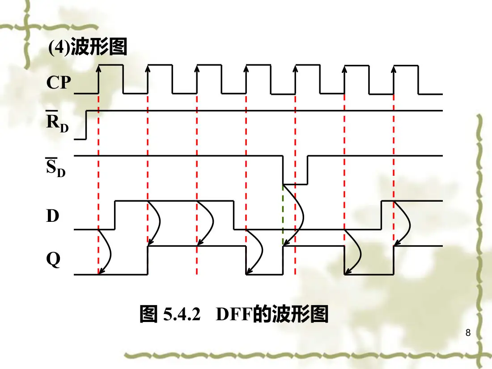

原文：

(4)波形图

### 2.负边沿JKFF

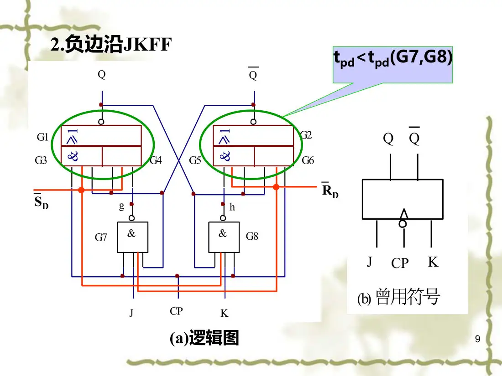

原文：

2.负边沿JKFF

9

### CP=1期间：

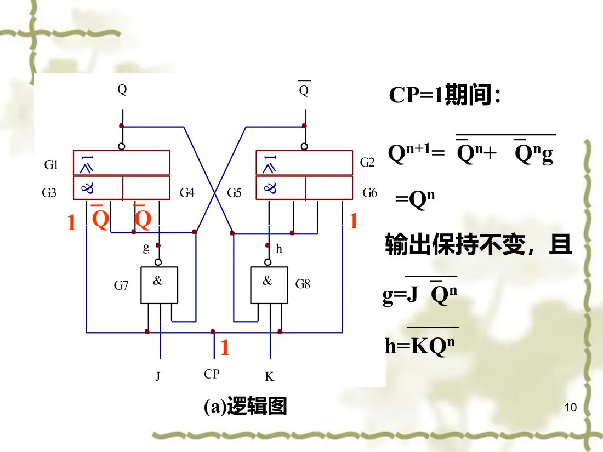

原文：

CP=1期间：

$$
\begin{array}{r l} & {\mathbf {Q} ^ {n + 1} = \overline {{\overline {{\mathbf {Q}}} ^ {n} + \overline {{\mathbf {Q}}} ^ {n} \mathbf {g}}}} \\ & {\quad = \mathbf {Q} ^ {n}} \end{array}
$$

输出保持不变，且

$$
\mathbf {g} = \overline {{\mathbf {J} \cdot \overline {{\mathbf {Q}}} ^ {\mathrm{n}}}}
$$

$$
\mathbf {h} = \overline {{\mathbf {K Q ^ {n}}}}
$$

10

### CP下降沿到达:

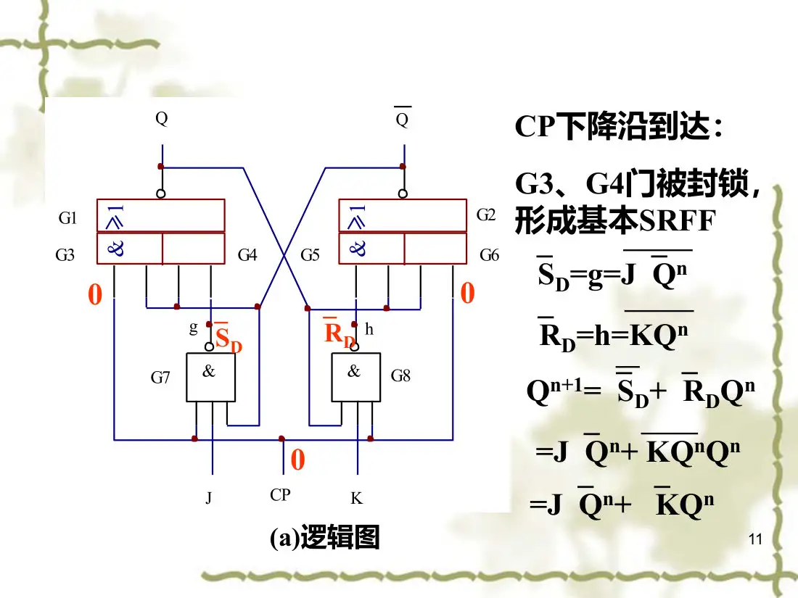

原文：

CP下降沿到达:

G3、G4门被封锁，形成基本SRFF

$$
\begin{array}{r l} & {\overline {{\mathbf {S}}} _ {\mathbf {D}} = \mathbf {g} = \overline {{\mathbf {J} \cdot \overline {{\mathbf {Q}}} ^ {n}}}} \\ & {\overline {{\mathbf {R}}} _ {\mathbf {D}} = \mathbf {h} = \overline {{\mathbf {K Q} ^ {n}}}} \\ & {\mathbf {Q} ^ {n + 1} = \overline {{\overline {{\mathbf {S}}} _ {\mathbf {D}}}} + \overline {{\mathbf {R}}} _ {\mathbf {D}} \mathbf {Q} ^ {n}} \\ & {= \mathbf {J} \cdot \overline {{\mathbf {Q}}} ^ {n} + \overline {{\mathbf {K Q} ^ {n}}} \mathbf {Q} ^ {n}} \\ & {= \mathbf {J} \cdot \overline {{\mathbf {Q}}} ^ {n} + \overline {{\mathbf {K Q} ^ {n}}}} \end{array}
$$

11

### $\mathrm{CP} = 0$ 期间

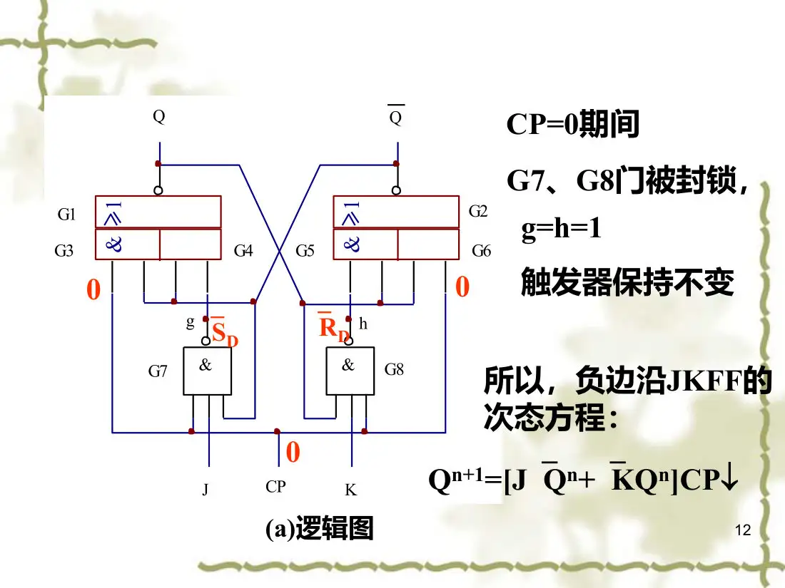

原文：

$\mathrm{CP} = 0$ 期间

G7、G8门被封锁，

$$
\mathbf {g} = \mathbf {h} = 1
$$

触发器保持不变

所以，负边沿JKFF的次态方程：

$$
\mathbf {Q} ^ {\mathrm{n+1}} = [ \mathbf {J} \overline {{\mathbf {Q}}} ^ {\mathrm{n}} + \overline {{\mathbf {K}}} \mathbf {Q} ^ {\mathrm{n}} ] \mathbf {C P} \downarrow
$$

12

### 负边沿JKFF功能表

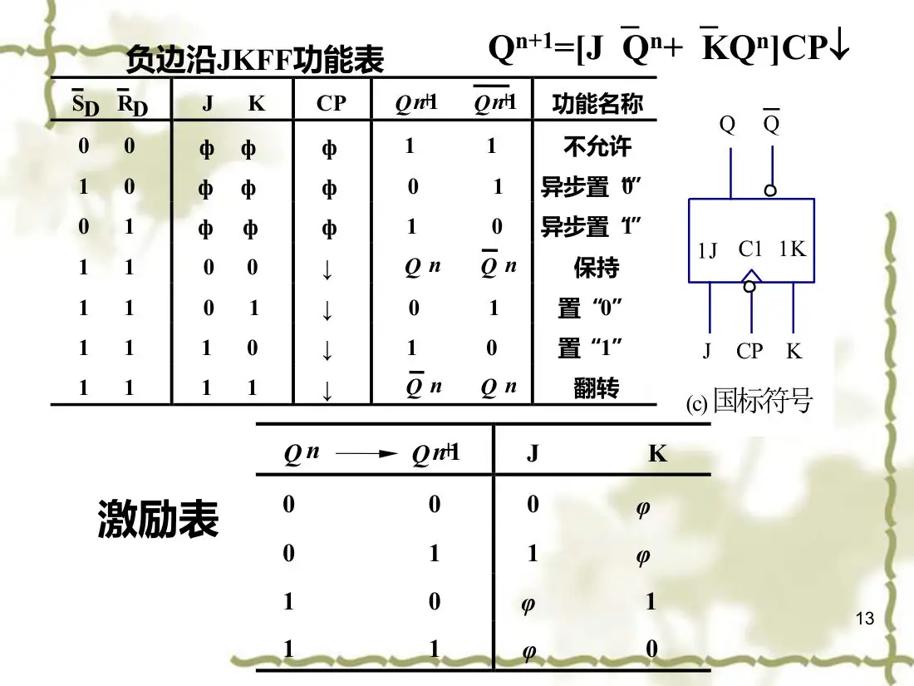

原文：

负边沿JKFF功能表

$\mathbf{Q}^{\mathrm{n + 1}} = [\mathbf{J}\overline{\mathbf{Q}}^{\mathrm{n}} + \overline{\mathbf{K}}\mathbf{Q}^{\mathrm{n}}]\mathbf{C}\mathbf{P}\downarrow$

<table><tr><td colspan="2"> $\overline{\mathrm{S}}_{\mathrm{D}}$   $\overline{\mathrm{R}}_{\mathrm{D}}$ </td><td colspan="2">J K</td><td>CP</td><td> $Qn^{\#1}$ </td><td> $\overline{Qn^{\#1}}$ </td><td>功能名称</td></tr><tr><td>0</td><td>0</td><td> $\phi$ </td><td> $\phi$ </td><td> $\phi$ </td><td>1</td><td>1</td><td>不允许</td></tr><tr><td>1</td><td>0</td><td> $\phi$ </td><td> $\phi$ </td><td> $\phi$ </td><td>0</td><td>1</td><td>异步置“0”</td></tr><tr><td>0</td><td>1</td><td> $\phi$ </td><td> $\phi$ </td><td> $\phi$ </td><td>1</td><td>0</td><td>异步置“1”</td></tr><tr><td>1</td><td>1</td><td>0</td><td>0</td><td>↓</td><td> $Q n$ </td><td> $\overline{Q} n$ </td><td>保持</td></tr><tr><td>1</td><td>1</td><td>0</td><td>1</td><td>↓</td><td>0</td><td>1</td><td>置“0”</td></tr><tr><td>1</td><td>1</td><td>1</td><td>0</td><td>↓</td><td>1</td><td>0</td><td>置“1”</td></tr><tr><td>1</td><td>1</td><td>1</td><td>1</td><td>↓</td><td> $\overline{Q} n$ </td><td> $Q n$ </td><td>翻转</td></tr></table>

激励表

<table><tr><td colspan="2">Qn → Qn1</td><td>J</td><td>K</td></tr><tr><td>0</td><td>0</td><td>0</td><td>φ</td></tr><tr><td>0</td><td>1</td><td>1</td><td>φ</td></tr><tr><td>1</td><td>0</td><td>φ</td><td>1</td></tr><tr><td>1</td><td>1</td><td>φ</td><td>0</td></tr></table>

13

### 波形图

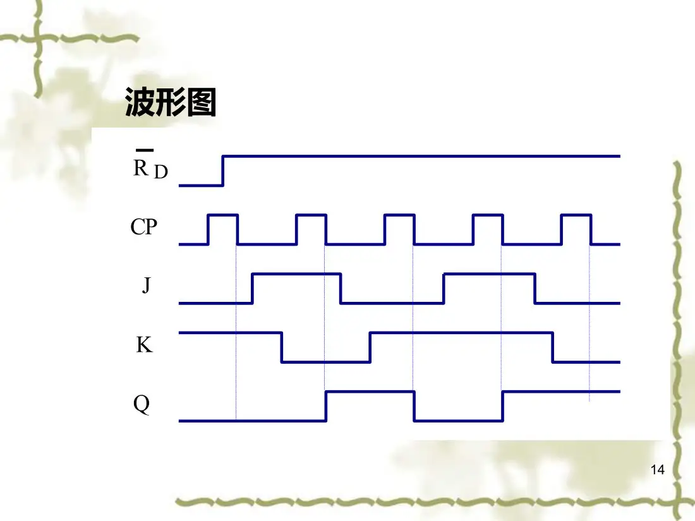

原文：

波形图

$\overline{\mathrm{R}}_{\mathrm{D}}$

14

### TFF 和 T'FF

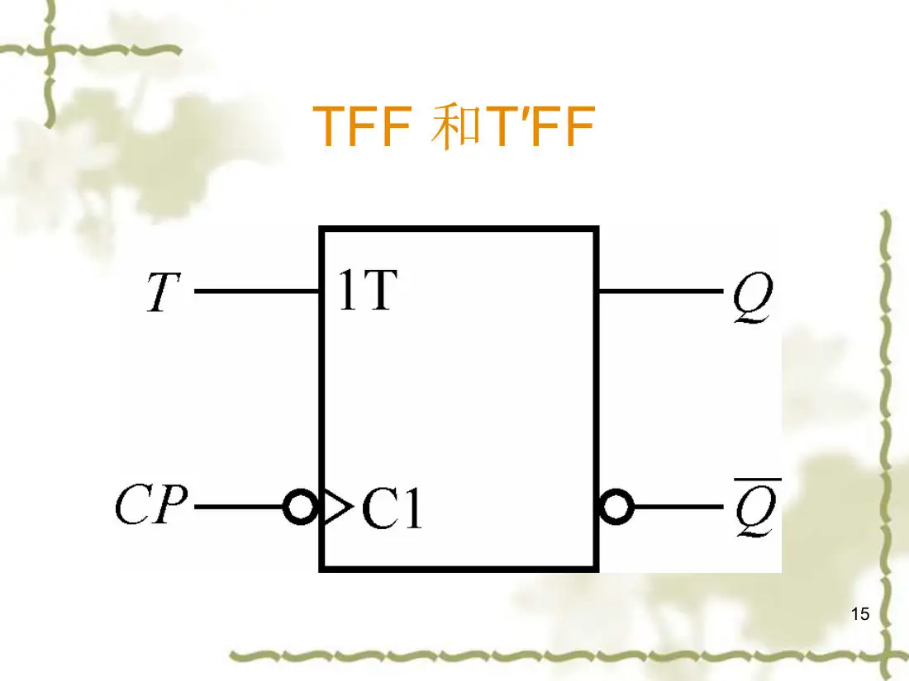

原文：

TFF 和 T'FF

15

### TFF 的实现电路

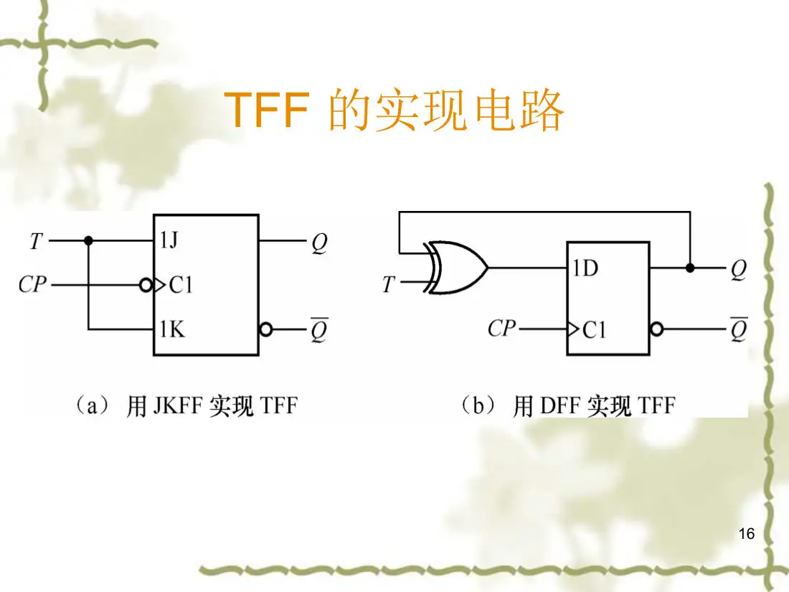

原文：

TFF 的实现电路

16

### TFF 的功能表

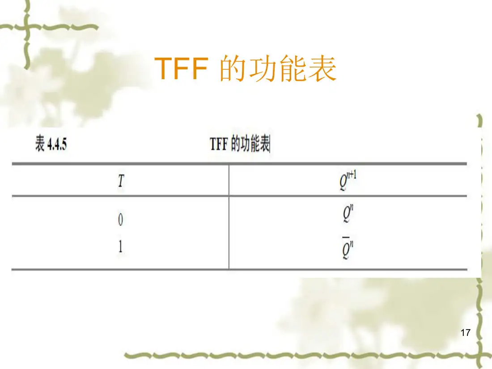

原文：

TFF 的功能表

<table><tr><td colspan="2">表4.4.5 TFF的功能表</td></tr><tr><td>T</td><td> $Q^{n+1}$ </td></tr><tr><td>0</td><td> $Q^n$ </td></tr><tr><td>1</td><td> $\overline{Q^n}$ </td></tr></table>

17

### 18

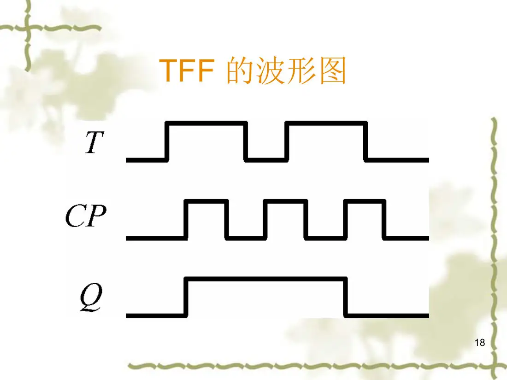

原文：

18

### T'FF

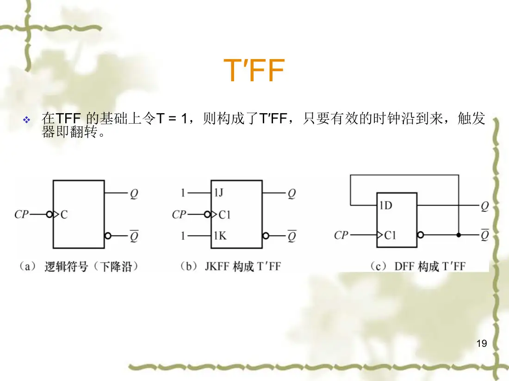

原文：

T'FF

在TFF的基础上令T = 1，则构成了T'FF，只要有效的时钟沿到来，触发器即翻转。

19

### T'FF 的波形图

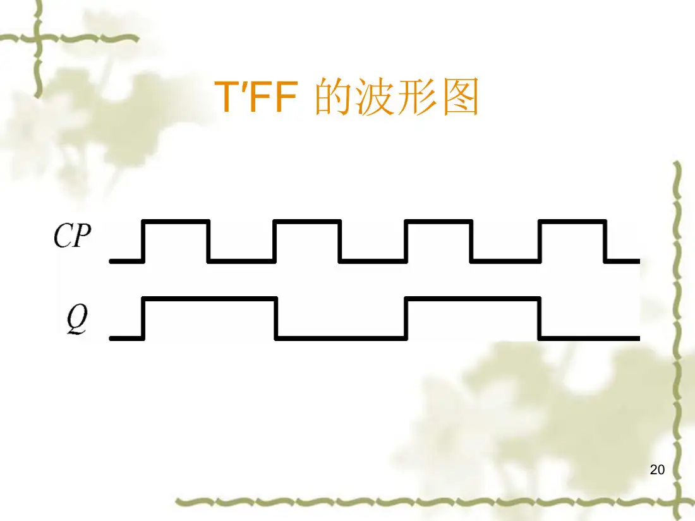

原文：

T'FF 的波形图

CP Q

20

### 小结: 触发方式在逻辑符号中的表示:

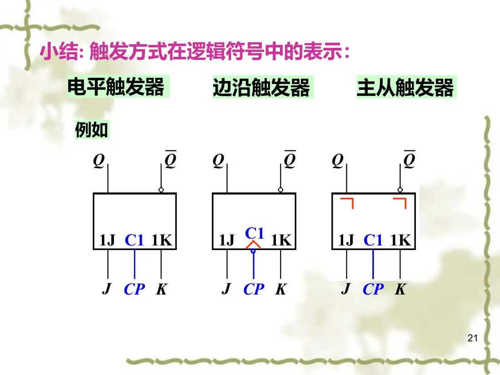

原文：

小结: 触发方式在逻辑符号中的表示:

电平触发器

边沿触发器

主从触发器

例如

$$
\begin{array}{c c c} \hline Q & \overline {{Q}} \\ \hline 1 J & C 1 & 1 K \\ \hline J & C P & K \\ \hline \end{array}
$$

21

### 根据是否受时钟控制分为

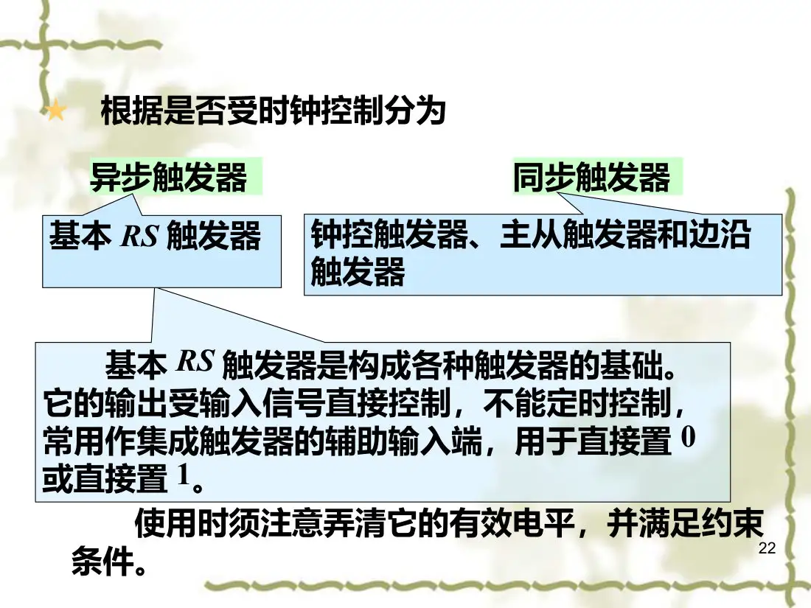

原文：

根据是否受时钟控制分为

异步触发器

基本 RS 触发器

同步触发器

钟控触发器、主从触发器和边沿触发器

基本 RS 触发器是构成各种触发器的基础。它的输出受输入信号直接控制，不能定时控制，常用作集成触发器的辅助输入端，用于直接置 0 或直接置 1。

使用时须注意弄清它的有效电平，并满足约束条件。

### 不同触发方式的工作特点

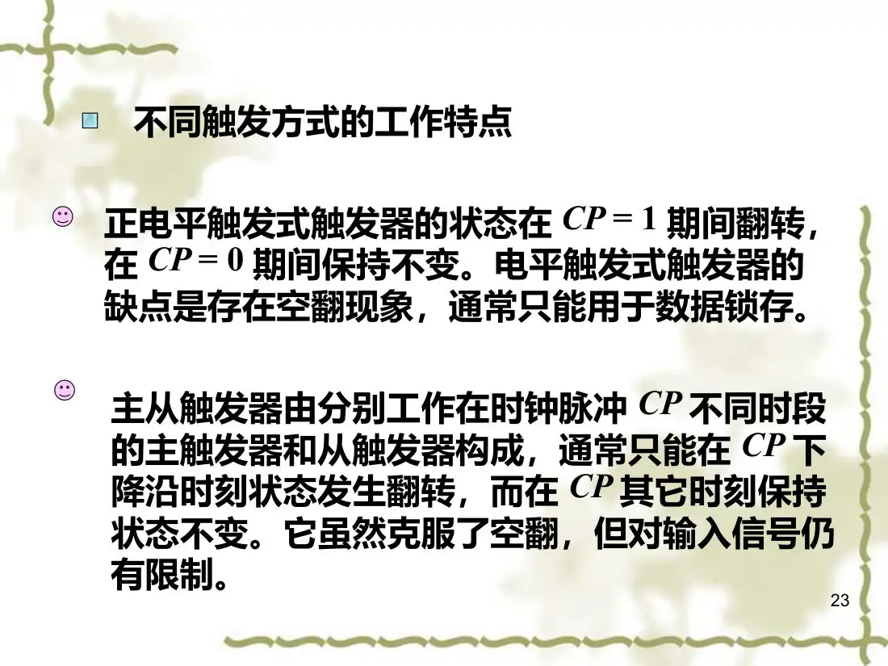

原文：

不同触发方式的工作特点

正电平触发式触发器的状态在 CP = 1 期间翻转，在 CP = 0 期间保持不变。电平触发式触发器的缺点是存在空翻现象，通常只能用于数据锁存。

主从触发器由分别工作在时钟脉冲 CP 不同时段的主触发器和从触发器构成，通常只能在 CP 下降沿时刻状态发生翻转，而在 CP 其它时刻保持状态不变。它虽然克服了空翻，但对输入信号仍有限制。

23

### 24

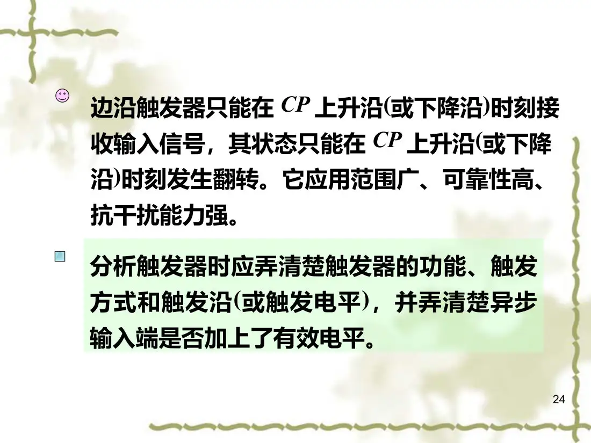

原文：

边沿触发器只能在 CP 上升沿(或下降沿)时刻接收输入信号，其状态只能在 CP 上升沿(或下降沿)时刻发生翻转。它应用范围广、可靠性高、抗干扰能力强。

分析触发器时应弄清楚触发器的功能、触发方式和触发沿(或触发电平)，并弄清楚异步输入端是否加上了有效电平。

24

### 25

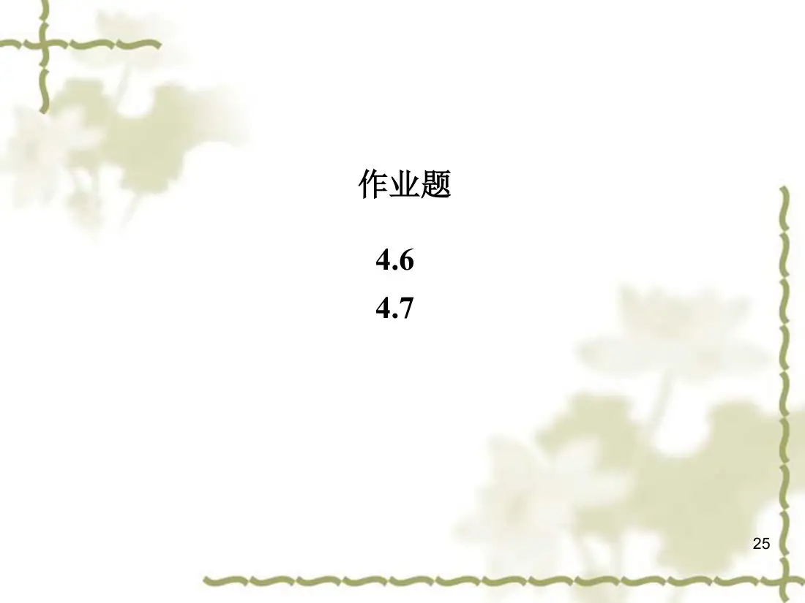

原文：

25
