# 《数字电路与逻辑设计B》第5章 序列信号发生器和顺序脉冲发生器（课件）

原件的每一页，下面附识别出的文字。

### 1 5.4 序列信号发生器 一、 概述

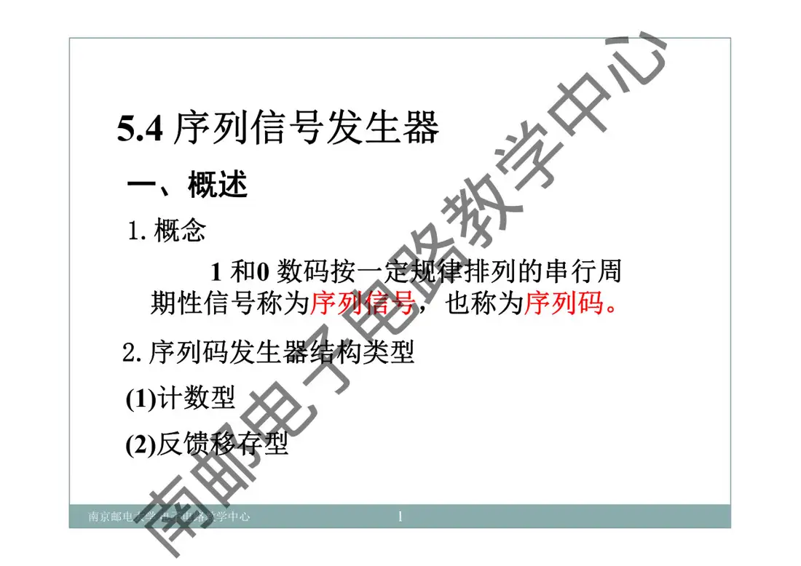

原文：

1 5.4 序列信号发生器 一、 概述

1 . 概念

1 和0 数码按一定规律排列的串行周期性信号称为序列信号， 也称为序列码。

2 序列码发生器结构类型.

(1)计数型

(2)反馈移存型

南京邮电大学 电子电路教学中心

1

### 南京邮电大学 电子电路教学中心

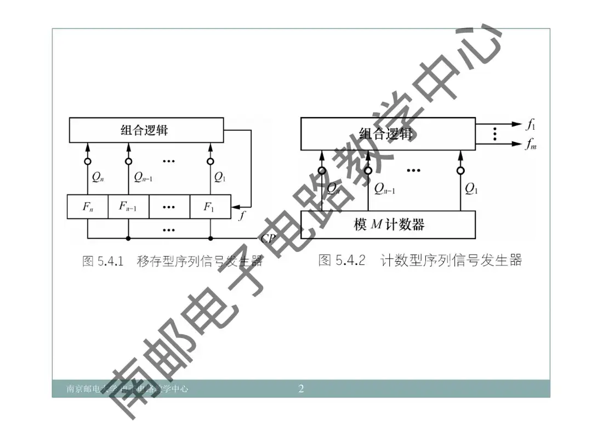

原文：

南京邮电大学 电子电路教学中心

2

### 1． 移存型序列信号发生器的设计已知序列码 山

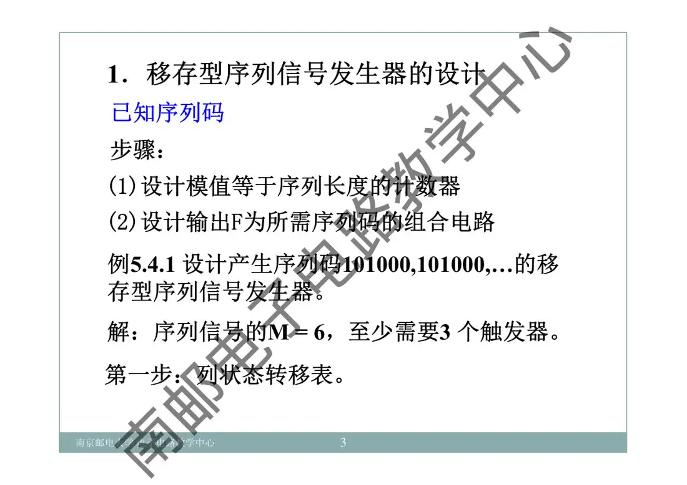

原文：

1． 移存型序列信号发生器的设计已知序列码 山

步骤：

(1) 设计模值等于序列长度的计数器

(2) 设计输出F为所需序列码的组合电路

例 5.4. 1 设计产 生序 列 码 1 01 000,1 01 000, … 的 移存型序列信号发生器。

解： 序列信号的M = 6， 至少需要3 个触发器。 第一步： 列状态转移表。

南京邮电大学 电子电路教学中心

3

### 表 5.4.1 例 5.4.1 使用 3 个触发器时的状态转移表

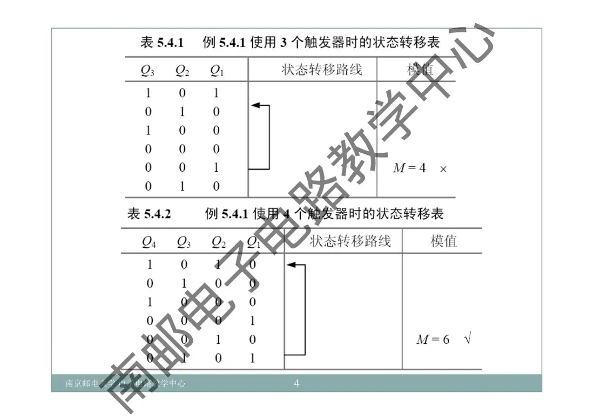

原文：

表 5.4.1 例 5.4.1 使用 3 个触发器时的状态转移表
<table><tr><td> $Q_3$ </td><td> $Q_2$ </td><td> $Q_1$ </td><td>状态转移路线</td><td>模值</td></tr><tr><td>1</td><td>0</td><td>1</td><td></td><td></td></tr><tr><td>0</td><td>1</td><td>0</td><td></td><td></td></tr><tr><td>1</td><td>0</td><td>0</td><td></td><td></td></tr><tr><td>0</td><td>0</td><td>0</td><td></td><td></td></tr><tr><td>0</td><td>0</td><td>1</td><td></td><td>M=4 ×</td></tr><tr><td>0</td><td>1</td><td>0</td><td></td><td></td></tr></table>

表 5.4.2 例 5.4.1 使用4 个触发器时的状态转移表
<table><tr><td></td><td>状态转移路线</td><td>模值</td></tr><tr><td></td><td></td><td>M=6 √</td></tr></table>

南京邮电大学 电子电路教学中心

4

### $$

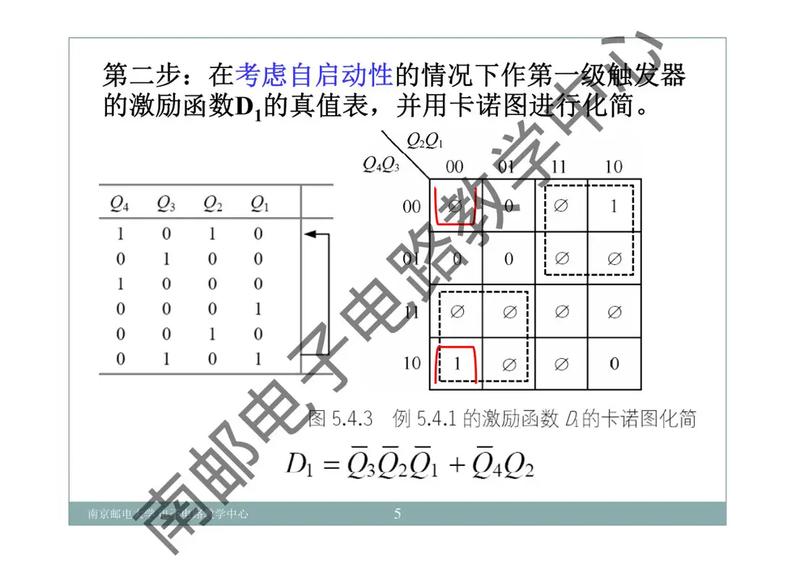

原文：

第二步： 在考虑 自 启动性的情况下作第一级触发器的激励函数 $\mathbf { D _ { 1 } }$ 的真值表， 并用卡诺图进行化简。

<table><tr><td> $Q_4$ </td><td> $Q_3$ </td><td> $Q_2$ </td><td> $Q_1$ </td></tr><tr><td>1</td><td>0</td><td>1</td><td>0</td></tr><tr><td>0</td><td>1</td><td>0</td><td>0</td></tr><tr><td>1</td><td>0</td><td>0</td><td>0</td></tr><tr><td>0</td><td>0</td><td>0</td><td>1</td></tr><tr><td>0</td><td>0</td><td>1</td><td>0</td></tr><tr><td>0</td><td>1</td><td>0</td><td>1</td></tr></table>

图 5.4.3 例 5.4.1 的激励函数 $\mathcal { D } _ { 1 }$ 的卡诺图化简

$$
D _ {1} = \bar {Q} _ {3} \bar {Q} _ {2} \bar {Q} _ {1} + \bar {Q} _ {4} Q _ {2}
$$

南京邮电大学 电子电路教学中心

5

### 南京邮电大学 电子电路教学中心

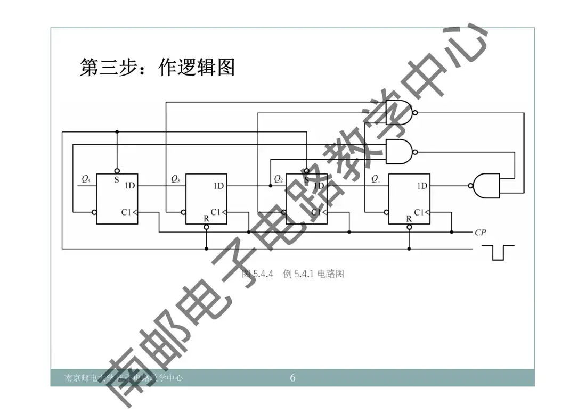

原文：

南京邮电大学 电子电路教学中心

6

### 表 5.4.3 例 5.42 组合电路真值表

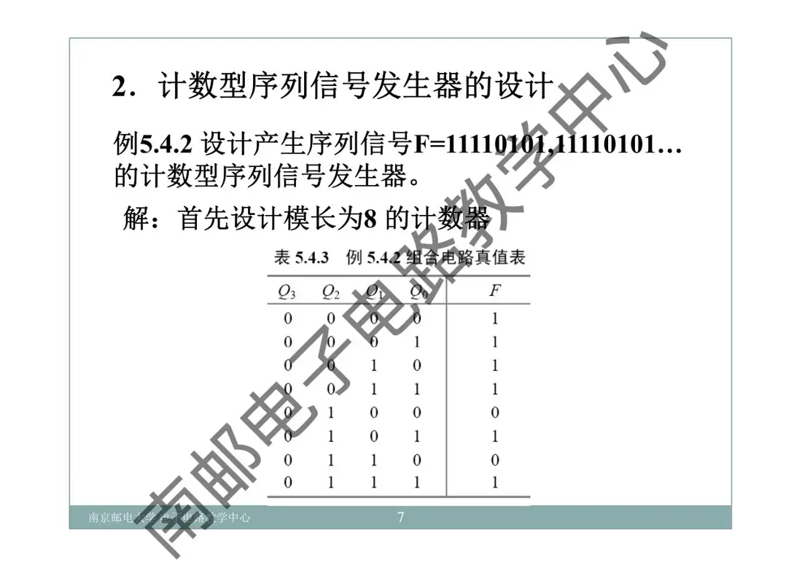

原文：

表 5.4.3 例 5.42 组合电路真值表
<table><tr><td> $Q_3$ </td><td> $Q_2$ </td><td> $Q_1$ </td><td> $Q_0$ </td><td>F</td></tr><tr><td>0</td><td>0</td><td>0</td><td>0</td><td>1</td></tr><tr><td>0</td><td>0</td><td>0</td><td>1</td><td>1</td></tr><tr><td>0</td><td>0</td><td>1</td><td>0</td><td>1</td></tr><tr><td>0</td><td>0</td><td>1</td><td>1</td><td>1</td></tr><tr><td>0</td><td>1</td><td>0</td><td>0</td><td>0</td></tr><tr><td>0</td><td>1</td><td>0</td><td>1</td><td>1</td></tr><tr><td>0</td><td>1</td><td>1</td><td>0</td><td>0</td></tr><tr><td>0</td><td>1</td><td>1</td><td>1</td><td>1</td></tr></table>

2． 计数型序列信号发生器的设计

例 5.4.2 设计产 序 列 信 号生 F=1111 01 01 ,1111 01 01 …的计数型序列信号发生器。

解： 首先设计模长为8 的计数器

南京邮电大学 电子电路教学中心

7

### 南京邮电大学 电子电路教学中心

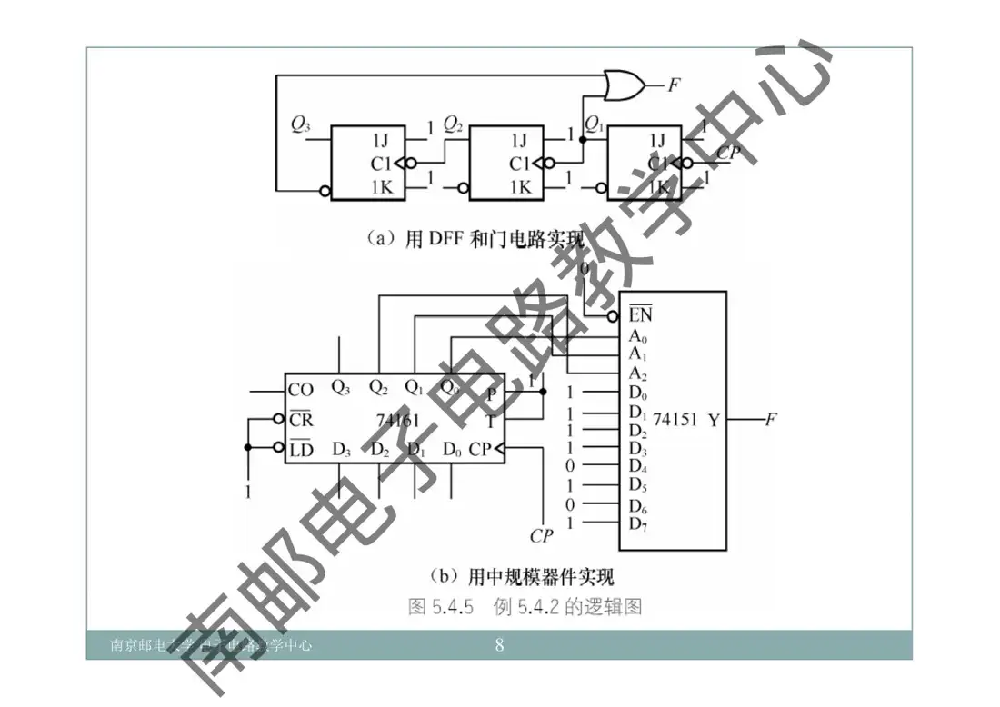

原文：

南京邮电大学 电子电路教学中心

8

### 3． 典型 电路——m 序列

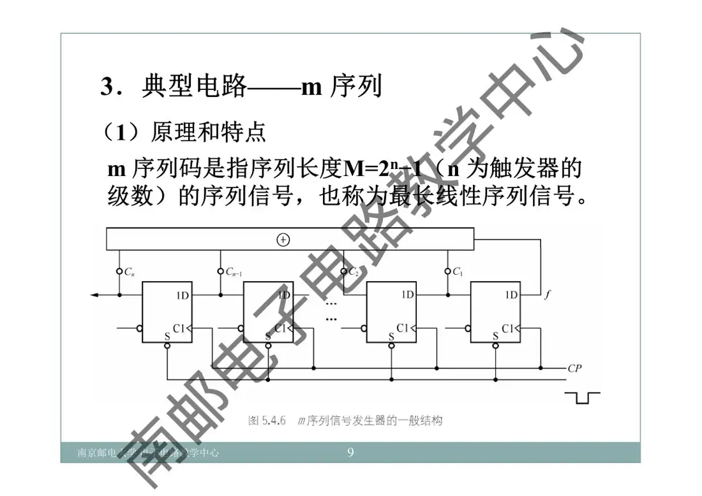

原文：

3． 典型 电路——m 序列

（1 ） 原理和特点

m 序列码是指序列长度M=2n−1 （n 为触发器的级数） 的序列信号， 也称为最长线性序列信号。

南京邮电大学 电子电路教学中心

9

### 图 5.4.8= 15 的 m 序列信号发生器的状态转移图

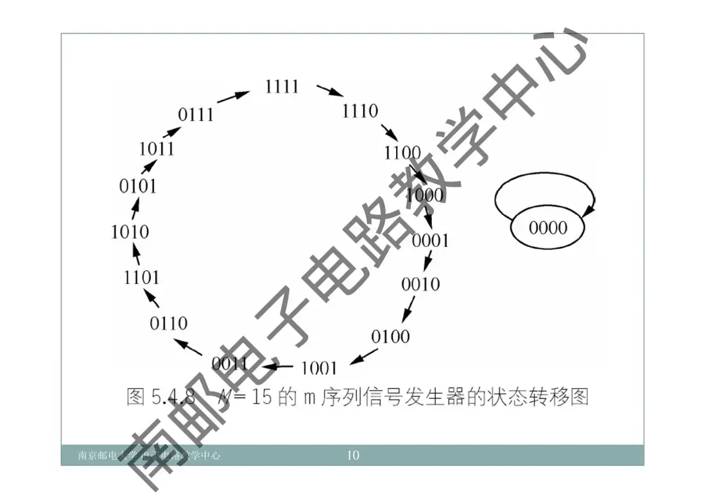

原文：

图 5.4.8= 15 的 m 序列信号发生器的状态转移图

南京邮电大学 电子电路教学中心

1 0

### m 序列称为最长线性序列

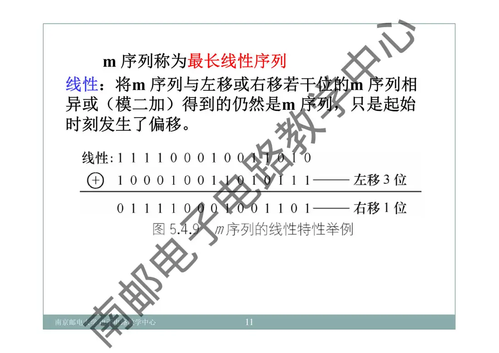

原文：

m 序列称为最长线性序列

线性： 将m 序列与左移或右移若干位的m 序列相异或 （模二加 ） 得到的仍然是m 序列， 只是起始时刻发生了偏移。

线性：11110001001010

+10001001√01111——左移3位

0 1 1 1 1 00 9100 1 1 0 1——右移1位图 5.4.9m序列的线性特性举例

南京邮电大学 电子电路教学中心

1 1

### 南京邮电大学 电子电路教学中心

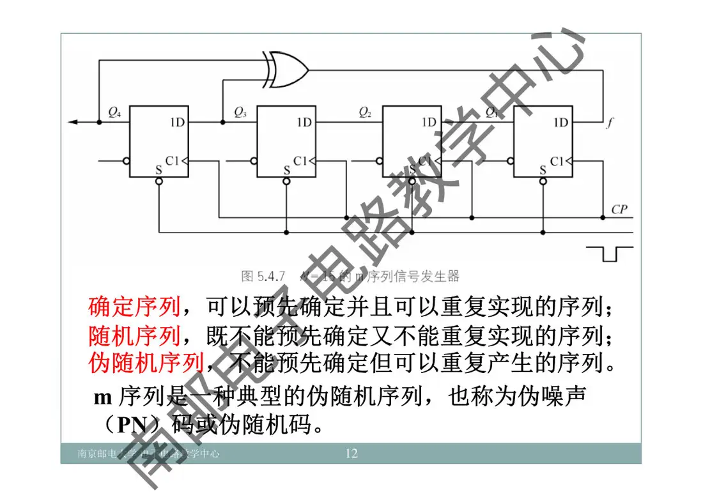

原文：

确定序列， 可以预先确定并且可以重复实现的序列；随机序列， 既不能预先确定又不能重复实现的序列；伪随机序列， 不能预先确定但可以重复产生的序列 。m 序列是一种典型的伪随机序列， 也称为伪噪声（PN） 码或伪随机码。

南京邮电大学 电子电路教学中心

1 2

### 表 5.4.4 m 序列反馈函数表

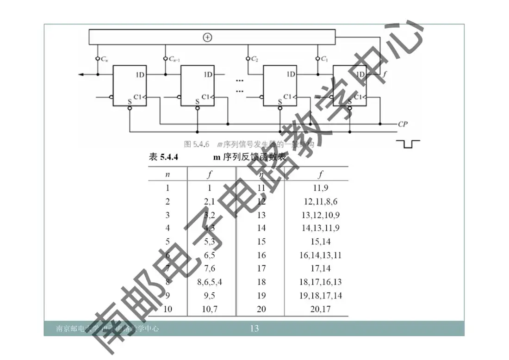

原文：

表 5.4.4 m 序列反馈函数表
<table><tr><td>n</td><td>f</td><td>n</td><td>f</td></tr><tr><td>1</td><td>1</td><td>11</td><td>11,9</td></tr><tr><td>2</td><td>2,1</td><td>12</td><td>12,11,8,6</td></tr><tr><td>3</td><td>3,2</td><td>13</td><td>13,12,10,9</td></tr><tr><td>4</td><td>4,3</td><td>14</td><td>14,13,11,9</td></tr><tr><td>5</td><td>5,3</td><td>15</td><td>15,14</td></tr><tr><td>6</td><td>6,5</td><td>16</td><td>16,14,13,11</td></tr><tr><td>7</td><td>7,6</td><td>17</td><td>17,14</td></tr><tr><td>8</td><td>8,6,5,4</td><td>18</td><td>18,17,16,13</td></tr><tr><td>9</td><td>9,5</td><td>19</td><td>19,18,17,14</td></tr><tr><td>10</td><td>10,7</td><td>20</td><td>20,17</td></tr></table>

南京邮电大学 电子电路教学中心

1 3

### 解决方法： 修改第一级触发器的激励函数， 将全 “0” 的次态纳入有效循环。

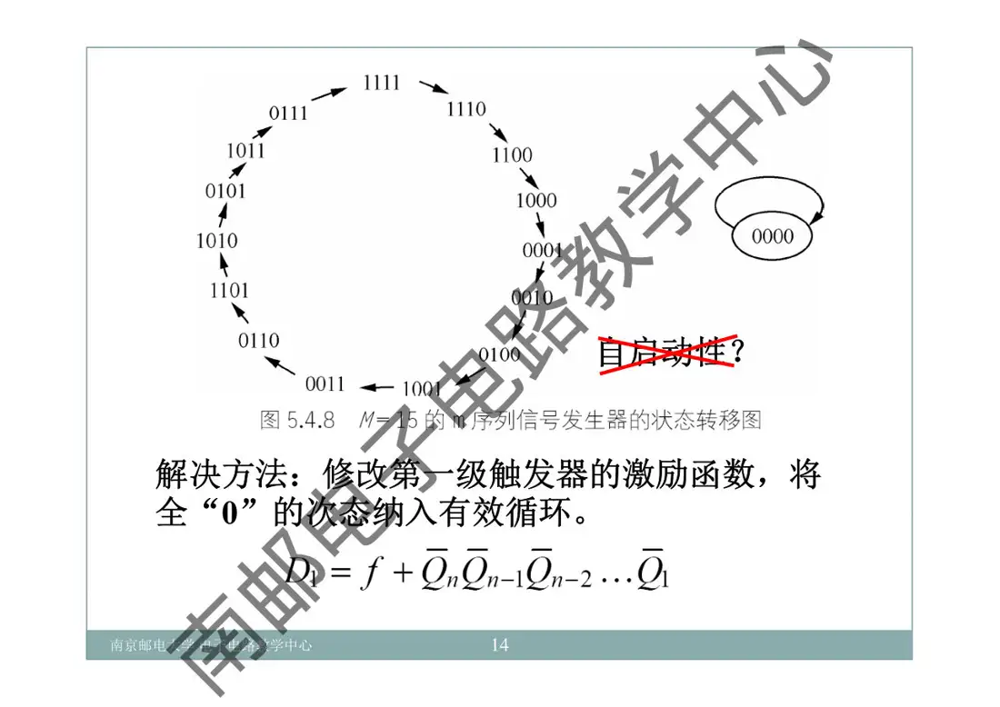

原文：

解决方法： 修改第一级触发器的激励函数， 将全 “0” 的次态纳入有效循环。

$$
D _ {1} = f + \overline {{Q}} _ {n} \overline {{Q}} _ {n - 1} \overline {{Q}} _ {n - 2} \dots \overline {{Q}} _ {1}
$$

南京邮电大学 电子电路教学中心

1 4

### （2） m 序列 的应用

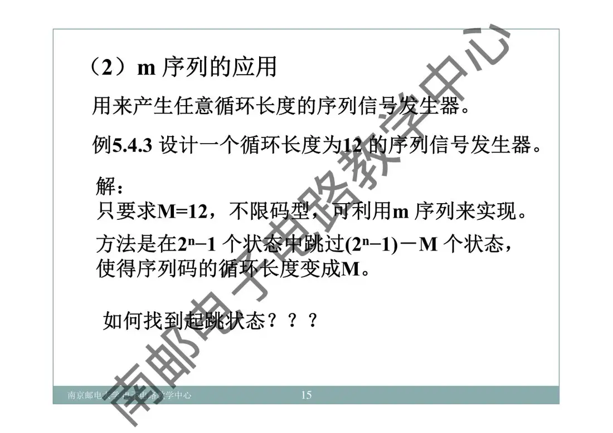

原文：

（2） m 序列 的应用

用来产生任意循环长度的序列信号发生器。

例5.4.3 设计一个循环长度为12 的序列信号发生器。

解 ：

只要求M 12 = ， 不限码型， 可利用m 序列来实现。

方法是在2n−1 个状态 中跳过(2n−1)－M 个状态，使得序列码的循环长度变成M。

如何找到起跳状态？ ？ ？

南京邮电大学 电子电路教学中心

1 5

### 寻找起跳状态的步骤：

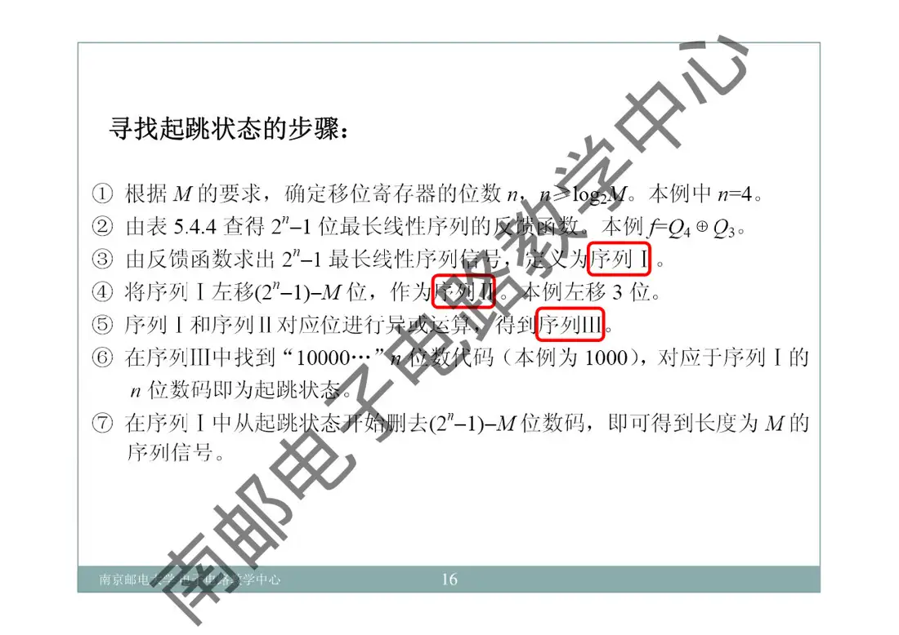

原文：

寻找起跳状态的步骤：

①根据M的要求，确定移位寄存器的位数 $n _ { \Large \star } n _ { \Large \star } \equiv \ln Q _ { 2 } M _ { \Large \odot }$ 。本例中 $n { = } 4$

②由表 5.4.4 查得 $2 ^ { n } - 1$ 位最长线性序列的反馈函数。本例 $f { = } Q _ { 4 } \oplus Q _ { 3 }$ o

③由反馈函数求出 $2 ^ { n } - 1$ 最长线性序列信号，义为序列

④将序列Ⅰ左移 $( 2 ^ { n } - 1 ) - M$ 位，作为列本例左移3位。

⑤序列Ⅰ和序列Ⅱ对应位进行异或运算得到序列Ⅲ。

⑥在序列III中找到“10000…”位数代码（本例为1000），对应于序列Ⅰ的n位数码即为起跳状态。

⑦ 在序列Ⅰ中从起跳状态开始删去 $( 2 ^ { n } - 1 ) - M$ 位数码，即可得到长度为M的序列信号。

南京邮电大学 电子电路教学中心

1 6

### 南京邮电大学 电子电路教学中心

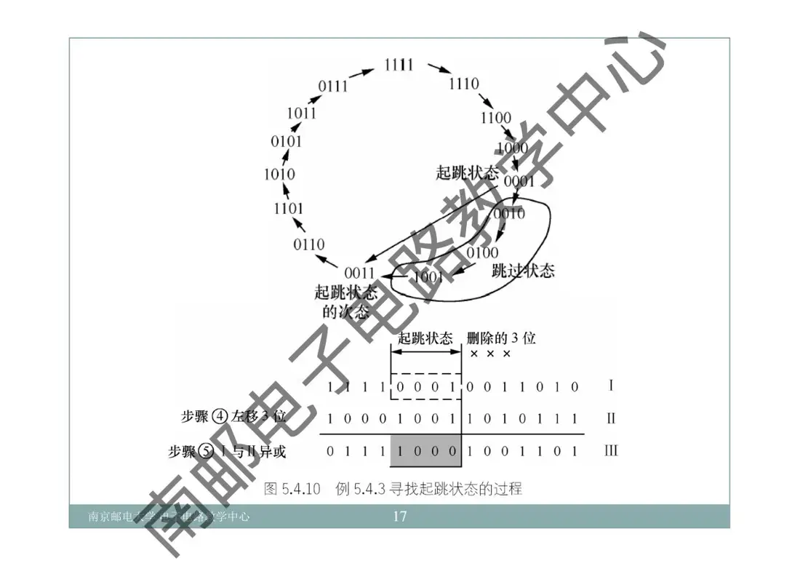

原文：

南京邮电大学 电子电路教学中心

1 7

### $$

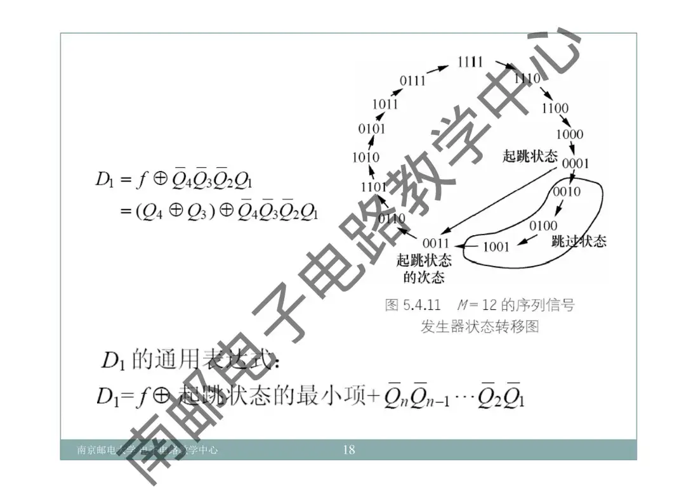

原文：

$$
\begin{array}{r l} D _ {1} & = f \oplus \bar {Q} _ {4} \bar {Q} _ {3} \bar {Q} _ {2} Q _ {1} \\ & = (Q _ {4} \oplus Q _ {3}) \oplus \bar {Q} _ {4} \bar {Q} _ {3} \bar {Q} _ {2} Q _ {1} \end{array}
$$

$D _ { 1 }$ 的通用表达式：

$D _ { 1 } { = } f$ ④起跳状态的最小项+ $\overline { { { Q } } } _ { n } \overline { { { Q } } } _ { n - 1 } \cdots \overline { { { Q } } } _ { 2 } \overline { { { Q } } } _ { 1 }$

南京邮电大学 电子电路教学中心

1 8

### 例5 4 4 . . 设计 个循环长度为 一 16 的序列信号发生器 。

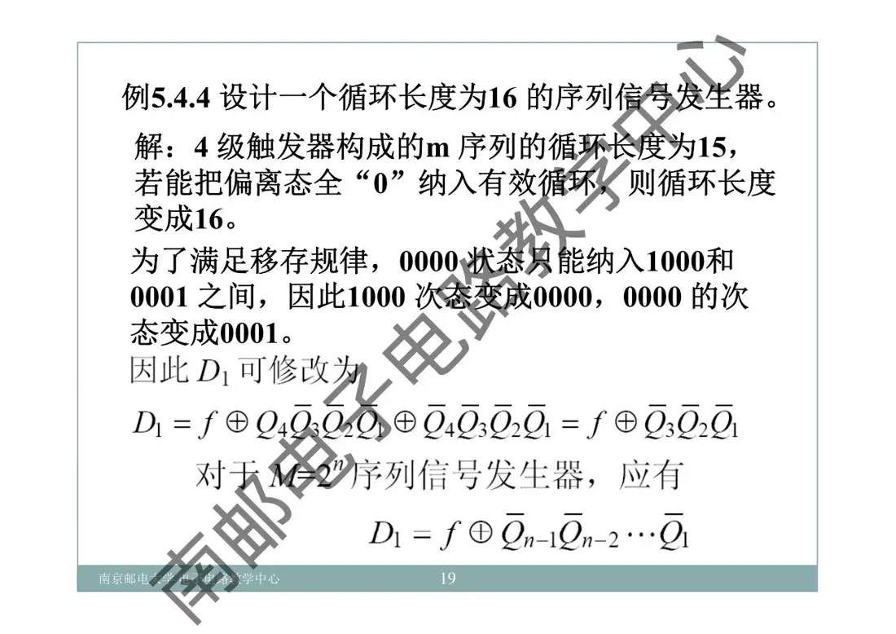

原文：

例5 4 4 . . 设计 个循环长度为 一 16 的序列信号发生器 。

解： 4 级触发器构成的m 序列的循环长度为15，若能把偏离态全 “0” 纳入有效循环， 则循环长度变成1 6 。

为了满足移存规律， 0000 状态只能纳入1000和0001 之 间 ， 因 此 1 000 次态变成0000 ， 0000 的 次态变成0001 。

因此 $D _ { 1 }$ 可修改为

$$
D _ {1} = f \oplus Q _ {4} \overline {{Q}} _ {3} \overline {{Q}} _ {2} \overline {{Q}} _ {1} \oplus \overline {{Q}} _ {4} \overline {{Q}} _ {3} \overline {{Q}} _ {2} \overline {{Q}} _ {1} = f \oplus \overline {{Q}} _ {3} \overline {{Q}} _ {2} \overline {{Q}} _ {1}
$$

对天 $M \equiv 2 ^ { n }$ 序列信号发生器，应有

$$
D _ {1} = f \oplus \overline {{Q}} _ {n - 1} \overline {{Q}} _ {n - 2} \dots \overline {{Q}} _ {1}
$$

南京邮电大学 电子电路教学中心

1 9

### 5.5 顺序脉冲发生器

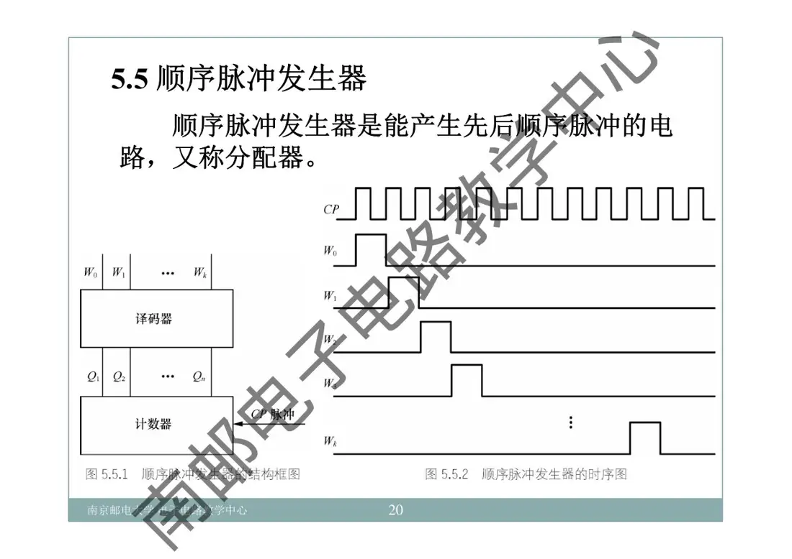

原文：

5.5 顺序脉冲发生器

顺序脉冲发生器是能产生先后顺序脉冲的 电路， 又称分配器。

南京邮电大学 电子电路教学中心

20

### 南京邮电大学 电子电路教学中心

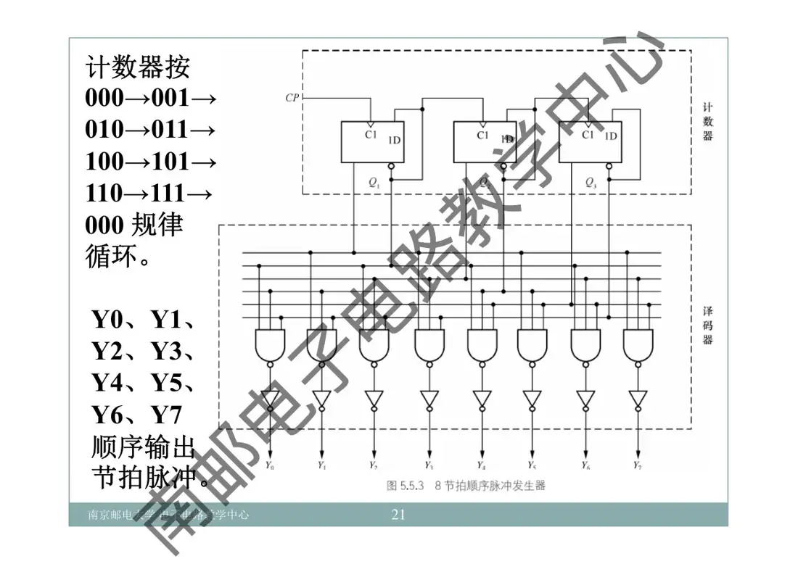

原文：

南京邮电大学 电子电路教学中心

2 1

### 清除冒险现象常用 以下方法：

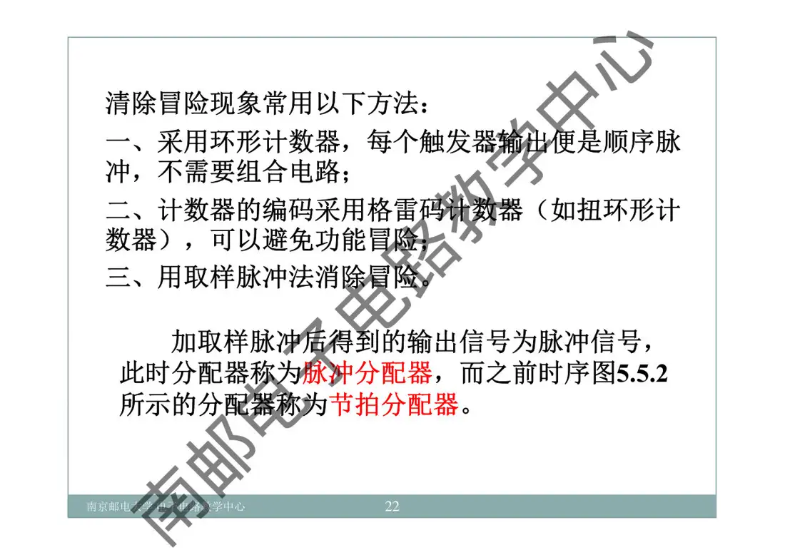

原文：

清除冒险现象常用 以下方法：

一、 采用环形计数器， 每个触发器输出便是顺序脉冲， 不需要组合电路；

二、 计数器的编码采用格雷码计数器 （如扭环形计数器） ， 可以避免功能冒险；

三、 用取样脉冲法消除冒险。

加取样脉冲后得到的输出信号为脉冲信号，此时分配器称为脉冲分配器， 而之前时序图5.5.2所示的分配器称为节拍分配器。

南京邮电大学 电子电路教学中心

22

### 南京邮电大学 电子电路教学中心

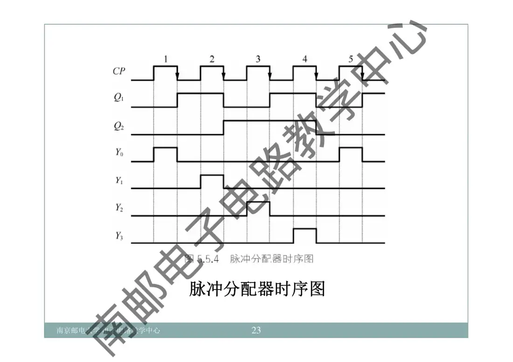

原文：

南京邮电大学 电子电路教学中心

23

### 作业5.285.316.32

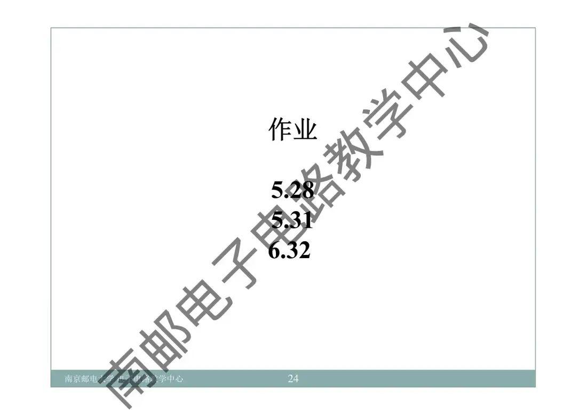

原文：

<table><tr><td>作业</td></tr><tr><td>5.28</td></tr><tr><td>5.31</td></tr><tr><td>6.32</td></tr></table>
