# 《数字电路与逻辑设计B》第5章 移存型计数器（课件）

原件的每一页，下面附识别出的文字。

### 移存型计数器

原文：

移存型计数器

### 第 2 页

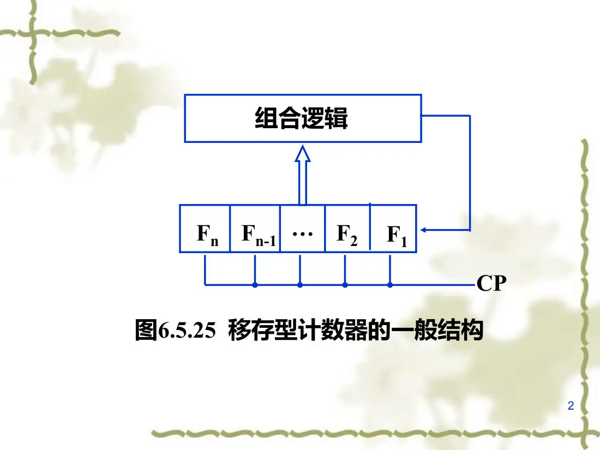

### 移存型计数器的特点

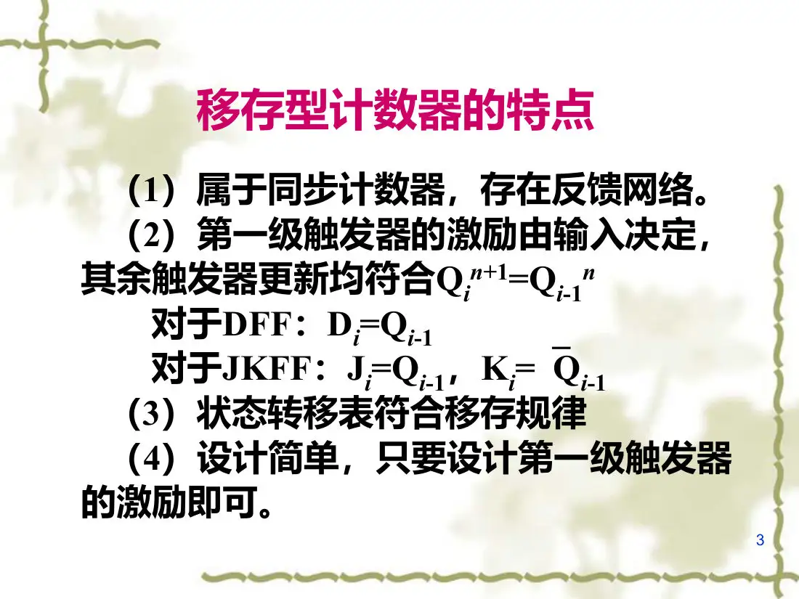

原文：

移存型计数器的特点

(1) 属于同步计数器，存在反馈网络。

(2) 第一级触发器的激励由输入决定, 其余触发器更新均符合 $Q_{i}^{n+1}=Q_{i-1}^{n}$

对于DFF: $D_{i}=Q_{i-1}$

对于JKFF: $\mathrm{J}_i = \mathrm{Q}_{i - 1},\mathrm{K}_i = \overline{\mathrm{Q}}_{i - 1}$

(3) 状态转移表符合移存规律

(4) 设计简单, 只要设计第一级触发器的激励即可。

3

### 移存型计数器的分析

原文：

移存型计数器的分析

与同步计数器的分析步骤相同，只是最后得到的状态转移表满足移存规律。

4

### 移存型计数器的设计

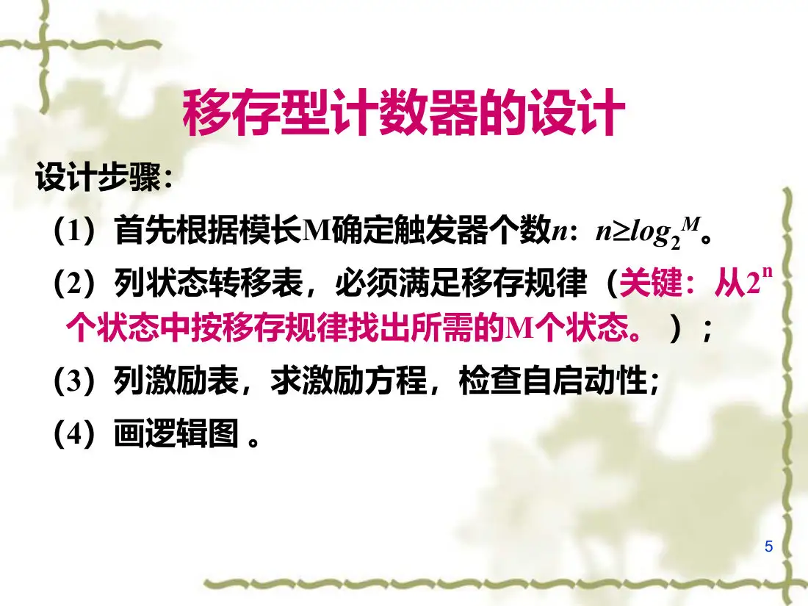

原文：

移存型计数器的设计

设计步骤:

(1) 首先根据模长M确定触发器个数 $n: n \geq \log_{2}^{M}$ 。

(2) 列状态转移表，必须满足移存规律（关键：从 $2^{n}$ 个状态中按移存规律找出所需的M个状态。）；

(3) 列激励表，求激励方程，检查自启动性；

(4) 画逻辑图。

5

### 第 6 页

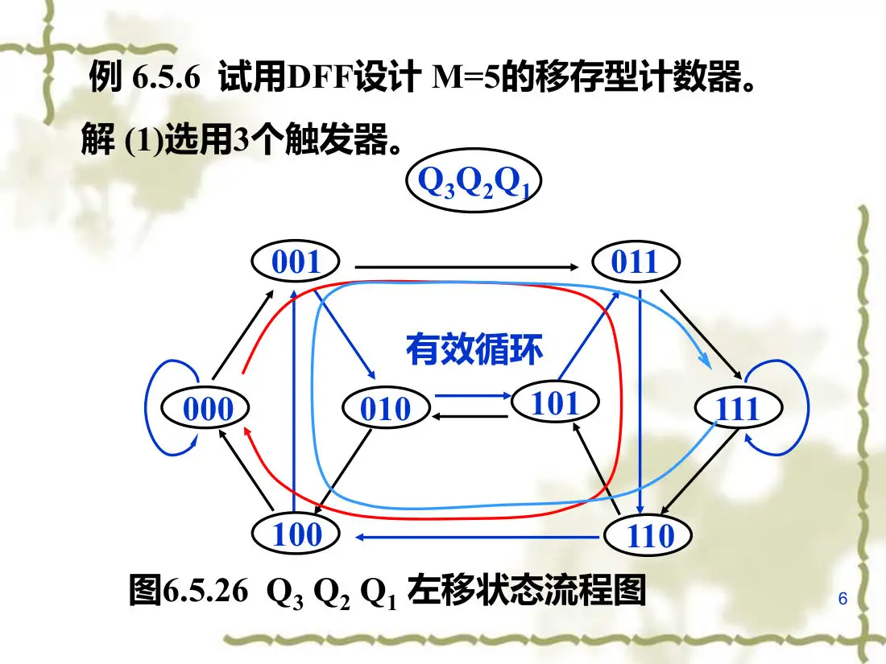

原文：

例 6.5.6 试用DFF设计 M=5 的移存型计数器。解 (1)选用3个触发器。

### 状态转移表:

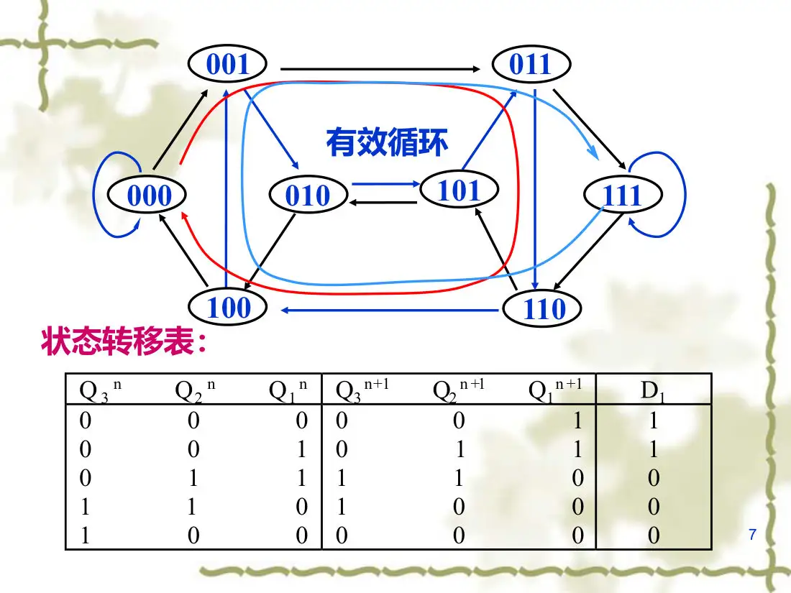

原文：

状态转移表:

<table><tr><td> $Q_{3}^{n}$ </td><td> $Q_{2}^{n}$ </td><td> $Q_{1}^{n}$ </td><td> $Q_{3}^{n+1}$ </td><td> $Q_{2}^{n+1}$ </td><td> $Q_{1}^{n+1}$ </td><td> $D_{1}$ </td></tr><tr><td>0</td><td>0</td><td>0</td><td>0</td><td>0</td><td>1</td><td>1</td></tr><tr><td>0</td><td>0</td><td>1</td><td>0</td><td>1</td><td>1</td><td>1</td></tr><tr><td>0</td><td>1</td><td>1</td><td>1</td><td>1</td><td>0</td><td>0</td></tr><tr><td>1</td><td>1</td><td>0</td><td>1</td><td>0</td><td>0</td><td>0</td></tr><tr><td>1</td><td>0</td><td>0</td><td>0</td><td>0</td><td>0</td><td>0</td></tr><tr><td>1</td><td>0</td><td>0</td><td>0</td><td>0</td><td>0</td><td>0</td></tr></table>

### $$

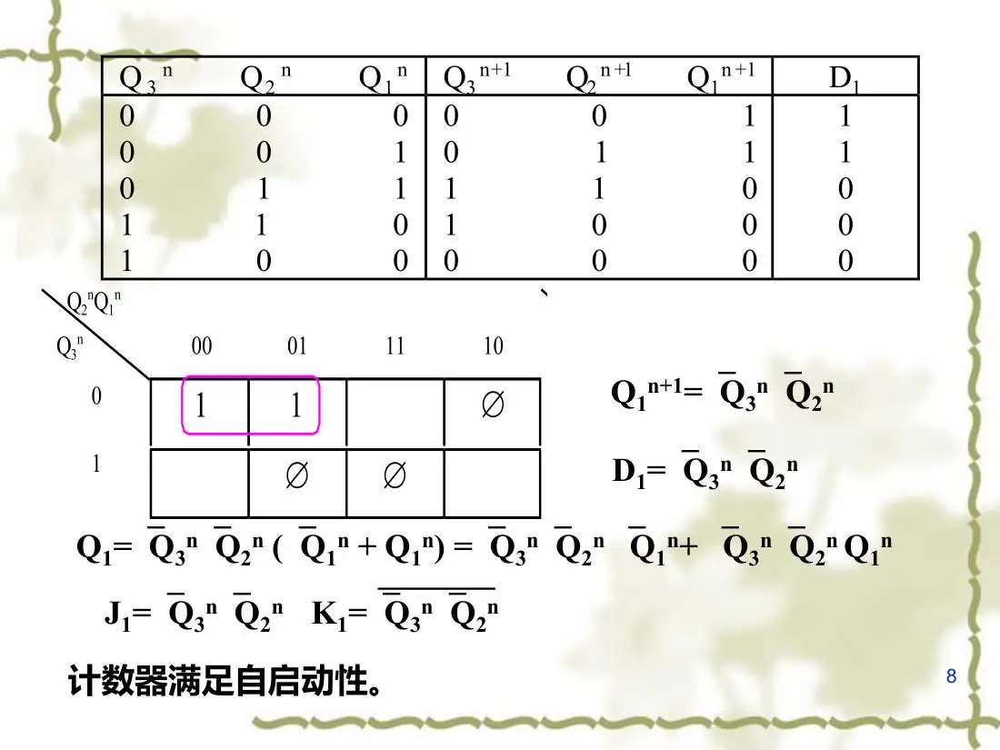

原文：

$$
\mathbf {Q} _ {1} ^ {\mathrm{n+1}} = \overline {{\mathbf {Q}}} _ {3} ^ {\mathrm{n}} \overline {{\mathbf {Q}}} _ {2} ^ {\mathrm{n}}
$$

$$
\mathbf {D} _ {1} = \overline {{\mathbf {Q}}} _ {3} ^ {\mathrm{n}} \overline {{\mathbf {Q}}} _ {2} ^ {\mathrm{n}}
$$

$$
\mathbf {Q} _ {1} = \overline {{\mathbf {Q}}} _ {3} ^ {\mathrm{n}} \overline {{\mathbf {Q}}} _ {2} ^ {\mathrm{n}} (\overline {{\mathbf {Q}}} _ {1} ^ {\mathrm{n}} + \mathbf {Q} _ {1} ^ {\mathrm{n}}) = \overline {{\mathbf {Q}}} _ {3} ^ {\mathrm{n}} \overline {{\mathbf {Q}}} _ {2} ^ {\mathrm{n}} \overline {{\mathbf {Q}}} _ {1} ^ {\mathrm{n+}} \overline {{\mathbf {Q}}} _ {3} ^ {\mathrm{n}} \overline {{\mathbf {Q}}} _ {2} ^ {\mathrm{n}} \mathbf {Q} _ {1} ^ {\mathrm{n}}
$$

$$
\mathbf {J} _ {1} = \overline {{\mathbf {Q}}} _ {3} ^ {\mathrm{n}} \overline {{\mathbf {Q}}} _ {2} ^ {\mathrm{n}} \quad \mathbf {K} _ {1} = \overline {{\overline {{\mathbf {Q}}} _ {3} ^ {\mathrm{n}} \overline {{\mathbf {Q}}} _ {2} ^ {\mathrm{n}}}}
$$

计数器满足自启动性。

### $$

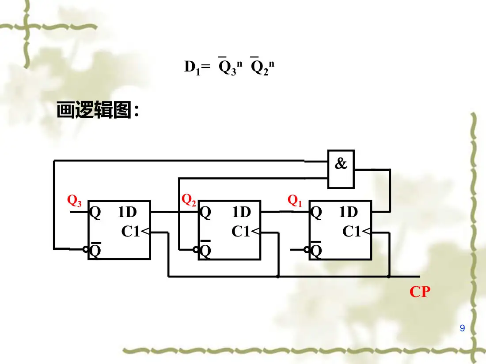

原文：

$$
\mathbf {D} _ {1} = \overline {{\mathbf {Q}}} _ {3} ^ {\mathrm{n}} \overline {{\mathbf {Q}}} _ {2} ^ {\mathrm{n}}
$$

画逻辑图：

### 3.环形计数器

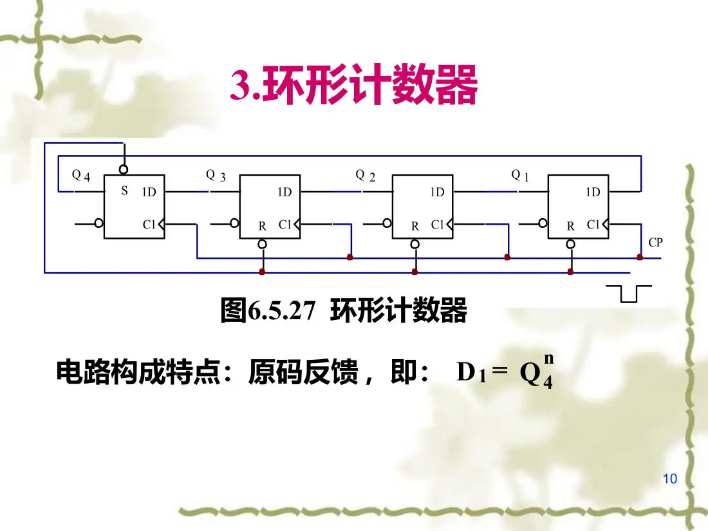

原文：

3.环形计数器

电路构成特点：原码反馈，即： $D_{1}=Q_{4}^{n}$

10

### 表6.5.16 环形计数器状态转移表

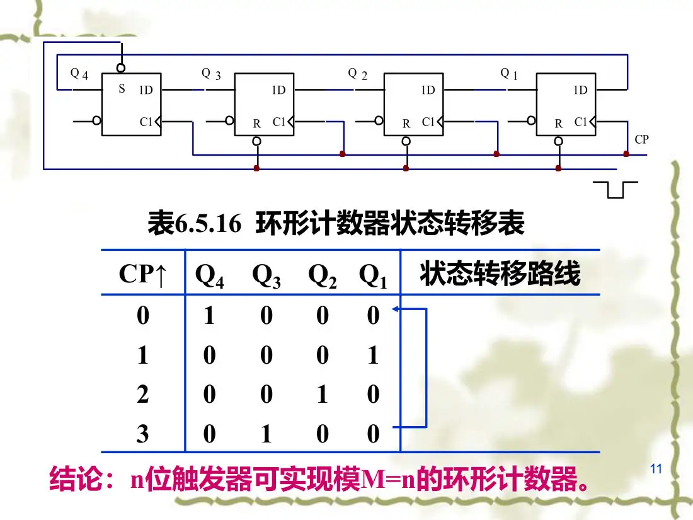

原文：

表6.5.16 环形计数器状态转移表
<table><tr><td>CP↑</td><td> $Q_4$ </td><td> $Q_3$ </td><td> $Q_2$ </td><td> $Q_1$ </td><td>状态转移路线</td></tr><tr><td>0</td><td>1</td><td>0</td><td>0</td><td>0</td><td rowspan="4"></td></tr><tr><td>1</td><td>0</td><td>0</td><td>0</td><td>1</td></tr><tr><td>2</td><td>0</td><td>0</td><td>1</td><td>0</td></tr><tr><td>3</td><td>0</td><td>1</td><td>0</td><td>0</td></tr></table>

结论：n位触发器可实现模M=n的环形计数器。

11

### 检查自启动性

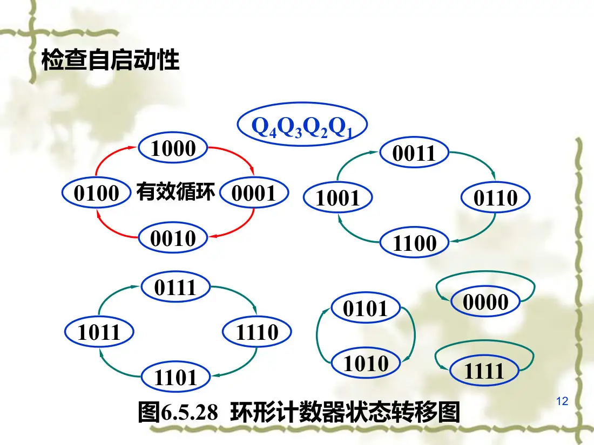

原文：

检查自启动性

### 扭环形计数器

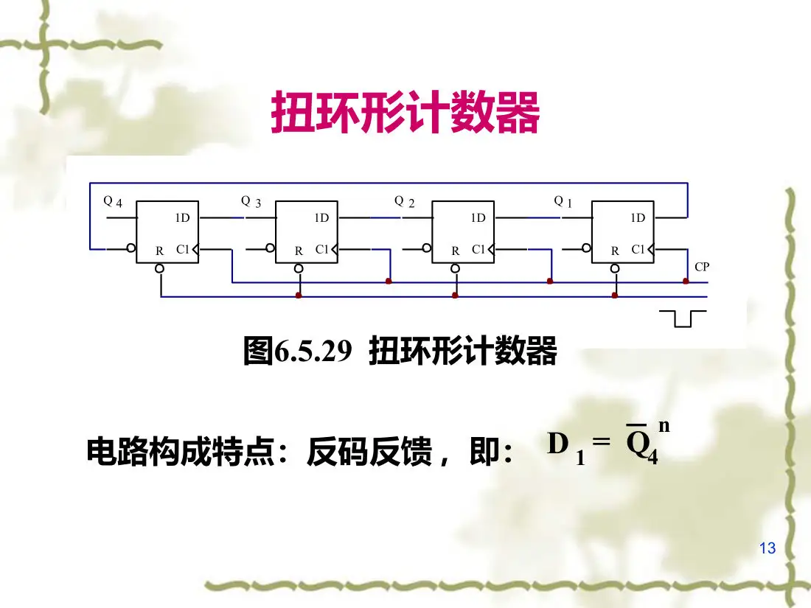

原文：

扭环形计数器

电路构成特点：反码反馈，即： $D_{1}=\overline{Q}_{4}^{n}$

13

### 结论: (1) n位触发器可实现模M=2n的扭环形计数器。

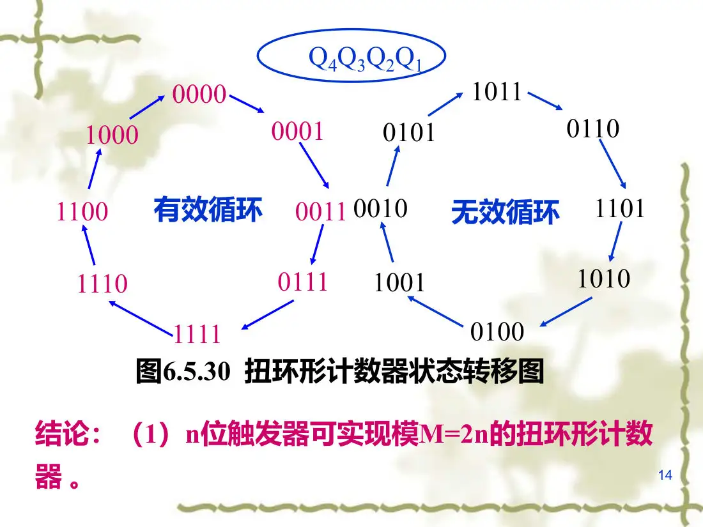

原文：

结论: (1) n位触发器可实现模M=2n的扭环形计数器。

14

### 用MSI移存器构成环形或扭环形计数器。

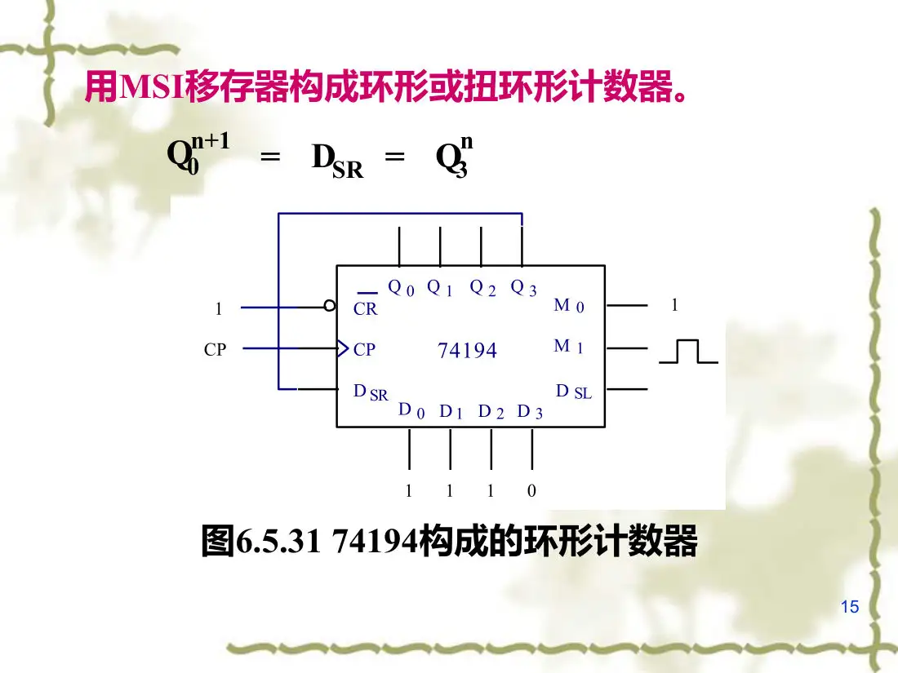

原文：

用MSI移存器构成环形或扭环形计数器。

$$
\mathbf {Q} _ {0} ^ {\mathrm{n+1}} = \mathbf {D} _ {\mathrm{SR}} = \mathbf {Q} _ {3} ^ {\mathrm{n}}
$$

15

### 表6.5.17 图6.5.31电路的状态转移表

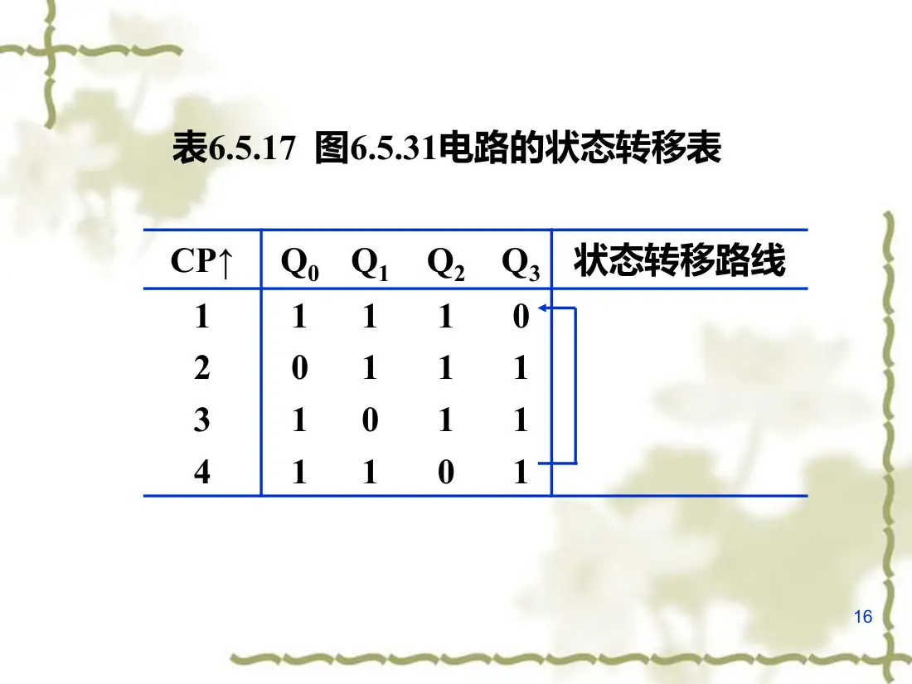

原文：

表6.5.17 图6.5.31电路的状态转移表
<table><tr><td>CP↑</td><td> $Q_0$ </td><td> $Q_1$ </td><td> $Q_2$ </td><td> $Q_3$ </td><td>状态转移路线</td></tr><tr><td>1</td><td>1</td><td>1</td><td>1</td><td>0</td><td rowspan="4"></td></tr><tr><td>2</td><td>0</td><td>1</td><td>1</td><td>1</td></tr><tr><td>3</td><td>1</td><td>0</td><td>1</td><td>1</td></tr><tr><td>4</td><td>1</td><td>1</td><td>0</td><td>1</td></tr></table>

16

### 6.6 序列码发生器

原文：

6.6 序列码发生器

序列码：周期性重复出现的一串数码称为序列码。例：10110 10110 .....

循环长度：一个周期内数码的个数称为序列长度。

序列码电路：产生序列码的电路。

结构类型：

计数型序列码发生器
移存型序列码发生器

17

### 计数型序列码发生器

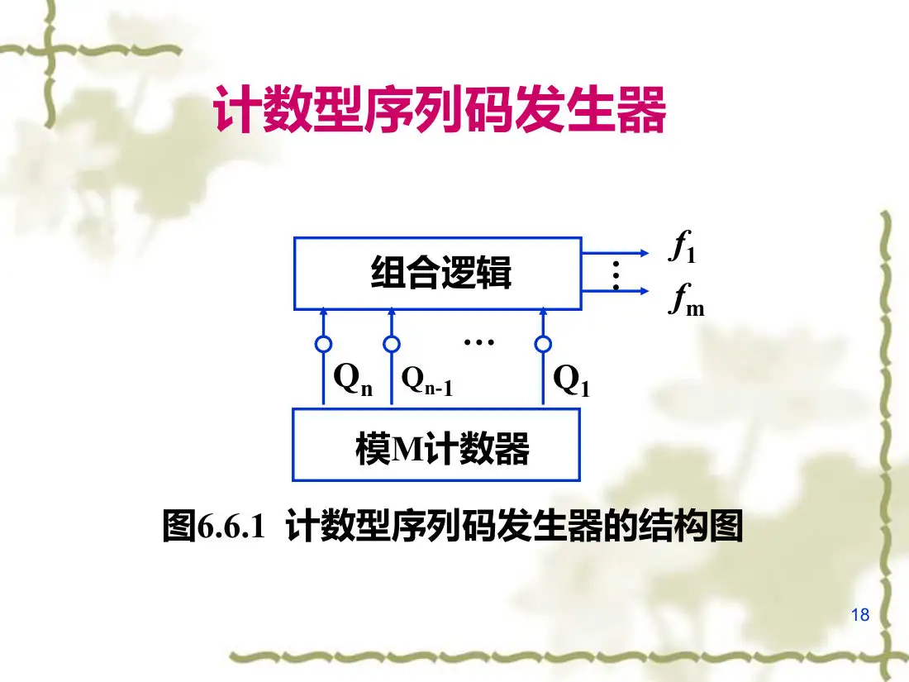

原文：

计数型序列码发生器

18

### 计数型序列码发生器的设计

原文：

计数型序列码发生器的设计

设计步骤:

先设计模值为序列长度的计数器

再设计一组合电路，其输入为计数器各触发器的输出 $Q_{i}$ ，输出为序列码F。

19

### 解：方法一：用小规模器件实现

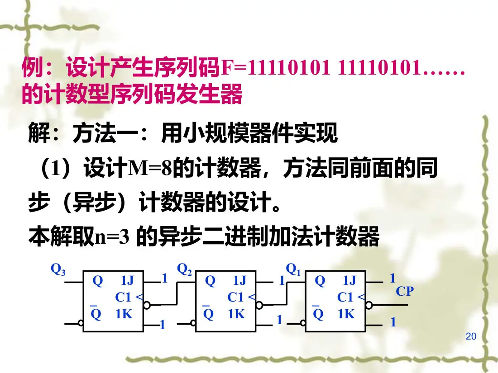

原文：

例：设计产生序列码F=11110101 11110101......的计数型序列码发生器

解：方法一：用小规模器件实现

(1) 设计M=8的计数器，方法同前面的同步（异步）计数器的设计。

本解取n=3 的异步二进制加法计数器

20

### (2) 设计组合电路

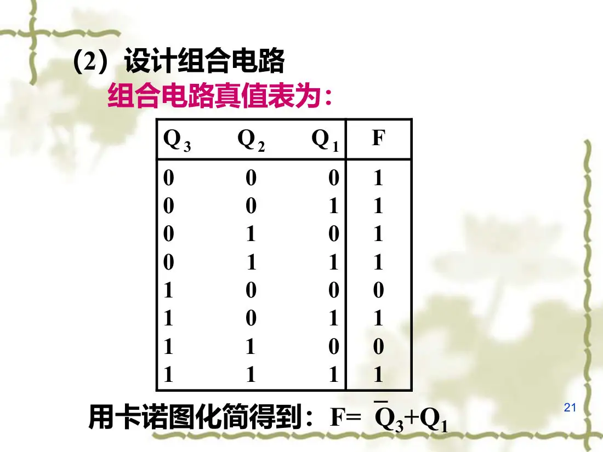

原文：

(2) 设计组合电路

组合电路真值表为:

<table><tr><td> $Q_3$ </td><td> $Q_2$ </td><td> $Q_1$ </td><td>F</td></tr><tr><td>0</td><td>0</td><td>0</td><td>1</td></tr><tr><td>0</td><td>0</td><td>1</td><td>1</td></tr><tr><td>0</td><td>1</td><td>0</td><td>1</td></tr><tr><td>0</td><td>1</td><td>1</td><td>1</td></tr><tr><td>1</td><td>0</td><td>0</td><td>0</td></tr><tr><td>1</td><td>0</td><td>1</td><td>1</td></tr><tr><td>1</td><td>1</td><td>0</td><td>0</td></tr><tr><td>1</td><td>1</td><td>1</td><td>1</td></tr></table>

用卡诺图化简得到： $F= \overline{Q}_{3}+Q_{1}$

21

### 用卡诺图化简得到： $F = \overline{Q}_{3} + Q_{1}$

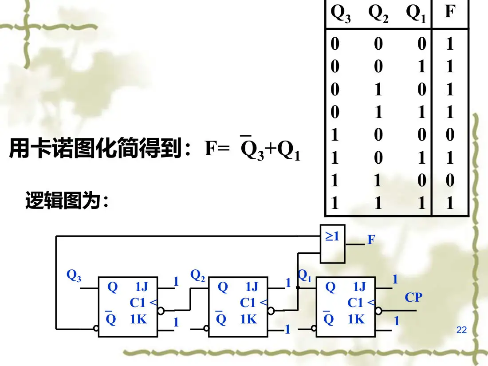

原文：

用卡诺图化简得到： $F = \overline{Q}_{3} + Q_{1}$

逻辑图为:

<table><tr><td> $Q_3$ </td><td> $Q_2$ </td><td> $Q_1$ </td><td>F</td></tr><tr><td>0</td><td>0</td><td>0</td><td>1</td></tr><tr><td>0</td><td>0</td><td>1</td><td>1</td></tr><tr><td>0</td><td>1</td><td>0</td><td>1</td></tr><tr><td>0</td><td>1</td><td>1</td><td>1</td></tr><tr><td>1</td><td>0</td><td>0</td><td>0</td></tr><tr><td>1</td><td>0</td><td>1</td><td>1</td></tr><tr><td>1</td><td>1</td><td>0</td><td>0</td></tr><tr><td>1</td><td>1</td><td>1</td><td>1</td></tr></table>

22

### 方法二、用中规模器件MSI实现。

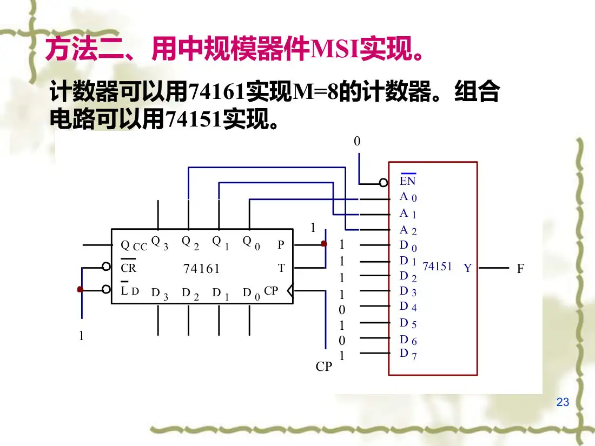

原文：

方法二、用中规模器件MSI实现。

计数器可以用74161实现M=8的计数器。组合电路可以用74151实现。

23

### 6.7 顺序脉冲发生器

原文：

6.7 顺序脉冲发生器

作用：在数字系统中，需要一种分配器产生节拍信号，这种节拍控制信号就是一种顺序脉冲：按时间顺序依次出现的一组高电平（低电平）的顺序信号。

能够产生这种顺序脉冲的电路是称为顺序脉冲发生器。

24

### 3.顺序脉冲发生器的设计

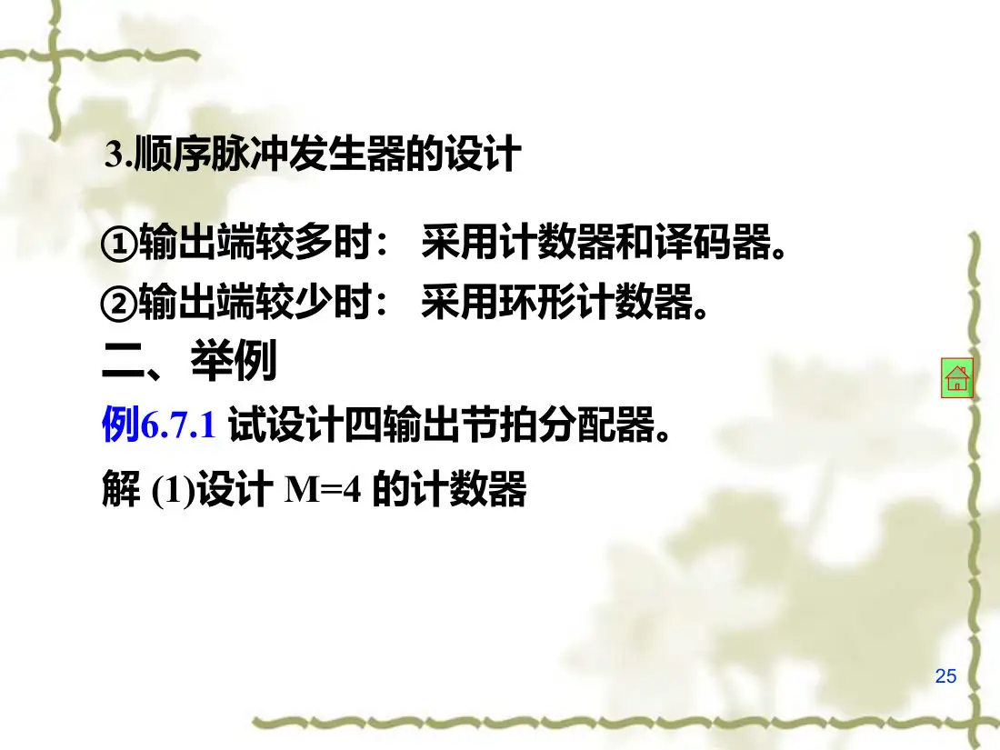

原文：

3.顺序脉冲发生器的设计

①输出端较多时：采用计数器和译码器。

②输出端较少时：采用环形计数器。

二、举例

例6.7.1 试设计四输出节拍分配器。

解 (1)设计 M=4 的计数器

25

### 表6.7.1 2-4线译码器的真值表

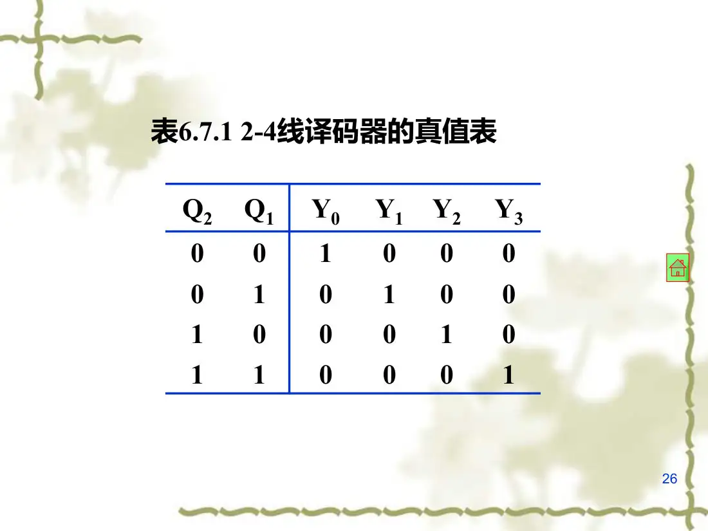

原文：

表6.7.1 2-4线译码器的真值表
<table><tr><td> $Q_2$ </td><td> $Q_1$ </td><td> $Y_0$ </td><td> $Y_1$ </td><td> $Y_2$ </td><td> $Y_3$ </td></tr><tr><td>0</td><td>0</td><td>1</td><td>0</td><td>0</td><td>0</td></tr><tr><td>0</td><td>1</td><td>0</td><td>1</td><td>0</td><td>0</td></tr><tr><td>1</td><td>0</td><td>0</td><td>0</td><td>1</td><td>0</td></tr><tr><td>1</td><td>1</td><td>0</td><td>0</td><td>0</td><td>1</td></tr></table>

26

### (一) 由四进制计数器(JK 触发器)和译码器构成

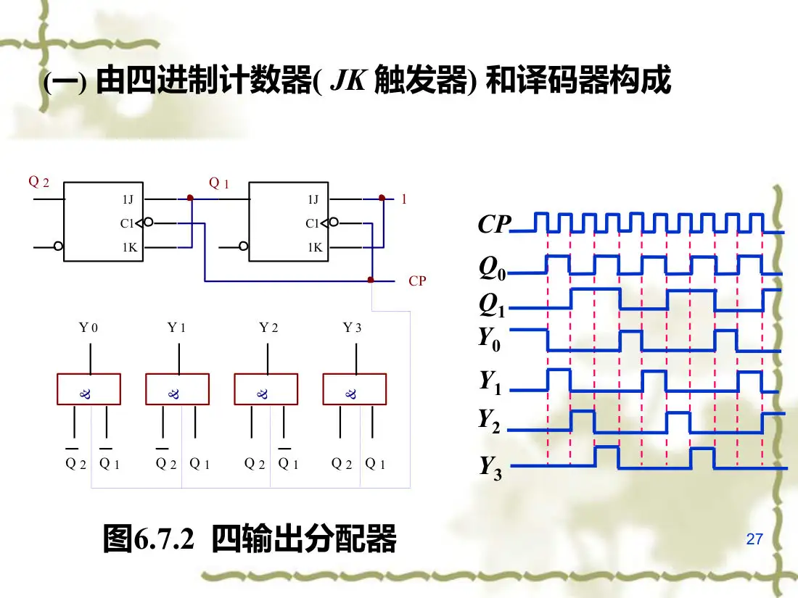

原文：

(一) 由四进制计数器(JK 触发器)和译码器构成

27

### 例1 由M=4环形计数器实现四输出节拍分配器。

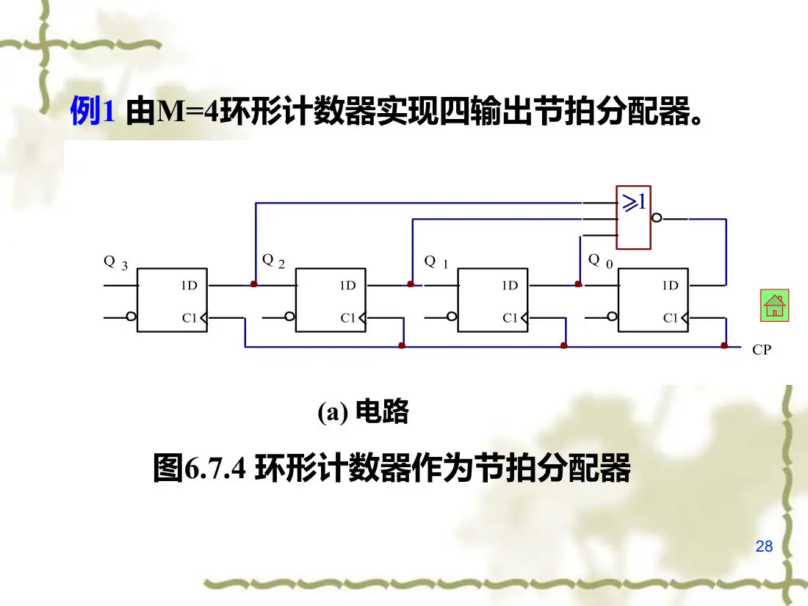

原文：

例1 由M=4环形计数器实现四输出节拍分配器。

28

### 29

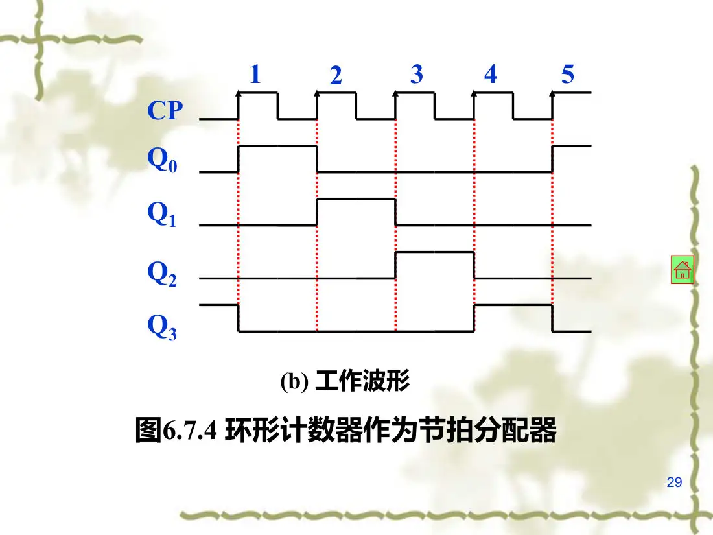

原文：

29

### 第 30 页

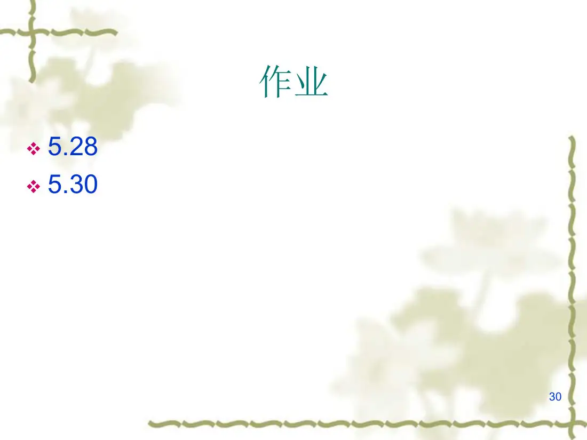

### $$

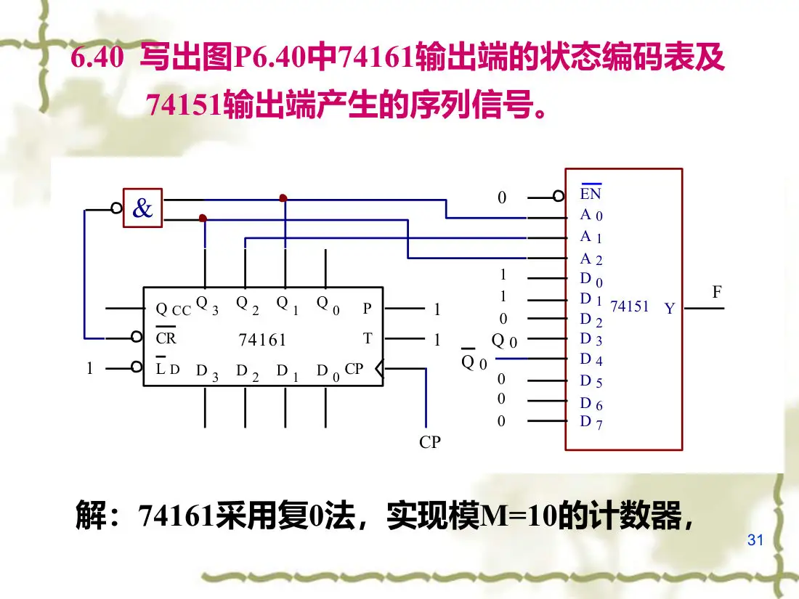

原文：

6.40 写出图P6.40中74161输出端的状态编码表及74151输出端产生的序列信号。

$$
\begin{array}{c c c} \text { & } & 0 & \text { EN } \\ & \text { A   0 } \\ & \text { A   1 } \\ & \text { A   2 } \\ & \text { D   0 } \\ & \text { D   1 } \\ & \text { D   2 } \\ & \text { D   3 } \\ & \text { D   4 } \\ & \text { D   5 } \\ & \text { D   6 } \\ & \text { D   7 } \\ & \text { F } \\ & \text { CP } \\ & \text { QCCQ3Q2Q1Q0P} \\ & \text { CR74161T} \\ & \text { LD D3D2D1D0CP} \\ & \end{array}
$$

解：74161采用复0法，实现模M=10的计数器，

31

### $$

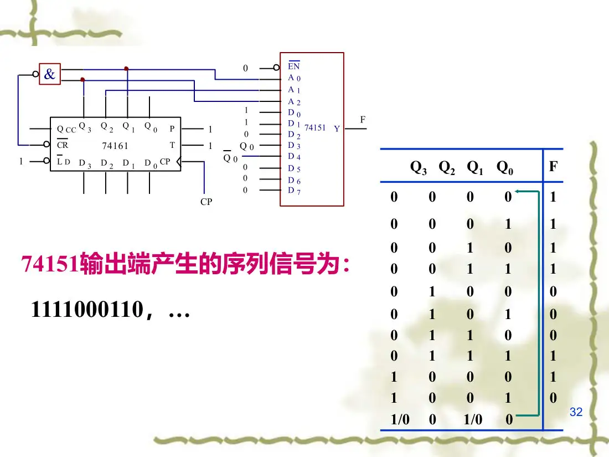

原文：

$$
\begin{array}{c c c} \text { & } & 0 & \text { EN } \\ & 1 & \text { A   0 } \\ & Q _ {C C} Q _ {3} Q _ {2} Q _ {1} Q _ {0} P & 1 \\ & \overline {{C R}} 7 4 1 6 1 T & 1 \\ & \overline {{L D}} D _ {3} D _ {2} D _ {1} D _ {0} C P & \overline {{Q}} _ {0} \\ & & C P \end{array} \quad \begin{array}{c c c} \text { Y } & F \\ & D 1 & 7 4 1 5 1 \\ & D 2 & D 3 \\ & D 4 & D 5 \\ & D 6 & D 7 \end{array}
$$

74151输出端产生的序列信号为:
1111000110, ...

<table><tr><td></td><td> $Q_3$ </td><td> $Q_2$ </td><td> $Q_1$ </td><td> $Q_0$ </td><td>F</td></tr><tr><td>0</td><td>0</td><td>0</td><td>0</td><td>0</td><td>1</td></tr><tr><td>0</td><td>0</td><td>0</td><td>1</td><td>1</td><td>1</td></tr><tr><td>0</td><td>0</td><td>1</td><td>0</td><td>1</td><td>1</td></tr><tr><td>0</td><td>0</td><td>1</td><td>1</td><td>1</td><td>1</td></tr><tr><td>0</td><td>1</td><td>0</td><td>0</td><td>0</td><td>0</td></tr><tr><td>0</td><td>1</td><td>0</td><td>1</td><td>0</td><td>0</td></tr><tr><td>0</td><td>1</td><td>1</td><td>0</td><td>0</td><td>0</td></tr><tr><td>0</td><td>1</td><td>1</td><td>1</td><td>1</td><td>1</td></tr><tr><td>1</td><td>0</td><td>0</td><td>0</td><td>1</td><td>1</td></tr><tr><td>1</td><td>0</td><td>0</td><td>1</td><td>0</td><td>0</td></tr><tr><td>1/0</td><td>0</td><td>1/0</td><td>0</td><td></td><td></td></tr></table>

### $$

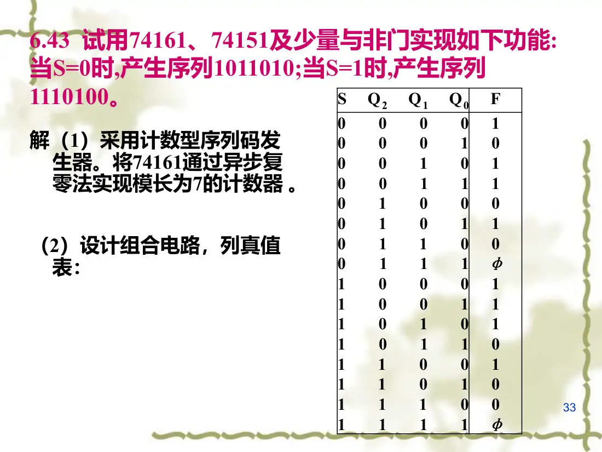

原文：

6.43 试用74161、74151及少量与非门实现如下功能: 当S=0时,产生序列1011010;当S=1时,产生序列

$$
1 1 1 0 1 0 0
$$

解（1）采用计数型序列码发生器。将74161通过异步复零法实现模长为7的计数器。

(2) 设计组合电路，列真值表：

<table><tr><td>S</td><td> $Q_2$ </td><td> $Q_1$ </td><td> $Q_0$ </td><td>F</td></tr><tr><td>0</td><td>0</td><td>0</td><td>0</td><td>1</td></tr><tr><td>0</td><td>0</td><td>0</td><td>1</td><td>0</td></tr><tr><td>0</td><td>0</td><td>1</td><td>0</td><td>1</td></tr><tr><td>0</td><td>0</td><td>1</td><td>1</td><td>1</td></tr><tr><td>0</td><td>1</td><td>0</td><td>0</td><td>0</td></tr><tr><td>0</td><td>1</td><td>0</td><td>1</td><td>1</td></tr><tr><td>0</td><td>1</td><td>1</td><td>0</td><td>0</td></tr><tr><td>0</td><td>1</td><td>1</td><td>1</td><td> $\phi$ </td></tr><tr><td>1</td><td>0</td><td>0</td><td>0</td><td>1</td></tr><tr><td>1</td><td>0</td><td>0</td><td>1</td><td>1</td></tr><tr><td>1</td><td>0</td><td>1</td><td>0</td><td>1</td></tr><tr><td>1</td><td>0</td><td>1</td><td>1</td><td>0</td></tr><tr><td>1</td><td>1</td><td>0</td><td>0</td><td>1</td></tr><tr><td>1</td><td>1</td><td>0</td><td>1</td><td>0</td></tr><tr><td>1</td><td>1</td><td>1</td><td>0</td><td>0</td></tr><tr><td>1</td><td>1</td><td>1</td><td>1</td><td> $\phi$ </td></tr></table>

33

### 34

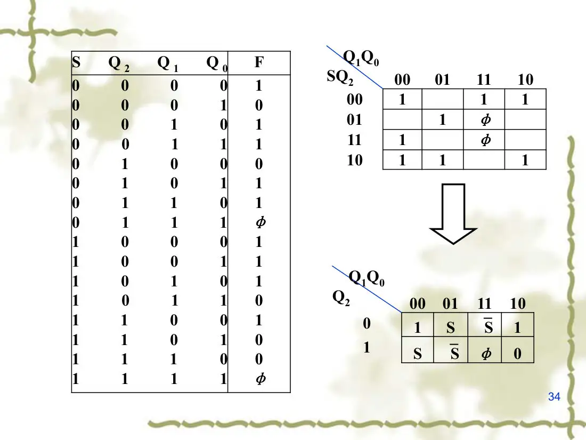

原文：

<table><tr><td>S</td><td> $Q_{2}$ </td><td> $Q_{1}$ </td><td> $Q_{0}$ </td><td>F</td></tr><tr><td>0</td><td>0</td><td>0</td><td>0</td><td>1</td></tr><tr><td>0</td><td>0</td><td>0</td><td>1</td><td>0</td></tr><tr><td>0</td><td>0</td><td>1</td><td>0</td><td>1</td></tr><tr><td>0</td><td>0</td><td>1</td><td>1</td><td>1</td></tr><tr><td>0</td><td>1</td><td>0</td><td>0</td><td>0</td></tr><tr><td>0</td><td>1</td><td>0</td><td>1</td><td>1</td></tr><tr><td>0</td><td>1</td><td>1</td><td>0</td><td>1</td></tr><tr><td>0</td><td>1</td><td>1</td><td>1</td><td> $\phi$ </td></tr><tr><td>1</td><td>0</td><td>0</td><td>0</td><td>1</td></tr><tr><td>1</td><td>0</td><td>0</td><td>1</td><td>1</td></tr><tr><td>1</td><td>0</td><td>1</td><td>0</td><td>1</td></tr><tr><td>1</td><td>0</td><td>1</td><td>1</td><td>0</td></tr><tr><td>1</td><td>1</td><td>0</td><td>0</td><td>1</td></tr><tr><td>1</td><td>1</td><td>0</td><td>1</td><td>0</td></tr><tr><td>1</td><td>1</td><td>1</td><td>0</td><td>0</td></tr><tr><td>1</td><td>1</td><td>1</td><td>1</td><td> $\phi$ </td></tr></table>

<table><tr><td>SQ2\Q1Q0</td><td>00</td><td>01</td><td>11</td><td>10</td></tr><tr><td>00</td><td>1</td><td></td><td>1</td><td>1</td></tr><tr><td>01</td><td></td><td>1</td><td> $\phi$ </td><td></td></tr><tr><td>11</td><td>1</td><td></td><td> $\phi$ </td><td></td></tr><tr><td>10</td><td>1</td><td>1</td><td></td><td>1</td></tr></table>

<table><tr><td colspan="5">Q1Q0</td></tr><tr><td>Q2</td><td>00</td><td>01</td><td>11</td><td>10</td></tr><tr><td>0</td><td>1</td><td>S</td><td> $\overline{S}$ </td><td>1</td></tr><tr><td>1</td><td>S</td><td> $\overline{S}$ </td><td> $\phi$ </td><td>0</td></tr></table>

34

### 35

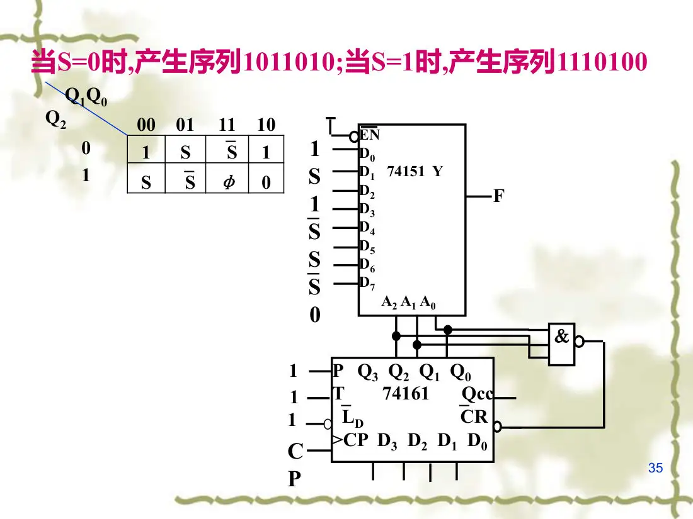

原文：

当S=0时,产生序列1011010;当S=1时,产生序列1110100 $Q_{1}Q_{0}$

<table><tr><td>Q2</td><td>00</td><td>01</td><td>11</td><td>10</td></tr><tr><td>0</td><td>1</td><td>S</td><td> $\overline{S}$ </td><td>1</td></tr><tr><td>1</td><td>S</td><td> $\overline{S}$ </td><td> $\phi$ </td><td>0</td></tr></table>

35

### 第 36 页

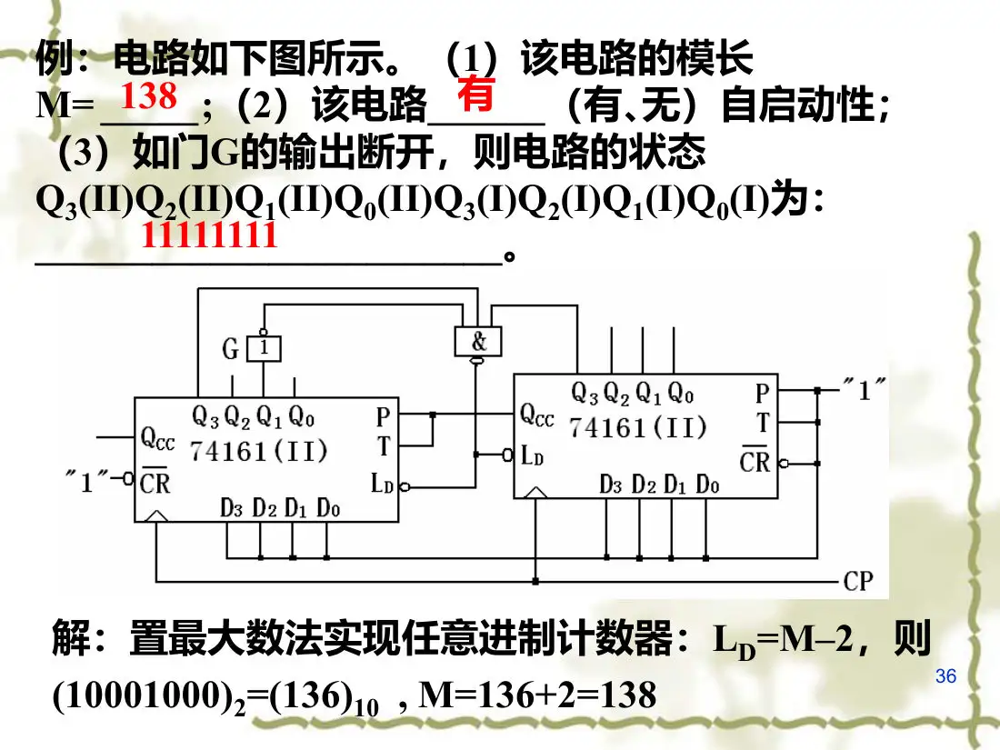

原文：

例: 电路如下图所示。(1) 该电路的模长 $\mathrm{M} = 138$ ; (2) 该电路有 (有、无) 自启动性;

(3) 如门G的输出断开, 则电路的状态 $Q_{3} ( \mathrm{II}) Q_{2} ( \mathrm{II}) Q_{1} ( \mathrm{II}) Q_{0} ( \mathrm{II}) Q_{3} ( \mathrm{I}) Q_{2} ( \mathrm{I}) Q_{1} ( \mathrm{I}) Q_{0} ( \mathrm{I})$ 为: 11111111。

解：置最大数法实现任意进制计数器： $L_{D}=M-2$ ，则 $(10001000)_{2}=(136)_{10}$ ，M=136+2=138

### 37

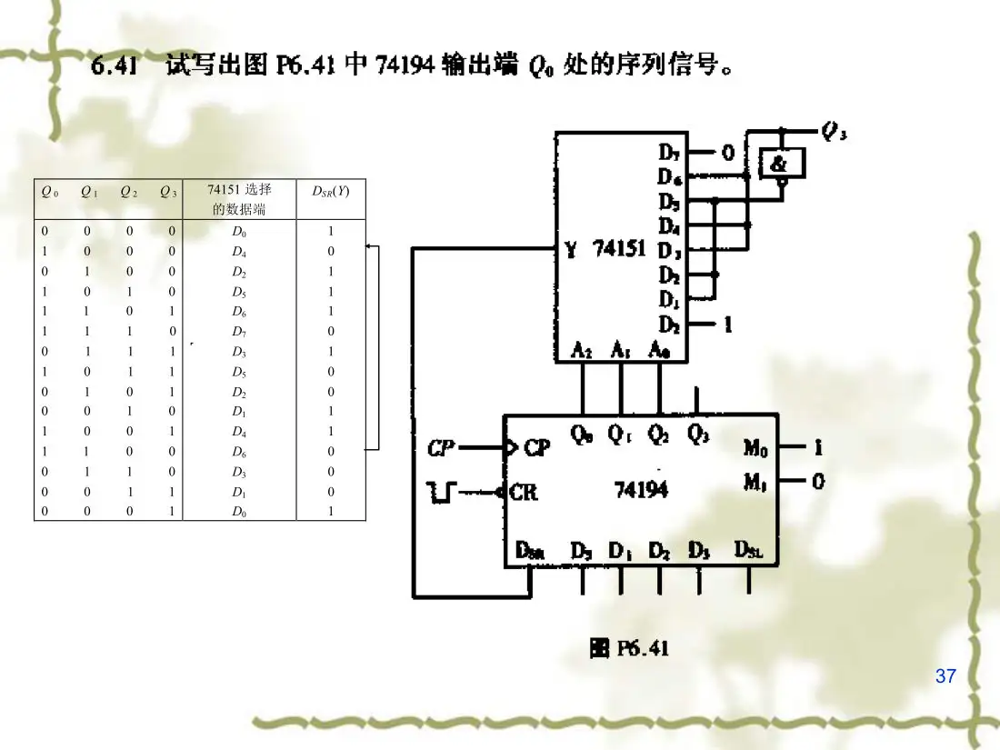

原文：

6.41 试写出图 P6.41 中 74194 输出端 $Q_{0}$ 处的序列信号。

<table><tr><td> $Q_{0}$ </td><td> $Q_{1}$ </td><td> $Q_{2}$ </td><td> $Q_{3}$ </td><td>74151 选择的数据端</td><td> $D_{SR}(Y)$ </td></tr><tr><td>0</td><td>0</td><td>0</td><td>0</td><td> $D_{0}$ </td><td>1</td></tr><tr><td>1</td><td>0</td><td>0</td><td>0</td><td> $D_{4}$ </td><td>0</td></tr><tr><td>0</td><td>1</td><td>0</td><td>0</td><td> $D_{2}$ </td><td>1</td></tr><tr><td>1</td><td>0</td><td>1</td><td>0</td><td> $D_{5}$ </td><td>1</td></tr><tr><td>1</td><td>1</td><td>0</td><td>1</td><td> $D_{6}$ </td><td>1</td></tr><tr><td>1</td><td>1</td><td>1</td><td>0</td><td> $D_{7}$ </td><td>0</td></tr><tr><td>0</td><td>1</td><td>1</td><td>1</td><td> $D_{3}$ </td><td>1</td></tr><tr><td>1</td><td>0</td><td>1</td><td>1</td><td> $D_{5}$ </td><td>0</td></tr><tr><td>0</td><td>1</td><td>0</td><td>1</td><td> $D_{2}$ </td><td>0</td></tr><tr><td>0</td><td>0</td><td>1</td><td>0</td><td> $D_{1}$ </td><td>1</td></tr><tr><td>1</td><td>0</td><td>0</td><td>1</td><td> $D_{4}$ </td><td>1</td></tr><tr><td>1</td><td>1</td><td>0</td><td>0</td><td> $D_{6}$ </td><td>0</td></tr><tr><td>0</td><td>1</td><td>1</td><td>0</td><td> $D_{3}$ </td><td>0</td></tr><tr><td>0</td><td>0</td><td>1</td><td>1</td><td> $D_{1}$ </td><td>0</td></tr><tr><td>0</td><td>0</td><td>0</td><td>1</td><td> $D_{0}$ </td><td>1</td></tr></table>

37

### $Q_{0}$ 处的序列信号为：10111010011000。

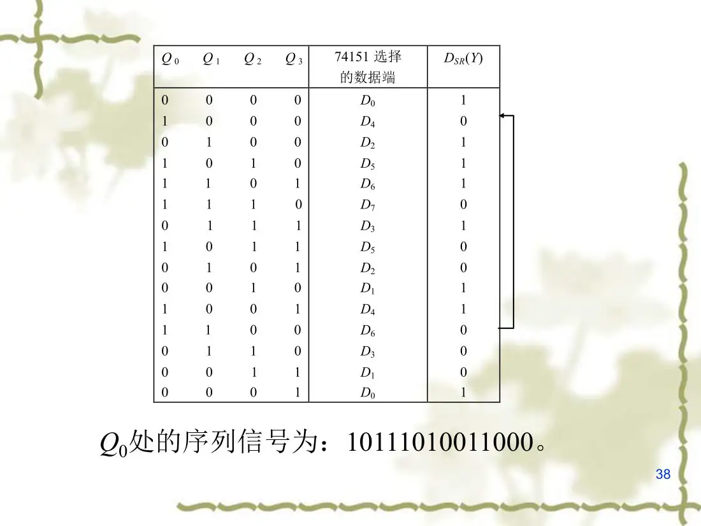

原文：

<table><tr><td> $Q_0$ </td><td> $Q_1$ </td><td> $Q_2$ </td><td> $Q_3$ </td><td>74151 选择的数据端</td><td> $D_{SR}(Y)$ </td></tr><tr><td>0</td><td>0</td><td>0</td><td>0</td><td> $D_0$ </td><td>1</td></tr><tr><td>1</td><td>0</td><td>0</td><td>0</td><td> $D_4$ </td><td>0</td></tr><tr><td>0</td><td>1</td><td>0</td><td>0</td><td> $D_2$ </td><td>1</td></tr><tr><td>1</td><td>0</td><td>1</td><td>0</td><td> $D_5$ </td><td>1</td></tr><tr><td>1</td><td>1</td><td>0</td><td>1</td><td> $D_6$ </td><td>1</td></tr><tr><td>1</td><td>1</td><td>1</td><td>0</td><td> $D_7$ </td><td>0</td></tr><tr><td>0</td><td>1</td><td>1</td><td>1</td><td> $D_3$ </td><td>1</td></tr><tr><td>1</td><td>0</td><td>1</td><td>1</td><td> $D_5$ </td><td>0</td></tr><tr><td>0</td><td>1</td><td>0</td><td>1</td><td> $D_2$ </td><td>0</td></tr><tr><td>0</td><td>0</td><td>1</td><td>0</td><td> $D_1$ </td><td>1</td></tr><tr><td>1</td><td>0</td><td>0</td><td>1</td><td> $D_4$ </td><td>1</td></tr><tr><td>1</td><td>1</td><td>0</td><td>0</td><td> $D_6$ </td><td>0</td></tr><tr><td>0</td><td>1</td><td>1</td><td>0</td><td> $D_3$ </td><td>0</td></tr><tr><td>0</td><td>0</td><td>1</td><td>1</td><td> $D_1$ </td><td>0</td></tr><tr><td>0</td><td>0</td><td>0</td><td>1</td><td> $D_0$ </td><td>1</td></tr></table>

$Q_{0}$ 处的序列信号为：10111010011000。

38
