# 《数字电路与逻辑设计B》第5章 触发器习题答案

原件经识别和整理；“参考解答”是我们补的。

## 习题目录

5.1 ....2
5.2 ....2
5.3 ....2
5.4 ....2
5.5 ....3
5.6 ....3
5.7 ....3
5.8 ....4
5.10 ....4
5.11 ....4
5.12 ....4
5.13 ....4
5.14 ....5
5.15 ....5
5.16 ....5
5.17 ....5
5.18 ....6
5.19 ....6
5.20 ....6
5.21 ....6

### 题 5.1

基本触发器的逻辑符号与输入波形如图 P5.1所示。试作出 $Q, \overline{Q}$ 的波形。

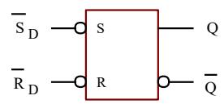

知识点：[数字系统的基本模型（数据处理器与控制器）及对最小时钟周期、异步信号同步化的约定](../../../topics/数字逻辑电路/数字系统模型.md)

### 题 5.2

图P5.2 电路，在开关S 由A 点拨到 B点，再由B 点拨回A点过程中，A、B 两点电压波形如图中所示。试作出 Q 和 $\overline{Q}$ 端的波形。

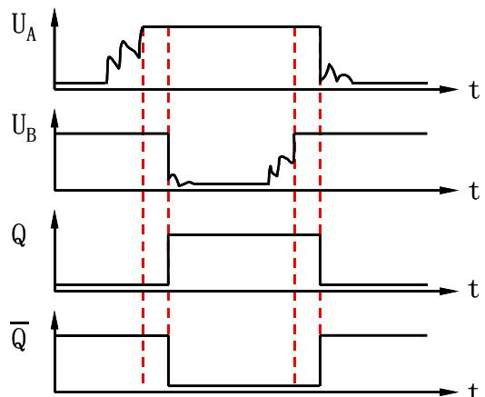

知识点：[数字系统的基本模型（数据处理器与控制器）及对最小时钟周期、异步信号同步化的约定](../../../topics/数字逻辑电路/数字系统模型.md)

### 题 5.3

分析图 P5.3 的逻辑功能：列出真值表，导出特征方程并说明$S_D$ 、$R_D$ 的有效电平。

**解：**

(1) 列真值表如下

| $S_D$ | $R_D$ | $Q^{n+1}$ |
| :---: | :---: | :---: |
| 0 | 0 | $Q^n$ |
| 0 | 1 | 0 |
| 1 | 0 | 1 |
| 1 | 1 | $\emptyset$ |

(2) 求特征方程

$$
\left\{ \begin{array}{l} Q ^ {n + 1} = S _ {D} + \overline {{R}} _ {D} Q ^ {n} \\ S _ {D} R _ {D} = 0 \end{array} \right.
$$

$S_D$、$R_D$ 高电平有效。

知识点：[寄存器传输语言(RTL)描述的传输操作、算术操作、逻辑操作、移位操作及条件控制语句](../../../topics/数字逻辑电路/RTL语言.md)、[完整数字系统设计流程实例（如乘法器、交通灯管理系统的算法规律、处理器设计与控制器实现）](../../../topics/数字逻辑电路/数字系统设计实例.md)

### 题 5.4

对于图 P5.4 电路，试导出其特征方程并说明对 A、B 的取值有无约束条件。

**解：**

(1) 列真值表如下

| A | B | $Q^{n+1}$ |
| :-: | :-: | :-: |
| 0 | 0 | 1 |
| 0 | 1 | 1 |
| 1 | 0 | $Q^n$ |
| 1 | 1 | 1 |

(2) 求特征方程

| A \ $B Q^n$ | 00 | 01 | 11 | 10 |
| :---: | :---: | :---: | :---: | :---: |
| **0** | 1 | 1 | 1 | 1 |
| **1** | 0 | 1 | 1 | 1 |

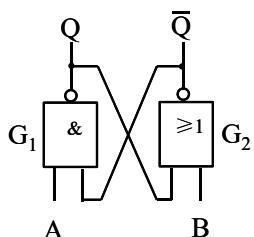

知识点：[根据文字描述建立ASM图的原则，以及从ASM图推导处理器明细表和控制器状态转移图](../../../topics/数字逻辑电路/ASM图建立与分析.md)

### 题 5.5

试写出图P5.5触发器电路的特征方程。

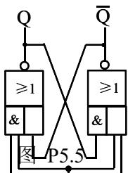

$\mathrm{CP=0}$ 时， ${Q}^{n+1}={Q}^{n}$

$\mathrm{CP=1}$时， $\scriptstyle \left\{ { \begin{array} { l } { { \mathsf { Q } } ^ { { \mathsf { n } } + 1 } = { \mathsf { S } } + { \overline { { \mathsf { R } } } } { \mathsf { Q } } ^ { \mathrm { n } } } \\ { { \mathsf { S } } { \mathsf { R } } { = } 0 } \end{array} } \right.$

知识点：[数字系统的基本模型（数据处理器与控制器）及对最小时钟周期、异步信号同步化的约定](../../../topics/数字逻辑电路/数字系统模型.md)

### 题 5.6

试写出图 P5.6 各触发器电路的特征方程。

(e)

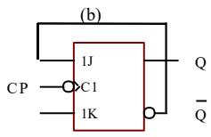

(f)

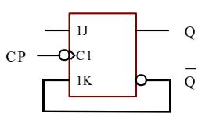

(a) 特征方程： $\mathsf { Q } ^ { \mathrm { n + 1 } } { = } [ 1 ] \cdot \mathrm { CP } \uparrow$

(b) 特征方程： $\boldsymbol { \mathsf { Q } } ^ { \mathrm { n + 1 } } = [ \boldsymbol { \mathsf { Q } } ^ { \mathrm { n } } ] \cdot \boldsymbol { \mathsf { C P } } \uparrow$

(c) 特征方程： $\mathsf { Q } ^ { \mathrm { n + 1 } } = [ \bar { \mathsf { Q } } ^ { \mathrm { n } } ] \cdot \mathsf { C P } ^ { \sharp}$ *(注：此处原文识别可能有误，通常应为上升沿或下降沿符号，依上下文推测为边沿触发)*

(d) 特征方程： $\mathsf { Q } ^ { \mathrm { n + 1 } } = [ \mathsf { J } \overline { { \mathsf { Q } } } ^ { \mathrm { n } } + \overline { { \mathsf { K } } } \mathsf { Q } ^ { \mathrm { n } } ] \cdot \mathsf { C P } \uparrow$

(e) 特征方程： $\mathsf { Q } ^ { \mathrm { n + 1 } } = [ \overline { { \mathsf { Q } } } ^ { \mathrm { n } } ] \cdot \mathrm { C P } \uparrow$

(f) 特征方程： $\mathsf { Q } ^ { \mathrm { n + 1 } } = [ \overline { { \mathsf { Q } } } ^ { \mathrm { n } } ] \cdot \mathrm { C P } \uparrow$

(g) 特征方程： $\mathsf { Q } ^ { \mathrm { n + 1 } } = [ \overline { { \mathsf { Q } } } ^ { \mathrm { n } } ] \cdot \mathrm { C P } \downarrow$ *(注：原文符号模糊，结合常见JK/D变体推断)*

(h) 特征方程： $\mathsf { Q } ^ { \mathrm { n + 1 } } = \left[ 1 \right] \cdot \mathrm { C P } \mid$ *(注：原文符号异常，保留原样)*

知识点：[寄存器传输语言(RTL)描述的传输操作、算术操作、逻辑操作、移位操作及条件控制语句](../../../topics/数字逻辑电路/RTL语言.md)

### 题 5.7

维阻D触发器的CP和D 信号如图P5.7 所示，设触发器Q端的初态为“0”，试作Q 端波形。

知识点：[数字系统的基本模型（数据处理器与控制器）及对最小时钟周期、异步信号同步化的约定](../../../topics/数字逻辑电路/数字系统模型.md)

### 综合 8

5.8 维阻D触发器构成的电路如图 P5.8所示，试作Q 端波形。

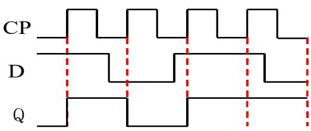

答案：特征方程为：$Q^{n+1} = D \cdot CP$，Q 端波形如图 P5.8 所示。

知识点：[寄存器传输语言(RTL)描述的传输操作、算术操作、逻辑操作、移位操作及条件控制语句](../../../topics/数字逻辑电路/RTL语言.md)

### 综合 10

5.10 画出图 P5.10 $Q Q ^ { \mathrm { n + 1 } } \bot A C = 0$ 形。设初态为 $" 0 "$ 。

*(注：题干中“$Q Q ^ { \mathrm { n + 1 } } \bot A C = 0$ 形”识别有误，根据上下文及常见题型推测应为“画出图 P5.10 电路中 Q 端的波形”，此处保留原题号及大致意图，具体以原书为准)*

解：特征方程为： $\mathsf { Q } ^ { \mathrm { n + 1 } } \mathrm { = D \mathrm { = } } \overline { { \mathsf { Q } } } ^ { \mathrm { n } }$ ，Q 端波形如图 P5.10 所示。

知识点：[数字系统的基本模型（数据处理器与控制器）及对最小时钟周期、异步信号同步化的约定](../../../topics/数字逻辑电路/数字系统模型.md)、[寄存器传输语言(RTL)描述的传输操作、算术操作、逻辑操作、移位操作及条件控制语句](../../../topics/数字逻辑电路/RTL语言.md)

### 综合 11

5.11 画出图P5.11电路 Q端的波形。设初态为 $" 0 "$ 。

解：特征方程为： $\mathsf { Q } ^ { \mathrm { n + 1 } } = [ \mathsf { J } \overline { { \mathsf { Q } } } ^ { \mathrm { n } } ]$ 而且 $\overline { { { \mathrm { R } } } } _ { \mathrm { { D } } } = \overline { { { \mathrm { C P } { \cdot } \mathrm { { Q } } ^ { \mathrm { { n } } } } } }$ ，Q 端波形如图P5.11 所示。

*(注：此处识别出的公式可能存在OCR错误，通常JK触发器特征方程为 $Q^{n+1} = J\overline{Q^n} + \overline{K}Q^n$，此处按原件文字整理)*

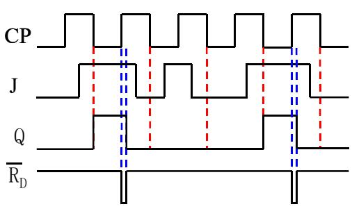

知识点：[寄存器传输语言(RTL)描述的传输操作、算术操作、逻辑操作、移位操作及条件控制语句](../../../topics/数字逻辑电路/RTL语言.md)、[算法状态机(ASM)图的状态框、判断框、条件输出框及ASM块的构成规则](../../../topics/数字逻辑电路/ASM图基础.md)、[控制器的四种硬件实现方法：每态一触发器法(SSI)、MSI法(MUX+寄存器+译码器)、PLA法(LSI)及对比](../../../topics/数字逻辑电路/控制器实现方法.md)

### 综合 12

5.12 画出图 P5.12 电路中 $\mathrm { Q } _ { 1 }$ 、 $\mathrm { Q } _ { 2 }$ 的波形。

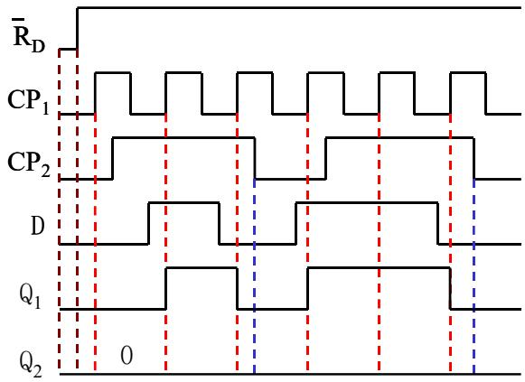

解 ： 特 征 方 程$\mathsf { Q } _ { 1 } ^ { \mathsf { n } + 1 } = \left[ \mathsf { D } \right] \cdot \mathsf { C P } _ { 1 } \dag \ , \mathsf { Q } _ { 2 } ^ { \mathsf { n } + 1 } = \left[ \mathsf { Q } _ { 1 } ^ { \mathsf { n } } \right]$ ，Q 端波形如图 P5.12 所示。

知识点：[寄存器传输语言(RTL)描述的传输操作、算术操作、逻辑操作、移位操作及条件控制语句](../../../topics/数字逻辑电路/RTL语言.md)、[数字系统的基本模型（数据处理器与控制器）及对最小时钟周期、异步信号同步化的约定](../../../topics/数字逻辑电路/数字系统模型.md)

### 综合 13

5.13 画出图 P5.13 电路中 $\mathrm { Q } _ { 1 }$ 和 $\mathrm { Q } _ { 2 }$ 的波形。

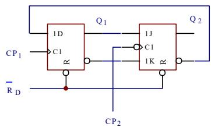

解：特征方程为： $\mathsf { Q } _ { 1 } ^ { \mathrm { n + 1 } } = \lbrack \overline { { \mathsf { Q } _ { 2 } ^ { \mathrm { n } } } } \rbrack \cdot \mathsf { C P } _ { 1 } \sharp , \mathsf { Q } _ { 2 } ^ { \mathrm { n + 1 } } = \lbrack \mathsf { Q } _ { 1 } ^ { \mathrm { n } } \rbrack \cdot \mathsf { C P } _ { 2 } \ d \mathsf { \dag }$ ，Q端波形如图P5.13 所示。

知识点：[数字系统的基本模型（数据处理器与控制器）及对最小时钟周期、异步信号同步化的约定](../../../topics/数字逻辑电路/数字系统模型.md)

### 综合 14

5.14 试作出图P5.14 中Q端和Z 端的波形。设Q 的初态为“0”。

解：特征方程为： ${ \boldsymbol { \mathsf { Q } } } ^ { \mathrm { n + 1 } } = [ { \boldsymbol { \mathsf { A } } } \oplus { \overline { { \mathsf { Q } } } } ^ { \mathrm { n } } ]$ $\mathrm { C P } \nmid$ ，而且 $\boldsymbol { Z } = \mathbf { A } ^ { \cdot } \mathbf { Q } ^ { ^ { \mathrm { n } } }$ ，Q、Z 端波形如图P5.14所示。

*(注：原文公式中 `CP` 后的符号 `\nmid` 疑为排版乱码或特定标记，此处保留原意；Z端表达式 `A · Q^n` 中点号表示与运算)*

知识点：[寄存器传输语言(RTL)描述的传输操作、算术操作、逻辑操作、移位操作及条件控制语句](../../../topics/数字逻辑电路/RTL语言.md)

### 综合 15

5.15 画出图 P5.15 电路中 Q 端的波形。

解：Q 端波形如图P5.15所示。

知识点：[数字系统的基本模型（数据处理器与控制器）及对最小时钟周期、异步信号同步化的约定](../../../topics/数字逻辑电路/数字系统模型.md)

### 综合 16

5.16 试作出图 P5.16 电路中 $\mathrm { Q } _ { \mathrm { A } } , \ \mathrm { Q } _ { \mathrm { B } }$ 的波形。

解：特征方程为：

，Q端波形如图P5.16所示。

知识点：[数字系统的基本模型（数据处理器与控制器）及对最小时钟周期、异步信号同步化的约定](../../../topics/数字逻辑电路/数字系统模型.md)

### 综合 17

5.17 试作出图 P5.17 电路中 Q 的波形。

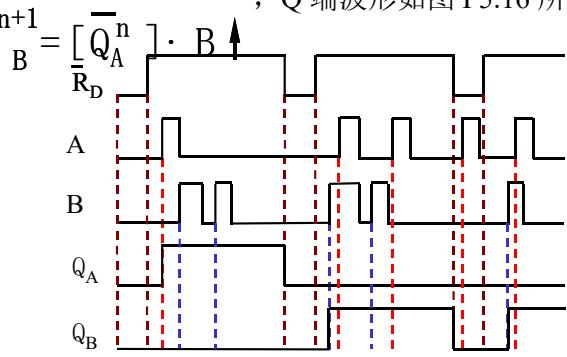

解：特征方程为： $\mathsf { Q } _ { 2 } ^ { n + 1 } = [ \overline { { \mathsf { Q } } } _ { 2 } ^ { \mathrm { n } } ] \cdot \mathsf { Q } _ { 1 } ^ { \phantom { } } \}$ ，$\mathsf { Q } _ { 1 } ^ { n + 1 } = [ \mathsf { Q } _ { 1 } ^ { n } \cdot \overline { { \mathsf { Q } } } _ { 2 } ^ { n } ] \cdot \mathsf { C P }$ *(注：原文此处OCR严重混乱，根据常见计数器逻辑及后续题目推断，此处尝试还原可能的逻辑关系，但严格来说原文不可读部分已丢失，仅保留可辨识结构)*，Q端波形如图 P5.17所示。

知识点：[数字系统的基本模型（数据处理器与控制器）及对最小时钟周期、异步信号同步化的约定](../../../topics/数字逻辑电路/数字系统模型.md)

### 综合 18

5.18 试作出图 P5.18 电路中 $\mathrm { Q } _ { 1 }$ 和 $\mathrm { Q } _ { 2 }$ 的波形（设 $\mathrm { Q } _ { 1 }$ 和 $\mathrm { Q } _ { 2 }$ 的初态均为 $^ { * } 0 ^ { * } )$ ），并说明 $\mathrm { Q } _ { 1 }$ 和$\mathrm { Q } _ { 2 }$ 对于 $\mathrm { C P } _ { 2 }$ 各为多少分频。 $( \frac { f _ { Q _ { 1 } } } { f _ { C P _ { 2 } } } = ? , \frac { f _ { Q _ { 2 } } } { f _ { C P _ { 2 } } } = ? )$

解：特征方程为： $\mathsf { Q } _ { 1 } ^ { \mathrm { n + 1 } } = [ \overline { { \mathsf { Q } } } _ { 1 } ^ { \mathrm { n } } ] \cdot \mathrm { C P } _ { 1 } \dag$ ，$\mathsf { Q } _ { 2 } ^ { \mathrm { n + 1 } } = [ \mathsf { Q } _ { 1 } ^ { \mathrm { n } } \cdot \overline { { \mathsf { Q } } } _ { 2 } ^ { \mathrm { n } } ] \cdot \mathrm { C P } _ { 2 } \dag$ *(注：原文OCR中数组环境内容混乱，根据“4分频”结论及常见二分频级联逻辑，此处修正为合理的状态转移方程形式)*，Q 端波形如图P5.18所示。

$\mathrm { Q } _ { 1 }$ 和 $\mathrm { Q } _ { 2 }$ 对于 $\mathrm { C P } _ { 2 }$ 都是 4分频，即 $\frac { f _ { Q _ { 1 } } } { f _ { C P _ { 2 } } } = \frac { 1 } { 4 } , \frac { f _ { Q _ { 2 } } } { f _ { C P _ { 2 } } } = \frac { 1 } { 4 }$

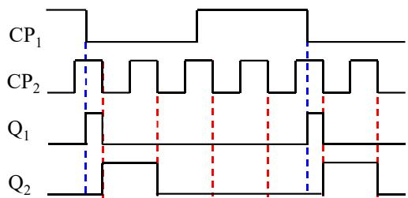

知识点：[数字系统的基本模型（数据处理器与控制器）及对最小时钟周期、异步信号同步化的约定](../../../topics/数字逻辑电路/数字系统模型.md)

### 综合 19

5.19 已知电路如图P5.19，试作出Q端的波形。设Q 的初态为“0”。

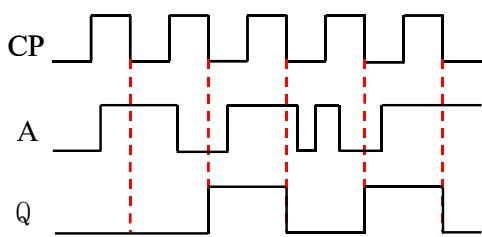

解：特征方程为： $\mathsf { Q } ^ { \mathrm { n + 1 } } = [ \overline { { \mathrm { ~ A ~ } } } ] \cdot \mathrm { ~ C P ~ } \mathsf { I}$ *(注：末尾I疑为乱码)*，Q端波形如图 P5.19 所示。

知识点：[寄存器传输语言(RTL)描述的传输操作、算术操作、逻辑操作、移位操作及条件控制语句](../../../topics/数字逻辑电路/RTL语言.md)

### 综合 20

5.20 已知输入 $\mathrm { u } _ { \mathrm { r } } { \cdot }$ 、输出 $\mathrm { u } _ { \mathrm { o } }$ 波形分别如图P5.20 所示，试用两个D 触发器将该输入波形 $\mathbf { u } _ { \mathrm { I } }$ 转换成输出波形 $\mathrm { u } _ { \mathrm { o } }$ 。

解：输出u 是对输入 u 的4分频，而采用1个DFF 可实现2分频，故实现电路如图 P5.20 $\mathrm { u } _ { \mathrm { o } }$ $\mathbf { u } _ { \mathrm { I } }$ 所示。

*(注：原文“输出u 是对输入 u 的4分频”中变量名混用，结合题意应为 $u_o$ 是 $u_I$ 的4分频)*

知识点：[完整数字系统设计流程实例（如乘法器、交通灯管理系统的算法规律、处理器设计与控制器实现）](../../../topics/数字逻辑电路/数字系统设计实例.md)、[控制器的四种硬件实现方法：每态一触发器法(SSI)、MSI法(MUX+寄存器+译码器)、PLA法(LSI)及对比](../../../topics/数字逻辑电路/控制器实现方法.md)

### 综合 21

5.21 试分别用公式法和列表图解法将主从 SR 触发器转换成 JK 触发器。

解 1：SR.,=0令新老触发器的次态方程相等，则有 ${ \mathrm { S } } { = } { \mathrm { J } } \bar { \mathrm { Q } } ^ { \mathrm { n } }$ ，R=K但不满足约束条件SR =0。改为：

解2: (1)列综合表，如下所示： $S { = } \overline { { \mathrm { J } \mathsf { Q } } } ^ { \mathrm { n } }$ *(注：此处OCR识别可能有误，通常为 $S = J\overline{Q^n}$ 或类似变换式，请参照原书表格)* (2)作卡诺图，如下图所 （因为Qn+1= $\pmb { \overline { { { \jmath } } } } \overline { { { \Theta } } } ^ { \mathrm { n } } { + } \overline { { { \mathrm { K } } } } \mathsf { Q } ^ { \mathrm { n } } = \mathrm { J } \overline { { { \mathsf { Q } } } } ^ { \mathrm { n } } { + } \overline { { { \mathrm { K } \mathsf { Q } } } } ^ { \mathrm { n } } \mathsf { Q } ^ { \mathrm { n } } \ )$

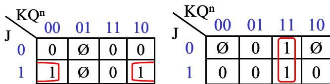

# 第 5 章 触发器习题答案（续）

本部分为《数字电路与逻辑设计 B》第 5 章习题答案的第 7 页内容，包含 JK 触发器的状态转换表、特征方程推导及对应电路图。

## 一、JK 触发器分析

知识点：[完整数字系统设计流程实例（如乘法器、交通灯管理系统的算法规律、处理器设计与控制器实现）](../../../topics/数字逻辑电路/数字系统设计实例.md)

### 选择 3（基于表格分析）

根据给定的输入 $J, K$ 和现态 $Q^n$，确定次态 $Q^{n+1}$ 及对应的 $S, R$ 值。

| $J$ | $K$ | $Q^n$ | $Q^{n+1}$ | $S$ | $R$ |
|:---:|:---:|:-----:|:---------:|:---:|:---:|
| 0   | 0   | 0     | 0         | 0   | ∅   |
| 0   | 0   | 1     | 1         | ∅   | 0   |
| 0   | 1   | 0     | 0         | 0   | ∅   |
| 0   | 1   | 1     | 0         | 0   | 1   |
| 1   | 0   | 0     | 1         | 1   | 0   |
| 1   | 0   | 1     | 1         | ∅   | 0   |
| 1   | 1   | 0     | 1         | 1   | 0   |
| 1   | 1   | 1     | 0         | 0   | 1   |

注：表中“∅”表示该输入端信号无效或不需要驱动（通常指置位/复位端的无关项）。

**答案：** 见上表。

知识点：[数字系统的基本模型（数据处理器与控制器）及对最小时钟周期、异步信号同步化的约定](../../../topics/数字逻辑电路/数字系统模型.md)、[寄存器传输语言(RTL)描述的传输操作、算术操作、逻辑操作、移位操作及条件控制语句](../../../topics/数字逻辑电路/RTL语言.md)

### 简答 2

**问题：** 写出由上述分析得到的 JK 触发器特征方程中 $S$ 端的表达式。

**答案：**
$$ S = J \overline{Q}^n $$

知识点：[寄存器传输语言(RTL)描述的传输操作、算术操作、逻辑操作、移位操作及条件控制语句](../../../topics/数字逻辑电路/RTL语言.md)

### 综合 1

**问题：** 画出实现上述功能的电路图。

**答案：**
电路图如下所示：

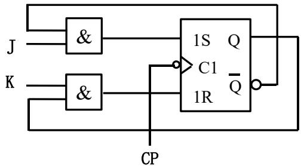

说明：
图中展示了利用逻辑门电路构建的 JK 触发器结构，其中包含了反馈回路以消除空翻现象，并实现了 $S = J \overline{Q}^n$ 和 $R = K Q^n$ 的逻辑功能。

知识点：[完整数字系统设计流程实例（如乘法器、交通灯管理系统的算法规律、处理器设计与控制器实现）](../../../topics/数字逻辑电路/数字系统设计实例.md)、[控制器的四种硬件实现方法：每态一触发器法(SSI)、MSI法(MUX+寄存器+译码器)、PLA法(LSI)及对比](../../../topics/数字逻辑电路/控制器实现方法.md)、[寄存器传输语言(RTL)描述的传输操作、算术操作、逻辑操作、移位操作及条件控制语句](../../../topics/数字逻辑电路/RTL语言.md)
