# 《数字电路与逻辑设计B》第5章 触发器（课件）

原件的每一页，下面附识别出的文字。

### 第5章 触发器（Flip Flop）

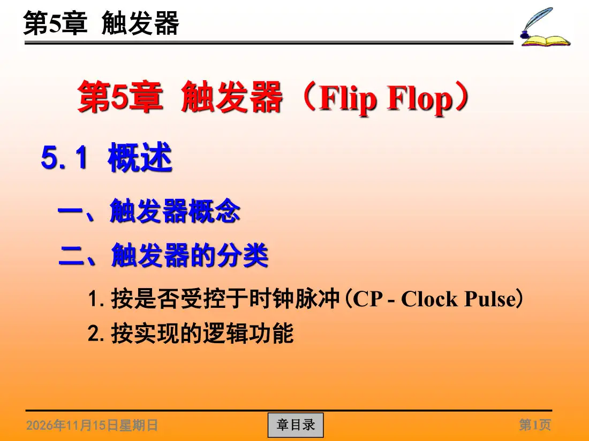

原文：

第5章 触发器（Flip Flop）

5.1 概述

一、触发器概念

二、触发器的分类

1.按是否受控于时钟脉冲(CP - Clock Pulse)

2.按实现的逻辑功能

第5章 触发器

く

2026年11月15日星期日

章目录

第1页

### 一、与非门构成的基本 SRFF

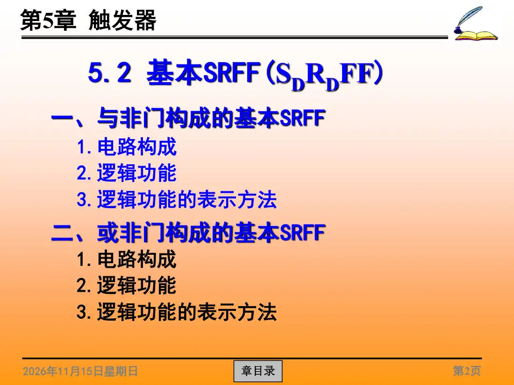

原文：

5.2 基本SRFF( $( \mathbf { S _ { D } } \mathbf { R _ { D } } \mathbf { F } \mathbf { F } )$

一、与非门构成的基本 SRFF

1.电路构成

2.逻辑功能

3.逻辑功能的表示方法

二、或非门构成的基本SRFF

1.电路构成

2.逻辑功能

3.逻辑功能的表示方法

第5章 触发器

2026年11月15日星期日

章目录

第2页

### 5.3 钟控电位触发器(钟控触发器)

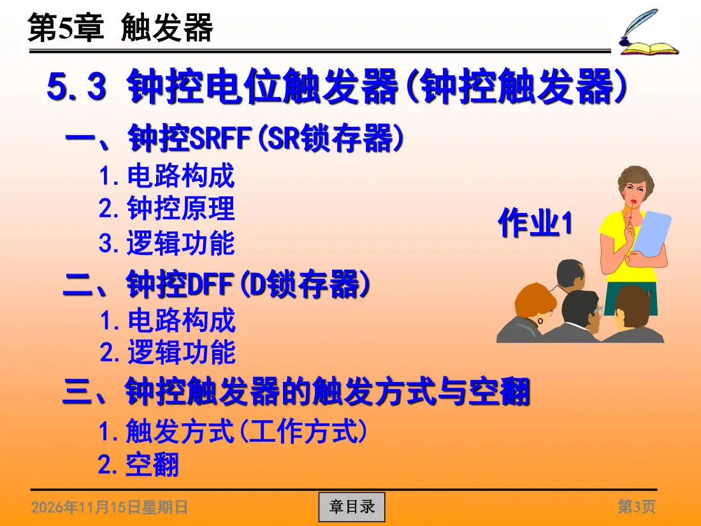

原文：

5.3 钟控电位触发器(钟控触发器)

一、钟控 1. 电路构成 SRFF(SR锁存器)

1.电路构成

2.钟控原理

3.逻辑功能

1. 电路构成二、钟控DFF(D锁存器)

1.电路构成

2.逻辑功能

作业1

三、钟控触发器的触发方式与空翻

1.触发方式(工作方式)

2.空翻

第5章 触发器

2026年11月15日星期日

章目录

第3页

### 5.4 常用触发器

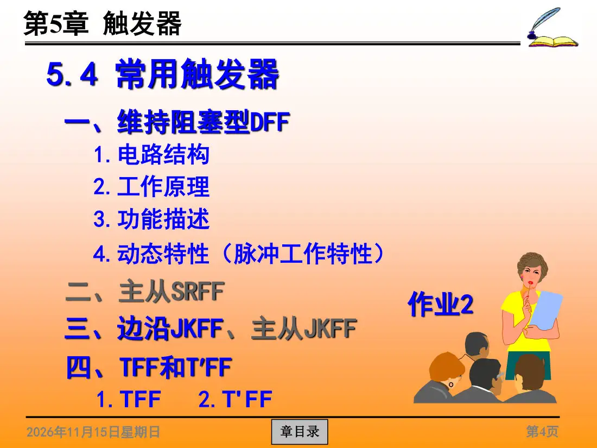

原文：

5.4 常用触发器

一、维持阻塞型DFF1. 电路结构

1.电路结构

2.工作原理

3.功能描述

4.动态特性（脉冲工作特性）

二、主从SRFF

三、边沿JKFF、主从JKFF

四、TFF和2.T' FTFF1.TF

1.TFF 2.T' FF

作业2

第5章 触发器

く

2026年11月15日星期日

章目录

第4页

### 5.5 CMOS 触发器

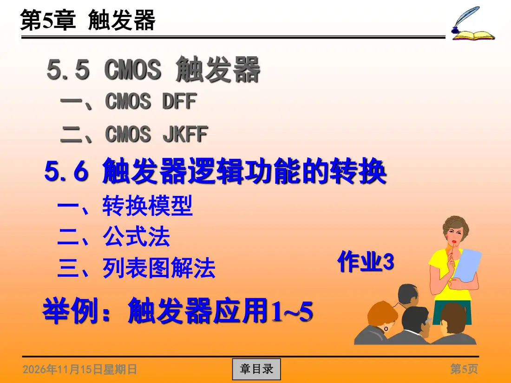

原文：

5.5 CMOS 触发器
一、CMOS DFF
二、CMOS JKFF
5.6 触发器逻辑功能的转换
一、转换模型
二、公式法
三、列表图解法 作业3
举例：触发器应用1\~5

第5章 触发器

く

2026年11月15日星期日

章目录

第5页

### 第5章 触发器

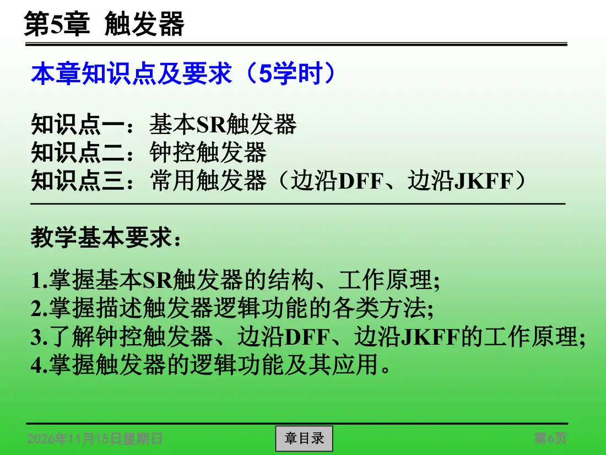

原文：

第5章 触发器

本章知识点及要求（5学时）

知识点一：基本SR触发器

知识点二：钟控触发器

知识点三：常用触发器（边沿DFF、边沿JKFF）

教学基本要求：

1.掌握基本SR触发器的结构、工作原理;

2.掌握描述触发器逻辑功能的各类方法;

3.了解钟控触发器、边沿DFF、边沿JKFF的工作原理;

4.掌握触发器的逻辑功能及其应用。

2026年11月15日星期日

章目录

第6页

### 第5章 触发器

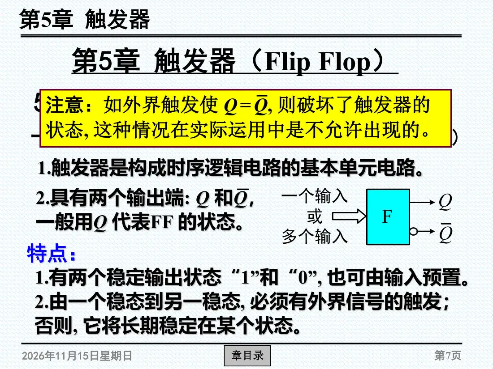

原文：

第5章 触发器

第5章 触发器（Flip Flop）

.1 概述 注意：如外界触发使 Q=Q, 则破坏了触发器的、触发器概念状态, 这种情况在实际运用中是不允许出现的。

1.触发器是构成时序逻辑电路的基本单元电路。

2.具有两个输出端: Q 和Q，般用Q 代表FF 的状态。

特点：

1.有两个稳定输出状态“1”和“0”, 也可由输入预置。

2.由一个稳态到另一稳态, 必须有外界信号的触发；否则, 它将长期稳定在某个状态。

2026年11月15日星期日

章目录

第7页

### 第5章 触发器

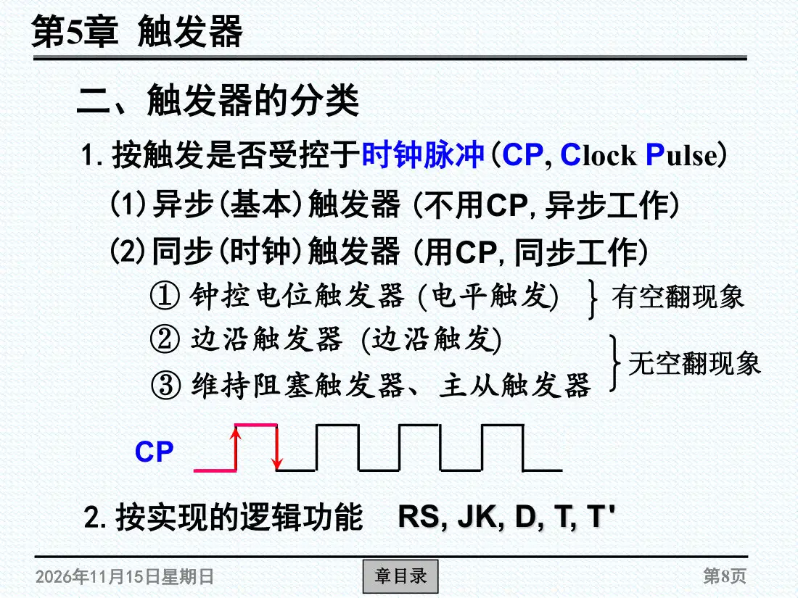

原文：

第5章 触发器

触发器的分类

1.按触发是否受控于时钟脉冲(CP, Clock Pulse)

(1)异步(基本)触发器 (不用CP,异步工作)

(2)同步(时钟)触发器(用CP,同步工作)

① 钟控电位触发器 (电平触发) 有空翻现象

② 边沿触发器 (边沿触发)

③维持阻塞触发器、主从触发器

无空翻现象

2.按实现的逻辑功能 RS, JK, D, T, T'

2026年11月15日星期日

章目录

第8页

### 第5章 触发器— 与非门构成的基本SRFF

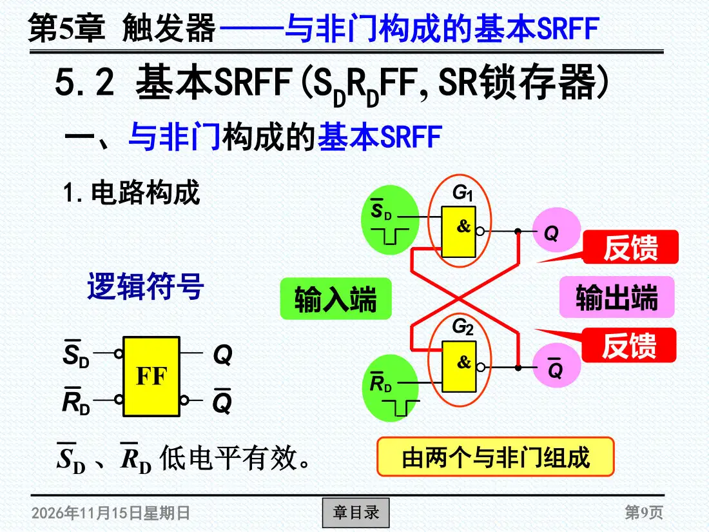

原文：

第5章 触发器— 与非门构成的基本SRFF

5.2 基本SRFF $( S _ { D } R _ { D } F )$ F, SR锁存器)与非门构成的基本SRFF

1.电路构成

逻辑符号

输入端

$$
\begin{array}{c} \overline {{S}} _ {D} \\ \overline {{R}} _ {D} \end{array} \boxed {\text {FF}}
$$

$\overline { { S } } _ { \mathrm { ~ D ~ } } , \overline { { R } } _ { \mathrm { ~ D ~ } }$ 低电平有效。

反馈

输出端

反馈

由两个与非门组成

2026年11月15日星期日

章目录

第9页

### 第5章 触发器—— 与非门构成的基本SRFF

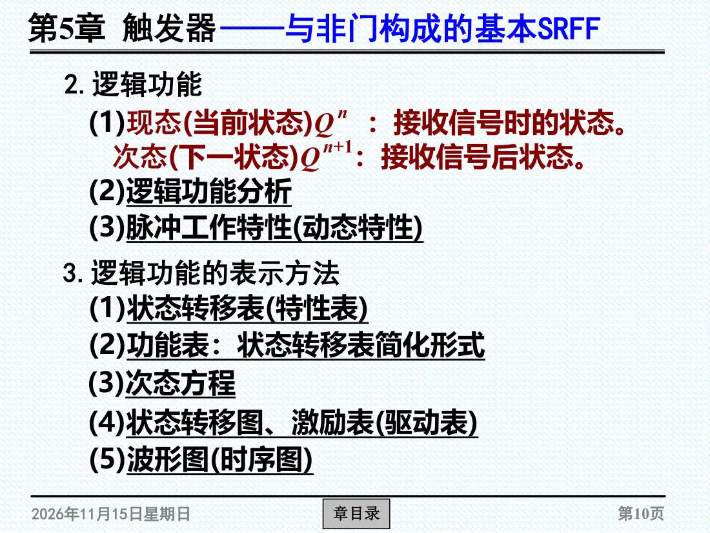

原文：

第5章 触发器—— 与非门构成的基本SRFF

2.逻辑功能

(1)现态(当前状态) $\boldsymbol { \underline { Q } } ^ { n }$ 接收信号时的状态。次态(下一状态) $\boldsymbol { Q } ^ { n + 1 }$ 接收信号后状态。

(2)逻辑功能分析

(3)脉冲工作特性(动态特性)

3.逻辑功能的表示方法

(1)状态转移表(特性表)

(2)功能表：状态转移表简化形式

(3)次态方程

(4)状态转移图、激励表(驱动表)

(5)波形图(时序图)

2026年11月15日星期日

章目录

第10页

### 第5章 触发器— 与非门构成的基本SRFF

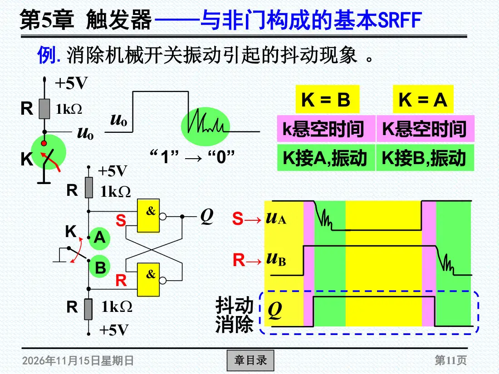

原文：

第5章 触发器— 与非门构成的基本SRFF

例.消除机械开关振动引起的抖动现象 。

$$
K = B
$$

k悬空时间

K接A,振动

$$
\mathsf {K} = \mathsf {A}
$$

K悬空时间

K接B,振动

抖动 消除

2026年11月15日星期日

章目录

第11页

### 第5章 触发器— 或非门构成的基本SRFF

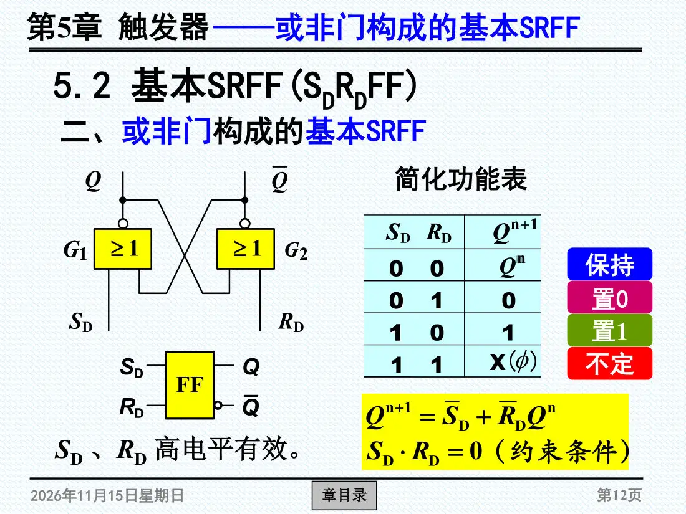

原文：

第5章 触发器— 或非门构成的基本SRFF

5.2 基本SRFF $( S _ { D } R _ { D } F [ )$

二、 或非门构成的基本SRFF

$$
\begin{array}{c} S _ {D} \\ R _ {D} \end{array} \boxed {\text {FF}}
$$

$S _ { \mathrm { { D } } } \cdot R _ { \mathrm { { D } } }$ 高电平有效。

简化功能表
<table><tr><td> $S_{D}$   $R_{D}$ </td><td> $Q^{n+1}$ </td></tr><tr><td>0 0</td><td> $Q^{n}$ </td></tr><tr><td>0 1</td><td>0</td></tr><tr><td>1 0</td><td>1</td></tr><tr><td>1 1</td><td> $X(\phi)$ </td></tr></table>

保持置0置1不定

$$
Q ^ {\mathrm{n+1}} = \overline {{S}} _ {\mathrm{D}} + \overline {{R}} _ {\mathrm{D}} Q ^ {\mathrm{n}}
$$

$S _ { \mathrm { { D } } } \cdot R _ { \mathrm { { D } } } = 0$ (约束条件)

2026年11月15日星期日

章目录

第12页

### 基本SR触发器主要特点

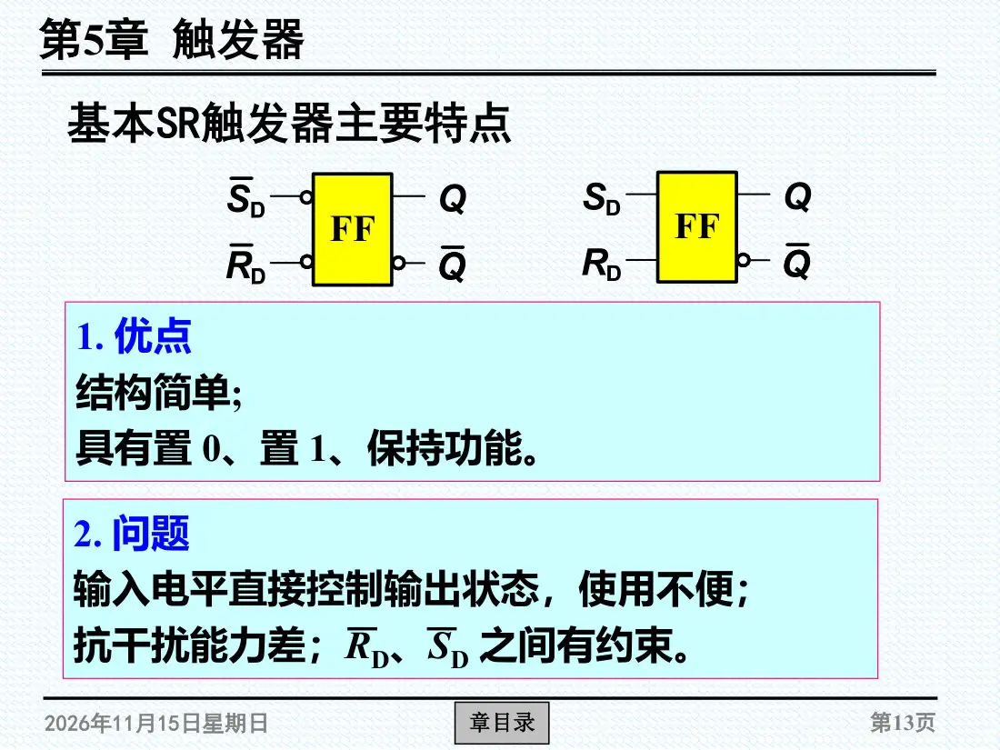

原文：

基本SR触发器主要特点

$$
\begin{array}{c} \overline {{S}} _ {D} \\ \overline {{R}} _ {D} \end{array} \boxed {\text {FF}}
$$

$$
\begin{array}{c} S _ {D} \\ R _ {D} \end{array} \boxed {\text {FF}}
$$

1. 优点

结构简单;

具有置 0、置 1、保持功能。

2. 问题

输入电平直接控制输出状态，使用不便；抗干扰能力差； $\overline { { R } } _ { \bf { D } } , \ \overline { { S } } _ { \bf { D } }$ 之间有约束。

第5章 触发器

2026年11月15日星期日

章目录

第13页

### 第5章 触发器

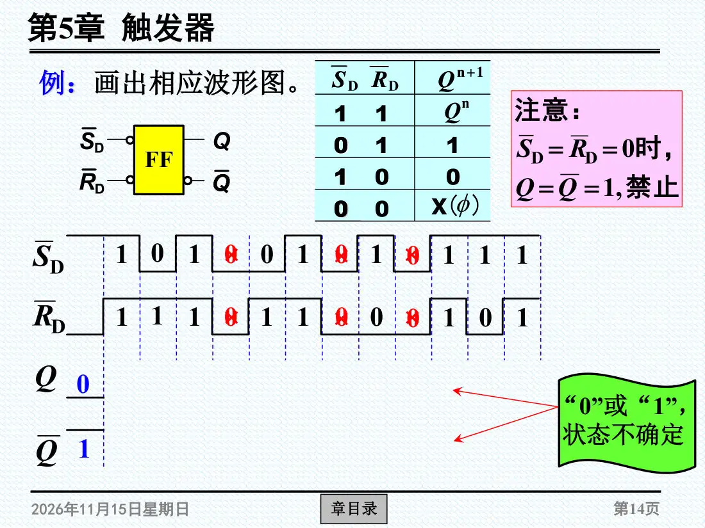

原文：

第5章 触发器

例：画出相应波形图

$$
\begin{array}{c} \overline {{S}} _ {D} \\ \overline {{R}} _ {D} \end{array} \boxed {\text {FF}}
$$

<table><tr><td colspan="2"> $\overline{S}_{\text{D}}$   $\overline{R}_{\text{D}}$ </td><td> $Q^{\text{n+1}}$ </td></tr><tr><td>1</td><td>1</td><td> $Q^{\text{n}}$ </td></tr><tr><td>0</td><td>1</td><td>1</td></tr><tr><td>1</td><td>0</td><td>0</td></tr><tr><td>0</td><td>0</td><td> $\mathbf{X}(\phi)$ </td></tr></table>

注意：

$$
\begin{array}{l} {{\overline {{{S}}} _ {\mathrm{D}} = \overline {{{R}}} _ {\mathrm{D}} = 0 \text {时},}} \\ {{Q = \overline {{{Q}}} = 1, \text {禁止}}} \end{array}
$$

$$
\begin{array}{c c c c c c c c c c c c c c c} \hline \overline {{S}} _ {\mathrm{D}} & 1 & 0 & 1 & 0 & 0 & 1 & 0 & 1 & 0 & 1 & 1 & 1 & 1 \\ \hline \overline {{R}} _ {\mathrm{D}} & 1 & 1 & 1 & 0 & 1 & 1 & 0 & 0 & 0 & 1 & 0 & 1 \\ \hline Q & 0 \\ \hline \overline {{Q}} & 1 \end{array}
$$

“0”或“1”，状态不确定

2026年11月15日星期日

章目录

第14页

### 第5章 触发器 钟控SR触发器

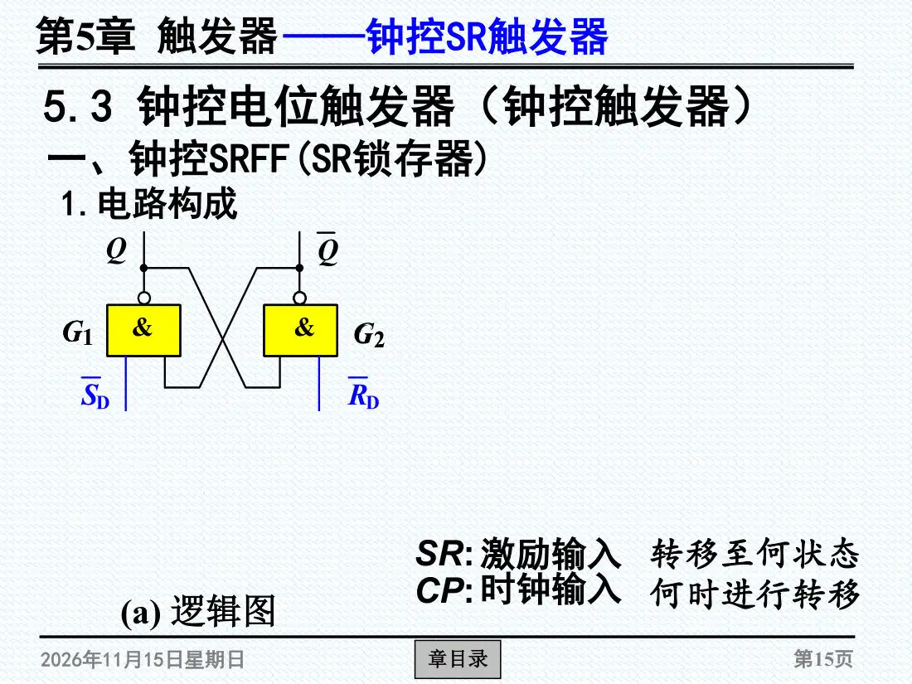

原文：

第5章 触发器 钟控SR触发器

5.3 钟控电位触发器（钟控触发器）

钟控SRFF(SR锁存器)

1.电路构成

(a) 逻辑图

激励输入SR: 转移至何状态 时钟输入CP: 何时进行转移

2026年11月15日星期日

章目录

第15页

### 第5章 触发器 钟控SR触发器

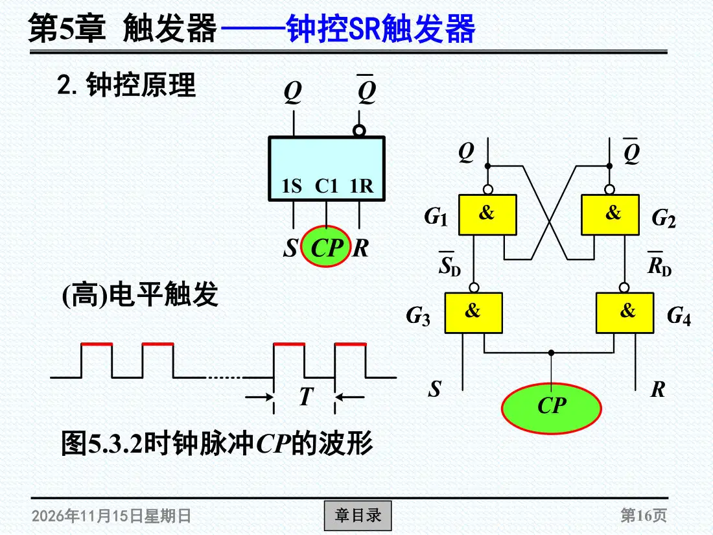

原文：

第5章 触发器 钟控SR触发器

2.钟控原理

(高)电平触发

2026年11月15日星期日

章目录

第16页

### 第5章 触发器 钟控SR触发器

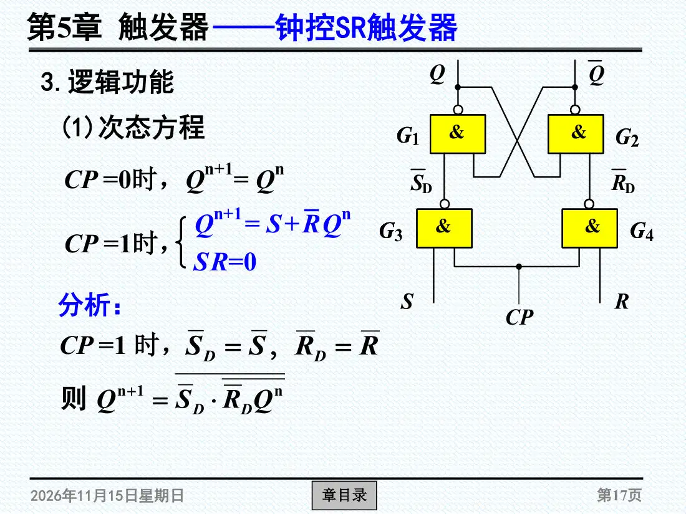

原文：

第5章 触发器 钟控SR触发器

3.逻辑功能

(1)次态方程

$C P { = } 0$ 时， ${ { Q } ^ { { \mathfrak { n } } + 1 } } { = { Q } ^ { \mathfrak { n } } }$

$C P { = } 1$ 时， $\left\{ \begin{array} { l l } { { Q } ^ { { \mathrm { n + 1 } } } = S + { \bar { R } } Q ^ { { \mathrm { n } } } } \\ { { S R } = 0 } \end{array} \right.$

分析：

$\mathbf { \nabla } C P { = } 1$ 时， $\overline { { S } } _ { D } = \overline { { S } } , \overline { { R } } _ { D } = \overline { { R } }$

则 $Q ^ { \mathbf { n } + 1 } = \overline { { S } } _ { D } \cdot \overline { { R } } _ { D } Q ^ { \mathbf { n } }$

2026年11月15日星期日

章目录

第17页

### 第5章 触发器 钟控SR触发器

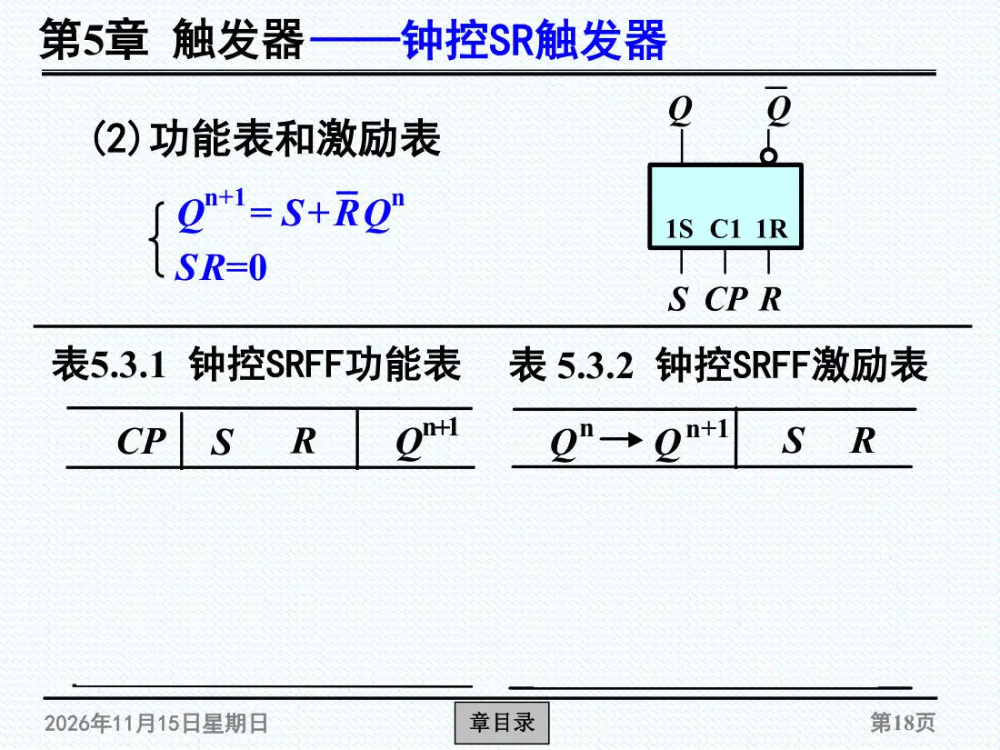

原文：

第5章 触发器 钟控SR触发器

(2)功能表和激励表

$$
\left\{ \begin{array}{l} Q ^ {n + 1} = S + \overline {{R}} Q ^ {n} \\ S R = 0 \end{array} \right.
$$

表5.3.1 钟控SRFF功能表 表 5.3.2 钟控SRFF激励表
<table><tr><td>CP</td><td>S</td><td>R</td><td> $Q^{n+1}$ </td><td> $Q^n \to Q^{n+1}$ </td><td>S</td><td>R</td></tr></table>

2026年11月15日星期日

章目录

第18页

### 第5章 触发器 钟控SR触发器

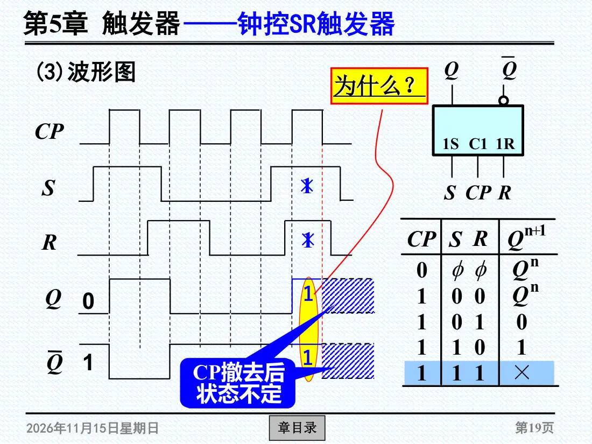

原文：

第5章 触发器 钟控SR触发器

(3)波形图

CP

为什么？

CP撤去后CP撤去后 状态不定状态不定

<table><tr><td>CP</td><td>S</td><td>R</td><td> $Q^{n+1}$ </td></tr><tr><td>0</td><td> $\phi$ </td><td> $\phi$ </td><td> $Q^n$ </td></tr><tr><td>1</td><td>0</td><td>0</td><td> $Q^n$ </td></tr><tr><td>1</td><td>0</td><td>1</td><td>0</td></tr><tr><td>1</td><td>1</td><td>0</td><td>1</td></tr><tr><td>1</td><td>1</td><td>1</td><td>×</td></tr></table>

2026年11月15日星期日

章目录

第19页

### 第5章 触发器 钟控SR触发器

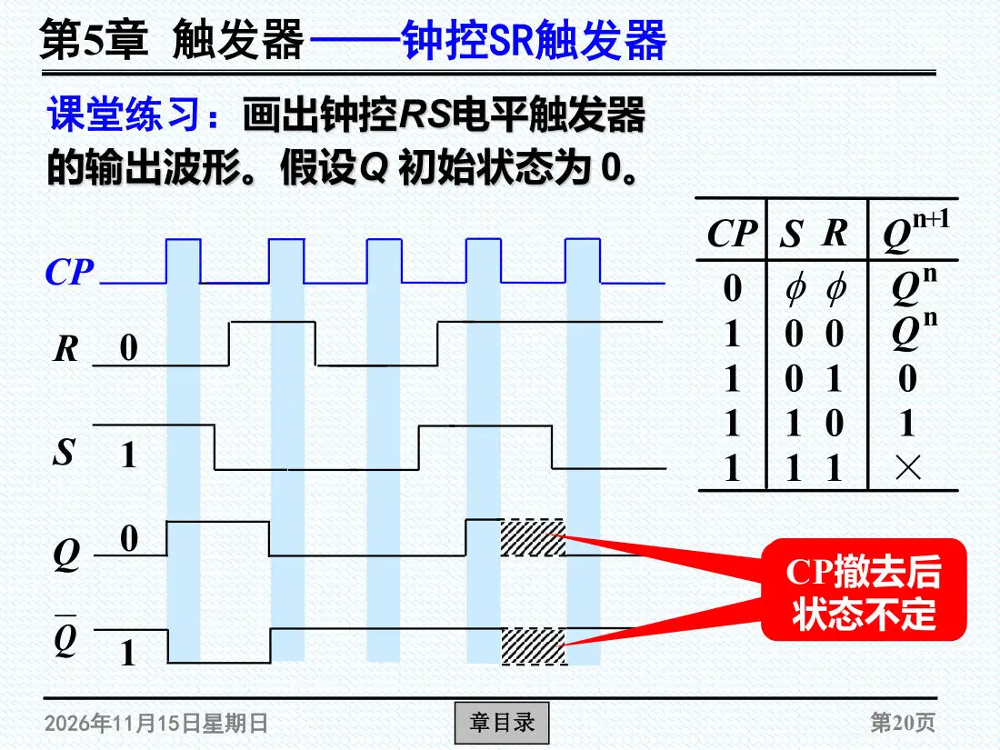

原文：

第5章 触发器 钟控SR触发器

课堂练习：画出钟控RS电平触发器的输出波形。假设Q 初始状态为 0。

<table><tr><td>CP</td><td>S</td><td>R</td><td> $Q^{n+1}$ </td></tr><tr><td>0</td><td> $\phi$ </td><td> $\phi$ </td><td> $Q^n$ </td></tr><tr><td>1</td><td>0</td><td>0</td><td> $Q^n$ </td></tr><tr><td>1</td><td>0</td><td>1</td><td>0</td></tr><tr><td>1</td><td>1</td><td>0</td><td>1</td></tr><tr><td>1</td><td>1</td><td>1</td><td>×</td></tr></table>

CP撤去后CP撤去后状态不定

2026年11月15日星期日

章目录

第20页

### 第5章 触发器——钟控D触发器

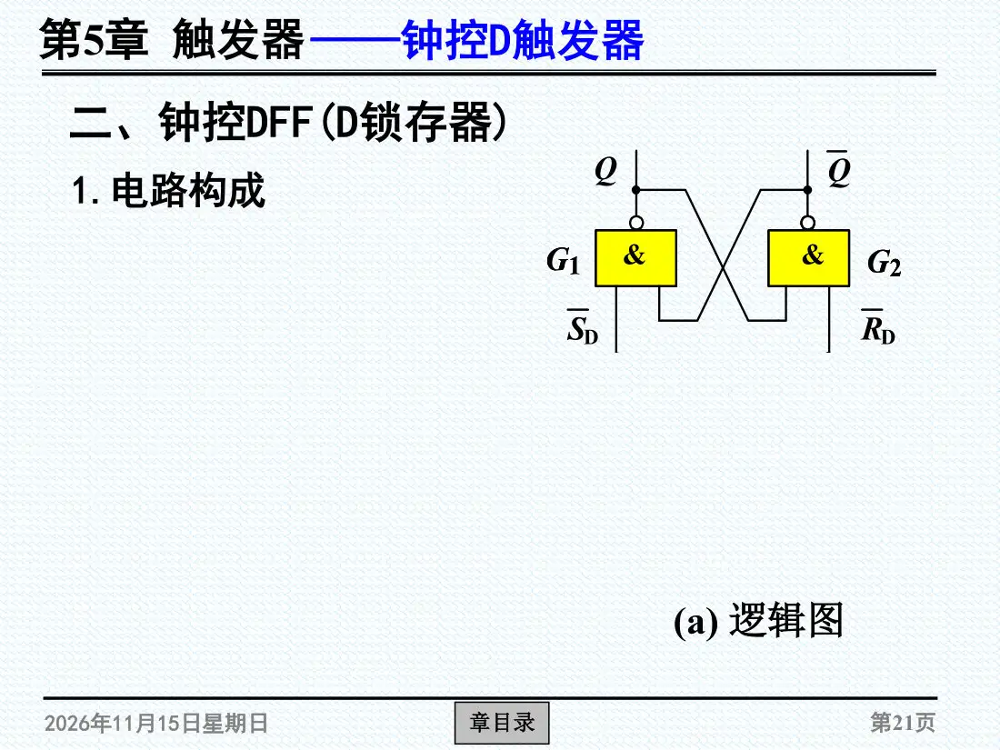

原文：

第5章 触发器——钟控D触发器

二、钟控DFF(D锁存器)

1.电路构成

(a) 逻辑图

2026年11月15日星期日

章目录

第21页

### 第5章 触发器— 钟控D触发器

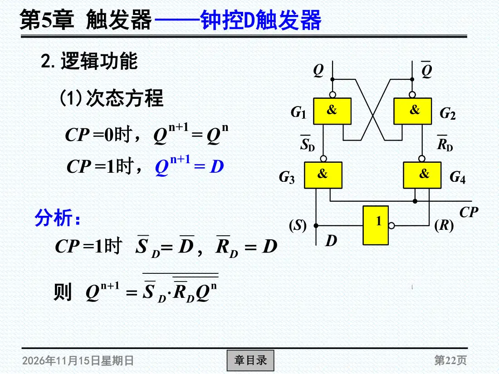

原文：

第5章 触发器— 钟控D触发器

2.逻辑功能

(1)次态方程

$C P { = } 0$ 时， $\boldsymbol { Q } ^ { \mathbf { n } + 1 } = \boldsymbol { Q } ^ { \mathbf { n } }$

CP =1时， ${ { Q } ^ { { \bf { n } } + 1 } } = D$

分析：

$C P { = } 1$ 时 $\overline { { S } } _ { D } = \overline { { D } } , \overline { { R } } _ { D } = D$

则 $Q ^ { \mathbf { n } + 1 } = \overline { { S } } _ { D } { \cdot } \overline { { R } } _ { D } Q ^ { \mathbf { n } }$

2026年11月15日星期日

章目录

第22页

### 第5章 触发器— 钟控D触发器

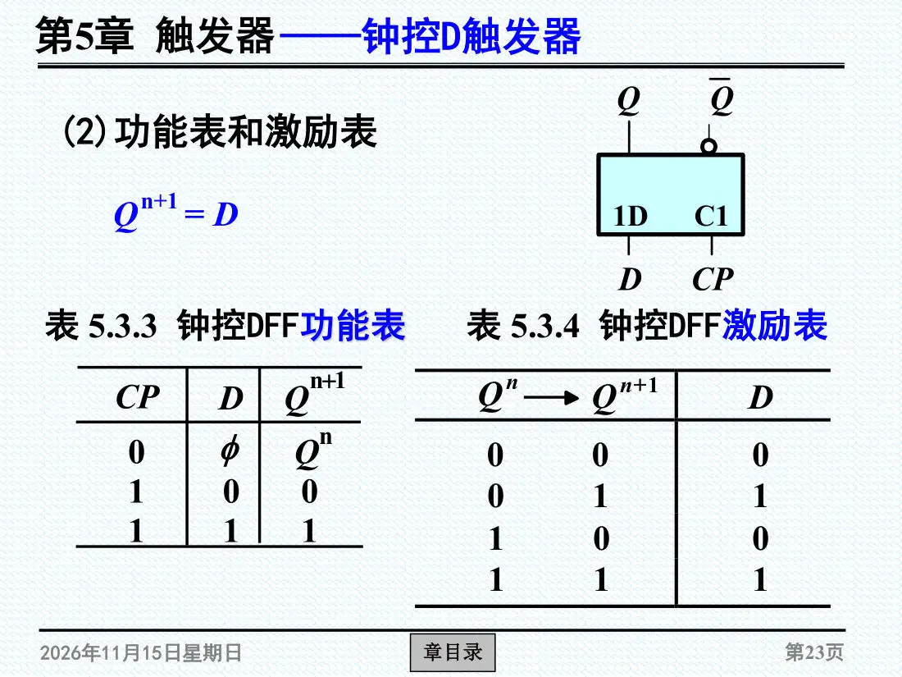

原文：

第5章 触发器— 钟控D触发器

(2)功能表和激励表

$$
Q ^ {n + 1} = D
$$

表 5.3.3 钟控DFF功能表
<table><tr><td>CP</td><td>D</td><td> $Q^{n+1}$ </td></tr><tr><td>0</td><td> $\phi$ </td><td> $Q^n$ </td></tr><tr><td>1</td><td>0</td><td>0</td></tr><tr><td>1</td><td>1</td><td>1</td></tr></table>

<table><tr><td colspan="2"> $Q^n \longrightarrow Q^{n+1}$ </td><td>D</td></tr><tr><td>0</td><td>0</td><td>0</td></tr><tr><td>0</td><td>1</td><td>1</td></tr><tr><td>1</td><td>0</td><td>0</td></tr><tr><td>1</td><td>1</td><td>1</td></tr></table>

2026年11月15日星期日

章目录

第23页

### 第5章 触发器 钟控触发方式与空翻

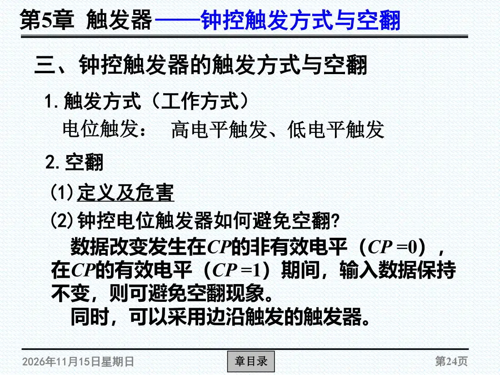

原文：

第5章 触发器 钟控触发方式与空翻

三、钟控触发器的触发方式与空翻

1.触发方式（工作方式）

电位触发： 高电平触发、低电平触发

2.空翻

(1)定义及危害

(2)钟控电位触发器如何避免空翻?

数据改变发生在CP的非有效电平（CP =0）在CP的有效电平（CP =1）期间，输入数据保持不变，则可避免空翻现象。

同时，可以采用边沿触发的触发器。

2026年11月15日星期日

章目录

第24页

### 第5章 触发器

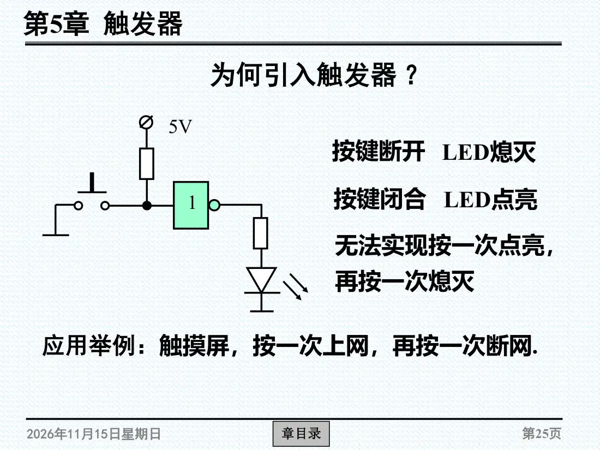

原文：

第5章 触发器

为何引入触发器 ？

按键断开 LED熄灭

按键闭合 LED点亮

无法实现按一次点亮，再按一次熄灭

应用举例：触摸屏，按一次上网，再按一次断网.

2026年11月15日星期日

章目录

第25页

### 第5章 触发器

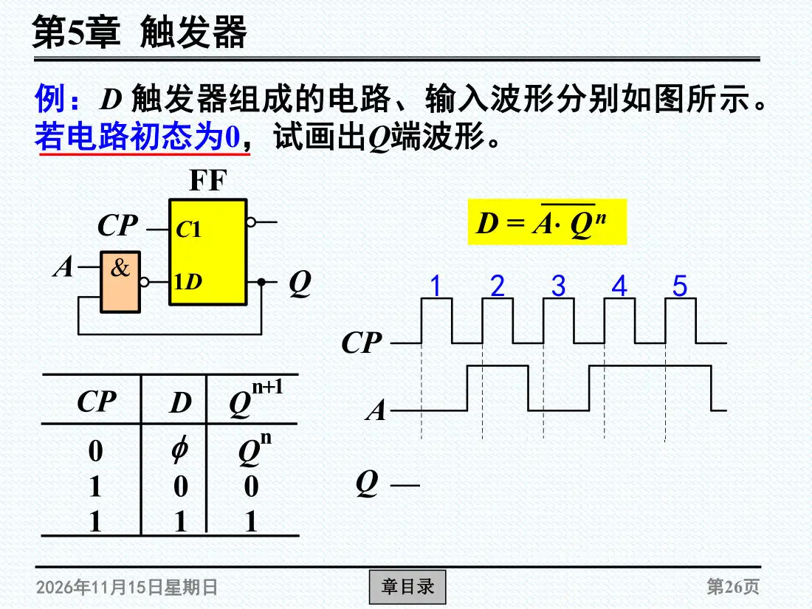

原文：

第5章 触发器

例：D 触发器组成的电路、输入波形分别如图所示。若电路初态为0，试画出Q端波形。

<table><tr><td>CP</td><td>D</td><td> $Q^{n+1}$ </td></tr><tr><td>0</td><td> $\phi$ </td><td> $Q^n$ </td></tr><tr><td>1</td><td>0</td><td>0</td></tr><tr><td>1</td><td>1</td><td>1</td></tr></table>

$$
D = \overline {{A \cdot Q}} ^ {n}
$$

2026年11月15日星期日

章目录

第26页

### 第5章 触发器— 钟控触发器

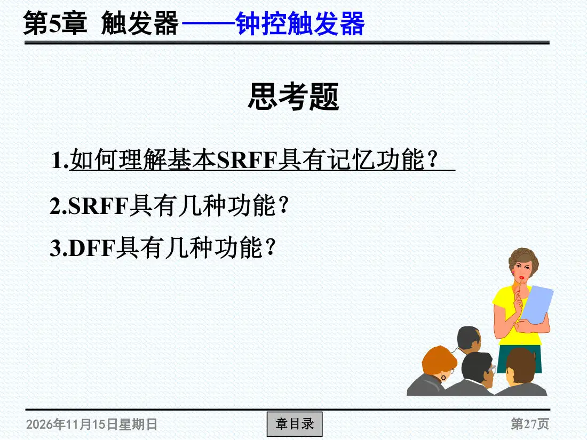

原文：

第5章 触发器— 钟控触发器

思考题

1.如何理解基本SRFF具有记忆功能？

2.SRFF具有几种功能？

3.DFF具有几种功能？

2026年11月15日星期日

章目录

第27页

### 望同学们：

原文：

望同学们：

【作业1】

独立完成作业

认真完成作业

5.1

5.4

5.5

第5章 触发器

2026年11月15日星期日

章目录

第28页

### 第5章 触发器 维持阻塞型DFF

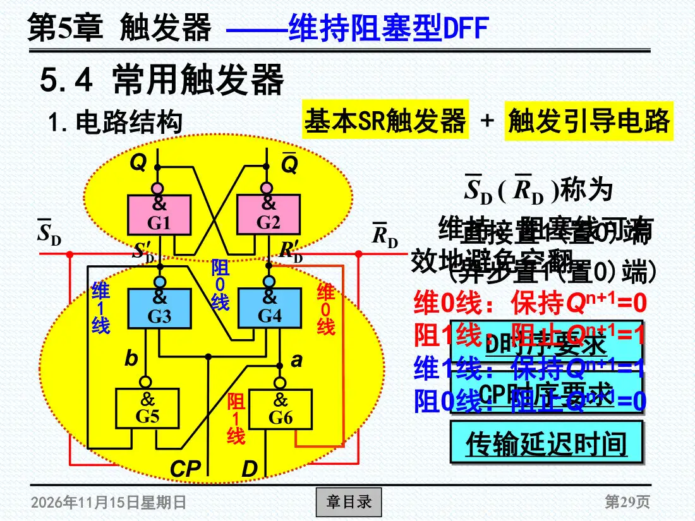

原文：

第5章 触发器 维持阻塞型DFF

5.4 常用触发器

1.电路结构

基本SR触发器 触发引导电路

$\overline { { S } } _ { \bf D } ( \overline { { R } } _ { \bf D }$ )称为

直接置1(置0)端维持、阻塞线可有 (异步置1(置0)端)效地避免空翻。 维0线：保持 $Q ^ { n + 1 } = 0$ D时序要求 阻1线：阻止Qn+1=1 CP时序要求维1线：保持Qn+1=1 CP时序要求 阻0线：阻止Qn+1=0

传输延迟时间

2026年11月15日星期日

章目录

第29页

### 第5章 触发器 维持阻塞型DFF

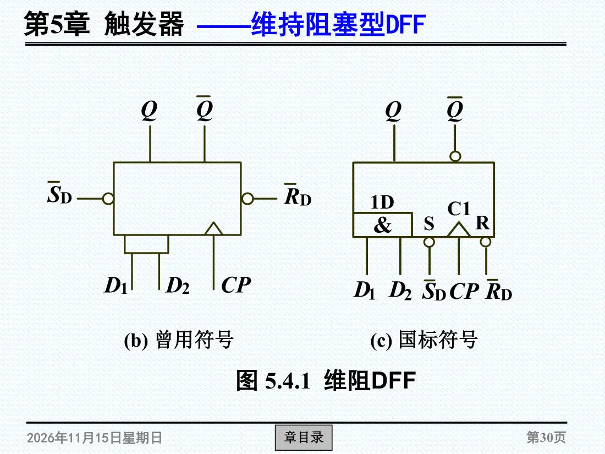

原文：

第5章 触发器 维持阻塞型DFF

2026年11月15日星期日

章目录

第30页

### CP=0期间Qn+1= Qn 保持输入信号被封锁。

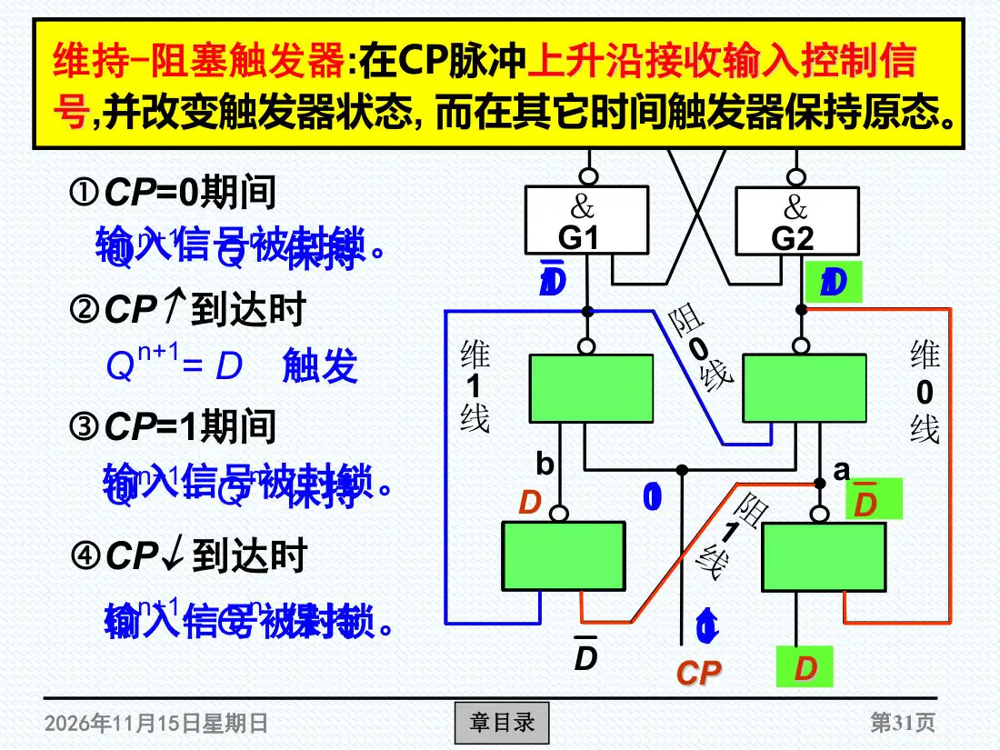

原文：

5 ——维持-阻塞触发器:在CP脉冲上升沿接收输入控制信Q2.工作原理 Qn+1=QnDQn+1=Qn号,并改变触发器状态, 而在其它时间触发器保持原态。

CP=0期间Qn+1= Qn 保持输入信号被封锁。

②CP↑到达时 $\boldsymbol { Q } ^ { n + 1 } = \boldsymbol { D }$ 触发

CP=1期间Qn+1= Qn 保持输入信号被封锁。

④CP↓到达时Qn+1= Qn 保持输入信号被封锁。

2026年11月15日星期日

章目录

第31页

### 第5章 触发器 维持阻塞型DFF

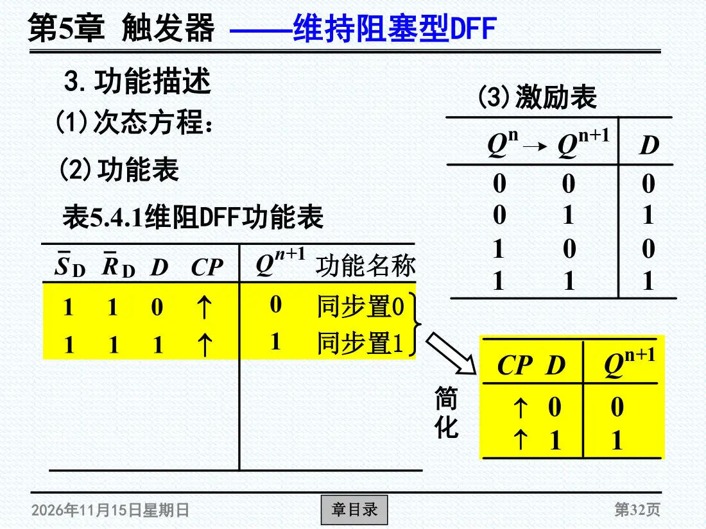

原文：

第5章 触发器 维持阻塞型DFF

3.功能描述

(1)次态方程：

(2)功能表

表5.4.1维阻DFF功能表
<table><tr><td colspan="4"> $\overline{S}_{D}$   $\overline{R}_{D}$  D CP</td><td colspan="2"> $Q^{n+1}$  功能名称</td></tr><tr><td>1</td><td>1</td><td>0</td><td>↑</td><td>0</td><td>同步置0</td></tr><tr><td>1</td><td>1</td><td>1</td><td>↑</td><td>1</td><td>同步置1</td></tr></table>

(3)激励表

<table><tr><td colspan="2"> $Q^{n} \rightarrow Q^{n+1}$ </td><td>D</td></tr><tr><td>0</td><td>0</td><td>0</td></tr><tr><td>0</td><td>1</td><td>1</td></tr><tr><td>1</td><td>0</td><td>0</td></tr><tr><td>1</td><td>1</td><td>1</td></tr></table>

简化

<table><tr><td rowspan="3"></td><td> $Q^{n+1}$ </td></tr><tr><td>0</td></tr><tr><td>1</td></tr></table>

2026年11月15日星期日

章目录

第32页

### 第5章 触发器 维持阻塞型DFF

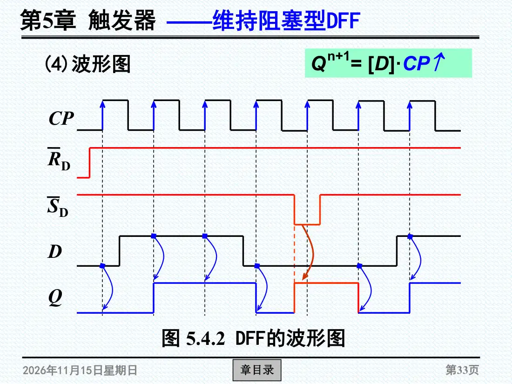

原文：

第5章 触发器 维持阻塞型DFF

(4)波形图

$$
Q ^ {n + 1} = [ D ] \cdot C P \uparrow
$$

章目录

2026年11月15日星期日

第33页

### 第5章 触发器 维持阻塞型DFF

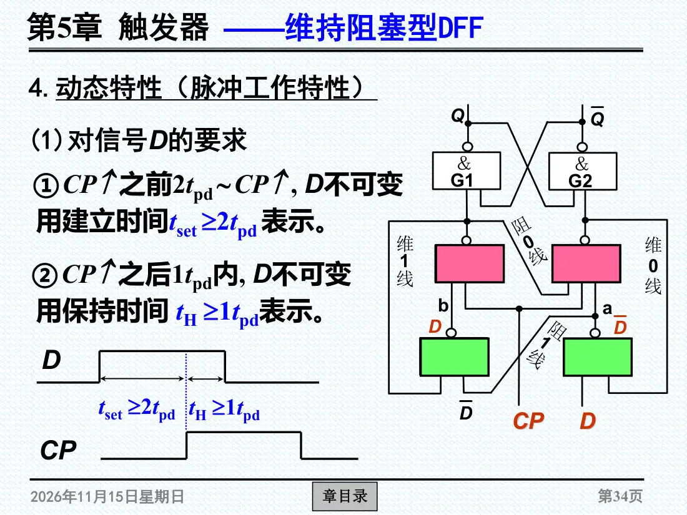

原文：

第5章 触发器 维持阻塞型DFF

4.动态特性（脉冲工作特性）

(1)对信号D的要求

①CP之前 $2 t _ { \mathrm { p d } } { \sim } C P \uparrow$ D不可变用建立时间 $t _ { \mathrm { s e t } } { \geq } 2 t _ { \mathrm { p d } }$ 表示。

②CP之后 $1 t _ { \mathrm { p d } }$ 内, D不可变用保持时间 $t _ { \mathrm { H } } \geq 1 t _ { \mathrm { p d } }$ 表示。

2026年11月15日星期日

章目录

第34页

### 4.动态特性（脉冲工作特性）

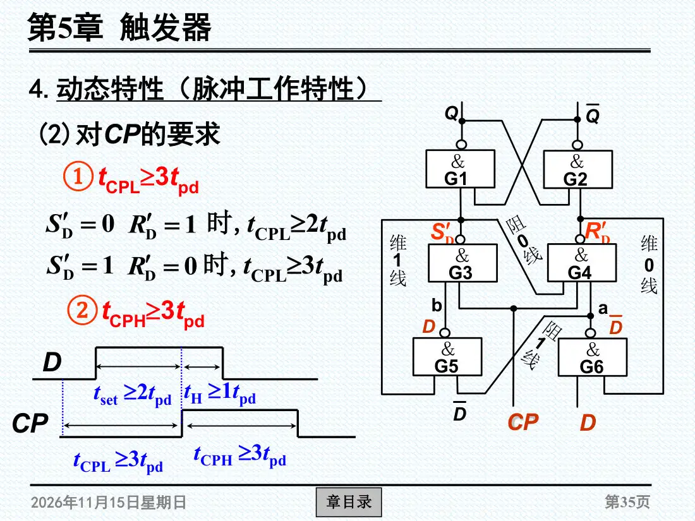

原文：

4.动态特性（脉冲工作特性）

(2)对CP的要求

① $t _ { \mathrm { C P l } } \geq 3 t _ { \mathrm { p d } }$

$$
S _ {\mathrm{D}} ^ {\prime} = 0 R _ {\mathrm{D}} ^ {\prime} = 1
$$

$$
t _ {\mathrm{CPL}} \geq 2 t _ {\mathrm{pd}}
$$

$$
S _ {\mathrm{D}} ^ {\prime} = 1 R _ {\mathrm{D}} ^ {\prime} = 0
$$

$$
t _ {\mathrm{CPL}} \geq 3 t _ {\mathrm{pd}}
$$

② $t _ { \mathrm { C P H } } { = } 3 t _ { \mathrm { p d } }$

$$
t _ {\mathrm{CPL}} \geq 3 t _ {\mathrm{pd}}
$$

$$
t _ {\mathrm{CPH}} \geq 3 t _ {\mathrm{pd}}
$$

第5章 触发器

2026年11月15日星期日

章目录

第35页

### 第5章 触发器 维持阻塞型DFF

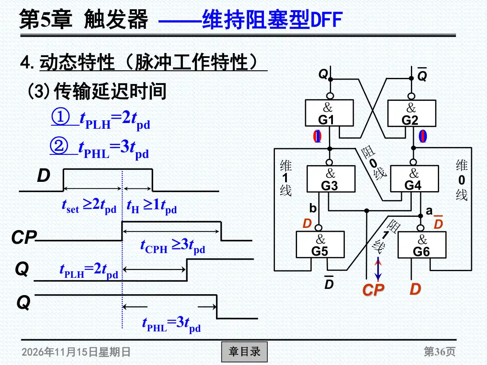

原文：

第5章 触发器 维持阻塞型DFF

4.动态特性（脉冲工作特性）

(3)传输延迟时间

$$
ⓛ t _ {\mathrm{PLH}} = 2 t _ {\mathrm{pd}}
$$

$$
② t _ {\mathrm{PHL}} = 3 t _ {\mathrm{pd}}
$$

$$
t _ {\mathrm{PLH}} = 2 t _ {\mathrm{pd}}
$$

2026年11月15日星期日

章目录

第36页

### 第5章 触发器 维持阻塞型DFF

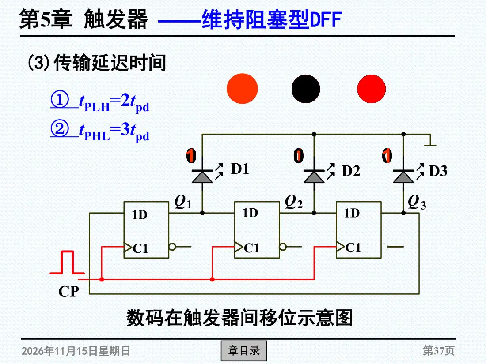

原文：

第5章 触发器 维持阻塞型DFF

(3)传输延迟时间

① =2t tPLH pd

数码在触发器间移位示意图

2026年11月15日星期日

章目录

第37页

### 第5章 触发器 边沿JKFF

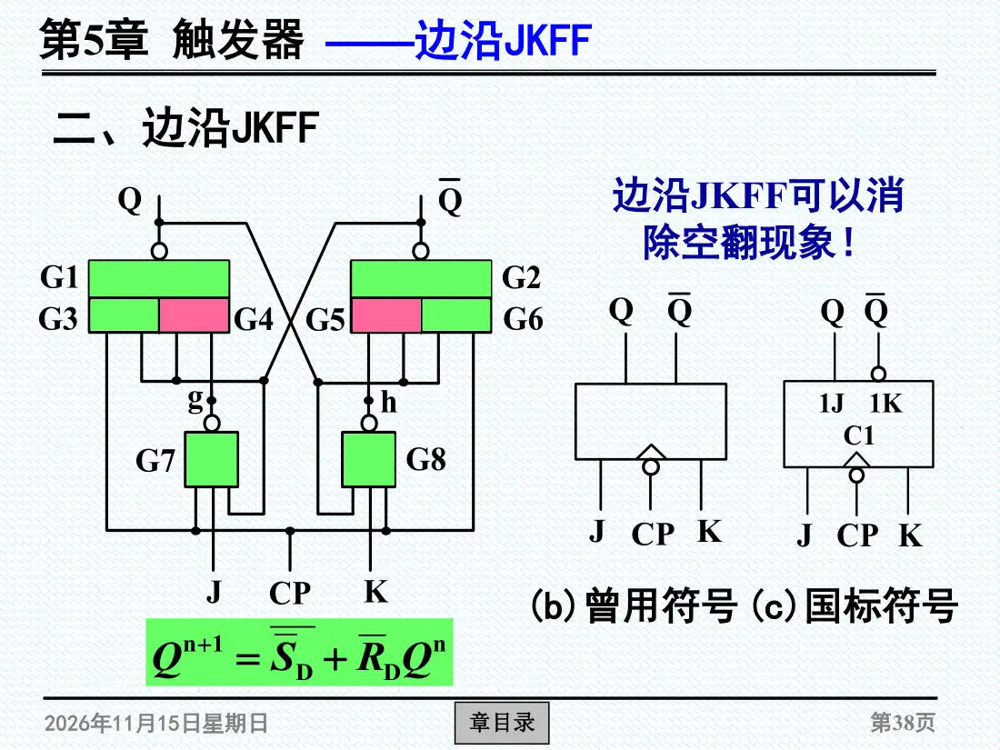

原文：

第5章 触发器 边沿JKFF

二、边沿JKFF

$$
Q ^ {\mathrm{n+1}} = \overline {{\overline {{S}} _ {\mathrm{D}}}} + \overline {{R}} _ {\mathrm{D}} Q ^ {\mathrm{n}}
$$

CP时,G3,G6先于G边沿JKFF可以消启,G1或G2被封除空翻现象！

n+1 n n n n(b)曾用符号 (c)国标符号

2026年11月15日星期日

章目录

第38页

### 第5章 触发器 ——边沿JKFF

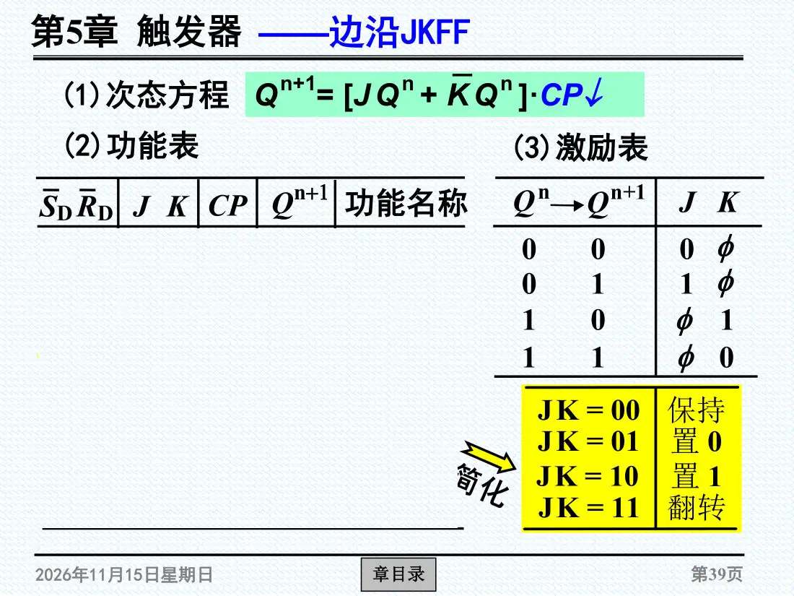

原文：

第5章 触发器 ——边沿JKFF

(1)次态方程 $Q ^ { n + 1 } = [ J Q ^ { n } + \overline { { K } } Q ^ { n } ] \cdot C P \downarrow$

(2)功能表

(3)激励表

<table><tr><td> $\overline{S}_{D} \overline{R}_{D}$ </td><td>J K</td><td>CP</td><td> $Q^{n+1}$ </td><td>功能名称</td><td colspan="2"> $Q^{n} \rightarrow Q^{n+1}$ </td><td colspan="2">J K</td></tr><tr><td></td><td></td><td></td><td></td><td></td><td>0</td><td>0</td><td>0</td><td> $\phi$ </td></tr><tr><td></td><td></td><td></td><td></td><td></td><td>0</td><td>1</td><td>1</td><td> $\phi$ </td></tr><tr><td></td><td></td><td></td><td></td><td></td><td>1</td><td>0</td><td> $\phi$ </td><td>1</td></tr><tr><td></td><td></td><td></td><td></td><td></td><td>1</td><td>1</td><td> $\phi$ </td><td>0</td></tr></table>

2026年11月15日星期日

章目录

第39页

### 第5章 触发器 ——边沿JKFF

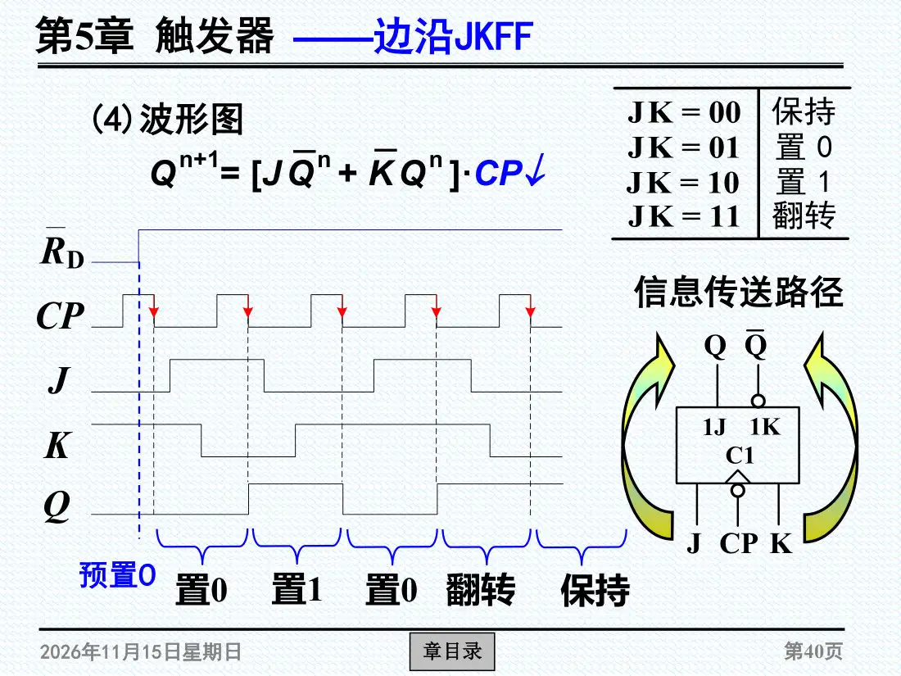

原文：

第5章 触发器 ——边沿JKFF

(4)波形图

$$
Q ^ {n + 1} = [ J \overline {{Q}} ^ {n} + \overline {{K}} Q ^ {n} ] \cdot C P \downarrow
$$

$$
\mathbf {J K} = \mathbf {0 0}
$$

$$
\mathbf {J K} = \mathbf {0 1}
$$

保持

$$
\mathbf {J K} = \mathbf {1 0}
$$

置0

$$
\mathbf {J K} = 1 \mathbf {1}
$$

置1

翻转

信息传送路径

预置0 置0 置1 置0 翻转 保持

2026年11月15日星期日

章目录

第40页

### 第5章 触发器

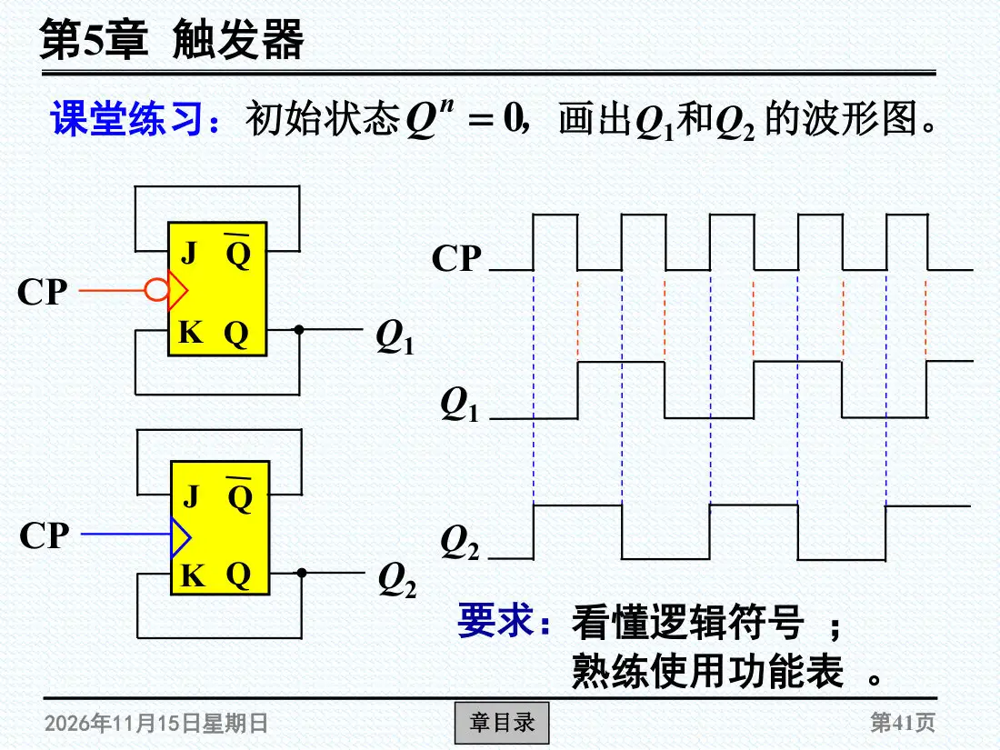

原文：

第5章 触发器

课堂练习：初始状态 ${ Q } ^ { n } = \mathbf { 0 } ,$ 画出 $Q _ { 1 }$ 和 $Q _ { 2 }$ 的波形图。

看懂逻辑符号要求：熟练使用功能表

2026年11月15日星期日

章目录

第41页

### 第5章 触发器 ——TFF 和 T'FF

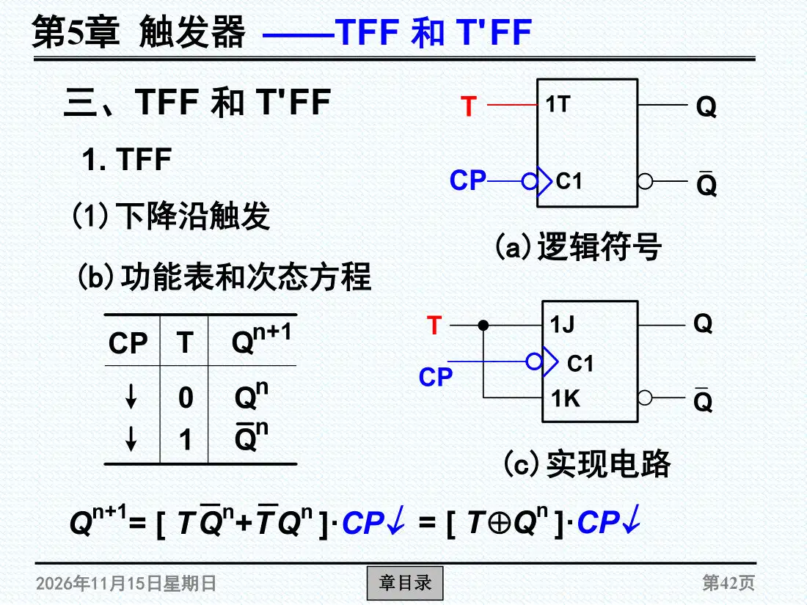

原文：

第5章 触发器 ——TFF 和 T'FF

三、TFF 和 T'FF

1. TFF

(1)下降沿触发

(b)功能表和次态方程

<table><tr><td>CP</td><td>T</td><td> $Q^{n+1}$ </td></tr><tr><td>↓</td><td>0</td><td> $Q^n$ </td></tr><tr><td>↓</td><td>1</td><td> $\overline{Q}^n$ </td></tr></table>

(a)逻辑符号

(c)实现电路

$$
Q ^ {n + 1} = [ T \overline {{Q}} ^ {n} + \overline {{T}} Q ^ {n} ] \cdot C P \downarrow = [ T \oplus Q ^ {n} ] \cdot C P \downarrow
$$

2026年11月15日星期日

章目录

第42页

### 第5章 触发器 ——TFF 和 T'FF

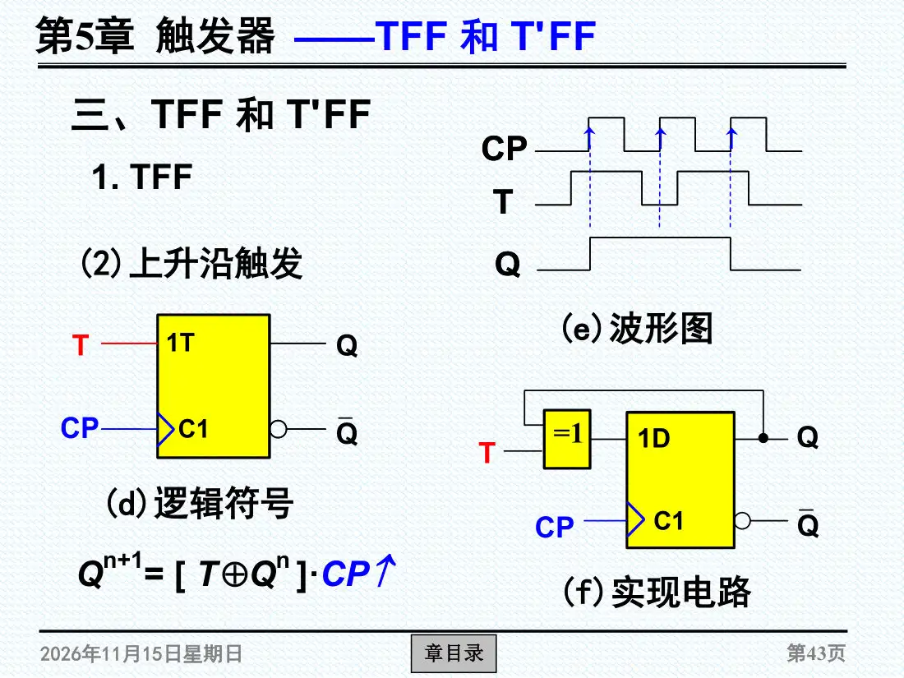

原文：

第5章 触发器 ——TFF 和 T'FF

三、TFF 和 T'FF

1. TFF

(2)上升沿触发

(d)逻辑符号

$$
Q ^ {n + 1} = [ T \oplus Q ^ {n} ] \cdot C P \uparrow
$$

(f)实现电路

2026年11月15日星期日

章目录

第43页

### 第5章 触发器 ——TFF 和 T'FF

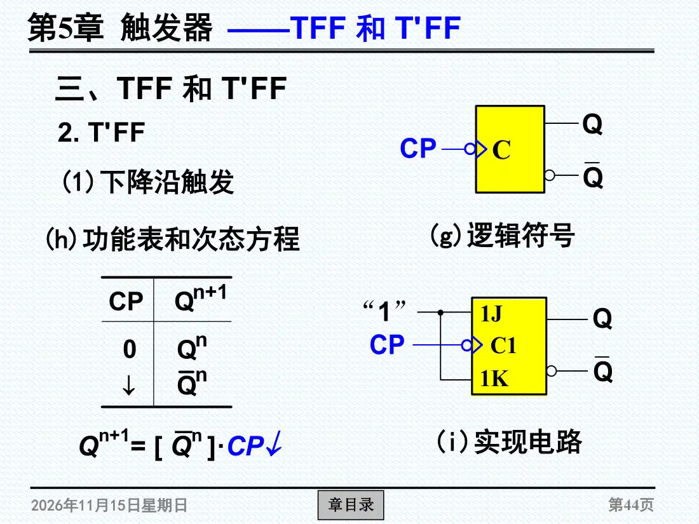

原文：

第5章 触发器 ——TFF 和 T'FF

三、TFF 和 T'FF

2. T'FF

(1)下降沿触发

(h)功能表和次态方程

<table><tr><td>CP</td><td> $Q^{n+1}$ </td></tr><tr><td>0↓</td><td> $Q^n$  $\overline{Q}^n$ </td></tr></table>

$$
Q ^ {n + 1} = [ \overline {{Q}} ^ {n} ] \cdot C P \downarrow
$$

$$
\mathrm{CP} \xrightarrow {\circ} \mathrm{C} \quad \begin{array}{c} \mathrm{Q} \\ \overline {{\mathrm{Q}}} \end{array}
$$

(g)逻辑符号

$$
\begin{array}{c} \text {1}" \\ \text {CP} \end{array} \boxed { \begin{array}{c} 1 J \\ C 1 \\ 1 K \end{array} } \boxed { \begin{array}{c} Q \\ \overline {{Q}} \end{array} }
$$

(i)实现电路

2026年11月15日星期日

章目录

第44页

### 第5章 触发器 ——TFF 和 T'FF

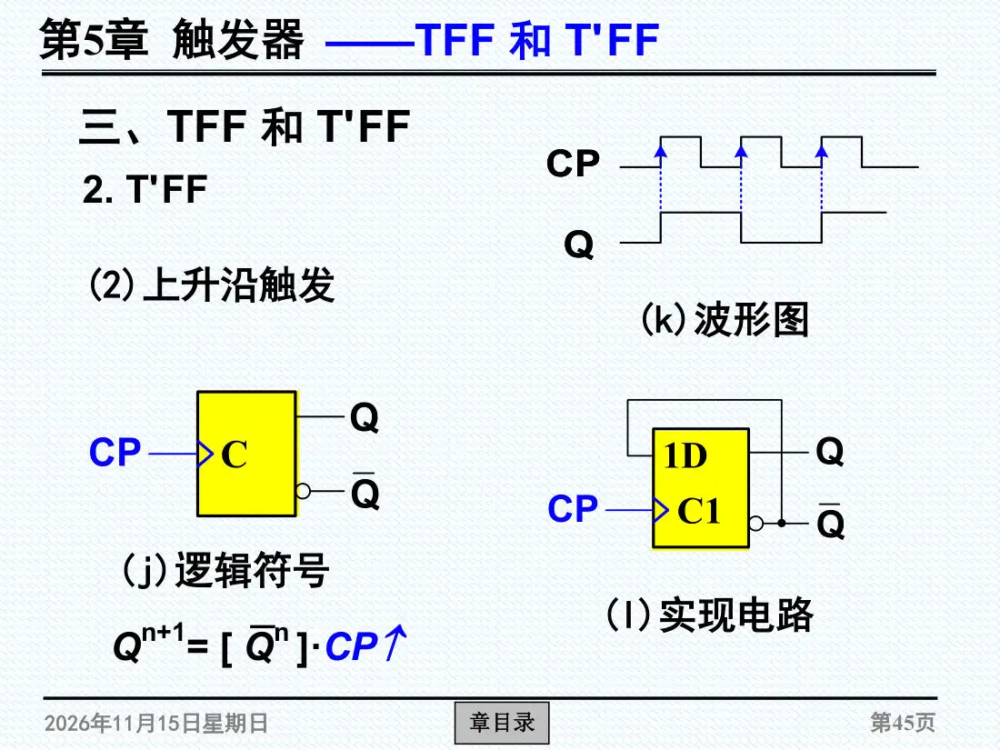

原文：

第5章 触发器 ——TFF 和 T'FF

三、TFF 和 T'FF

2. T'FF

(2)上升沿触发

$$
\mathrm{CP} \rightarrow \boxed {\mathrm{C}} \quad\begin{array}{c}\text { Q }\\\text { Q }\\\text { Q }\end{array}
$$

(j)逻辑符号

$$
Q ^ {n + 1} = [ \overline {{Q}} ^ {n} ] \cdot C P \uparrow
$$

$$
\begin{array}{c} \text {1D} \\ \text {C1} \end{array} \quad \begin{array}{c} \text {Q} \\ \text {\overline {{Q}}} \end{array}
$$

(l)实现电路

2026年11月15日星期日

章目录

第45页

### 望同学们：

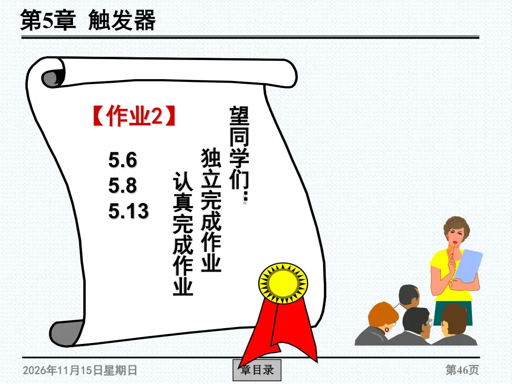

原文：

望同学们：

【作业2】

独立完成作业

认真完成作业

5.6 5.8

5.13

第5章 触发器

2026年11月15日星期日

章目录

第46页

### 第5章 触发器 触发器逻辑功能的转换

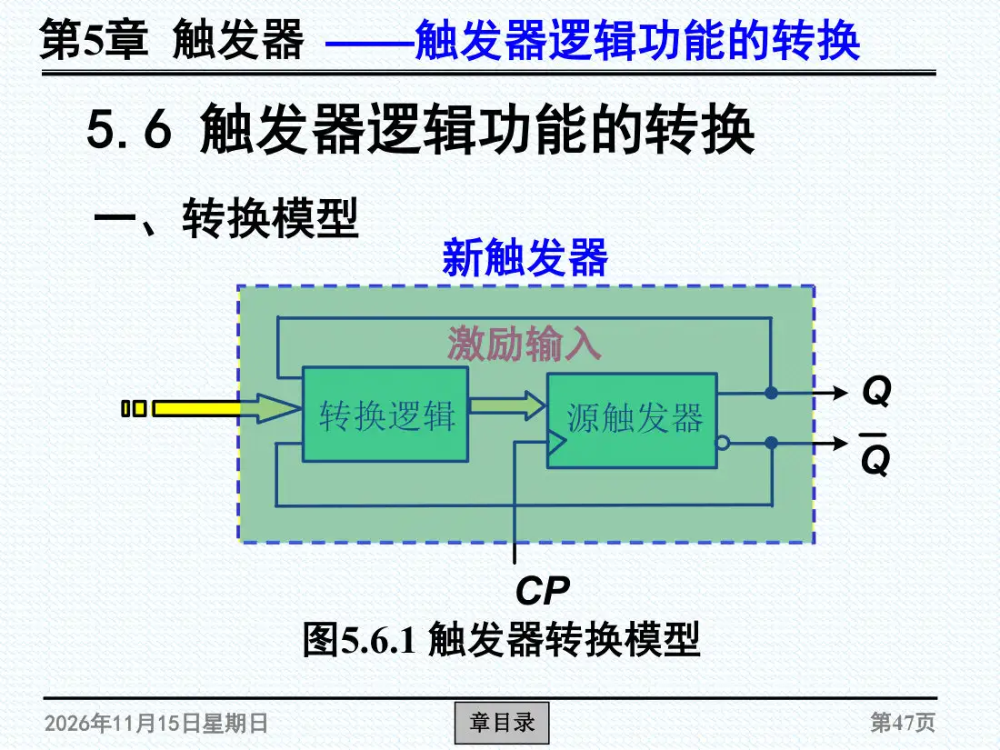

原文：

第5章 触发器 触发器逻辑功能的转换

5.6 触发器逻辑功能的转换

转换模型

2026年11月15日星期日

章目录

第47页

### 第5章 触发器 触发器逻辑功能的转换

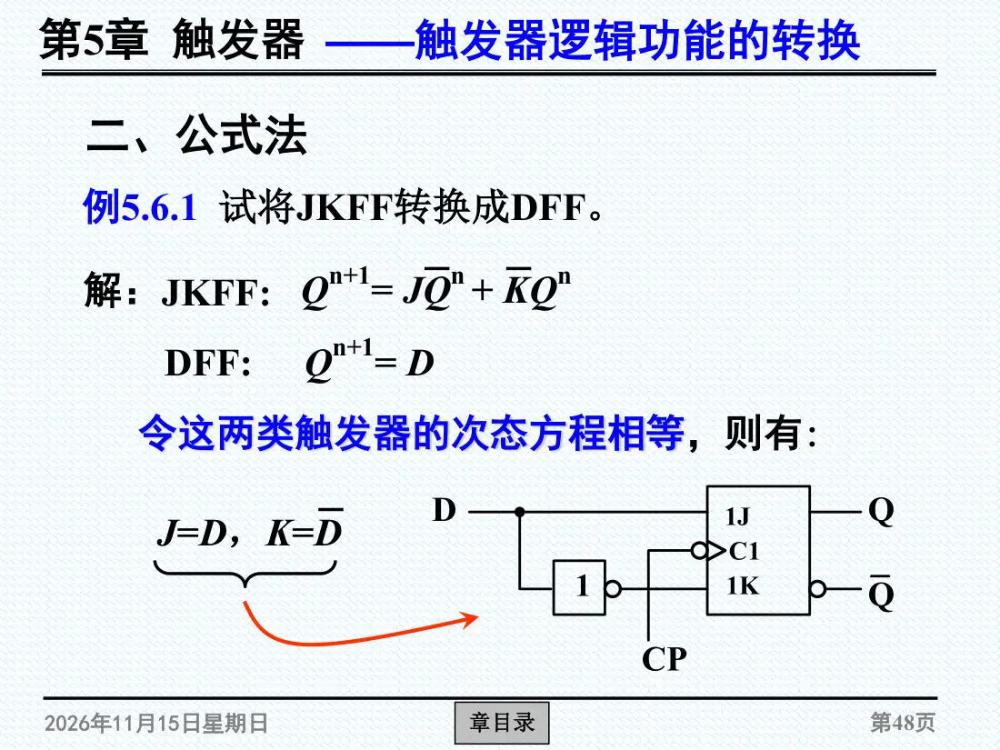

原文：

第5章 触发器 触发器逻辑功能的转换

公式法

例5.6.1 试将JKFF转换成DFF。

解： JKFF: $\boldsymbol { Q } ^ { \mathrm { n + 1 } } = \boldsymbol { J } \boldsymbol { \overline { { Q } } } ^ { \mathrm { n } } + \boldsymbol { \overline { { K } } } \boldsymbol { Q } ^ { \mathrm { n } }$

DFF: ${ { Q } ^ { n + 1 } } \mathrm { { = } } { \cal D }$

令这两类触发器的次态方程相等，则有:

D

2026年11月15日星期日

章目录

第48页

### 第5章 触发器 触发器逻辑功能的转换

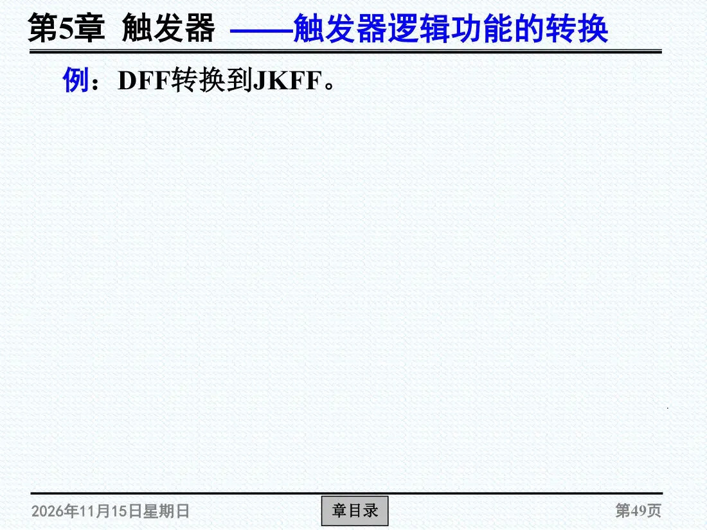

原文：

第5章 触发器 触发器逻辑功能的转换

例：DFF转换到JKFF。

2026年11月15日星期日

章目录

第49页

### 第5章 触发器 ——触发器逻辑功能的转换

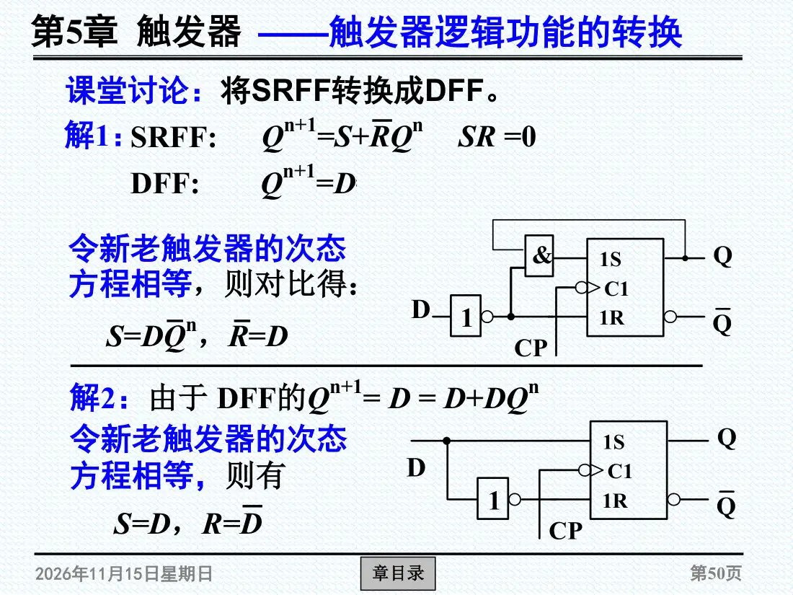

原文：

第5章 触发器 ——触发器逻辑功能的转换

课堂讨论：将SRFF转换成DFF。

SRFF:解1： ${ { \cal Q } ^ { \mathrm { n + 1 } } } { - } S { + } \overline { { { R } } } { { \cal Q } ^ { \mathrm { n } } } S R { - } \bf { 0 }$

DFF: $\boldsymbol { Q } ^ { \mathrm { n + 1 } } { = } \boldsymbol { D }$

令新老触发器的次态方程相等，则对比得：

$$
S = D \overline {{Q}} ^ {n}, \quad \overline {{R}} = D
$$

解2：由于 DFF的 $Q ^ { { \mathrm { n + 1 } } } - D - D + D Q ^ { \mathrm { n } }$

令新老触发器的次态 方程相等，则有

$$
S = D, \quad R = \overline {{D}}
$$

2026年11月15日星期日

章目录

第50页

### 课堂练习1：将SRFF转换成JKFF。

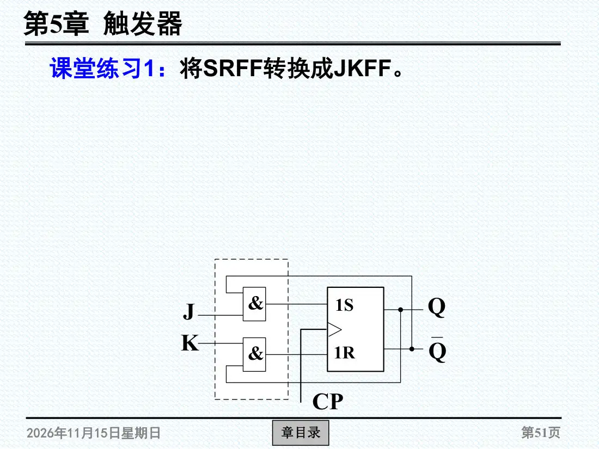

原文：

课堂练习1：将SRFF转换成JKFF。

第5章 触发器

2026年11月15日星期日

章目录

第51页

### 课堂练习2：将JKFF转换成SRFF。

原文：

课堂练习2：将JKFF转换成SRFF。

参考文献：李来运,冯志宇.触发器逻辑功能转换的两种方法[J].商丘职业技术学院学报,2008,7(5):57-60

第5章 触发器

2026年11月15日星期日

章目录

第52页

### CP

原文：

CP

第5章 触发器 触发器逻辑功能的转换

三、列表图解法

例5.6.1 将JKFF转换成DFF。

(2)画出DFF, JKFF卡诺图

$$
\begin{array}{c c c} J \backslash Q ^ {n} & 0 & 1 \\ D & 0 & \phi \\ 1 & 1 & \phi \end{array}
$$

$$
J = D
$$

D

$$
K = \overline {{D}}
$$

解:(1)列综合表
<table><tr><td>D</td><td>Qn</td><td rowspan="5"></td><td>J</td><td>K</td></tr><tr><td>0</td><td>0</td><td>0</td><td> $\phi$ </td></tr><tr><td>0</td><td>1</td><td> $\phi$ </td><td>1</td></tr><tr><td>1</td><td>0</td><td>1</td><td> $\phi$ </td></tr><tr><td>1</td><td>1</td><td> $\phi$ </td><td>0</td></tr></table>

目标FF状态表源FF激励表

2026年11月15日星期日

章目录

第53页

### 第5章 触发器 触发器逻辑功能的转换

原文：

第5章 触发器 触发器逻辑功能的转换

注：触发器功能转换时，还应注意触发方式的不同！

JKFF: $a ^ { n + 1 } = [ 1 - ( 2 ^ { n } + 1 + \frac { 1 } { 2 } ) ^ { n } ] \cdot C P \downarrow$

$\begin{array} { r l } { Q ^ { n + 1 } } & { { } [ \overline { { I } } \overline { { Q } } ^ { \mathrm { n } } + \overline { { I } } \overline { { Q } } ^ { \mathrm { n } } ] \cdot C P T } \end{array}$

DFF: $Q ^ { n + 1 } = \vert D \vert C P \uparrow$

T'FF: $Q ^ { n + 1 } = [ Q ^ { n } ] ( P \downarrow$

JK→T

2026年11月15日星期日

章目录

第54页

### 第5章 触发器

原文：

第5章 触发器

思考题

1.边沿DFF控制信号、时钟信号、激励信号分别对输出端有何影响？哪个输入信号的优先权最高？

2.原触发器、新触发器功能转换的方法有哪几种其正确性是建立在什么基础上？

2026年11月15日星期日

章目录

第55页

### 第5章 触发器

原文：

第5章 触发器

触发器的应用

1.试用DFF设计一个四路数字式抢答器。

2.试用基本SRFF设计一个两路数字式抢答器。

3.TTL边沿触发器电路分析。

4.单脉冲发生器。

5.复位端（清“0”端）的时序。

2026年11月15日星期日

章目录

第56页

### 望同学们：

原文：

望同学们：

独立完成作业

【作业3】

认真完成作业

5.14 5.17 5.19 5.20 5.21

第5章 触发器

2026年11月15日星期日

章目录

第57页

### 第5章 触发器 维持阻塞型DFF

原文：

第5章 触发器 维持阻塞型DFF

最高时钟频率： $f _ { \mathrm { m a x } } - \frac { 1 } { t _ { \mathrm { C P L } } + t _ { \mathrm { C P H } } } \leq \frac { 1 } { 6 t _ { \mathrm { p d } } }$

2026年11月15日星期日

章目录

第58页

### 第5章 触发器 ——应用1

原文：

第5章 触发器 ——应用1

例1：四人抢答电路。四人参加比赛, 每人一个按钮，其中一人按下按钮后，相应的指示灯亮。并且其它按钮按下时不起作用。

2026年11月15日星期日

章目录

第59页

### 第5章 触发器 ——应用1

原文：

第5章 触发器 ——应用1

接上例

若 前先清钮被按CP开启比如第一个按钮发光管不亮这时其它按钮被按下也没反应

2026年11月15日星期日

章目录

第60页

### 第5章 触发器 ——应用2

原文：

第5章 触发器 ——应用2

例2.试用基本SRFF设计一个两路数字式抢答器。

假设： 开关按下, K=0. 灯亮, L=1.

2026年11月15日星期日

章目录

第61页

### 第5章 触发器 应用2

原文：

第5章 触发器 应用2

<table><tr><td> $K_2$ </td><td> $K_1$ </td><td> $Q_2^n$ </td><td> $Q_1^n$ </td><td> $Q_2^{n+1}$ </td><td> $Q_1^{n+1}$ </td></tr><tr><td>0</td><td>0</td><td>0</td><td>0</td><td>1</td><td>1</td></tr><tr><td>0</td><td>1</td><td>0</td><td>0</td><td>1</td><td>0</td></tr><tr><td>1</td><td>0</td><td>0</td><td>0</td><td>0</td><td>1</td></tr></table>

基本SRFF次态方程：

$$
Q _ {2} ^ {n + 1} = \bar {K} _ {2} \bar {Q} _ {1} ^ {n} + Q _ {2} ^ {n}
$$

$$
\bar {S} _ {\mathrm{D2}} = K _ {2} + Q _ {1} ^ {n}, \bar {R} _ {\mathrm{D2}} = 1
$$

$$
Q _ {1} ^ {n + 1} = \bar {K} _ {1} \bar {Q} _ {2} ^ {n} + Q _ {1} ^ {n}
$$

$$
\bar {S} _ {\mathrm{D1}} = K _ {1} + Q _ {2} ^ {n}, \bar {R} _ {\mathrm{D1}} \stackrel {\mathrm{L1}} {=} 1
$$

接上例

2026年11月15日星期日

章目录

第62页

### 第5章 触发器 应用2

原文：

第5章 触发器 应用2

接上例

$$
Q _ {2} ^ {n + 1} = \bar {K} _ {2} \bar {Q} _ {1} ^ {n} + Q _ {2} ^ {n} = \bar {\overline {{S}}} _ {\mathrm{D2}} + \bar {R} _ {\mathrm{D2}} Q _ {2} ^ {n}
$$

$$
\bar {S} _ {\mathrm{D2}} = K _ {2} + Q _ {1} ^ {n}, \bar {R} _ {\mathrm{D2}} = 1
$$

$$
Q _ {1} ^ {n + 1} = \bar {K} _ {1} \bar {Q} _ {2} ^ {n} + Q _ {1} ^ {n} = \bar {\overline {{S}}} _ {\mathrm{D1}} + \bar {R} _ {\mathrm{D1}} Q _ {1} ^ {n}
$$

$$
\bar {S} _ {\mathrm{D1}} = K _ {1} + Q _ {2} ^ {n}, \bar {R} _ {\mathrm{D1}} = 1
$$

$$
K _ {2}
$$

$$
K _ {1}
$$

2026年11月15日星期日

章目录

第63页

### 第5章 触发器 ——应用3

原文：

第5章 触发器 ——应用3

例3：TTL边沿触发器组成的电路、输入波形分别如图所示。若电路初态为0，试画出Q端波形。

$$
\mathbf {J} = \mathbf {A} \oplus \mathbf {B}, \mathbf {K} = \bar {\mathbf {A}} \oplus \mathbf {B}
$$

<table><tr><td colspan="2"></td><td>A B</td><td>J K</td><td>C</td></tr><tr><td>JK=00</td><td>保持</td><td>0 0</td><td>0 1</td><td></td></tr><tr><td>JK=01</td><td>置0</td><td>0 1</td><td>1 0</td><td></td></tr><tr><td>JK=10</td><td>置1</td><td>1 0</td><td>1 0</td><td>Q 0</td></tr><tr><td>JK=11</td><td>翻转</td><td>1 1</td><td>0 1</td><td></td></tr></table>

2026年11月15日星期日

章目录

第64页

### 第5章 触发器 应用4，另见P126

原文：

第5章 触发器 应用4，另见P126

例4: 图示为两个JK触发器

$$
Q _ {2} ^ {n + 1} = J _ {2} \overline {{Q}} _ {2} + \overline {{K}} _ {2} Q _ {2} = J _ {2} \overline {{Q}} _ {2}
$$

$$
R _ {D} = Q _ {1}
$$

制, 每按一次, 输出一个

脉冲.试画出输出端

$\pmb { u } _ { \mathbf { 0 } }$ 的波形图。

<table><tr><td>JK=00</td><td>保持</td></tr><tr><td>JK=01</td><td>置0</td></tr><tr><td>JK=10</td><td>置1</td></tr><tr><td>JK=11</td><td>翻转</td></tr><tr><td colspan="2">冲周期。</td></tr></table>

$$
u _ {0} (Q _ {2})
$$

$$
\overline {{Q _ {1}}} \overline {{1}}
$$

假设：FF1初态为0，FF2初态为任意态。

2026年11月15日星期日

章目录

第65页

### 第5章 触发器 应用5:复位端时序

原文：

第5章 触发器 应用5:复位端时序

例5：画出图示电路Q端的波形。设初态为“0”。

【分析】 $\mathbf { Q } ^ { \mathbf { n } + 1 } [ \mathbf { J } \overline { { \mathbf { Q } } } ^ { \mathrm { n } } ] \cdot \mathbf { C P } \downarrow$ R = CP·Qn

与非门输出延时 $\mathbf { J K } = \mathbf { 0 0 }$ 保 JK = 01 0 $\mathbf { J } \mathbf { K } = \mathbf { 1 0 }$ $\mathbf { J } \mathbf { K } = 1 1$ 翻转

注意:复位端的时序！

2026年11月15日星期日

章目录

第66页

### 第5章 触发器— 3 与非门构成的基本SRFF

原文：

第5章 触发器— 3 与非门构成的基本SRFF

此时, 输出为非0非1状态. 因为当 $\overline { { R } } _ { \mathrm { { D } } }$ 和 $\overline { { S } } _ { \mathbf { D } }$ 同时由0变1 时, 输出状态可能为0, 也可能为1, 即输出状态不定—— 这种情况禁用！

<table><tr><td colspan="2">输入</td><td colspan="2">输出</td><td rowspan="2">功能说明</td></tr><tr><td> $\overline{R}_{D}$ </td><td> $\overline{S}_{D}$ </td><td>Q</td><td> $\overline{Q}$ </td></tr><tr><td>0</td><td>0</td><td>1</td><td>1</td><td>禁止</td></tr><tr><td>0</td><td>1</td><td>0</td><td>1</td><td>触发器置0</td></tr><tr><td>1</td><td>0</td><td>1</td><td>0</td><td>触发器置1</td></tr><tr><td>1</td><td>1</td><td>Q</td><td> $\overline{Q}$ </td><td>触发器原状态保持不变</td></tr></table>

2026年11月15日星期日

章目录

第67页

### 第5章 触发器— 与非门构成的基本SRFF

原文：

第5章 触发器— 与非门构成的基本SRFF

表 5.2.1 与非门基本RSFF的状态转移表

$$
\begin{array}{c} \overline {{S}} _ {D} \\ \overline {{R}} _ {D} \end{array} \boxed {\text {FF}}
$$

<table><tr><td> $\overline{S}_{\text{D}}$   $\overline{R}_{\text{D}}$   $Q^{n}$ </td><td> $Q^{n+1}$ </td><td>逻辑功能</td></tr></table>

表5.2.2与非门基本RSFF的功能表
<table><tr><td> $\overline{S}_{D}$   $\overline{R}_{D}$ </td><td> $Q^{n+1}$ </td></tr><tr><td>1 1</td><td> $Q^{n}$ </td></tr><tr><td>0 1</td><td>1</td></tr><tr><td>1 0</td><td>0</td></tr><tr><td>0 0</td><td> $X(\phi)$ </td></tr></table>

2026年11月15日星期日

章目录

第68页

### 第5章 触发器— 与非门构成的基本SRFF

原文：

第5章 触发器— 与非门构成的基本SRFF

求次态方程的卡诺图

$$
\begin{array}{c} \overline {{S}} _ {D} \\ \overline {{R}} _ {D} \end{array} \boxed {\text {FF}}
$$

<table><tr><td> $\overline{S}_{D}$ </td><td> $\overline{R}_{D}$ </td><td> $Q^{n}$ </td><td> $Q^{n+1}$ </td></tr><tr><td>1</td><td>1</td><td>0</td><td>0</td></tr><tr><td>1</td><td>1</td><td>1</td><td>1</td></tr><tr><td>0</td><td>1</td><td>0</td><td>1</td></tr><tr><td>0</td><td>1</td><td>1</td><td>1</td></tr><tr><td>1</td><td>0</td><td>0</td><td>0</td></tr><tr><td>1</td><td>0</td><td>1</td><td>0</td></tr><tr><td>0</td><td>0</td><td>0</td><td>X(φ)</td></tr><tr><td>0</td><td>0</td><td>1</td><td>X(φ)</td></tr></table>

图5.2.2 求次态方程的卡诺图
<table><tr><td rowspan="2"> $\overline{S}_{D}$ </td><td colspan="4"> $R_{D}Q^{n}$ </td></tr><tr><td>00</td><td>01</td><td>11</td><td>10</td></tr><tr><td>0</td><td>×</td><td>×</td><td>1</td><td>1</td></tr><tr><td>1</td><td>0</td><td>0</td><td>1</td><td>0</td></tr></table>

Qⁿ+1 = SD + RDQ" $\overline { { S } } _ { \mathrm { D } } + \overline { { R } } _ { \mathrm { D } } = 1$ (约束条件)

2026年11月15日星期日

章目录

第69页

### 第5章 触发器——与非门构成的基本SRFF

原文：

第5章 触发器——与非门构成的基本SRFF

表 5.2.3与非门基本触发器的激励表

图5.2.3
<table><tr><td>状态转移</td><td>输入条件</td></tr><tr><td> $Q^{n} \rightarrow Q^{n+1}$ </td><td> $\overline{S}_{D}$   $\overline{R}_{D}$ </td></tr><tr><td>0 0</td><td></td></tr><tr><td>0 1</td><td></td></tr><tr><td>1 0</td><td></td></tr><tr><td>1 1</td><td></td></tr></table>

与非门基本触发器的状态转移图

$$
\overline {{S}} _ {\mathrm{D}} = 1
$$

$$
\overline {{R}} _ {\mathrm{D}} = \phi
$$

$$
\overline {{S}} _ {\mathrm{D}} = 0, \overline {{R}} _ {\mathrm{D}} = 1
$$

$$
\overline {{S}} _ {\mathrm{D}} = 1, \overline {{R}} _ {\mathrm{D}} = 0
$$

2026年11月15日星期日

章目录

第70页

### 第5章 触发器 ——与非门构成的基本SRFF

原文：

第5章 触发器 ——与非门构成的基本SRFF

<table><tr><td> $\overline{S}_{D}$   $\overline{R}_{D}$ </td><td> $Q^{n+1}$ </td></tr><tr><td>1 1</td><td> $Q^{n}$ </td></tr><tr><td>0 1</td><td>1</td></tr><tr><td>1 0</td><td>0</td></tr><tr><td>0 0</td><td> $X(\phi)$ </td></tr></table>

2026年11月15日星期日

章目录

第71页

### 第5章 触发器 钟控触发器的空翻

原文：

第5章 触发器 钟控触发器的空翻

以钟控RS触发器为例

正常：在一个CP周期内, 输出状态Q只发生一次变化。

空翻：在一个CP作用周期内，触发器状态发生了两次或两次以上的变化— 应避免出现！

2026年11月15日星期日

章目录

第72页

### 第5章 触发器 钟控触发器的空翻

原文：

第5章 触发器 钟控触发器的空翻

例： 试对应输入波形画器初始状态为 0）。

<table><tr><td>CP</td><td>D</td><td> $Q^{n+1}$ </td></tr><tr><td>0</td><td> $\phi$ </td><td> $Q^n$ </td></tr><tr><td>1</td><td>0</td><td>0</td></tr><tr><td>1</td><td>1</td><td>1</td></tr></table>

解：

CP=1，同步D触发器次态跟随D信号。

（设触发

结论：同步(钟控)触发器在 CP = 1 期间可能会发生多次翻转— 空翻。

2026年11月15日星期日

章目录

第73页

### 第5章 触发器 钟控触发器的空翻

原文：

第5章 触发器 钟控触发器的空翻

例：因干扰而引起的误动作，波形图如下:

若要避免误动作，即达到每来一个时钟只变化一次,要求：触发信号的最小周期大于CP 时钟周期！

2026年11月15日星期日

章目录

第74页

### 第5章 触发器— 3 与非门构成的基本SRFF

原文：

第5章 触发器— 3 与非门构成的基本SRFF

基本SRFF触发器动态特性

正确触发的要求：

触发脉冲的持续时间 $t _ { \mathrm { w } } { > } 2 t _ { \mathrm { p d } }$

2026年11月15日星期日

章目录

第75页

### 组合电路回顾

原文：

组合电路回顾

1.构成组合电路的基本逻辑单元是什么？

2.描述组合电路功能的方法有哪些？

答：1.逻辑门

2.（1）真值表；

（2）逻辑表达式；

（3）逻辑电路图；

（4）卡诺图；

（5）波形图；

第5章 触发器

2026年11月15日星期日

章目录

第76页

### 第5章 触发器— 与非门构成的基本SRFF

原文：

第5章 触发器— 与非门构成的基本SRFF

逻辑功能分析

<table><tr><td> $\overline{S}_{D}$ </td><td> $\overline{R}_{D}$ </td><td> $Q^{n}$ </td><td> $Q^{n+1}$ </td></tr><tr><td>1</td><td>1</td><td>0</td><td>0</td></tr><tr><td>1</td><td>1</td><td>1</td><td>1</td></tr><tr><td>0</td><td>1</td><td>0</td><td>1</td></tr><tr><td>0</td><td>1</td><td>1</td><td>1</td></tr><tr><td>1</td><td>0</td><td>0</td><td>0</td></tr><tr><td>1</td><td>0</td><td>1</td><td>0</td></tr><tr><td>0</td><td>0</td><td>0</td><td>1*</td></tr><tr><td>0</td><td>0</td><td>1</td><td>1*</td></tr></table>

保持

置 1

置 0

$\overline { { S } } _ { \mathbf { D } }$ $\overline { { R } } _ { \mathbf { D } }$ 低电平有效。

$$
\begin{array}{c} \overline {{S}} _ {D} \\ \overline {{R}} _ {D} \end{array} \boxed {\text {FF}}
$$

<table><tr><td> $\overline{S}_{D}$ </td><td> $\overline{R}_{D}$ </td><td> $Q^{n+1}$ </td></tr><tr><td>1</td><td>1</td><td> $Q^{n}$ </td></tr><tr><td>0</td><td>1</td><td>1</td></tr><tr><td>1</td><td>0</td><td>0</td></tr><tr><td>0</td><td>0</td><td>1*</td></tr></table>

不定 约束条件： $\overline { { S } } _ { D } + \overline { { R } } _ { D } = 1$

2026年11月15日星期日

章目录

第77页
