# 《数字电路与逻辑设计B》第5章 计数器分析与设计（习题课）

原件的每一页，下面附识别出的文字。

### 第5章复习

原文：

第5章复习

### 计数器的分析

原文：

计数器的分析

同步、异步分析步骤：由电路→触发器激励函数(公式和图解) →状态转移表→分析模长和自启动性。

用图解法，注意高低位顺序，一般数码越高
位权越高： $Q_{3}\rightarrow Q_{0}$

移存型计数器属于同步计数器，只要求出第一级触发器的次态方程和初始状态，就可以写出状态转移表。

### 计数器的设计

原文：

计数器的设计

同步计数器的设计：状态转移表→激励函数和输出函数→(自启动性检查)→电路图。

异步计数器的设计：采用脉冲反馈法。反馈电路加基本SRFF，使电路可靠复位。

✿ 移存型计数器的设计：列状态转移表必须满足移存规律，主要求解第一级触发器的激励函数。常用移存型计数器：环形和扭环形。

### 同步二进制加法计数器的规律

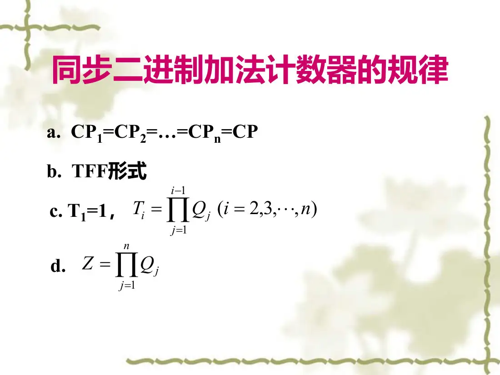

原文：

同步二进制加法计数器的规律

a. $CP_{1}=CP_{2}=\ldots=CP_{n}=CP$

b. TFF形式

c. $T_{1}=1,\quad T_{i}=\prod_{j=1}^{i-1}Q_{j}\;(i=2,3,\cdots,n)$ d. $Z=\prod_{j=1}^{n}Q_{j}$

### 同步二进制减法计数器的规律

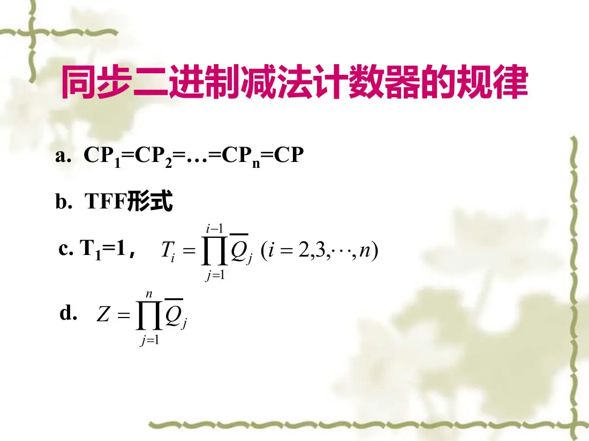

原文：

同步二进制减法计数器的规律

a. $CP_{1}=CP_{2}=\ldots=CP_{n}=CP$

b. TFF形式

c. $T_{1}=1,\quad T_{i}=\prod_{j=1}^{i-1}\overline{Q}_{j}\quad(i=2,3,\cdots,n)$ d. $Z = \prod_{j=1}^{n} \overline{Q}_{j}$

### 异步二进制加法计数器的规律：

原文：

异步二进制加法计数器的规律：

(1) 由 $n$ 个 $T'$ FF构成。

(2) 计数脉冲接第一级触发器的时钟 $CP_{0}$ 。

(3) 后一级输出 $Q_{i+1}$ 是前一级输出 $Q_{i}$ 的二分频, 且在 $Q_{i}$ 的下降沿触发, 因此

对于JKFF: $Q_{i}\rightarrow CP_{i + 1}$

对于DFF: $\bar{Q}_{i}\rightarrow CP_{i+1}$

进位信号 $Z = Q_{1}Q_{2}\dots Q_{n}$

### 异步二进制减法计数器的规律：

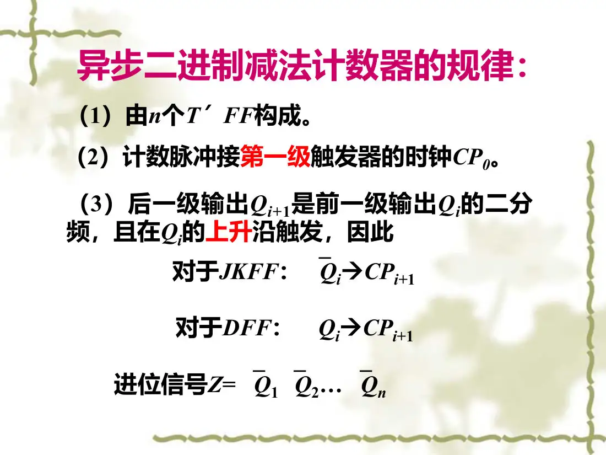

原文：

异步二进制减法计数器的规律：

(1) 由 $n$ 个 $T'$ FF构成。

(2) 计数脉冲接第一级触发器的时钟 $CP_{0}$ 。

(3) 后一级输出 $Q_{i+1}$ 是前一级输出 $Q_{i}$ 的二分频，且在 $Q_{i}$ 的上升沿触发，因此

对于JKFF: $\overline{Q}_i\rightarrow CP_{i + 1}$

对于DFF: $Q_{i} \rightarrow CP_{i+1}$

进位信号 $Z = \overline{Q}_{1}\overline{Q}_{2}\dots \overline{Q}_{n}$

### MSI同步计数器

原文：

MSI同步计数器

74161——4位二进制加法计数器。

74163——4位二进制加法计数器， $\overline{\mathrm{CR}}$ ：同步清0。

✿ 74160——十进制8421BCD加法计数器，引脚功能与74161相同，只是Qcc=1001时为1

### MSI异步计数器

原文：

MSI异步计数器

7490——“二—五—十”进制异步加法计数器。8421BCD和5421BCD

T213——“二—十六”任意进制计数器。

### MSI移位寄存器

原文：

MSI移位寄存器

✿ 74194——四位串入、并入—串出、并出双向移位寄存器。

74195——四位右移移存器

74165——串入、并出—串出8位右移移存器

### 级联扩展

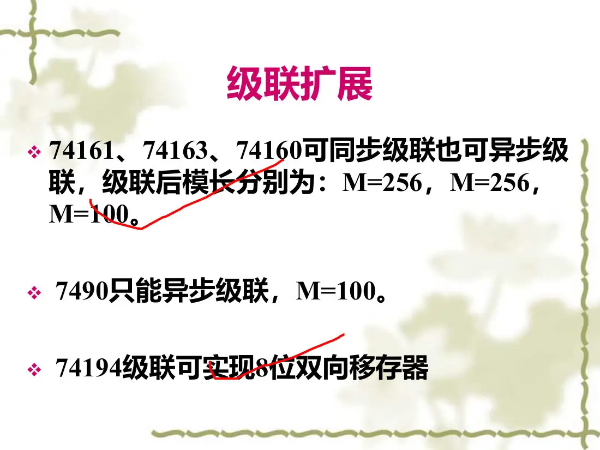

原文：

级联扩展

74161、74163、74160可同步级联也可异步级联，级联后模长分别为：M=256，M=256，M=100。

7490只能异步级联，M=100。

74194级联可实现8位双向移存器

### MSI实现任意进制计数器(M<N)

原文：

MSI实现任意进制计数器(M<N)

反馈法：异步清0法和同步置数法。注意：用 $L_{D}$ 端置全1（置最大数法）时，反馈状态对应编码中出现0的端口需通过非门送入反馈门。

任意进制计数器的进位信号/分频输出可以很方便的从反馈门输出端（CR, $L_{D}$ ）直接引出。

### 总结：74161实现模长为M的任意进制计数器

原文：

总结：74161实现模长为M的任意进制计数器

1、异步复0法: 反馈状态= $S_{M}$

2、同步置0法：反馈状态= $S_{M-1}$

3、置最小数法：置数状态=16-M

4、置最大数法：反馈状态= $S_{M-2}$

### MSI实现任意进制计数器(M>N)

原文：

MSI实现任意进制计数器(M>N)

1）整体清“0”法或整体置数法

基本思路：先将计数器级联组成模长大于M的计数器，计满M个状态后，采用清“0”或置数法实现M进制计数器。注意：异步级联不能采用置数法。

2）分解法

基本思路：将 $M=M_{1}\times M_{2}\times\ldots M_{n}$ ，其中 $M_{1}$ 、 $M_{2}$ 、 $\ldots M_{n}$ 均不大于N，则用n片计数器分别组成 $M_{1}$ 、 $M_{2}$ 、 $\ldots M_{n}$ 进制的计数器，然后异步级联即可构成M进制计数器。

### 几种连接方式的模长：

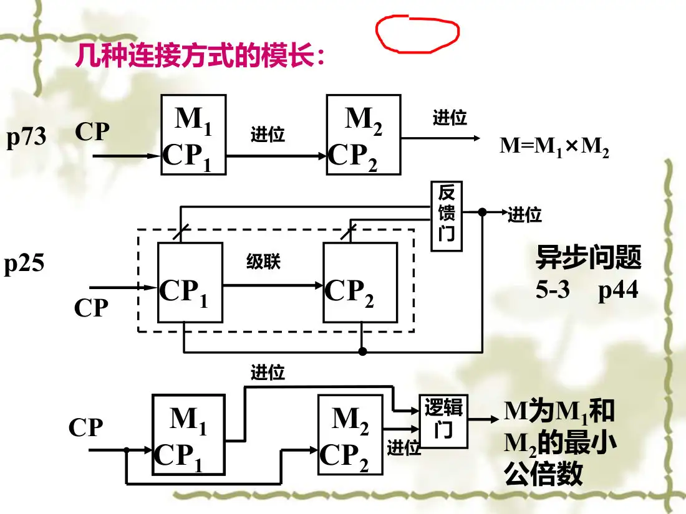

原文：

几种连接方式的模长：

### 74161的应用1:级联扩展

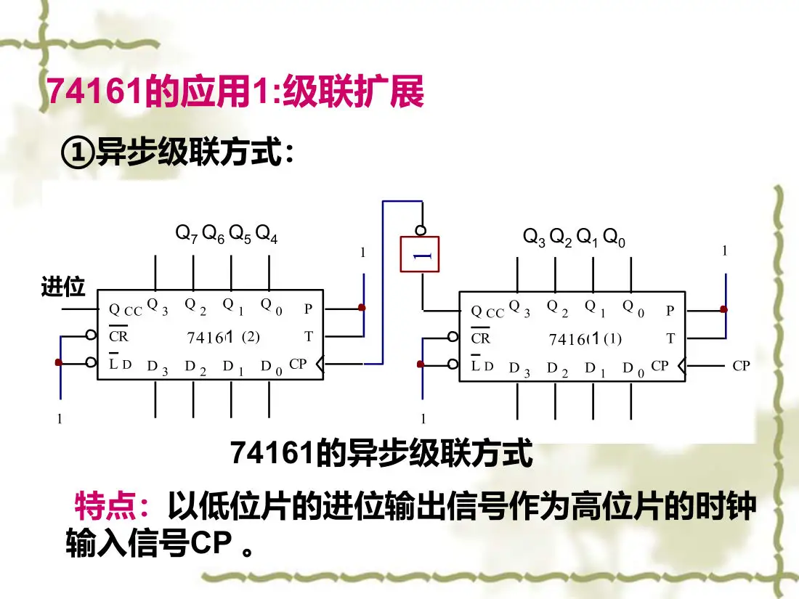

原文：

74161的应用1:级联扩展

①异步级联方式：

特点：以低位片的进位输出信号作为高位片的时钟输入信号CP。

### ②同步级联方式：

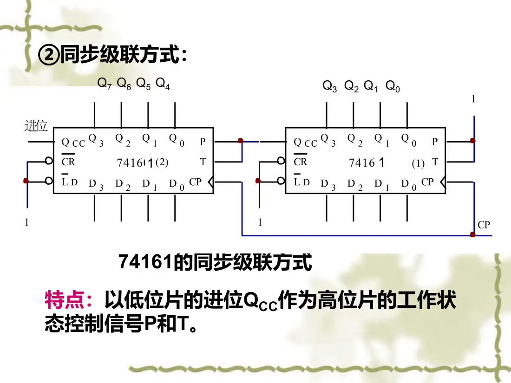

原文：

②同步级联方式：

特点：以低位片的进位 $Q_{cc}$ 作为高位片的工作状态控制信号P和T。

### 思考题：分析下图电路输出Z是CP的几分频？

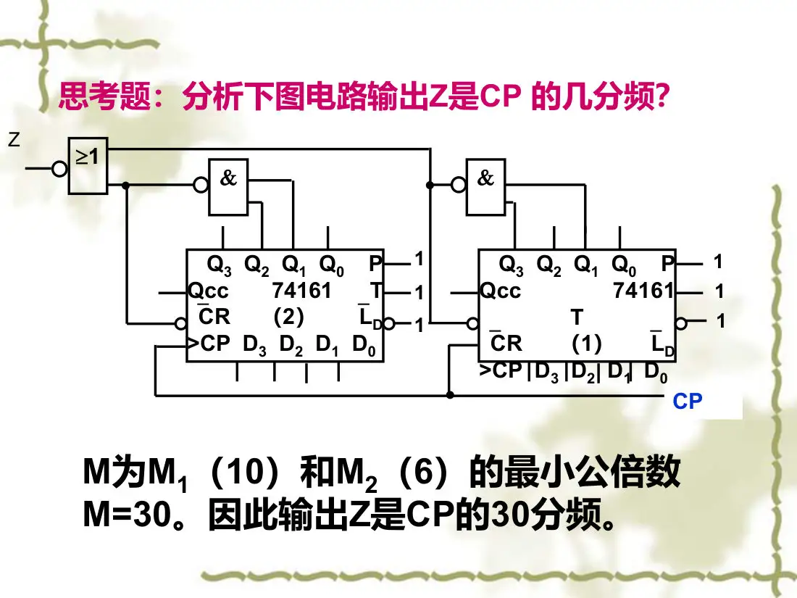

原文：

思考题：分析下图电路输出Z是CP的几分频？

M为 $M_{1}$ （10）和 $M_{2}$ （6）的最小公倍数M=30。因此输出Z是CP的30分频。

### 序列码发生器

原文：

序列码发生器

已知序列发生器：移存型和计数型。

已知序列长度发生器：用最长线性序列加反馈的设计方法。 $D_{1}=f\oplus$ 起跳状态+ $\overline{Q}_{n}$ $\overline{Q}_{n-1}\cdots$ $\overline{Q}_{1}$ m序列反馈函数记住n<5。

### 五、顺序脉冲发生器

原文：

五、顺序脉冲发生器
六、时序电路的分析和同步时序电路的设计例1 试给出一个自动售饮料机的原始状态转移图。它的投币口每次只能投入一枚五角或一元的硬币。投入一元五角硬币后机器自动给出一杯饮料，投入两元（两枚一元）硬币后，在给出饮料的同时找回一枚五角的硬币。

### 第 21 页

原文：

解: ①输入变量为A、B, 输出变量为Y、Z; 取投币信号为输入变量, 用A、B表示, 给出饮料信号和找钱信号为输出变量, 用Y、Z表示。

### 变量定义:

原文：

变量定义:

A: 表示投入一枚一元硬币。

B: 表示投入一枚五角硬币。

Y: 表示给出饮料。

Z: 表示找回一枚五角硬币。

状态定义：

$\mathrm{S}_0$ :初始状态。

$\mathrm{S}_{1}$ :收到五角硬币。

$\mathrm{S}_{2}$ :收到一元硬币。

$\mathrm{S}_{3}$ :收到一元五角硬币。并入 $\mathrm{S}_{0}$ 状态。

### 变量定义:

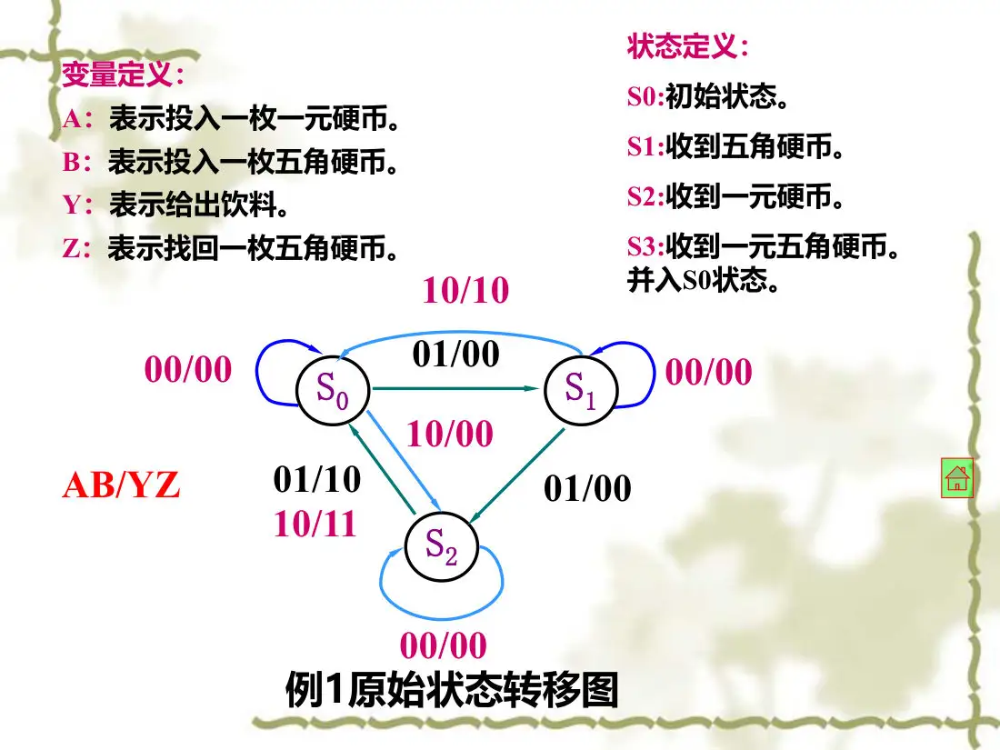

原文：

变量定义:

A: 表示投入一枚一元硬币。

B: 表示投入一枚五角硬币。

Y: 表示给出饮料。

Z: 表示找回一枚五角硬币。

10/10

状态定义：

S0:初始状态。

S1:收到五角硬币。

S2:收到一元硬币。

S3:收到一元五角硬币。并入S0状态。

AB/YZ

### 例2、分析图所示计数器电路，说明是模长为多少的计数器，并列出状态转移表。

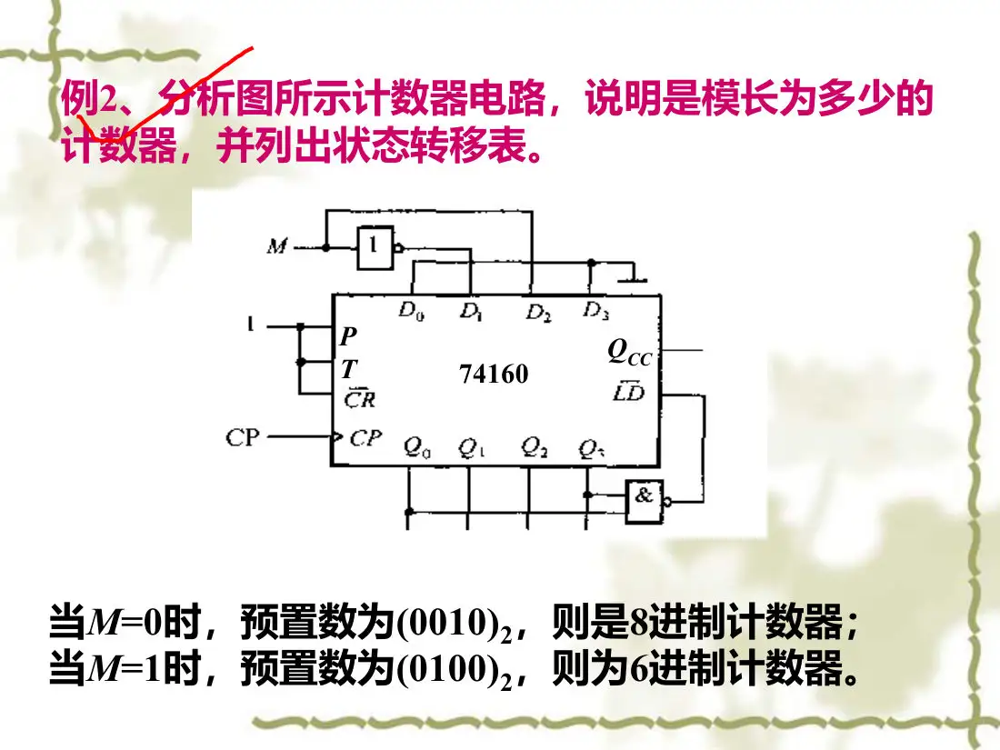

原文：

例2、分析图所示计数器电路，说明是模长为多少的计数器，并列出状态转移表。

当M=0时，预置数为 $(0010)_{2}$ ，则是8进制计数器；当M=1时，预置数为 $(0100)_{2}$ ，则为6进制计数器。

### 例2 判断下图所示电路是几进制计数器?

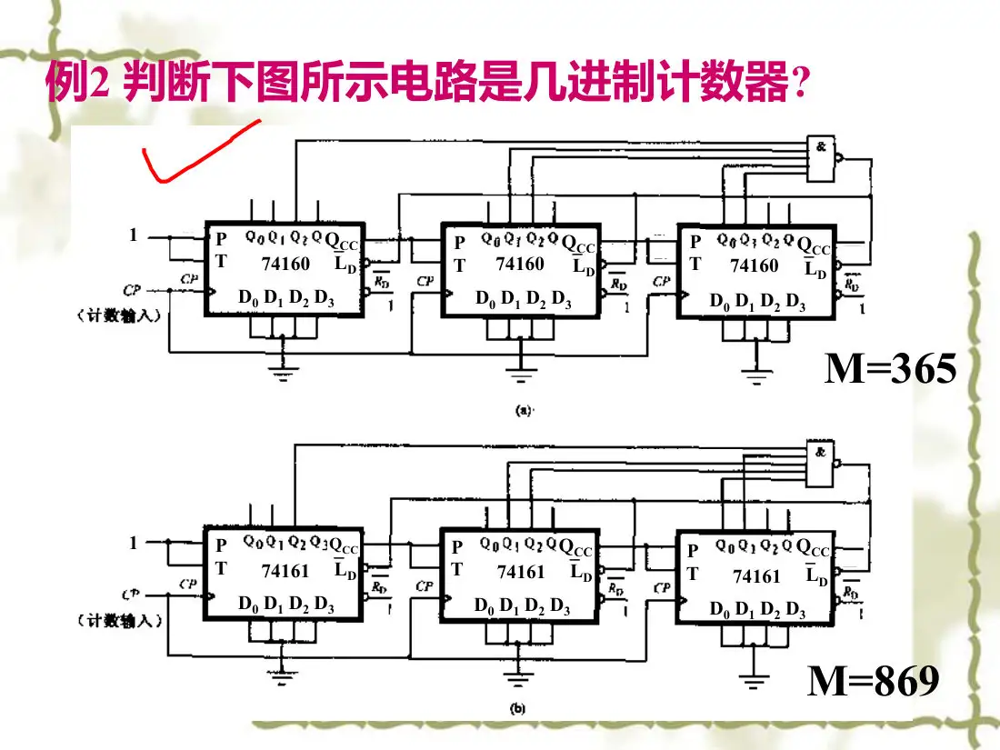

原文：

例2 判断下图所示电路是几进制计数器?

### 例3、试分析图所示电路的分频比(即Y与CP的分频比)。

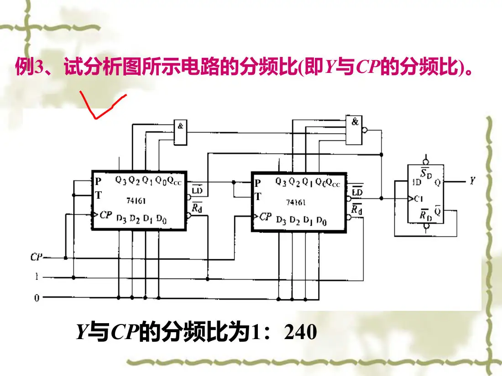

原文：

例3、试分析图所示电路的分频比(即Y与CP的分频比)。

Y与CP的分频比为1：240

### 习题讲解：

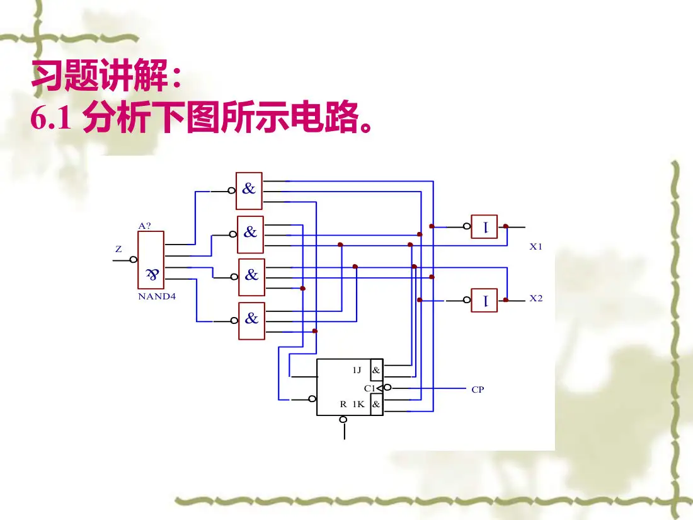

原文：

习题讲解：

6.1 分析下图所示电路。

### $$

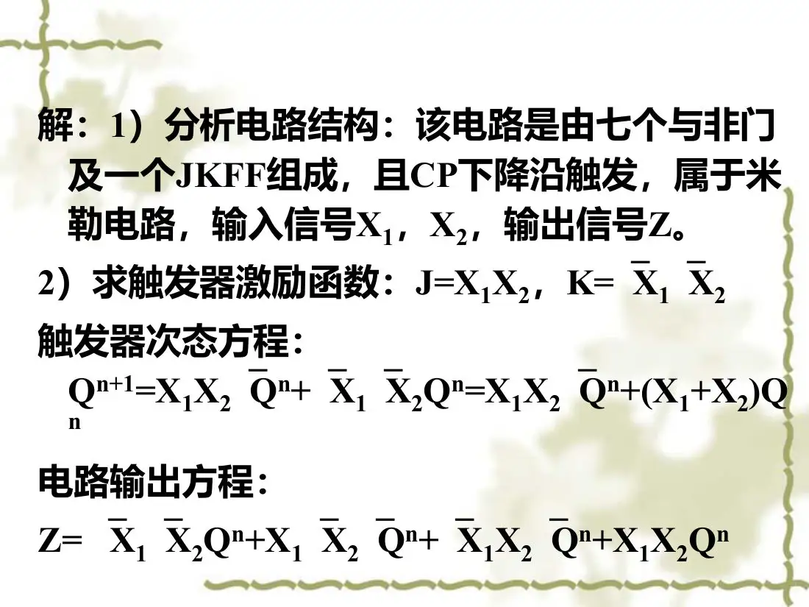

原文：

解：1）分析电路结构：该电路是由七个与非门及一个JKFF组成，且CP下降沿触发，属于米勒电路，输入信号 $X_{1}$ ， $X_{2}$ ，输出信号Z。

2）求触发器激励函数： $J=X_{1}X_{2}$ ， $K=\bar{X}_{1}\bar{X}_{2}$ 触发器次态方程：

$$
\mathbf {Q} _ {\mathrm{n}} ^ {\mathrm{n+1}} = \mathbf {X} _ {1} \mathbf {X} _ {2} \overline {{\mathbf {Q}}} ^ {\mathrm{n}} + \overline {{\mathbf {X}}} _ {1} \overline {{\mathbf {X}}} _ {2} \mathbf {Q} ^ {\mathrm{n}} = \mathbf {X} _ {1} \mathbf {X} _ {2} \overline {{\mathbf {Q}}} ^ {\mathrm{n}} + (\mathbf {X} _ {1} + \mathbf {X} _ {2}) \mathbf {Q}
$$

电路输出方程:

$$
\mathbf {Z} = \overline {{\mathbf {X}}} _ {1} \overline {{\mathbf {X}}} _ {2} \mathbf {Q} ^ {\mathrm{n}} + \mathbf {X} _ {1} \overline {{\mathbf {X}}} _ {2} \overline {{\mathbf {Q}}} ^ {\mathrm{n}} + \overline {{\mathbf {X}}} _ {1} \mathbf {X} _ {2} \overline {{\mathbf {Q}}} ^ {\mathrm{n}} + \mathbf {X} _ {1} \mathbf {X} _ {2} \mathbf {Q} ^ {\mathrm{n}}
$$

### 3)状态转移表:

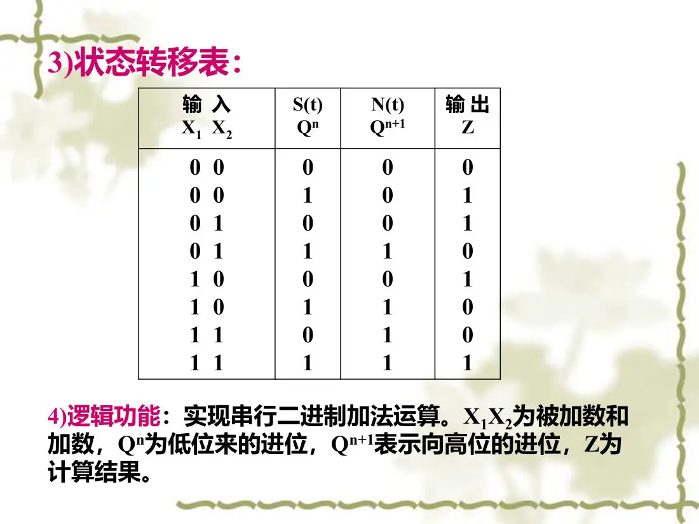

原文：

3)状态转移表:

<table><tr><td>输入 $X_1$   $X_2$ </td><td>S(t) $Q^n$ </td><td>N(t) $Q^{n+1}$ </td><td>输出Z</td></tr><tr><td>0 0</td><td>0</td><td>0</td><td>0</td></tr><tr><td>0 0</td><td>1</td><td>0</td><td>1</td></tr><tr><td>0 1</td><td>0</td><td>0</td><td>1</td></tr><tr><td>0 1</td><td>1</td><td>1</td><td>0</td></tr><tr><td>1 0</td><td>0</td><td>0</td><td>1</td></tr><tr><td>1 0</td><td>1</td><td>1</td><td>0</td></tr><tr><td>1 1</td><td>0</td><td>1</td><td>0</td></tr><tr><td>1 1</td><td>1</td><td>1</td><td>1</td></tr></table>

4)逻辑功能：实现串行二进制加法运算。 $X_{1}X_{2}$ 为被加数和加数， $Q^{n}$ 为低位来的进位， $Q^{n+1}$ 表示向高位的进位，Z为计算结果。

### 第 30 页

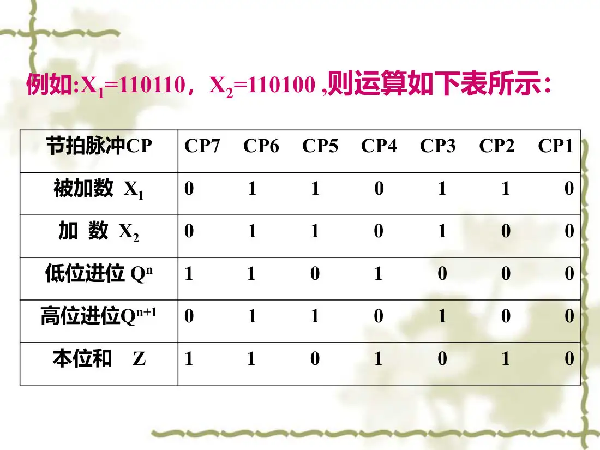

原文：

例如: $X_{1}=110110$ , $X_{2}=110100$ , 则运算如下表所示:

<table><tr><td>节拍脉冲CP</td><td>CP7</td><td>CP6</td><td>CP5</td><td>CP4</td><td>CP3</td><td>CP2</td><td>CP1</td></tr><tr><td>被加数  $X_1$ </td><td>0</td><td>1</td><td>1</td><td>0</td><td>1</td><td>1</td><td>0</td></tr><tr><td>加数  $X_2$ </td><td>0</td><td>1</td><td>1</td><td>0</td><td>1</td><td>0</td><td>0</td></tr><tr><td>低位进位  $Q^n$ </td><td>1</td><td>1</td><td>0</td><td>1</td><td>0</td><td>0</td><td>0</td></tr><tr><td>高位进位 $Q^{n+1}$ </td><td>0</td><td>1</td><td>1</td><td>0</td><td>1</td><td>0</td><td>0</td></tr><tr><td>本位和 Z</td><td>1</td><td>1</td><td>0</td><td>1</td><td>0</td><td>1</td><td>0</td></tr></table>

### (1) 101序列可以重叠，例如：

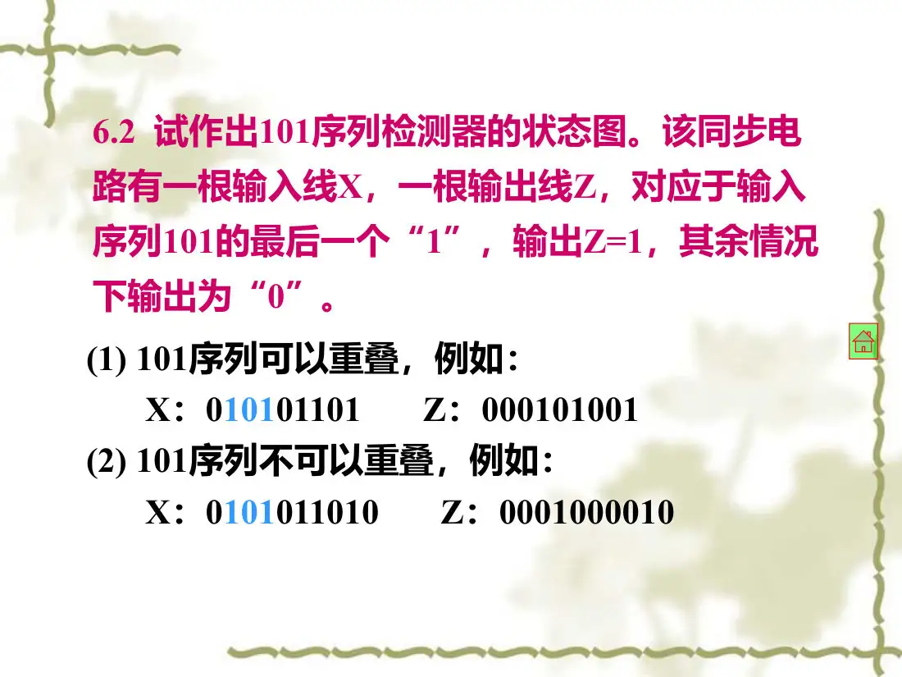

原文：

6.2 试作出101序列检测器的状态图。该同步电路有一根输入线X，一根输出线Z，对应于输入序列101的最后一个“1”，输出Z=1，其余情况下输出为“0”。

(1) 101序列可以重叠，例如：
X: 010101101 Z: 000101001

(2) 101序列不可以重叠，例如：
X: 0101011010 Z: 0001000010(1) 解: ① 输入变量为X、输出变量为Z;

### 定义状态:

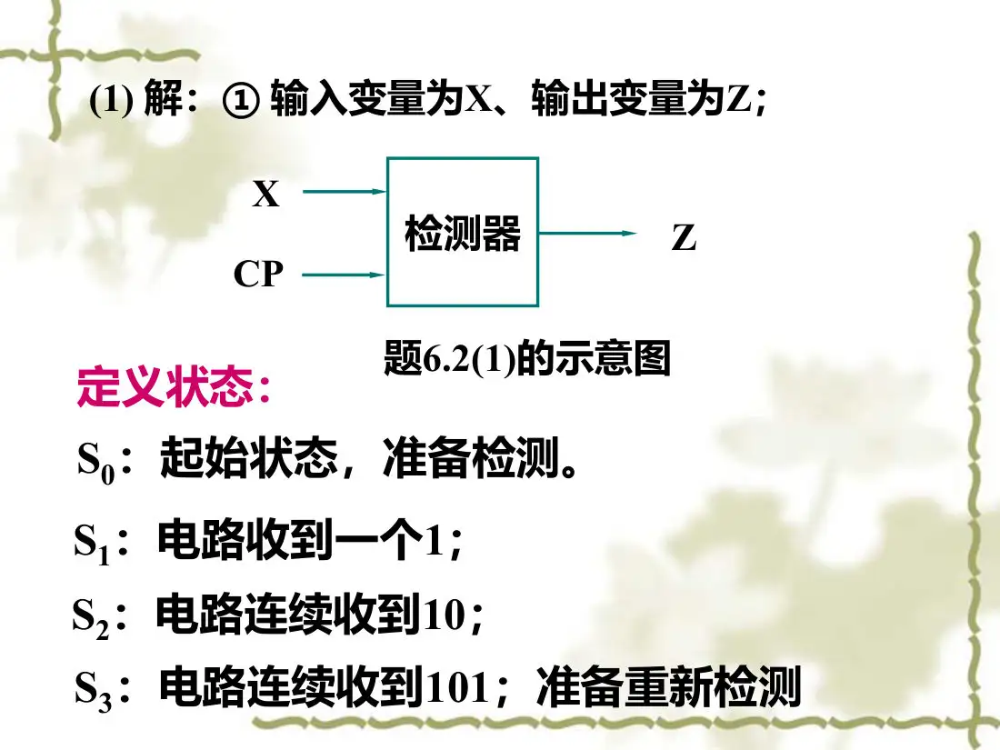

原文：

定义状态:

$\mathrm{S}_0$ ：起始状态，准备检测。

$\mathrm{S}_{1}$ : 电路收到一个1;

$\mathrm{S}_{2}$ : 电路连续收到10;

$\mathrm{S}_{3}$ ：电路连续收到101；准备重新检测

### 检测序列101(可重叠)状态转移图

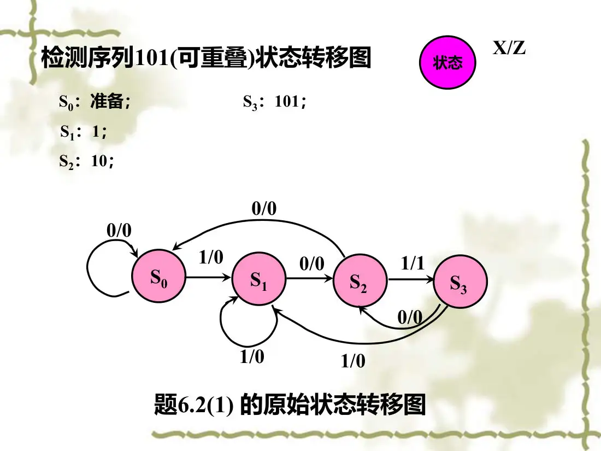

原文：

检测序列101(可重叠)状态转移图

状态

$\mathrm{S}_{0}$ ：准备；

$\mathbf{S}_1\colon 1;$

$\mathbf{S}_2$ : 10;

$\mathbf{S}_3$ : 101;

### 第 34 页

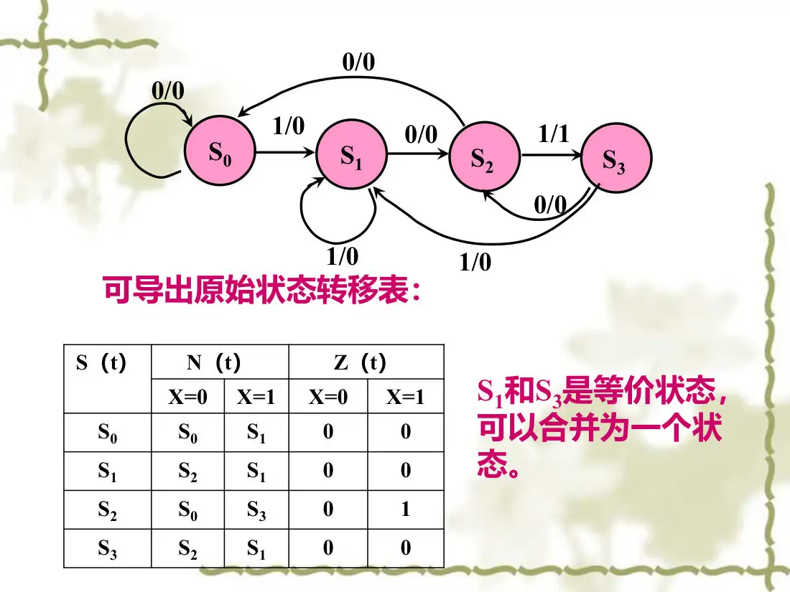

原文：

<table><tr><td rowspan="2">S (t)</td><td colspan="2">N (t)</td><td colspan="2">Z (t)</td></tr><tr><td>X=0</td><td>X=1</td><td>X=0</td><td>X=1</td></tr><tr><td> $S_0$ </td><td> $S_0$ </td><td> $S_1$ </td><td>0</td><td>0</td></tr><tr><td> $S_1$ </td><td> $S_2$ </td><td> $S_1$ </td><td>0</td><td>0</td></tr><tr><td> $S_2$ </td><td> $S_0$ </td><td> $S_3$ </td><td>0</td><td>1</td></tr><tr><td> $S_3$ </td><td> $S_2$ </td><td> $S_1$ </td><td>0</td><td>0</td></tr></table>

$\mathrm{S}_{1}$ 和 $\mathrm{S}_{3}$ 是等价状态，可以合并为一个状态。

### $S_{0}$ ：准备；

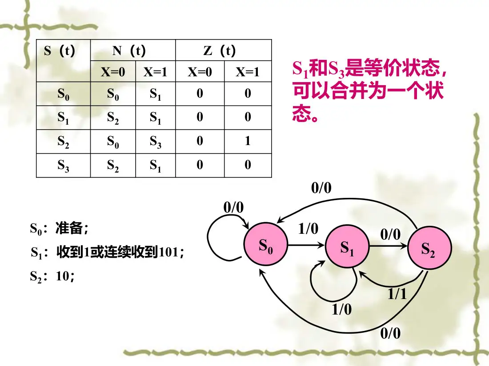

原文：

<table><tr><td rowspan="2">S (t)</td><td colspan="2">N (t)</td><td colspan="2">Z (t)</td></tr><tr><td>X=0</td><td>X=1</td><td>X=0</td><td>X=1</td></tr><tr><td> $S_0$ </td><td> $S_0$ </td><td> $S_1$ </td><td>0</td><td>0</td></tr><tr><td> $S_1$ </td><td> $S_2$ </td><td> $S_1$ </td><td>0</td><td>0</td></tr><tr><td> $S_2$ </td><td> $S_0$ </td><td> $S_3$ </td><td>0</td><td>1</td></tr><tr><td> $S_3$ </td><td> $S_2$ </td><td> $S_1$ </td><td>0</td><td>0</td></tr></table>

$S_{0}$ ：准备；

$\mathrm{S}_1$ ：收到1或连续收到101；

$S_{2}$ : 10;

$\mathrm{S}_{1}$ 和 $\mathrm{S}_{3}$ 是等价状态，可以合并为一个状态。

### (2) 解: ① 输入变量为X、输出变量为Z;

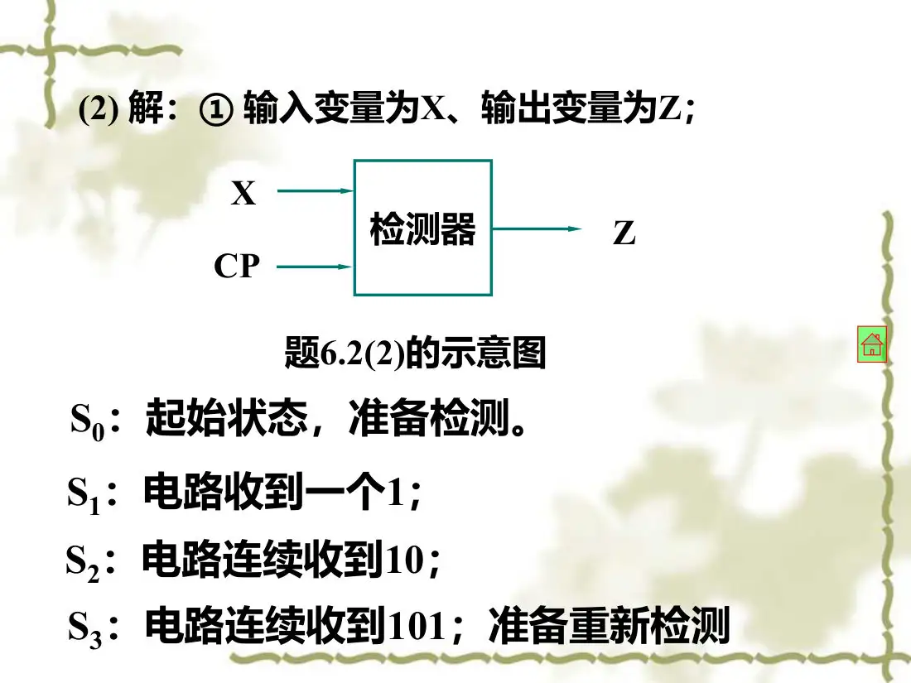

原文：

(2) 解: ① 输入变量为X、输出变量为Z;

$\mathrm{S}_0$ ：起始状态，准备检测。

$\mathrm{S}_{1}$ : 电路收到一个1;

$\mathrm{S}_{2}$ : 电路连续收到10;

$\mathrm{S}_{3}$ ：电路连续收到101；准备重新检测

### 检测序列101(不可重叠)状态转移图

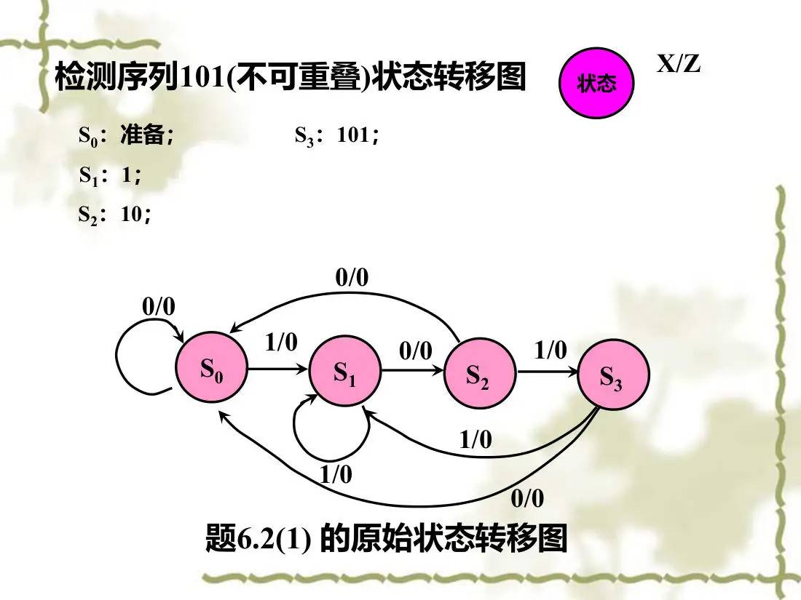

原文：

检测序列101(不可重叠)状态转移图

状态

$\mathrm{S}_0$ ：准备；

$\mathrm{S}_3$ : 101;

$\mathbf{S}_1$ : 1;

$\mathrm{S}_{2}$ : 10;

### 可导出原始状态转移表：

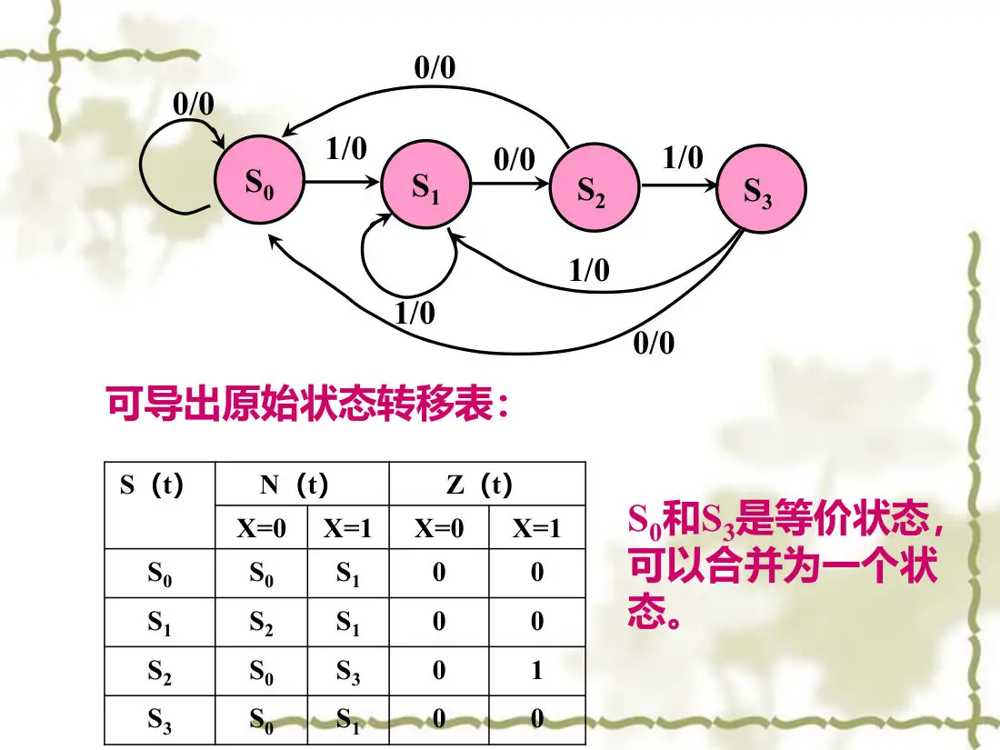

原文：

可导出原始状态转移表：

<table><tr><td rowspan="2">S (t)</td><td colspan="2">N (t)</td><td colspan="2">Z (t)</td></tr><tr><td>X=0</td><td>X=1</td><td>X=0</td><td>X=1</td></tr><tr><td> $S_0$ </td><td> $S_0$ </td><td> $S_1$ </td><td>0</td><td>0</td></tr><tr><td> $S_1$ </td><td> $S_2$ </td><td> $S_1$ </td><td>0</td><td>0</td></tr><tr><td> $S_2$ </td><td> $S_0$ </td><td> $S_3$ </td><td>0</td><td>1</td></tr><tr><td> $S_3$ </td><td> $S_0$ </td><td> $S_1$ </td><td>0</td><td>0</td></tr></table>

$\mathrm{S}_0$ 和 $\mathrm{S}_3$ 是等价状态，可以合并为一个状态。

### $\mathrm{S}_0$ ：连续收到101；准备；

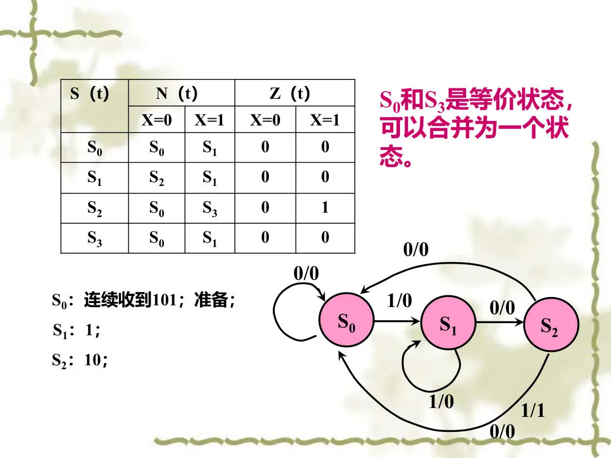

原文：

<table><tr><td rowspan="2">S (t)</td><td colspan="2">N (t)</td><td colspan="2">Z (t)</td></tr><tr><td>X=0</td><td>X=1</td><td>X=0</td><td>X=1</td></tr><tr><td> $S_0$ </td><td> $S_0$ </td><td> $S_1$ </td><td>0</td><td>0</td></tr><tr><td> $S_1$ </td><td> $S_2$ </td><td> $S_1$ </td><td>0</td><td>0</td></tr><tr><td> $S_2$ </td><td> $S_0$ </td><td> $S_3$ </td><td>0</td><td>1</td></tr><tr><td> $S_3$ </td><td> $S_0$ </td><td> $S_1$ </td><td>0</td><td>0</td></tr></table>

$\mathrm{S}_0$ ：连续收到101；准备；

$\mathbf{S}_1\colon 1;$

$$
\mathbf {S} _ {2}: \mathbf {1 0};
$$

$\mathrm{S}_0$ 和 $\mathrm{S}_3$ 是等价状态，可以合并为一个状态。

### 6.3 对下列原始状态转移表进行简化。

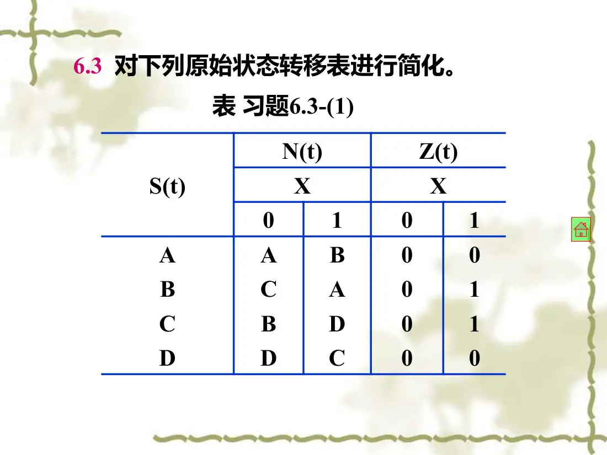

原文：

6.3 对下列原始状态转移表进行简化。

表 习题6.3-(1)
<table><tr><td rowspan="3">S(t)</td><td colspan="2">N(t)</td><td colspan="2">Z(t)</td></tr><tr><td colspan="2">X</td><td colspan="2">X</td></tr><tr><td>0</td><td>1</td><td>0</td><td>1</td></tr><tr><td>A</td><td>A</td><td>B</td><td>0</td><td>0</td></tr><tr><td>B</td><td>C</td><td>A</td><td>0</td><td>1</td></tr><tr><td>C</td><td>B</td><td>D</td><td>0</td><td>1</td></tr><tr><td>D</td><td>D</td><td>C</td><td>0</td><td>0</td></tr></table>

### S(t)N(t)Z(t)XX0101AAB00BCA01CBD01DDC00

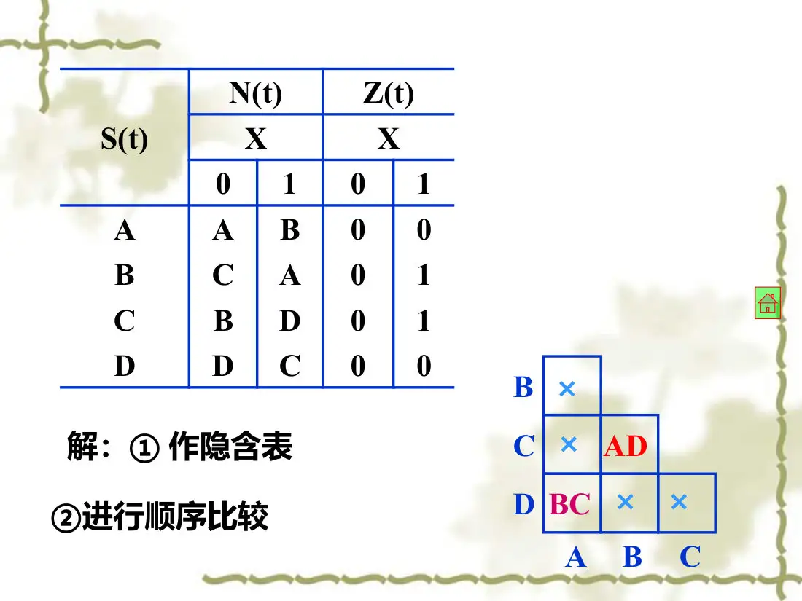

原文：

<table><tr><td rowspan="3">S(t)</td><td colspan="2">N(t)</td><td colspan="2">Z(t)</td></tr><tr><td colspan="2">X</td><td colspan="2">X</td></tr><tr><td>0</td><td>1</td><td>0</td><td>1</td></tr><tr><td>A</td><td>A</td><td>B</td><td>0</td><td>0</td></tr><tr><td>B</td><td>C</td><td>A</td><td>0</td><td>1</td></tr><tr><td>C</td><td>B</td><td>D</td><td>0</td><td>1</td></tr><tr><td>D</td><td>D</td><td>C</td><td>0</td><td>0</td></tr></table>
解：① 作隐含表

②进行顺序比较

### ③进行关联比较

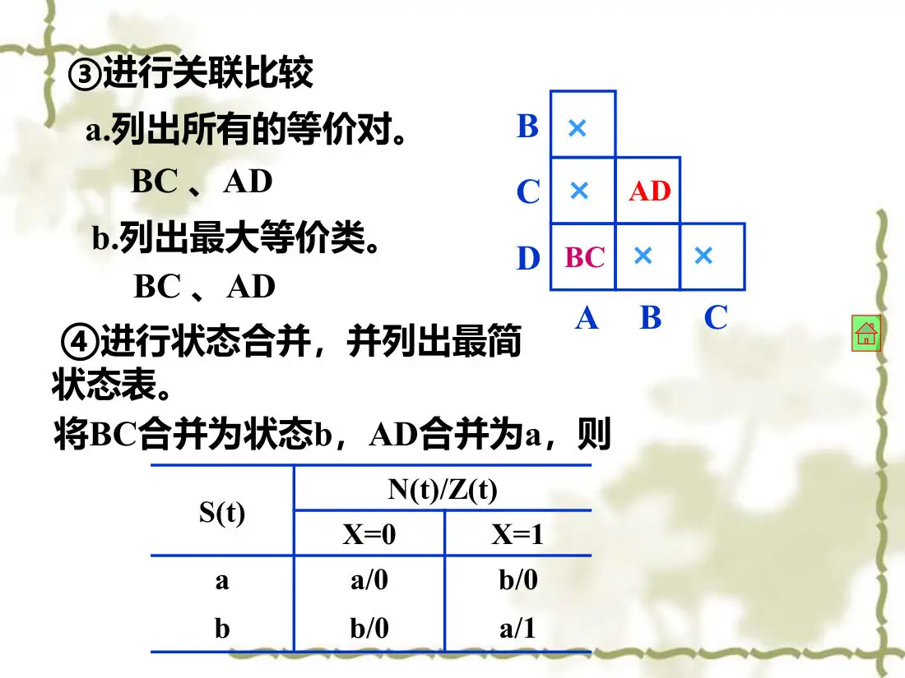

原文：

③进行关联比较

a.列出所有的等价对。BC、AD

b. 列出最大等价类。
BC、AD

④进行状态合并，并列出最简状态表。

将BC合并为状态b，AD合并为a，则

<table><tr><td rowspan="2">S(t)</td><td colspan="2">N(t)/Z(t)</td></tr><tr><td>X=0</td><td>X=1</td></tr><tr><td>a</td><td>a/0</td><td>b/0</td></tr><tr><td>b</td><td>b/0</td><td>a/1</td></tr></table>

### 6.3-(2)

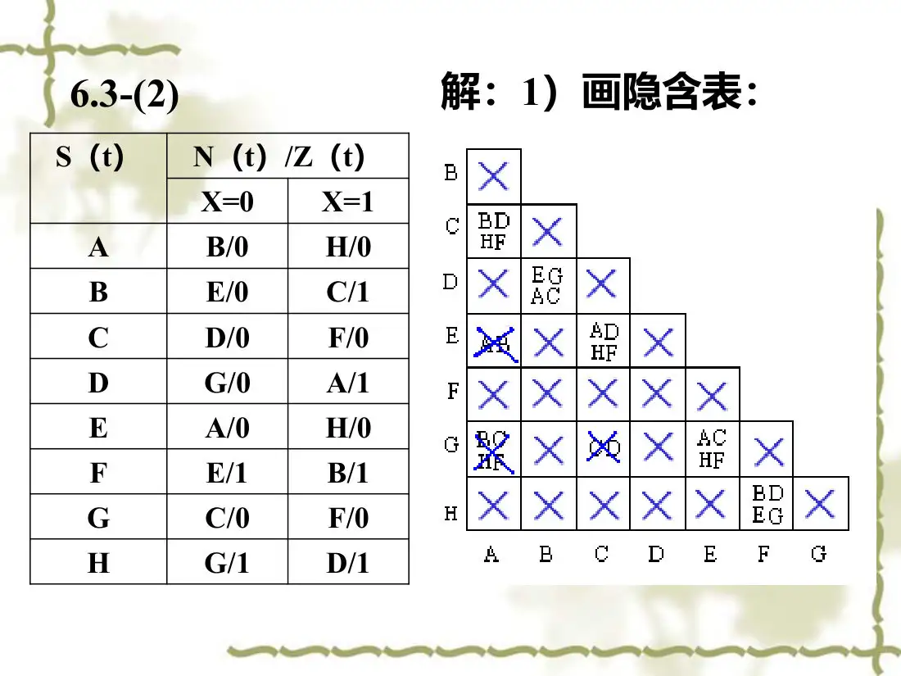

原文：

6.3-(2)

<table><tr><td rowspan="2">S (t)</td><td colspan="2">N (t) /Z (t)</td></tr><tr><td>X=0</td><td>X=1</td></tr><tr><td>A</td><td>B/0</td><td>H/0</td></tr><tr><td>B</td><td>E/0</td><td>C/1</td></tr><tr><td>C</td><td>D/0</td><td>F/0</td></tr><tr><td>D</td><td>G/0</td><td>A/1</td></tr><tr><td>E</td><td>A/0</td><td>H/0</td></tr><tr><td>F</td><td>E/1</td><td>B/1</td></tr><tr><td>G</td><td>C/0</td><td>F/0</td></tr><tr><td>H</td><td>G/1</td><td>D/1</td></tr></table>

### 2）关联比较：AC,BD,EG,HF,之间互为等价隐含条件，所以分别等价。

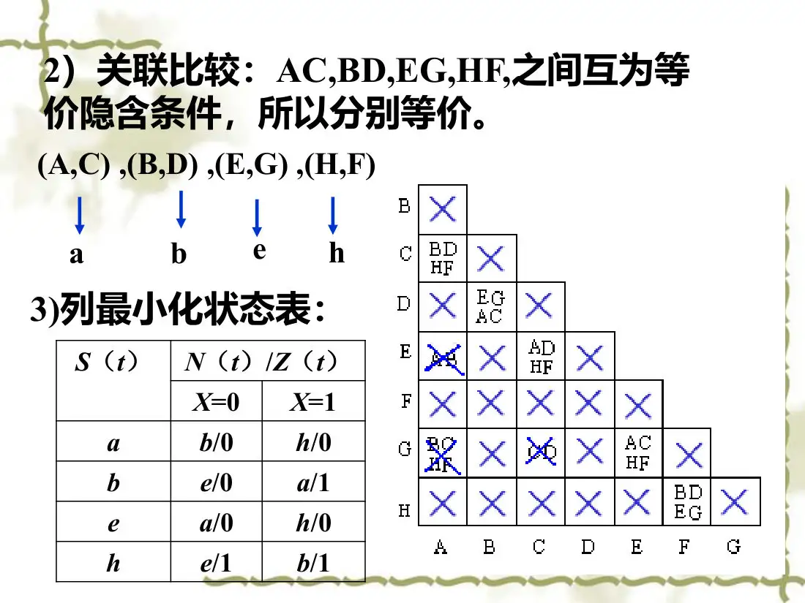

原文：

2）关联比较：AC,BD,EG,HF,之间互为等价隐含条件，所以分别等价。

$$
\begin{array}{c c c c c} \text {(A,C) , (B,D) , (E,G) , (H,F)} \\ \downarrow & \downarrow & \downarrow & \downarrow \\ \text {a} & \text {b} & \text {e} & \text {h} \end{array}
$$

3)列最小化状态表:

<table><tr><td rowspan="2">S(t)</td><td colspan="2">N(t)/Z(t)</td></tr><tr><td>X=0</td><td>X=1</td></tr><tr><td>a</td><td>b/0</td><td>h/0</td></tr><tr><td>b</td><td>e/0</td><td>a/1</td></tr><tr><td>e</td><td>a/0</td><td>h/0</td></tr><tr><td>h</td><td>e/1</td><td>b/1</td></tr></table>

<table><tr><td>B</td><td>×</td><td></td><td></td><td></td><td></td><td></td><td></td></tr><tr><td>C</td><td>BDHF</td><td>×</td><td></td><td></td><td></td><td></td><td></td></tr><tr><td>D</td><td>×</td><td>EGAC</td><td>×</td><td></td><td></td><td></td><td></td></tr><tr><td>E</td><td>AH</td><td>×</td><td>ADHF</td><td>×</td><td></td><td></td><td></td></tr><tr><td>F</td><td>×</td><td>×</td><td>×</td><td>×</td><td>×</td><td></td><td></td></tr><tr><td>G</td><td>BOHF</td><td>×</td><td>CO</td><td>×</td><td>ACHF</td><td>×</td><td></td></tr><tr><td>H</td><td>×</td><td>×</td><td>×</td><td>×</td><td>×</td><td>BDEG</td><td>×</td></tr></table>

### 第 45 页

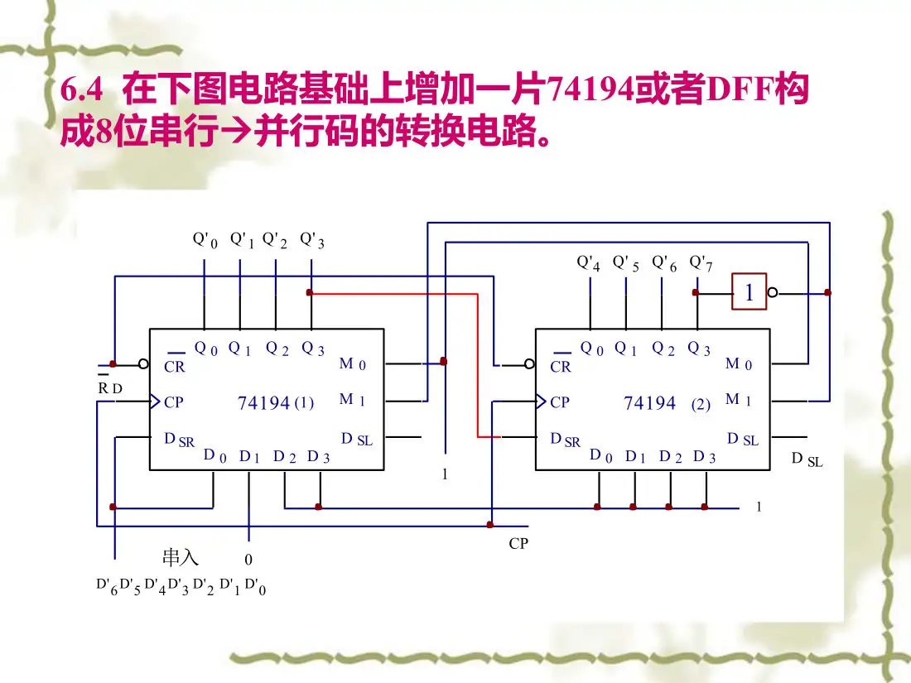

原文：

6.4 在下图电路基础上增加一片74194或者DFF构成8位串行→并行码的转换电路。

### 表6.4.4 7位串入—并出转换电路的状态转移表

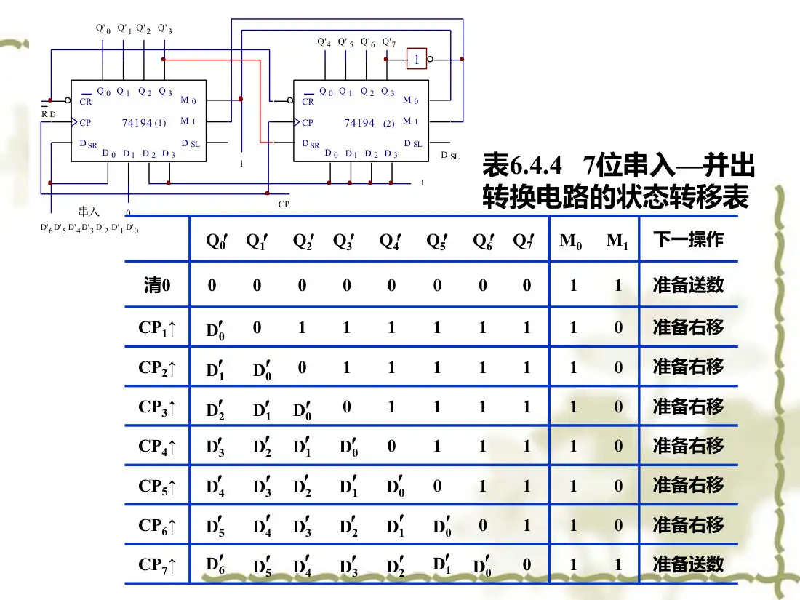

原文：

表6.4.4 7位串入—并出转换电路的状态转移表
<table><tr><td></td><td> ${\mathrm{Q}}_{0}^{\prime }$ </td><td> ${\mathrm{Q}}_{1}^{\prime }$ </td><td> ${\mathrm{Q}}_{2}^{\prime }$ </td><td> ${\mathrm{Q}}_{3}^{\prime }$ </td><td> ${\mathrm{Q}}_{4}^{\prime }$ </td><td> ${\mathrm{Q}}_{5}^{\prime }$ </td><td> ${\mathrm{Q}}_{6}^{\prime }$ </td><td> ${\mathrm{Q}}_{7}^{\prime }$ </td><td> ${\mathrm{M}}_{0}$ </td><td> ${\mathrm{M}}_{1}$ </td><td>下一操作</td></tr><tr><td>清0</td><td>0</td><td>0</td><td>0</td><td>0</td><td>0</td><td>0</td><td>0</td><td>0</td><td>1</td><td>1</td><td>准备送数</td></tr><tr><td> $CP_1\uparrow$ </td><td> $D_0^\prime$ </td><td>0</td><td>1</td><td>1</td><td>1</td><td>1</td><td>1</td><td>1</td><td>1</td><td>0</td><td>准备右移</td></tr><tr><td> $CP_2\uparrow$ </td><td> $D_1^\prime$ </td><td> $D_0^\prime$ </td><td>0</td><td>1</td><td>1</td><td>1</td><td>1</td><td>1</td><td>1</td><td>0</td><td>准备右移</td></tr><tr><td> $CP_3\uparrow$ </td><td> $D_2^\prime$ </td><td> $D_1^\prime$ </td><td> $D_0^\prime$ </td><td>0</td><td>1</td><td>1</td><td>1</td><td>1</td><td>1</td><td>0</td><td>准备右移</td></tr><tr><td> $CP_4\uparrow$ </td><td> $D_3^\prime$ </td><td> $D_2^\prime$ </td><td> $D_1^\prime$ </td><td> $D_0^\prime$ </td><td>0</td><td>1</td><td>1</td><td>1</td><td>1</td><td>0</td><td>准备右移</td></tr><tr><td> $CP_5\uparrow$ </td><td> $D_4^\prime$ </td><td> $D_3^\prime$ </td><td> $D_2^\prime$ </td><td> $D_1^\prime$ </td><td> $D_0^\prime$ </td><td>0</td><td>1</td><td>1</td><td>1</td><td>0</td><td>准备右移</td></tr><tr><td> $CP_6\uparrow$ </td><td> $D_5^\prime$ </td><td> $D_4^\prime$ </td><td> $D_3^\prime$ </td><td> $D_2^\prime$ </td><td> $D_1^\prime$ </td><td> $D_0^\prime$ </td><td>0</td><td>1</td><td>1</td><td>0</td><td>准备右移</td></tr><tr><td> $CP_7\uparrow$ </td><td> $D_6^\prime$ </td><td> $D_5^\prime$ </td><td> $D_4^\prime$ </td><td> $D_3^\prime$ </td><td> $D_2^\prime$ </td><td> $D_1^\prime$ </td><td> $D_0^\prime$ </td><td>0</td><td>1</td><td>1</td><td>准备送数</td></tr></table>

### 方法一：触发器输出作 $Q_{8}^{\prime}$ $M_{1}$ D

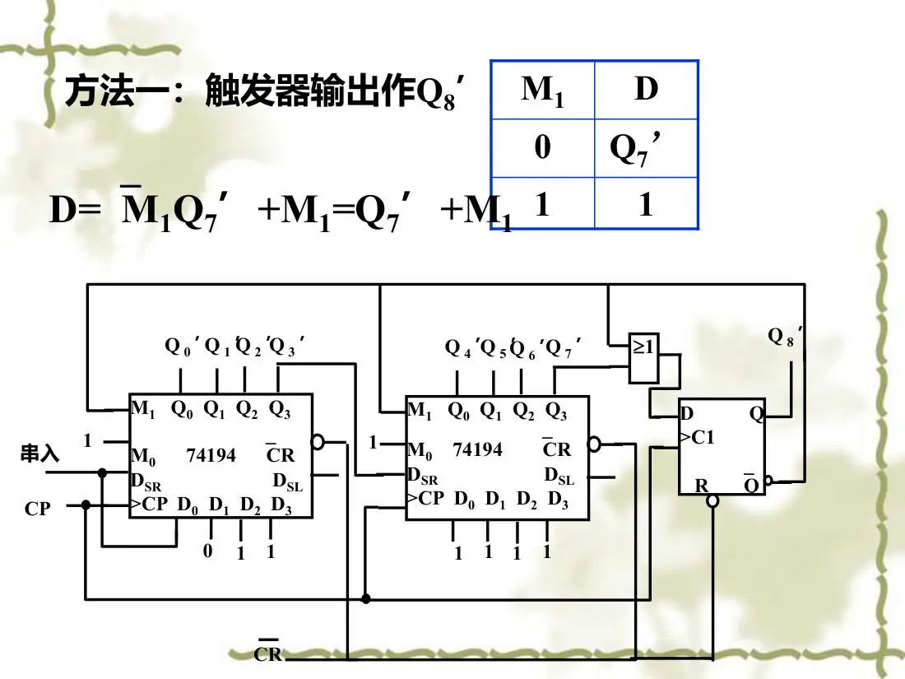

原文：

方法一：触发器输出作 $Q_{8}^{\prime}$ $M_{1}$ D

0 $Q_{7}^{\prime}$ 1 1

### 方法二：触发器输出作 $Q_{4}^{\prime}$

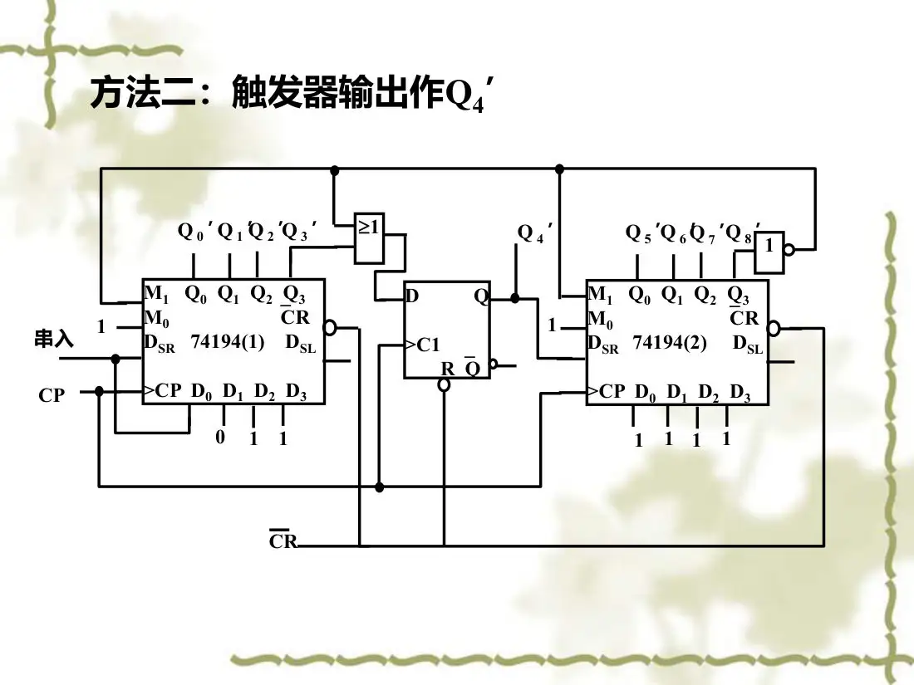

原文：

方法二：触发器输出作 $Q_{4}^{\prime}$

### 方法三：触发器输出作 $Q_{0}$

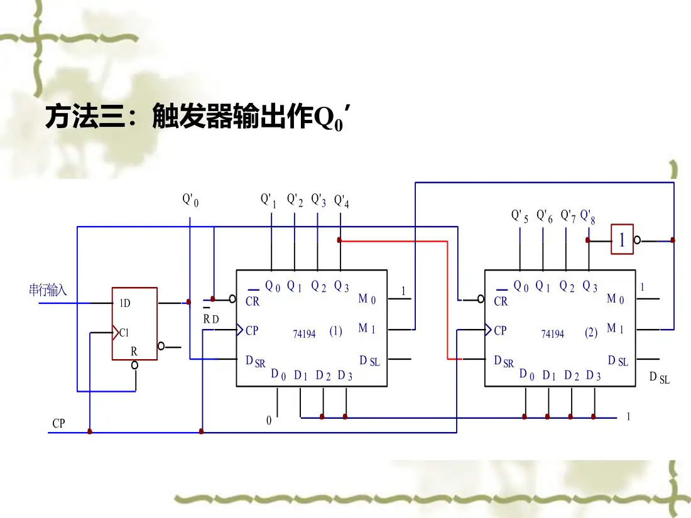

原文：

方法三：触发器输出作 $Q_{0}$

### 6.5 在下图基础上增加一片74194或DFF构成8位并行→串行码的转换电路。

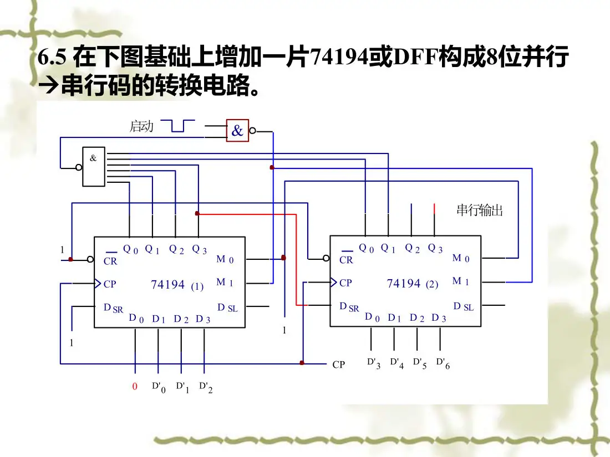

原文：

6.5 在下图基础上增加一片74194或DFF构成8位并行→串行码的转换电路。

### 第 51 页

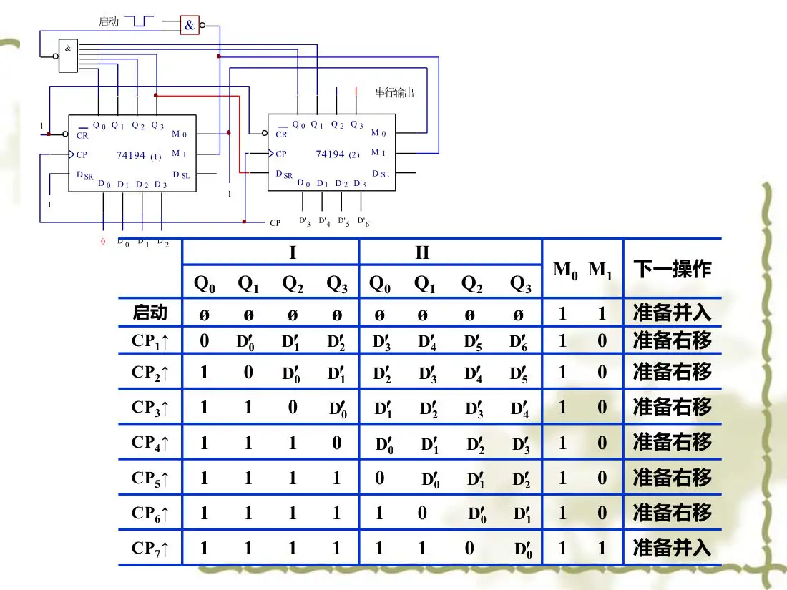

原文：

<table><tr><td rowspan="2"> $D_{0}^{1}D_{1}^{2}$ </td><td colspan="4">I</td><td colspan="4">II</td><td rowspan="2"> $M_{0} M_{1}$ </td><td rowspan="2">下一操作</td></tr><tr><td> $Q_{0}$ </td><td> $Q_{1}$ </td><td> $Q_{2}$ </td><td> $Q_{3}$ </td><td> $Q_{0}$ </td><td> $Q_{1}$ </td><td> $Q_{2}$ </td><td> $Q_{3}$ </td></tr><tr><td>启动</td><td>∅</td><td>∅</td><td>∅</td><td>∅</td><td>∅</td><td>∅</td><td>∅</td><td>∅</td><td>1 1</td><td>准备并入</td></tr><tr><td> $CP_{1}\uparrow$ </td><td>0</td><td> $D_{0}^{\prime}$ </td><td> $D_{1}^{\prime}$ </td><td> $D_{2}^{\prime}$ </td><td> $D_{3}^{\prime}$ </td><td> $D_{4}^{\prime}$ </td><td> $D_{5}^{\prime}$ </td><td> $D_{6}^{\prime}$ </td><td>1 0</td><td>准备右移</td></tr><tr><td> $CP_{2}\uparrow$ </td><td>1</td><td>0</td><td> $D_{0}^{\prime}$ </td><td> $D_{1}^{\prime}$ </td><td> $D_{2}^{\prime}$ </td><td> $D_{3}^{\prime}$ </td><td> $D_{4}^{\prime}$ </td><td> $D_{5}^{\prime}$ </td><td>1 0</td><td>准备右移</td></tr><tr><td> $CP_{3}\uparrow$ </td><td>1</td><td>1</td><td>0</td><td> $D_{0}^{\prime}$ </td><td> $D_{1}^{\prime}$ </td><td> $D_{2}^{\prime}$ </td><td> $D_{3}^{\prime}$ </td><td> $D_{4}^{\prime}$ </td><td>1 0</td><td>准备右移</td></tr><tr><td> $CP_{4}\uparrow$ </td><td>1</td><td>1</td><td>1</td><td>0</td><td> $D_{0}^{\prime}$ </td><td> $D_{1}^{\prime}$ </td><td> $D_{2}^{\prime}$ </td><td> $D_{3}^{\prime}$ </td><td>1 0</td><td>准备右移</td></tr><tr><td> $CP_{5}\uparrow$ </td><td>1</td><td>1</td><td>1</td><td>1</td><td>0</td><td> $D_{0}^{\prime}$ </td><td> $D_{1}^{\prime}$ </td><td> $D_{2}^{\prime}$ </td><td>1 0</td><td>准备右移</td></tr><tr><td> $CP_{6}\uparrow$ </td><td>1</td><td>1</td><td>1</td><td>1</td><td>1</td><td>0</td><td> $D_{0}^{\prime}$ </td><td> $D_{1}^{\prime}$ </td><td>1 0</td><td>准备右移</td></tr><tr><td> $CP_{7}\uparrow$ </td><td>1</td><td>1</td><td>1</td><td>1</td><td>1</td><td>1</td><td>0</td><td> $D_{0}^{\prime}$ </td><td>1 1</td><td>准备并入</td></tr></table>

### 方法一：触发器输出作 $Q_{0}^{\prime}$

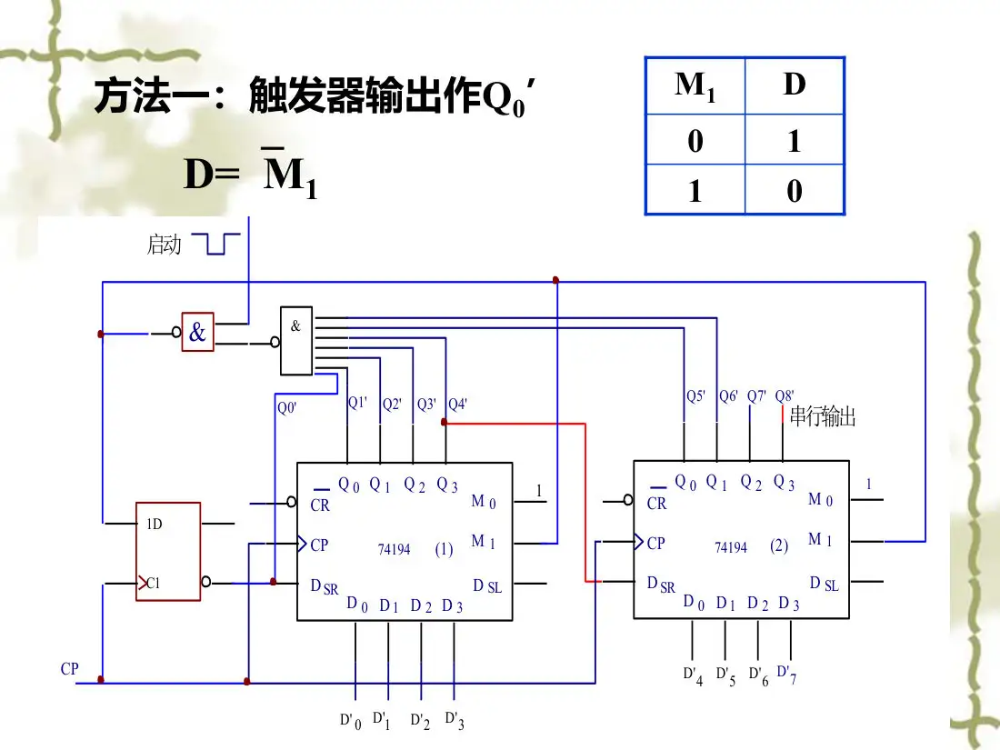

原文：

方法一：触发器输出作 $Q_{0}^{\prime}$

$$
\mathbf {D} = \overline {{\mathbf {M}}} _ {1}
$$

<table><tr><td> $M_1$ </td><td>D</td></tr><tr><td>0</td><td>1</td></tr><tr><td>1</td><td>0</td></tr></table>

### 状态转移表:

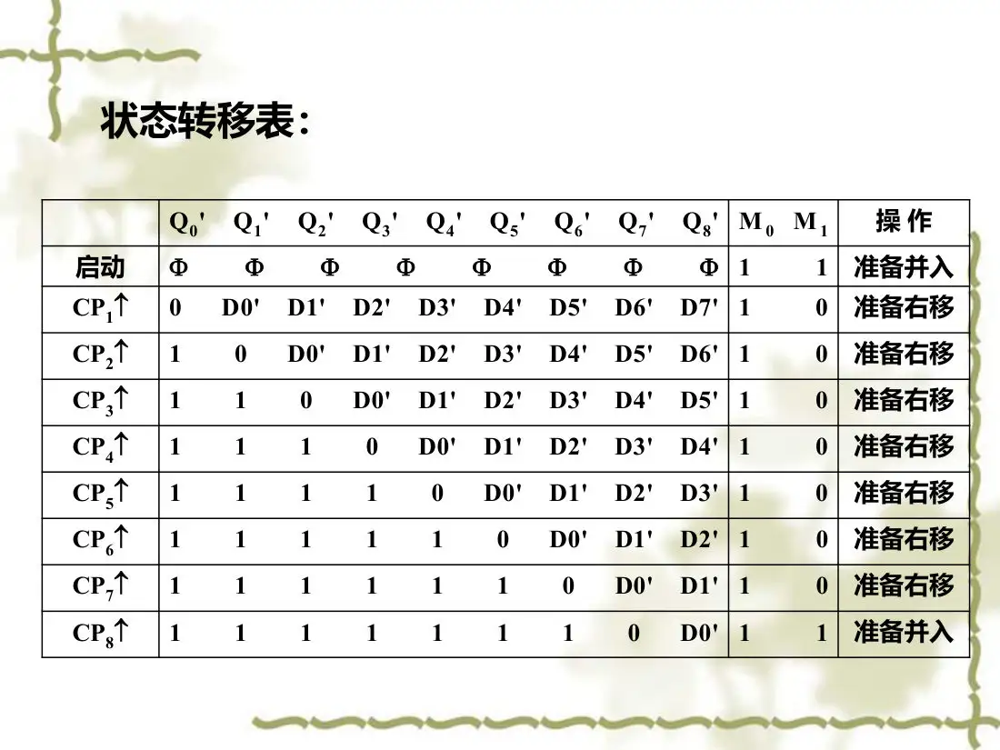

原文：

状态转移表:

<table><tr><td></td><td> $Q_{0}'$ </td><td> $Q_{1}'$ </td><td> $Q_{2}'$ </td><td> $Q_{3}'$ </td><td> $Q_{4}'$ </td><td> $Q_{5}'$ </td><td> $Q_{6}'$ </td><td> $Q_{7}'$ </td><td> $Q_{8}'$ </td><td> $M_{0}$ </td><td> $M_{1}$ </td><td>操作</td></tr><tr><td>启动</td><td> $\Phi$ </td><td> $\Phi$ </td><td> $\Phi$ </td><td> $\Phi$ </td><td> $\Phi$ </td><td> $\Phi$ </td><td> $\Phi$ </td><td> $\Phi$ </td><td> $\Phi$ </td><td>1</td><td>1</td><td>准备并入</td></tr><tr><td> $CP_{1}\uparrow$ </td><td>0</td><td>D0&#x27;</td><td>D1&#x27;</td><td>D2&#x27;</td><td>D3&#x27;</td><td>D4&#x27;</td><td>D5&#x27;</td><td>D6&#x27;</td><td>D7&#x27;</td><td>1</td><td>0</td><td>准备右移</td></tr><tr><td> $CP_{2}\uparrow$ </td><td>1</td><td>0</td><td>D0&#x27;</td><td>D1&#x27;</td><td>D2&#x27;</td><td>D3&#x27;</td><td>D4&#x27;</td><td>D5&#x27;</td><td>D6&#x27;</td><td>1</td><td>0</td><td>准备右移</td></tr><tr><td> $CP_{3}\uparrow$ </td><td>1</td><td>1</td><td>0</td><td>D0&#x27;</td><td>D1&#x27;</td><td>D2&#x27;</td><td>D3&#x27;</td><td>D4&#x27;</td><td>D5&#x27;</td><td>1</td><td>0</td><td>准备右移</td></tr><tr><td> $CP_{4}\uparrow$ </td><td>1</td><td>1</td><td>1</td><td>0</td><td>D0&#x27;</td><td>D1&#x27;</td><td>D2&#x27;</td><td>D3&#x27;</td><td>D4&#x27;</td><td>1</td><td>0</td><td>准备右移</td></tr><tr><td> $CP_{5}\uparrow$ </td><td>1</td><td>1</td><td>1</td><td>1</td><td>0</td><td>D0&#x27;</td><td>D1&#x27;</td><td>D2&#x27;</td><td>D3&#x27;</td><td>1</td><td>0</td><td>准备右移</td></tr><tr><td> $CP_{6}\uparrow$ </td><td>1</td><td>1</td><td>1</td><td>1</td><td>1</td><td>0</td><td>D0&#x27;</td><td>D1&#x27;</td><td>D2&#x27;</td><td>1</td><td>0</td><td>准备右移</td></tr><tr><td> $CP_{7}\uparrow$ </td><td>1</td><td>1</td><td>1</td><td>1</td><td>1</td><td>1</td><td>0</td><td>D0&#x27;</td><td>D1&#x27;</td><td>1</td><td>0</td><td>准备右移</td></tr><tr><td> $CP_{8}\uparrow$ </td><td>1</td><td>1</td><td>1</td><td>1</td><td>1</td><td>1</td><td>1</td><td>0</td><td>D0&#x27;</td><td>1</td><td>1</td><td>准备并入</td></tr></table>

### 方法二：触发器输出作 $Q_{4}^{\prime}$

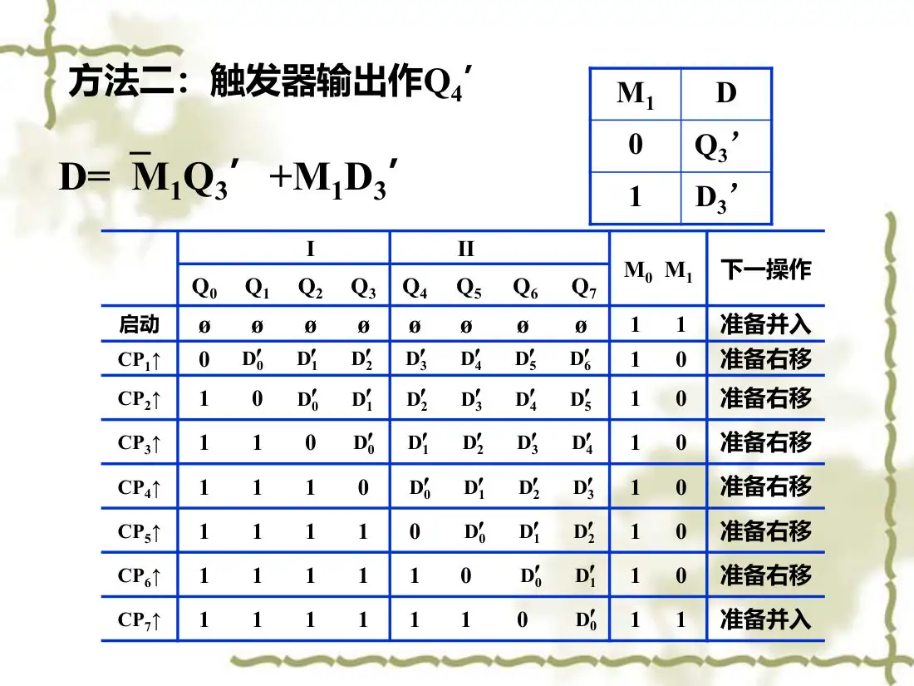

原文：

方法二：触发器输出作 $Q_{4}^{\prime}$

$$
\mathbf {D} = \overline {{\mathbf {M}}} _ {1} \mathbf {Q} _ {3} ^ {\prime} + \mathbf {M} _ {1} \mathbf {D} _ {3} ^ {\prime}
$$

<table><tr><td> $M_1$ </td><td>D</td></tr><tr><td>0</td><td> $Q_3'$ </td></tr><tr><td>1</td><td> $D_3'$ </td></tr></table>

<table><tr><td rowspan="2"></td><td colspan="4">I</td><td colspan="4">II</td><td rowspan="2"> $M_0$   $M_1$ </td><td rowspan="2">下一操作</td></tr><tr><td> $Q_0$ </td><td> $Q_1$ </td><td> $Q_2$ </td><td> $Q_3$ </td><td> $Q_4$ </td><td> $Q_5$ </td><td> $Q_6$ </td><td> $Q_7$ </td></tr><tr><td>启动</td><td>∅</td><td>∅</td><td>∅</td><td>∅</td><td>∅</td><td>∅</td><td>∅</td><td>∅</td><td>1 1</td><td>准备并入</td></tr><tr><td> $CP_1\uparrow$ </td><td>0</td><td> $D'_0$ </td><td> $D'_1$ </td><td> $D'_2$ </td><td> $D'_3$ </td><td> $D'_4$ </td><td> $D'_5$ </td><td> $D'_6$ </td><td>1 0</td><td>准备右移</td></tr><tr><td> $CP_2\uparrow$ </td><td>1</td><td>0</td><td> $D'_0$ </td><td> $D'_1$ </td><td> $D'_2$ </td><td> $D'_3$ </td><td> $D'_4$ </td><td> $D'_5$ </td><td>1 0</td><td>准备右移</td></tr><tr><td> $CP_3\uparrow$ </td><td>1</td><td>1</td><td>0</td><td> $D'_0$ </td><td> $D'_1$ </td><td> $D'_2$ </td><td> $D'_3$ </td><td> $D'_4$ </td><td>1 0</td><td>准备右移</td></tr><tr><td> $CP_4\uparrow$ </td><td>1</td><td>1</td><td>1</td><td>0</td><td> $D'_0$ </td><td> $D'_1$ </td><td> $D'_2$ </td><td> $D'_3$ </td><td>1 0</td><td>准备右移</td></tr><tr><td> $CP_5\uparrow$ </td><td>1</td><td>1</td><td>1</td><td>1</td><td>0</td><td> $D'_0$ </td><td> $D'_1$ </td><td> $D'_2$ </td><td>1 0</td><td>准备右移</td></tr><tr><td> $CP_6\uparrow$ </td><td>1</td><td>1</td><td>1</td><td>1</td><td>1</td><td>0</td><td> $D'_0$ </td><td> $D'_1$ </td><td>1 0</td><td>准备右移</td></tr><tr><td> $CP_7\uparrow$ </td><td>1</td><td>1</td><td>1</td><td>1</td><td>1</td><td>1</td><td>0</td><td> $D'_0$ </td><td>1 1</td><td>准备并入</td></tr></table>

### 方法二：触发器输出作 $Q_{4}^{\prime}$

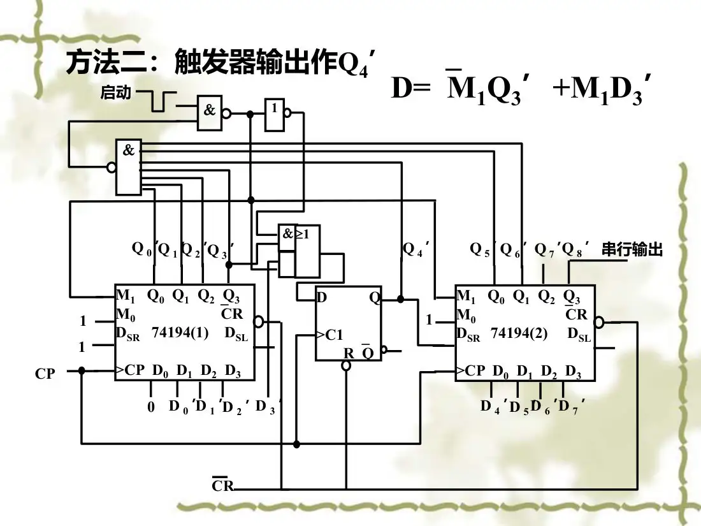

原文：

方法二：触发器输出作 $Q_{4}^{\prime}$

### 6.8分析图P6.8电路，画出其全状态转移图并说明能否自启动。

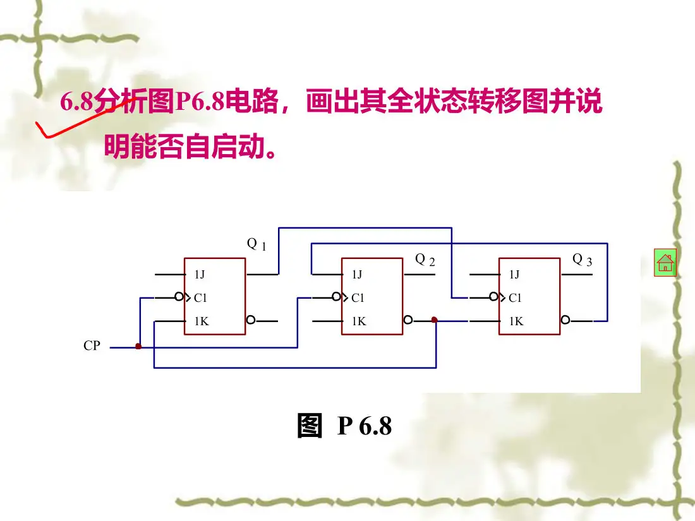

原文：

6.8分析图P6.8电路，画出其全状态转移图并说明能否自启动。

### 解：1）该电路为异步时序电路，无输入控制信号，属于Moore型，

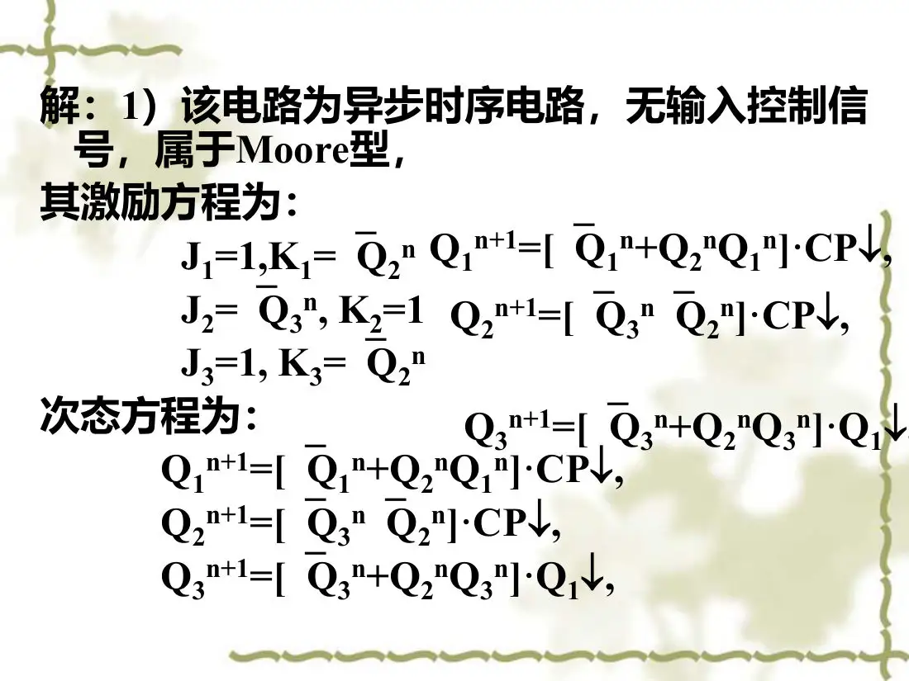

原文：

解：1）该电路为异步时序电路，无输入控制信号，属于Moore型，

其激励方程为：

$$
\left. \begin{array}{l} \text {性方:} \\ \mathrm{J} _ {1} = 1, \mathrm{K} _ {1} = \overline {{\mathrm{Q}}} _ {2} ^ {\mathrm{n}} \mathrm{Q} _ {1} ^ {\mathrm{n+1}} = [ \overline {{\mathrm{Q}}} _ {1} ^ {\mathrm{n}} + \mathrm{Q} _ {2} ^ {\mathrm{n}} \mathrm{Q} _ {1} ^ {\mathrm{n}} ] \cdot \mathrm{CP} \downarrow , \\ \mathrm{J} _ {2} = \overline {{\mathrm{Q}}} _ {3} ^ {\mathrm{n}}, \mathrm{K} _ {2} = 1 \quad \mathrm{Q} _ {2} ^ {\mathrm{n+1}} = [ \overline {{\mathrm{Q}}} _ {3} ^ {\mathrm{n}} \overline {{\mathrm{Q}}} _ {2} ^ {\mathrm{n}} ] \cdot \mathrm{CP} \downarrow , \\ \mathrm{J} _ {3} = 1, \mathrm{K} _ {3} = \overline {{\mathrm{Q}}} _ {2} ^ {\mathrm{n}} \end{array} \right\}
$$

次态方程为：

$$
\begin{array}{r l} & {\text {程为:} \quad Q _ {3} ^ {n + 1} = [ \overline {{{Q}}} _ {3} ^ {n} + Q _ {2} ^ {n} Q _ {3} ^ {n} ] \cdot Q _ {1} \downarrow} \\ & {Q _ {1} ^ {n + 1} = [ \overline {{{Q}}} _ {1} ^ {n} + Q _ {2} ^ {n} Q _ {1} ^ {n} ] \cdot C P \downarrow ,} \\ & {Q _ {2} ^ {n + 1} = [ \overline {{{Q}}} _ {3} ^ {n} \overline {{{Q}}} _ {2} ^ {n} ] \cdot C P \downarrow ,} \\ & {Q _ {3} ^ {n + 1} = [ \overline {{{Q}}} _ {3} ^ {n} + Q _ {2} ^ {n} Q _ {3} ^ {n} ] \cdot Q _ {1} \downarrow ,} \end{array}
$$

### Q2nQ1nQ3n0001111001111111

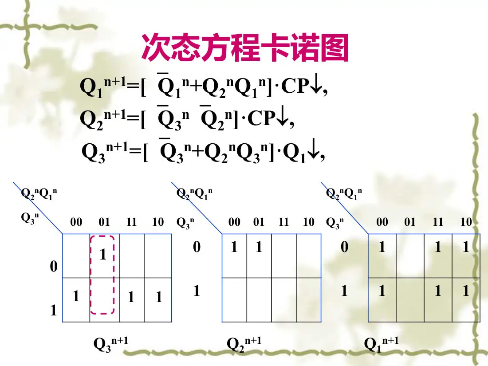

原文：

<table><tr><td colspan="5">Q2nQ1n</td></tr><tr><td>Q3n</td><td>00</td><td>01</td><td>11</td><td>10</td></tr><tr><td>0</td><td>1</td><td></td><td>1</td><td>1</td></tr><tr><td>1</td><td>1</td><td></td><td>1</td><td>1</td></tr></table>

次态方程卡诺图

$$
\begin{array}{l} \mathbf {Q} _ {1} ^ {\mathrm{n+1}} = [ \overline {{\mathbf {Q}}} _ {1} ^ {\mathrm{n}} + \mathbf {Q} _ {2} ^ {\mathrm{n}} \mathbf {Q} _ {1} ^ {\mathrm{n}} ] \cdot \mathbf {C P} \downarrow , \\ \mathbf {Q} _ {2} ^ {\mathrm{n+1}} = [ \overline {{\mathbf {Q}}} _ {3} ^ {\mathrm{n}} \overline {{\mathbf {Q}}} _ {2} ^ {\mathrm{n}} ] \cdot \mathbf {C P} \downarrow , \\ \mathbf {Q} _ {3} ^ {\mathrm{n+1}} = [ \overline {{\mathbf {Q}}} _ {3} ^ {\mathrm{n}} + \mathbf {Q} _ {2} ^ {\mathrm{n}} \mathbf {Q} _ {3} ^ {\mathrm{n}} ] \cdot \mathbf {Q} _ {1} \downarrow , \end{array}
$$

### 状态转移表

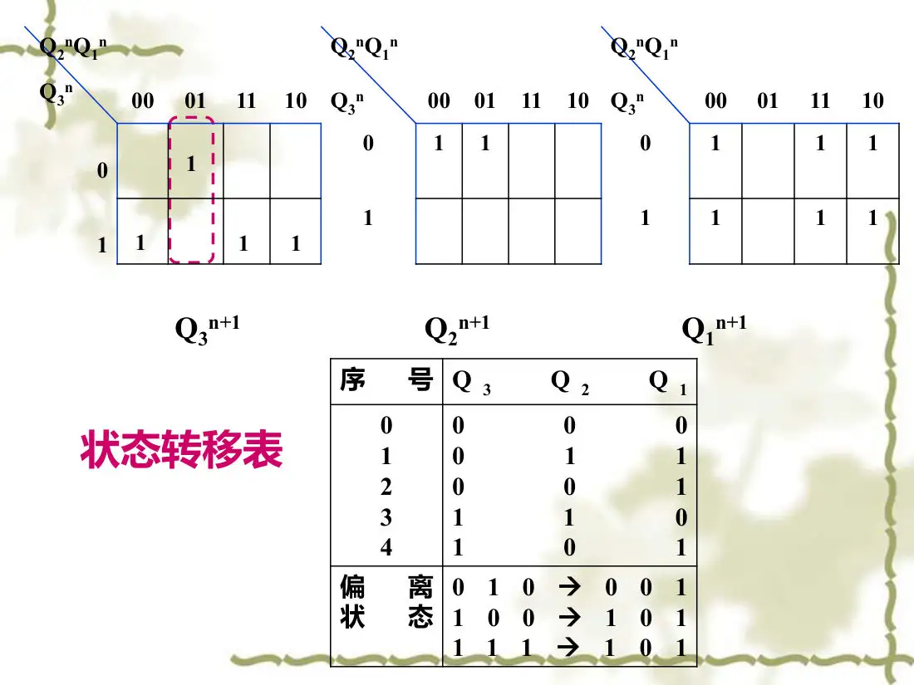

原文：

状态转移表

<table><tr><td>序号</td><td> $Q_{3}$ </td><td> $Q_{2}$ </td><td> $Q_{1}$ </td></tr><tr><td>0</td><td>0</td><td>0</td><td>0</td></tr><tr><td>1</td><td>0</td><td>1</td><td>1</td></tr><tr><td>2</td><td>0</td><td>0</td><td>1</td></tr><tr><td>3</td><td>1</td><td>1</td><td>0</td></tr><tr><td>4</td><td>1</td><td>0</td><td>1</td></tr><tr><td rowspan="3">偏离状态</td><td colspan="3">0 1 0 → 0 0 1</td></tr><tr><td colspan="3">1 0 0 → 1 0 1</td></tr><tr><td colspan="3">1 1 1 → 1 0 1</td></tr></table>

### 逻辑功能：该电路是一个M=5的具有自启动性的异步计数器

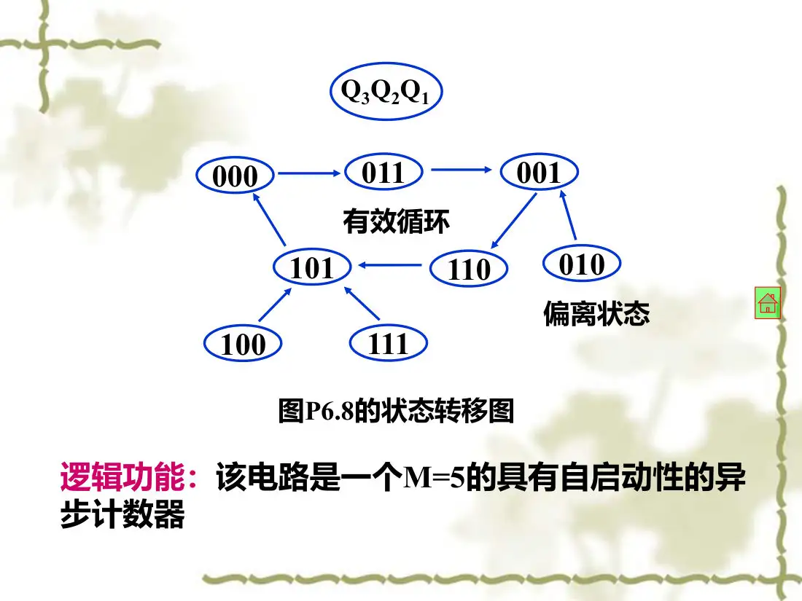

原文：

逻辑功能：该电路是一个M=5的具有自启动性的异步计数器

### 6.11试用JKFF设计符合图6.11波形，并且具备自启动性的同步计数电路。

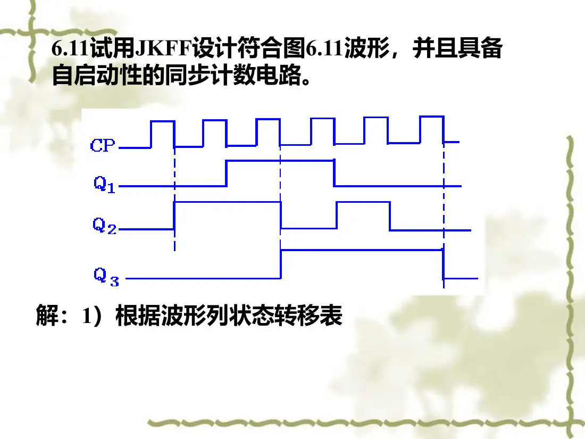

原文：

6.11试用JKFF设计符合图6.11波形，并且具备自启动性的同步计数电路。

### 解：1）根据波形列状态转移表

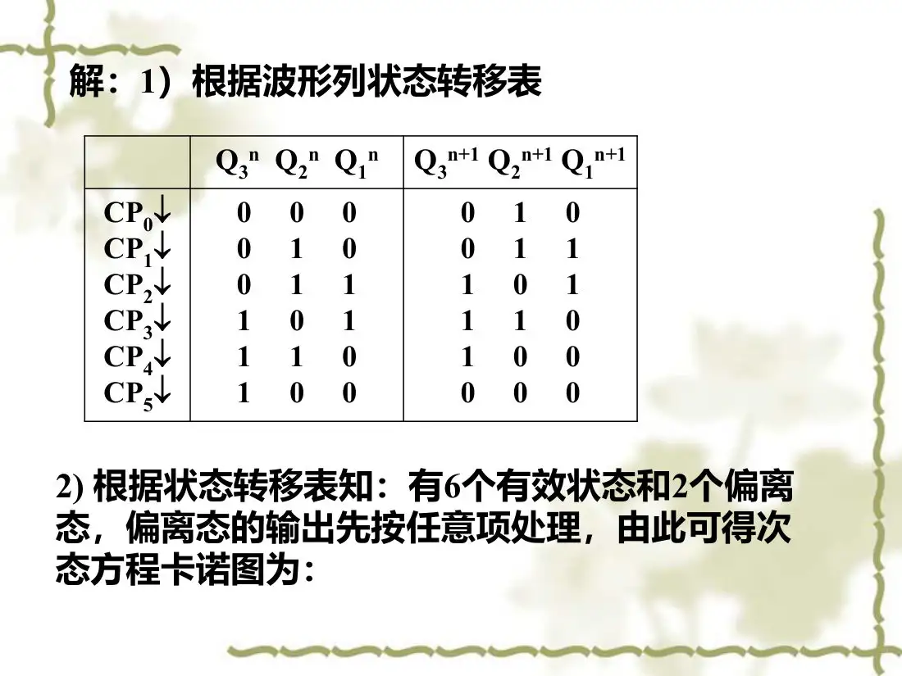

原文：

解：1）根据波形列状态转移表
<table><tr><td></td><td> $Q_{3}^{n}$ </td><td> $Q_{2}^{n}$ </td><td> $Q_{1}^{n}$ </td><td> $Q_{3}^{n+1}$ </td><td> $Q_{2}^{n+1}$ </td><td> $Q_{1}^{n+1}$ </td></tr><tr><td> $CP_{0}\downarrow$ </td><td>0</td><td>0</td><td>0</td><td>0</td><td>1</td><td>0</td></tr><tr><td> $CP_{1}\downarrow$ </td><td>0</td><td>1</td><td>0</td><td>0</td><td>1</td><td>1</td></tr><tr><td> $CP_{2}\downarrow$ </td><td>0</td><td>1</td><td>1</td><td>1</td><td>0</td><td>1</td></tr><tr><td> $CP_{3}\downarrow$ </td><td>1</td><td>0</td><td>1</td><td>1</td><td>1</td><td>0</td></tr><tr><td> $CP_{4}\downarrow$ </td><td>1</td><td>1</td><td>0</td><td>1</td><td>0</td><td>0</td></tr><tr><td> $CP_{5}\downarrow$ </td><td>1</td><td>0</td><td>0</td><td>0</td><td>0</td><td>0</td></tr></table>

2) 根据状态转移表知：有6个有效状态和2个偏离态，偏离态的输出先按任意项处理，由此可得次态方程卡诺图为：

### $$

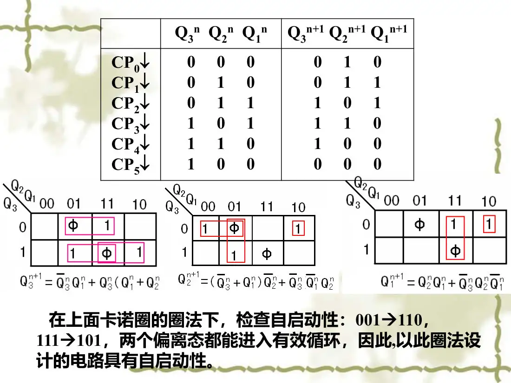

原文：

<table><tr><td></td><td> $Q_3^n$ </td><td> $Q_2^n$ </td><td> $Q_1^n$ </td><td> $Q_3^{n+1}$ </td><td> $Q_2^{n+1}$ </td><td> $Q_1^{n+1}$ </td></tr><tr><td> $CP_0\downarrow$ </td><td>0</td><td>0</td><td>0</td><td>0</td><td>1</td><td>0</td></tr><tr><td> $CP_1\downarrow$ </td><td>0</td><td>1</td><td>0</td><td>0</td><td>1</td><td>1</td></tr><tr><td> $CP_2\downarrow$ </td><td>0</td><td>1</td><td>1</td><td>1</td><td>0</td><td>1</td></tr><tr><td> $CP_3\downarrow$ </td><td>1</td><td>0</td><td>1</td><td>1</td><td>1</td><td>0</td></tr><tr><td> $CP_4\downarrow$ </td><td>1</td><td>1</td><td>0</td><td>1</td><td>0</td><td>0</td></tr><tr><td> $CP_5\downarrow$ </td><td>1</td><td>0</td><td>0</td><td>0</td><td>0</td><td>0</td></tr></table>

$$
\mathbf {Q} _ {3} ^ {n + 1} = \overline {{\mathbf {Q}}} _ {3} ^ {n} \mathbf {Q} _ {1} ^ {n} + \mathbf {Q} _ {3} ^ {n} (\mathbf {Q} _ {1} ^ {n} + \mathbf {Q} _ {2} ^ {n}
$$

$$
\mathbf {Q} _ {2} ^ {n + 1} = \left(\overline {{\mathbf {Q}}} _ {3} ^ {n} + \mathbf {Q} _ {1} ^ {n}\right) \overline {{\mathbf {Q}}} _ {2} ^ {n} + \overline {{\mathbf {Q}}} _ {3} ^ {n} \overline {{\mathbf {Q}}} _ {1} ^ {n} \mathbf {Q} _ {2} ^ {n}
$$

<table><tr><td>Q3\Q2</td><td>00</td><td>01</td><td>11</td><td>10</td></tr><tr><td>0</td><td></td><td> $\Phi$ </td><td>1</td><td>1</td></tr><tr><td>1</td><td></td><td></td><td> $\Phi$ </td><td></td></tr></table>

$$
\mathbf {Q} _ {1} ^ {n + 1} = \mathbf {Q} _ {2} ^ {n} \mathbf {Q} _ {1} ^ {n} + \overline {{\mathbf {Q}}} _ {3} ^ {n} \mathbf {Q} _ {2} ^ {n} \overline {{\mathbf {Q}}} _ {1} ^ {n}
$$

在上面卡诺圈的圈法下，检查自启动性：001→110，111→101，两个偏离态都能进入有效循环，因此,以此圈法设计的电路具有自启动性。

### 求激励方程：

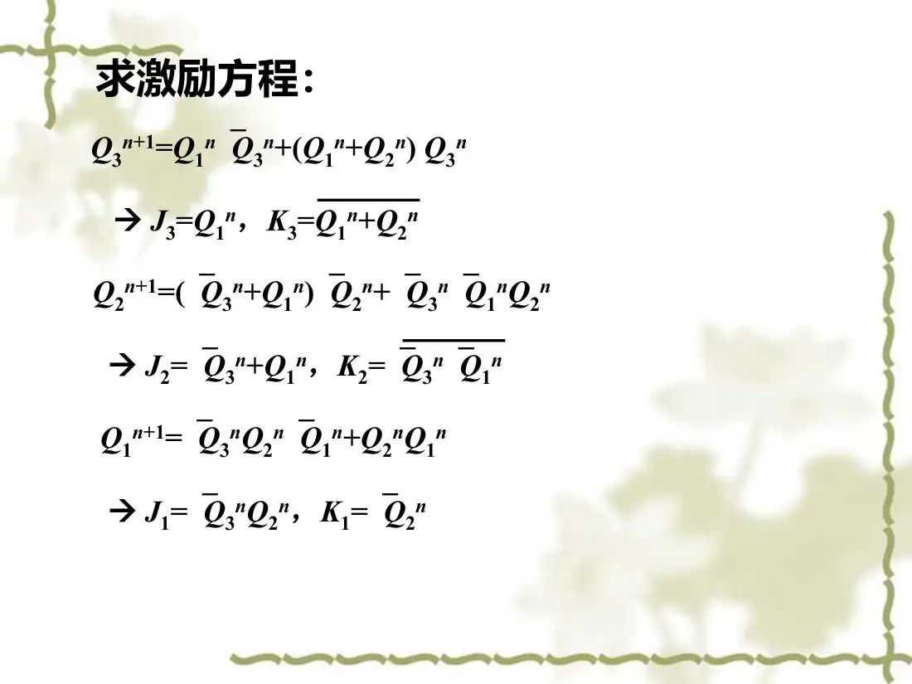

原文：

求激励方程：

$$
\begin{array}{r l} & Q _ {3} ^ {n + 1} = Q _ {1} ^ {n} \overline {{Q}} _ {3} ^ {n +} (Q _ {1} ^ {n} + Q _ {2} ^ {n}) Q _ {3} ^ {n} \\ & \Rightarrow J _ {3} = Q _ {1} ^ {n}, K _ {3} = \overline {{Q _ {1} ^ {n} + Q _ {2} ^ {n}}} \\ & Q _ {2} ^ {n + 1} = (\overline {{Q}} _ {3} ^ {n} + Q _ {1} ^ {n}) \overline {{Q}} _ {2} ^ {n +} \overline {{Q}} _ {3} ^ {n} \overline {{Q}} _ {1} ^ {n} Q _ {2} ^ {n} \\ & \Rightarrow J _ {2} = \overline {{Q}} _ {3} ^ {n} + Q _ {1} ^ {n}, K _ {2} = \overline {{\overline {{Q}} _ {3} ^ {n} \overline {{Q}} _ {1} ^ {n}}} \\ & Q _ {1} ^ {n + 1} = \overline {{Q}} _ {3} ^ {n} Q _ {2} ^ {n} \overline {{Q}} _ {1} ^ {n +} Q _ {2} ^ {n} Q _ {1} ^ {n} \\ & \Rightarrow J _ {1} = \overline {{Q}} _ {3} ^ {n} Q _ {2} ^ {n}, K _ {1} = \overline {{Q}} _ {2} ^ {n} \end{array}
$$

### 解 (1)

原文：

6.12 用四个DFF设计以下电路（1）异步二进制加法计数器。（2）在（1）的基础上用复“0”法构成M=12的异步加法计数器。

解 (1)

(2) 反馈状态为1100

Q4 & Q3 Q2 Q1 D 1 D C 1 D C 1 D C 1 C

### Q4 & Q3 Q2 Q1 D 1 D C 1 D C 1 D C

原文：

Q4 & Q3 Q2 Q1 D 1 D C 1 D C 1 D C

### .13 用四个DFF设计以下电路:

原文：

.13 用四个DFF设计以下电路:

(1) 异步二进制减法计数器。

(2) 在 (1) 的基础上用复 “0” 法构成M=13的异步

解 (1)

(2) 反馈状态为0011。

### $$

原文：

$$
\begin{array}{c c c c c c c c c c c c c c c c} \text {CP} & & & & & & & & & & & & & & \\ \hline & & & & & & & & & & & & & & \\ \hline Q _ {1} & 0 & 1 & 0 & 1 & 0 & 1 & 0 & 1 & 0 & 1 & 0 & 1 & 0 & 0 & 1 & 0 \\ \hline Q _ {2} & 0 & 1 & 1 & 0 & 0 & 1 & 1 & 0 & 0 & 1 & 1 & 0 & 0 & 0 & 1 & 1 \\ \hline Q _ {3} & 0 & 1 & 1 & 1 & 1 & 0 & 0 & 0 & 0 & 1 & 1 & 1 & 1 & 0 & 1 & 1 \\ \hline Q _ {4} & 0 & 1 & 1 & 1 & 1 & 1 & 1 & 1 & 1 & 0 & 0 & 0 & 0 & 0 & 1 & 1 \\ \hline \overline {{R}} _ {D} & \end{array}
$$

### 6.17 写出图P6.17电路的状态转移表及模长M=?

原文：

6.17 写出图P6.17电路的状态转移表及模长M=?

解：由图知，74161的预置数为 $Q_{3}^{n}Q_{2}^{n}11$ ，预置数控制端 $L_{D}$ 接 $Q_{1}$ 。电路先异步清零，则起始状态为0000，列状态转移表如下所示。

### $$

原文：

$$
\begin{array}{c c c c} \mathbf {Q} _ {3} & \mathbf {Q} _ {2} & \mathbf {Q} _ {1} & \mathbf {Q} _ {0} \\ \mathbf {0} & \mathbf {0} & \mathbf {0} & \mathbf {0} \\ \mathbf {0} & \mathbf {0} & 1 & 1 \\ \mathbf {0} & 1 & \mathbf {0} & \mathbf {0} \\ \mathbf {0} & 1 & 1 & 1 \\ 1 & \mathbf {0} & \mathbf {0} & \mathbf {0} \\ 1 & \mathbf {0} & 1 & 1 \\ 1 & 1 & \mathbf {0} & \mathbf {0} \\ 1 & 1 & 1 & 1 \end{array}
$$

由状态转移表知，模长M=8，且具备自启动性。

### 6.18 试分析图6.18能实现M=?的分频。

原文：

6.18 试分析图6.18能实现M=?的分频。

解：74161（1）的 $\overline{\mathrm{Q}}3$ 接至74161（2）的CP，两74161为异步级联，反馈状态为（4C） $_{\mathrm{H}} = 76$ ，又利用异步清0端，所以M=76。

### 解：思路：当计数计到5时，让其置数为10。反馈状态为0101。

原文：

6.19 试用74161设计循环顺序为0,1,2,3,4,5,10,11,12,13,14,15,0,1...的模长为12的计数电路。

解：思路：当计数计到5时，让其置数为10。反馈状态为0101。

### 第 73 页

原文：

6.20 试用74161设计能按8421BCD译码显示的0\~59计数的60分频电路。

解：思路：先将两片74161分别接成M=10和M=6的形式，再让两者级联，实现 $M=6\times10=60$ 。

### 6.22 试分析图P6.22(b)计数器的分频比为多少?

原文：

6.22 试分析图P6.22(b)计数器的分频比为多少?

### 第 75 页

### 两片74161采用异步级联方式，所以总模值M为

原文：

解: 两片74161都处于计数状态 (P=T=1), 第1片74161的预置数为 $(1001)_2$ , 第2片74161的预置数为 $(0111)_2$ , 都使用置最小数法实现任意进制计数器。

对第1片74161: $\mathrm{M}_{1} = \mathrm{N}_{1}-9, \mathrm{M}_{1} = 7$

对第2片74161： $\mathrm{M}_2 = \mathrm{N}_2 - 7$ ， $\mathrm{M}_2 = 9$

两片74161采用异步级联方式，所以总模值M为

$$
\mathbf {M} = \mathbf {M} _ {1} \mathbf {M} _ {2} = 7 \times 9 = 6 3
$$

即： $f_{CP}:f_{Z}=63:1$

### 第 77 页

原文：

6.23 试说明图6.23电路的模值为多少，并画出74160(I)的 $Q_{0}$ 、 $Q_{1}$ 、 $Q_{2}$ 、 $Q_{3}$ 端，74160(II)的Q0和 $\overline{R}_{D}$ 端的波形，至少画出一个周期。

### 第 78 页

### 解：① 求触发器的级数

原文：

6.35 用DFF设计移存型序列信号发生器，要求产生的序列信号为 (1)11110000...;

解：① 求触发器的级数

M=8，由 $\log_{2}M\leq n<\log_{2}M+1$ 得 n = 3。

②列状态转移表

<table><tr><td> $Q_3$ </td><td> $Q_2$ </td><td> $Q_1$ </td><td>状态转移路线</td><td>模数</td></tr><tr><td>1</td><td>1</td><td>1</td><td rowspan="2"></td><td rowspan="2">M=1×</td></tr><tr><td>1</td><td>1</td><td>1</td></tr></table>

### ③取n=4，列状态转移表及相应D $_{1}$ 的值。

原文：

③取n=4，列状态转移表及相应D $_{1}$ 的值。

<table><tr><td> $Q_4$ </td><td> $Q_3$ </td><td> $Q_2$ </td><td> $Q_1$ </td><td>状态转移路线</td><td>模数</td><td> $D_1$ </td></tr><tr><td>1</td><td>1</td><td>1</td><td>1</td><td rowspan="9"></td><td rowspan="9">M=8</td><td>0</td></tr><tr><td>1</td><td>1</td><td>1</td><td>0</td><td>0</td></tr><tr><td>1</td><td>1</td><td>0</td><td>0</td><td>0</td></tr><tr><td>1</td><td>0</td><td>0</td><td>0</td><td>0</td></tr><tr><td>0</td><td>0</td><td>0</td><td>0</td><td>1</td></tr><tr><td>0</td><td>0</td><td>0</td><td>1</td><td>1</td></tr><tr><td>0</td><td>0</td><td>1</td><td>1</td><td>1</td></tr><tr><td>0</td><td>1</td><td>1</td><td>1</td><td>1</td></tr><tr><td>1</td><td>1</td><td>1</td><td>1</td><td></td></tr></table>

### ④求激励函数 $D_{1}$ $Q_{2}Q_{1}$

原文：

④求激励函数 $D_{1}$ $Q_{2}Q_{1}$

$$
\begin{array}{c c c c c} \mathbb {I D} _ {1} & Q _ {2} Q _ {1} \\ Q _ {4} Q & 0 0 & 0 1 & 1 1 & 1 0 \\ _ {3} & 0 0 & 1 & 1 & 1 \\ & 0 1 & \emptyset & \emptyset & 1 \\ & 1 1 & 0 & \emptyset & 0 \\ & 1 0 & 0 & \emptyset & \emptyset \end{array}
$$

$$
\mathbf {D} _ {1} = \overline {{\mathbf {Q}}} _ {4}
$$

⑤画电路图

$\mathbf{D}_1$

### 6.37 试用JKFF设计循环长度M=12的序列信号发生器。

原文：

6.37 试用JKFF设计循环长度M=12的序列信号发生器。

解：该题要求设计一个已知序列长度的序列信号发生器，可以用修改最长线性序列的方法得到：取n=4，M=2 $^{n}$ -1=15的最长线性序列：111100010011010，将其左移3（15-12=3）位，再与本身相异或：

111100010011010 ⊕ 100010011010111 0111:1000:1001101

### $$

原文：

111100010011010 ⊕ 100010011010111 011110001001101

异或结果中寻找“1”后面接n-1个0的码，对应到原始序列得到的码为0001，所以反馈状态为Q4 Q3 Q2 Q1。修改反馈函数为：

$$
\begin{array}{r l} & {f = (Q _ {4} \oplus Q _ {3}) \oplus \text {起跳状态} + \text {全0项}} \\ & {\qquad = (Q _ {4} \oplus Q _ {3}) \oplus \overline {{{{Q}}}} _ {4} \overline {{{{Q}}}} _ {3} \overline {{{{Q}}}} _ {2} Q _ {1} + \overline {{{{Q}}}} _ {4} \overline {{{{Q}}}} _ {3} \overline {{{{Q}}}} _ {2} \overline {{{{Q}}}} _ {1}} \end{array}
$$

此时产生的序列为：111100011010（跳过了原序列0001后面的001的3位）

### $$

原文：

$$
f = (Q _ {4} \oplus Q _ {3}) \oplus \overline {{Q}} _ {4} \overline {{Q}} _ {3} \overline {{Q}} _ {2} Q _ {1} + \overline {{Q}} _ {4} \overline {{Q}} _ {3} \overline {{Q}} _ {2} \overline {{Q}} _ {1}
$$

### $$

原文：

6.40 写出图P6.40中74161输出端的状态编码表及74151输出端产生的序列信号。

$$
\begin{array}{c c c} \text { & } & 0 & \text { EN } \\ & \text { A   0 } \\ & \text { A   1 } \\ & \text { A   2 } \\ & \text { D   0 } \\ & \text { D   1 } \\ & \text { D   2 } \\ & \text { D   3 } \\ & \text { D   4 } \\ & \text { D   5 } \\ & \text { D   6 } \\ & \text { D   7 } \\ & \text { F } \\ & \text { CP } \\ & \text { QCCQ3Q2Q1Q0P} \\ & \text { CR74161T} \\ & \text { LD D3D2D1D0CP} \\ & \end{array}
$$

解：74161采用复0法，实现模M=10的计数器，

### $$

原文：

$$
\begin{array}{c c c} \text { & } & 0 & \text { EN } \\ & 1 & 1 \\ \text { QCC   Q3   Q2   Q1   Q0   P } & 1 & 1 \\ \text { CR } & 7 4 1 6 1 & T \\ \text { LD   D3   D2   D1   D0   CP } & 1 & 1 \\ & \text { CP } & \text { Q0   Q0 } \\ & & 7 4 1 5 1 \quad Y \quad F \end{array}
$$

74151输出端产生的序列信号为:
1111000110, ...

<table><tr><td></td><td> $Q_3$ </td><td> $Q_2$ </td><td> $Q_1$ </td><td> $Q_0$ </td><td>F</td></tr><tr><td>0</td><td>0</td><td>0</td><td>0</td><td>0</td><td>1</td></tr><tr><td>0</td><td>0</td><td>0</td><td>1</td><td>1</td><td>1</td></tr><tr><td>0</td><td>0</td><td>1</td><td>0</td><td>1</td><td>1</td></tr><tr><td>0</td><td>0</td><td>1</td><td>1</td><td>1</td><td>1</td></tr><tr><td>0</td><td>1</td><td>0</td><td>0</td><td>0</td><td>0</td></tr><tr><td>0</td><td>1</td><td>0</td><td>1</td><td>0</td><td>0</td></tr><tr><td>0</td><td>1</td><td>1</td><td>0</td><td>0</td><td>0</td></tr><tr><td>0</td><td>1</td><td>1</td><td>1</td><td>1</td><td>1</td></tr><tr><td>1</td><td>0</td><td>0</td><td>0</td><td>1</td><td>1</td></tr><tr><td>1</td><td>0</td><td>0</td><td>1</td><td>0</td><td>0</td></tr><tr><td>1/0</td><td>0</td><td>1/0</td><td>0</td><td></td><td></td></tr></table>

### $$

原文：

6.43 试用74161、74151及少量与非门实现如下功能: 当S=0时,产生序列1011010;当S=1时,产生序列

$$
1 1 1 0 1 0 0
$$

解（1）采用计数型序列码发生器。将74161通过异步复零法实现模长为7的计数器。

(2) 设计组合电路，列真值表：

<table><tr><td>S</td><td> $Q_2$ </td><td> $Q_1$ </td><td> $Q_0$ </td><td>F</td></tr><tr><td>0</td><td>0</td><td>0</td><td>0</td><td>1</td></tr><tr><td>0</td><td>0</td><td>0</td><td>1</td><td>0</td></tr><tr><td>0</td><td>0</td><td>1</td><td>0</td><td>1</td></tr><tr><td>0</td><td>0</td><td>1</td><td>1</td><td>1</td></tr><tr><td>0</td><td>1</td><td>0</td><td>0</td><td>0</td></tr><tr><td>0</td><td>1</td><td>0</td><td>1</td><td>1</td></tr><tr><td>0</td><td>1</td><td>1</td><td>0</td><td>0</td></tr><tr><td>0</td><td>1</td><td>1</td><td>1</td><td> $\phi$ </td></tr><tr><td>1</td><td>0</td><td>0</td><td>0</td><td>1</td></tr><tr><td>1</td><td>0</td><td>0</td><td>1</td><td>1</td></tr><tr><td>1</td><td>0</td><td>1</td><td>0</td><td>1</td></tr><tr><td>1</td><td>0</td><td>1</td><td>1</td><td>0</td></tr><tr><td>1</td><td>1</td><td>0</td><td>0</td><td>1</td></tr><tr><td>1</td><td>1</td><td>0</td><td>1</td><td>0</td></tr><tr><td>1</td><td>1</td><td>1</td><td>0</td><td>0</td></tr><tr><td>1</td><td>1</td><td>1</td><td>1</td><td> $\phi$ </td></tr></table>

### 第 88 页

原文：

<table><tr><td>S</td><td> $Q_{2}$ </td><td> $Q_{1}$ </td><td> $Q_{0}$ </td><td>F</td></tr><tr><td>0</td><td>0</td><td>0</td><td>0</td><td>1</td></tr><tr><td>0</td><td>0</td><td>0</td><td>1</td><td>0</td></tr><tr><td>0</td><td>0</td><td>1</td><td>0</td><td>1</td></tr><tr><td>0</td><td>0</td><td>1</td><td>1</td><td>1</td></tr><tr><td>0</td><td>1</td><td>0</td><td>0</td><td>0</td></tr><tr><td>0</td><td>1</td><td>0</td><td>1</td><td>1</td></tr><tr><td>0</td><td>1</td><td>1</td><td>0</td><td>1</td></tr><tr><td>0</td><td>1</td><td>1</td><td>1</td><td> $\phi$ </td></tr><tr><td>1</td><td>0</td><td>0</td><td>0</td><td>1</td></tr><tr><td>1</td><td>0</td><td>0</td><td>1</td><td>1</td></tr><tr><td>1</td><td>0</td><td>1</td><td>0</td><td>1</td></tr><tr><td>1</td><td>0</td><td>1</td><td>1</td><td>0</td></tr><tr><td>1</td><td>1</td><td>0</td><td>0</td><td>1</td></tr><tr><td>1</td><td>1</td><td>0</td><td>1</td><td>0</td></tr><tr><td>1</td><td>1</td><td>1</td><td>0</td><td>0</td></tr><tr><td>1</td><td>1</td><td>1</td><td>1</td><td> $\phi$ </td></tr></table>

<table><tr><td>SQ2\Q1Q0</td><td>00</td><td>01</td><td>11</td><td>10</td></tr><tr><td>00</td><td>1</td><td></td><td>1</td><td>1</td></tr><tr><td>01</td><td></td><td>1</td><td> $\phi$ </td><td></td></tr><tr><td>11</td><td>1</td><td></td><td> $\phi$ </td><td></td></tr><tr><td>10</td><td>1</td><td>1</td><td></td><td>1</td></tr></table>

<table><tr><td colspan="5">Q1Q0</td></tr><tr><td>Q2</td><td>00</td><td>01</td><td>11</td><td>10</td></tr><tr><td>0</td><td>1</td><td>S</td><td> $\overline{S}$ </td><td>1</td></tr><tr><td>1</td><td>S</td><td> $\overline{S}$ </td><td> $\phi$ </td><td>0</td></tr><tr><td>Q2</td><td>00</td><td>01</td><td>11</td><td>10</td></tr><tr><td>0</td><td>1</td><td>S</td><td> $\overline{S}$ </td><td>1</td></tr><tr><td>1</td><td>S</td><td> $\overline{S}$ </td><td> $\phi$ </td><td>0</td></tr></table>

### 第 89 页

### $$

原文：

6.44 用74161、74151及若干与非门设计一电路同时输出两个不同的序列信号 $Z_{1}=111100010$ , 和 $Z_{2}=101110001$ （不另加控制信号）。

解：可以将74161变换成移位寄存器，实现移存型序列码发生器，产生序列码 $Z_{1}$ ，在将该74161和74151组和形成计数型序列码发生器产生序列码 $Z_{2}$ 。

<table><tr><td> $Q_3$ </td><td> $Q_2$ </td><td> $Q_1$ </td><td> $Q_0$ </td><td> $D_{SL}$ </td></tr><tr><td>1</td><td>1</td><td>1</td><td>1</td><td>0</td></tr><tr><td>1</td><td>1</td><td>1</td><td>0</td><td>0</td></tr><tr><td>1</td><td>1</td><td>0</td><td>0</td><td>0</td></tr><tr><td>1</td><td>0</td><td>0</td><td>0</td><td>1</td></tr><tr><td>0</td><td>0</td><td>0</td><td>1</td><td>0</td></tr><tr><td>0</td><td>0</td><td>1</td><td>0</td><td>1</td></tr><tr><td>0</td><td>1</td><td>0</td><td>1</td><td>1</td></tr><tr><td>1</td><td>0</td><td>1</td><td>1</td><td>1</td></tr><tr><td>0</td><td>1</td><td>1</td><td>1</td><td>1</td></tr></table>

$$
\mathbf {D} _ {\mathrm{SL}} = \overline {{\mathbf {Q}}} _ {2} \overline {{\mathbf {Q}}} _ {0} + \overline {{\mathbf {Q}}} _ {3} \mathbf {Q} _ {2} + \mathbf {Q} _ {3} \overline {{\mathbf {Q}}} _ {2}
$$

### $$

原文：

$$
\mathbf {D} _ {\mathrm{SL}} = \overline {{\mathbf {Q}}} _ {2} \overline {{\mathbf {Q}}} _ {0} + \overline {{\mathbf {Q}}} _ {3} \mathbf {Q} _ {2} + \mathbf {Q} _ {3} \overline {{\mathbf {Q}}} _ {2}
$$

列计数型序列码发生器的真值表：

<table><tr><td> $Q_3$ Q</td><td colspan="2"> $Q_2$ </td><td> $Q_1$ 0</td><td> $Z_2$ </td></tr><tr><td>1</td><td>1</td><td>1</td><td>1</td><td>1</td></tr><tr><td>1</td><td>1</td><td>1</td><td>0</td><td>0</td></tr><tr><td>1</td><td>1</td><td>0</td><td>0</td><td>1</td></tr><tr><td>1</td><td>0</td><td>0</td><td>0</td><td>1</td></tr><tr><td>0</td><td>0</td><td>0</td><td>1</td><td>1</td></tr><tr><td>0</td><td>0</td><td>1</td><td>0</td><td>0</td></tr><tr><td>0</td><td>1</td><td>0</td><td>1</td><td>0</td></tr><tr><td>1</td><td>0</td><td>1</td><td>1</td><td>0</td></tr><tr><td>0</td><td>1</td><td>1</td><td>1</td><td>1</td></tr></table>

### 第 92 页

原文：

例: 电路如下图所示。(1) 该电路的模长 $\mathrm{M} = 138$ ; (2) 该电路有 (有、无) 自启动性;

(3) 如门G的输出断开, 则电路的状态 $Q_{3} ( \mathrm{II}) Q_{2} ( \mathrm{II}) Q_{1} ( \mathrm{II}) Q_{0} ( \mathrm{II}) Q_{3} ( \mathrm{I}) Q_{2} ( \mathrm{I}) Q_{1} ( \mathrm{I}) Q_{0} ( \mathrm{I})$ 为: 11111111。

解: 置最大数法实现任意进制计数器: $L_{D} = M - 2$ , 则 $(10001000)_{2} = (136)_{10}, M = 136 + 2 = 138$
