# 《数字电路与逻辑设计B》第6章 时序电路的分析与设计（课件）

原件的每一页，下面附识别出的文字。

### 一般时序电路的 分析和设计

原文：

一般时序电路的 分析和设计

### 时序电路的分析步骤

原文：

时序电路的分析步骤

(1) 电路分析：根据电路结构，确定是同步还是异步电路，是Moore型，还是Mealy型；确定输入信号和输出信号，哪些部分是组合逻辑电路，哪些部分是存储电路。

(2) 列方程:

列各触发器激励方程

列各触发器状态方程（包括CP）

列电路输出方程

(3) 作状态转移表（图），波形图。

(4) 分析逻辑功能。

2

### 例1：分析下图所示电路。

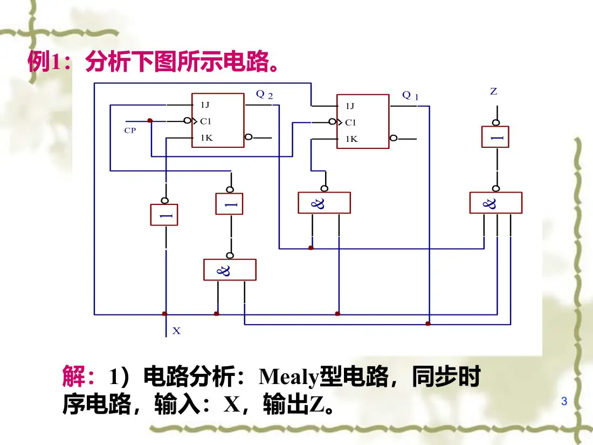

原文：

例1：分析下图所示电路。

解：1）电路分析：Mealy型电路，同步时序电路，输入：X，输出Z。

### 2) 列方程: b、状态方程:

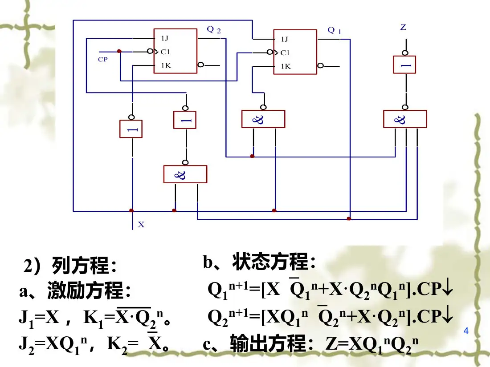

原文：

2) 列方程: b、状态方程:

a、激励方程： $Q_{1}^{n+1}=[X\overline{Q}_{1}^{n}+X\cdot Q_{2}^{n}Q_{1}^{n}].CP\downarrow$

$J_{1}=X$ , $K_{1}=\overline{X\cdot Q_{2}}^{n}$ . $Q_{2}^{n+1}=[XQ_{1}^{n}\overline{Q}_{2}^{n}+X\cdot Q_{2}^{n}]$ . CP↓

$J_{2}=XQ_{1}^{n},\quad K_{2}=\overline{X}$ 。c、输出方程： $Z=XQ_{1}^{n}Q_{2}^{n}$

### b、状态方程：

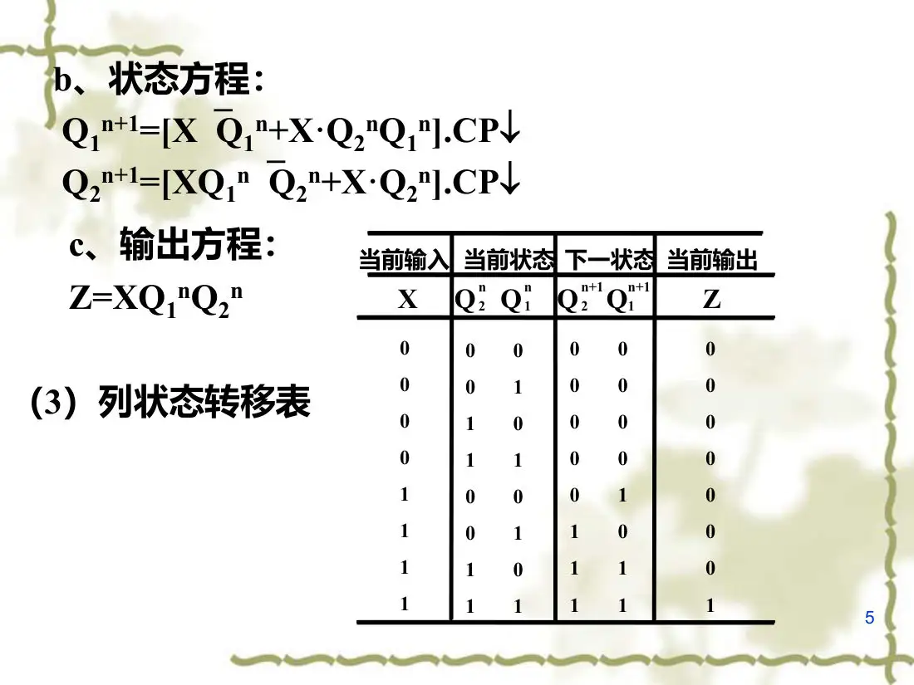

原文：

b、状态方程：

$$
\mathbf {Q} _ {1} ^ {\mathrm{n+1}} = [ \mathbf {X} \overline {{\mathbf {Q}}} _ {1} ^ {\mathrm{n}} + \mathbf {X} \cdot \mathbf {Q} _ {2} ^ {\mathrm{n}} \mathbf {Q} _ {1} ^ {\mathrm{n}} ]. \mathbf {C P} \downarrow
$$

$$
\mathbf {Q} _ {2} ^ {\mathrm{n+1}} = [ \mathbf {X} \mathbf {Q} _ {1} ^ {\mathrm{n}} \overline {{\mathbf {Q}}} _ {2} ^ {\mathrm{n}} + \mathbf {X} \cdot \mathbf {Q} _ {2} ^ {\mathrm{n}} ]. \mathbf {C P} \downarrow
$$

c、输出方程:

$$
\mathrm{Z} = \mathrm{XQ} _ {1} ^ {\mathrm{n}} \mathrm{Q} _ {2} ^ {\mathrm{n}}
$$

(3) 列状态转移表

<table><tr><td>当前输入</td><td colspan="2">当前状态</td><td colspan="2">下一状态</td><td>当前输出</td></tr><tr><td>X</td><td> $Q_{2}^{n}$ </td><td> $Q_{1}^{n}$ </td><td> $Q_{2}^{n+1}$ </td><td> $Q_{1}^{n+1}$ </td><td>Z</td></tr><tr><td>0</td><td>0</td><td>0</td><td>0</td><td>0</td><td>0</td></tr><tr><td>0</td><td>0</td><td>1</td><td>0</td><td>0</td><td>0</td></tr><tr><td>0</td><td>1</td><td>0</td><td>0</td><td>0</td><td>0</td></tr><tr><td>0</td><td>1</td><td>1</td><td>0</td><td>0</td><td>0</td></tr><tr><td>1</td><td>0</td><td>0</td><td>0</td><td>1</td><td>0</td></tr><tr><td>1</td><td>0</td><td>1</td><td>1</td><td>0</td><td>0</td></tr><tr><td>1</td><td>1</td><td>0</td><td>1</td><td>1</td><td>0</td></tr><tr><td>1</td><td>1</td><td>1</td><td>1</td><td>1</td><td>1</td></tr></table>

5

### 表6.2.3(b)例6.2.2电路的状态转移表

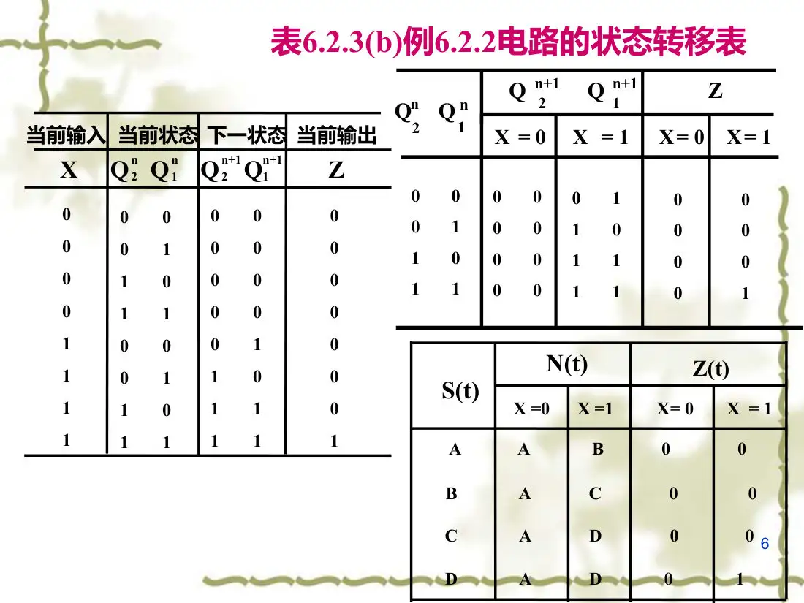

原文：

表6.2.3(b)例6.2.2电路的状态转移表
<table><tr><td>当前输入</td><td colspan="2">当前状态</td><td colspan="2">下一状态</td><td>当前输出</td></tr><tr><td>X</td><td> $Q_{2}^{n}$ </td><td> $Q_{1}^{n}$ </td><td> $Q_{2}^{n+1}$ </td><td> $Q_{1}^{n+1}$ </td><td>Z</td></tr><tr><td>0</td><td>0</td><td>0</td><td>0</td><td>0</td><td>0</td></tr><tr><td>0</td><td>0</td><td>1</td><td>0</td><td>0</td><td>0</td></tr><tr><td>0</td><td>1</td><td>0</td><td>0</td><td>0</td><td>0</td></tr><tr><td>0</td><td>1</td><td>1</td><td>0</td><td>0</td><td>0</td></tr><tr><td>1</td><td>0</td><td>0</td><td>0</td><td>1</td><td>0</td></tr><tr><td>1</td><td>0</td><td>1</td><td>1</td><td>0</td><td>0</td></tr><tr><td>1</td><td>1</td><td>0</td><td>1</td><td>1</td><td>0</td></tr><tr><td>1</td><td>1</td><td>1</td><td>1</td><td>1</td><td>1</td></tr></table>

<table><tr><td rowspan="2" colspan="2"> $Q_{2}^{n}$   $Q_{1}^{n}$ </td><td colspan="2"> $Q_{2}^{n+1}$   $Q_{1}^{n+1}$ </td><td colspan="2">Z</td></tr><tr><td>X = 0</td><td>X = 1</td><td>X = 0</td><td>X = 1</td></tr><tr><td>0</td><td>0</td><td>0</td><td>0</td><td>0</td><td>0</td></tr><tr><td>0</td><td>1</td><td>0</td><td>0</td><td>1</td><td>0</td></tr><tr><td>1</td><td>0</td><td>0</td><td>0</td><td>1</td><td>0</td></tr><tr><td>1</td><td>1</td><td>0</td><td>0</td><td>1</td><td>0</td></tr></table>

<table><tr><td rowspan="2">S(t)</td><td colspan="2">N(t)</td><td colspan="2">Z(t)</td></tr><tr><td>X=0</td><td>X=1</td><td>X=0</td><td>X=1</td></tr><tr><td>A</td><td>A</td><td>B</td><td>0</td><td>0</td></tr><tr><td>B</td><td>A</td><td>C</td><td>0</td><td>0</td></tr><tr><td>C</td><td>A</td><td>D</td><td>0</td><td>06</td></tr><tr><td>D</td><td>A</td><td>D</td><td>0</td><td>1</td></tr><tr><td>C</td><td>A</td><td>D</td><td>0</td><td>0</td></tr><tr><td>D</td><td>A</td><td>D</td><td>0</td><td>1</td></tr></table>

### 第 7 页

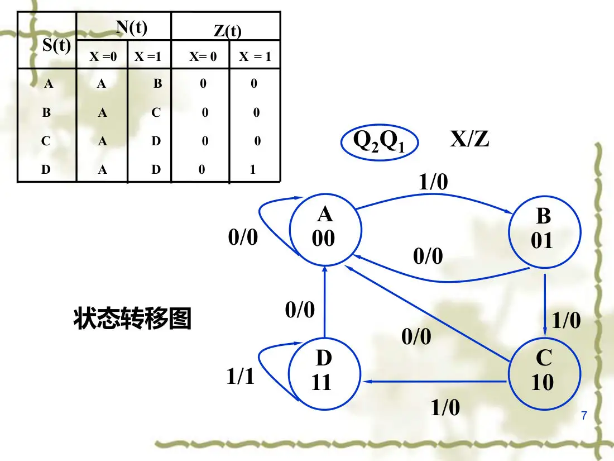

### 第 8 页

原文：

4) 分析逻辑功能: Mealy型电路。在任何状态下, 一旦X出现0, 则电路回到初始状态A,且输出Z为0。当X连续出现四个及四个以上的“1”, 输出Z则为1, 可以看出, 该电路是一个连续四个以上1的检测电路。

8

### 例2：分析下图所示电路。

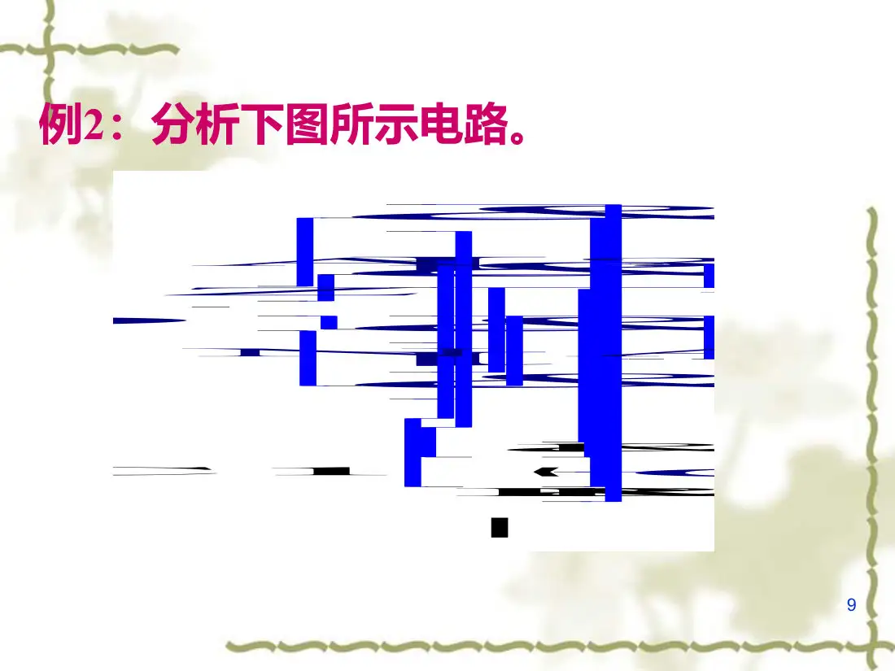

原文：

例2：分析下图所示电路。

### 10

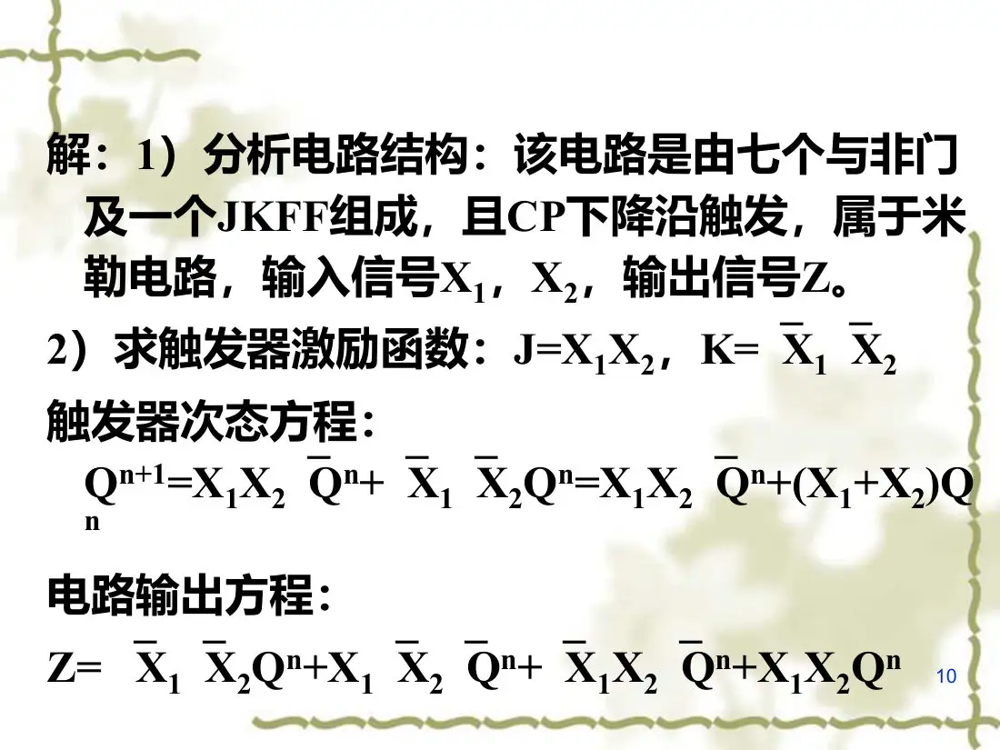

原文：

10

解：1）分析电路结构：该电路是由七个与非门及一个JKFF组成，且CP下降沿触发，属于米勒电路，输入信号 $X_{1}$ ， $X_{2}$ ，输出信号Z。

2）求触发器激励函数： $J=X_{1}X_{2}$ ， $K=\bar{X}_{1}\bar{X}_{2}$ 触发器次态方程：

$$
\mathbf {Q} _ {\mathrm{n}} ^ {\mathrm{n+1}} = \mathbf {X} _ {1} \mathbf {X} _ {2} \overline {{\mathbf {Q}}} ^ {\mathrm{n}} + \overline {{\mathbf {X}}} _ {1} \overline {{\mathbf {X}}} _ {2} \mathbf {Q} ^ {\mathrm{n}} = \mathbf {X} _ {1} \mathbf {X} _ {2} \overline {{\mathbf {Q}}} ^ {\mathrm{n}} + (\mathbf {X} _ {1} + \mathbf {X} _ {2}) \mathbf {Q}
$$

电路输出方程:

$$
\mathbf {Z} = \overline {{\mathbf {X}}} _ {1} \overline {{\mathbf {X}}} _ {2} \mathbf {Q} ^ {\mathrm{n}} + \mathbf {X} _ {1} \overline {{\mathbf {X}}} _ {2} \overline {{\mathbf {Q}}} ^ {\mathrm{n}} + \overline {{\mathbf {X}}} _ {1} \mathbf {X} _ {2} \overline {{\mathbf {Q}}} ^ {\mathrm{n}} + \mathbf {X} _ {1} \mathbf {X} _ {2} \mathbf {Q} ^ {\mathrm{n}}
$$

### 3)状态转移表:

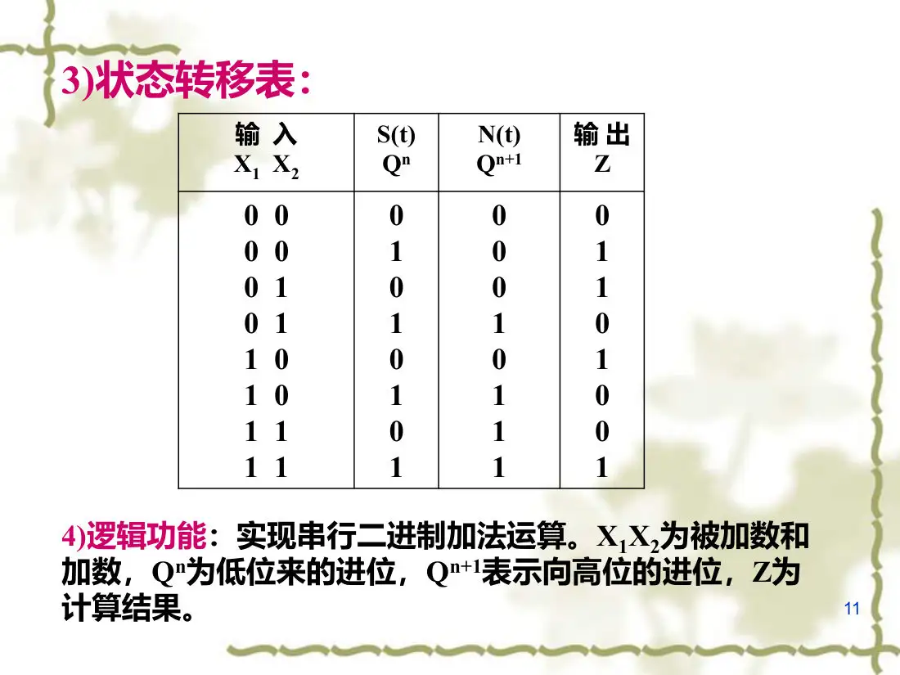

原文：

3)状态转移表:

<table><tr><td>输入 $X_1$   $X_2$ </td><td>S(t) $Q^n$ </td><td>N(t) $Q^{n+1}$ </td><td>输出Z</td></tr><tr><td>0 0</td><td>0</td><td>0</td><td>0</td></tr><tr><td>0 0</td><td>1</td><td>0</td><td>1</td></tr><tr><td>0 1</td><td>0</td><td>0</td><td>1</td></tr><tr><td>0 1</td><td>1</td><td>1</td><td>0</td></tr><tr><td>1 0</td><td>0</td><td>0</td><td>1</td></tr><tr><td>1 0</td><td>1</td><td>1</td><td>0</td></tr><tr><td>1 1</td><td>0</td><td>1</td><td>0</td></tr><tr><td>1 1</td><td>1</td><td>1</td><td>1</td></tr></table>

4)逻辑功能: 实现串行二进制加法运算。 $X_{1}X_{2}$ 为被加数和加数, $Q^{n}$ 为低位来的进位, $Q^{n+1}$ 表示向高位的进位, Z为计算结果。

11

### 12

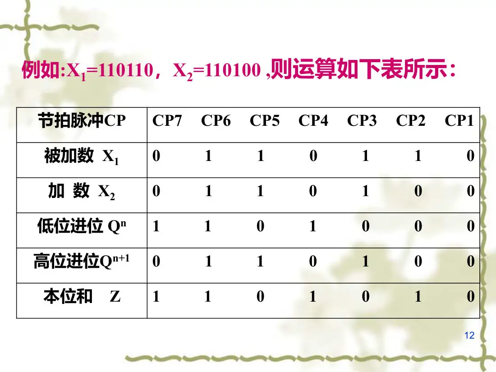

原文：

例如: $X_{1}=110110$ , $X_{2}=110100$ , 则运算如下表所示:

<table><tr><td>节拍脉冲CP</td><td>CP7</td><td>CP6</td><td>CP5</td><td>CP4</td><td>CP3</td><td>CP2</td><td>CP1</td></tr><tr><td>被加数  $X_1$ </td><td>0</td><td>1</td><td>1</td><td>0</td><td>1</td><td>1</td><td>0</td></tr><tr><td>加数  $X_2$ </td><td>0</td><td>1</td><td>1</td><td>0</td><td>1</td><td>0</td><td>0</td></tr><tr><td>低位进位  $Q^n$ </td><td>1</td><td>1</td><td>0</td><td>1</td><td>0</td><td>0</td><td>0</td></tr><tr><td>高位进位 $Q^{n+1}$ </td><td>0</td><td>1</td><td>1</td><td>0</td><td>1</td><td>0</td><td>0</td></tr><tr><td>本位和 Z</td><td>1</td><td>1</td><td>0</td><td>1</td><td>0</td><td>1</td><td>0</td></tr></table>

12

### 同步时序电路的设计

原文：

同步时序电路的设计

设计步骤:

(1)根据功能要求，确定输入输出信号，建立原始状态转移表。

最为关键重要的一步，不易掌握。初次建立的状态转移表往往不是最简的，因此称为原始状态表。

(2)化简状态表

原始状态表往往存在多余的状态或重复的状态，若状态越多，则电路越复杂，必须对其进行化简。

13

### (3)进行状态编码

原文：

(3)进行状态编码

(4)选定触发器，根据状态转移表设计各触发器的激励函数和输出函数。

(5)画电路图。

14

### 建立原始状态表

原文：

建立原始状态表

例1：设计一个同步序列电路对输入序列进行检测，当出现01011时，输出为1，否则输出为0。

解：输入：X，输出：Z。

15

### 定义状态:

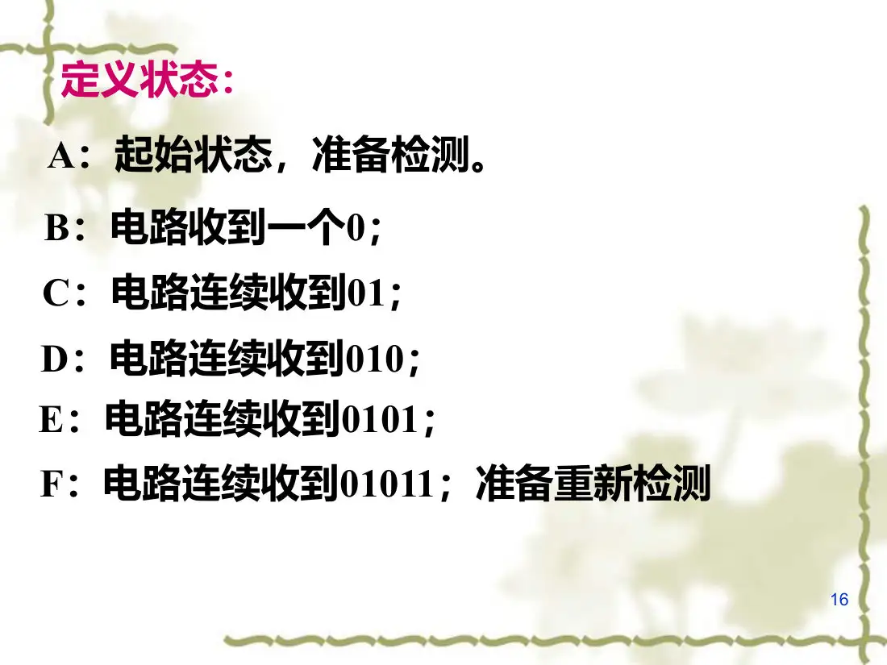

原文：

定义状态:

A: 起始状态，准备检测。

B: 电路收到一个0;

C: 电路连续收到01;

D: 电路连续收到010;

E: 电路连续收到0101;

F: 电路连续收到01011；准备重新检测

16

### 检测序列01011状态转移图

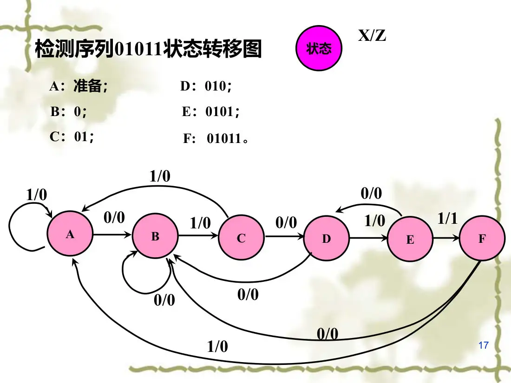

原文：

检测序列01011状态转移图

A: 准备; D: 010;

B: 0; E: 0101;

C: 01; F: 01011。

### 注意:

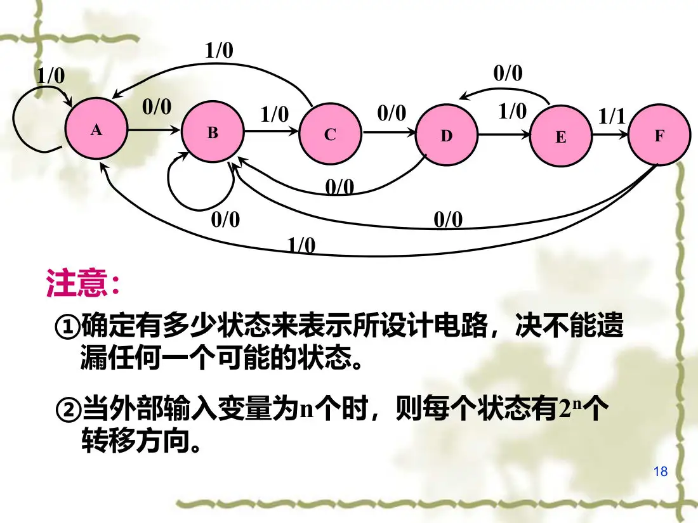

原文：

注意:

①确定有多少状态来表示所设计电路，决不能遗漏任何一个可能的状态。

②当外部输入变量为n个时，则每个状态有 $2^{n}$ 个转移方向。

18

### 可导出原始状态转移表：

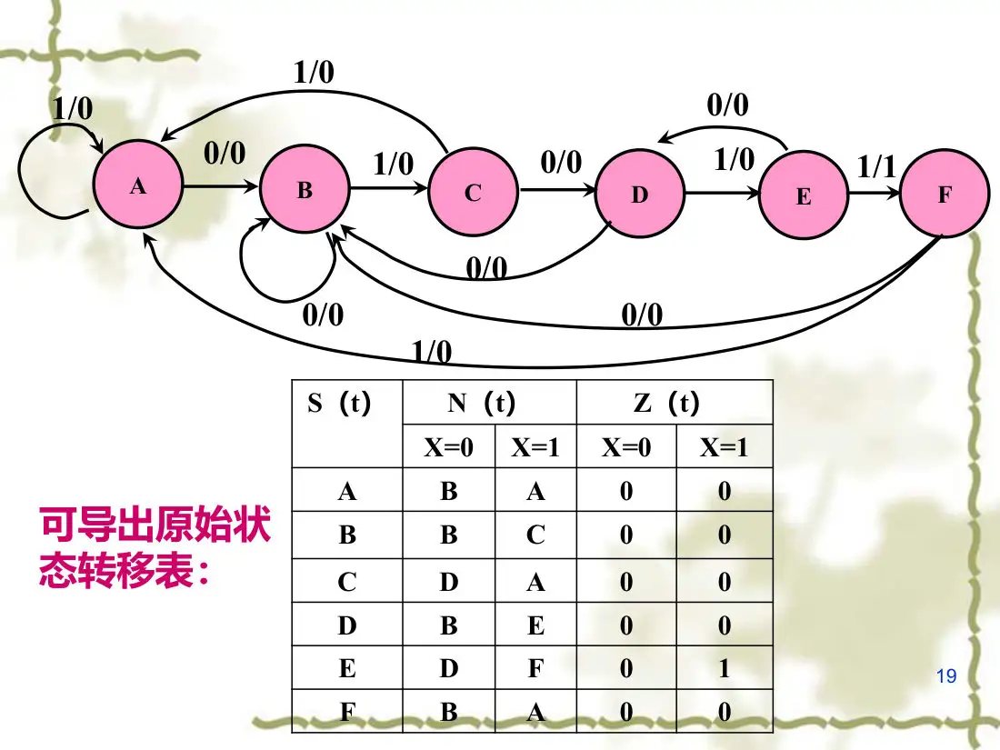

原文：

可导出原始状态转移表：

<table><tr><td rowspan="2">S (t)</td><td colspan="2">N (t)</td><td colspan="2">Z (t)</td></tr><tr><td>X=0</td><td>X=1</td><td>X=0</td><td>X=1</td></tr><tr><td>A</td><td>B</td><td>A</td><td>0</td><td>0</td></tr><tr><td>B</td><td>B</td><td>C</td><td>0</td><td>0</td></tr><tr><td>C</td><td>D</td><td>A</td><td>0</td><td>0</td></tr><tr><td>D</td><td>B</td><td>E</td><td>0</td><td>0</td></tr><tr><td>E</td><td>D</td><td>F</td><td>0</td><td>1</td></tr><tr><td>F</td><td>B</td><td>A</td><td>0</td><td>0</td></tr></table>

### 化简原始状态表

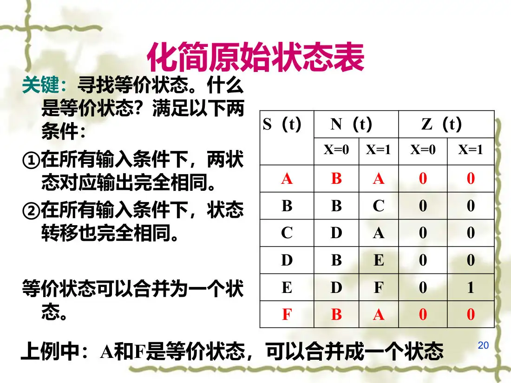

原文：

化简原始状态表

关键：寻找等价状态。什么是等价状态？满足以下两条件：

①在所有输入条件下，两状态对应输出完全相同。

②在所有输入条件下，状态转移也完全相同。

等价状态可以合并为一个状态。

<table><tr><td rowspan="2">S (t)</td><td colspan="2">N (t)</td><td colspan="2">Z (t)</td></tr><tr><td>X=0</td><td>X=1</td><td>X=0</td><td>X=1</td></tr><tr><td>A</td><td>B</td><td>A</td><td>0</td><td>0</td></tr><tr><td>B</td><td>B</td><td>C</td><td>0</td><td>0</td></tr><tr><td>C</td><td>D</td><td>A</td><td>0</td><td>0</td></tr><tr><td>D</td><td>B</td><td>E</td><td>0</td><td>0</td></tr><tr><td>E</td><td>D</td><td>F</td><td>0</td><td>1</td></tr><tr><td>F</td><td>B</td><td>A</td><td>0</td><td>0</td></tr></table>

上例中：A和F是等价状态，可以合并成一个状态

20

### 检测序列01011状态转移图

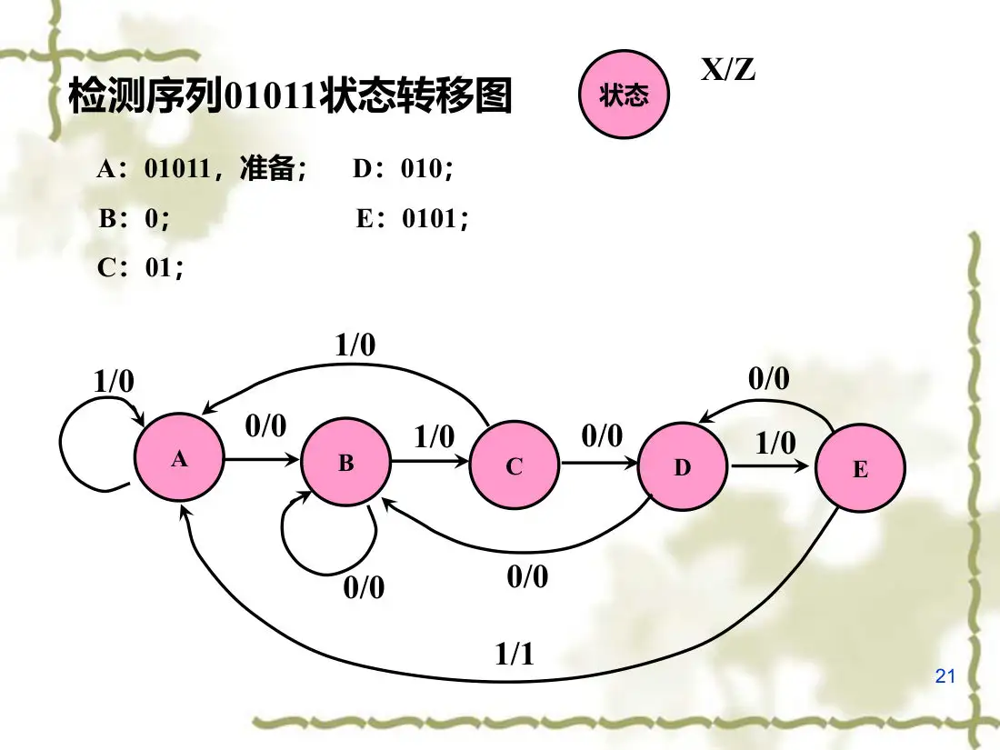

原文：

检测序列01011状态转移图

A: 01011, 准备; D: 010;

B: 0; E: 0101;

C: 01;

21

### 等价状态条件2的几种特殊情况

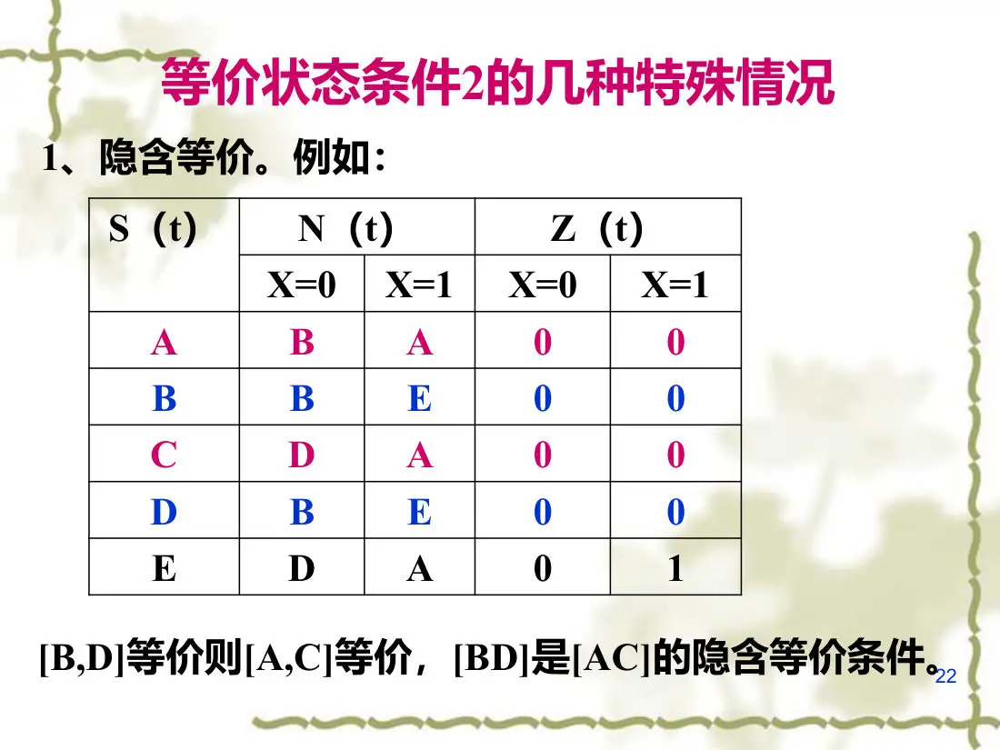

原文：

等价状态条件2的几种特殊情况

1、隐含等价。例如：

<table><tr><td rowspan="2">S (t)</td><td colspan="2">N (t)</td><td colspan="2">Z (t)</td></tr><tr><td>X=0</td><td>X=1</td><td>X=0</td><td>X=1</td></tr><tr><td>A</td><td>B</td><td>A</td><td>0</td><td>0</td></tr><tr><td>B</td><td>B</td><td>E</td><td>0</td><td>0</td></tr><tr><td>C</td><td>D</td><td>A</td><td>0</td><td>0</td></tr><tr><td>D</td><td>B</td><td>E</td><td>0</td><td>0</td></tr><tr><td>E</td><td>D</td><td>A</td><td>0</td><td>1</td></tr></table>

[B,D]等价则[A,C]等价，[BD]是[AC]的隐含等价条件。 $^{22}$

### 等价状态条件2的几种特殊情况

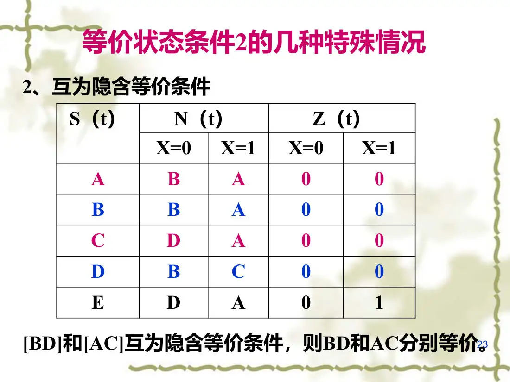

原文：

等价状态条件2的几种特殊情况

2、互为隐含等价条件

<table><tr><td rowspan="2">S (t)</td><td colspan="2">N (t)</td><td colspan="2">Z (t)</td></tr><tr><td>X=0</td><td>X=1</td><td>X=0</td><td>X=1</td></tr><tr><td>A</td><td>B</td><td>A</td><td>0</td><td>0</td></tr><tr><td>B</td><td>B</td><td>A</td><td>0</td><td>0</td></tr><tr><td>C</td><td>D</td><td>A</td><td>0</td><td>0</td></tr><tr><td>D</td><td>B</td><td>C</td><td>0</td><td>0</td></tr><tr><td>E</td><td>D</td><td>A</td><td>0</td><td>1</td></tr></table>

[BD]和[AC]互为隐含等价条件，则BD和AC分别等价 $^{23}$ 。

### 等价状态条件2的几种特殊情况

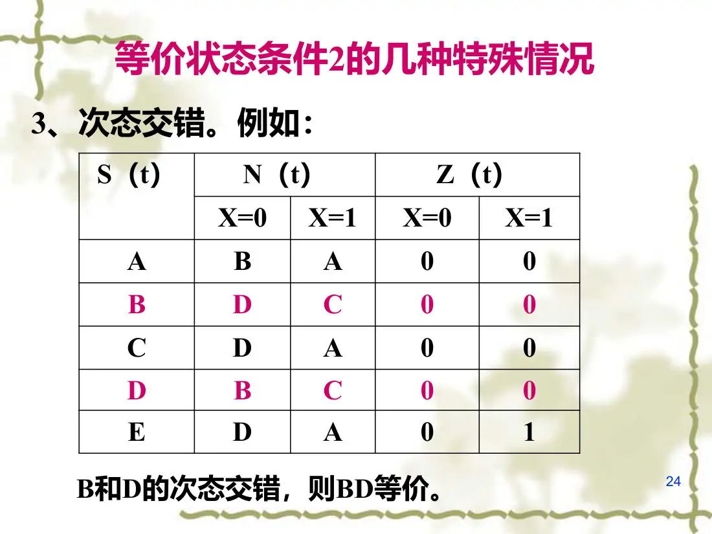

原文：

等价状态条件2的几种特殊情况

3、次态交错。例如：

<table><tr><td rowspan="2">S (t)</td><td colspan="2">N (t)</td><td colspan="2">Z (t)</td></tr><tr><td>X=0</td><td>X=1</td><td>X=0</td><td>X=1</td></tr><tr><td>A</td><td>B</td><td>A</td><td>0</td><td>0</td></tr><tr><td>B</td><td>D</td><td>C</td><td>0</td><td>0</td></tr><tr><td>C</td><td>D</td><td>A</td><td>0</td><td>0</td></tr><tr><td>D</td><td>B</td><td>C</td><td>0</td><td>0</td></tr><tr><td>E</td><td>D</td><td>A</td><td>0</td><td>1</td></tr></table>

B和D的次态交错，则BD等价。

24

### 等价状态条件2的几种特殊情况

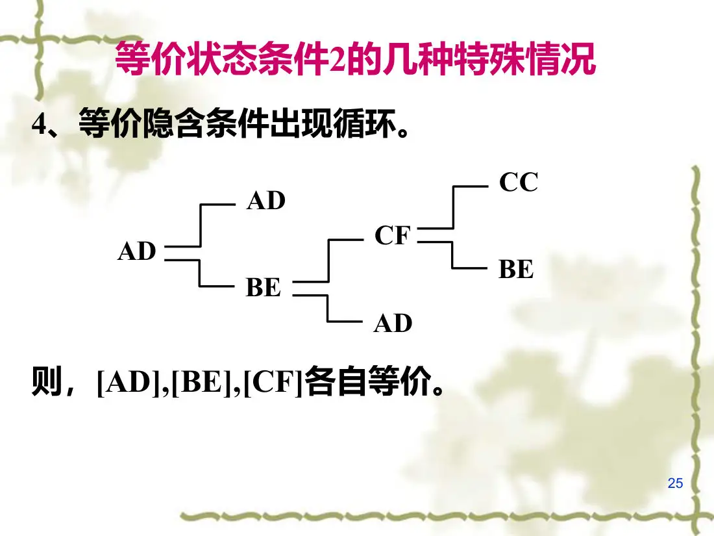

原文：

等价状态条件2的几种特殊情况

4、等价隐含条件出现循环。

则，[AD], [BE], [CF]各自等价。

25

### 化简过程分三步:

原文：

化简过程分三步:

画出隐含表进行顺序比较。

进行关联比较

列出最小化状态表。

26

### 例2：将下面原始状态表进行化简。

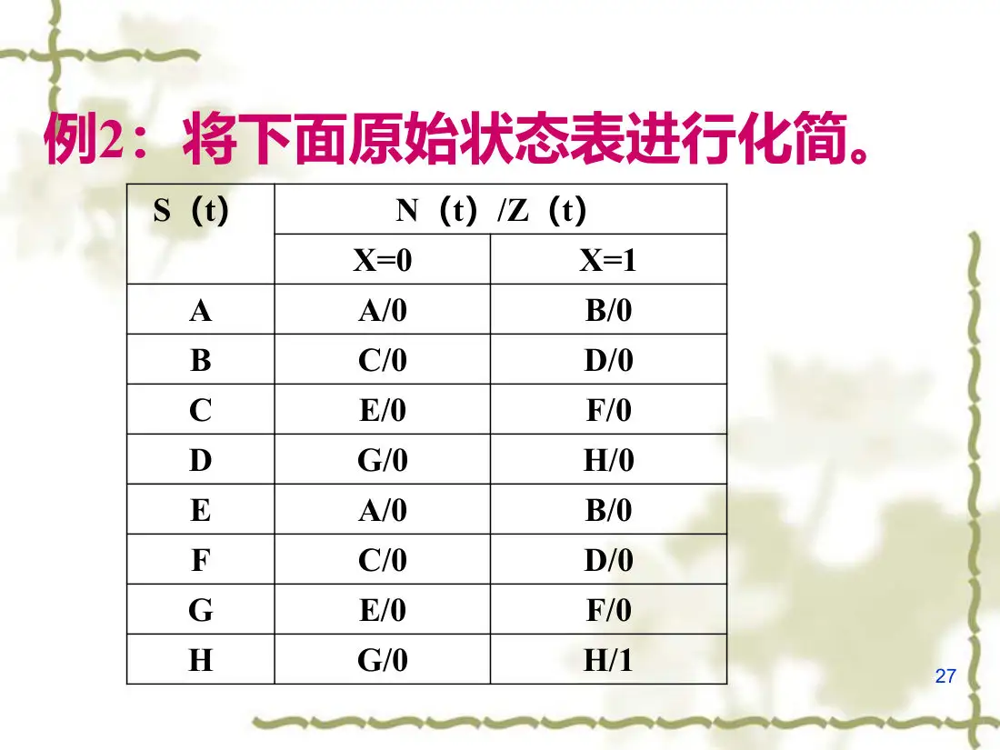

原文：

例2：将下面原始状态表进行化简。

<table><tr><td rowspan="2">S (t)</td><td colspan="2">N (t) /Z (t)</td></tr><tr><td>X=0</td><td>X=1</td></tr><tr><td>A</td><td>A/0</td><td>B/0</td></tr><tr><td>B</td><td>C/0</td><td>D/0</td></tr><tr><td>C</td><td>E/0</td><td>F/0</td></tr><tr><td>D</td><td>G/0</td><td>H/0</td></tr><tr><td>E</td><td>A/0</td><td>B/0</td></tr><tr><td>F</td><td>C/0</td><td>D/0</td></tr><tr><td>G</td><td>E/0</td><td>F/0</td></tr><tr><td>H</td><td>G/0</td><td>H/1</td></tr></table>

27

### 28

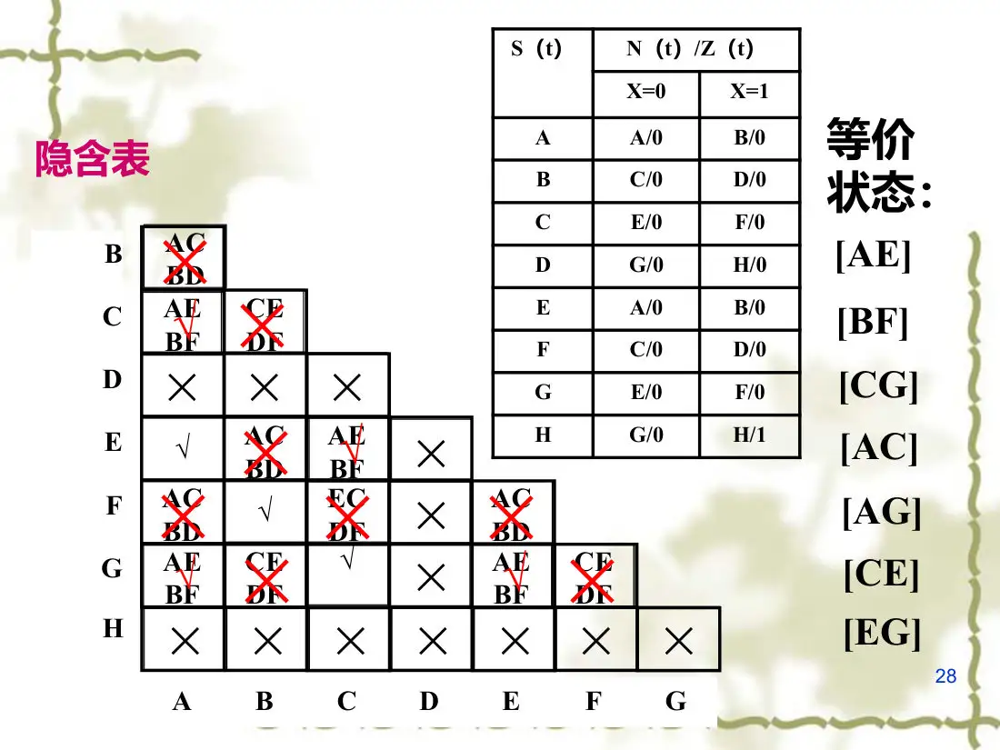

原文：

<table><tr><td rowspan="2" colspan="2">S (t)</td><td colspan="2">N (t)/Z (t)</td></tr><tr><td>X=0</td><td>X=1</td></tr><tr><td colspan="2">A</td><td>A/0</td><td>B/0</td></tr><tr><td colspan="2">B</td><td>C/0</td><td>D/0</td></tr><tr><td colspan="2">C</td><td>E/0</td><td>F/0</td></tr><tr><td colspan="2">D</td><td>G/0</td><td>H/0</td></tr><tr><td colspan="2">E</td><td>A/0</td><td>B/0</td></tr><tr><td colspan="2">F</td><td>C/0</td><td>D/0</td></tr><tr><td colspan="2">G</td><td>E/0</td><td>F/0</td></tr><tr><td colspan="2">H</td><td>G/0</td><td>H/1</td></tr></table>

28

### 等价类：等价状态的集合。

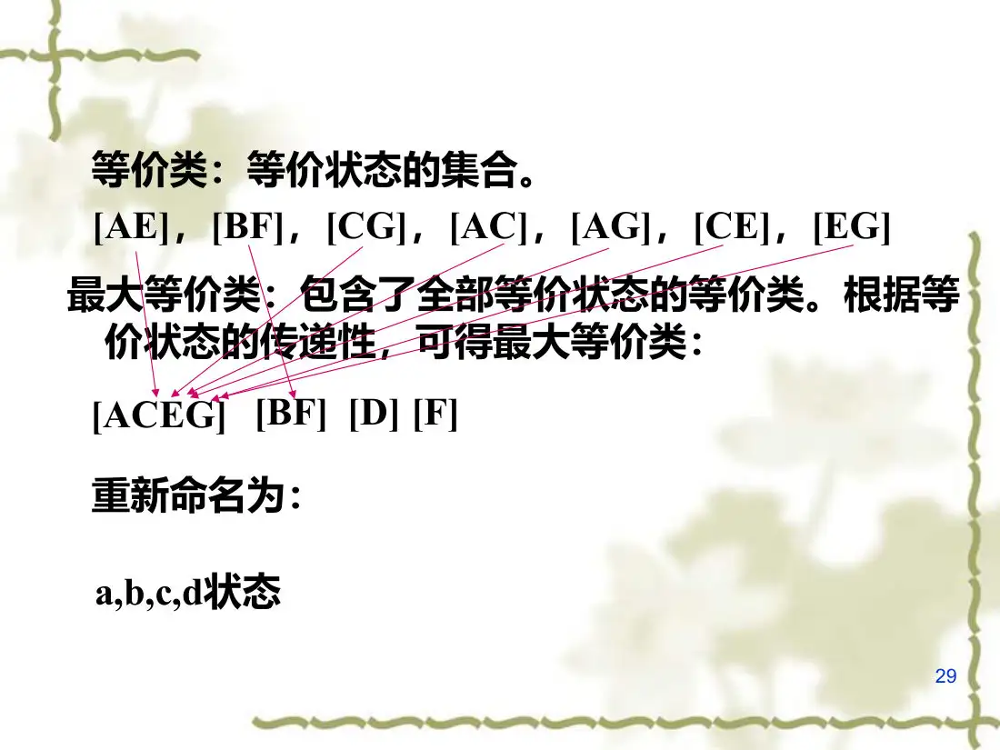

原文：

等价类：等价状态的集合。

[AE], [BF], [CG], [AC], [AG], [CE], [EG]

最大等价类：包含了全部等价状态的等价类。根据等价状态的传递性，可得最大等价类：

[ACEG] [BF] [D] [F]

重新命名为：

a,b,c,d状态

29

### [ACEG], [BF], [D], [H]

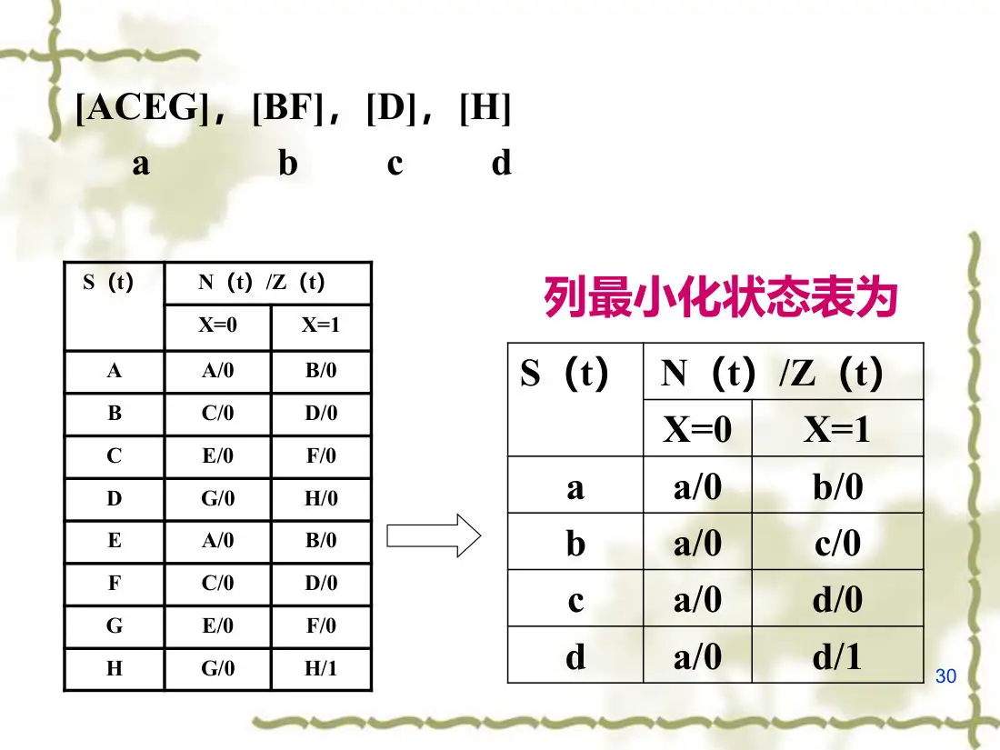

原文：

[ACEG], [BF], [D], [H]
a b c d

<table><tr><td rowspan="2">S (t)</td><td colspan="2">N (t) /Z (t)</td></tr><tr><td>X=0</td><td>X=1</td></tr><tr><td>A</td><td>A/0</td><td>B/0</td></tr><tr><td>B</td><td>C/0</td><td>D/0</td></tr><tr><td>C</td><td>E/0</td><td>F/0</td></tr><tr><td>D</td><td>G/0</td><td>H/0</td></tr><tr><td>E</td><td>A/0</td><td>B/0</td></tr><tr><td>F</td><td>C/0</td><td>D/0</td></tr><tr><td>G</td><td>E/0</td><td>F/0</td></tr><tr><td>H</td><td>G/0</td><td>H/1</td></tr></table>

列最小化状态表为

<table><tr><td rowspan="2">S (t)</td><td colspan="2">N (t) /Z (t)</td></tr><tr><td>X=0</td><td>X=1</td></tr><tr><td>a</td><td>a/0</td><td>b/0</td></tr><tr><td>b</td><td>a/0</td><td>c/0</td></tr><tr><td>c</td><td>a/0</td><td>d/0</td></tr><tr><td>d</td><td>a/0</td><td>d/1</td></tr></table>

30

### 状态编码

原文：

状态编码

在工程上比较具有实用价值的方法为相邻法：尽可能使次态方程和输出函数在卡诺图上“1”的分布为逻辑相邻，以便于化简。

31

### 三个原则：（优先权由高到低）

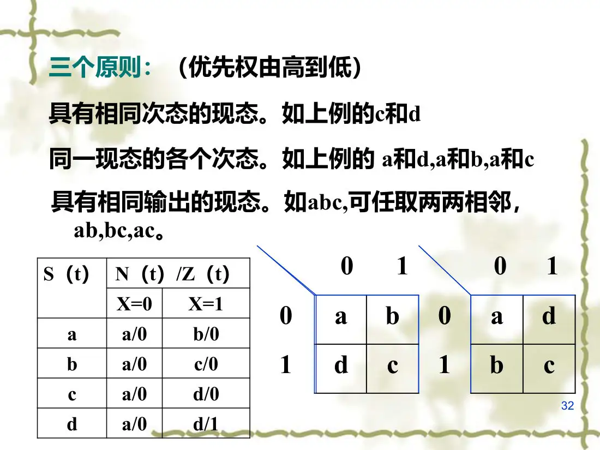

原文：

三个原则：（优先权由高到低）

具有相同次态的现态。如上例的c和d

同一现态的各个次态。如上例的 a和d,a和b,a和c具有相同输出的现态。如abc,可任取两两相邻，ab,bc,ac。

<table><tr><td rowspan="2">S (t)</td><td colspan="2">N (t) /Z (t)</td></tr><tr><td>X=0</td><td>X=1</td></tr><tr><td>a</td><td>a/0</td><td>b/0</td></tr><tr><td>b</td><td>a/0</td><td>c/0</td></tr><tr><td>c</td><td>a/0</td><td>d/0</td></tr><tr><td>d</td><td>a/0</td><td>d/1</td></tr></table>

<table><tr><td>a</td><td>b</td></tr><tr><td>d</td><td>c</td></tr></table>

<table><tr><td>a</td><td>d</td></tr><tr><td>b</td><td>c</td></tr></table>

32

### 编码后的二进制状态转移表为：

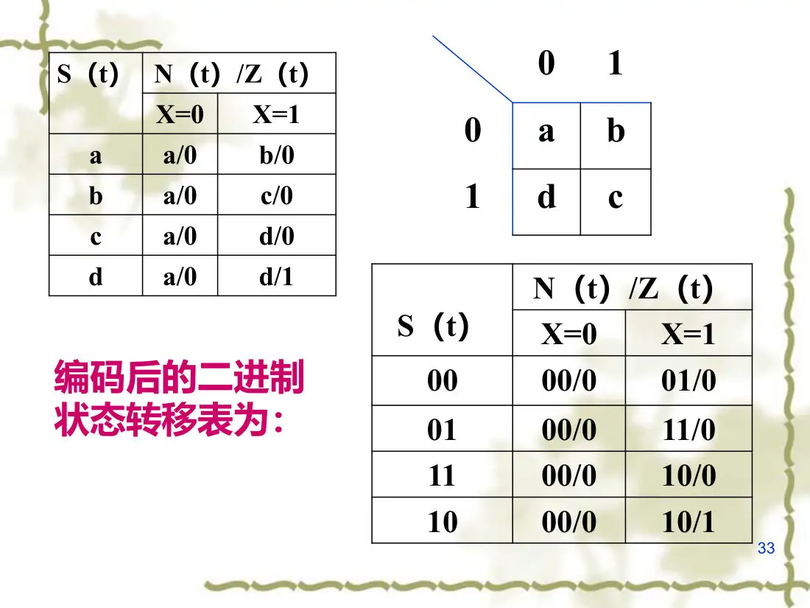

原文：

<table><tr><td rowspan="2">S (t)</td><td colspan="2">N (t) /Z (t)</td></tr><tr><td>X=0</td><td>X=1</td></tr><tr><td>a</td><td>a/0</td><td>b/0</td></tr><tr><td>b</td><td>a/0</td><td>c/0</td></tr><tr><td>c</td><td>a/0</td><td>d/0</td></tr><tr><td>d</td><td>a/0</td><td>d/1</td></tr></table>

编码后的二进制状态转移表为：

<table><tr><td></td><td>0</td><td>1</td></tr><tr><td>0</td><td>a</td><td>b</td></tr><tr><td>1</td><td>d</td><td>c</td></tr></table>

<table><tr><td rowspan="2">S (t)</td><td colspan="2">N (t) /Z (t)</td></tr><tr><td>X=0</td><td>X=1</td></tr><tr><td>00</td><td>00/0</td><td>01/0</td></tr><tr><td>01</td><td>00/0</td><td>11/0</td></tr><tr><td>11</td><td>00/0</td><td>10/0</td></tr><tr><td>10</td><td>00/0</td><td>10/1</td></tr></table>

33

### (4)选定触发器，根据状态转移表设计各触发器的激励函数和输出函数。

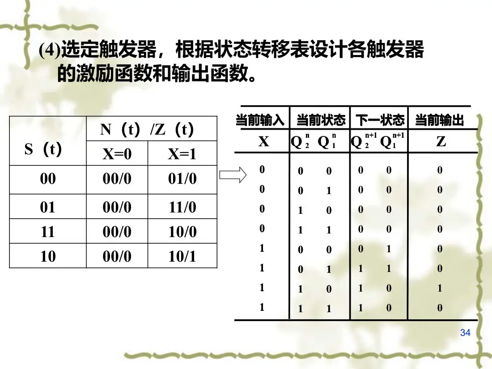

原文：

(4)选定触发器，根据状态转移表设计各触发器的激励函数和输出函数。

<table><tr><td rowspan="2">S (t)</td><td colspan="2">N (t) /Z (t)</td></tr><tr><td>X=0</td><td>X=1</td></tr><tr><td>00</td><td>00/0</td><td>01/0</td></tr><tr><td>01</td><td>00/0</td><td>11/0</td></tr><tr><td>11</td><td>00/0</td><td>10/0</td></tr><tr><td>10</td><td>00/0</td><td>10/1</td></tr></table>

<table><tr><td>当前输入</td><td colspan="2">当前状态</td><td colspan="2">下一状态</td><td>当前输出</td></tr><tr><td>X</td><td> $Q_{2}^{n}$ </td><td> $Q_{1}^{n}$ </td><td> $Q_{2}^{n+1}$ </td><td> $Q_{1}^{n+1}$ </td><td>Z</td></tr><tr><td>0</td><td>0</td><td>0</td><td>0</td><td>0</td><td>0</td></tr><tr><td>0</td><td>0</td><td>1</td><td>0</td><td>0</td><td>0</td></tr><tr><td>0</td><td>1</td><td>0</td><td>0</td><td>0</td><td>0</td></tr><tr><td>0</td><td>1</td><td>1</td><td>0</td><td>0</td><td>0</td></tr><tr><td>1</td><td>0</td><td>0</td><td>0</td><td>1</td><td>0</td></tr><tr><td>1</td><td>0</td><td>1</td><td>1</td><td>1</td><td>0</td></tr><tr><td>1</td><td>1</td><td>0</td><td>1</td><td>0</td><td>1</td></tr><tr><td>1</td><td>1</td><td>1</td><td>1</td><td>0</td><td>0</td></tr></table>

34

### $$

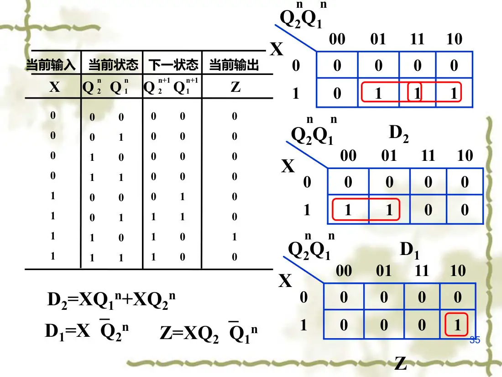

原文：

<table><tr><td>当前输入</td><td colspan="2">当前状态</td><td colspan="2">下一状态</td><td>当前输出</td></tr><tr><td>X</td><td> $Q_{2}^{n}$ </td><td> $Q_{1}^{n}$ </td><td> $Q_{2}^{n+1}$ </td><td> $Q_{1}^{n+1}$ </td><td>Z</td></tr><tr><td>0</td><td>0</td><td>0</td><td>0</td><td>0</td><td>0</td></tr><tr><td>0</td><td>0</td><td>1</td><td>0</td><td>0</td><td>0</td></tr><tr><td>0</td><td>1</td><td>0</td><td>0</td><td>0</td><td>0</td></tr><tr><td>0</td><td>1</td><td>1</td><td>0</td><td>0</td><td>0</td></tr><tr><td>1</td><td>0</td><td>0</td><td>0</td><td>1</td><td>0</td></tr><tr><td>1</td><td>0</td><td>1</td><td>1</td><td>1</td><td>0</td></tr><tr><td>1</td><td>1</td><td>0</td><td>1</td><td>0</td><td>1</td></tr><tr><td>1</td><td>1</td><td>1</td><td>1</td><td>0</td><td>0</td></tr></table>

$$
\begin{array}{l} \mathbf {D} _ {2} = \mathbf {X Q} _ {1} ^ {\mathrm{n}} + \mathbf {X Q} _ {2} ^ {\mathrm{n}} \\ \mathbf {D} _ {1} = \mathbf {X} \overline {{\mathbf {Q}}} _ {2} ^ {\mathrm{n}} \quad \mathbf {Z} = \mathbf {X Q} _ {2} \overline {{\mathbf {Q}}} _ {1} ^ {\mathrm{n}} \end{array}
$$

### 第 36 页

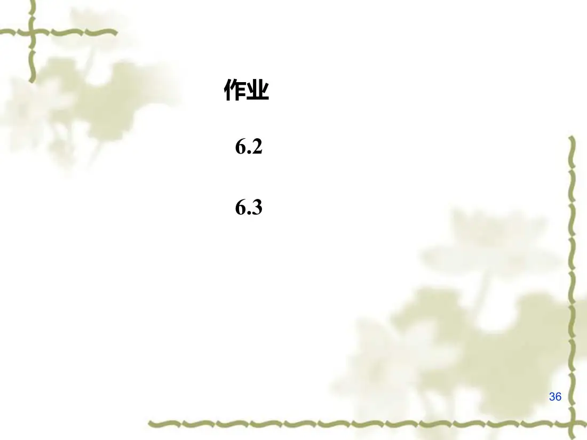
