# 《数字电路与逻辑设计B》第6章 时序逻辑电路（课件）

原件的每一页，下面附识别出的文字。

### 第6章 时序逻辑电路

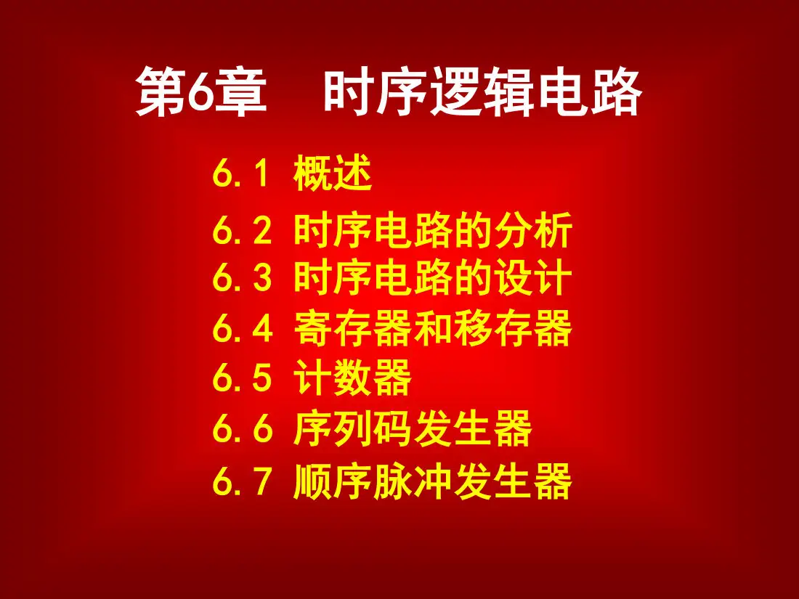

原文：

第6章 时序逻辑电路

6.1 概述

6.2 时序电路的分析

6.3 时序电路的设计

6.4 寄存器和移存器

6.5 计数器

6.6 序列码发生器

6.7 顺序脉冲发生器

### 第6章 时序逻辑电路

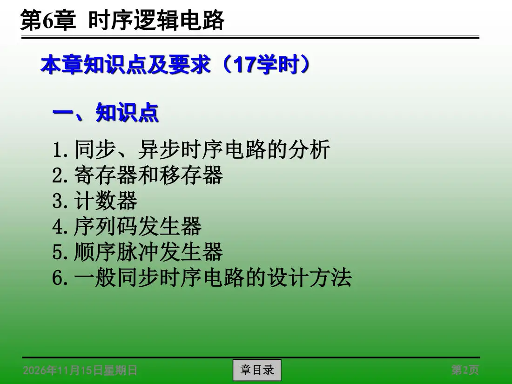

原文：

第6章 时序逻辑电路

本章知识点及要求（17学时）

一、知识点

1.同步、异步时序电路的分析

2.寄存器和移存器

3.计数器

4.序列码发生器

5.顺序脉冲发生器

6.一般同步时序电路的设计方法

2026年11月15日星期日

章目录

第2页

### 第6章 时序逻辑电路

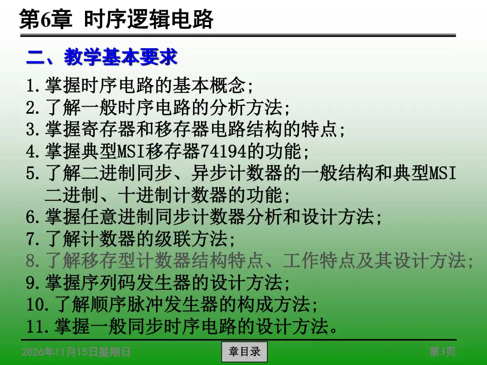

原文：

第6章 时序逻辑电路

二、教学基本要求

1.掌握时序电路的基本概念;

2.了解一般时序电路的分析方法;

3.掌握寄存器和移存器电路结构的特点;

4.掌握典型MSI移存器74194的功能;

5.了解二进制同步、异步计数器的一般结构和典型MSI二进制、十进制计数器的功能;

6.掌握任意进制同步计数器分析和设计方法;

7.了解计数器的级联方法;

8.了解移存型计数器结构特点、工作特点及其设计方法;

9.掌握序列码发生器的设计方法;

10.了解顺序脉冲发生器的构成方法;

11.掌握一般同步时序电路的设计方法。

2026年11月15日星期日

章目录

第3页

### 第6章 时序逻辑电路

原文：

第6章 时序逻辑电路

6.1 概述

一、组合电路

1.结构特点

2.功能特点

二、时序电路

1.结构特点 3.工作描述

2.功能特点 4.分类

第6章 时序逻辑电路

2026年11月15日星期日

章目录

第4页

### 6.2 时序电路的分析

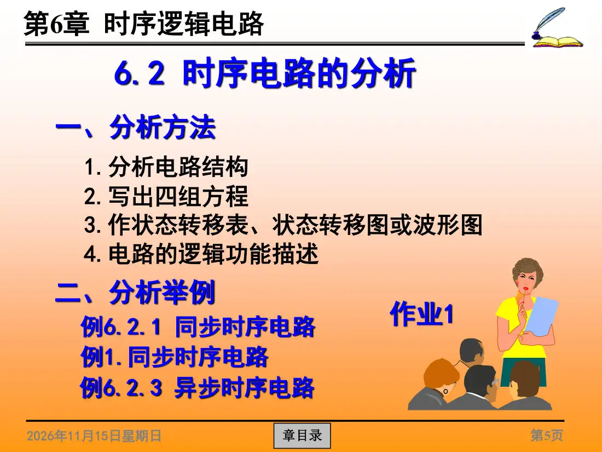

原文：

6.2 时序电路的分析

一、分析方法

1.分析电路结构

2.写出四组方程

3.作状态转移表、状态转移图或波形图

4.电路的逻辑功能描述

二、分析举例

例6.2.1 同步时序电路

例1.同步时序电路

例6.2.3 异步时序电路

作业1

第6章 时序逻辑电路

く

2026年11月15日星期日

章目录

第5页

### 6.3 时序电路的设计

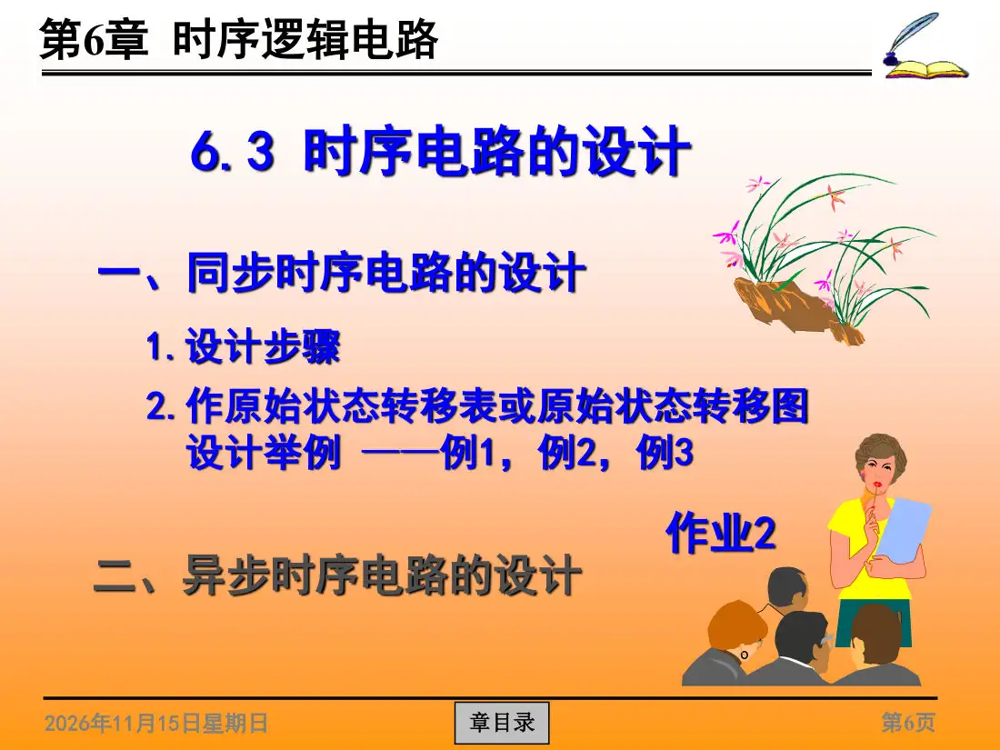

原文：

6.3 时序电路的设计

一、同步时序电路的设计

1.设计步骤

2.作原始状态转移表或原始状态转移图设计举例 ——例1，例2，例3

二、异步时序电路的设计

第6章 时序逻辑电路

く

2026年11月15日星期日

章目录

第6页

### 6.4 寄存器和移存器

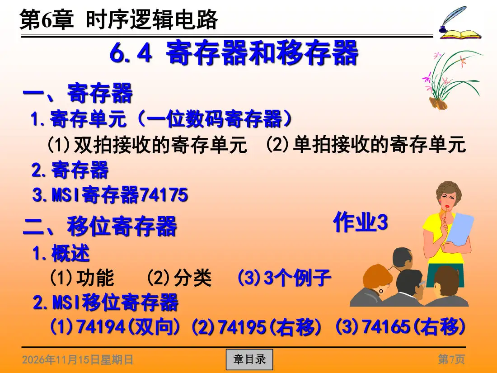

原文：

6.4 寄存器和移存器

单元 （ 一 位 数码 寄 存 器 一、寄存器 ）

1.寄存单元（一位数码寄存器）

(1)双拍接收的寄存单元 (2)单拍接收的寄存单元

2.寄存器

3.MSI寄存器74175

. 述 二、移位寄存器

1.概述

(1)功能 (2)分类 (3)3个例子

作业3

(1)74194( 双 向 (2)74195( 右 移 2 . M S I移位 寄存器

(1)74194(双向) (2)74195(右移) (3)74165(右移)

第6章 时序逻辑电路6.4 寄存器 和移存器

2026年11月15日星期日

章目录

第7页

### 6.5 计数器

原文：

6.5 计数器

计数器的概念、应用、基本结构及分类。

一、二进制计数器

1.同步计数器（由SSI构成）

(1)加法计数器 (2)减法计数器

2.异步计数器（由SSI构成）

(1)加法计数器 (2)减法计数器

3.MSI二进制计数器

(1)74 LS161

(2)74 LS163

二、十进制计数器74LS160

作业4

第6章 时序逻辑电路

2026年11月15日星期日

章目录

第8页

### 三、任意进制计数器

原文：

三、任意进制计数器

1.用触发器和逻辑门设计任意进制计数器

2.用MSI(二-十进制)计数器构成任意进制计数器(1)复0法(利用复位端)

(2)置数法(利用置数控制端，并行输入端)

①预置0法 ②置最小数法 ③置最大数法

3.计数器的扩展(级联)

四、移存型计数器

1.结构及特点、分析与设计思路

2.典型电路

(1)环形计数器 (2)扭环形计数器

作业5

第6章 时序逻辑电路

2026年11月15日星期日

章目录

第9页

### 6.6 序列码发生器

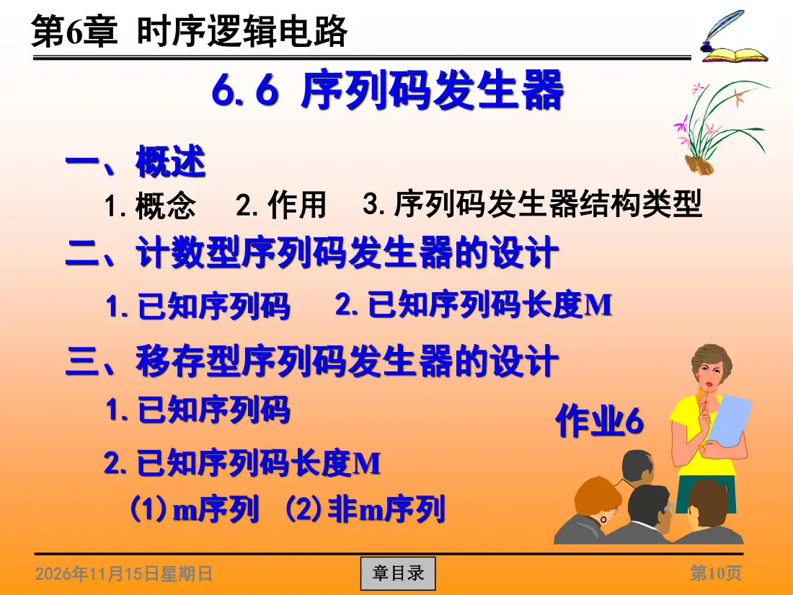

原文：

6.6 序列码发生器

一、概述

3.序列码发生器结构类型1.概念 2.作用

二、计数型序列码发生器的设计

1.已知序列码 2.已知序列码长度M

三、移存型序列码发生器的设计

1.已知序列码

2.已知序列码长度M

(1)m序列 (2)非m序列

作业6

第6章 时序逻辑电路

2026年11月15日星期日

章目录

第10页

### 6.7 顺序脉冲发生器

原文：

6.7 顺序脉冲发生器

一、概述

1.顺序脉冲概念

2.顺序脉冲发生器概念及分类

3.顺序脉冲发生器的设计

二、举例

第6章 时序逻辑电路

2026年11月15日星期日

章目录

第11页

### 第6章 时序逻辑电路

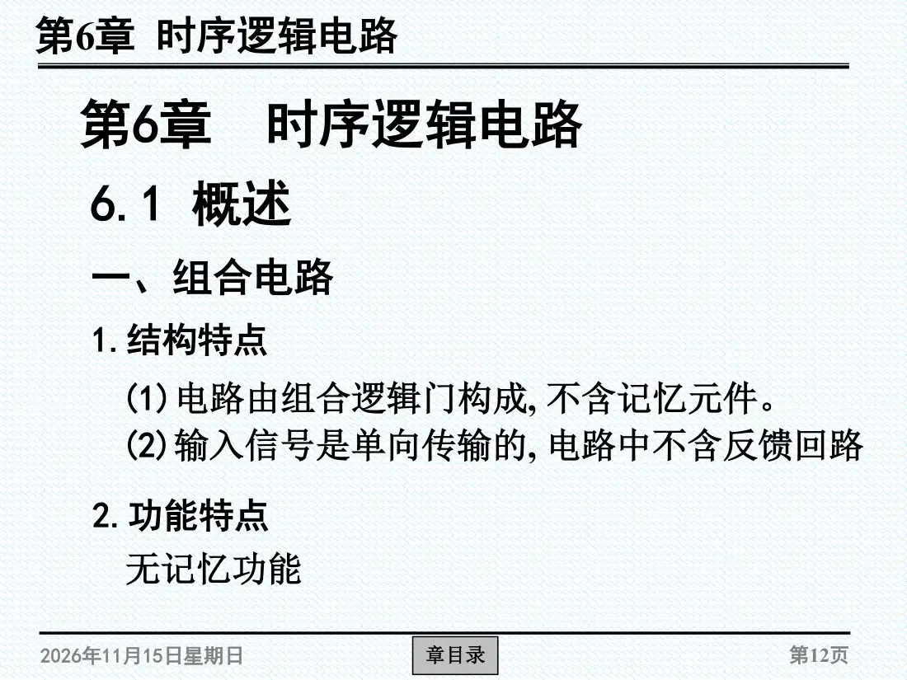

原文：

第6章 时序逻辑电路

第6章 时序逻辑电路

6.1 概述

一、组合电路

1.结构特点

(1)电路由组合逻辑门构成, 不含记忆元件。

(2)输入信号是单向传输的, 电路中不含反馈回路

2.功能特点

无记忆功能

2026年11月15日星期日

章目录

第12页

### 第6章 时序逻辑电路 时序电路的概况

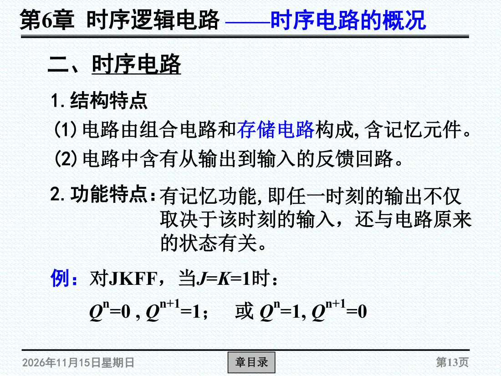

原文：

第6章 时序逻辑电路 时序电路的概况

二、时序电路

1.结构特点

(1)电路由组合电路和存储电路构成, 含记忆元件。

(2)电路中含有从输出到输入的反馈回路。

2.功能特点： 有记忆功能,即任一时刻的输出不仅取决于该时刻的输入，还与电路原来的状态有关。

例：对JKFF，当 $J { = } K { = } 1$ 时：

$$
Q ^ {n} = 0, Q ^ {n + 1} = 1; \quad \text {或} Q ^ {n} = 1, Q ^ {n + 1} = 0
$$

2026年11月15日星期日

章目录

第13页

### 第6章 时序逻辑电路 时序电路的概况

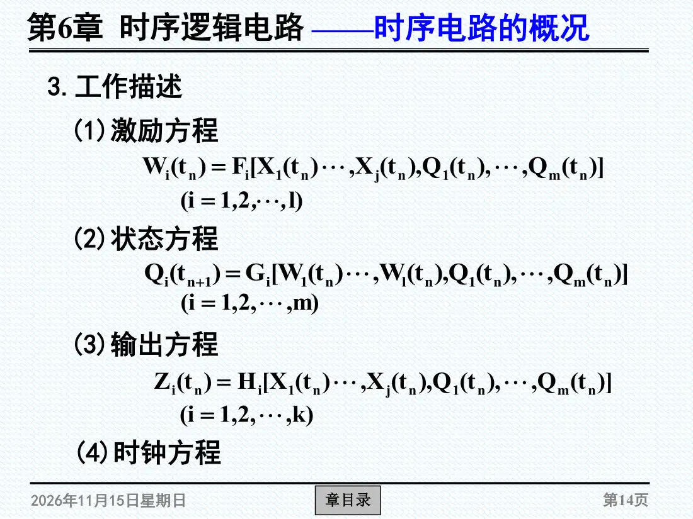

原文：

第6章 时序逻辑电路 时序电路的概况

3.工作描述

(1)激励方程

$$
\begin{array}{l} \mathbf {W} _ {\mathbf {i}} (\mathbf {t} _ {\mathbf {n}}) = \mathbf {F} _ {\mathbf {i}} [ \mathbf {X} _ {1} (\mathbf {t} _ {\mathbf {n}}) \dots , \mathbf {X} _ {\mathbf {j}} (\mathbf {t} _ {\mathbf {n}}), \mathbf {Q} _ {1} (\mathbf {t} _ {\mathbf {n}}), \dots , \mathbf {Q} _ {\mathbf {m}} (\mathbf {t} _ {\mathbf {n}}) ] \\ (\mathbf {i} = 1, 2, \dots , \mathbf {l}) \end{array}
$$

(2)状态方程

$$
\begin{array}{l} \mathbf {Q} _ {\mathrm{i}} (\mathbf {t} _ {\mathrm{n+1}}) = \mathbf {G} _ {\mathrm{i}} [ \mathbf {W} _ {1} (\mathbf {t} _ {\mathrm{n}}) \dots , \mathbf {W} _ {1} (\mathbf {t} _ {\mathrm{n}}), \mathbf {Q} _ {1} (\mathbf {t} _ {\mathrm{n}}), \dots , \mathbf {Q} _ {\mathrm{m}} (\mathbf {t} _ {\mathrm{n}}) ] \\ (\mathbf {i} = 1, 2, \dots , \mathbf {m}) \end{array}
$$

(3)输出方程

$$
\begin{array}{l} \mathbf {Z} _ {\mathbf {i}} (\mathbf {t} _ {\mathbf {n}}) = \mathrm{H} _ {\mathbf {i}} [ \mathbf {X} _ {1} (\mathbf {t} _ {\mathbf {n}}) \dots , \mathbf {X} _ {\mathbf {j}} (\mathbf {t} _ {\mathbf {n}}), \mathbf {Q} _ {1} (\mathbf {t} _ {\mathbf {n}}), \dots , \mathbf {Q} _ {\mathbf {m}} (\mathbf {t} _ {\mathbf {n}}) ] \\ (\mathbf {i} = 1, 2, \dots , \mathbf {k}) \end{array}
$$

(4)时钟方程

2026年11月15日星期日

章目录

第14页

### 第6章 时序逻辑电路 时序电路的概况

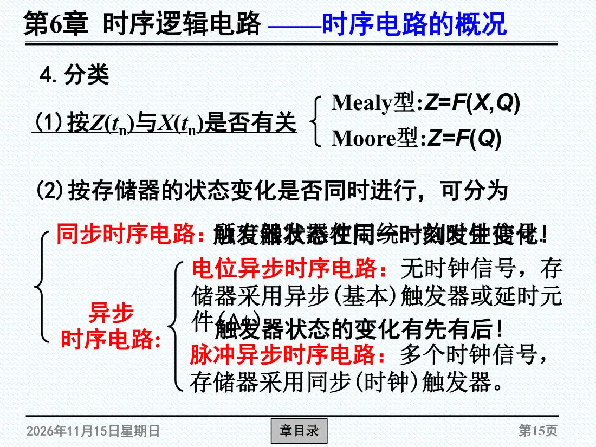

原文：

第6章 时序逻辑电路 时序电路的概况

4.分类

Mealy型: $Z = F ( X , Q )$ (1)按 $Z ( t _ { \mathrm { n } } )$ 与 $X ( t _ { \mathrm { n } } )$ 是否有关 Moore型:Z=F(Q)

(2)按存储器的状态变化是否同时进行，可分为

同步时序电路：所有触发器使用统一的时钟信号.触发器状态在同一时刻发生变化!

异步 时序电路:

电位异步时序电路：无时钟信号，存储器采用异步(基本)触发器或延时元件(∆t)。触发器状态的变化有先有后!脉冲异步时序电路：多个时钟信号，存储器采用同步(时钟)触发器。

2026年11月15日星期日

章目录

第15页

### 第6章 时序逻辑电路

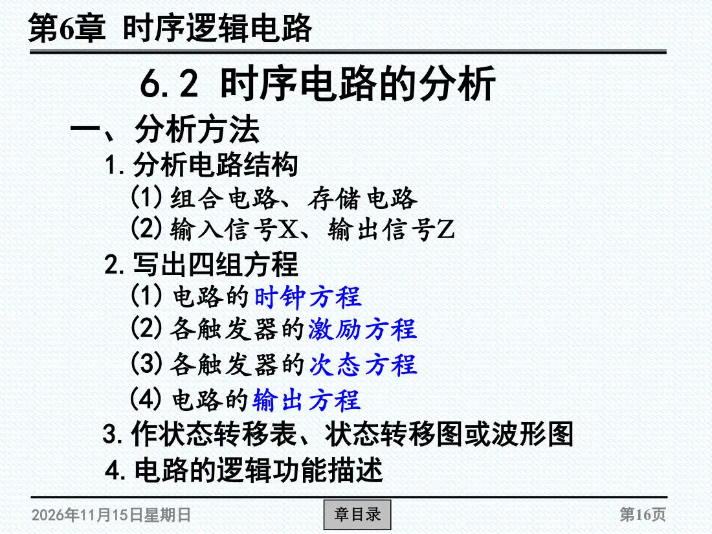

原文：

第6章 时序逻辑电路

6.2 时序电路的分析

分析方法

1.分析电路结构

(1)组合电路、存储电路

(2)输入信号X、输出信号Z

2.写出四组方程

(1)电路的时钟方程

(2)各触发器的激励方程

(3)各触发器的次态方程

(4)电路的输出方程

3.作状态转移表、状态转移图或波形图

4.电路的逻辑功能描述

2026年11月15日星期日

章目录

第16页

### 第6章 时序逻辑电路 时序电路分析

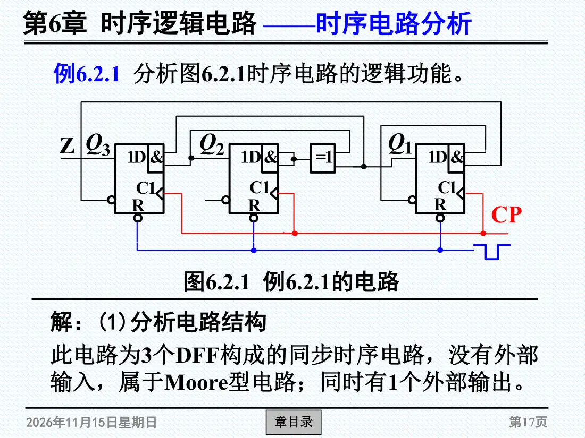

原文：

第6章 时序逻辑电路 时序电路分析

例6.2.1 分析图6.2.1时序电路的逻辑功能。

解：(1)分析电路结构

此电路为3个DFF构成的同步时序电路，没有外部输入，属于Moore型电路；同时有1个外部输出。

2026年11月15日星期日

章目录

第17页

### 第6章 时序逻辑电路 —— 时序电路分析

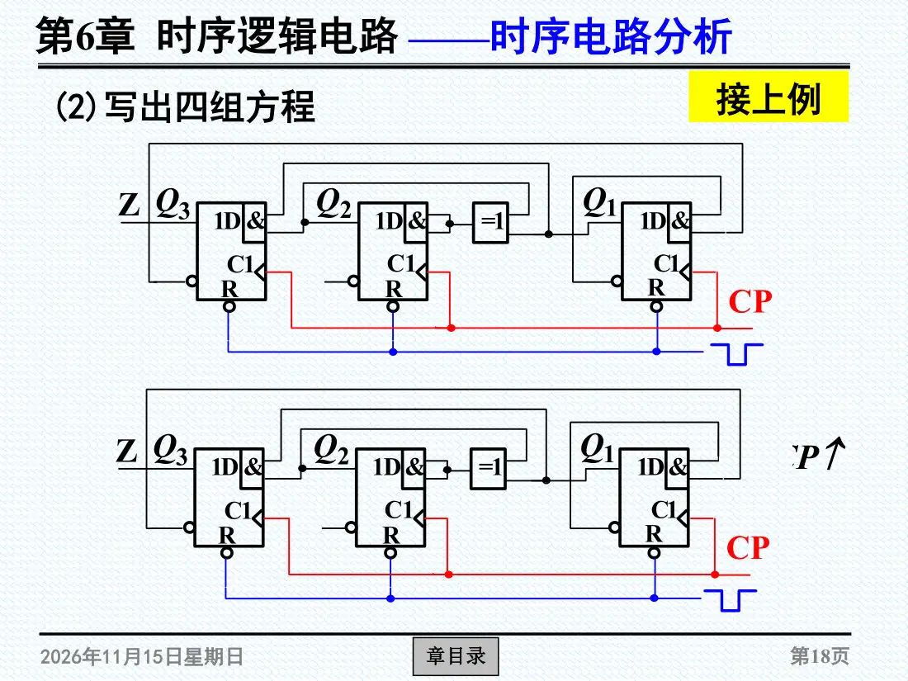

原文：

第6章 时序逻辑电路 —— 时序电路分析

(2)写出四组方程

接上例

2026年11月15日星期日

章目录

第18页

### 第6章 时序逻辑电路 时序电路分析

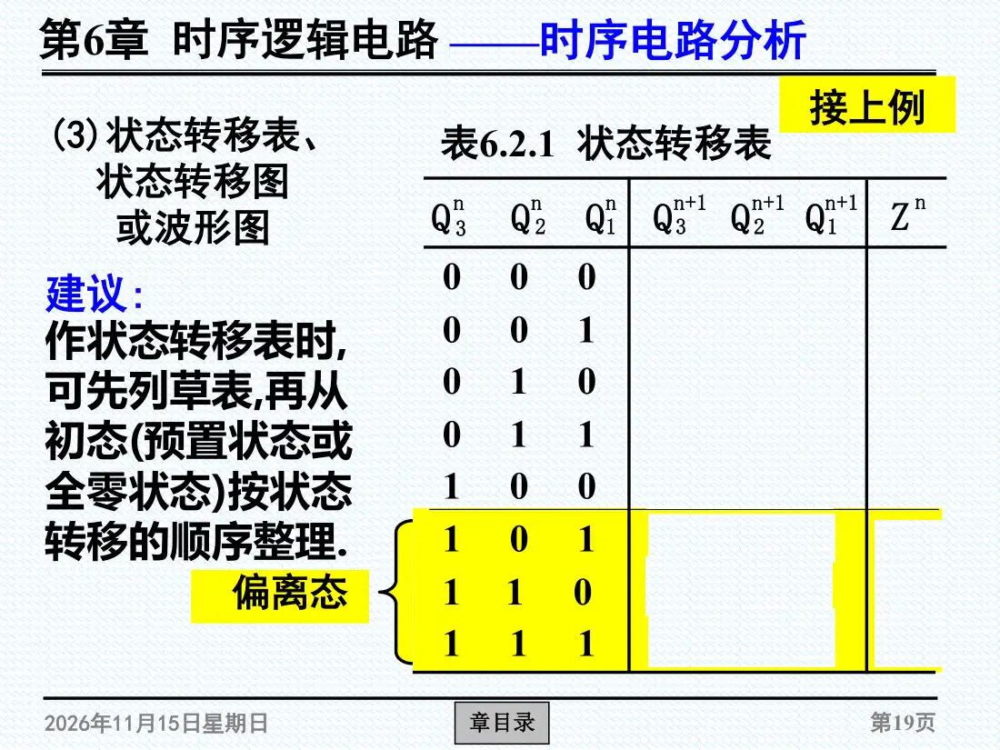

原文：

第6章 时序逻辑电路 时序电路分析

(3)状态转移表、状态转移图或波形图

n+1建议:

Q3 = Q1 ·Q2作状态转移表时, n Q =n+1 Qn Q可先列草表,再从 n+1 n n初态(预置状态或 1 1 3全零状态)按状态 Z = Qn转移的顺序整理.

偏离态

接上例

表6.2.1 状态转移表
<table><tr><td> $Q_{3}^{n}$ </td><td> $Q_{2}^{n}$ </td><td> $Q_{1}^{n}$ </td><td> $Q_{3}^{n+1}$ </td><td> $Q_{2}^{n+1}$ </td><td> $Q_{1}^{n+1}$ </td><td> $Z^{n}$ </td></tr><tr><td>0</td><td>0</td><td>0</td><td></td><td></td><td></td><td></td></tr><tr><td>0</td><td>0</td><td>1</td><td></td><td></td><td></td><td></td></tr><tr><td>0</td><td>1</td><td>0</td><td></td><td></td><td></td><td></td></tr><tr><td>0</td><td>1</td><td>1</td><td></td><td></td><td></td><td></td></tr><tr><td>1</td><td>0</td><td>0</td><td></td><td></td><td></td><td></td></tr><tr><td>1</td><td>0</td><td>1</td><td></td><td></td><td></td><td></td></tr><tr><td>1</td><td>1</td><td>0</td><td></td><td></td><td></td><td></td></tr><tr><td>1</td><td>1</td><td>1</td><td></td><td></td><td></td><td></td></tr></table>

2026年11月15日星期日

章目录

第19页

### 第6章 时序逻辑电路 时序电路分析

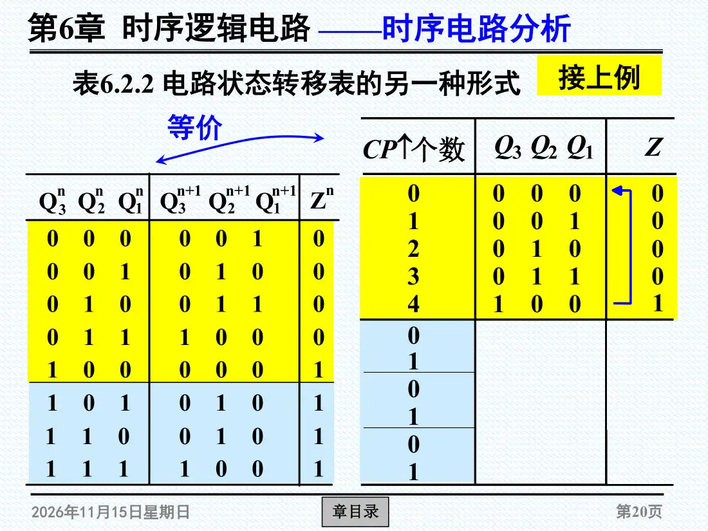

原文：

第6章 时序逻辑电路 时序电路分析

表6.2.2 电路状态转移表的另一种形式 接上例
<table><tr><td colspan="7">等价</td></tr><tr><td> $Q_{3}^{n}$ </td><td> $Q_{2}^{n}$ </td><td> $Q_{1}^{n}$ </td><td> $Q_{3}^{n+1}$ </td><td> $Q_{2}^{n+1}$ </td><td> $Q_{1}^{n+1}$ </td><td> $Z^{n}$ </td></tr><tr><td>0</td><td>0</td><td>0</td><td>0</td><td>0</td><td>1</td><td>0</td></tr><tr><td>0</td><td>0</td><td>1</td><td>0</td><td>1</td><td>0</td><td>0</td></tr><tr><td>0</td><td>1</td><td>0</td><td>0</td><td>1</td><td>1</td><td>0</td></tr><tr><td>0</td><td>1</td><td>1</td><td>1</td><td>0</td><td>0</td><td>0</td></tr><tr><td>1</td><td>0</td><td>0</td><td>0</td><td>0</td><td>0</td><td>1</td></tr><tr><td>1</td><td>0</td><td>1</td><td>0</td><td>1</td><td>0</td><td>1</td></tr><tr><td>1</td><td>1</td><td>0</td><td>0</td><td>1</td><td>0</td><td>1</td></tr><tr><td>1</td><td>1</td><td>1</td><td>1</td><td>0</td><td>0</td><td>1</td></tr></table>

<table><tr><td>CP↑个数</td><td> $Q_3$   $Q_2$   $Q_1$ </td><td>Z</td></tr><tr><td>0</td><td>0 0 0</td><td>0</td></tr><tr><td>1</td><td>0 0 1</td><td>0</td></tr><tr><td>2</td><td>0 1 0</td><td>0</td></tr><tr><td>3</td><td>0 1 1</td><td>0</td></tr><tr><td>4</td><td>1 0 0</td><td>1</td></tr><tr><td>0</td><td rowspan="6"></td><td rowspan="6"></td></tr><tr><td>1</td></tr><tr><td>0</td></tr><tr><td>1</td></tr><tr><td>0</td></tr><tr><td>1</td></tr></table>

2026年11月15日星期日

章目录

第20页

### 第6章 时序逻辑电路 接上例——时序电路分析

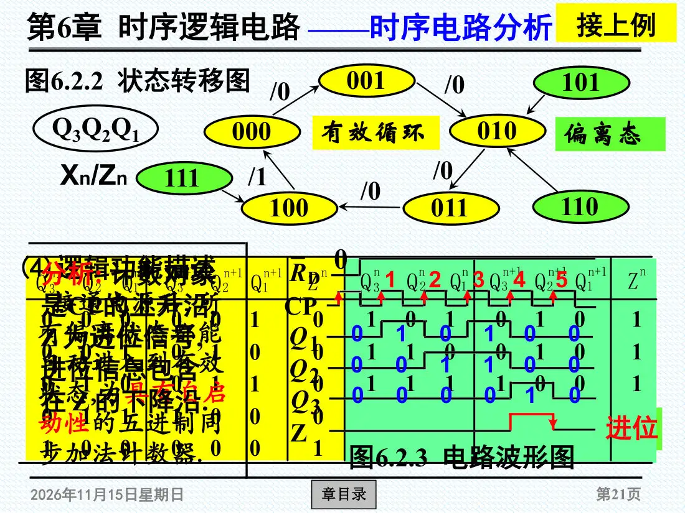

原文：

第6章 时序逻辑电路 接上例——时序电路分析

2026年11月15日星期日

章目录

第21页

### 第6章 时序逻辑电路 时序电路分析

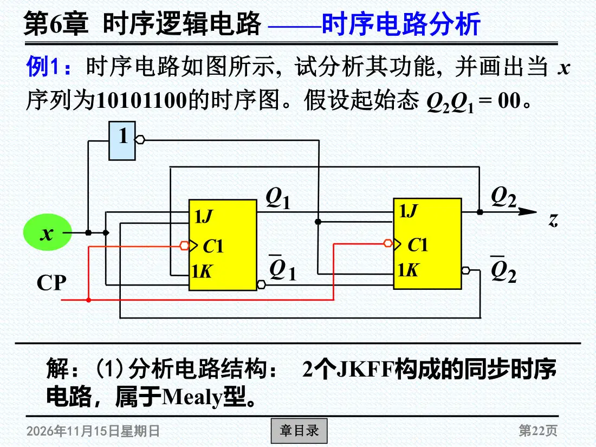

原文：

第6章 时序逻辑电路 时序电路分析

例1：时序电路如图所示, 试分析其功能, 并画出当 x序列为10101100的时序图。假设起始态 $\boldsymbol { Q } _ { 2 } \boldsymbol { Q } _ { 1 } = \mathbf { 0 0 }$

解：(1)分析电路结构： 2个JKFF构成的同步时序电路，属于Mealy型。

2026年11月15日星期日

章目录

第22页

### 第6章 时序逻辑电路 —— 时序电路分析

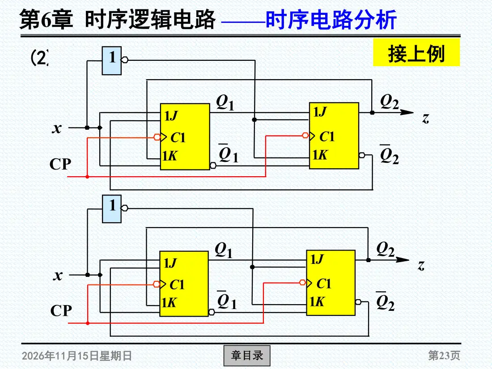

原文：

第6章 时序逻辑电路 —— 时序电路分析

接上例

2026年11月15日星期日

章目录

第23页

### 第6章 时序逻辑电路 时序电路分析

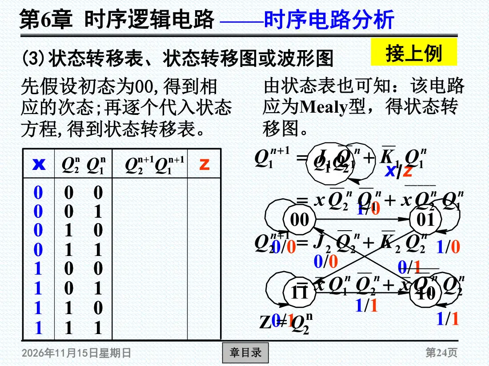

原文：

第6章 时序逻辑电路 时序电路分析

(3)状态转移表、状态转移图或波形图

接上例

先假设初态为00,得到相应的次态;再逐个代入状态方程,得到状态转移表。

<table><tr><td>X</td><td> $Q_{2}^{n}$   $Q_{1}^{n}$ </td><td> $Q_{2}^{n+1}Q_{1}^{n+1}$ </td><td>Z</td></tr><tr><td>0</td><td>0 0</td><td></td><td></td></tr><tr><td>0</td><td>0 1</td><td></td><td></td></tr><tr><td>0</td><td>1 0</td><td></td><td></td></tr><tr><td>0</td><td>1 1</td><td></td><td></td></tr><tr><td>1</td><td>0 0</td><td></td><td></td></tr><tr><td>1</td><td>0 1</td><td></td><td></td></tr><tr><td>1</td><td>1 0</td><td></td><td></td></tr><tr><td>1</td><td>1 1</td><td></td><td></td></tr></table>

由状态表也可知：该电路应为Mealy型，得状态转移图。

2026年11月15日星期日

章目录

第24页

### 第6章 时序逻辑电路 时序电路分析 接上例

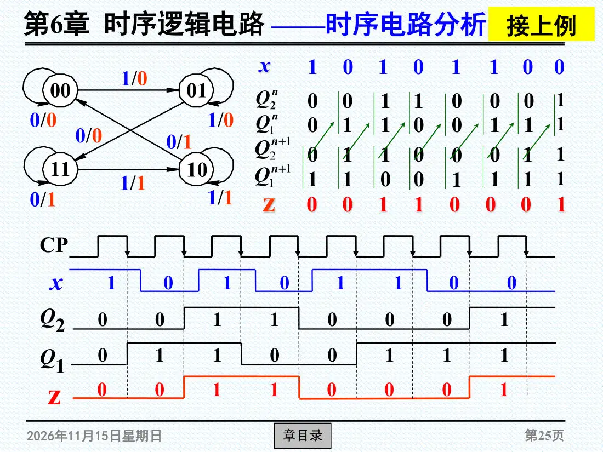

原文：

第6章 时序逻辑电路 时序电路分析 接上例

$$
\begin{array}{c c c c c c c c c c} x & 1 & 0 & 1 & 0 & 1 & 1 & 0 & 0 \\ \hline Q _ {2} ^ {n} & 0 & 0 & 1 & 1 & 0 & 0 & 0 & 0 & 1 \\ Q _ {1} ^ {n} & 0 & 1 & 1 & 0 & 0 & 1 & 1 & 1 & 1 \\ Q _ {2} ^ {n + 1} & 0 & 1 & 1 & 0 & 0 & 0 & 1 & 1 \\ Q _ {1} ^ {n + 1} & 1 & 1 & 0 & 0 & 1 & 1 & 1 & 1 \\ \hline Z & 0 & 0 & 1 & 1 & 0 & 0 & 0 & 1 \end{array}
$$

$$
\begin{array}{c c c c c c c c c} \text {CP} & 1 & 0 & 1 & 0 & 1 & 1 & 0 & 0 \\ x & 1 & 0 & 1 & 0 & 1 & 1 & 0 & 0 \\ Q _ {2} & 0 & 0 & 1 & 1 & 0 & 0 & 0 & 1 \\ Q _ {1} & 0 & 1 & 1 & 0 & 0 & 1 & 1 & 1 \\ z & 0 & 0 & 1 & 1 & 0 & 0 & 0 & 1 \end{array}
$$

2026年11月15日星期日

章目录

第25页

### 第6章 时序逻辑电路 时序电路分析

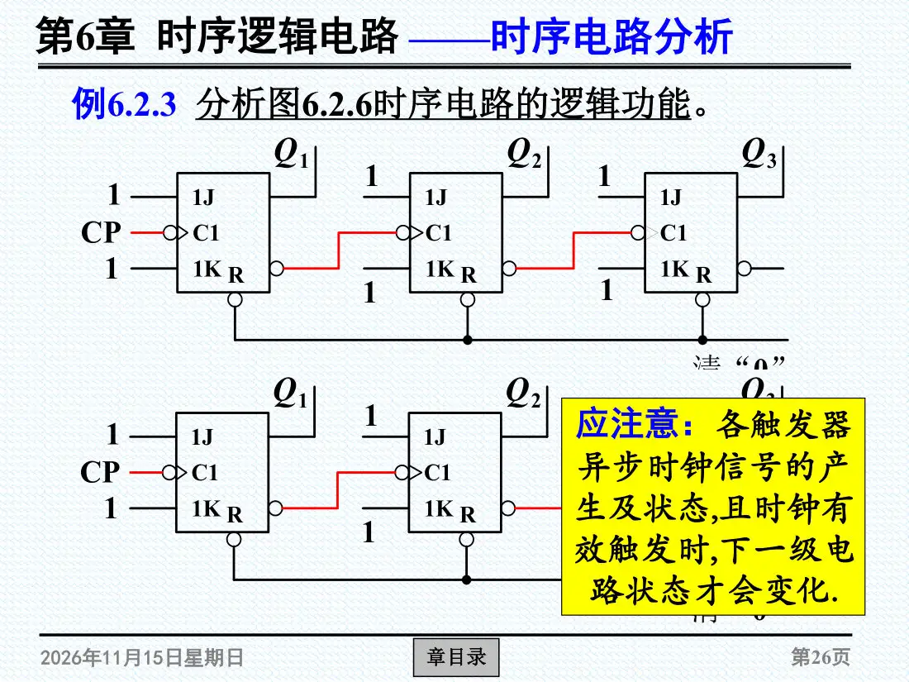

原文：

第6章 时序逻辑电路 时序电路分析

例6.2.3 分析图6.2.6时序电路的逻辑功能。

应注意：各触发器异步时钟信号的产+ K Q ]·CP效触发时，下一级电路状态才会变化.

2026年11月15日星期日

章目录

第26页

### 第6章 时序逻辑电路

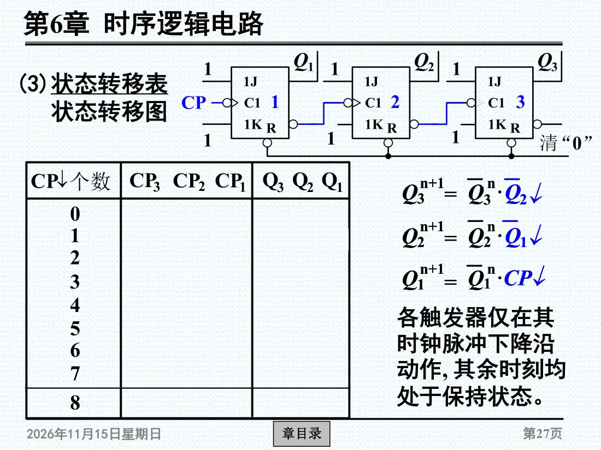

原文：

第6章 时序逻辑电路

(3)状态转移表状态转移图

$$
\begin{array}{c c c} 1 & Q _ {1} & 1 \\ \text {CP} & 1 & 1 \\ \text {1J C1 1} & 1 & 1 \\ \text {1K R} & 1 & 1 \\ \text {1J C1 2} & 1 & Q _ {2} \\ \text {1K R} & 1 & 1 \\ \text {清“0”} & 1 & 1 \\ \text {1J C1 3} & 1 & Q _ {3} \\ \text {1K R} & 1 & \end{array}
$$

<table><tr><td>CP↓个数</td><td> $CP_3$   $CP_2$   $CP_1$ </td><td> $Q_3$   $Q_2$   $Q_1$ </td></tr><tr><td>0</td><td></td><td></td></tr><tr><td>1</td><td></td><td></td></tr><tr><td>2</td><td></td><td></td></tr><tr><td>3</td><td></td><td></td></tr><tr><td>4</td><td></td><td></td></tr><tr><td>5</td><td></td><td></td></tr><tr><td>6</td><td></td><td></td></tr><tr><td>7</td><td></td><td></td></tr><tr><td>8</td><td></td><td></td></tr></table>

$$
Q _ {3} ^ {\mathrm{n+1}} = \overline {{Q}} _ {3} ^ {\mathrm{n}} \cdot \overline {{Q}} _ {2} \downarrow
$$

$$
Q _ {2} ^ {\mathbf {n + 1}} = \overline {{Q}} _ {2} ^ {\mathbf {n}} \cdot \overline {{Q}} _ {1} \downarrow
$$

$$
Q _ {1} ^ {\mathrm{n+1}} = \overline {{Q}} _ {1} ^ {\mathrm{n}} \cdot C P \downarrow
$$

各触发器仅在其时钟脉冲下降沿动作, 其余时刻均处于保持状态。

2026年11月15日星期日

章目录

第27页

### 第6章 时序逻辑电路 接上例时序电路分析

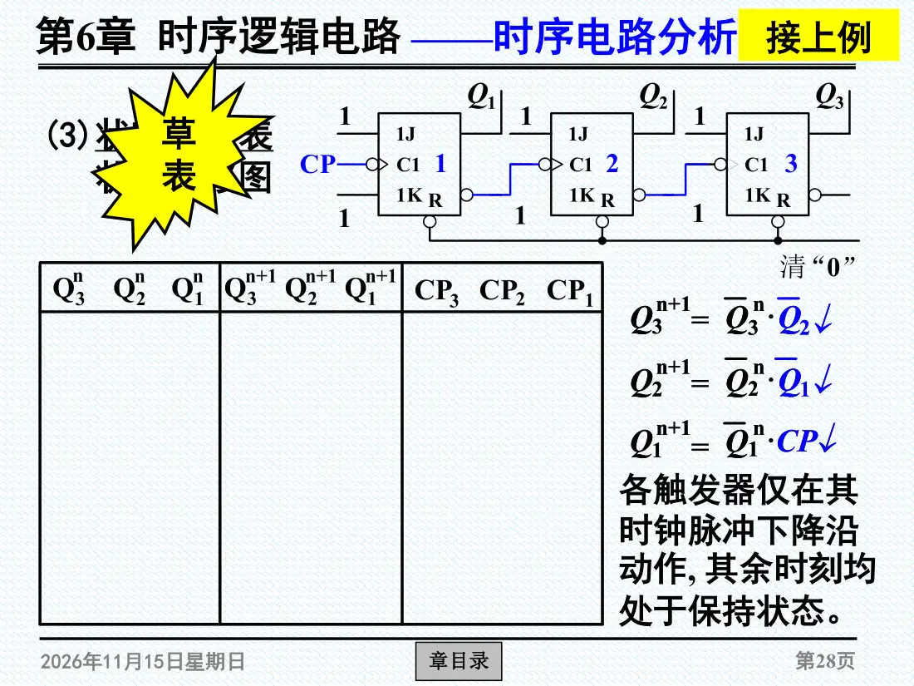

原文：

第6章 时序逻辑电路 接上例时序电路分析

<table><tr><td> $Q_{3}^{n}$ </td><td> $Q_{2}^{n}$ </td><td> $Q_{1}^{n}$ </td><td> $Q_{3}^{n+1}$ </td><td> $Q_{2}^{n+1}$ </td><td> $Q_{1}^{n+1}$ </td><td> $CP_{3}$ </td><td> $CP_{2}$ </td><td> $CP_{1}$ </td></tr><tr><td></td><td></td><td></td><td></td><td></td><td></td><td></td><td></td><td></td></tr></table>

2026年11月15日星期日

章目录

第28页

### 第6章 时序逻辑电路 时序电路分析

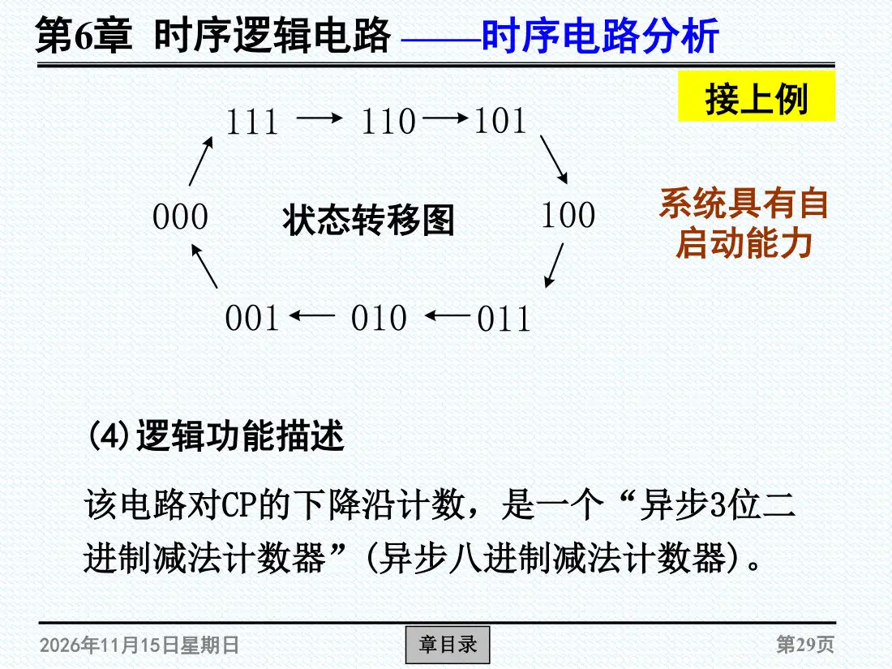

原文：

第6章 时序逻辑电路 时序电路分析

状态转移图

100

接上例

系统具有自启动能力

(4)逻辑功能描述

该电路对CP的下降沿计数，是一个“异步3位二进制减法计数器”(异步八进制减法计数器)。

2026年11月15日星期日

章目录

第29页

### 第6章 时序逻辑电路

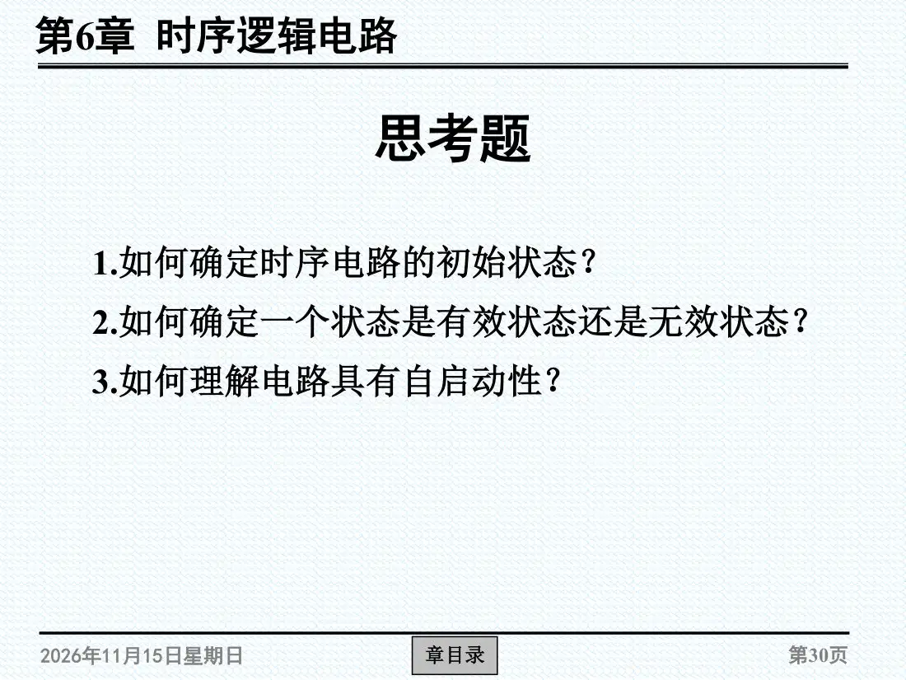

原文：

第6章 时序逻辑电路

思考题

1.如何确定时序电路的初始状态？

2.如何确定一个状态是有效状态还是无效状态？

3.如何理解电路具有自启动性？

2026年11月15日星期日

章目录

第30页

### 第6章 时序逻辑电路

原文：

第6章 时序逻辑电路

望同学们：

【作业1】

独立完成作业认真完成作业

2026年11月15日星期日

章目录

第31页

### 6.3 时序电路的设计

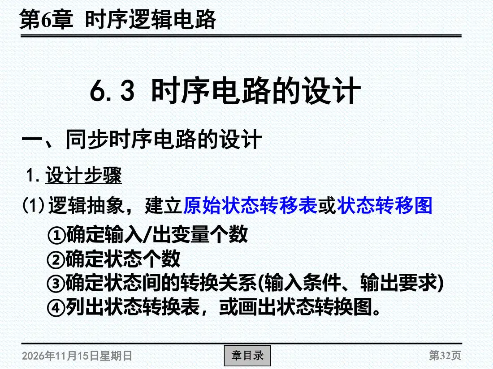

原文：

6.3 时序电路的设计

一、 同步时序电路的设计

1.设计步骤

(1)逻辑抽象，建立原始状态转移表或状态转移图

①确定输入/出变量个数

②确定状态个数

③确定状态间的转换关系(输入条件、输出要求)

④列出状态转换表，或画出状态转换图。

第6章 时序逻辑电路

2026年11月15日星期日

章目录

第32页

### 第6章 时序逻辑电路

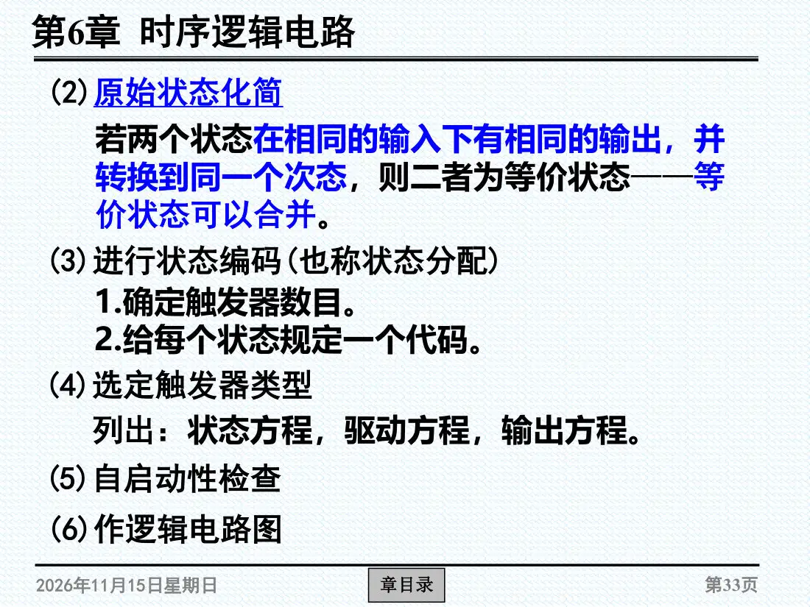

原文：

第6章 时序逻辑电路

(2)原始状态化简

若两个状态在相同的输入下有相同的输出， 并转换到同一个次态，则二者为等价状态— 等价状态可以合并。

(3)进行状态编码(也称状态分配)1.确定触发器数目。2.给每个状态规定一个代码。

(4)选定触发器类型列出：状态方程，驱动方程，输出方程。

(5)自启动性检查

(6)作逻辑电路图

2026年11月15日星期日

章目录

第33页

### 第6章 时序逻辑电路

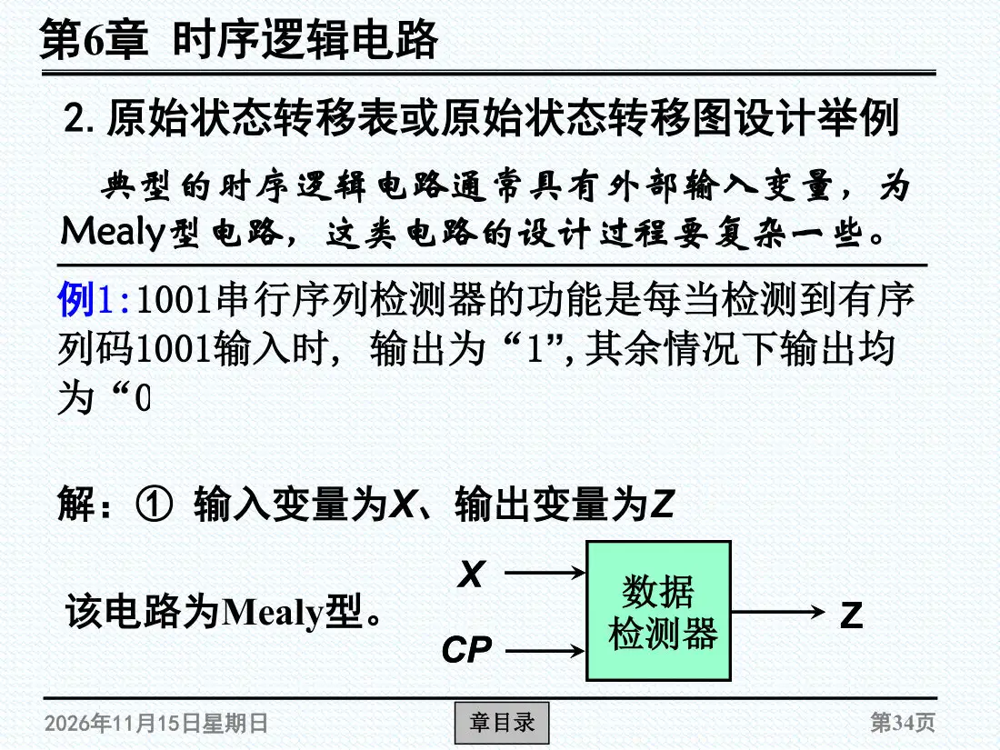

原文：

第6章 时序逻辑电路

2.原始状态转移表或原始状态转移图设计举例

典型的时序逻辑电路通常具有外部输入变量，为Mealy型电路，这类电路的设计过程要复杂一些。

例1:1001串行序列检测器的功能是每当检测到有序列码1001输入时, 输出为“1”,其余情况下输出均为“0”

解：① 输入变量为X、输出变量为Z

该电路为Mealy型。

数据检测器

2026年11月15日星期日

章目录

第34页

### 序列码可重叠序列码可重叠但为任意数码时且恰为1001时

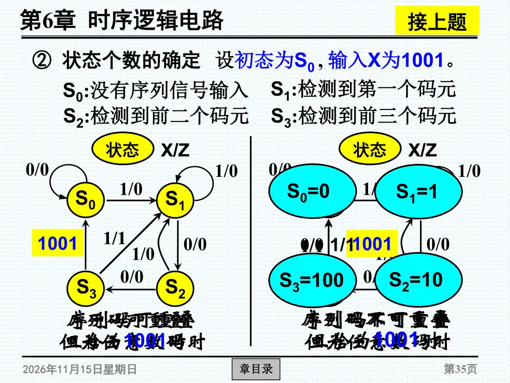

原文：

设初态为② 状态个数的确定 $s _ { \mathfrak { o } }$ , 输入X为1001。

${ \bf S } _ { 0 }$ :没有序列信号输入 $\mathsf { \pmb S } _ { 1 }$ :检测到第一个码元

$\mathbb { S } _ { 2 } { \mathrm { : } }$ 检测到前二个码元 $\mathsf { \pmb S } _ { 3 }$ :检测到前三个码元

序列码可重叠序列码可重叠但为任意数码时且恰为1001时

第6章 时序逻辑电路

接上题

2026年11月15日星期日

章目录

第35页

### ![序

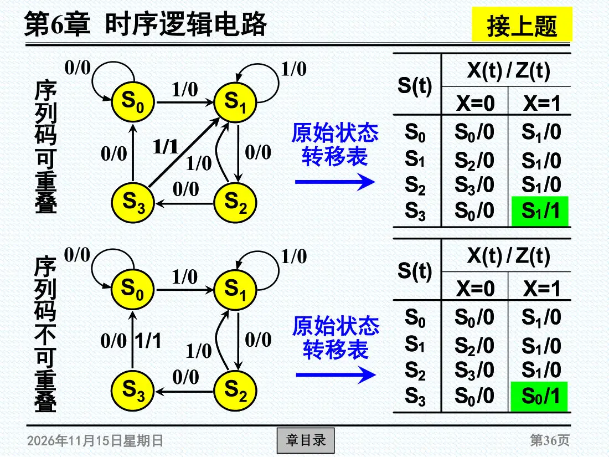

原文：

<table><tr><td rowspan="2">S(t)</td><td colspan="2">X(t)/Z(t)</td></tr><tr><td>X=0</td><td>X=1</td></tr><tr><td>S0</td><td>S0/0</td><td>S1/0</td></tr><tr><td>S1</td><td>S2/0</td><td>S1/0</td></tr><tr><td>S2</td><td>S3/0</td><td>S1/0</td></tr><tr><td>S3</td><td>S0/0</td><td>S1/1</td></tr><tr><td colspan="3"></td></tr><tr><td rowspan="2">S(t)</td><td colspan="2">X(t)/Z(t)</td></tr><tr><td>X=0</td><td>X=1</td></tr><tr><td>S0</td><td>S0/0</td><td>S1/0</td></tr><tr><td>S1</td><td>S2/0</td><td>S1/0</td></tr><tr><td>S2</td><td>S3/0</td><td>S1/0</td></tr><tr><td>S3</td><td>S0/0</td><td>S0/1</td></tr></table>

第6章 时序逻辑电路

接上题

2026年11月15日星期日

章目录

第36页

### 第6章 时序逻辑电路

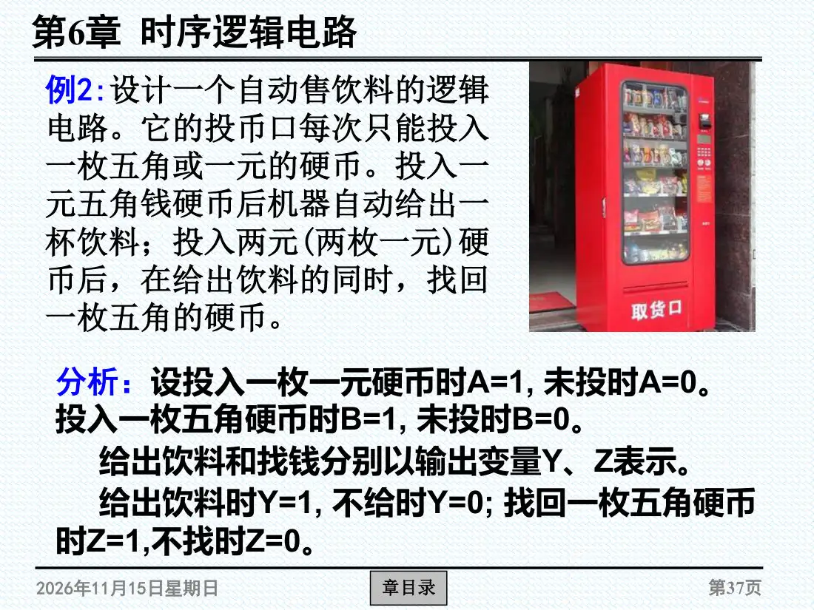

原文：

第6章 时序逻辑电路

例2:设计一个自动售饮料的逻辑电路。它的投币口每次只能投入枚五角或一元的硬币。投入元五角钱硬币后机器自动给出杯饮料；投入两元(两枚一元)硬币后，在给出饮料的同时，找回枚五角的硬币。

分析：设投入一枚一元硬币时A=1, 未投时A=0。投入一枚五角硬币时B=1, 未投时B=0。

给出饮料和找钱分别以输出变量Y、Z表示。

给出饮料时Y=1, 不给时Y=0; 找回一枚五角硬币时Z=1,不找时Z=0。

2026年11月15日星期日

章目录

第37页

### S0: 未投币(初始状态)

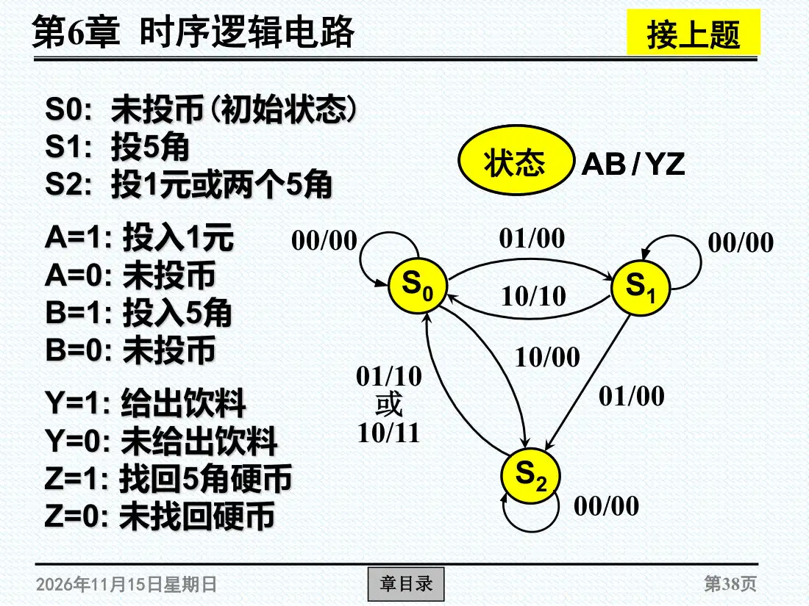

原文：

S0: 未投币(初始状态)

S1: 投5角

S2: 投1元或两个5角

A=1: 投入1元

00/00

A=0: 未投币

B=1: 投入5角

B=0: 未投币

Y=1: 给出饮料

Y=0: 未给出饮料

Z=1: 找回5角硬币

Z=0: 未找回硬币

状态

第6章 时序逻辑电路

接上题

2026年11月15日星期日

章目录

第38页

### 第6章 时序逻辑电路

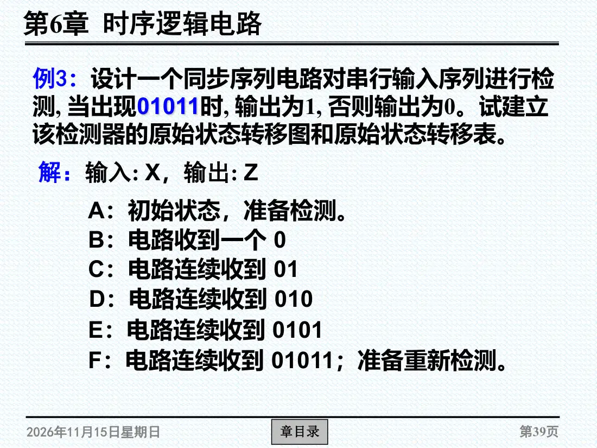

原文：

第6章 时序逻辑电路

例3：设计一个同步序列电路对串行输入序列进行检测, 当出现01011时, 输出为1, 否则输出为0。试建立该检测器的原始状态转移图和原始状态转移表。

解：输入: X，输出: Z

A：初始状态，准备检测。

B：电路收到一个 0

C：电路连续收到 01

D：电路连续收到 010

E：电路连续收到 0101

F：电路连续收到 01011；准备重新检测。

2026年11月15日星期日

章目录

第39页

### 当有n个外部输入变量时，每个状态有2n个转移方向。

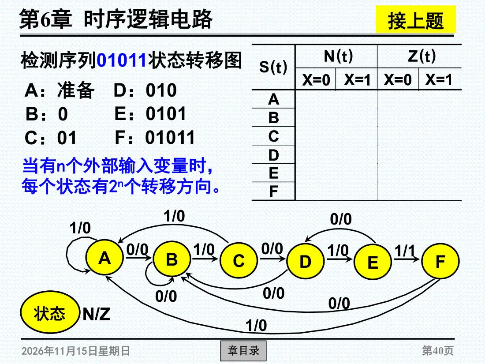

原文：

检测序列01011状态转移图A：准备 D：010B：0 E：0101C：01 F：01011

当有n个外部输入变量时，每个状态有2n个转移方向。

<table><tr><td rowspan="2">S(t)</td><td colspan="2">N(t)</td><td colspan="2">Z(t)</td></tr><tr><td>X=0</td><td>X=1</td><td>X=0</td><td>X=1</td></tr><tr><td>A</td><td></td><td></td><td></td><td></td></tr><tr><td>B</td><td></td><td></td><td></td><td></td></tr><tr><td>C</td><td></td><td></td><td></td><td></td></tr><tr><td>D</td><td></td><td></td><td></td><td></td></tr><tr><td>E</td><td></td><td></td><td></td><td></td></tr><tr><td>F</td><td></td><td></td><td></td><td></td></tr></table>

第6章 时序逻辑电路

接上题

2026年11月15日星期日

章目录

第40页

### 第6章 时序逻辑电路

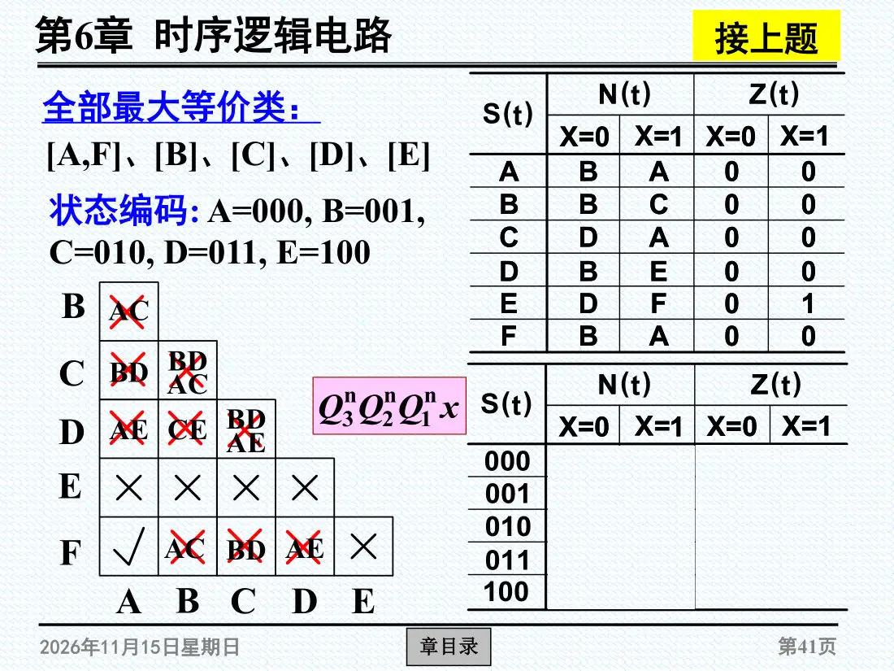

原文：

第6章 时序逻辑电路

接上题

<table><tr><td rowspan="8" colspan="6">全部最大等价类:[A,F]、[B]、[C]、[D]、[E]状态编码:A=000,B=001,C=010,D=011,E=100</td><td rowspan="2">S(t)</td><td colspan="2">N(t)</td><td colspan="2">Z(t)</td></tr><tr><td>X=0</td><td>X=1</td><td>X=0</td><td>X=1</td></tr><tr><td>A</td><td>B</td><td>A</td><td>0</td><td>0</td></tr><tr><td>B</td><td>B</td><td>C</td><td>0</td><td>0</td></tr><tr><td>C</td><td>D</td><td>A</td><td>0</td><td>0</td></tr><tr><td>D</td><td>B</td><td>E</td><td>0</td><td>0</td></tr><tr><td>E</td><td>D</td><td>F</td><td>0</td><td>1</td></tr><tr><td>F</td><td>B</td><td>A</td><td>0</td><td>0</td></tr><tr><td>B</td><td>AC</td><td colspan="4"></td><td rowspan="3">S(t)</td><td colspan="2">N(t)</td><td colspan="2">Z(t)</td></tr><tr><td>C</td><td>BD</td><td>BDAC</td><td colspan="3"></td><td rowspan="2">X=0</td><td rowspan="2">X=1</td><td rowspan="2">X=0</td><td rowspan="2">X=1</td></tr><tr><td>D</td><td>AE</td><td>CE</td><td>BDAE</td><td colspan="2"></td></tr><tr><td rowspan="3">E</td><td rowspan="3">×</td><td rowspan="3">×</td><td rowspan="3">×</td><td rowspan="3">×</td><td rowspan="3"></td><td>000</td><td rowspan="5" colspan="2"></td><td rowspan="5" colspan="2"></td></tr><tr><td>001</td></tr><tr><td>010</td></tr><tr><td rowspan="2">F</td><td rowspan="2">√</td><td rowspan="2">AC</td><td rowspan="2">BD</td><td rowspan="2">AE</td><td rowspan="2">×</td><td>011</td></tr><tr><td>100</td></tr></table>

2026年11月15日星期日

章目录

第41页

### J xQ Q3 1 2=选用JK触发器实现电路

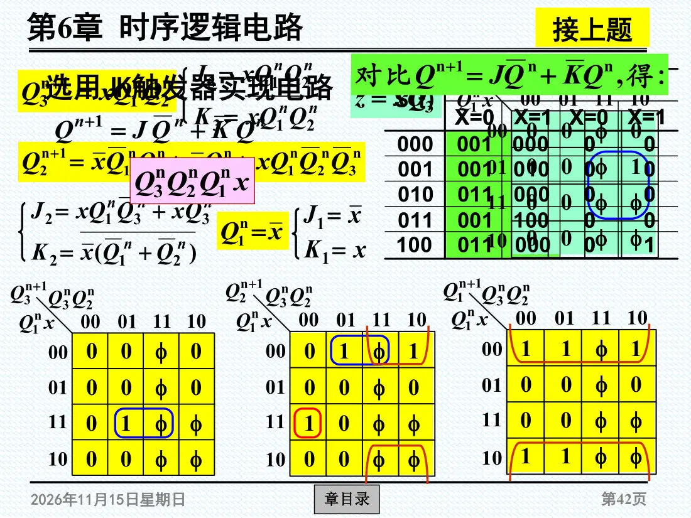

原文：

J xQ Q3 1 2=选用JK触发器实现电路

$$
Q ^ {n + 1} = J \overline {{Q}} ^ {n} + K \overline {{K}} Q ^ {n} Q _ {1} ^ {n} Q _ {2} ^ {n}
$$

$$
Q _ {2} ^ {\mathrm{n+1}} = \bar {x} \overline {{Q}} _ {1} ^ {\mathrm{n}} Q _ {1} ^ {\mathrm{n}} - Q _ {1} ^ {\mathrm{n}} x Q _ {1} ^ {\mathrm{n}} \overline {{Q}} _ {2} ^ {\mathrm{n}} \overline {{Q}} _ {3} ^ {\mathrm{n}}
$$

$$
Q _ {1} ^ {\mathrm{n}} = \bar {x} \left\{ \begin{array}{l} J _ {1} = \bar {x} \\ K _ {1} = x \end{array} \right.
$$

$$
Q ^ {n + 1} = J \overline {{Q}} ^ {n} + \overline {{K}} Q ^ {n}
$$

<table><tr><td rowspan="2" colspan="2">z = Σ(3)</td><td colspan="2">01x</td><td>00</td><td>01</td><td>11</td><td>10</td></tr><tr><td>X=0</td><td>00</td><td>X=1</td><td>0</td><td>X=0</td><td>X=1</td></tr><tr><td rowspan="3">n3</td><td>000</td><td>001</td><td>000</td><td></td><td>0</td><td>0</td><td>0</td></tr><tr><td>001</td><td>001</td><td>000</td><td>0</td><td>0</td><td>0</td><td>10</td></tr><tr><td>010</td><td>011</td><td>000</td><td>0</td><td>0</td><td>0</td><td>0</td></tr><tr><td>x̄</td><td>011</td><td>001</td><td>100</td><td></td><td>0</td><td></td><td>0</td></tr><tr><td>x</td><td>100</td><td>011</td><td>000</td><td>0</td><td>0</td><td>0</td><td>0</td></tr></table>

<table><tr><td> $Q_{3}^{n+1}$  $Q_{3}^{n}$  $Q_{2}^{n}$  $Q_{1}^{n}$ x</td><td>00</td><td>01</td><td>11</td><td>10</td></tr><tr><td>00</td><td>0</td><td>0</td><td>φ</td><td>0</td></tr><tr><td>01</td><td>0</td><td>0</td><td>φ</td><td>0</td></tr><tr><td>11</td><td>0</td><td>1</td><td>φ</td><td>φ</td></tr><tr><td>10</td><td>0</td><td>0</td><td>φ</td><td>φ</td></tr></table>

$$
\begin{array}{c c c c c} Q _ {2} ^ {n + 1} & Q _ {3} ^ {n} & Q _ {2} ^ {n} \\ Q _ {1} ^ {n} x & 0 0 & 0 1 & 1 1 & 1 0 \\ \hline 0 0 & 0 & 1 & \phi & 1 \\ \hline 0 1 & 0 & 0 & \phi & 0 \\ \hline 1 1 & 1 & 0 & \phi & \phi \\ \hline 1 0 & 0 & 0 & \phi & \phi \end{array}
$$

<table><tr><td>Q1n+1Q3nQ2nQ1nx</td><td>00</td><td>01</td><td>11</td><td>10</td></tr><tr><td>00</td><td>1</td><td>1</td><td> $\phi$ </td><td>1</td></tr><tr><td>01</td><td>0</td><td>0</td><td> $\phi$ </td><td>0</td></tr><tr><td>11</td><td>0</td><td>0</td><td> $\phi$ </td><td> $\phi$ </td></tr><tr><td>10</td><td>1</td><td>1</td><td> $\phi$ </td><td> $\phi$ </td></tr></table>

第6章 时序逻辑电路

接上题

2026年11月15日星期日

章目录

第42页

### 第6章 时序逻辑电路

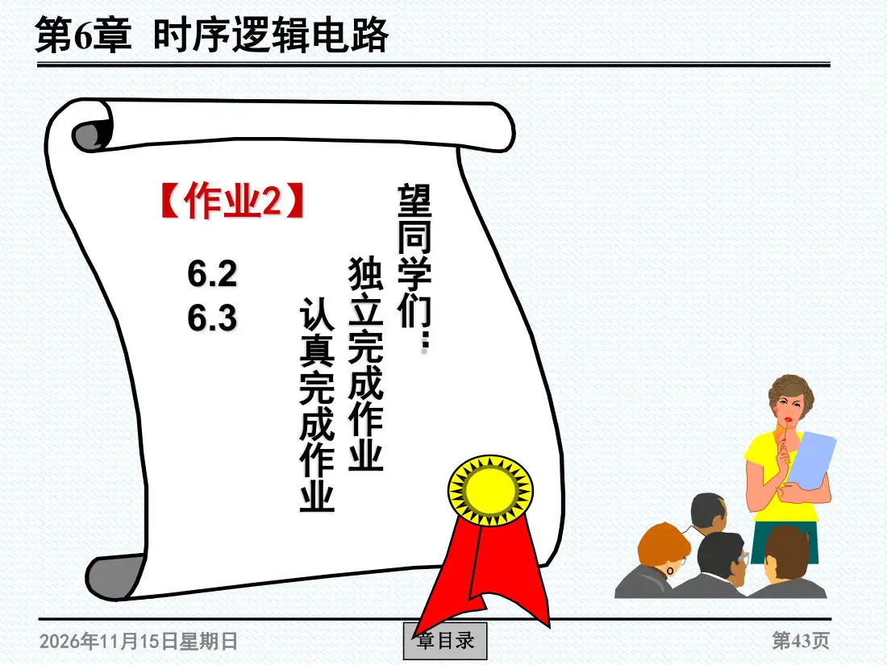

原文：

第6章 时序逻辑电路

望同学们：

【作业2】

独立完成作业

认真完成作业

6.2

6.3

2026年11月15日星期日

章目录

第43页

### 第6章 时序逻辑电路

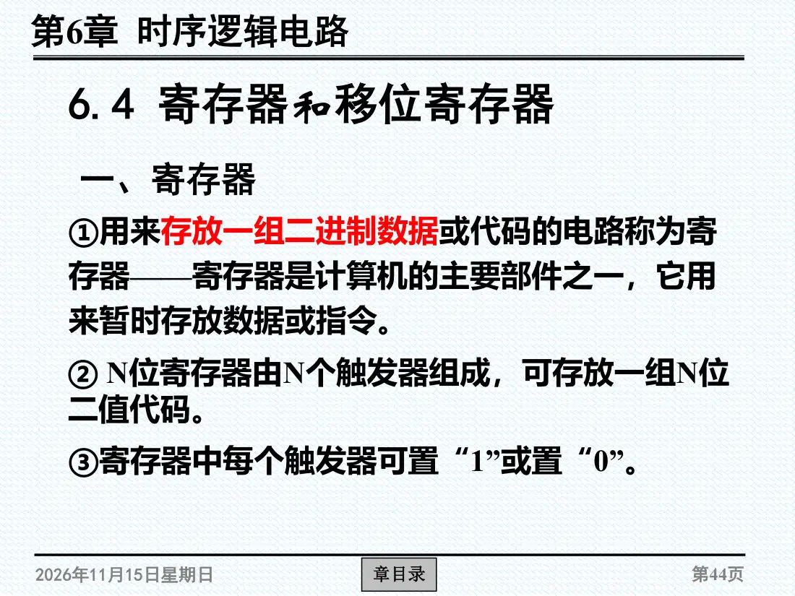

原文：

第6章 时序逻辑电路

6.4 寄存器和移位寄存器

寄存器

①用来存放一组二进制数据或代码的电路称为寄存器— 寄存器是计算机的主要部件之一，它用来暂时存放数据或指令。

② N位寄存器由N个触发器组成，可存放一组N位二值代码。

③寄存器中每个触发器可置“1”或置“0”。

2026年11月15日星期日

章目录

第44页

### 第6章 时序逻辑电路

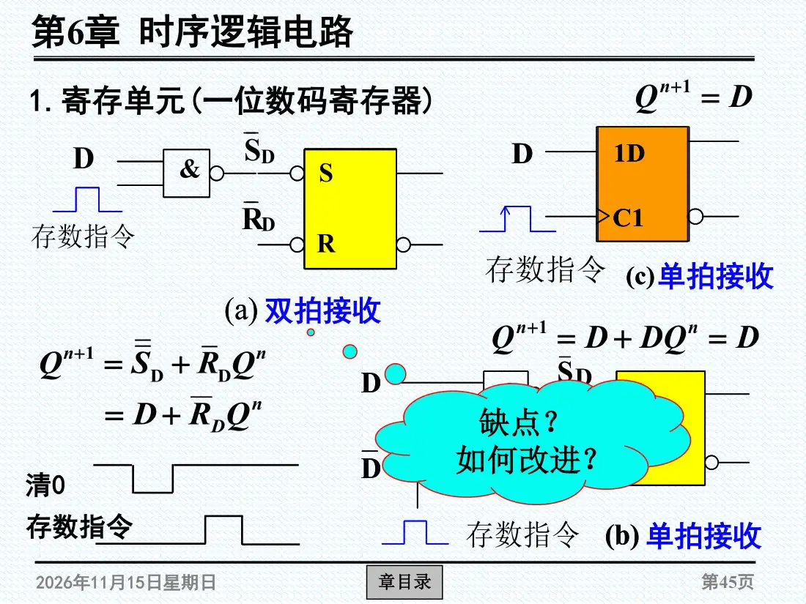

原文：

第6章 时序逻辑电路

1.寄存单元(一位数码寄存器)

存数指令

双拍接收

$$
\begin{array}{r} Q ^ {n + 1} = \overline {{\overline {{S}}}} _ {\mathrm{D}} + \overline {{R}} _ {\mathrm{D}} Q ^ {n} \\ = D + \overline {{R}} _ {D} Q ^ {n} \end{array}
$$

$$
Q ^ {n + 1} = D
$$

存数指令 单拍接收

清0

$$
Q ^ {n + 1} = D + D Q ^ {n} = D
$$

存数指令

缺点？ 如何改进？

存数指令

单拍接收

2026年11月15日星期日

章目录

第45页

### 第6章 时序逻辑电路

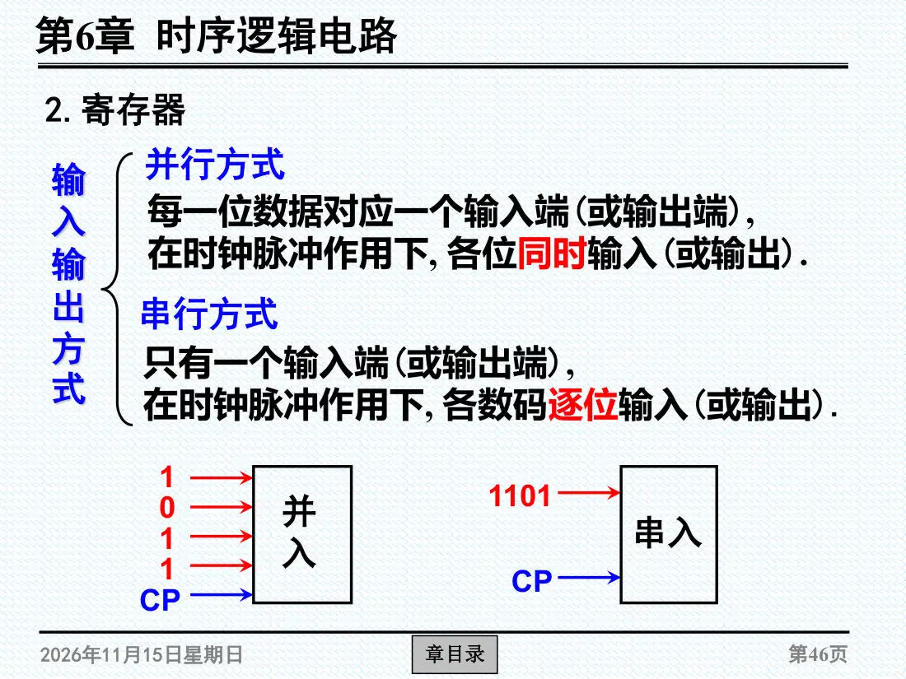

原文：

第6章 时序逻辑电路

2.寄存器

输

入

输

出

方

式

并行方式

每一位数据对应一个输入端(或输出端)在时钟脉冲作用下, 各位同时输入(或输出).

串行方式

只有一个输入端(或输出端),

在时钟脉冲作用下, 各数码逐位输入(或输出).

串入

2026年11月15日星期日

章目录

第46页

### 第6章 时序逻辑电路

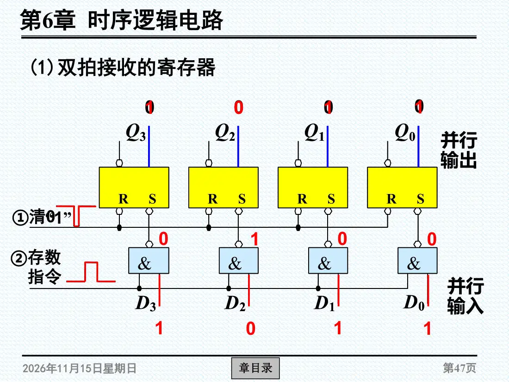

原文：

第6章 时序逻辑电路

(1)双拍接收的寄存器

2026年11月15日星期日

章目录

第47页

### 第6章 时序逻辑电路

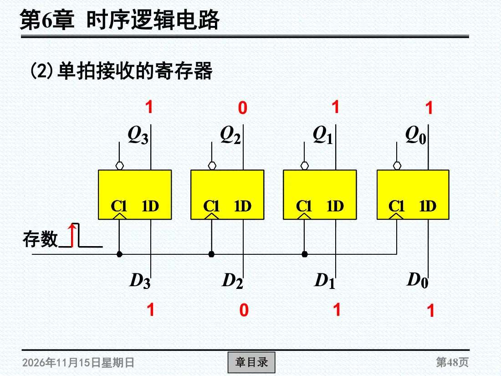

原文：

第6章 时序逻辑电路

(2)单拍接收的寄存器

2026年11月15日星期日

章目录

第48页

### 第6章 时序逻辑电路

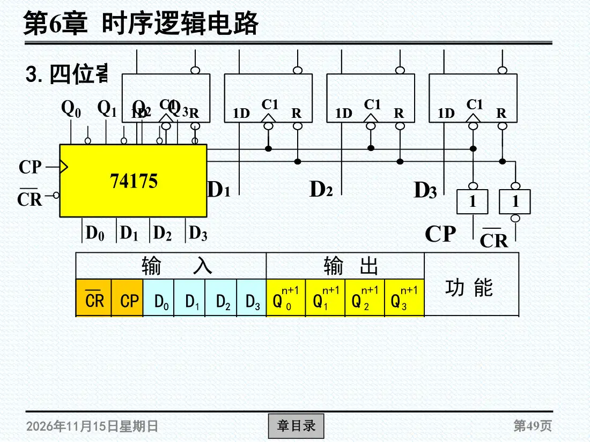

原文：

第6章 时序逻辑电路

2026年11月15日星期日

章目录

第49页

### 第6章 时序逻辑电路

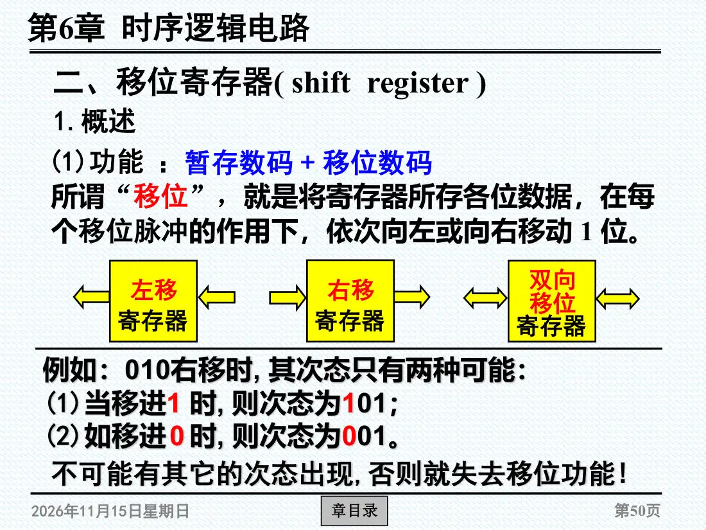

原文：

第6章 时序逻辑电路

二 移位寄存器( shift register

1.概述

(1)功能 ：暂存数码 + 移位数码

所谓“移位”，就是将寄存器所存各位数据，在每个移位脉冲的作用下，依次向左或向右移动 1 位。

左移寄存器

右移寄存器双向移位寄存器

例如：010右移时, 其次态只有两种可能：

(1)当移进1 时, 则次态为101；

(2)如移进0时, 则次态为001。

不可能有其它的次态出现,否则就失去移位功能!

2026年11月15日星期日

章目录

第50页

### 第6章 时序逻辑电路

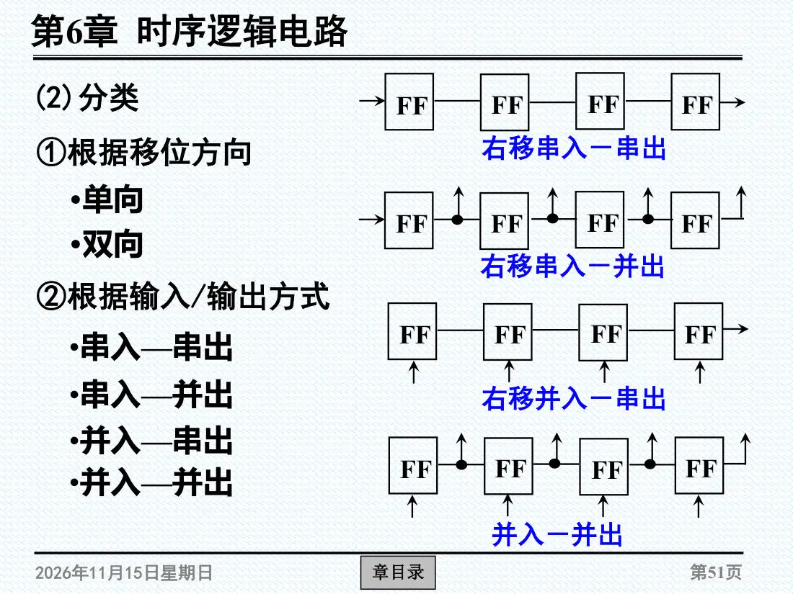

原文：

第6章 时序逻辑电路

(2)分类

①根据移位方向

•单向

•双向

②根据输入/输出方式

•串入—串出

•串入—并出

•并入—串出

•并入—并出

右移串入－串出

右移串入－并出

右移并入－串出

并入－并出

2026年11月15日星期日

章目录

第51页

### 第6章 时序逻辑电路

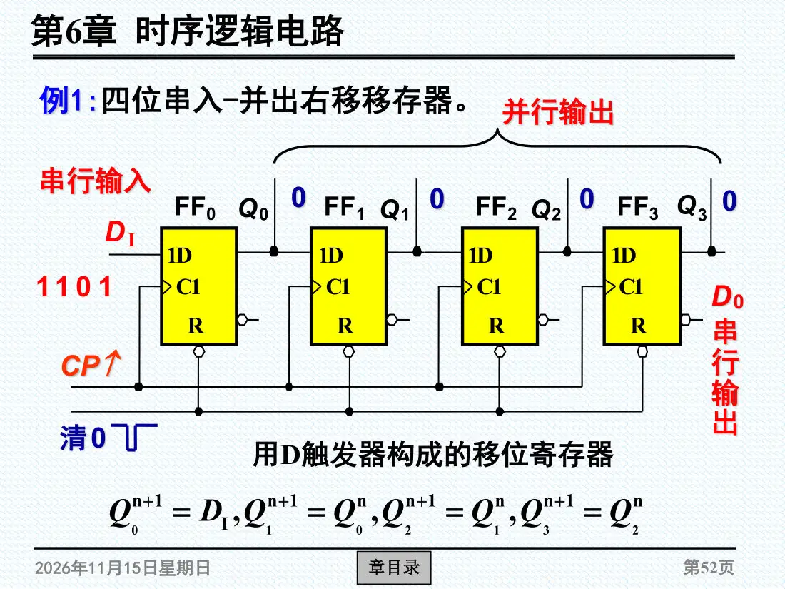

原文：

第6章 时序逻辑电路

例1:四位串入-并出右移移存器。

串行输入

清0

用D触发器构成的移位寄存器

$$
Q _ {0} ^ {\mathrm{n+1}} = D _ {\mathrm{I}}, Q _ {1} ^ {\mathrm{n+1}} = Q _ {0} ^ {\mathrm{n}}, Q _ {2} ^ {\mathrm{n+1}} = Q _ {1} ^ {\mathrm{n}}, Q _ {3} ^ {\mathrm{n+1}} = Q _ {2} ^ {\mathrm{n}}
$$

2026年11月15日星期日

章目录

第52页

### 第6章 时序逻辑电路

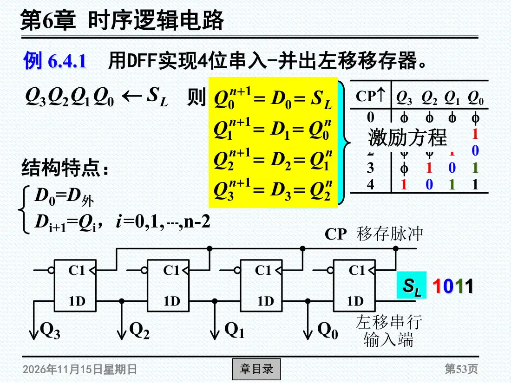

原文：

<table><tr><td>CP↑</td><td> $Q_3$ </td><td> $Q_2$ </td><td> $Q_1$ </td><td> $Q_0$ </td></tr><tr><td>0</td><td>φ</td><td>φ</td><td>φ</td><td>φ</td></tr><tr><td colspan="4">激励方程</td><td>1</td></tr><tr><td>2</td><td>ψ</td><td>ψ</td><td>1</td><td>0</td></tr><tr><td>3</td><td>φ</td><td>1</td><td>0</td><td>1</td></tr><tr><td>4</td><td>1</td><td>0</td><td>1</td><td>1</td></tr></table>

第6章 时序逻辑电路

例 6.4.1 用DFF实现4位串入-并出左移移存器。

$$
Q _ {3} Q _ {2} Q _ {1} Q _ {0} \leftarrow S _ {L}
$$

结构特点：

$$
\left\{ \begin{array}{l} D _ {0} = D _ {\text {外}} \\ D _ {i + 1} = Q _ {i}, i = 0, 1, \dots , n - 2 \end{array} \right.
$$

$$
\begin{array}{l} Q _ {0} ^ {n + 1} = D _ {0} = S _ {L} \\ Q _ {1} ^ {n + 1} = D _ {1} = Q _ {0} ^ {n} \\ Q _ {2} ^ {n + 1} = D _ {2} = Q _ {1} ^ {n} \\ Q _ {3} ^ {n + 1} = D _ {3} = Q _ {2} ^ {n} \end{array}
$$

CP 移存脉冲

左移串行输入端

2026年11月15日星期日

章目录

第53页

### 第6章 时序逻辑电路

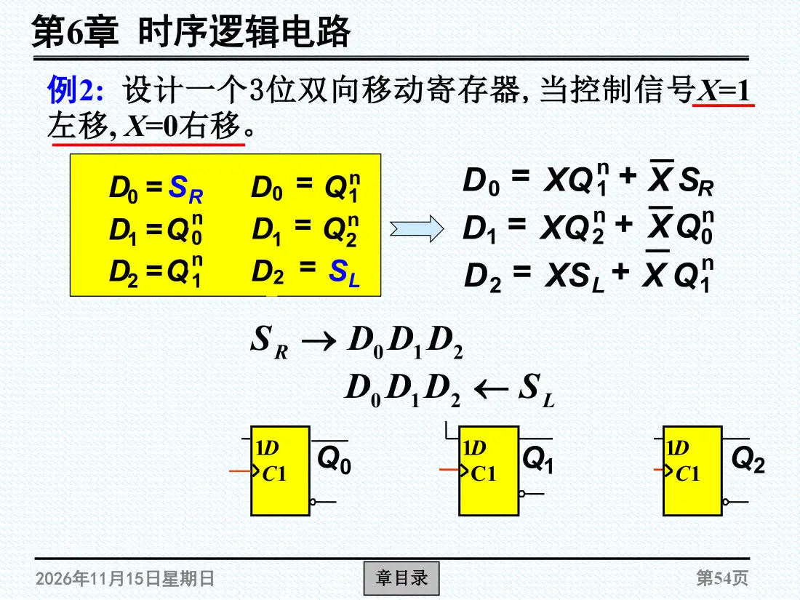

原文：

第6章 时序逻辑电路

例2: 设计一个3位双向移动寄存器,当控制信号 $X { \equiv } 1$ 左移, $X { = } 0$ 右移。

$$
\begin{array}{c c} D _ {0} = S _ {R} & D _ {0} = Q _ {1} ^ {n} \\ D _ {1} = Q _ {0} ^ {n} & D _ {1} = Q _ {2} ^ {n} \\ D _ {2} = Q _ {1} ^ {n} & D _ {2} = S _ {L} \end{array} \quad \Longrightarrow \quad \begin{array}{c c} D _ {0} = X Q _ {1} ^ {n} + \overline {{X}} S _ {R} \\ D _ {1} = X Q _ {2} ^ {n} + \overline {{X}} Q _ {0} ^ {n} \\ D _ {2} = X S _ {L} + \overline {{X}} Q _ {1} ^ {n} \end{array}
$$

$$
\begin{array}{c}S _ {R} \rightarrow D _ {0} D _ {1} D _ {2}\\D _ {0} D _ {1} D _ {2} \leftarrow S _ {L}\end{array}
$$

$$
\begin{array}{c}1 D\\\rightarrow C 1\end{array}Q _ {0}
$$

$$
\boxed {1 D} _ {\text { C1 }} \quad Q _ {1}
$$

$$
\begin{array}{c}1 D\\\rightarrow C 1\end{array}Q _ {2}
$$

2026年11月15日星期日

章目录

第54页

### 第6章 时序逻辑电路

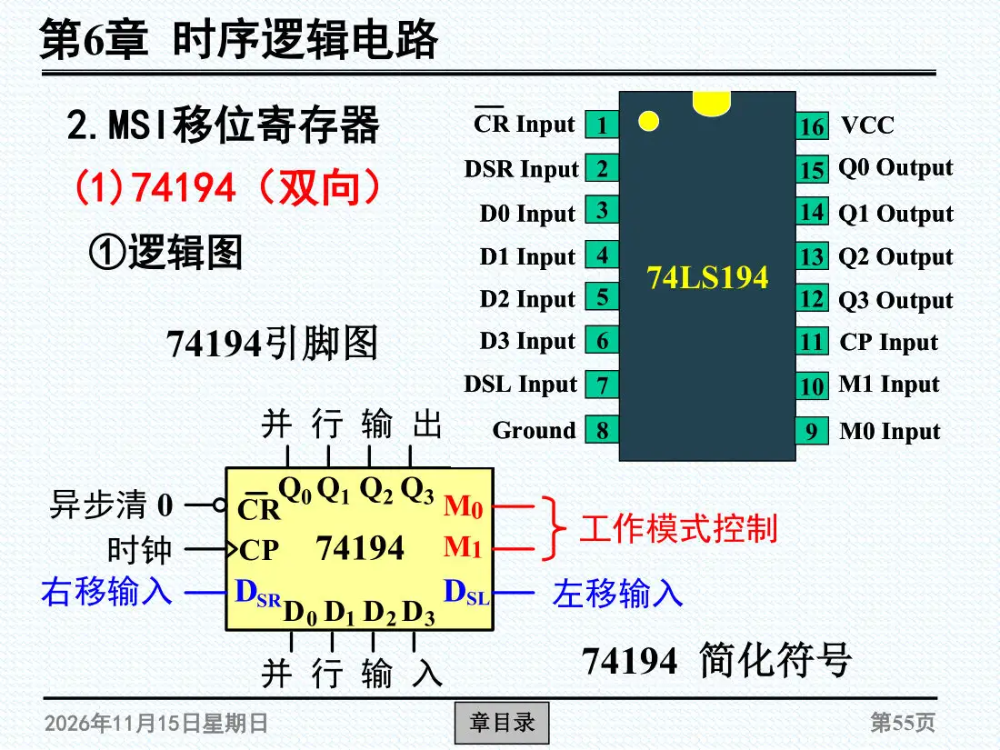

原文：

第6章 时序逻辑电路

2.MSI移位寄存器

(1)74194（双向）

①逻辑图

74194引脚图

异步清0

时钟

右移输入

$$
\boxed {\mathbf {D} _ {\mathrm{SR}} \mathbf {D} _ {0} \mathbf {D} _ {1} \mathbf {D} _ {2} \mathbf {D} _ {3} \mathbf {D} _ {\mathrm{SL}}}
$$

工作模式控制

并行输入

左移输入

74194 简化符号

2026年11月15日星期日

章目录

第55页

### 第6章 时序逻辑电路

原文：

第6章 时序逻辑电路

②74194功能表

右移 $D _ { \mathbb { S } \mathbb { R } } > Q _ { 0 } > Q _ { 1 } > Q _ { 2 } > Q _ { 3 }$

左移 $Q _ { 0 }  Q _ { 1 }  Q _ { 2 }  Q _ { 3 }  D _ { S \vert }$

<table><tr><td>MoM1</td><td>功能</td></tr><tr><td>0 0</td><td>保持</td></tr><tr><td>1 1</td><td>并入</td></tr><tr><td>1 0</td><td>右移</td></tr><tr><td>0 1</td><td>左移</td></tr></table>

2026年11月15日星期日

章目录

第56页

### 图6.4.6 两片74194构成8位双向移存器

原文：

图6.4.6 两片74194构成8位双向移存器
<table><tr><td>第6章 时序逻辑电路</td><td>MoM1</td><td>功能</td></tr><tr><td rowspan="4">374194的扩展</td><td>0 0</td><td>保持</td></tr><tr><td>1 1</td><td>并入</td></tr><tr><td>1 0</td><td>右移</td></tr><tr><td>0 1</td><td>左移</td></tr></table>

2026年11月15日星期日

章目录

第57页

### 第6章 时序逻辑电路

原文：

第6章 时序逻辑电路

④应用举例1

$$
\begin{array}{c c c} L _ {0} & \nearrow & L _ {2} \\ L _ {1} & \nearrow & L _ {3} \end{array}
$$

$$
\begin{array}{c c c c c} & 1 & 0 & 0 & 0 \\ \hline & \overline {{C R}} ^ {Q _ {0} Q _ {1} Q _ {2} Q _ {3}} M _ {0} \\ \hline & C P & 7 4 1 9 4 & M _ {1} \\ \hline & D _ {S R} D _ {0} D _ {1} D _ {2} D _ {3} & D _ {S L} \\ \hline & 1 & 0 & 0 & 0 \\ \hline & \text {并右移} \end{array}
$$

2026年11月15日星期日

章目录

第58页

### 第6章 时序逻辑电路

原文：

第6章 时序逻辑电路

<table><tr><td>MoM1</td><td>功能</td></tr><tr><td>0 0</td><td>保持</td></tr><tr><td>1 1</td><td>并入</td></tr><tr><td>1 0</td><td>右移</td></tr><tr><td>0 1</td><td>左移</td></tr></table>

转换完成信号

2026年11月15日星期日

章目录

第59页

### 并行输入

原文：

<table><tr><td>第6章 时序逻辑电路</td><td>MoM1</td><td>功能</td></tr><tr><td rowspan="4">4应用举例3七位并入-串出转换电路</td><td>0 0</td><td>保持</td></tr><tr><td>1 1</td><td>并入</td></tr><tr><td>1 0</td><td>右移</td></tr><tr><td>0 1</td><td>左移</td></tr></table>

并行输入

2026年11月15日星期日

章目录

第60页

### 第6章 时序逻辑电路

原文：

第6章 时序逻辑电路

(2)74195(右移)

J, K: 双端串行数据输入端S / L (Shift/Load)：移位/置数功能控制端

(3)74165(右移)

>CLK s/L 74165 Q7 CLKINHIBIT DSR D0D1D2D3D4D5D6D7

74195简化符号

时钟禁止端

CLKINHIBIT=1，CLK不起作用

74165简化符号

2026年11月15日星期日

章目录

第61页

### 第6章 时序逻辑电路

原文：

第6章 时序逻辑电路

表6.4.6 74195的功能表
<table><tr><td>S/L</td><td>J K</td><td> $\overline{CR}$ </td><td>CP</td><td> $Q_0^{n+1}Q_1^{n+1}Q_2^{n+1}Q_3^{n+1}$ </td><td>功能</td></tr></table>

$\mathbf { Q } _ { 0 } ^ { \mathfrak { n } + 1 }$ 由 J、K 和 $\mathbf { Q } _ { 0 } ^ { \mathfrak { n } }$ 决定

2026年11月15日星期日

章目录

第62页

### 第6章 时序逻辑电路

原文：

第6章 时序逻辑电路

表6.4.7 74165的功能表
<table><tr><td colspan="5">输入</td><td colspan="2">输出</td><td rowspan="3">功能</td></tr><tr><td>移位/置数</td><td>时钟禁止</td><td>时钟</td><td>串入</td><td>并入</td><td>内部</td><td>外部</td></tr><tr><td>S/L</td><td>CLKINHIBIT</td><td>CLK</td><td> $D_{SR}$ </td><td> $D_0 \sim D_7$ </td><td> $Q_0^{n+1}Q_1^{n+1}Q_2^{n+1}Q_3^{n+1}Q_4^{n+1}Q_5^{n+1}Q_6^{n+1}$ </td><td> $Q_7^{n+1}$ </td></tr></table>

2026年11月15日星期日

章目录

第63页

### 第6章 时序逻辑电路

原文：

第6章 时序逻辑电路

思考题

1. 寄存器和移存器的功能有何异同？

2. 寄存器和移存器对触发器的触发方式(直接触发、电位触发、边沿触发)有何要求？SUW

2026年11月15日星期日

章目录

第64页

### 第6章 时序逻辑电路

原文：

第6章 时序逻辑电路

望同学们：

【作业3】

独立完成作业认真完成作业

6.4

6.5

2026年11月15日星期日

章目录

第65页

### 第6章 时序逻辑电路

原文：

第6章 时序逻辑电路

6.5 计数器

1.计数器的概念

在数字电路中，能够记忆输入脉冲个数的电路称为计数器；还可用于计数、分频、定时、产生节拍脉冲等。

2.应用(如频率计)

3.基本结构

2026年11月15日星期日

章目录

第66页

### 第6章 时序逻辑电路

原文：

第6章 时序逻辑电路

4.分类

二进制计数器

(1)按模值

十进制计数器

任意进制计数器

(2)按存储器的状态变化是否同时

同步计数器

异步计数器

加法计数器

(3)按逻辑功能

减法计数器

可逆计数器

2026年11月15日星期日

章目录

第67页

### 1.同步计数器(由SSI构成)

原文：

一、二进制计数器 模值: $M = 2 ^ { n }$ ，计数范围: $0 \sim 2 ^ { n } - 1$

1.同步计数器(由SSI构成)

(1)加法计数器

a. $\mathbf { C P } _ { 1 } - \ldots = \mathbf { C P } _ { \mathrm { n } } = \mathbf { C P }$

b. TFF形式

$T _ { 1 } { = } 1$ 且

T, = , (i = 2,3,,n)

d. $\mathbf { Z } = \prod _ { j = 1 } ^ { n } { \mathbf { Q } } _ { j }$

<table><tr><td>CP</td><td>T</td><td> $Q^{n+1}$ </td></tr></table>

(2)减法 $1 + \frac { 0 } { 3 } \times \frac { 5 } { 1 5 } = \frac { 0 } { 5 }$

a. $\mathbf { C P } _ { 1 } { \bf - } \ldots { - } \mathbf { C P } _ { \mathrm { n } } { - } \mathbf { C P }$

b.T $\# \mathbb { F } \mathbb { F }$ 形式1J

c.CP $I _ { 1 } = \int \limits _ { 1 } \frac { 0 . 4 } { 1 5 } d t$ Q

$$
\begin{array}{c} T = \prod_ {i} Q _ {j} (i = 2, 3, \dots , n) \\ T - \boxed {= 1} \quad i = 1 \\ d. Z = \prod_ {j = 1} ^ {n} \overline {{Q _ {j}}} \\ C P - \boxed {j = 1} \end{array}
$$

第6章 时序逻辑电路

2026年11月15日星期日

章目录

第68页

### 第6章 时序逻辑电路

原文：

第6章 时序逻辑电路

例1：分析图6.5.2所示电路的逻辑功能。

①分析电路结构 3JKFF时钟同步结构。

②写出三组方程

a.各触发器的激励方程

$$
\mathrm{J} _ {3} = \mathrm{K} _ {3} = \mathrm{Q} _ {1} ^ {\mathrm{n}} \mathrm{Q} _ {2} ^ {\mathrm{n}}
$$

$$
\mathbf {J} _ {2} = \mathbf {K} _ {2} = \mathbf {Q} _ {1} ^ {\mathrm{n}}
$$

$$
\mathbf {J} _ {1} = \mathbf {K} _ {1} = 1
$$

2026年11月15日星期日

章目录

第69页

### 第6章 时序逻辑电路

原文：

第6章 时序逻辑电路

b.各触发器的次态方程

$$
\mathbf {Q} _ {3} ^ {\mathrm{n+1}} = [ \mathbf {Q} _ {1} ^ {\mathrm{n}} \mathbf {Q} _ {2} ^ {\mathrm{n}} \overline {{\mathbf {Q}}} _ {3} ^ {\mathrm{n}} + \overline {{\mathbf {Q} _ {1} ^ {\mathrm{n}} \mathbf {Q} _ {2} ^ {\mathrm{n}}}} \mathbf {Q} _ {3} ^ {\mathrm{n}} ] \cdot \mathbf {C P} \downarrow
$$

$$
\mathbf {Q} _ {2} ^ {\mathbf {n + 1}} = [ \mathbf {Q} _ {1} ^ {\mathbf {n}} \overline {{\mathbf {Q}}} _ {2} ^ {\mathbf {n}} + \overline {{\mathbf {Q}}} _ {1} ^ {\mathbf {n}} \mathbf {Q} _ {2} ^ {\mathbf {n}} ] \cdot \mathbf {C P} \downarrow
$$

$$
\mathbf {Q} _ {1} ^ {\mathbf {n + 1}} = [ \overline {{\mathbf {Q}}} _ {1} ^ {\mathbf {n}} ] \cdot \mathbf {C P} \downarrow
$$

④电路的逻辑功能描述

同步模8加法计数器(即3位二进制同步加法计数器)。

2026年11月15日星期日

章目录

第70页

### 第6章 时序逻辑电路

原文：

第6章 时序逻辑电路

同步二进制加法、减法计数器

模8同步加法计数

模8同步减法计数

2026年11月15日星期日

章目录

第71页

### 第6章 时序逻辑电路

原文：

第6章 时序逻辑电路

2.异步计数器(由SSI构成)

(1)加法计数器

a. $\mathbf { T } \mathbf { F } \mathbf { F }$ 形式

$\mathbf { C P _ { 1 } = C P }$

$\mathrm { C P } _ { \mathrm { i } } - \Big \{ \begin{array} { l } { \overline { { Q } } _ { \mathrm { i - 1 } } } \\ { Q _ { \mathrm { i - 1 } } } \end{array} \Big .$ 上升沿触发下降沿触发$( \mathrm { i } { - } 2 , 3 , { \ldots } , \mathrm { n } )$

c. $\mathbf { Z } - \prod _ { j = 1 } ^ { n } { \mathbf { Q } } _ { j }$

CP $\mathbf { Q } ^ { \mathsf { n } + 1 }$

(2)减法计数器 0 Qn

a. $\mathbf { T } \mathbf { F } \mathbf { F }$ 形式 $\bar { \mathsf Q } ^ { \mathsf Q }$

$\begin{array} { r l } & { \mathrm { l o . , C P _ { 1 } = C P } } \\ &  \mathrm { C P _ { i } = \{ \underbrace { Q _ { \mathrm { k l e t } } \mathrm { E \} } } _ { \mathrm { Q _ { 1 , t K } \mathrm { F \} } } } } \end{array}$ 沿触发 沿触发

$$
\begin{array}{c} (i = 2, 3, \dots , n) \\ Z = \prod_ {j = 1} ^ {n} Q _ {j} \\ C P \end{array}
$$

2026年11月15日星期日

章目录

第72页

### 第6章 时序逻辑电路

原文：

第6章 时序逻辑电路

例2：异步二进制减法计数器和异步二进制加法计数器

2026年11月15日星期日

章目录

第73页

### 第6章 时序逻辑电路

原文：

第6章 时序逻辑电路

例3：用DFF构成的3位二进制异步加法计数器电路和异步减法计数器电路。注意二者之间的区别！

2026年11月15日星期日

章目录

第74页

### 第6章 时序逻辑电路

原文：

第6章 时序逻辑电路

可逆计数器电路图

不用的时钟须保持为1；

依据“允许时钟通过的电路状态”进行设计。

2026年11月15日星期日

章目录

第75页

### 第6章 时序逻辑电路

原文：

第6章 时序逻辑电路

总结：由SSI构成的二进制计数器的结构

二

进

制

计

数

器

同步计数器

$$
\begin{array}{c} \mathrm{TFF} \\ T _ {1} = 1 \end{array}
$$

异步计数器

T'FF

$$
C P _ {1} = C P
$$

加法计数器

减法计数器

加法计数器

减法计数器

$$
T _ {i} = \prod_ {j = 1} ^ {i - 1} Q _ {j} (i = 2, 3, \dots , n)
$$

$$
T _ {i} = \prod_ {j = 1} ^ {i - 1} \overline {{Q}} _ {j} (i = 2, 3, \dots , n)
$$

$$
\begin{array}{c} C P _ {i} = \overline {{Q}} _ {i - 1} (\uparrow) | | Q _ {i - 1} (\downarrow) \\ (i = 2, 3, \dots , n) \end{array}
$$

$$
\begin{array}{c} C P _ {i} = Q _ {i - 1} (\uparrow) \parallel \overline {{Q}} _ {i - 1} (\downarrow) \\ (i = 2, 3, \dots , n) \end{array}
$$

2026年11月15日星期日

章目录

第76页

### 第6章 时序逻辑电路 常用计数器(1)

原文：

第6章 时序逻辑电路 常用计数器(1)

<table><tr><td>类型</td><td>型号</td><td>功能</td></tr><tr><td rowspan="10">计数器</td><td>74LS162</td><td>十进制同步计数器(同步清除)</td></tr><tr><td>74LS163</td><td>4位二进制同步计数器(同步清除)</td></tr><tr><td>74LS168</td><td>可预置制十进制同步加/减计数器</td></tr><tr><td>74LS169</td><td>可预置4位二进制同步加/减计数器</td></tr><tr><td>74LS190</td><td>可预置十进制同步加/减计数器</td></tr><tr><td>74LS191</td><td>可预置制4位二进制同步加/减计数器</td></tr><tr><td>74LS192</td><td>可预置十进制同步加/减计数器(双时钟)</td></tr><tr><td>74LS193</td><td>可预置4位二进制同步加/减计数器(双时钟)</td></tr><tr><td>74LS196</td><td>可预置十进制计数器</td></tr><tr><td>74LS197</td><td>可预置二进制计数器</td></tr><tr><td rowspan="6">计数器</td><td>7468</td><td>双十进制计数器</td></tr><tr><td>74LS90</td><td>异步二-五-十进制计数器(异步清除/置9)</td></tr><tr><td>74LS92</td><td>十二分频计数器</td></tr><tr><td>74LS93</td><td>4位二进制计数器</td></tr><tr><td>74LS160</td><td>同步十进制计数器(异步清除)</td></tr><tr><td>74LS161</td><td>4位二进制同步计数器(异步清除)</td></tr></table>

2026年11月15日星期日

章目录

第77页

### 第6章 时序逻辑电路 常用计数器(2)

原文：

第6章 时序逻辑电路 常用计数器(2)

<table><tr><td>类型</td><td>型号</td><td>功能</td></tr><tr><td rowspan="8">计数器</td><td>74LS690</td><td>可预置十进制同步计数器/寄存器(直接清除、三态)</td></tr><tr><td>74LS691</td><td>可预置二进制同步计数器/寄存器(直接清除、三态)</td></tr><tr><td>74LS692</td><td>可预置十进制同步计数器/寄存器(同步清除、三态)</td></tr><tr><td>74LS693</td><td>可预置二进制同步计数器/寄存器(同步清除、三态)</td></tr><tr><td>74LS696</td><td>十进制同步加/减计数器(三态、直接清除)</td></tr><tr><td>74LS697</td><td>二进制同步加/减计数器(三态、直接清除)</td></tr><tr><td>74LS698</td><td>十进制同步加/减计数器(三态、同步清除)</td></tr><tr><td>74LS699</td><td>二进制同步加/减计数器(三态、同步清除)</td></tr><tr><td rowspan="9">计数器</td><td>74LS290</td><td>十进制计数器</td></tr><tr><td>74LS293</td><td>4位二进制计数器</td></tr><tr><td>74LS390</td><td>双4位十进制计数器</td></tr><tr><td>74LS393</td><td>双4位二进制计数器(以不清楚)</td></tr><tr><td>74LS490</td><td>双4位十进制计数器</td></tr><tr><td>74LS568</td><td>可预置十进制同步加/减计数器(三态)</td></tr><tr><td>74LS569</td><td>可预置二进制同步加/减计数器(三态)</td></tr><tr><td>74LS668</td><td>十进制同步加/减计数器</td></tr><tr><td>74LS669</td><td>二进制同步加/减计数器</td></tr></table>

2026年11月15日星期日

章目录

第78页

### 第6章 时序逻辑电路

原文：

第6章 时序逻辑电路

3.MSI二进制计数器

(1)74LS161

(2)74LS163

均为4位二进制(M=16)可预置同步加法计数器。

74161异步清0、 74163同步清0CR清0端区别：

$$
\left| \mathbf {Q} _ {3} \right| \mathbf {Q} _ {2} \left| \mathbf {Q} _ {1} \right| \mathbf {Q} _ {0}
$$

同步置数控制端工作模式控制端

$$
\left| \mathbf {D} _ {3} \right| \mathbf {D} _ {2} \left| \mathbf {D} _ {1} \right| \mathbf {D} _ {0}
$$

$\mathbf { Q _ { C C } }$ 进位输出端 $\mathrm { Q } _ { 3 } \mathrm { Q } _ { 2 } \mathrm { Q } _ { 1 } \mathrm { Q } _ { 0 } { = } 1 1 1 1$ 时, $\mathbf { Q } _ { \mathbf { C C } } = 1$

2026年11月15日星期日

章目录

第79页

### 第6章 时序逻辑电路

原文：

第6章 时序逻辑电路

②功能表 表6.5.2 74161 的功能表 工作频率25MHz
<table><tr><td> $\overline{CR}$ </td><td> $\overline{L}_{D}$ </td><td>P(S1)T(S2)</td><td>CP</td><td>D3 D2 D1 D0</td><td>Q3n+1Q2n+1Q1n+1Q0n+1</td><td>功能</td></tr></table>

$$
\mathbf {Q} _ {\mathrm{CC}} = \mathbf {Q} _ {3} \mathbf {Q} _ {2} \mathbf {Q} _ {1} \mathbf {Q} _ {0} \cdot \mathbf {T}
$$

2026年11月15日星期日

章目录

第80页

### 第6章 时序逻辑电路

原文：

第6章 时序逻辑电路

74161

$$
\begin{array}{c c c c c c c c c} \text {CP} & 1 & 2 & 3 & 4 & 5 & 6 \\ \hline \overline {{\text {CR}}} & & & & & & \\ \text {Q} _ {0} & 0 & 1 & 0 & 1 & 0 & 0 & 1 \\ \text {Q} _ {1} & 0 & 0 & 1 & 1 & 0 & 0 & 0 \\ \text {Q} _ {2} & 0 & 0 & 0 & 0 & 1 & 0 & 0 \\ \text {Q} _ {3} & 0 & 0 & 0 & 0 & 0 & 0 & 0 \end{array}
$$

74161异步清零示例：当CP时, 计数器由0000开始计数, 但当出现清零信号CR时, 计数状态0101→0000。

2026年11月15日星期日

章目录

第81页

### 第6章 时序逻辑电路

原文：

第6章 时序逻辑电路

74163

74163同步清零示例:清零信号持续时间短无法清零。

2026年11月15日星期日

章目录

第82页

### 第6章 时序逻辑电路

原文：

第6章 时序逻辑电路

74163

$$
\begin{array}{c c c c c c c c c} \text {CP} & 1 & 2 & 3 & 4 & 5 & 6 \\ \hline \overline {{\text {CR}}} & & & & & & \\ \text {Q} _ {0} & 0 & 1 & 0 & 1 & 0 & 1 & 0 \\ \text {Q} _ {1} & 0 & 0 & 1 & 1 & 0 & 0 & 0 \\ \text {Q} _ {2} & 0 & 0 & 0 & 0 & 1 & 1 & 1 \\ \text {Q} _ {3} & 0 & 0 & 0 & 0 & 0 & 0 & 0 \end{array}
$$

74163同步清零示例:

0101时出现清零信号, 1个时钟周期后变0000。

2026年11月15日星期日

章目录

第83页

### 第6章 时序逻辑电路

原文：

第6章 时序逻辑电路

修改,当计同步十进制个CLK电路减法计数器

注意：同步十进制加/减法计数器的结构完全不同！

计数脉沖

### 第6章 时序逻辑电路

原文：

第6章 时序逻辑电路

5.异步十进制加法计数器 在4位二进制异步加法计 数器上修改而成,要跳过 1010\_1111这六个状态.

第85页

### 第6章 时序逻辑电路

原文：

第6章 时序逻辑电路

进制计数器74LS160

74LS160 模10(同步计数、异步清0)：进位 $\mathrm { Q } _ { \mathrm { c c } } { = } \mathrm { Q } _ { 3 } \mathrm { Q } _ { 0 }$ T(1001时产生进位)74LS161 模16(同步计数、异步清0) ：进位 $\mathbf { Q } _ { \mathbf { C C } } { = } \mathbf { Q } _ { 3 } \mathbf { Q } _ { 2 } \mathbf { Q } _ { 1 } \mathbf { Q _ { 0 } }$ T (1111时产生进位)

2026年11月15日星期日

章目录

第86页

### 表6.5.8 74160的功能表

原文：

表6.5.8 74160的功能表
<table><tr><td> $\overline{CR}$ </td><td> $\overline{L}_{D}$ </td><td>P T</td><td>CP</td><td> $Q_{3}^{n+1}Q_{2}^{n+1}Q_{1}^{n+1}Q_{0}^{n+1}$ </td><td>功能</td></tr><tr><td colspan="6">进位 $Q_{CC}=Q_{3}Q_{0}\cdot T$  工作频率25MHz</td></tr></table>

第6章 时序逻辑电路

2026年11月15日星期日

章目录

第87页

### 第6章 时序逻辑电路

原文：

第6章 时序逻辑电路

思考题

1.同步清零和异步清零有何区别？

2.“同步计数器”中的同步如何理解？

2026年11月15日星期日

章目录

第88页

### 第6章 时序逻辑电路

原文：

第6章 时序逻辑电路

望同学们：

独立完成作业认真完成作业

【作业4】

6.12(1)

6.13(1)

2026年11月15日星期日

章目录

第89页

### 第6章 时序逻辑电路 —任意进制计数器设计

原文：

第6章 时序逻辑电路 —任意进制计数器设计

三、任意进制计数器

任意进制计数器是指模值M，既不等于2n，也不等于10的计数器。

1.用触发器和逻辑门设计任意进制计数器

例6.5.1 试用JKFF设计按自然二进制码计数的M=5的同步加法计数器。

解：(1)求触发器级数

$$
\log_ {2} M \leq n <   \log_ {2} M + 1 \quad \text {取} n = 3 。
$$

(2)列综合表

为使电路具有自启动性，应考虑所有的状态，包括偏离状态，

2026年11月15日星期日

章目录

第90页

### 第6章 时序逻辑电路 任意进制计数器设计

原文：

第6章 时序逻辑电路 任意进制计数器设计

表6.5.9 例6.5.1的综合表

激

励

表

状

态

转

移

表

假设111110 101现在，用JKFF设计按自 000→001→010→011→100M=5的同步加法计数器。

2026年11月15日星期日

章目录

第91页

### 第6章 时序逻辑电路 —任意进制计数器设计

原文：

第6章 时序逻辑电路 —任意进制计数器设计

(3)求各触发器的激励函数(由综合表做卡诺图得到)

$$
\mathbf {J} _ {3} = \mathbf {Q} _ {2} ^ {\mathrm{n}} \mathbf {Q} _ {1} ^ {\mathrm{n}}; \quad \mathbf {K} _ {3} = 1
$$

$$
\mathbf {J} _ {2} = \mathbf {Q} _ {1} ^ {\mathrm{n}} \quad ; \quad \mathbf {K} _ {2} = \mathbf {Q} _ {1} ^ {\mathrm{n}}
$$

$$
\mathbf {J} _ {1} = \overline {{\mathbf {Q}}} _ {3} ^ {\mathrm{n}}; \quad \mathbf {K} _ {1} = \overline {{\mathbf {Q}}} _ {3} ^ {\mathrm{n}}
$$

(4)画逻辑图 考虑了偏离态后, 该电路可以自启动！

2026年11月15日星期日

章目录

第92页

### 第6章 时序逻辑电路 —任意进制计数器设计

原文：

第6章 时序逻辑电路 —任意进制计数器设计

例1：试用JKFF设计按自然二进制码计数的M=8的同步减法计数器。

3位二进制减计数器状态图及状态表

$$
\begin{array}{c} \text {Q} _ {2} \text {Q} _ {1} \text {Q} _ {0} / \text {B} \\ \text {000} \xrightarrow {\text {/1}} \text {111} \xrightarrow {\text {/0}} \text {110} \xrightarrow {\text {/0}} \text {101} \\ \text {001} \xrightarrow {\text {/0}} \text {010} \xrightarrow {\text {/0}} \text {011} \xrightarrow {\text {/0}} \text {100} \end{array}
$$

选用3个下降沿触发的边沿JK触发器组成电路

<table><tr><td> $Q_{2}^{n}$ </td><td> $Q_{1}^{n}$ </td><td> $Q_{0}^{n}$ </td><td> $Q_{2}^{n+1}$ </td><td> $Q_{1}^{n+1}$ </td><td> $Q_{0}^{n+1}$ </td><td>B</td></tr><tr><td>0</td><td>0</td><td>0</td><td>1</td><td>1</td><td>1</td><td>1</td></tr><tr><td>1</td><td>1</td><td>1</td><td>1</td><td>1</td><td>0</td><td>0</td></tr><tr><td>1</td><td>1</td><td>0</td><td>1</td><td>0</td><td>1</td><td>0</td></tr><tr><td>1</td><td>0</td><td>1</td><td>1</td><td>0</td><td>0</td><td>0</td></tr><tr><td>1</td><td>0</td><td>0</td><td>0</td><td>1</td><td>1</td><td>0</td></tr><tr><td>0</td><td>1</td><td>1</td><td>0</td><td>1</td><td>0</td><td>0</td></tr><tr><td>0</td><td>1</td><td>0</td><td>0</td><td>0</td><td>1</td><td>0</td></tr><tr><td>0</td><td>0</td><td>1</td><td>0</td><td>0</td><td>0</td><td>0</td></tr></table>

2026年11月15日星期日

章目录

第93页

### 第6章 时序逻辑电路 ——任意进制计数器设计

原文：

第6章 时序逻辑电路 ——任意进制计数器设计

求状态方程:（画各触发器的次态卡诺图）

$$
\mathrm{Q} _ {2} ^ {n + 1} \backslash \mathrm{Q} _ {1} ^ {n} \mathrm{Q} _ {0} ^ {n}
$$

<table><tr><td>Q2n</td><td>00</td><td>01</td><td>11</td><td>10</td></tr><tr><td>0</td><td>1</td><td>0</td><td>0</td><td>0</td></tr><tr><td>1</td><td>0</td><td>1</td><td>1</td><td>1</td></tr></table>

$$
\begin{array}{c c c c c} \mathsf {Q} _ {1} ^ {n + 1} & \mathsf {Q} _ {1} ^ {n} \mathsf {Q} _ {0} ^ {n} \\ \mathsf {Q} _ {2} ^ {n} & 0 0 & 0 1 & 1 1 & 1 0 \\ \hline 0 & 1 & 0 & 1 & 0 \\ \hline 1 & 1 & 0 & 1 & 0 \\ \hline \end{array}
$$

$$
\begin{array}{c c c c c} \mathsf {Q} _ {0} ^ {n + 1} & \mathsf {Q} _ {1} ^ {n} \mathsf {Q} _ {0} ^ {n} \\ \mathsf {Q} _ {2} ^ {n} & 0 0 & 0 1 & 1 1 & 1 0 \\ \hline 0 & 1 & 0 & 0 & 1 \\ \hline 1 & 1 & 0 & 0 & 1 \end{array}
$$

$$
\left\{ \begin{array}{l} \mathbf {Q} _ {2} ^ {n + 1} = \overline {{\mathbf {Q}}} _ {2} ^ {n} \overline {{\mathbf {Q}}} _ {1} ^ {n} \overline {{\mathbf {Q}}} _ {0} ^ {n} + \mathbf {Q} _ {2} ^ {n} \mathbf {Q} _ {1} ^ {n} + \mathbf {Q} _ {2} ^ {n} \mathbf {Q} _ {0} ^ {n} \\ \mathbf {Q} _ {1} ^ {n + 1} = \overline {{\mathbf {Q}}} _ {1} ^ {n} \overline {{\mathbf {Q}}} _ {0} ^ {n} + \mathbf {Q} _ {1} ^ {n} \mathbf {Q} _ {0} ^ {n} \\ \mathbf {Q} _ {0} ^ {n + 1} = \overline {{\mathbf {Q}}} _ {0} ^ {n} \end{array} \right.
$$

$$
\begin{array}{c c c c c c c} \hline 1 & 1 & 1 & 1 & 1 & 0 & 0 \\ \hline 1 & 1 & 0 & 1 & \overline {{0}} & \overline {{1}} & 0 \\ \hline 1 & 0 & Q _ {1} ^ {n + 1} & \overline {{1}} = J Q _ {0} ^ {n} + K Q _ {0} ^ {n} \\ \hline 1 & 0 & 0 & 0 & 1 & 1 & 0 \\ \hline \end{array}
$$

$$
\left\{ \begin{array}{l} Q _ {2} ^ {n + 1} = \overline {{Q}} _ {1} ^ {n} \overline {{Q}} _ {0} ^ {n} \overline {{Q}} _ {2} ^ {n} + \overline {{\overline {{Q}} _ {1} ^ {n}}} \cdot \overline {{\overline {{Q}} _ {0} ^ {n}}} Q _ {2} ^ {n} \\ Q _ {1} ^ {n + 1} = \overline {{Q}} _ {0} ^ {n} \overline {{Q}} _ {1} ^ {n} + Q _ {0} ^ {n} Q _ {1} ^ {n} \\ Q _ {0} ^ {n + 1} = 1 \cdot \overline {{Q}} _ {0} ^ {n} + 0 \cdot Q _ {0} ^ {n} \end{array} \right.
$$

2026年11月15日星期日

章目录

第94页

### 第6章 时序逻辑电路 —任意进制计数器设计

原文：

第6章 时序逻辑电路 —任意进制计数器设计

$$
\left\{ \begin{array}{l} \mathbf {Q} _ {2} ^ {n + 1} = \overline {{\mathbf {Q}}} _ {1} ^ {n} \overline {{\mathbf {Q}}} _ {0} ^ {n} \overline {{\mathbf {Q}}} _ {2} ^ {n} + \overline {{\overline {{\mathbf {Q}}} _ {1} ^ {n}}} \overline {{\overline {{\mathbf {Q}}} _ {0} ^ {n}}} \mathbf {Q} _ {2} ^ {n} \\ \mathbf {Q} _ {1} ^ {n + 1} = \overline {{\mathbf {Q}}} _ {0} ^ {n} \overline {{\mathbf {Q}}} _ {1} ^ {n} + \mathbf {Q} _ {0} ^ {n} \mathbf {Q} _ {1} ^ {n} \\ \mathbf {Q} _ {0} ^ {n + 1} = 1 \cdot \overline {{\mathbf {Q}}} _ {0} ^ {n} + 0 \cdot \mathbf {Q} _ {0} ^ {n} \end{array} \right.
$$

对比 $\mathbf { Q } ^ { n + 1 } = \mathbf { J } \overline { { \mathbf { Q } } } ^ { n } + \overline { { \mathbf { K } } } \mathbf { Q } ^ { n }$ 得： 并且 $\mathbf { B } = \mathbf { \overline { { Q } } } _ { 2 } ^ { n } \cdot \mathbf { \overline { { Q } } } _ { 1 } ^ { n } \cdot \mathbf { \overline { { Q } } } _ { 0 } ^ { n }$

$$
\left\{ \begin{array}{l} \mathbf {J} _ {2} = \mathbf {K} _ {2} = \overline {{\mathbf {Q}}} _ {1} ^ {n} \overline {{\mathbf {Q}}} _ {0} ^ {n} \\ \mathbf {J} _ {1} = \mathbf {K} _ {1} = \overline {{\mathbf {Q}}} _ {0} ^ {n} \\ \mathbf {J} _ {0} = \mathbf {K} _ {0} = 1 \end{array} \right.
$$

画逻辑电路图:

输入减计数脉冲

2026年11月15日星期日

章目录

第95页

### 第6章 时序逻辑电路 MSI任意进制计数器

原文：

第6章 时序逻辑电路 MSI任意进制计数器

2.用MSI(二-十进制)计数器构成任意进制计数器

N进制 $N > M$ M进制

(1)复0法, 利用CR 端

(2)置数法, 利用 $L _ { p }$ 端

指导思想：顺序计数时需跳过N–M个状态。

(1)复0法(异步/同步复0法——利用清0端)

自动跳转

同步强制跳转

异步强制跳转

2026年11月15日星期日

章目录

第96页

### 第6章 时序逻辑电路 ——复0法计数

原文：

第6章 时序逻辑电路 ——复0法计数

例1：试用74161复0法设计M=6的计数器。

$$
\begin{array}{l} \text {解：7.} \\ \text {电路的} \\ \mathrm{Q} _ {3} \quad \mathrm{Q} _ {2} \\ \hline 0 \quad 0 \\ 0 \quad 0 \\ 0 \quad 0 \\ 0 \quad 0 \\ 0 \quad 1 \\ 0 \quad 1 \quad 0 \quad 1 \\ (0 \quad 1 \quad 1 \quad 0) \end{array} \text {起跳状态 图6.5.14 (a)异步复0法}
$$

2026年11月15日星期日

章目录

第97页

### 第6章 时序逻辑电路 复0法计数

原文：

第6章 时序逻辑电路 复0法计数

$$
\begin{array}{c c c c c c c c c} & 0 & 1 & 2 & 3 & 4 & 5 & 6 \\ \hline \text {CP} & 0 & 1 & 0 & 1 & 0 & 1 & 0 \\ \hline Q _ {0} & 0 & 0 & 1 & 1 & 0 & 0 & 0 \\ \hline Q _ {1} & 0 & 0 & 0 & 0 & 1 & 1 & 0 \\ \hline Q _ {2} & 0 & 0 & 0 & 0 & 0 & 0 & 0 \\ \hline Q _ {3} & 0 & 0 & 0 & 0 & 0 & 0 & 0 \\ \hline \overline {{C R}} & \end{array}
$$

对于异步复0法, 随着计数器被置0, 复位信号随之消失,由于复位信号持续时间很短, 电路的可靠性不高。

2026年11月15日星期日

章目录

第98页

### 第6章 时序逻辑电路 复0法计数

原文：

第6章 时序逻辑电路 复0法计数

注意：

采用异步复0法时，各触发器有可能不能同时复0。

由于置零信号持续时间极短，如果触发器的复位速度有快有慢，则可能动作慢的触发器还未来得及复位，零信号已经消失，导致电路误动作——必须改进！

2026年11月15日星期日

章目录

第99页

### 低电平置 零信号

原文：

低电平置 零信号

第6章 时序逻辑电路 复0法计数

《异步复0法改进》

可靠的异步复位0电路

当触发器误动作时,低电平置零信号随之消失,但由于SR锁存器状态不变,因而计数器置 0 信号得以维持。

2026年11月15日星期日

章目录

第100页

### 第6章 时序逻辑电路 复0法计数

原文：

第6章 时序逻辑电路 复0法计数

《异步复0法改进》

加到计数器CR端的置零信号宽度与计数脉冲高电平持续时间相等, 直到计数脉冲CP回到低电平后, SR锁存器置0, 清0端 CR的低电平也随之消失。

2026年11月15日星期日

章目录

第101页

### 第6章 时序逻辑电路 复0法计数

原文：

第6章 时序逻辑电路 复0法计数

例2: 试用74163复0法设计M=6的计数器。

解：74163为同步复0方式，起跳状态为 $S _ { 5 } ,$ 即 $( 0 1 0 1 ) _ { 2 } 。$ 电路图如下所示：

注意：同步清0是指在清0端 $\mathbf { C R = 0 }$ , 且当下一个CP到来时, 各触发器同时清0。

——不存在异步复0法中因复 0 信号维持时间短而可靠性不高的问题。

2026年11月15日星期日

章目录

第102页

### 第6章 时序逻辑电路 复0法计数

原文：

第6章 时序逻辑电路 复0法计数

注意：74163同步复0时，起跳状态不能用0110。

$$
\begin{array}{c c c c c c c c c} & 1 & 2 & 3 & 4 & 5 & 6 & 7 \\ \text {CP} & & & & & & & \\ Q _ {0} & 0 & 1 & 0 & 1 & 0 & 1 & 0 & 0 \\ Q _ {1} & 0 & 0 & 1 & 1 & 0 & 0 & 1 & 0 \\ Q _ {2} & 0 & 0 & 0 & 0 & 1 & 1 & 1 & 0 \\ Q _ {3} & 0 & 0 & 0 & 0 & 0 & 0 & 0 & 0 \\ \overline {{C R}} & & & & & & & \end{array}
$$

问题：同步复0与异步复0的区别？

2026年11月15日星期日

章目录

第103页

### 第6章 时序逻辑电路 置数法计数

原文：

第6章 时序逻辑电路 置数法计数

(2)置数法( —— 利用置数控制端和并行输入端)

以从计数循环中的任何一个状同步预置数法:如74160,7416异步预置数法: 如7490,74190

，从而跳跃N–M个状态，得到M进制适用于具有同步预置端的集成计数器。适用于具有异步预置端的集成计数器。

概念：模M相加(——“和”/M，取“余数

例如：模M=16，求15+2的模16结果。

则 (15+2) Mod 16 = 1

2026年11月15日星期日

章目录

第104页

### 第6章 时序逻辑电路 ——置数法计数

原文：

第6章 时序逻辑电路 ——置数法计数

用置数法实现M=12的计数器(以同步74161为例)

①预置0法

$$
\boxed {\begin{array}{c}\downarrow\\S _ {0} \rightarrow S _ {1} \rightarrow S _ {2} \rightarrow S _ {3} \rightarrow S _ {4} \rightarrow S _ {5} \rightarrow S _ {6} \rightarrow S _ {7} \rightarrow S _ {8} \rightarrow S _ {9} \rightarrow S _ {1 0} \rightarrow S _ {1 1}\end{array}}
$$

②预置最小数法

$$
\boxed {S _ {4} \rightarrow S _ {5} \rightarrow S _ {6} \rightarrow S _ {7} \rightarrow S _ {8} \rightarrow S _ {9} \rightarrow S _ {1 0} \rightarrow S _ {1 1} \rightarrow S _ {1 2} \rightarrow S _ {1 3} \rightarrow S _ {1 4} \rightarrow S _ {1 5}}
$$

③预置最大数法

$$
\begin{array}{c}\boxed {\downarrow}\\S _ {1 5} \rightarrow S _ {0} \rightarrow S _ {1} \rightarrow S _ {2} \rightarrow S _ {3} \rightarrow S _ {4} \rightarrow S _ {5} \rightarrow S _ {6} \rightarrow S _ {7} \rightarrow S _ {8} \rightarrow S _ {9} \rightarrow S _ {1 0}\end{array}
$$

2026年11月15日星期日

章目录

第105页

### 例6.5.3 试用74161预置0法设计M=6的计数器。

原文：

预置0法（重点）注意：与同步复0法相似，同步置0法在置数信号到来后，还要等下一个计数脉冲CP到来后才0 1 2 M-1 M置数，同样可避免异步复 0过程中因置0信号持续时间过短而不可靠的问题。

例6.5.3 试用74161预置0法设计M=6的计数器。

解：74161采用同步置数方式,则反馈状态为$\mathbf { S _ { M - 1 } } ,$ 即 $\mathbf { S _ { 5 } } ( 0 1 0 1 )$

$$
\overline {{\mathrm{L}}} _ {\mathrm{D}} = \overline {{\mathrm{Q} _ {2} \mathrm{Q} _ {0}}}
$$

第6个CP

$$
Q _ {3} Q _ {2} Q _ {1} Q _ {0} = 0 0 0 0
$$

第6章 时序逻辑电路 —— 置数法计数

2026年11月15日星期日

章目录

第106页

### 第6章 时序逻辑电路 ——置数法计数

原文：

第6章 时序逻辑电路 ——置数法计数

② 预置最小数法(M=12同步预置举例)数 器  到 重 新 处 于预 置 数 工作 状 态  。 预 置 数为 。

74161十六进制同步计数器。预置数为 $( 1 6 - 1 2 ) = 4$ 即从 $\mathrm { D } _ { 3 } \mathrm { D } _ { 2 } \mathrm { D } _ { 1 } \mathrm { D } _ { 0 } = 0 1 0 0$ 开始计数。当第11CP到达时计数器计到1111， $\varrho _ { \mathrm { c c } } { = } 1$ 则当第12CP到达时，计数器重新处于预置数工作状态。

$$
\begin{array}{c} Q _ {3} Q _ {2} Q _ {1} Q _ {0} = 1 1 1 1 \\ \text {QCC=1} \\ T \downarrow 7 4 L S 1 6 1 \\ \overline {{L}} _ {D} ^ {\mathrm{CP}} \overline {{D}} _ {3} ^ {-} \overline {{D}} _ {2} D _ {1} D _ {0} \\ \text {第12个CP} \\ Q _ {3} Q _ {2} Q _ {1} Q _ {0} = 0 1 0 0 \end{array}
$$

$$
\begin{array}{c c c c c} \text {跳} & 0 & 0 & 0 & 0 \\ \text {过} & \dots & \dots & \\ & 0 & 0 & 1 & 1 \\ \hline 1 C P & 0 & 1 & 0 & 0 \\ 2 C P & 0 & 1 & 0 & 1 \\ \dots & 0 & 1 & 1 & 0 \\ 1 1 C P & \dots & \dots & \\ & 1 & 1 & 1 & 0 \\ & 1 & 1 & 1 & 1 \end{array}
$$

12CP 置数

2026年11月15日星期日

章目录

第107页

### 第6章 时序逻辑电路 ——置数法计数

原文：

第6章 时序逻辑电路 ——置数法计数

③预置最大数法(M=12同步预置举例)预置数为最大数15, 即1111, 且跳过1011、1100、1101、1110四个状态,则计数到 $\mathcal { Q } _ { 3 } \mathcal { Q } _ { 2 } \mathcal { Q } _ { 1 } \mathcal { Q } _ { 0 } { = } 1 0 1 0$ 时，$\overline { { L } } _ { \mathbf { D } } { = } \mathbf { 0 }$ 第12CP到达时计数器重新预置数。

$$
\begin{array}{c c c c c} \text {2CP} & 0 & 0 & 0 & 0 \\ 3 \text {CP} & 0 & 0 & 0 & 1 \\ \dots & & \dots & \dots \\ 1 1 \text {CP} & 1 & 0 & 1 & 0 \\ \hline 1 2 \text {CP} & 1 & 0 & 1 & 1 \\ \text {置数} & 1 & 1 & 0 & 0 \\ & 1 & 1 & 0 & 1 \\ & 1 & 1 & 1 & 0 \\ \hline & 1 & 1 & 1 & 1 \end{array} \quad \left. \begin{array}{l} 1 \text {CP} \\ \text {跳过} \\ \end{array} \right\}
$$

2026年11月15日星期日

章目录

第108页

### 第6章 时序逻辑电路 —— 置数法计数 中间10个状态

原文：

第6章 时序逻辑电路 —— 置数法计数 中间10个状态

例:分析如下计数预置电路

还有没有其它161预置数呢？

2026年11月15日星期日

### 第6章 时序逻辑电路 置数法计数

原文：

第6章 时序逻辑电路 置数法计数

后10个状态: 最小数预置

$$
\begin{array}{c c c c} \mathbf {0} & \mathbf {0} & \mathbf {0} & \mathbf {0} \\ \mathbf {0} & \mathbf {0} & \mathbf {0} & 1 \end{array}
$$

中间10个状态

跳过

$$
\begin{array}{c c c c} 0 & 1 & 0 & 0 \\ \hline 1 \sim 1 0 \\ 2 \sim 1 1 \\ 3 \sim 1 2 \\ 4 \sim 1 3 \\ 5 \sim 1 4 \\ \hline 1 & 1 & 1 & 1 \end{array}
$$

10CP

前10个状态: 最大数预置

$$
\begin{array}{c c c c c} & 0 & 0 & 1 & 0 \\ \text {   1CP   } & 0 & 0 & 1 & 1 \\ & 0 & 1 & 0 & 0 \\ \vdots & & & \vdots & \\ \text {   4CP   } & 0 & 1 & 1 & 1 \\ \vdots & & & \vdots & \\ \text {   9CP   } & 1 & 1 & 0 & 0 \end{array}
$$

$$
\left. \begin{array}{c c c c} 1 & 1 & 0 & 1 \\ 1 & 1 & 1 & 0 \\ 1 & 1 & 1 & 1 \end{array} \right]
$$

跳过

2026年11月15日星期日

章目录

第110页

### 第6章 时序逻辑电路

原文：

第6章 时序逻辑电路

《用MSI计数器构成任意进制计数器方法总结》

复0法—

$$
\begin{array}{c} \mathrm{S} _ {0} \longrightarrow \mathrm{S} _ {1} \longrightarrow \mathrm{S} _ {2} \dots \dots \longrightarrow \mathrm{S} _ {\mathrm{M-1}} \\ \uparrow \\ \text {同步} \end{array}
$$

(1)确定起始状态

(2)确定起跳状态

(3)设计判别电路

置数法—

S预 S预+1 S预+(M- 同步

①利用起跳状态中“ ”输出端或者

②利用起跳状态中全部输出端

2026年11月15日星期日

章目录

第111页

### 第6章 时序逻辑电路

原文：

第6章 时序逻辑电路

课堂讨论:电路功能分析。十进制计数器74160：异步复0, 同步置数

缺陷？如何改进？

采用“复0法”，适合0 1 1 0于有“异步复0端”计结论：数器

同步六进制计数器改进1: 增加SR锁存器。Q这样, 计数脉冲回到低电LT平后, SR锁存器仍被置0,CP电路可靠性提高。输入此时,加到计数器清0端的复0信号的宽度与计数脉冲高电平持续时间相等。

缺陷: 6CP时, 出现0110瞬态, 则复0信号随着计数器被置0而立即消失, 即复0信号持续时间很短, 导致该电路可靠性不高。

2026年11月15日星期日

章目录

第112页

### 第6章 时序逻辑电路

原文：

第6章 时序逻辑电路

改进2：采用“置数法”适合于有“同步置位端”计数器。

6CP置数

$$
\begin{array}{c c c c c} & \text {Q3} & \text {Q2} & \text {Q1} & \text {Q0} \\ \hline 1 \mathrm{CP} & 0 & 0 & 0 & 0 \\ 2 \mathrm{CP} & 0 & 0 & 0 & 1 \\ 3 \mathrm{CP} & 0 & 0 & 1 & 0 \\ 4 \mathrm{CP} & 0 & 0 & 1 & 1 \\ 5 \mathrm{CP} & 0 & 1 & 0 & 0 \\ \hline & 0 & 1 & 0 & 1 \\ \hline \text {跳过} & 0 & 1 & 1 & 0 \\ & 0 & 1 & 1 & 1 \\ & 0 & 1 & 1 & 1 \\ & 1 & 0 & 0 & 1 \end{array}
$$

$$
\begin{array}{c c c c c} & \text {Q3} & \text {Q2} & \text {Q1} & \text {Q0} \\ \hline 2 \mathrm{CP} & 0 & 0 & 0 & 0 \\ 3 \mathrm{CP} & 0 & 0 & 0 & 1 \\ 4 \mathrm{CP} & 0 & 0 & 1 & 0 \\ 5 \mathrm{CP} & 0 & 0 & 1 & 1 \\ \hline 6 \mathrm{CP} & 0 & 1 & 0 & 0 \\ \text {置数} & \hline 0 & 1 & 0 & 1 \\ & 0 & 1 & 1 & 0 \\ & 0 & 1 & 1 & 1 \\ & 0 & 1 & 1 & 1 \\ \hline & 1 & 0 & 0 & 1 \end{array} \quad \left. \begin{array}{c} 1 \mathrm{CP} \\ \text {跳过} \\ \end{array} \right\}
$$

1. 预置方法？

2. 进位标志？

2026年11月15日星期日

章目录

第113页

### 第6章 时序逻辑电路 ——计数器级联

原文：

第6章 时序逻辑电路 ——计数器级联

3.计数器的扩展(级联)——M >N 时

①扩展方案(以 2个N 进制计数器扩展为例）

a.分解方案:用两片计数器分别组成 $N _ { 1 }$ 和 $N _ { 2 }$ 进制计数器，然后级联成M进制计数器。 $M = N _ { 1 } \times N _ { 2 }$

b.整体方案:整体清0或整体置数 $( N ^ { 2 } > M )$ 将两片计数器级联成 $N ^ { 2 }$ 进制计数器。

②扩展方法

a.异步级联 →采用分解方案以低位片进位输出信号作为高位片时钟输入信号。

b.同步级联 →采用整体方案以低位片进位输出信号作为高位片控制信号P、T。

2026年11月15日星期日

章目录

第114页

### 第6章 时序逻辑电路 M=100计数器

原文：

第6章 时序逻辑电路 M=100计数器

① 74160异步级联方式

进位

D3 D2 D1 D0CP LDD3 D2 D1 D0CP LD以低位片进位输出信号作为高位片控制信号P、T

② 74160同步级联方式 以低位片进位输出信号作为高位片时钟输入信号

2026年11月15日星期日

章目录

第115页

### 第6章 时序逻辑电路 ——计数器级联

原文：

第6章 时序逻辑电路 ——计数器级联

例6.5.5 试用两片74160接成M=29的计数器。74160

方案1：采用整体预置0法，如图6.5.22所示。

2026年11月15日星期日

章目录

第116页

### 第6章 时序逻辑电路 ——计数器级联

原文：

第6章 时序逻辑电路 ——计数器级联

例6.5.5 试用两片74160接成M=29的计数器。

方案2：采用整体复0法，如图6.5.23所示。

整体预置0法的可靠性较整体复0法高？为什么？

再进一步，若用74161设计，如何改变电路？

2026年11月15日星期日

章目录

第117页

### 第6章 时序逻辑电路 ——计数器级联举例

原文：

第6章 时序逻辑电路 ——计数器级联举例

例：试用 74161 实现模 60 计数器。

解：单片74161最大计数值为16, 故实现模60计数器必须用两片74161。

采用异步分解方案：将M分解为60=610, 用两片74161分别组成模6、模10计数器, 然后异步级联组成模60计数器。

$$
\mathbf {M} = 1 0
$$

$$
\mathbf {M} = 6
$$

2026年11月15日星期日

章目录

第118页

### 第6章 时序逻辑电路 ——计数器级联举例

原文：

第6章 时序逻辑电路 ——计数器级联举例

QC② 采用同步整体置数方案：

先将两片74161 同步级联组成N=162=256的计数器，置然后用整体置数法构成模60计数器。

数整体置0: 计数范围为0\~59, 当计到59(00111011) 时,法下一个CP到来时同步置0。

2026年11月15日星期日

章目录

第119页

### 第6章 时序逻辑电路 ——计数器综合应用举例

原文：

第6章 时序逻辑电路 ——计数器综合应用举例

例：用74161设计具有时、分、秒的24小时计时器。

首先，设计60进制计数器——分、秒计数

$$
M = 6
$$

$$
M = 1 0
$$

2026年11月15日星期日

章目录

第120页

### 第6章 时序逻辑电路 ——计数器应用举例

原文：

第6章 时序逻辑电路 ——计数器应用举例

然后，设计24进制计数器——小时计数

当计数到24时, 清零。

2026年11月15日星期日

章目录

第121页

### 第6章 时序逻辑电路 ——计数器应用举例

原文：

第6章 时序逻辑电路 ——计数器应用举例

小时显示00\~23小时分显示00\~59分

数

码

管 显

示

译

码

器

秒显示00\~59秒

7448

↑111

24进制计数器

7448

1111

↑111

60进制计数器

a\~g7段

1111

60进制计数器

秒脉冲

CP

2026年11月15日星期日

章目录

第122页

### 第6章 时序逻辑电路 ——计数器应用举例

原文：

第6章 时序逻辑电路 ——计数器应用举例

2026年11月15日星期日

章目录

第123页

### 第6章 时序逻辑电路 ——分频器举例1

原文：

第6章 时序逻辑电路 ——分频器举例1

模M计数器进位输出端输出脉冲的频率是输入脉冲频率的1/M，因此可用模M计数器组成M分频器。

例:某石英晶体振荡器输出脉冲信号频率为32768Hz，用74161组成分频器,将其分频为1Hz的脉冲信号。

解：因为32768=215，经15级2分频，就可获得频率为分析：74161中，Q0, Q1, Q2, Q3的周期分别为时钟CP的2的脉冲倍号。因面此将器出6级联(分频器24×23)，从高位片(4)的Q 输出即可。

2026年11月15日星期日

章目录

第124页

### 第6章 时序逻辑电路 分频器举例2

原文：

第6章 时序逻辑电路 分频器举例2

D7\~D0=11101110=(238)10 得256-238=18

只有当低位计数器溢出前，高位计数器的使能才有效，下一个计数脉冲使低位计数器复位同时使高位计数器加1。同步进位方式只适用于具有使能控制的集成计数器。

<table><tr><td rowspan="2">下一个计数胁加1。同步进</td><td>1</td><td>1</td><td>1</td><td>1</td><td>1</td><td>1</td><td>1</td><td>1</td></tr><tr><td>1</td><td>1</td><td>1</td><td>0</td><td>1</td><td>1</td><td>1</td><td>0</td></tr></table>

立V数奋集成计数器。

2026年11月15日星期日

章目录

第125页

### 第6章 时序逻辑电路 自启动问题

原文：

第6章 时序逻辑电路 自启动问题

例：用JK触发器设计一个格雷码表示的6进制同步加法计数器。

<table><tr><td colspan="3"> $Q_{2}^{n}$   $Q_{1}^{n}$   $Q_{0}^{n}$ </td><td> $Q_{2}^{n+1}Q_{1}^{n+1}Q_{0}^{n+1}$ </td><td>F</td></tr><tr><td>0</td><td>0</td><td>0</td><td></td><td></td></tr><tr><td>0</td><td>0</td><td>1</td><td></td><td></td></tr><tr><td>0</td><td>1</td><td>1</td><td></td><td></td></tr><tr><td>1</td><td>1</td><td>1</td><td></td><td></td></tr><tr><td>1</td><td>1</td><td>0</td><td></td><td></td></tr><tr><td>1</td><td>0</td><td>0</td><td></td><td></td></tr></table>

$$
\begin{array}{c} \mathbf {0 0 0} \xrightarrow {/ 0} \mathbf {0 0 1} \xrightarrow {/ 0} \mathbf {0 1 1} \\ / 1 \uparrow \\ \mathbf {1 0 0} \xleftarrow {/ 0} \mathbf {1 1 0} \xleftarrow {/ 0} \mathbf {1 1 1} \end{array}
$$

2026年11月15日星期日

章目录

第126页

### 第6章 时序逻辑电路 自启动问题

原文：

第6章 时序逻辑电路 自启动问题

<table><tr><td> $Q_2^n$ </td><td> $Q_1^n$ </td><td> $Q_0^n$ </td><td> $Q_2^{n+1}$ </td><td> $Q_1^{n+1}$ </td><td> $Q_0^{n+1}$ </td><td>F</td></tr><tr><td>0</td><td>0</td><td>0</td><td>0</td><td>0</td><td>1</td><td>0</td></tr><tr><td>0</td><td>0</td><td>1</td><td>0</td><td>1</td><td>1</td><td>0</td></tr><tr><td>0</td><td>1</td><td>1</td><td>1</td><td>1</td><td>1</td><td>0</td></tr><tr><td>1</td><td>1</td><td>1</td><td>1</td><td>1</td><td>0</td><td>0</td></tr><tr><td>1</td><td>1</td><td>0</td><td>1</td><td>0</td><td>0</td><td>0</td></tr><tr><td>1</td><td>0</td><td>0</td><td>0</td><td>0</td><td>0</td><td>1</td></tr><tr><td>0</td><td>1</td><td>0</td><td>1</td><td>0</td><td>1</td><td>0</td></tr><tr><td>1</td><td>0</td><td>1</td><td>0</td><td>1</td><td>0</td><td>0</td></tr></table>

实际上,三个K图只需修改将两个无效状态010和101代【修改】将任意项X全部取1，即可将无效状态010或101的次入上述方程，得次态分别为能使状态方程最简，且能使态指定为有效状态之一。如：

101电路修改 $\mathrm { Q } _ { 2 } \colon \mathrm { ~ \mathbf ~ { 0 } ~ l ~ \mathbf ~ { 0 } ~ } {  } 1 0 1  1 1 0$

修改 $\mathbf { Q } _ { 1 }$ $1 0 1  0 1 0  1 1 1$

2026修改 $\mathrm { Q _ { 0 } } \colon \ { \bf 1 0 } 1 { \longrightarrow } { \bf 0 } 1 { \bf 0 } { \longrightarrow } 1 { \bf 0 0 } ;$

第127页

### 第6章 时序逻辑电路

原文：

第6章 时序逻辑电路

思考题

1.用复0法设计模M计数器,该计数器的初始状态、起跳状态分别是什么？

2.用预置数法设计模M计数器,对预置数有无要求？

3.复0法、预置数法设计的模M计数器有无自启动性？

2026年11月15日星期日

章目录

第128页

### 第6章 时序逻辑电路

原文：

第6章 时序逻辑电路

望同学们：

【作业5】

独立完成作业

认真完成作业

2026年11月15日星期日

章目录

第129页

### 第6章 时序逻辑电路

原文：

第6章 时序逻辑电路

6.5.4 移存型计数器

1.结构及特点

同步计数器;

• 无外部输入;

触发器状态移存更新, 移存型计数器的一般结构即 $\left\{ \begin{array} { l l } { Q _ { 1 } ^ { { \mathfrak { n } } + 1 } = ? } & { \lambda } \\ { Q _ { \mathrm { i } } ^ { { \mathfrak { n } } + 1 } = Q _ { \mathrm { i } } ^ { \mathfrak { n } } } \end{array} \right.$ 待设计 第一级状态为0或1i=2,3,… 其它级具有状态移位功能

2.分析与设计

足全状态图的迁移关系，但只需设计第一级。Qi = Di = Qi-1 ( i=2,3, …,n) DFF:

2026年11月15日星期日

章目录

第130页

### 第6章 时序逻辑电路

原文：

第6章 时序逻辑电路

例 6.5.6 试用DFF设计 M=6 的移存型计数器。

解: (1)选用3个D触发器。

(2)列综合表 (3)求激励函数 (4)画电路图

从全部关键： $2 ^ { \mathfrak { n } }$ 个状态中按移存规律任意选出一种所需的M个状态。 $Q _ { \mathrm { i } } ^ { \mathrm { n + 1 } } = D _ { \mathrm { i } } = Q _ { \mathrm { i - 1 } } ^ { \mathrm { n } }$ 综合表

<table><tr><td> $\mathbf{Q}_{3}$ </td><td> $\mathbf{Q}_{2}$ </td><td> $\mathbf{Q}_{1}$ </td><td> $\mathbf{D}_{1}$ </td></tr><tr><td>0</td><td>0</td><td>0</td><td>1</td></tr><tr><td>0</td><td>0</td><td>1</td><td>1</td></tr><tr><td>0</td><td>1</td><td>1</td><td>1</td></tr><tr><td>1</td><td>1</td><td>1</td><td>0</td></tr><tr><td>1</td><td>1</td><td>0</td><td>0</td></tr><tr><td>1</td><td>0</td><td>0</td><td>0</td></tr></table>

2026年11月15日星期日

章目录

第131页

### 第6章 时序逻辑电路

原文：

第6章 时序逻辑电路

例1：设计模 10 移存型计数器。

解：从全状态图中任选一种循环周期为10的状态迁移序列： $\mathbf { 0 } { \longrightarrow } 8 { \longrightarrow } 4 { \longrightarrow } 1 0 { \longrightarrow } 1 3 { \longrightarrow } 1 4 { \longrightarrow } 1 5 { \longrightarrow } 7 { \longrightarrow } 3 { \longrightarrow } 1$

为了保证计数器具有自启动能力，应将其余状态作为无关项处理，并将其引入有效循环。

2026年11月15日星期日

章目录

第132页

### 第6章 时序逻辑电路

原文：

第6章 时序逻辑电路

$$
\begin{array}{c c c c c c c c c} \hline 0 0 0 0 & 1 & 1 0 0 0 & 0 & 0 1 0 0 & 1 & 1 0 1 0 & 1 & 1 1 0 1 \\ \hline 0 & 0 & 0 & 0 & 0 & 1 & 1 & 1 & 1 \\ \hline 0 0 0 1 & 0 & 0 0 1 1 & 0 & 0 & 1 & 1 & 1 & 1 \\ \hline 0 & 0 & 0 & 0 & 0 & 1 & 1 & 1 & 1 \\ \hline \end{array}
$$

<table><tr><td> $\mathbf{Q_0Q_1Q_2Q_3}$ </td><td>F</td></tr><tr><td>0 0 0 0</td><td>1</td></tr><tr><td>1 0 0 0</td><td>0</td></tr><tr><td>0 1 0 0</td><td>1</td></tr><tr><td>1 0 1 0</td><td>1</td></tr><tr><td>1 1 0 1</td><td>1</td></tr><tr><td>1 1 1 0</td><td>1</td></tr><tr><td>1 1 1 1</td><td>0</td></tr><tr><td>0 1 1 1</td><td>0</td></tr><tr><td>0 0 1 1</td><td>0</td></tr><tr><td>0 0 0 1</td><td>0</td></tr></table>

2026年11月15日星期日

章目录

第133页

### 2026年11月15日星期日

原文：

<table><tr><td rowspan="20" colspan="2"></td><td colspan="6"> ${\mathrm{Q}}_{0}{\mathrm{Q}}_{1}{\mathrm{Q}}_{2}{\mathrm{Q}}_{3}$ </td><td>F</td></tr><tr><td rowspan="11" colspan="6">实现器件可以用触发器和门电路实现;规模集成电路,如数据选择器实现。 ${D}_{0} = {D}_{6} = 1; {D}_{2} = {D}_{3} = {D}_{7} = 0; {D}_{1} = L$ 取  ${Q}_{3} = {A}_{0},{Q}_{2} = {A}_{1},{Q}_{0} = {A}_{2}$ </td><td>0 0 0 0 1</td></tr><tr><td>1 0 0 0 0</td></tr><tr><td>0 1 0 0 1</td></tr><tr><td>1 0 1 0 1</td></tr><tr><td>1 1 0 1 1</td></tr><tr><td>1 1 1 0 1</td></tr><tr><td>1 1 1 1 0</td></tr><tr><td>0 1 1 1 0</td></tr><tr><td>0 0 1 1 0</td></tr><tr><td>0 0 0 1 0</td></tr><tr><td>0 10 1 0 0</td></tr><tr><td> ${Q}_{2}{Q}_{3}$ </td><td colspan="6">或采用降维方法</td></tr><tr><td> ${Q}_{0}$ </td><td>00</td><td>01</td><td>11</td><td>0</td><td>10</td><td>1 0 0</td></tr><tr><td rowspan="2">0</td><td>1</td><td> ${Q}_{1}$ </td><td>0</td><td>0</td><td>0</td><td>1 1</td></tr><tr><td></td><td></td><td></td><td></td><td>1</td><td>0</td></tr><tr><td rowspan="4">1</td><td> ${Q}_{1}$ </td><td> ${Q}_{1}$ </td><td>0</td><td>1</td><td>0</td><td>1 0</td></tr><tr><td></td><td></td><td></td><td></td><td>1</td><td>0</td></tr><tr><td></td><td></td><td></td><td></td><td>1</td><td>0</td></tr><tr><td></td><td></td><td></td><td></td><td>1</td><td>0</td></tr></table>

2026年11月15日星期日

章目录

第134页

### 第6章 时序逻辑电路

原文：

第6章 时序逻辑电路

3.移存型计数器典型电路

(1)环形计数器

电路构成特点：原码反馈，即 $Q _ { 1 } ^ { \mathbf { n } + 1 } = \mathbf { \underline { { { O } } } } _ { 4 } ^ { \mathbf { n } }$

结论：n 位触发器可实现模 M=n 的环形计数器。

(2)扭环形计数器

电路构成特点： 反码反馈，即 $Q _ { 1 } ^ { \mathbf { n } + 1 } = \overline { { { Q } } } _ { 4 } ^ { \mathbf { n } }$

结论：n 位触发器可实现模M=2n的扭环形计数器。

2026年11月15日星期日

章目录

第135页

### 第6章 时序逻辑电路 ——举例1

原文：

第6章 时序逻辑电路 ——举例1

例2：用MSI移存器构成环形或扭环形计数器。

环形计数器：原码反馈

$$
Q _ {0} ^ {\mathbf {n + 1}} = D _ {\mathrm{SR}} = Q _ {3} ^ {\mathbf {n}}
$$

电路无自启动性需加启动脉冲

表6.5.17 图6.5.31电路的状态转移表
<table><tr><td>CP↑</td><td> $Q_0$ </td><td> $Q_1$ </td><td> $Q_2$ </td><td> $Q_3$ </td></tr><tr><td>1</td><td>1</td><td>1</td><td>1</td><td>0</td></tr><tr><td>2</td><td>0</td><td>1</td><td>1</td><td>1</td></tr><tr><td>3</td><td>1</td><td>0</td><td>1</td><td>1</td></tr><tr><td>4</td><td>1</td><td>1</td><td>0</td><td>1</td></tr></table>

2026年11月15日星期日

章目录

第136页

### 第6章 时序逻辑电路 ——举例2

原文：

第6章 时序逻辑电路 ——举例2

例如:设计一个能自启动的环型计数器：100→010→001→100.

若只考虑使状态方程最简, 可求得 $\mathcal { Q } _ { 1 } ^ { n + 1 } { = } \mathcal { Q } _ { 3 } ^ { n } ; \mathcal { Q } _ { 2 } ^ { n + 1 } { = } \mathcal { Q } _ { 1 } ^ { n } ; \mathcal { Q } _ { 3 } ^ { n + 1 } { = } \mathcal { Q } _ { 2 } ^ { n }$ 将5个无效状态000,101,110,111,011分别代入上式,结果如K图示.

<table><tr><td rowspan="3">Q2Q3Q1</td><td>00</td><td>01</td><td>11</td><td>10</td></tr><tr><td>000</td><td>100</td><td>101</td><td>001</td></tr><tr><td>010</td><td>110</td><td>111</td><td>011</td></tr></table>

<table><tr><td rowspan="2">Q2Q3/Q1</td><td>00</td><td>01</td><td>11</td><td>10</td></tr><tr><td>xxx</td><td>100</td><td>xxx</td><td>001</td></tr><tr><td>1</td><td>010</td><td>xxx</td><td>xxx</td><td>xxx</td></tr></table>

001 010→

可见,有三个无效循环, 不能自启.

2026年11月15日星期日

章目录

第137页

### 第6章 时序逻辑电路 举

原文：

第6章 时序逻辑电路 举

为保证移位寄存器内部结构不变，只允许修000 $\varrho _ { 1 } \varrho _ { 2 } \varrho _ { 3 }$ 发器的输入，即只改变每个无效状100态中 $\varrho _ { k }$ 的次态。→ 自启 001←010→ 011 101111 → 111→011101110 110

则得K图修改后的次态方程：

$$
Q _ {1} ^ {n + 1} = \overline {{Q}} _ {1} \overline {{Q}} _ {2}
$$

$$
D _ {1} = Q _ {1} ^ {n + 1} = \overline {{Q _ {1} + Q _ {2}}}
$$

$$
Q _ {2} ^ {n + 1} = Q _ {1}
$$

$$
D _ {2} = Q _ {2} ^ {n + 1} = Q _ {1}
$$

$$
Q _ {3} ^ {n + 1} = Q _ {2}
$$

$$
D _ {3} = Q _ {3} ^ {n + 1} = Q _ {2}
$$

<table><tr><td rowspan="3">Q2Q3/Q1</td><td>00</td><td>01</td><td>11</td><td>10</td></tr><tr><td>xxx</td><td>100</td><td>xxx</td><td>001</td></tr><tr><td>010</td><td>xxx</td><td>xxx</td><td>xxx</td></tr><tr><td rowspan="3">Q2Q3/Q1</td><td>00</td><td>01</td><td>11</td><td>10</td></tr><tr><td>000</td><td>100</td><td>101</td><td>001</td></tr><tr><td>010</td><td>110</td><td>111</td><td>011</td></tr><tr><td rowspan="3">Q2Q3/Q1</td><td>00</td><td>01</td><td>11</td><td>10</td></tr><tr><td>100</td><td>100</td><td>001</td><td>001</td></tr><tr><td>010</td><td>010</td><td>011</td><td>011</td></tr></table>

2026年11月15日星期日

章目录

第138页

### 第6章 时序逻辑电路

原文：

第6章 时序逻辑电路

思考题

1.能否用计数型序列码发生器输出多种序列码？

2.能否用移存型序列码发生器输出多种序列码？

2026年11月15日星期日

章目录

第139页

### 第6章 时序逻辑电路

原文：

第6章 时序逻辑电路

同

学

们

独

立

完

成

作

业认

真

完

成

作

业

6.35 6.36 6.38 6.40 6.41

2026年11月15日星期日

章目录

第140页

### 第6章 时序逻辑电路

原文：

第6章 时序逻辑电路

6.6 序列码发生器

概述

1.概念(P173)

周期性重复出现的一列数码称为序列码，如1100,1100 , … 其长度M称为序列长度，即循环长度。

2.作用

误码率测量 、测距 、通信加密 、扩频通信等。

3.序列码发生器结构类型

(1)计数型序列码发生器 :能获得多列序列码

(2)反馈移存型序列码发生器:只能获得一列序列码

2026年11月15日星期日

章目录

第141页

### 第6章 时序逻辑电路

原文：

第6章 时序逻辑电路

码长度等于计数模值M

计数器的状态设置与输出序列没有直接关系，对于便于对输出序列的更改。

从移存器的某一输出端可以得到周期性的序列码。

2026年11月15日星期日

章目录

第142页

### 第6章 时序逻辑电路 —— 计数型序列码

原文：

第6章 时序逻辑电路 —— 计数型序列码

二、计数型序列码发生器的设计

1.已知序列码 2.已知序列码长度M

已知序列码，设计计数型序列码发生器：

(1)设计模值等于序列长度的计数器

(2)设计输出 F为所需序列码的组合电路

例6.6.1 设计产生序列码 F=11110101…的计数型序列码发生器。

解：(1)选用74161，设计模值M=8的计数器；

(2)设计输出F为所需序列码的组合逻辑电路。

2026年11月15日星期日

章目录

第143页

### 第6章 时序逻辑电路 计数型序列码

原文：

第6章 时序逻辑电路 计数型序列码

表6.6.1 组合逻辑的真值表 产生序列码 F = 11110101 采用74151实现组合逻辑，且令: Q2=A2, Q1=A1, Q0=A0

计数型序列码发生器

2026年11月15日星期日

章目录

第144页

### 第6章 时序逻辑电路 —— 计数型序列码

原文：

第6章 时序逻辑电路 —— 计数型序列码

例1: 设计一个产生1101000101序列码的计数型序

列码发生器。

解：① 因M=10,可选用74161设计一个模10计数器。

② 设计组合输出网络。

2026年11月15日星期日

章目录

第145页

### 第6章 时序逻辑电路 —— 计数型序列码

原文：

第6章 时序逻辑电路 —— 计数型序列码

K图降维,并与8选1-MUX的K画出输出Z的卡诺图

然后, 令 $Q _ { 3 } \frac { \bf 0 } { \bf \bar { \omega } } A _ { 2 3 } ^ { 1 } \ : Q _ { 3 } ^ { 1 } = A _ { 1 } ^ { 0 } , \ : Q _ { 1 } ^ { 1 } = A _ { 0 }$

$$
\left| \begin{array}{c c c c c} 1 & 0 & 0 & 0 & 0 \\ 1 & 0 & 0 & 1 & 1 \\ 1 & 0 & 1 & 0 & 0 \\ 1 & 0 & 1 & 1 & 0 \\ 1 & 1 & 0 & 0 & 0 \\ 1 & 1 & 0 & 1 & 1 \\ 1 & 1 & 1 & 0 & 0 \\ 1 & 1 & 1 & 1 & 1 \end{array} \right|
$$

2026年11月15日星期日

章目录

第146页

### 第6章 时序逻辑电路 计数型序列码

原文：

第6章 时序逻辑电路 计数型序列码

二、计数型序列码发生器的设计

2.已知序列码长度M

当所要设计的序列码只有长度要求而无码型要球时，可自行设计满足长度要求的码型，再按已知序列码发生器的设计步骤进行设计。

2026年11月15日星期日

章目录

第147页

### 第6章 时序逻辑电路 移存型序列码

原文：

第6章 时序逻辑电路 移存型序列码

三、移存型序列码发生器的设计

1.已知序列码

2.已知序列码长度M

已知序列码，设计移存型序列码发生器：

将给定的序列码按照移位规律每n位一组，划分为M个状态。若M个状态中出现重复现象，则应增加移存器位数。然后继续用n+1位再重复上述过程，直到划分为M个独立状态为止。

例6.6.2 设计产生序列码 101000,101000,… 的反馈移存型序列码发生器。

解：① 求触发器的级数

$$
M = 6; \quad \log_ {2} M \leq n <   \log_ {2} M + 1 \quad \text {取} n = 3 。
$$

2026年11月15日星期日

章目录

第148页

### 第6章 时序逻辑电路 移存型序列码

原文：

第6章 时序逻辑电路 移存型序列码

② 3触发器状态转移表 ③ 若取n=4，状态转移表101000101000

2026年11月15日星期日

章目录

第149页

### 第6章 时序逻辑电路 —移存型序列码移存型序列码 101000

原文：

<table><tr><td colspan="6">Q2Q1</td></tr><tr><td>Q4Q3</td><td>Q0Q3</td><td>Q0Q2</td><td>Q0Q1</td><td colspan="2">11转移</td></tr><tr><td>00</td><td>φ</td><td>0</td><td>φ</td><td colspan="2">1</td></tr><tr><td>1</td><td>0</td><td>1</td><td>0</td><td colspan="2"></td></tr><tr><td>0</td><td>1</td><td>0</td><td>0</td><td>φ</td><td>φ</td></tr><tr><td>1</td><td>1</td><td>0</td><td>φ</td><td>φ</td><td>φ</td></tr><tr><td>0</td><td>0</td><td>0</td><td>φ</td><td>φ</td><td>φ</td></tr><tr><td>0</td><td>0</td><td>0</td><td>φ</td><td>φ</td><td>0</td></tr><tr><td>0</td><td>0</td><td>1</td><td>1</td><td>φ</td><td>φ</td></tr><tr><td>0</td><td>1</td><td>0</td><td>1</td><td colspan="2"></td></tr></table>

第6章 时序逻辑电路 —移存型序列码移存型序列码 101000

④求激励函数 $D _ { 1 }$

$$
\begin{array}{r l} & D _ {1} = \overline {{Q}} _ {3} \overline {{Q}} _ {2} \overline {{Q}} _ {1} + \overline {{Q}} _ {4} Q _ {2} \\ & = \overline {{\overline {{Q}} _ {3} \overline {{Q}} _ {2} \overline {{Q}} _ {1}}} \overline {{\overline {{Q}} _ {4} Q _ {2}}} \end{array}
$$

<table><tr><td colspan="4"> $Q_{4}^{n}$   $Q_{3}^{n}$   $Q_{2}^{n}$   $Q_{1}^{n}$ </td><td> $Q_{4}^{n+1}$   $Q_{3}^{n+1}$   $Q_{2}^{n+1}$   $Q_{1}^{n+1}$ </td><td> $D_{1}$ </td></tr><tr><td>1</td><td>0</td><td>1</td><td>0</td><td></td><td></td></tr><tr><td>0</td><td>1</td><td>0</td><td>0</td><td></td><td></td></tr><tr><td>1</td><td>0</td><td>0</td><td>0</td><td></td><td></td></tr><tr><td>0</td><td>0</td><td>0</td><td>1</td><td></td><td></td></tr><tr><td>0</td><td>0</td><td>1</td><td>0</td><td></td><td></td></tr><tr><td>0</td><td>1</td><td>0</td><td>1</td><td></td><td></td></tr></table>

2026年11月15日星期日

章目录

第150页

### 第6章 时序逻辑电路 移存型序列码

原文：

第6章 时序逻辑电路 移存型序列码

⑤ 作逻辑图 $D _ { 1 } = \overline { { { Q } } } _ { 3 } \overline { { { Q } } } _ { 2 } \overline { { { Q } } } _ { 1 } + \overline { { { Q } } } _ { 4 } \underline { { { Q } } } _ { 2 } = \overline { { { \bar { Q } } _ { 3 } \bar { Q } _ { 2 } \bar { Q } } } _ { 1 } \overline { { { Q } } } _ { 4 } \underline { { { Q } } } _ { 2 }$

2026年11月15日星期日

章目录

第151页

### 第6章 时序逻辑电路 移存型序列码

原文：

第6章 时序逻辑电路 移存型序列码

2. 已知序列长度M，设计序列发生器

m序列码： $M = 2 ^ { \frac { m } { 2 } } - 1$ 的最长线性序列码。的最长线性序列码。

非m序列码： $2 ^ { n - 1 } < M \leq 2 ^ { n }$ , 且 $M \neq 2 ^ { \mathbf { n } } - 1$ 的线性序列码

(1)自己构造序列码，然后按“已知序列码”设(2)利用最长线性序列码(m序列码)发生器进行设计计在电路上, m序列码由移位寄存器和异或反馈网络构成.

### 第6章 时序逻辑电路 m序列码设计

原文：

第6章 时序逻辑电路 m序列码设计

例6.3.3 设计M=15的m序列码发生器。

①求触发器的级数n由 $2 ^ { \mathrm { n } } - 1 { = } 1 5$ , 得 $\mathbf { { \nabla } } n { = } 4$

②查表,确定反馈函数f f = Q4Q3

③画逻辑电路

④状态转移图

⑤自启动性设计

$$
D _ {1} = f + \overline {{Q}} _ {4} \overline {{Q}} _ {3} \overline {{Q}} _ {2} \overline {{Q}} _ {1}
$$

表6.6.4 m序列码反馈函数表
<table><tr><td>n</td><td>f</td><td rowspan="11"></td><td>n</td><td>f</td></tr><tr><td>1</td><td>1</td><td>11</td><td>11,9</td></tr><tr><td>2</td><td>2,1</td><td>12</td><td>12,11,8,6</td></tr><tr><td>3</td><td>3,2</td><td>13</td><td>13,12,10,9</td></tr><tr><td>4</td><td>4,3</td><td>14</td><td>14,13,11,9</td></tr><tr><td>5</td><td>5,3</td><td>15</td><td>15,14</td></tr><tr><td>6</td><td>6,5</td><td>16</td><td>16,14,13,11</td></tr><tr><td>7</td><td>7,6</td><td>17</td><td>17,14</td></tr><tr><td>8</td><td>8,6,5,4</td><td>18</td><td>18,17,16,13</td></tr><tr><td>9</td><td>9,5</td><td>19</td><td>19,18,17,14</td></tr><tr><td>10</td><td>10,7</td><td>20</td><td>20,17</td></tr></table>

添加防全“0”最小推广：由n级触发器构成的m序列码发生器能自启动激励函数为 $D _ { 1 } { = } f + \bar { Q } _ { \mathrm { n } } \bar { Q } _ { \mathrm { n - 1 } } . . . \bar { Q } _ { \mathrm { 1 } }$

### 第6章 时序逻辑电路 非m序列码设计

原文：

第6章 时序逻辑电路 非m序列码设计

非m序列码发生器的设计—

$2 ^ { n - 1 } < M \leq 2 ^ { n }$ , 且 $M \neq 2 ^ { \mathrm { n } } - 1$ 的序列码发生器

$a _ { 0 } = 2 ^ { n }$ 的序列码发生器的设计的序列码发生器的设计b. M < 2的 序 列 码包 括$b . \ M < 2 ^ { \mathrm { n } } - 1$ 的序列码发生器的设计

设计思路：基于m序列码发生器，进行修正设计。

例 6.6.4 设计 $M { = } 1 6$ 的序列码发生器。

①确定触发器级数。 $\scriptstyle \log _ { 2 } M \leq n < \log _ { 2 } M + 1$ , 得 $\mathbf { \nabla } \cdot \mathbf { \vec { n } } { = } 4$

②修改m序列的 $D _ { 1 }$ 表达式。把0000强行纳入 $M { = } 1 5$ 的m序列码发生器状态转移图中。

即 $\mathbf { 1 0 0 0 \to 0 0 0 0 \to 0 0 0 }$ 此时 $D _ { 1 } = ?$

2026年11月15日星期日

章目录

第154页

### 第6章 时序逻辑电路 非m序列码设计 接上例

原文：

第6章 时序逻辑电路 非m序列码设计 接上例

1000→0001

$$
D _ {1} = f = Q _ {4} \oplus Q _ {3}
$$

$$
1 0 0 0 \rightarrow 0 0 0 0
$$

$$
D _ {1} = f \oplus Q _ {4} \overline {{Q}} _ {3} \overline {{Q}} _ {2} \overline {{Q}} _ {1}
$$

$$
0 0 0 0 \rightarrow 0 0 0 0
$$

$$
D _ {1} = f = Q _ {4} \oplus Q _ {3}
$$

$$
0 0 0 0 \rightarrow 0 0 0 1
$$

$$
D _ {1} = f \oplus \overline {{Q}} _ {4} \overline {{Q}} _ {3} \overline {{Q}} _ {2} \overline {{Q}} _ {1}
$$

因此 $0 D / = f \oplus 1 Q _ { 1 } \overline { { { \bigoplus } } } _ { 1 } \overline { { { Q } } } _ { 2 } \overline { { { Q } } } _ { 1 } 1 \oplus \overline { { { Q } } } _ { 1 } \overline { { { \wp } } } _ { 1 } \overline { { { Q } } } _ { 2 } \overline { { { Q } } } _ { 1 }$ 1011 = f θ ā ā ā (04 ⊕ ¯4) = fθ 03¯2210101 Q Q Q Q 0001即 $\hat { 1 0 } 1 \hat { 0 } _ { 1 } - f \textcircled { + } \frac { 1 } { \cdot } \textcircled { 2 } 3 \leq 2 \leq 1$ 0010 0000

③画逻辑电路1101 011 $\mathbf { 0 } - \mathbf { 0 0 1 1 } - 1 \mathbf { 0 0 1 } - \mathbf { 0 1 0 0 }$

【结论】 $M { \ = } 2 ^ { \mathfrak { n } }$ 的序列码发生器 $D _ { 1 } { = } f \Phi \bar { Q } _ { \mathrm { n - 1 } } \bar { Q } _ { \mathrm { n - 2 } } { \ldots } \bar { Q } _ { 1 }$

2026年11月15日星期日

章目录

第155页

### 第6章 时序逻辑电路 非m序列码设计

原文：

第6章 时序逻辑电路 非m序列码设计

b. $M < 2 ^ { \mathrm { n } } { - } 1$ 的序列码发生器的设计

$$
D _ {1} = f \oplus \text {起跳状态} + \overline {{{Q}}} _ {\mathrm{n}} \overline {{{Q}}} _ {\mathrm{n-1}} \dots \overline {{{Q}}} _ {1}
$$

设计关键：找起跳状态。

【起跳状态的确定】：

①作长度为 $2 ^ { \mathbf { n } } { - } 1$ 的线性序列I

②将I向左移 $2 ^ { \mathrm { n } } { \mathrm { - } } 1 { \mathrm { - } } M$ 位，得线性序列II

③将I和II进行异或运算，得线性序列III

④在III 中找到 $\mathbf { 1 0 0 0 . . . 0 }$ 码组，序列I中对应位置的n位码就是起跳状态。

2026年11月15日星期日

章目录

第156页

### 第6章 时序逻辑电路 非m序列码设计

原文：

第6章 时序逻辑电路 非m序列码设计

例6.6.5 设计 $\mathbf { M } { = } 1 0$ 的序列码发生器。

①确定级数 n 和 $M { = } 2 ^ { \mathbf { n } } { \ \mathrm { - } } 1$ 的m序列码发生器的 $f _ { \circ }$ 由 $2 ^ { n - 1 } < M \leq 2 ^ { n }$ 求得, $\pmb { n } \mathrm { = } 4$ 查表得： $f { = } Q _ { 4 } { \oplus } Q _ { 3 }$

②确定起跳状态

××111100010011010 序列I11110001001101011110 序列II（I 左移5位）110101111000100 序列 III（I II）

③确定激励函数 $D _ { 1 }$

$$
\begin{array}{r l} D _ {1} & = f \oplus \overline {{Q}} _ {4} \overline {{Q}} _ {3} Q _ {2} Q _ {1} + \overline {{Q}} _ {4} \overline {{Q}} _ {3} \overline {{Q}} _ {2} \overline {{Q}} _ {1} \\ & = Q _ {4} \oplus Q _ {3} \oplus \overline {{Q}} _ {4} \overline {{Q}} _ {3} Q _ {2} Q _ {1} + \overline {{Q}} _ {4} \overline {{Q}} _ {3} \overline {{Q}} _ {2} \overline {{Q}} _ {1} \end{array}
$$

④画逻辑电路

2026年11月15日星期日

章目录

第157页

### 第6章 时序逻辑电路

原文：

第6章 时序逻辑电路

6.7 顺序脉冲发生器

一、概述

1.顺序脉冲概念、作用(P177)应用于步进电机、动态显示等方面。

2.顺序脉冲发生器概念及分类

(1)概念

(2)分类

节拍分配器: 顺序输出电位信号

脉冲分配器: 顺序输出脉冲信号

3.顺序脉冲发生器的设计

(1)输出端较多时：采用计数器和译码器。

(2)输出端较少时：采用环形计数器。

2026年11月15日星期日

章目录

第158页

### 第6章 时序逻辑电路

原文：

第6章 时序逻辑电路

$$
C P \quad \boxed {1} \boxed {2} \boxed {3} \boxed {4} \boxed {5} \boxed {6}
$$

二、举例

例6.7.1 试设计四输出节拍分配器。

解 (1)设计 M=4 的计数器

(2)设计 2-4 线译码器 ①列真值表

(3)画电路图

②确定表达式

2026年11月15日星期日

章目录

第159页

### 第6章 时序逻辑电路

原文：

第6章 时序逻辑电路

表6.7.1 2-4线译码器的真值表
<table><tr><td> $Q_2$ </td><td> $Q_1$ </td><td> $Y_0$ </td><td> $Y_1$ </td><td> $Y_2$ </td><td> $Y_3$ </td></tr><tr><td>0</td><td>0</td><td>1</td><td>0</td><td>0</td><td>0</td></tr><tr><td>0</td><td>1</td><td>0</td><td>1</td><td>0</td><td>0</td></tr><tr><td>1</td><td>0</td><td>0</td><td>0</td><td>1</td><td>0</td></tr><tr><td>1</td><td>1</td><td>0</td><td>0</td><td>0</td><td>1</td></tr></table>

$$
Y _ {0} = \overline {{Q}} _ {2} \overline {{Q}} _ {1}
$$

$$
Y _ {1} = \overline {{Q}} _ {2} Q _ {1}
$$

$$
Y _ {2} = Q _ {2} \overline {{Q}} _ {1}
$$

$$
Y _ {3} = Q _ {2} Q _ {1}
$$

2026年11月15日星期日

章目录

第160页

### 第6章 时序逻辑电路

原文：

第6章 时序逻辑电路

(a)模4计数器

取样脉冲

(b)2-4译码器

$$
Y _ {0} = \overline {{Q}} _ {2} \overline {{Q}} _ {1}
$$

$$
Y _ {1} = \overline {{Q}} _ {2} Q _ {1}
$$

$$
Y _ {2} = Q _ {2} \overline {{Q}} _ {1}
$$

$$
Y _ {3} = Q _ {2} Q _ {1}
$$

2026年11月15日星期日

章目录

第161页

### 第6章 时序逻辑电路

原文：

第6章 时序逻辑电路

电位信号

$$
Y _ {0} = \overline {{Q}} _ {2} \overline {{Q}} _ {1}
$$

$$
Y _ {1} = \overline {{Q}} _ {2} Q _ {1}
$$

$$
Y _ {2} = Q _ {2} \overline {{Q}} _ {1}
$$

$$
Y _ {3} = Q _ {2} Q _ {1}
$$

2026年11月15日星期日

章目录

第162页

### 第6章 时序逻辑电路

原文：

第6章 时序逻辑电路

2026年11月15日星期日

章目录

第163页

### 第6章 时序逻辑电路

原文：

第6章 时序逻辑电路

思考题

1.能否用计数型序列码发生器输出多种序列码？

2.能否用移存型序列码发生器输出多种序列码？

2026年11月15日星期日

章目录

第164页

### 第6章 时序逻辑电路

原文：

第6章 时序逻辑电路

望同学们：

【作业6】

独立完成作业认真完成作业

2026年11月15日星期日

章目录

第165页

### 第6章 时序逻辑电路

原文：

第6章 时序逻辑电路

2026年11月15日星期日

章目录

第166页

### 第6章 时序逻辑电路

原文：

第6章 时序逻辑电路

2026年11月15日星期日

章目录

第167页

### 第6章 时序逻辑电路

原文：

第6章 时序逻辑电路

2026年11月15日星期日

章目录

第168页

### 第6章 时序逻辑电路

原文：

第6章 时序逻辑电路

例6.2.3电路状态图（图中0表示未触发）
<table><tr><td rowspan="2">CP↓个数</td><td colspan="3">电路状态</td><td colspan="3">时钟说明</td></tr><tr><td> $Q_3$ </td><td> $Q_2$ </td><td> $Q_1$ </td><td> $CP_3(\overline{Q}_2)$ </td><td> $CP_2(\overline{Q}_1)$ </td><td> $CP_1$ </td></tr><tr><td>0</td><td>0</td><td>0</td><td>0</td><td>0</td><td>0</td><td>0</td></tr><tr><td>1</td><td>1</td><td>1</td><td>1</td><td>↓</td><td>↓</td><td>↓</td></tr><tr><td>2</td><td>1</td><td>1</td><td>0</td><td>0</td><td>0</td><td>↓</td></tr><tr><td>3</td><td>1</td><td>0</td><td>1</td><td>0</td><td>↓</td><td>↓</td></tr><tr><td>4</td><td>1</td><td>0</td><td>0</td><td>0</td><td>0</td><td>↓</td></tr><tr><td>5</td><td>0</td><td>1</td><td>1</td><td>↓</td><td>↓</td><td>↓</td></tr><tr><td>6</td><td>0</td><td>1</td><td>0</td><td>0</td><td>0</td><td>↓</td></tr><tr><td>7</td><td>0</td><td>0</td><td>1</td><td>0</td><td>↓</td><td>↓</td></tr><tr><td>8</td><td>0</td><td>0</td><td>0</td><td>0</td><td>0</td><td>↓</td></tr></table>

2026年11月15日星期日

章目录

第169页

### 第6章 时序逻辑电路

原文：

第6章 时序逻辑电路

(3)作状态转移表、状态转移图

$$
Q _ {3} ^ {\mathrm{n+1}} = \overline {{Q}} _ {3} ^ {\mathrm{n}} \cdot \overline {{Q}} _ {2} \downarrow
$$

$$
Q _ {2} ^ {\mathrm{n+1}} = \overline {{Q}} _ {2} ^ {\mathrm{n}} \cdot \overline {{Q}} _ {1} \downarrow
$$

$$
Q _ {1} ^ {\mathrm{n+1}} = \overline {{Q}} _ {1} ^ {\mathrm{n}} \cdot C P \downarrow
$$

<table><tr><td rowspan="2">CP↓个数</td><td colspan="3">电路状态</td><td colspan="3">时钟说明</td></tr><tr><td> $Q_3$ </td><td> $Q_2$ </td><td> $Q_1$ </td><td> $CP_1 \downarrow$ </td><td> $CP_2(\overline{Q}_1) \downarrow$ </td><td> $CP_3(\overline{Q}_2) \downarrow$ </td></tr><tr><td>0</td><td>0</td><td>0</td><td>0</td><td>0</td><td>0</td><td>0</td></tr><tr><td>1</td><td>1</td><td>1</td><td>1</td><td>1</td><td>1</td><td>1</td></tr><tr><td>2</td><td>1</td><td>1</td><td>0</td><td>1</td><td>0</td><td>0</td></tr><tr><td>3</td><td>1</td><td>0</td><td>1</td><td>1</td><td>1</td><td>0</td></tr><tr><td>4</td><td>1</td><td>0</td><td>0</td><td>1</td><td>0</td><td>0</td></tr><tr><td>5</td><td>0</td><td>1</td><td>1</td><td>1</td><td>1</td><td>1</td></tr><tr><td>6</td><td>0</td><td>1</td><td>0</td><td>1</td><td>0</td><td>0</td></tr><tr><td>7</td><td>0</td><td>0</td><td>1</td><td>1</td><td>1</td><td>0</td></tr><tr><td>8</td><td>0</td><td>0</td><td>0</td><td>1</td><td>0</td><td>0</td></tr></table>

2026年11月15日星期日

章目录

第170页

### 第6章 时序逻辑电路

原文：

第6章 时序逻辑电路

时序电路按输出变量的依从关系来分,可分为米里 (Mealy)型和摩尔(Moore)型两类:

Mealy型时序电路框图

$$
Z (t) = F [ x (t), Q ^ {n} (t) ]
$$

$$
Z (t) = F [ Q ^ {n} (t) ]
$$

Mealy型电路的输出是输入变量及现态的函数；Moore型电路的输出仅与电路的现态有关。

2026年11月15日星期日

章目录

第171页

### 同步时序电路设计步骤框图

原文：

同步时序电路设计步骤框图

第6章 时序逻辑电路

2026年11月15日星期日

章目录

第172页

### 1.观察法简化

原文：

1.观察法简化

在相同输入条件下

状态等价判别方法：输出必须相同, 再看次态是否等价。

①次态相同(或次态与现态相同) B,E等价，记为[B,E]

②次态交错

F,G等价，记为[F,G]

③次态互为隐含条件

A,C等价取决B,D, 则称B,D等价 是A,C等价的隐含条件。反之, A,C等价是B,D等价的隐含条件. 称A,C与B,D互为隐含, 即A与C, B与D等价,记为[A,C],[B,D]

<table><tr><td rowspan="2">S(t)</td><td colspan="2">N(t)/Z(t)</td></tr><tr><td>X=0</td><td>X=1</td></tr><tr><td>A</td><td>B/0</td><td>C/0</td></tr><tr><td>B</td><td>E/1</td><td>C/0</td></tr><tr><td>C</td><td>D/0</td><td>A/0</td></tr><tr><td>D</td><td>E/1</td><td>A/0</td></tr><tr><td>E</td><td>E/1</td><td>C/0</td></tr><tr><td>F</td><td>G/1</td><td>E/0</td></tr><tr><td>G</td><td>F/1</td><td>E/0</td></tr></table>

2026年11月15日星期日

章目录

第173页

### 逻辑电路状态转换表的简化相互等价状态的集合

原文：

逻辑电路状态转换表的简化相互等价状态的集合

由于[B,E]且[B,D]，则[D,E] ，称它们为等价类，而将[B,D,E]称为最大等价类。 不被其它等价类所包含最终，得等价状态： $[ \mathbf { A } , \mathbf { C } ]$ [F,G]、[B,D,E]

<table><tr><td rowspan="2">S(t)</td><td colspan="2">N(t)/Z(t)</td></tr><tr><td>X=0</td><td>X=1</td></tr><tr><td>A</td><td>B/0</td><td>C/0</td></tr><tr><td>B</td><td>E/1</td><td>C/0</td></tr><tr><td>C</td><td>D/0</td><td>A/0</td></tr><tr><td>D</td><td>E/1</td><td>A/0</td></tr><tr><td>E</td><td>E/1</td><td>C/0</td></tr><tr><td>F</td><td>G/1</td><td>E/0</td></tr><tr><td>G</td><td>F/1</td><td>E/0</td></tr></table>

简化

<table><tr><td rowspan="2">S(t)</td><td colspan="2">N(t)/Z(t)</td></tr><tr><td>X=0</td><td>X=1</td></tr><tr><td>A</td><td>B/0</td><td>A/0</td></tr><tr><td>B</td><td>B/1</td><td>A/0</td></tr><tr><td>F</td><td>F/1</td><td>B/0</td></tr></table>

化简的实质：寻找所有的最大等价类, 并将等价类合并, 得最简状态表, 以使设计电路最简。

2026年11月15日星期日

章目录

第174页

### ABCDEFG

原文：

<table><tr><td>A</td><td>B</td><td>C</td><td>D</td><td>E</td><td>F</td><td>G</td></tr></table>

<table><tr><td>E</td><td>×</td><td>DFAF</td><td>DF</td><td>×</td><td></td><td></td></tr><tr><td>F</td><td>√</td><td>×</td><td>×</td><td>BD</td><td>×</td><td></td></tr><tr><td>G</td><td>DGAF</td><td>×</td><td>×</td><td>BGAF</td><td>×</td><td>DGAF</td></tr><tr><td>H</td><td>×</td><td>BCAF</td><td>BC</td><td>×</td><td>BCDF</td><td>×</td></tr></table>

第6章 时序逻辑电路 状态化简

①作隐含表

输出必须相同, 再看次态是否等价传统的比较方法

<table><tr><td rowspan="2">S(t)</td><td colspan="4">X1 X2</td></tr><tr><td>00</td><td>01</td><td>11</td><td>10</td></tr><tr><td>A</td><td>D/0</td><td>D/0</td><td>F/0</td><td>A/0</td></tr><tr><td>B</td><td>C/1</td><td>D/0</td><td>E/1</td><td>F/0</td></tr><tr><td>C</td><td>C/1</td><td>D/0</td><td>E/1</td><td>A/0</td></tr><tr><td>D</td><td>D/0</td><td>B/0</td><td>A/0</td><td>F/0</td></tr><tr><td>E</td><td>C/1</td><td>F/0</td><td>E/1</td><td>A/0</td></tr><tr><td>F</td><td>D/0</td><td>D/0</td><td>A/0</td><td>F/0</td></tr><tr><td>G</td><td>G/0</td><td>G/0</td><td>A/0</td><td>A/0</td></tr><tr><td>H</td><td>B/1</td><td>D/0</td><td>E/1</td><td>A/0</td></tr></table>

画隐含表顺序比较

1.状态不等价填×, 状态等价填,

2.取决隐含条件的, 条件填在格中.

缺头、少尾

2026年11月15日星期日

章目录

第175页

### 第6章 时序逻辑电路 隐含表法简化

原文：

第6章 时序逻辑电路 隐含表法简化

②关联比较

进一步检查填有隐含条件的那些方格。若某些隐含 条件肯定不能满足，就在该方格内标注“×”

<table><tr><td rowspan="2">S(t)</td><td colspan="4">X1 X2</td></tr><tr><td>00</td><td>01</td><td>11</td><td>10</td></tr><tr><td>A</td><td>D/0</td><td>D/0</td><td>F/0</td><td>A/0</td></tr><tr><td>B</td><td>C/1</td><td>D/0</td><td>E/1</td><td>F/0</td></tr><tr><td>C</td><td>C/1</td><td>D/0</td><td>E/1</td><td>A/0</td></tr><tr><td>D</td><td>D/0</td><td>B/0</td><td>A/0</td><td>F/0</td></tr><tr><td>E</td><td>C/1</td><td>F/0</td><td>E/1</td><td>A/0</td></tr><tr><td>F</td><td>D/0</td><td>D/0</td><td>A/0</td><td>F/0</td></tr><tr><td>G</td><td>G/0</td><td>G/0</td><td>A/0</td><td>A/0</td></tr><tr><td>H</td><td>B/1</td><td>D/0</td><td>E/1</td><td>A/0</td></tr></table>

<table><tr><td>B</td><td>×</td><td></td><td></td><td></td><td></td><td></td><td></td></tr><tr><td>C</td><td>×</td><td>AF</td><td></td><td></td><td></td><td></td><td></td></tr><tr><td>D</td><td>BD AF×</td><td>×</td><td>×</td><td></td><td></td><td></td><td></td></tr><tr><td>E</td><td>×</td><td>DF AF×</td><td>DF ×</td><td>×</td><td></td><td></td><td></td></tr><tr><td>F</td><td>√</td><td>×</td><td>×</td><td>BD ×</td><td>×</td><td></td><td></td></tr><tr><td>G</td><td>DG AF×</td><td>×</td><td>×</td><td>BG AF×</td><td>×</td><td>DG AF×</td><td></td></tr><tr><td>H</td><td>×</td><td>BC AF</td><td>BC</td><td>×</td><td>BC DF×</td><td>×</td><td>×</td></tr></table>

2026年11月15日星期日

章目录

第176页

### 第6章 时序逻辑电路 状态化简

原文：

第6章 时序逻辑电路 状态化简

③寻找最大等价类由此得到用A表示 部等价对用B表示全部最大等[A,F]、[B,C,H]和 [D]、[E]、[G]

④最简状态表

<table><tr><td rowspan="2">S(t)</td><td colspan="4">X1 X2</td></tr><tr><td>00</td><td>01</td><td>11</td><td>10</td></tr><tr><td>A</td><td>D/0</td><td>D/0</td><td>A/0</td><td>A/0</td></tr><tr><td>B</td><td>C/1</td><td>D/0</td><td>E/1</td><td>A/0</td></tr><tr><td>D</td><td>D/0</td><td>B/0</td><td>A/0</td><td>A/0</td></tr><tr><td>E</td><td>B/1</td><td>A/0</td><td>E/1</td><td>A/0</td></tr><tr><td>G</td><td>G/0</td><td>G/0</td><td>A/0</td><td>A/0</td></tr></table>

[A,F]、[B,C]、[B,H]、[C,H] 最大等价类[B,C,H]

<table><tr><td>B</td><td>×</td><td></td><td></td><td></td><td></td><td></td><td></td></tr><tr><td>C</td><td>×</td><td>AF</td><td></td><td></td><td></td><td></td><td></td></tr><tr><td>D</td><td>BD AFX</td><td>×</td><td>×</td><td></td><td></td><td></td><td></td></tr><tr><td>E</td><td>×</td><td>DF AFX</td><td>DF</td><td>×</td><td></td><td></td><td></td></tr><tr><td>F</td><td>√</td><td>×</td><td>×</td><td>BD</td><td>×</td><td></td><td></td></tr><tr><td>G</td><td>DG AFX</td><td>×</td><td>×</td><td>BG AFX</td><td>×</td><td>DG AFX</td><td></td></tr><tr><td>H</td><td>×</td><td>BC AF</td><td>BC</td><td>×</td><td>BC DFX</td><td>×</td><td>×</td></tr></table>

2026年11月15日星期日

章目录

第177页

### 第6章 时序逻辑电路 隐含表法简化

原文：

第6章 时序逻辑电路 隐含表法简化

由此得到全部等价对：

[A,C]、[B,D]、[B,E]、[D,E]、[F,G]

<table><tr><td rowspan="2">S(t)</td><td colspan="2">N(t)/Z(t)</td></tr><tr><td>X=0</td><td>X=1</td></tr><tr><td>A</td><td>B/0</td><td>C/0</td></tr><tr><td>B</td><td>E/1</td><td>C/0</td></tr><tr><td>C</td><td>D/0</td><td>A/0</td></tr><tr><td>D</td><td>E/1</td><td>A/0</td></tr><tr><td>E</td><td>E/1</td><td>C/0</td></tr><tr><td>F</td><td>G/1</td><td>E/0</td></tr><tr><td>G</td><td>F/1</td><td>E/0</td></tr></table>

<table><tr><td rowspan="5" colspan="4">对:E]、[D,E]、[F,G] ,E] →</td><td rowspan="2">S(t)</td><td colspan="2">N(t)/Z(t)</td></tr><tr><td>X=0</td><td>X=1</td></tr><tr><td>A</td><td>B/0</td><td>A/0</td></tr><tr><td>B</td><td>B/1</td><td>A/0</td></tr><tr><td>F</td><td>F/1</td><td>B/0</td></tr><tr><td>B</td><td>×</td><td></td><td></td><td></td><td></td><td></td></tr><tr><td>C</td><td>BD</td><td>×</td><td></td><td></td><td></td><td></td></tr><tr><td>D</td><td>×</td><td>AC</td><td>×</td><td></td><td></td><td></td></tr><tr><td>E</td><td>×</td><td>√</td><td>×</td><td>AC</td><td></td><td></td></tr><tr><td>F</td><td>×</td><td>EGCE×</td><td>×</td><td>EGAE×</td><td>EGCE×</td><td></td></tr><tr><td>G</td><td>×</td><td>EFCE×</td><td>×</td><td>EFAE×</td><td>EFCE×</td><td>√</td></tr></table>

2026年11月15日星期日

章目录

第178页

### 第6章 时序逻辑电路

原文：

第6章 时序逻辑电路

② 状态个数的确定 设初态为 $\bf { S _ { 0 } }$ 则输入X为1001。$\bf { S _ { 0 } }$ : 没有序列信号输入 $\mathbf { S _ { 1 } }$ :检测到第一个码元$\mathbf { S } _ { 2 } \mathbf { : }$ :检测到前二个码元 $\mathrm { \bf S } _ { 3 } \mathrm { \bf : \mathrm { ~ \underline { ~ } { ~ } { ~ } ~ } }$ 检测到前三个码元

2026年11月15日星期日

章目录

第179页

### 第6章 时序逻辑电路

原文：

第6章 时序逻辑电路

② 状态个数的确定 设初态为 ${ \bf S _ { 0 } }$ 则输入X为1001。$\bf { S _ { 0 } }$ : 没有序列信号输入 $\mathbf { S _ { 1 } }$ :检测到第一个码元$\mathbf { S } _ { 2 }$ :检测到前二个码元 $\mathbf { S } _ { 3 }$ :检测到前三个码元

2026年11月15日星期日

章目录

第180页

### 第6章 时序逻辑电路

原文：

第6章 时序逻辑电路

表6.5.1 图6.5.2电路的状态转移表
<table><tr><td rowspan="2">CP↓个数</td><td colspan="3">S(t)</td><td rowspan="2"> $Z=Q_3Q_2Q_1$ </td></tr><tr><td> $Q_3$ </td><td> $Q_2$ </td><td> $Q_1$ </td></tr><tr><td>0</td><td>0</td><td>0</td><td>0</td><td>0</td></tr><tr><td>1</td><td>0</td><td>0</td><td>1</td><td>0</td></tr><tr><td>2</td><td>0</td><td>1</td><td>0</td><td>0</td></tr><tr><td>3</td><td>0</td><td>1</td><td>1</td><td>0</td></tr><tr><td>4</td><td>1</td><td>0</td><td>0</td><td>0</td></tr><tr><td>5</td><td>1</td><td>0</td><td>1</td><td>0</td></tr><tr><td>6</td><td>1</td><td>1</td><td>0</td><td>0</td></tr><tr><td>7</td><td>1</td><td>1</td><td>1</td><td>1</td></tr></table>

2026年11月15日星期日

章目录

第181页

### 第6章 时序逻辑电路

原文：

第6章 时序逻辑电路

2026年11月15日星期日

章目录

第182页

### 第6章 时序逻辑电路

原文：

第6章 时序逻辑电路

2026年11月15日星期日

章目录

第183页

### 第6章 时序逻辑电路

原文：

第6章 时序逻辑电路

$$
\begin{array}{c c c c c c c c c c} \text {CP} & 1 & 2 & 3 & 4 & 5 & 6 & 7 & 8 \\ \hline Q _ {1} & 0 & 1 & 0 & 1 & 0 & 1 & 0 & 1 & 0 \\ \hline Q _ {2} & 0 & 0 & 1 & 1 & 0 & 0 & 1 & 1 & 0 \\ \hline Q _ {3} & 0 & 0 & 0 & 0 & 1 & 1 & 1 & 1 & 0 \\ \hline T _ {2} & & & & & & & & \\ T _ {3} & & & & & & & & \end{array}
$$

2026年11月15日星期日

章目录

第184页

### 第6章 时序逻辑电路

原文：

第6章 时序逻辑电路

同步加法计数器状态转移表
<table><tr><td> $\mathbf{Q}_{3}$   $\mathbf{Q}_{2}$   $\mathbf{Q}_{1}$ </td><td> $T_{1}$ </td><td> $T_{2}$ </td><td> $T_{3}$ </td></tr><tr><td>0 0 0</td><td>1</td><td>0</td><td>0</td></tr><tr><td>0 0 1</td><td>1</td><td>1</td><td>0</td></tr><tr><td>0 1 0</td><td>1</td><td>0</td><td>0</td></tr><tr><td>0 1 1</td><td>1</td><td>1</td><td>1</td></tr><tr><td>1 0 0</td><td>1</td><td>0</td><td>0</td></tr><tr><td>1 0 1</td><td>1</td><td>1</td><td>0</td></tr><tr><td>1 1 0</td><td>1</td><td>0</td><td>0</td></tr><tr><td>1 1 1</td><td>1</td><td>1</td><td>1</td></tr></table>

同步减法计数器状态转移表
<table><tr><td> $\mathbf{Q}_{3}$   $\mathbf{Q}_{2}$   $\mathbf{Q}_{1}$ </td><td> $T_{1}$ </td><td> $T_{2}$ </td><td> $T_{3}$ </td></tr><tr><td>1 1 1</td><td>1</td><td>0</td><td>0</td></tr><tr><td>1 1 0</td><td>1</td><td>1</td><td>0</td></tr><tr><td>1 0 1</td><td>1</td><td>0</td><td>0</td></tr><tr><td>1 0 0</td><td>1</td><td>1</td><td>1</td></tr><tr><td>0 1 1</td><td>1</td><td>0</td><td>0</td></tr><tr><td>0 1 0</td><td>1</td><td>1</td><td>0</td></tr><tr><td>0 0 1</td><td>1</td><td>0</td><td>0</td></tr><tr><td>0 0 0</td><td>1</td><td>1</td><td>1</td></tr></table>

2026年11月15日星期日

章目录

第185页

### 第6章 时序逻辑电路

原文：

第6章 时序逻辑电路

$$
\begin{array}{c c c c c c c c c c c c c c} & 1 & 2 & 3 & 4 & 5 & 6 & 7 & 8 \\ \hline \text {CP} & & & & & & & & \\ Q _ {1} & 0 & 1 & 0 & 1 & 0 & 1 & 0 & 1 & 0 \\ Q _ {2} & 0 & 0 & 1 & 1 & 0 & 0 & 1 & 1 & 0 \\ Q _ {3} & 0 & 0 & 0 & 0 & 1 & 1 & 1 & 1 & 0 \end{array}
$$

2026年11月15日星期日

章目录

第186页

### 第6章 时序逻辑电路

原文：

第6章 时序逻辑电路

异步加法计数器状态转移表
<table><tr><td>CP↓</td><td> $Q_3Q_2Q_1$ </td><td> $Q_1↓$ </td><td> $Q_2↓$ </td><td> $CP_1↓$ </td><td> $CP_2↓$ </td><td> $CP_3↓$ </td></tr><tr><td>0</td><td>0 0 0</td><td>0</td><td>0</td><td>0</td><td>0</td><td>0</td></tr><tr><td>1</td><td>0 0 1</td><td>0</td><td>0</td><td>1</td><td>0</td><td>0</td></tr><tr><td>1</td><td>0 1 0</td><td>1</td><td>0</td><td>1</td><td>1</td><td>0</td></tr><tr><td>1</td><td>0 1 1</td><td>0</td><td>0</td><td>1</td><td>0</td><td>0</td></tr><tr><td>1</td><td>1 0 0</td><td>1</td><td>1</td><td>1</td><td>1</td><td>1</td></tr><tr><td>1</td><td>1 0 1</td><td>0</td><td>0</td><td>1</td><td>0</td><td>0</td></tr><tr><td>1</td><td>1 1 0</td><td>1</td><td>0</td><td>1</td><td>1</td><td>0</td></tr><tr><td>1</td><td>1 1 1</td><td>0</td><td>0</td><td>1</td><td>0</td><td>0</td></tr></table>

2026年11月15日星期日

章目录

第187页

### 第6章 时序逻辑电路

原文：

第6章 时序逻辑电路

异步减法计数器状态转移表
<table><tr><td>CP↑</td><td> $Q_3Q_2Q_1$ </td><td> $Q_1↑$ </td><td> $Q_2↑$ </td><td> $CP_1↓$ </td><td> $CP_2↓$ </td><td> $CP_3↓$ </td></tr><tr><td>0</td><td>1 1 1</td><td>0</td><td>0</td><td>0</td><td>0</td><td>0</td></tr><tr><td>1</td><td>1 1 0</td><td>0</td><td>0</td><td>1</td><td>0</td><td>0</td></tr><tr><td>1</td><td>1 0 1</td><td>1</td><td>0</td><td>1</td><td>1</td><td>0</td></tr><tr><td>1</td><td>1 0 0</td><td>0</td><td>0</td><td>1</td><td>0</td><td>0</td></tr><tr><td>1</td><td>0 1 1</td><td>1</td><td>1</td><td>1</td><td>1</td><td>1</td></tr><tr><td>1</td><td>0 1 0</td><td>0</td><td>0</td><td>1</td><td>0</td><td>0</td></tr><tr><td>1</td><td>0 0 1</td><td>1</td><td>0</td><td>1</td><td>1</td><td>0</td></tr><tr><td>1</td><td>0 0 0</td><td>0</td><td>0</td><td>1</td><td>0</td><td>0</td></tr></table>

2026年11月15日星期日

章目录

第188页

### 第6章 时序逻辑电路

原文：

第6章 时序逻辑电路

2026年11月15日星期日

章目录

第189页

### 表6.5.2 74161的功能表

原文：

表6.5.2 74161的功能表
<table><tr><td> $\overline{CR}$ </td><td> $\overline{L}_{D}$ </td><td>P(S1)T(S2)</td><td>CP</td><td>D3 D2 D1 D0</td><td>Q3n+1Q2n+1Q1n+1Q0n+1</td><td>功能</td></tr><tr><td>0</td><td>φ</td><td>φ φ</td><td>φ</td><td>φ φ φ φ</td><td>0 0 0 0</td><td>异步置0</td></tr><tr><td>1</td><td>0</td><td>φ φ</td><td>↑</td><td>d3 d2 d1 d0</td><td>d3 d2 d1 d0</td><td>同步并入</td></tr><tr><td>1</td><td>1</td><td>1 1</td><td>↑</td><td>φ φ φ φ</td><td>0000 ~ 1111</td><td>计数</td></tr><tr><td>1</td><td>1</td><td>0 1</td><td>φ</td><td>φ φ φ φ</td><td>Q3n Q2n Q1n Q0n进位  $Q_{CC}^{n}$ </td><td rowspan="2">保持</td></tr><tr><td>1</td><td>1</td><td>φ 0</td><td>φ</td><td>φ φ φ φ</td><td>Q3n Q2n Q1n Q0n进位  $Q_{CC}^{n}=0$ </td></tr></table>
进位 $\mathbf { Q } _ { \mathrm { C C } } { = } \mathbf { Q } _ { 3 } \mathbf { Q } _ { 2 } \mathbf { Q } _ { 1 } \mathbf { Q } _ { 0 } { \cdot } \mathbf { T }$ （1111时进位）

第6章 时序逻辑电路

2026年11月15日星期日

章目录

第190页

### 第6章 时序逻辑电路

原文：

第6章 时序逻辑电路

表6.5.8 74160的功能表同步8421BCD加法计数器 进位 $\mathbf { Q } _ { \mathrm { C C } } { = } \mathbf { Q } _ { 3 } \mathbf { Q } _ { 0 } { \cdot } \mathbf { T }$ （1001时进位）
<table><tr><td> $\overline{CR}$ </td><td> $\overline{L}_{D}$ </td><td>P T</td><td>CP</td><td> $Q_{3}^{n+1}Q_{2}^{n+1}Q_{1}^{n+1}Q_{0}^{n+1}$ </td><td>功能</td></tr><tr><td>0</td><td>1</td><td> $\phi$  $\phi$ </td><td> $\phi$ </td><td>0 0 0 0</td><td>异步清0</td></tr><tr><td>1</td><td>0</td><td> $\phi$  $\phi$ </td><td>↑</td><td> $d_{3}$  $d_{2}$  $d_{1}$  $d_{0}$ </td><td>同步并入</td></tr><tr><td>1</td><td>1</td><td>1 1</td><td>↑</td><td>0000~1001</td><td>8421BCD计数</td></tr><tr><td>1</td><td>1</td><td>0 1</td><td> $\phi$ </td><td> $Q_{3}^{n}$  $Q_{2}^{n}$  $Q_{1}^{n}$  $Q_{0}^{n}$ </td><td>保持  $Q_{CC}^{n}$ </td></tr><tr><td>1</td><td>1</td><td> $\phi$  0</td><td> $\phi$ </td><td> $Q_{3}^{n}$  $Q_{2}^{n}$  $Q_{1}^{n}$  $Q_{0}^{n}$ </td><td>保持  $Q_{CC}=0$ </td></tr></table>

2026年11月15日星期日

章目录

第191页

### 第6章 时序逻辑电路

原文：

第6章 时序逻辑电路

$$
\begin{array}{c c c c c c c c c c c c c} \text {CP} & 1 & 2 & - & 8 & 9 & 1 0 & 1 1 & 1 2 \\ \hline Q _ {0} & 0 & 1 & 0 & - & 0 & 1 & 0 & 1 & 0 \\ Q _ {1} & 0 & 0 & 1 & - & 0 & 0 & 0 & 0 & 1 \\ Q _ {2} & 0 & 0 & 0 & - & 0 & 0 & 0 & 0 & 0 \\ Q _ {3} & 0 & 0 & 0 & - & 1 & 1 & 0 & 0 & 0 \\ Q _ {C C} & & & & & & & \\ \overline {{Q}} _ {C C} & & & & & & & \end{array}\tag{1}
$$

异步级联电路的工作波形图

2026年11月15日星期日

章目录

第192页

### 第6章 时序逻辑电路

原文：

第6章 时序逻辑电路

根据起跳状态设计判别门电路

<table><tr><td> $Q_3$ </td><td> $Q_2$ </td><td> $Q_1$ </td><td> $Q_0$ </td><td> $\overline{CR}$ </td></tr><tr><td>0</td><td>0</td><td>0</td><td>0</td><td>1</td></tr><tr><td>0</td><td>0</td><td>0</td><td>1</td><td>1</td></tr><tr><td>0</td><td>0</td><td>1</td><td>0</td><td>1</td></tr><tr><td>0</td><td>0</td><td>1</td><td>1</td><td>1</td></tr><tr><td>0</td><td>1</td><td>0</td><td>0</td><td>1</td></tr><tr><td>0</td><td>1</td><td>0</td><td>1</td><td>1</td></tr></table>

<table><tr><td>Q1Q0Q3Q2</td><td>00</td><td>01</td><td>11</td><td>10</td></tr><tr><td>00</td><td>0</td><td>0</td><td>0</td><td>0</td></tr><tr><td>01</td><td>0</td><td>0</td><td> $\phi$ </td><td>1</td></tr><tr><td>11</td><td> $\phi$ </td><td> $\phi$ </td><td> $\phi$ </td><td> $\phi$ </td></tr><tr><td>10</td><td> $\phi$ </td><td> $\phi$ </td><td> $\phi$ </td><td> $\phi$ </td></tr></table>

$$
\boldsymbol {C R} = \boldsymbol {Q} _ {2} \boldsymbol {Q} _ {1}
$$

即 $C R = Q _ { 2 } Q _ { 1 }$

2026年11月15日星期日

章目录

第193页

### 第6章 时序逻辑电路 复0法计数

原文：

第6章 时序逻辑电路 复0法计数

同步复0与异步复0的区别（以M=6为例）异步复“0” 同步复“0”

问题：能否用74161完成同步复0，或章目录用74163完成异步复0？

2026年11月15日星期日

第194页

### 设置初始状态1000

原文：

设置初始状态1000

第6章 时序逻辑电路

环形计数器(图6.5.27)

原码反馈 $D _ { 1 } = Q _ { 4 } ^ { \mathfrak { n } }$

<table><tr><td>CP↑</td><td> $Q_4$ </td><td> $Q_3$ </td><td> $Q_2$ </td><td> $Q_1$ </td><td>状态转移路线</td></tr><tr><td>0</td><td>1</td><td>0</td><td>0</td><td>0</td><td rowspan="4"></td></tr><tr><td>1</td><td>0</td><td>0</td><td>0</td><td>1</td></tr><tr><td>2</td><td>0</td><td>0</td><td>1</td><td>0</td></tr><tr><td>3</td><td>0</td><td>1</td><td>0</td><td>0</td></tr></table>

表6.5.16环形计数器状态转移表

2026年11月15日星期日

章目录

第195页

### 第6章 时序逻辑电路

原文：

第6章 时序逻辑电路

2026年11月15日星期日

章目录

第196页

### 第6章 时序逻辑电路

原文：

第6章 时序逻辑电路

【注意】：该电路存在两个以上的循环时序。要想使环形计器在选定的时序中工作，方法有两种：

（1）利用触发器的直接置位端和直接复位端，将计数器的状态预置到正常时序中的某一个状态上去。该方法虽然简单，但有两个缺点。其一，电路在工作中一旦受干扰脱离了正常时序，就不能自动返回；其二，对于中规模电路，由于受到引出线的限制，一个单片中的几个触发器不会同时引出直接置位端和直接复位端，因而不能采用预置的办法对某一级单独置“0”或是置“1”。

（2）利用外接反馈逻辑电路的办法，使计数器自动进入正常时序。所以这种电路即使受干扰脱离了正常时序也能自动返回，即具有自启动性。

2026年11月15日星期日

章目录

第197页

### 第6章 时序逻辑电路

原文：

第6章 时序逻辑电路

列出多余项, 修改激励函数, 使计数器具备自启动性。

Q Q原D1——利用外接反馈逻辑电路的办法，对触发器1#的激Q Q 00 01 11 10励函数进行修改，使计数器能自动进入正常时序。

01001有效循环(0001

0011

因此, 可修改D1为：环1001 0110

2026年11月15日星期日

章目录

第198页

### 第6章 时序逻辑电路

原文：

第6章 时序逻辑电路

扭环形计数器(图6.5.29)

反码反馈 $\underline { { \boldsymbol { D } _ { 1 } } } = \overline { { \boldsymbol { Q } } } _ { 4 } ^ { \mathrm { n } }$

设置初始状态0000

2026年11月15日星期日

章目录

第199页

### 第6章 时序逻辑电路

原文：

第6章 时序逻辑电路

列出多余项, 修改激励函数, 使计数器具备自启动性。

Q QD1——利用外接反馈逻辑电路的办法，对触发器1#的激Q Q 00 01 11 10励函数进行修改，使计数器能自动进入正常时序。

$$
\begin{array}{c c c c c} 1 & 0 & 0 & 1 & 0 \\ 0 & 0 & \phi & 1 & \phi \\ 1 & 0 & 0 & 0 & 0 \\ 1 & 0 & 1 & \phi & 0 \\ 1 & 1 & \phi & 0 & \phi \\ 1 & 1 & \phi & 0 & \phi \end{array}
$$

0101 01101011因此, 可修改D 为：0010 无效循环 1101${ \bf { \hat { D } } } _ { 1 } = { \bf { \overline { { Q } } } } _ { 4 } { \bf { \overline { { Q } } } } _ { 3 } + { \bf { \overline { { Q } } } } _ { 4 } \phi _ { 1 }$ 1001 0100 1010

2026年11月15日星期日

章目录

第200页

### 第6章 时序逻辑电路 非m序列码设计

原文：

第6章 时序逻辑电路 非m序列码设计

① 作长度为 $2 ^ { \mathrm { n } } { \ - } 1$ 的线性序列I, 起跳状态包含其中。

② 将I向左移2n−1−M位，得线性序列II【注】, 得到起跳状态后第2n−1−M个状态与起跳状态对应。

③ 将I和II 进行异或运算，得线性序列III。

④ 在III中找到1000…0 码组，序列I 中对应位置的n位码就是起跳状态。 $\mathbf { 0 1 1 1 } \to \mathbf { 1 1 1 1 } \to \mathbf { 1 1 1 0 } \to \mathbf { 1 1 0 0 } \to \mathbf { 1 0 0 0 }$

起跳状态后

第2n−1−M个

状态

0101

1010

发生器状态图

起跳状态

0001

0010

$$
\begin{array}{l} 1 \dot {1} 0 1 \leftarrow 0 1 1 0 \leftarrow 0 \dot {0} 1 1 \leftarrow 1 0 0 1 \leftarrow 0 1 \dot {0} 0 \end{array}
$$

【注:方案2】步骤②中, 将I向右移M 位, 得线性序列II。

2026年11月15日星期日

章目录

第201页

### 第6章 时序逻辑电路 线性序列码设计 接上例

原文：

第6章 时序逻辑电路 线性序列码设计 接上例

图6.6.6 M=15的m序列码发生器 预置初态1111

$$
0 1 1 1 \rightarrow 1 1 1 1 \rightarrow 1 1 1 0 \rightarrow 1 1 0 0 \rightarrow 1 0 0 0
$$

0001 0010

1101 0110 0011 1001 0100

图6.6.7 M=15的m序列码发生器的状态转移图

2026年11月15日星期日

章目录

第202页
