# 《数字电路与逻辑设计B》第6章习题答案

原件经识别和整理；“参考解答”是我们补的。

### 习题 6.1

试分析下图所示电路。

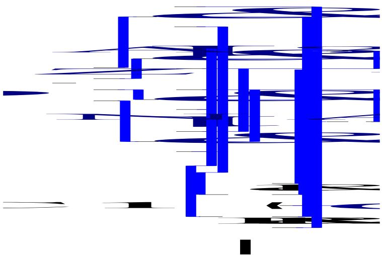

**答案：**
1）分析电路结构：该电路是由七个与非门及一个 JKFF组成，且CP下降沿触发，属于米勒电路，输入信号 $X_1$，$X_2$，输出信号 $Z$。

2）求触发器激励函数：
$$J = X_1 X_2, \quad K = \overline{X_1} \overline{X_2}$$

触发器次态方程：
$$Q^{n+1} = X_1 X_2 \bar{Q}^n + \bar{X}_1 \bar{X}_2 Q^n = X_1 X_2 \bar{Q}^n + (X_1 + X_2) Q^n$$

电路输出方程：
$$Z = \bar{X}_1 \bar{X}_2 Q^{n+1} + X_1 \bar{X}_2 \bar{Q}^{n+1} + \bar{X}_1 X_2 \bar{Q}^{n+1} + X_1 X_2 Q^{n+1}$$

3)状态转移表：

| 输入 | | S(t) $Q^n$ | N(t) $Q^{n+1}$ | 输出 Z |
| :---: | :---: | :---: | :---: | :---: |
| $X_1$ | $X_2$ | | | |
| 0 | 0 | 0 | 0 | 0 |
| 0 | 0 | 1 | 0 | 1 |
| 0 | 1 | 0 | 0 | 1 |
| 0 | 1 | 1 | 1 | 0 |
| 1 | 0 | 0 | 0 | 1 |
| 1 | 0 | 1 | 1 | 0 |
| 1 | 1 | 0 | 1 | 0 |
| 1 | 1 | 1 | 1 | 1 |

状态转移图：

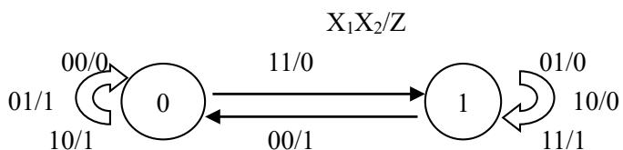

4)逻辑功能：实现串行二进制加法运算。 $X_1 X_2$ 为被加数和加数， $Q^n$ 为低位来的进位， $Q^{n+1}$ 表示向高位的进位。且电路每来一个CP，实现一次加法运算，即状态转换一次。

例如 $X_1=110110$，$X_2=110100$，则运算如下表所示（LSB $\to$ MSB）：

| 节拍脉冲 CP | CP1 | CP2 | CP3 | CP4 | CP5 | CP6 | CP7 |
| :---: | :---: | :---: | :---: | :---: | :---: | :---: | :---: |
| 被加数 $X_1$ | 0 | 1 | 1 | 0 | 1 | 1 | 0 |
| 加数 $X_2$ | 0 | 0 | 1 | 0 | 1 | 1 | 0 |
| 低位进位 $Q^n$ | 0 | 0 | 0 | 1 | 0 | 1 | 1 |
| 高位进位 $Q^{n+1}$ | 0 | 0 | 1 | 0 | 1 | 1 | 0 |
| 本位和 Z | 0 | 1 | 0 | 1 | 0 | 1 | 1 |

知识点：[控制器的四种硬件实现方法：每态一触发器法(SSI)、MSI法(MUX+寄存器+译码器)、PLA法(LSI)及对比](../../../topics/数字逻辑电路/控制器实现方法.md)、[根据文字描述建立ASM图的原则，以及从ASM图推导处理器明细表和控制器状态转移图](../../../topics/数字逻辑电路/ASM图建立与分析.md)、[完整数字系统设计流程实例（如乘法器、交通灯管理系统的算法规律、处理器设计与控制器实现）](../../../topics/数字逻辑电路/数字系统设计实例.md)

### 习题 6.2

试作出101序列检测器的状态图，该同步电路由一根输入线X，一根输出线Z，对应与输入序列的101的最后一个“1”，输出Z=1。其余情况下输出为“0”。

（1） 101 序列可以重叠，例如：
X：010101101
Z：000101001

（2） 101 序列不可以重叠，如：
X：0101011010
Z：0001000010

**答案：**
1）
$S_0$: 起始状态，或收到 101序列后重新开始检测。
$S_1$: 收到序列起始位“1”。
$S_2$: 收到序列前 2位“10”。

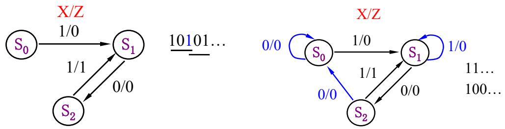

2）

知识点：[算法状态机(ASM)图的状态框、判断框、条件输出框及ASM块的构成规则](../../../topics/数字逻辑电路/ASM图基础.md)、[控制器的四种硬件实现方法：每态一触发器法(SSI)、MSI法(MUX+寄存器+译码器)、PLA法(LSI)及对比](../../../topics/数字逻辑电路/控制器实现方法.md)

### 习题 6.3

对下列原始状态表进行化简：

**(a)**

| S(t) | N(t) | | Z(t) | |
| :---: | :---: | :---: | :---: | :---: |
| | X=0 | X=1 | X=0 | X=1 |
| A | A | B | 0 | 0 |
| B | C | A | 0 | 1 |
| C | B | D | 0 | 1 |
| D | D | C | 0 | 0 |

**答案：**
1）列隐含表：

(a)

2）进行关联比较
所有的等价类为：AD，BC。
最大等价类为：AD，BC，重新命名为 $a, b$ 。

3）列最小化状态表为：

| S(t) | N(t)/Z(t) | |
| :---: | :---: | :---: |
| | X=0 | X=1 |
| a | a/0 | b/0 |
| b | b/0 | a/1 |

**(b)**

| S (t) | N (t) /Z (t) | |
| :---: | :---: | :---: |
| | X=0 | X=1 |
| A | B/0 | H/0 |
| B | E/0 | C/1 |
| C | D/0 | F/0 |
| D | G/0 | A/1 |
| E | A/0 | H/0 |
| F | E/1 | B/1 |
| G | C/0 | F/0 |
| H | G/1 | D/1 |

**答案：**
1）画隐含表：

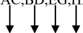

2）进行关联比较：AC,BD,EG,HF,之间互为等价隐含条件，所以分别等价。★ 重新命名为： a, b, e, h

3)列最小化状态表：

| S (t) | N (t) /Z (t) | |
| :---: | :---: | :---: |
| | X=0 | X=1 |
| a | b/0 | h/0 |
| b | e/0 | a/1 |
| e | a/0 | h/0 |
| h | e/1 | b/1 |

## 6.4

试画出用 MSI 移存器 74194 构成 8 位串行→并行码的转换电路（用 3 片 74194 或 2 片 74194 和一个 D 触发器）。

解：1）用 3 片 74194：

2）用 2 片 74194 和一个 D 触发器

| | $Q_0'$ | $Q_1'$ | $Q_2'$ | $Q_3'$ | $Q_4'$ | $Q_5'$ | $Q_6'$ | $Q_7'$ | $Q_8'$ | $M_0$ | $M_1$ | 下一操作 |
|---|---|---|---|---|---|---|---|---|---|---|---|---|
| 清 0 | 0 | 0 | 0 | 0 | 0 | 0 | 0 | 0 | 0 | 1 | 1 | 准备送数 |
| $CP_1 \uparrow$ | $D_0'$ | 0 | 1 | 1 | 1 | 1 | 1 | 1 | 1 | 1 | 0 | 准备右移 |
| $CP_2 \uparrow$ | $D_1'$ | $D_0'$ | 0 | 1 | 1 | 1 | 1 | 1 | 1 | 1 | 0 | 准备右移 |
| $CP_3 \uparrow$ | $D_2'$ | $D_1'$ | $D_0'$ | 0 | 1 | 1 | 1 | 1 | 1 | 1 | 0 | 准备右移 |
| $CP_4 \uparrow$ | $D_3'$ | $D_2'$ | $D_1'$ | $D_0'$ | 0 | 1 | 1 | 1 | 1 | 1 | 0 | 准备右移 |
| $CP_5 \uparrow$ | $D_4'$ | $D_3'$ | $D_2'$ | $D_1'$ | $D_0'$ | 0 | 1 | 1 | 1 | 1 | 0 | 准备右移 |
| $CP_6 \uparrow$ | $D_5'$ | $D_4'$ | $D_3'$ | $D_2'$ | $D_1'$ | $D_0'$ | 0 | 1 | 1 | 1 | 0 | 准备右移 |
| $CP_7 \uparrow$ | $D_6'$ | $D_5'$ | $D_4'$ | $D_3'$ | $D_2'$ | $D_1'$ | $D_0'$ | 0 | 1 | 1 | 0 | 准备右移 |
| $CP_8 \uparrow$ | $D_7'$ | $D_6'$ | $D_5'$ | $D_4'$ | $D_3'$ | $D_2'$ | $D_1'$ | $D_0'$ | 0 | 1 | 1 | 准备送数 |

## 6.5

试画出 74194 构成 8 位并行→串行码的转换电路。

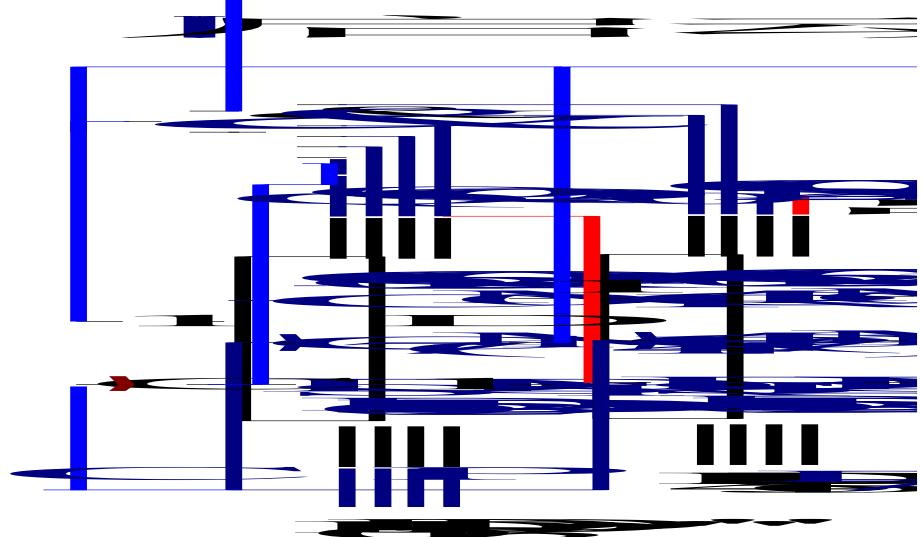

状态转移表：

| | $Q_0'$ | $Q_1'$ | $Q_2'$ | $Q_3'$ | $Q_4'$ | $Q_5'$ | $Q_6'$ | $Q_7'$ | $Q_8'$ | $M_0$ | $M_1$ | 操作 |
|---|---|---|---|---|---|---|---|---|---|---|---|---|
| 启动 | $\Phi$ | $\Phi$ | $\Phi$ | $\Phi$ | $\Phi$ | $\Phi$ | $\Phi$ | $\Phi$ | $\Phi$ | 1 | 1 | 准备并入 |
| $CP_1\uparrow$ | 0 | $D_0'$ | $D_1'$ | $D_2'$ | $D_3'$ | $D_4'$ | $D_5'$ | $D_6'$ | $D_7'$ | 1 | 0 | 准备右移 |
| $CP_2\uparrow$ | 1 | 0 | $D_0'$ | $D_1'$ | $D_2'$ | $D_3'$ | $D_4'$ | $D_5'$ | $D_6'$ | 1 | 0 | 准备右移 |
| $CP_3\uparrow$ | 1 | 1 | 0 | $D_0'$ | $D_1'$ | $D_2'$ | $D_3'$ | $D_4'$ | $D_5'$ | 1 | 0 | 准备右移 |
| $CP_4\uparrow$ | 1 | 1 | 1 | 0 | $D_0'$ | $D_1'$ | $D_2'$ | $D_3'$ | $D_4'$ | 1 | 0 | 准备右移 |
| $CP_5\uparrow$ | 1 | 1 | 1 | 1 | 0 | $D_0'$ | $D_1'$ | $D_2'$ | $D_3'$ | 1 | 0 | 准备右移 |
| $CP_6\uparrow$ | 1 | 1 | 1 | 1 | 1 | 0 | $D_0'$ | $D_1'$ | $D_2'$ | 1 | 0 | 准备右移 |
| $CP_7\uparrow$ | 1 | 1 | 1 | 1 | 1 | 1 | 0 | $D_0'$ | $D_1'$ | 1 | 0 | 准备右移 |
| $CP_8\uparrow$ | 1 | 1 | 1 | 1 | 1 | 1 | 1 | 0 | $D_0'$ | 1 | 1 | 准备并入 |

## 6.6

试分析题图 6.6 电路，画出状态转移图并说明有无自启动性。

解：激励方程：$J_1 = K_1 = 1$；

$$
\begin{array}{l}
J_2 = Q_1^n \overline{Q}_3^n,\ K_2 = Q_1^n \\
J_2 = Q_1^n Q_2^n,\ K_2 = Q_1^n
\end{array}
$$

状态方程：$Q_1^{n+1} = \overline{Q}_1^n \cdot CP\downarrow$

$$
Q_2^{n+1} = \left[ Q_1^n \overline{Q}_3^n \overline{Q}_2^n + \overline{Q}_1^n Q_2^n \right] \cdot CP\downarrow
$$

$$
Q_3^{n+1} = \left[ Q_1^n Q_2^n \overline{Q}_3^n + \overline{Q}_1^n Q_3^n \right] \cdot CP\downarrow
$$

状态转移表：

| 序号 | $Q_3$ | $Q_2$ | $Q_1$ |
|---|---|---|---|
| 0 | 0 | 0 | 0 |
| 1 | 0 | 0 | 1 |
| 2 | 0 | 1 | 0 |
| 3 | 0 | 1 | 1 |
| 4 | 1 | 0 | 0 |
| 5 | 1 | 0 | 1 |
| 偏离状态 | 1 | 1 | 0 → 1 1 1 |
| 偏离状态 | 1 | 1 | 1 → 0 0 0 |

## 6.7

图 P6.7 为同步加/减可逆二进制计数器，试分析该电路，作出 X=0 和 X=1 时的状态转

# 数字电路与逻辑设计B 第6章习题答案（第8-9页）

本部分为《数字电路与逻辑设计B》第6章习题答案的第3部分，包含题6.7的状态转移表推导及题6.8的异步时序电路分析。

## 计算 1

知识点：[控制器的四种硬件实现方法：每态一触发器法(SSI)、MSI法(MUX+寄存器+译码器)、PLA法(LSI)及对比](../../../topics/数字逻辑电路/控制器实现方法.md)、[完整数字系统设计流程实例（如乘法器、交通灯管理系统的算法规律、处理器设计与控制器实现）](../../../topics/数字逻辑电路/数字系统设计实例.md)

### 题 6.7

**题干：**
移表。参考图 P6.7。

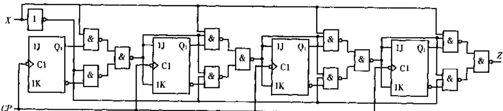

**解：**

激励方程为：
$$
K_1 = J_1 = 1
$$
$$
K_2 = J_2 = X \odot Q_1^n
$$
$$
K_3 = J_3 = (X \odot Q_1^n)(X \odot Q_2^n)
$$
$$
K_4 = J_4 = (X \odot Q_1^n)(X \odot Q_2^n)(X \odot Q_3^n)
$$
$$
Z = (X \odot Q_1^n)(X \odot Q_2^n)(X \odot Q_3^n)(X \odot Q_4^n)
$$

题 6.7 的状态转移表如下：

| X | $Q_{4}^{n}$ | $Q_{3}^{n}$ | $Q_{2}^{n}$ | $Q_{1}^{n}$ | $Q_{4}^{n+1}$ | $Q_{3}^{n+1}$ | $Q_{2}^{n+1}$ | $Q_{1}^{n+1}$ | Z |
|---|---|---|---|---|---|---|---|---|---|
| 0 | 0 | 0 | 0 | 0 | 1 | 1 | 1 | 1 | 1 |
| 0 | 1 | 1 | 1 | 1 | 1 | 1 | 1 | 0 | 0 |
| 0 | 1 | 1 | 1 | 0 | 1 | 1 | 0 | 1 | 0 |
| 0 | 1 | 1 | 0 | 1 | 1 | 1 | 0 | 0 | 0 |
| 0 | 1 | 1 | 0 | 0 | 1 | 0 | 1 | 1 | 0 |
| 0 | 1 | 0 | 1 | 1 | 1 | 0 | 1 | 0 | 0 |
| 0 | 1 | 0 | 1 | 0 | 1 | 0 | 0 | 1 | 0 |
| 0 | 1 | 0 | 0 | 1 | 1 | 0 | 0 | 0 | 0 |
| 0 | 1 | 0 | 0 | 0 | 0 | 1 | 1 | 1 | 0 |
| 0 | 0 | 1 | 1 | 1 | 0 | 1 | 1 | 0 | 0 |
| 0 | 0 | 1 | 1 | 0 | 0 | 1 | 0 | 1 | 0 |
| 0 | 0 | 1 | 0 | 1 | 0 | 1 | 0 | 0 | 0 |
| 0 | 0 | 1 | 0 | 0 | 0 | 0 | 1 | 1 | 0 |
| 0 | 0 | 0 | 1 | 1 | 0 | 0 | 1 | 0 | 0 |
| 0 | 0 | 0 | 1 | 0 | 0 | 0 | 0 | 1 | 0 |
| 0 | 0 | 0 | 0 | 1 | 0 | 0 | 0 | 0 | 1 |
| 1 | 0 | 0 | 0 | 0 | 0 | 0 | 0 | 1 | 0 |
| 1 | 0 | 0 | 0 | 1 | 0 | 0 | 1 | 0 | 0 |
| 1 | 0 | 0 | 1 | 0 | 0 | 0 | 1 | 1 | 0 |
| 1 | 0 | 0 | 1 | 1 | 0 | 1 | 0 | 0 | 0 |
| 1 | 0 | 1 | 0 | 0 | 0 | 1 | 0 | 1 | 0 |
| 1 | 0 | 1 | 0 | 1 | 0 | 1 | 1 | 0 | 0 |
| 1 | 0 | 1 | 1 | 0 | 0 | 1 | 1 | 1 | 0 |
| 1 | 0 | 1 | 1 | 1 | 1 | 0 | 0 | 0 | 0 |
| 1 | 1 | 0 | 0 | 0 | 1 | 0 | 0 | 1 | 0 |
| 1 | 1 | 0 | 0 | 1 | 1 | 0 | 1 | 0 | 0 |
| 1 | 1 | 0 | 1 | 0 | 1 | 0 | 1 | 1 | 0 |
| 1 | 1 | 0 | 1 | 1 | 1 | 1 | 0 | 0 | 0 |
| 1 | 1 | 1 | 0 | 0 | 1 | 1 | 0 | 1 | 0 |
| 1 | 1 | 1 | 0 | 1 | 1 | 1 | 1 | 0 | 0 |
| 1 | 1 | 1 | 1 | 0 | 1 | 1 | 1 | 1 | 1 |
| 1 | 1 | 1 | 1 | 1 | 0 | 0 | 0 | 0 | 0 |

知识点：[控制器的四种硬件实现方法：每态一触发器法(SSI)、MSI法(MUX+寄存器+译码器)、PLA法(LSI)及对比](../../../topics/数字逻辑电路/控制器实现方法.md)、[算法状态机(ASM)图的状态框、判断框、条件输出框及ASM块的构成规则](../../../topics/数字逻辑电路/ASM图基础.md)、[寄存器传输语言(RTL)描述的传输操作、算术操作、逻辑操作、移位操作及条件控制语句](../../../topics/数字逻辑电路/RTL语言.md)

### 题 6.8

**题干：**
分析图6.8电路，画出其全状态转移图并说明能否自启动。

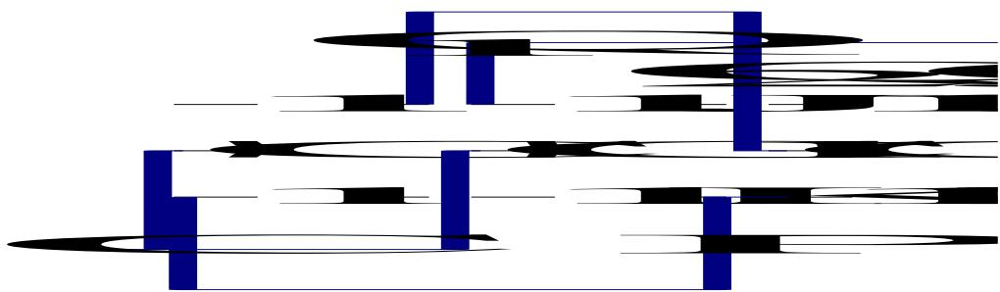

**解：**

1）该电路为异步时序电路，无输入控制信号，属于 Moore 型。

其激励方程为：
$$
J_1 = 1, \quad K_1 = \overline{Q}_2^n
$$
$$
J_2 = \overline{Q}_3^n, \quad K_2 = 1
$$
$$
J_3 = 1, \quad K_3 = \overline{Q}_2^n
$$

次态方程为：
$$
Q_1^{n+1} = [\overline{Q}_1^n + Q_2^n Q_1^n] \cdot \text{CP}\downarrow
$$
$$
Q_2^{n+1} = [\overline{Q}_3^n \overline{Q}_2^n] \cdot \text{CP}\downarrow
$$
$$
Q_3^{n+1} = [\overline{Q}_3^n + Q_2^n Q_3^n] \cdot Q_1\downarrow
$$

小圈内对应 $Q_1\downarrow$，其余应保持 $Q_3^n$ 不变。

2) 用列表法求状态转移表：

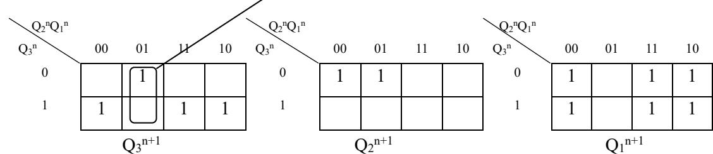

可得状态转移表：

| 序号 | $Q_3$ | $Q_2$ | $Q_1$ |
|---|---|---|---|
| 0 | 0 | 0 | 0 |
| 1 | 0 | 1 | 1 |
| 2 | 0 | 0 | 1 |
| 3 | 1 | 1 | 0 |
| 4 | 1 | 0 | 1 |
| 偏离状态 | $\multicolumn{3}{l\|}{0\ 1\ 0 \rightarrow 0\ 0\ 1}$ |
| 偏离状态 | $\multicolumn{3}{l\|}{1\ 0\ 0 \rightarrow 1\ 0\ 1}$ |
| 偏离状态 | $\multicolumn{3}{l\|}{1\ 1\ 1 \rightarrow 1\ 0\ 1}$ |

状态转移图：

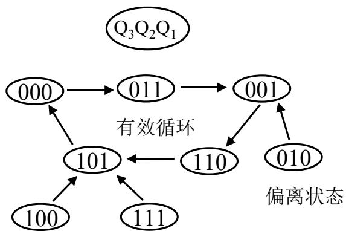

偏离态能够进入有效循环，因此该电路具有自启动性。

逻辑功能：该电路是一个 M=5 的异步计数器。

# 《数字电路与逻辑设计B》第6章习题答案（第 10–11 页）

本部分整理自《数字电路与逻辑设计B》第6章习题答案文档的第 10–11 页，主要包含同步计数器设计的解题过程。

## 一、综合题

知识点：[控制器的四种硬件实现方法：每态一触发器法(SSI)、MSI法(MUX+寄存器+译码器)、PLA法(LSI)及对比](../../../topics/数字逻辑电路/控制器实现方法.md)、[完整数字系统设计流程实例（如乘法器、交通灯管理系统的算法规律、处理器设计与控制器实现）](../../../topics/数字逻辑电路/数字系统设计实例.md)

### 综合 9

用 JKFF 设计符合下列条件的同步计数器电路。

当 $X=0$ 时为 $M=5$ 的加法计数器，其状态为 0，1，2，3，4。当 $X=1$ 时为 $M=5$ 的减法计数器，其状态为 7，6，5，4，3。

解：所设计电路应为 Mealy 型。有输入控制信号 $X$。

1）列状态转移表：

| X | $Q_{3}^{n}$ | $Q_{2}^{n}$ | $Q_{1}^{n}$ | $Q_{3}^{n+1}$ | $Q_{2}^{n+1}$ | $Q_{1}^{n+1}$ | Z |
|---|-------------|-------------|-------------|---------------|---------------|---------------|---|
| 0 | 0           | 0           | 0           | 0             | 0             | 1             | 0 |
| 0 | 0           | 0           | 1           | 0             | 1             | 0             | 0 |
| 0 | 0           | 1           | 0           | 0             | 1             | 1             | 0 |
| 0 | 0           | 1           | 1           | 1             | 0             | 0             | 0 |
| 0 | 1           | 0           | 0           | 0             | 0             | 0             | 1 |
| 1 | 1           | 1           | 1           | 1             | 1             | 0             | 0 |
| 1 | 1           | 1           | 0           | 1             | 0             | 1             | 0 |
| 1 | 1           | 0           | 1           | 1             | 0             | 0             | 0 |
| 1 | 1           | 0           | 0           | 0             | 1             | 1             | 0 |
| 1 | 0           | 1           | 1           | 1             | 1             | 1             | 1 |

偏离态输出按任意项。

2）求激励方程：

$$
Q_{3}^{n+1} = Q_{2}^{n} Q_{1}^{n} \overline{Q}_{3}^{n} + (Q_{2}^{n} + Q_{1}^{n}) Q_{3}^{n}
$$

所以
$$
J_3 = Q_{2}^{n} Q_{1}^{n}, \quad K_3 = Q_{2}^{n} + Q_{1}^{n}
$$

$$
Q_{2}^{n+1} = (\overline{X} Q_{1}^{n} + X \overline{Q}_{1}^{n}) \overline{Q}_{2}^{n} + (X Q_{1}^{n} + \overline{X} \overline{Q}_{1}^{n}) Q_{2}^{n}
$$

所以
$$
J_2 = \overline{X} Q_{1}^{n} + X \overline{Q}_{1}^{n} = X \oplus Q_{1}^{n}
$$
$$
K_2 = X Q_{1}^{n} + \overline{X} \overline{Q}_{1}^{n} = X \odot Q_{1}^{n}
$$

$$
Q_{1}^{n+1} = (\overline{Q}_{3}^{n} + X) \overline{Q}_{1}^{n} + X \overline{Q}_{3}^{n} Q_{1}^{n}
$$

所以
$$
J_1 = \overline{Q}_{3}^{n} + X, \quad K_1 = X \overline{Q}_{3}^{n}
$$

本题未要求具有自启动性，所以可不检查自启动性，但必须有预置端，使计数器能进入有效循环。

3）画电路图：

知识点：[控制器的四种硬件实现方法：每态一触发器法(SSI)、MSI法(MUX+寄存器+译码器)、PLA法(LSI)及对比](../../../topics/数字逻辑电路/控制器实现方法.md)、[寄存器传输语言(RTL)描述的传输操作、算术操作、逻辑操作、移位操作及条件控制语句](../../../topics/数字逻辑电路/RTL语言.md)、[完整数字系统设计流程实例（如乘法器、交通灯管理系统的算法规律、处理器设计与控制器实现）](../../../topics/数字逻辑电路/数字系统设计实例.md)

### 综合 10

试改用 D 触发器实现第 9 题所述功能的电路。

解：

1）列状态转移表 6.3.11：

**题 6.10 的状态转移表**

| X | $Q_{3}^{n}$ | $Q_{2}^{n}$ | $Q_{1}^{n}$ | $Q_{3}^{n+1}$ | $Q_{2}^{n+1}$ | $Q_{1}^{n+1}$ | Z |
|---|-------------|-------------|-------------|---------------|---------------|---------------|---|
| 0 | 0           | 0           | 0           | 0             | 0             | 1             | 0 |
| 0 | 0           | 0           | 1           | 0             | 1             | 0             | 0 |
| 0 | 0           | 1           | 0           | 0             | 1             | 1             | 0 |
| 0 | 0           | 1           | 1           | 1             | 0             | 0             | 0 |
| 0 | 1           | 0           | 0           | 0             | 0             | 0             | 1 |
| 1 | 1           | 1           | 1           | 1             | 1             | 0             | 0 |
| 1 | 1           | 1           | 0           | 1             | 0             | 1             | 0 |
| 1 | 1           | 0           | 1           | 1             | 0             | 0             | 0 |
| 1 | 1           | 0           | 0           | 0             | 1             | 1             | 0 |
| 1 | 0           | 1           | 1           | 1             | 1             | 1             | 1 |

偏离态输出按任意项处理。

2）求激励方程：

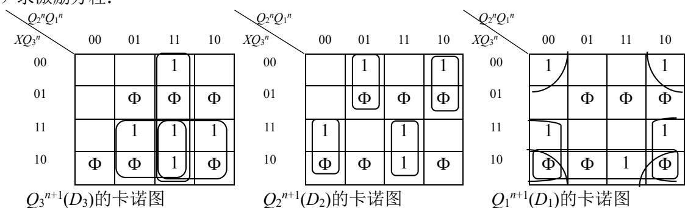

$$
D_3 = Q_{2}^{n} Q_{1}^{n} + X Q_{1}^{n} + X Q_{2}^{n}
$$

$$
D_2 = \bar{X} \bar{Q}_{2}^{n} Q_{1}^{n} + \bar{X} Q_{2}^{n} \bar{Q}_{1}^{n} + X \bar{Q}_{2}^{n} \bar{Q}_{1}^{n} + X Q_{2}^{n} Q_{1}^{n}
$$

$$
D_1 = \overline{Q}_{3}^{n} \overline{Q}_{1}^{n} + X \overline{Q}_{1}^{n} + X \overline{Q}_{3}^{n}
$$

3）电路图略。

知识点：[控制器的四种硬件实现方法：每态一触发器法(SSI)、MSI法(MUX+寄存器+译码器)、PLA法(LSI)及对比](../../../topics/数字逻辑电路/控制器实现方法.md)、[根据文字描述建立ASM图的原则，以及从ASM图推导处理器明细表和控制器状态转移图](../../../topics/数字逻辑电路/ASM图建立与分析.md)

### 综合 11

试用 JKFF 设计符合图 6.11 波形，并且具备自启动性的同步计数电路。

# 《数字电路与逻辑设计B》第6章习题答案

整理自《数字电路与逻辑设计B》第6章习题答案文档第12–14页内容。

## 一、综合题（或计算/设计题）

知识点：[数字系统的基本模型（数据处理器与控制器）及对最小时钟周期、异步信号同步化的约定](../../../topics/数字逻辑电路/数字系统模型.md)、[寄存器传输语言(RTL)描述的传输操作、算术操作、逻辑操作、移位操作及条件控制语句](../../../topics/数字逻辑电路/RTL语言.md)、[算法状态机(ASM)图的状态框、判断框、条件输出框及ASM块的构成规则](../../../topics/数字逻辑电路/ASM图基础.md)

### 综合 1

题目描述缺失（根据上下文推测为某计数器状态转移分析）。

- 状态转移表如下：

| $CP_{0}\downarrow$ | $Q_{3}^{n}$ | $Q_{2}^{n}$ | $Q_{1}^{n}$ | $Q_{3}^{n+1}$ | $Q_{2}^{n+1}$ | $Q_{1}^{n+1}$ |
| :--- | :---: | :---: | :---: | :---: | :---: | :---: |
| 触发 | 0 | 0 | 0 | 0 | 1 | 0 |
| 触发 | 0 | 1 | 0 | 0 | 1 | 1 |
| 触发 | 0 | 1 | 1 | 1 | 0 | 1 |
| 触发 | 1 | 0 | 1 | 1 | 1 | 0 |
| 触发 | 1 | 1 | 0 | 1 | 0 | 0 |
| 触发 | 1 | 0 | 0 | 0 | 0 | 0 |

- 根据状态转移表知：有 6 个有效状态和 2 个偏离态，偏离态的输出先按任意项处理，由此可得次态方程卡诺图为：

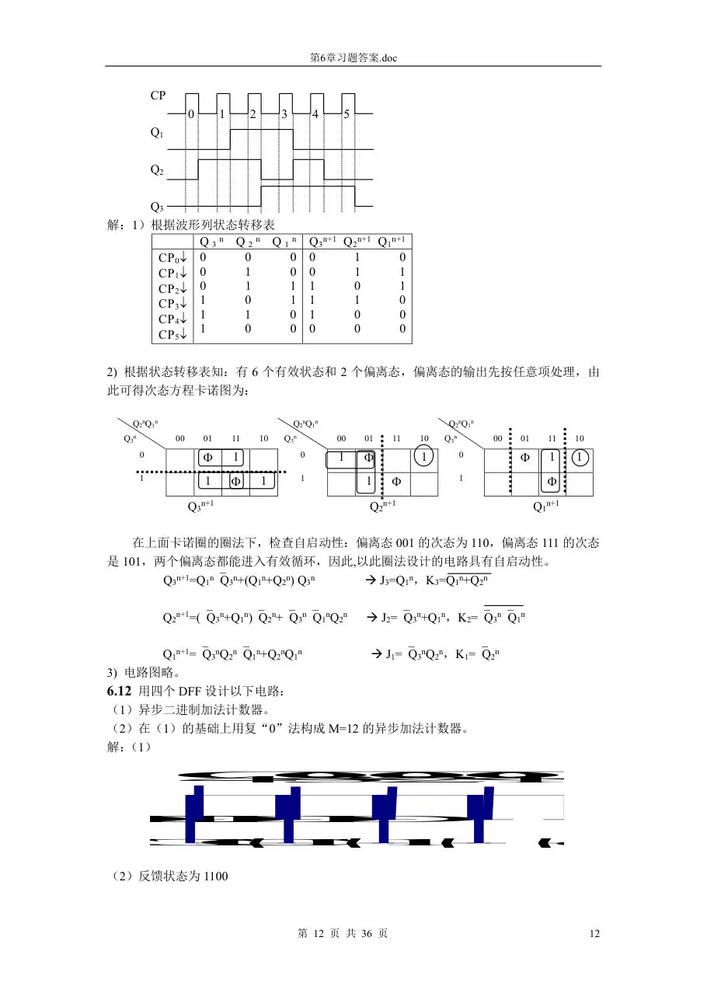

在上面卡诺圈的圈法下，检查自启动性：偏离态001的次态为110，偏离态 111的次态是101，两个偏离态都能进入有效循环，因此,以此圈法设计的电路具有自启动性。

$$
\begin{aligned}
& Q_ {3} ^ {n + 1} = Q_ {1} ^ {n} \overline {{Q}} _ {3} ^ {n+ (Q_ {1} ^ {n+ Q_ {2} ^ {n})}} Q_ {3} ^ {n} & \rightarrow J_ {3} = Q_ {1} ^ {n} , K_ {3} = \overline {{Q_ {1} ^ {n+ Q_ {2} ^ {n}}}} \\
& Q_ {2} ^ {n + 1} = (\overline {{Q}} _ {3} ^ {n+ Q_ {1} ^ {n}}) \overline {{Q}} _ {2} ^ {n+ \overline {{Q}} _ {3} ^ {n}} \overline {{Q}} _ {1} ^ {n} Q_ {2} ^ {n} & \rightarrow J_ {2} = \overline {{Q}} _ {3} ^ {n+ Q_ {1} ^ {n}}, K_ {2} = \overline {{\overline {{Q}} _ {3} ^ {n} \overline {{Q}} _ {1} ^ {n}}} \\
& Q_ {1} ^ {n + 1} = \overline {{Q}} _ {3} ^ {n} Q_ {2} ^ {n} \overline {{Q}} _ {1} ^ {n+ Q_ {2} ^ {n}} Q_ {1} ^ {n} & \rightarrow J_ {1} = \overline {{Q}} _ {3} ^ {n} Q_ {2} ^ {n}, K _ {1} = \overline {{Q}} _ {2} ^ {n}
\end{aligned}
$$

- 电路图略。

答案：符合自启动性要求。

知识点：[完整数字系统设计流程实例（如乘法器、交通灯管理系统的算法规律、处理器设计与控制器实现）](../../../topics/数字逻辑电路/数字系统设计实例.md)

### 综合 2

**6.12** 用四个DFF设计以下电路：

（1）异步二进制加法计数器。

（2）在（1）的基础上用复“0”法构成M=12 的异步加法计数器。

解：（1）

（2）反馈状态为1100

答案：见上述电路图及反馈状态说明。

知识点：[数字系统的基本模型（数据处理器与控制器）及对最小时钟周期、异步信号同步化的约定](../../../topics/数字逻辑电路/数字系统模型.md)、[寄存器传输语言(RTL)描述的传输操作、算术操作、逻辑操作、移位操作及条件控制语句](../../../topics/数字逻辑电路/RTL语言.md)

### 综合 3

**6.13** 用四个 DFF 设计以下电路：

（1）异步二进制减法计数器。

（2）在（1）的基础上用复“0”法构成M=13 的异步计数器。

解：（1）

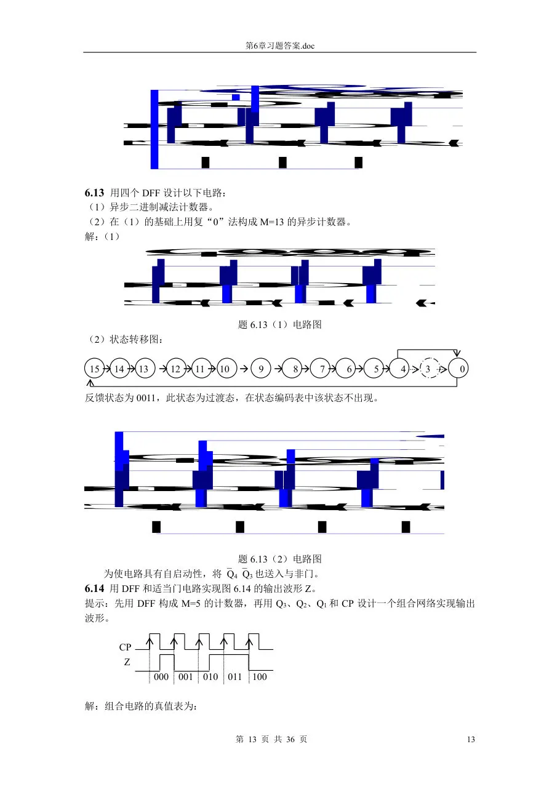

（2）状态转移图：

为使电路具有自启动性，将 $\overline { { { \bf Q } } } _ { 4 } \overline { { { \bf Q } } } _ { 3 }$ 也送入与非门。

答案：见上述电路图及改进措施。

知识点：[完整数字系统设计流程实例（如乘法器、交通灯管理系统的算法规律、处理器设计与控制器实现）](../../../topics/数字逻辑电路/数字系统设计实例.md)

### 综合 4

**6.14** 用DFF和适当门电路实现图 6.14的输出波形Z。

提示：先用 DFF 构成 M=5 的计数器，再用 $\mathrm { Q } _ { 3 } , \ \mathrm { Q } _ { 2 } , \ \mathrm { Q } _ { 1 }$ 和 CP 设计一个组合网络实现输出波形。

解：组合电路的真值表为：

| $Q_3$ | $Q_2$ | $Q_1$ | CP | Z |
| :---: | :---: | :---: | :---: | :---: |
| 0 | 0 | 0 | 0 | 1 |
| 0 | 0 | 0 | 1 | 0 |
| 0 | 0 | 1 | 0 | 0 |
| 0 | 0 | 1 | 1 | 0 |
| 0 | 1 | 0 | 0 | 1 |
| 0 | 1 | 0 | 1 | 0 |
| 0 | 1 | 1 | 0 | 1 |
| 0 | 1 | 1 | 1 | 1 |
| 1 | 0 | 0 | 0 | 0 |
| 1 | 0 | 0 | 1 | 0 |

Z 的卡诺图：

| Q1CP \ Q3Q2 | 00 | 01 | 11 | 10 |
| :--- | :---: | :---: | :---: | :---: |
| **00** | 1 | | | |
| **01** | 1 | | 1 | 1 |
| **11** | Φ | Φ | Φ | Φ |
| **10** | | | Φ | Φ |

$$
\mathrm{Z} = \overline {{\mathrm{Q}}} _ {3} \overline {{\mathrm{Q}}} _ {1} \mathrm{CP} + \mathrm{Q} _ {2} \mathrm{Q} _ {1}
$$

答案：见上述真值表、卡诺图、表达式及电路图。

知识点：[完整数字系统设计流程实例（如乘法器、交通灯管理系统的算法规律、处理器设计与控制器实现）](../../../topics/数字逻辑电路/数字系统设计实例.md)、[控制器的四种硬件实现方法：每态一触发器法(SSI)、MSI法(MUX+寄存器+译码器)、PLA法(LSI)及对比](../../../topics/数字逻辑电路/控制器实现方法.md)

### 综合 5

**6.15** 试用 DFF 和与非门实现图 6.15“待设计电路”。要求发光二极管前 3s 亮，后 2s 暗，如此周期性重复。

解：即产生序列信号 11100。用移存型序列信号发生器实现，状态转移表为：

| $Q_{3}$ | $Q_{2}$ | $Q_{1}$ | $D_{1}$ |
| :---: | :---: | :---: | :---: |
| 1 | 1 | 1 | 0 |
| 1 | 1 | 0 | 0 |
| 1 | 0 | 0 | 1 |
| 0 | 0 | 1 | 1 |
| 0 | 1 | 1 | 1 |

$\mathrm { D } _ { 1 }$ 的卡诺图为：

| Q2Q1 \ Q3 | 00 | 01 | 11 | 10 |
| :--- | :---: | :---: | :---: | :---: |
| **0** | Φ | 1 | 1 | Φ |
| **1** | 1 | Φ | | |

检查自启动性： $0 0 0 {  } 0 0 1 \checkmark ,$ $0 1 0 \to 1 0 1 \to 0 1 1 \checkmark$, 三个偏离态都能进入有效循环，所以具有自启动性。由此可得 $\mathrm { D } _ { 1 }$ 的方程为：

$$
\mathrm{D} 1 = \overline {{\mathrm{Q}}} _ {2} + \overline {{\mathrm{Q}}} _ {1} = \overline {{\mathrm{Q} _ {2} \mathrm{Q} _ {1}}}
$$

答案：见上述状态转移表、卡诺图、驱动方程及自启动性检查结果。

解：（a）电路的状态转移表：

| $Q_3$ | $Q_2$ | $Q_1$ | $Q_0$ | |
|---|---|---|---|---|
| 0 | 0 | 0 | 0 | 置3 |
| 0 | 0 | 1 | 1 | 置3 |
| 0 | 1 | 0 | 0 | 置3 |
| 0 | 1 | 1 | 1 | 置7 |
| 1 | 0 | 0 | 0 | 置7 |
| 1 | 0 | 1 | 1 | 置11 |
| 1 | 1 | 0 | 0 | 置11 |
| 1 | 1 | 1 | 1 | 置15 |

M=8

知识点：[完整数字系统设计流程实例（如乘法器、交通灯管理系统的算法规律、处理器设计与控制器实现）](../../../topics/数字逻辑电路/数字系统设计实例.md)、[寄存器传输语言(RTL)描述的传输操作、算术操作、逻辑操作、移位操作及条件控制语句](../../../topics/数字逻辑电路/RTL语言.md)、[控制器的四种硬件实现方法：每态一触发器法(SSI)、MSI法(MUX+寄存器+译码器)、PLA法(LSI)及对比](../../../topics/数字逻辑电路/控制器实现方法.md)

### 6.18

试分析图 6.18 能实现 M=? 的分频。

答案：74161（1）的 $\overline{Q}_3$ 接至 74161（2）的 CP，两 74161 为异步级联，反馈状态为 $(4\mathrm{C})_\mathrm{H}=76$，又利用异步清 0 端，所以 M=76。

知识点：[完整数字系统设计流程实例（如乘法器、交通灯管理系统的算法规律、处理器设计与控制器实现）](../../../topics/数字逻辑电路/数字系统设计实例.md)、[根据文字描述建立ASM图的原则，以及从ASM图推导处理器明细表和控制器状态转移图](../../../topics/数字逻辑电路/ASM图建立与分析.md)

### 6.19

试用 74161 设计循环顺序为 0,1,2,3,4,5,10,11,12,13,14,15,0,1… 的模长为 12 的计数电路。

答案：思路：当计数计到 5 时，让其置数为 10。反馈状态为 0101。

为了使其具有自启动性，将 $\overline{Q}_3$、$\overline{Q}_1$ 接入与非门。

知识点：[完整数字系统设计流程实例（如乘法器、交通灯管理系统的算法规律、处理器设计与控制器实现）](../../../topics/数字逻辑电路/数字系统设计实例.md)

### 6.20

试用 74161 设计能按 8421BCD 译码显示的 0~59 计数的 60 分频电路。

答案：思路：先将两片 74161 分别接成 M=10 和 M=6 的形式，再让两者级联，实现 $\mathrm{M}=6\times10=60$。

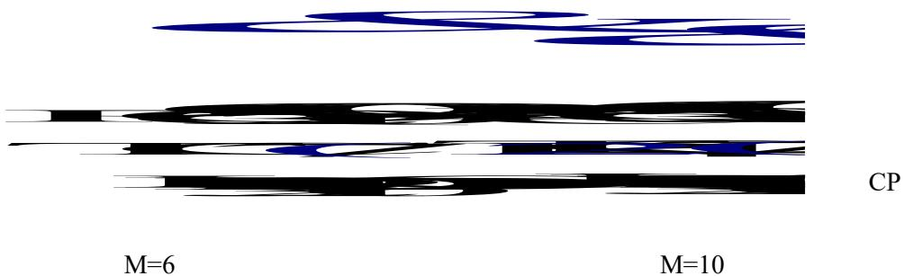

知识点：[控制器的四种硬件实现方法：每态一触发器法(SSI)、MSI法(MUX+寄存器+译码器)、PLA法(LSI)及对比](../../../topics/数字逻辑电路/控制器实现方法.md)、[数字系统的基本模型（数据处理器与控制器）及对最小时钟周期、异步信号同步化的约定](../../../topics/数字逻辑电路/数字系统模型.md)

### 6.21

试用 实现符合下述编码表的电路。

| $Q_3$ | $Q_2$ | $Q_1$ | $Q_0$ |
|---|---|---|---|
| 0 | 0 | 0 | 0 |
| 0 | 1 | 0 | 0 |
| 0 | 1 | 0 | 1 |
| 0 | 1 | 1 | 0 |
| 0 | 1 | 1 | 1 |
| 1 | 0 | 0 | 0 |
| 1 | 1 | 0 | 0 |
| 1 | 1 | 0 | 1 |
| 1 | 1 | 1 | 1 |

答案：

| $Q_3^n$ | $Q_2^n$ | $Q_1^n$ | $Q_0^n$ | $Q_3^{n+1}$ | $Q_2^{n+1}$ | $Q_1^{n+1}$ | $Q_0^{n+1}$ | $T_3$ | $T_2$ | $T_1$ | $T_0$ |
|---|---|---|---|---|---|---|---|---|---|---|---|
| 0 | 0 | 0 | 0 | 0 | 1 | 0 | 0 | 0 | 1 | 0 | 0 |
| 0 | 1 | 0 | 0 | 0 | 1 | 0 | 1 | 0 | 0 | 0 | 1 |
| 0 | 1 | 0 | 1 | 0 | 1 | 1 | 0 | 0 | 0 | 1 | 1 |
| 0 | 1 | 1 | 0 | 0 | 1 | 1 | 1 | 0 | 0 | 0 | 1 |
| 0 | 1 | 1 | 1 | 1 | 0 | 0 | 0 | 1 | 1 | 1 | 1 |
| 1 | 0 | 0 | 0 | 1 | 1 | 0 | 0 | 0 | 1 | 0 | 0 |
| 1 | 1 | 0 | 0 | 1 | 1 | 0 | 1 | 0 | 0 | 0 | 1 |
| 1 | 1 | 0 | 1 | 1 | 1 | 1 | 1 | 0 | 0 | 1 | 0 |
| 1 | 1 | 1 | 1 | 0 | 0 | 0 | 0 | 1 | 1 | 1 | 1 |

列各激励函数卡诺图：

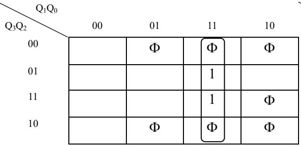

电路具有自启动性。

电路图略。

知识点：[数字系统的基本模型（数据处理器与控制器）及对最小时钟周期、异步信号同步化的约定](../../../topics/数字逻辑电路/数字系统模型.md)

### 6.22

试分析图 6.22（a）（b）2 个计数器的分频比为多少？

答案：（a）$\mathrm{J}=\overline{Q}_3$，$\mathrm{K}=Q_3$。状态转移表：

$$
\begin{array}{c c c c c c}
\hline
Q_0 & Q_1 & Q_2 & Q_3 & J & K \\
\hline
0 & 0 & 0 & 0 & 1 & 0 \\
1 & 0 & 0 & 0 & 1 & 0 \\
0 & 1 & 0 & 0 & 1 & 0 \\
1 & 0 & 1 & 0 & 1 & 0 \\
0 & 1 & 0 & 1 & 0 & 1 \\
0 & 0 & 1 & 0 & 1 & 0 \\
1 & 0 & 0 & 1 & 0 & 1 \\
1 & 1 & 0 & 0 & 1 & 0 \\
0 & 1 & 1 & 0 & 1 & 0 \\
1 & 0 & 1 & 1 & 0 & 1 \\
1 & 1 & 0 & 1 & 0 & 1 \\
1 & 1 & 1 & 0 & 1 & 0
\end{array}
$$

$$
\mathrm{M}=\mathrm{M}_1\times\mathrm{M}_2=63
$$

知识点：[数字系统的基本模型（数据处理器与控制器）及对最小时钟周期、异步信号同步化的约定](../../../topics/数字逻辑电路/数字系统模型.md)

### 6.23

试说明图 6.23 电路的模值为多少，并画出 74160（Ⅰ）的 $\mathrm{Q}_0$、$\mathrm{Q}_1$、$\mathrm{Q}_2$、$\mathrm{Q}_3$ 端，74160（Ⅱ）的 $\mathrm{Q}_0$ 和 $\overline{\mathrm{R}}_\mathrm{D}$ 端的波形，至少画出一个周期。

## 习题解答

知识点：[完整数字系统设计流程实例（如乘法器、交通灯管理系统的算法规律、处理器设计与控制器实现）](../../../topics/数字逻辑电路/数字系统设计实例.md)、[寄存器传输语言(RTL)描述的传输操作、算术操作、逻辑操作、移位操作及条件控制语句](../../../topics/数字逻辑电路/RTL语言.md)、[控制器的四种硬件实现方法：每态一触发器法(SSI)、MSI法(MUX+寄存器+译码器)、PLA法(LSI)及对比](../../../topics/数字逻辑电路/控制器实现方法.md)

### 综合 24

解：$M=15$

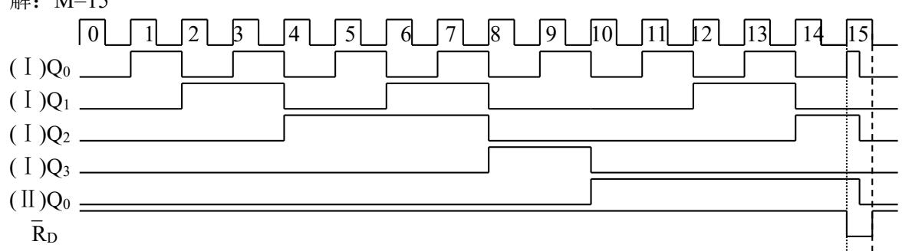

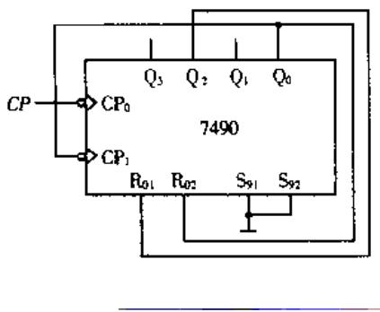

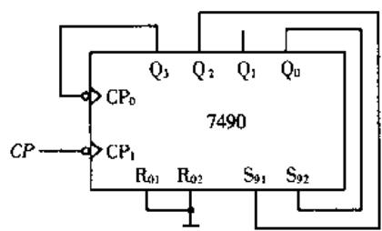

$$
\begin{array}{c c c c} \hline Q _ {3} & Q _ {2} & Q _ {1} & Q _ {0} \\ \hline 0 & 0 & 0 & 0 \\ 0 & 0 & 0 & 1 \\ 0 & 0 & 1 & 0 \\ 0 & 0 & 1 & 1 \\ 0 & 1 & 0 & 0 \\ \hline \end{array} \quad M = 5
$$

$$
\begin{array}{c c c c} \hline Q _ {0} & Q _ {3} & Q _ {2} & Q _ {1} \\ \hline 0 & 0 & 0 & 0 \\ 0 & 0 & 0 & 1 \\ 0 & 0 & 1 & 0 \\ 0 & 0 & 1 & 1 \\ 0 & 1 & 0 & 0 \\ 1 & 0 & 0 & 0 \\ 1 & 0 & 0 & 1 \\ 1 & 1 & 0 & 0 \end{array} \quad \overline {{M}} = 8
$$

知识点：[完整数字系统设计流程实例（如乘法器、交通灯管理系统的算法规律、处理器设计与控制器实现）](../../../topics/数字逻辑电路/数字系统设计实例.md)、[根据文字描述建立ASM图的原则，以及从ASM图推导处理器明细表和控制器状态转移图](../../../topics/数字逻辑电路/ASM图建立与分析.md)、[控制器的四种硬件实现方法：每态一触发器法(SSI)、MSI法(MUX+寄存器+译码器)、PLA法(LSI)及对比](../../../topics/数字逻辑电路/控制器实现方法.md)

### 综合 25

试用 7490 设计用 8421BCD 编码的模 7 计数器。（1）用 $\mathrm { R _ { 0 1 } }$ 、 $\mathrm { R } _ { 0 2 }$ 作反馈端；（2）用 $\mathrm { S } 9 1$ $\mathrm { S } _ { 9 2 }$ 作反馈端。

解：（1）

知识点：[完整数字系统设计流程实例（如乘法器、交通灯管理系统的算法规律、处理器设计与控制器实现）](../../../topics/数字逻辑电路/数字系统设计实例.md)

### 综合 26

试用 7490 设计用 5421BCD 编码的模 7 计数器。（1）用 $\mathrm { R _ { 0 1 } }$ 、 ${ \mathrm { R } } _ { 0 2 }$ 作反馈端；（2）用 $\mathrm { S } _ { 9 1 }$ $\mathrm { S } { 9 2 }$ 作反馈端。

解： （1）

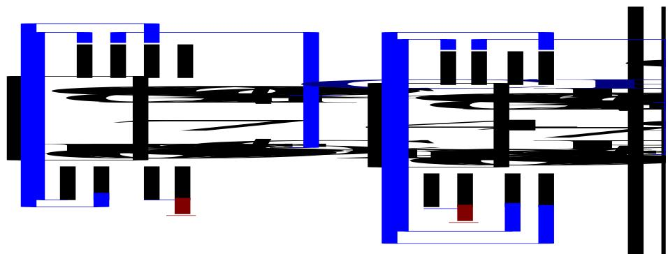

知识点：[完整数字系统设计流程实例（如乘法器、交通灯管理系统的算法规律、处理器设计与控制器实现）](../../../topics/数字逻辑电路/数字系统设计实例.md)、[寄存器传输语言(RTL)描述的传输操作、算术操作、逻辑操作、移位操作及条件控制语句](../../../topics/数字逻辑电路/RTL语言.md)

### 综合 27

写出图6.27分频电路的模长

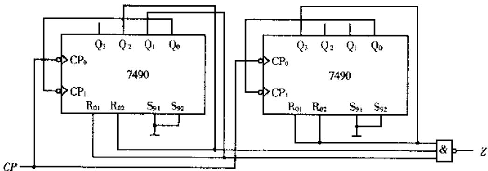

知识点：[完整数字系统设计流程实例（如乘法器、交通灯管理系统的算法规律、处理器设计与控制器实现）](../../../topics/数字逻辑电路/数字系统设计实例.md)、[寄存器传输语言(RTL)描述的传输操作、算术操作、逻辑操作、移位操作及条件控制语句](../../../topics/数字逻辑电路/RTL语言.md)、[控制器的四种硬件实现方法：每态一触发器法(SSI)、MSI法(MUX+寄存器+译码器)、PLA法(LSI)及对比](../../../topics/数字逻辑电路/控制器实现方法.md)

### 综合 28

写出图6.28的模长及第一个状态和最后一个状态。

知识点：[控制器的四种硬件实现方法：每态一触发器法(SSI)、MSI法(MUX+寄存器+译码器)、PLA法(LSI)及对比](../../../topics/数字逻辑电路/控制器实现方法.md)、[算法状态机(ASM)图的状态框、判断框、条件输出框及ASM块的构成规则](../../../topics/数字逻辑电路/ASM图基础.md)、[完整数字系统设计流程实例（如乘法器、交通灯管理系统的算法规律、处理器设计与控制器实现）](../../../topics/数字逻辑电路/数字系统设计实例.md)

### 综合 29

图6.29是串入、并入—串出8 位移存器74165的逻辑符号。试用74165设计一个并行—串行转换电路，它连续不断地将并行输入的8位数据转换成串行输出，即当一组数据串行输出完毕时，立即装入一组新的数据。所用器件不限，试设计出完整的电路。

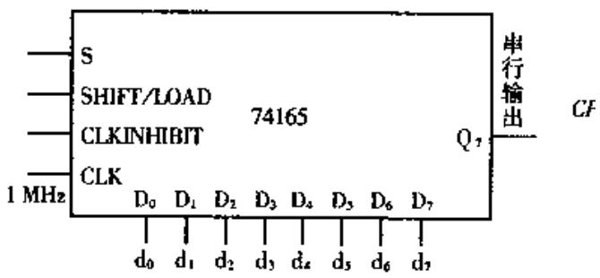

解：

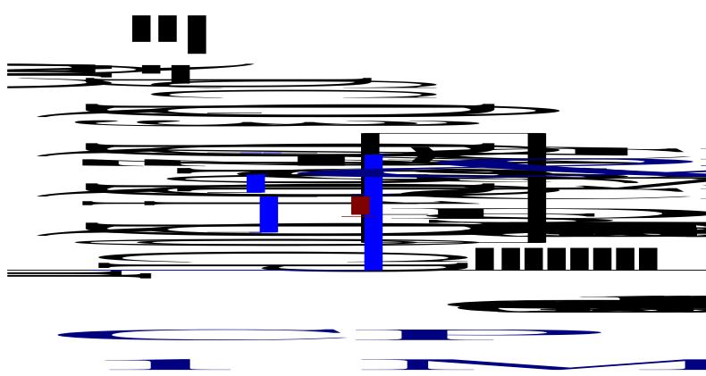

知识点：[完整数字系统设计流程实例（如乘法器、交通灯管理系统的算法规律、处理器设计与控制器实现）](../../../topics/数字逻辑电路/数字系统设计实例.md)、[寄存器传输语言(RTL)描述的传输操作、算术操作、逻辑操作、移位操作及条件控制语句](../../../topics/数字逻辑电路/RTL语言.md)、[控制器的四种硬件实现方法：每态一触发器法(SSI)、MSI法(MUX+寄存器+译码器)、PLA法(LSI)及对比](../../../topics/数字逻辑电路/控制器实现方法.md)

### 综合 30

电路如图6.30所示，试写出其编码表及模长并说明理由。

| $Q_{3}$ | $Q_{2}$ | $Q_{1}$ | $Q_{0}$ |
| :---: | :---: | :---: | :---: |
| 0 | 0 | 0 | 0 |
| 0 | 0 | 0 | 1 |
| 0 | 0 | 1 | 0 |
| 0 | 0 | 1 | 1 |
| 0 | 1 | 0 | 0 |
| 0 | 1 | 0 | 1 |
| 0 | 1 | 1 | 0 |
| 0 | 1 | 1 | 1 |
| 1 | 0 | 0 | 0 |

答案：M=10，因为反馈状态为1100，在8421BCD 码中不会出现。所以模长仍为10。

知识点：[根据文字描述建立ASM图的原则，以及从ASM图推导处理器明细表和控制器状态转移图](../../../topics/数字逻辑电路/ASM图建立与分析.md)、[完整数字系统设计流程实例（如乘法器、交通灯管理系统的算法规律、处理器设计与控制器实现）](../../../topics/数字逻辑电路/数字系统设计实例.md)

### 综合 31

现用信号为$f_1=100\text{Hz}$ 的矩形波，试用两块 7490将该信号变换成$f_0=2\text{Hz}$的方波。

解：

知识点：[完整数字系统设计流程实例（如乘法器、交通灯管理系统的算法规律、处理器设计与控制器实现）](../../../topics/数字逻辑电路/数字系统设计实例.md)

### 综合 32

试用一片7490和一个JKFF构成M=12的分频电路。并要求该电路的第一状态为0001。

解：思路：一个 JKFF 可以构成 M=2 的计数器，将 JKFF 和 7490 异步级联构成 M=20 的计数器，取13的二进制码（01101） 为反馈状态。由于电路的第一状态为0001，所以取JKFF构成的M=2 的计数器输出为最低位权输出 Q0。状态转移表为：

| 记录状态 | $Q_{4}$ | $Q_{3}$ | $Q_{2}$ | $Q_{1}$ | $Q_{0}$ |
| :---: | :---: | :---: | :---: | :---: | :---: |
| 1 | 0 | 0 | 0 | 0 | 1 |
| 2 | 0 | 0 | 0 | 1 | 0 |
| 3 | 0 | 0 | 0 | 1 | 1 |
| 4 | 0 | 0 | 1 | 0 | 0 |
| 5 | 0 | 0 | 1 | 0 | 1 |
| 6 | 0 | 0 | 1 | 1 | 0 |
| 7 | 0 | 0 | 1 | 1 | 1 |
| 8 | 0 | 1 | 0 | 0 | 0 |
| 9 | 0 | 1 | 0 | 0 | 1 |
| 10 | 0 | 1 | 0 | 1 | 0 |
| 11 | 0 | 1 | 0 | 1 | 1 |
| 12 | 0 | 1 | 1 | 0 | 0 |

知识点：[数字系统的基本模型（数据处理器与控制器）及对最小时钟周期、异步信号同步化的约定](../../../topics/数字逻辑电路/数字系统模型.md)、[控制器的四种硬件实现方法：每态一触发器法(SSI)、MSI法(MUX+寄存器+译码器)、PLA法(LSI)及对比](../../../topics/数字逻辑电路/控制器实现方法.md)

### 综合 33

在上题中，若要求其输出为 8421BCD 译码显示时，即计数状态为 01，02，…，11，12编码。试再用一片 7490和一个JKFF 实现电路。

解：状态转移表为：

| 显示状态 | $Q_{4}$ | $Q_{3}$ | $Q_{2}$ | $Q_{1}$ | $Q_{0}$ |
| :--- | :---: | :---: | :---: | :---: | :---: |
| 01 | 0 | 0 | 0 | 0 | 1 |
| 02 | 0 | 0 | 0 | 1 | 0 |
| 03 | 0 | 0 | 0 | 1 | 1 |
| 04 | 0 | 0 | 1 | 0 | 0 |
| 05 | 0 | 0 | 1 | 0 | 1 |
| 06 | 0 | 0 | 1 | 1 | 0 |
| 07 | 0 | 0 | 1 | 1 | 1 |
| 08 | 0 | 1 | 0 | 0 | 0 |
| 09 | 0 | 1 | 0 | 0 | 1 |
| 10 | 1 | 0 | 0 | 0 | 0 |
| 11 | 1 | 0 | 0 | 0 | 1 |
| 12 | 1 | 0 | 0 | 1 | 0 |

其中 $Q_{4}$ 用来显示十位，$Q_{3} Q_{2} Q_{1} Q_{0}$ 用来显示个位。从状态转移表中可以看出 $Q_{4} Q_{3} Q_{2} Q_{1}$ 是 1 位 5421BCD 码，因此将 7490 接成 5421BCD 码的形式。$Q_{4} Q_{3} Q_{2} Q_{1} Q_{0}$ 的反馈状态为 10011。

知识点：[完整数字系统设计流程实例（如乘法器、交通灯管理系统的算法规律、处理器设计与控制器实现）](../../../topics/数字逻辑电路/数字系统设计实例.md)

### 综合 6.34

试用一片 7490 和一片八选一数据选择器 74151 实现图 6.14 输出波形 Z。

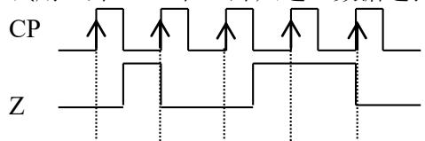

解：

| $Q_3$ | $Q_2$ | $Q_1$ | CP | Z |
| :---: | :---: | :---: | :---: | :---: |
| 0 | 0 | 0 | 0 | 1 |
| 0 | 0 | 0 | 1 | 0 |
| 0 | 0 | 1 | 0 | 0 |
| 0 | 0 | 1 | 1 | 0 |
| 0 | 1 | 0 | 0 | 1 |
| 0 | 1 | 0 | 1 | 0 |
| 0 | 1 | 1 | 0 | 1 |
| 0 | 1 | 1 | 1 | 1 |
| 1 | 0 | 0 | 0 | 0 |
| 1 | 0 | 0 | 1 | 0 |

对卡诺图降维：

| | $Q_1$CP | | | | | $Q_1$ | |
| :--- | :---: | :---: | :---: | :---: | :--- | :---: | :---: |
| **$Q_3 Q_2$** | 00 | 01 | 11 | 10 | **$Q_3 Q_2$** | 0 | 1 |
| 00 | 1 | | | | 00 | $\overline{CP}$ | |
| 01 | 1 | | 1 | 1 | 01 | $\overline{CP}$ | 1 |
| 11 | $\Phi$ | $\Phi$ | $\Phi$ | $\Phi$ | 11 | $\Phi$ | $\Phi$ |
| 10 | | | $\Phi$ | $\Phi$ | 10 | | $\Phi$ |

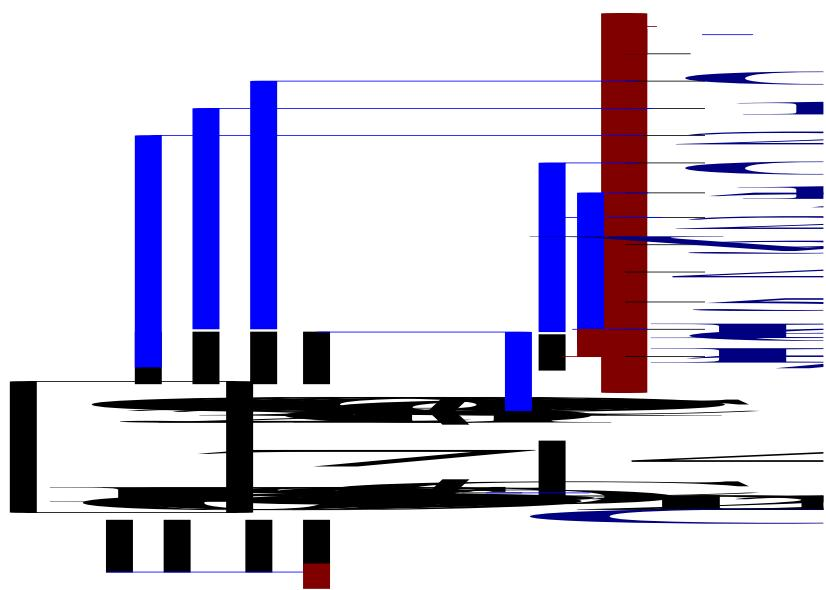

知识点：[完整数字系统设计流程实例（如乘法器、交通灯管理系统的算法规律、处理器设计与控制器实现）](../../../topics/数字逻辑电路/数字系统设计实例.md)、[寄存器传输语言(RTL)描述的传输操作、算术操作、逻辑操作、移位操作及条件控制语句](../../../topics/数字逻辑电路/RTL语言.md)

### 综合 6.35

用设计移位型序列信号发生器，要求产生的序列信号为（1）11110000…（2）111100100…。

解：

（1）状态转移表为：

| $Q_3$ | $Q_2$ | $Q_1$ | $Q_0$ | $D_0$ |
| :---: | :---: | :---: | :---: | :---: |
| 1 | 1 | 1 | 1 | 0 |
| 1 | 1 | 1 | 0 | 0 |
| 1 | 1 | 0 | 0 | 0 |
| 0 | 0 | 0 | 0 | 0 |
| 0 | 0 | 0 | 1 | 1 |
| 0 | 0 | 1 | 1 | 1 |
| 0 | 1 | 1 | 1 | 1 |

所以 $D_{0} = \overline{Q}_{3}$，电路图为：

（2）状态转移表为：

| $Q_4$ | $Q_3$ | $Q_2$ | $Q_1$ | $Q_0$ | $D_0$ |
| :---: | :---: | :---: | :---: | :---: | :---: |
| 1 | 1 | 1 | 1 | 0 | 0 |
| 1 | 1 | 1 | 0 | 0 | 1 |
| 1 | 1 | 0 | 0 | 1 | 0 |
| 1 | 0 | 0 | 1 | 0 | 0 |
| 0 | 0 | 1 | 0 | 0 | 1 |
| 0 | 1 | 0 | 0 | 1 | 1 |
| 1 | 0 | 0 | 1 | 1 | 1 |
| 0 | 0 | 1 | 1 | 1 | 1 |
| 0 | 1 | 1 | 1 | 1 | 0 |

经卡诺图化简为 $D_{0} = \overline{\overline{Q}_{1} \overline{Q}_{0}} \cdot \overline{\overline{Q}_{4} \overline{Q}_{2}} \cdot \overline{\overline{Q}_{3} Q_{0}}$

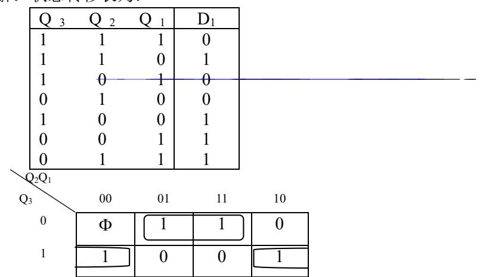

知识点：[控制器的四种硬件实现方法：每态一触发器法(SSI)、MSI法(MUX+寄存器+译码器)、PLA法(LSI)及对比](../../../topics/数字逻辑电路/控制器实现方法.md)、[完整数字系统设计流程实例（如乘法器、交通灯管理系统的算法规律、处理器设计与控制器实现）](../../../topics/数字逻辑电路/数字系统设计实例.md)、[寄存器传输语言(RTL)描述的传输操作、算术操作、逻辑操作、移位操作及条件控制语句](../../../topics/数字逻辑电路/RTL语言.md)

### 综合 6.37

试用 JKFF 设计循环长度 M=12 的序列信号发生器。

解：该题要求设计一个已知序列长度的序列信号发生器，可以用修改最长线性序列的方法得到：取 n=4，M=$2^n$-1=15 的最长线性序列：111100010011010，将其左移 3（15-12=3）位，

$$
\begin{array}{c c} & 1   1   1   1   \boxed {0}   0   0   1   \boxed {0}   0   1   1   0   1   0 \\ \oplus & 1   0   0   0   \boxed {1}   0   0   1   \boxed {1}   0   1   0   1   1   1 \\ \hline & 0   1   1   1   \boxed {1}   0   0   0   \boxed {1}   0   0   1   1   0   1 \end{array}
$$

异或结果中寻找 "1" 后面接 n-1 个 0 的码，对应到原始序列得到的码为 0001，所以反馈状态为 $\overline{Q}_{4} \overline{Q}_{3} \overline{Q}_{2} Q_{1}$ 。修改反馈函数为：

$$
f = (Q 4 \oplus Q 3) \oplus \text{起跳状态} + \text{全} 0 \text{项} = (Q 4 \oplus Q 3) \oplus \overline{Q}_{4} \overline{Q}_{3} \overline{Q}_{2} Q_{1} + \overline{Q}_{4} \overline{Q}_{3} \overline{Q}_{2} \overline{Q}_{1}
$$

此时产生的序列为：111100011010（跳过了原序列 0001 后面的 001 的 3 位）

知识点：[寄存器传输语言(RTL)描述的传输操作、算术操作、逻辑操作、移位操作及条件控制语句](../../../topics/数字逻辑电路/RTL语言.md)、[控制器的四种硬件实现方法：每态一触发器法(SSI)、MSI法(MUX+寄存器+译码器)、PLA法(LSI)及对比](../../../topics/数字逻辑电路/控制器实现方法.md)、[完整数字系统设计流程实例（如乘法器、交通灯管理系统的算法规律、处理器设计与控制器实现）](../../../topics/数字逻辑电路/数字系统设计实例.md)

### 综合 38

分析图6.28电路，试写出其编码表及模长。

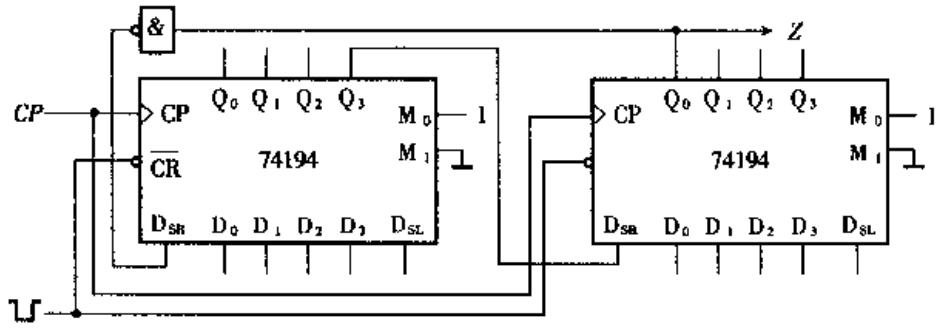

答案：
分析两个74194级联成 8位右移寄存器。取第二个 74194的 $Q_0$ 反馈给第一片 74194的 $D_{SR}$。$M_1 M_0 = 01$，所以始终处于右移工作状态。其状态编码表为：(其中 $Q_0'$ 为第二个 74194的 $Q_0$)

| 序号 | $Q_0$ | $Q_1$ | $Q_2$ | $Q_3$ | $Q_0'$ | Z |
| :--- | :---: | :---: | :---: | :---: | :---: | :---: |
| 启动 | 0 | 0 | 0 | 0 | 0 | 0 |
| 1 | 1 | 0 | 0 | 0 | 0 | 0 |
| 2 | 1 | 1 | 0 | 0 | 0 | 0 |
| 3 | 1 | 1 | 1 | 0 | 0 | 0 |
| 4 | 1 | 1 | 1 | 1 | 0 | 0 |
| 5 | 1 | 1 | 1 | 1 | 1 | 1 |
| 6 | 0 | 1 | 1 | 1 | 1 | 1 |
| 7 | 0 | 0 | 1 | 1 | 1 | 1 |
| 8 | 0 | 0 | 0 | 1 | 1 | 1 |
| 9 | 0 | 0 | 0 | 0 | 1 | 1 |

因此 $M = 10$。

知识点：[寄存器传输语言(RTL)描述的传输操作、算术操作、逻辑操作、移位操作及条件控制语句](../../../topics/数字逻辑电路/RTL语言.md)、[完整数字系统设计流程实例（如乘法器、交通灯管理系统的算法规律、处理器设计与控制器实现）](../../../topics/数字逻辑电路/数字系统设计实例.md)

### 综合 39

试写出图6.39的 74194输出端的编码表及数据选择器输出端F 处的序列信号。

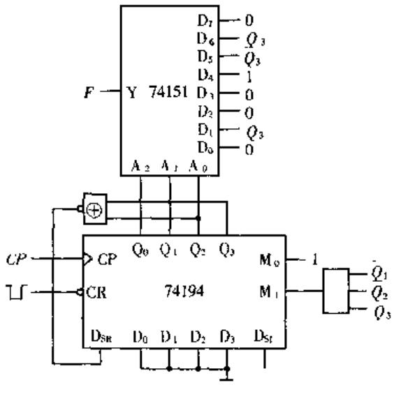

答案：
$M_1 = \bar{Q}_1 Q_2 Q_3$, $D_{SR} = Q_3 \odot Q_2$。状态编码表为：

| $Q_0$ | $Q_1$ | $Q_2$ | $Q_3$ | $M_1$ | $D_{SR}$ | 74151 选择的数据端 | F |
| :---: | :---: | :---: | :---: | :---: | :---: | :---: | :---: |
| 0 | 0 | 0 | 0 | 0 | 1 | $D_0$ | 0 |
| 1 | 0 | 0 | 0 | 0 | 1 | $D_4$ | 1 |
| 1 | 1 | 0 | 0 | 0 | 1 | $D_6$ | 0 |
| 1 | 1 | 1 | 0 | 0 | 0 | $D_7$ | 0 |
| 0 | 1 | 1 | 1 | 0 | 1 | $D_3$ | 0 |
| 1 | 0 | 1 | 1 | 0 | 1 | $D_5$ | 0 |
| 1 | 1 | 0 | 1 | 0 | 0 | $D_6$ | 1 |
| 0 | 1 | 1 | 0 | 0 | 0 | $D_3$ | 0 |
| 0 | 0 | 1 | 1 | 0 | 1 | $D_1$ | 1 |
| 1 | 0 | 0 | 1 | 1 | 0 | $D_4$ | 1 |

F 处的序列为：0100001011。

知识点：[完整数字系统设计流程实例（如乘法器、交通灯管理系统的算法规律、处理器设计与控制器实现）](../../../topics/数字逻辑电路/数字系统设计实例.md)、[控制器的四种硬件实现方法：每态一触发器法(SSI)、MSI法(MUX+寄存器+译码器)、PLA法(LSI)及对比](../../../topics/数字逻辑电路/控制器实现方法.md)

### 综合 40

写出图 6.40 中74161 输出端的状态编码表及74151输出端产生的序列信号。

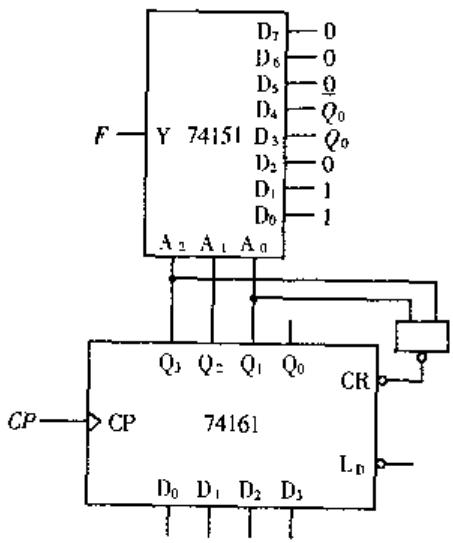

$$
\overline{\mathrm{CR}} = Q_3 Q_1
$$

答案：

| $Q_3$ | $Q_2$ | $Q_1$ | $Q_0$ | 74151 选择的数据端 | F |
| :---: | :---: | :---: | :---: | :---: | :---: |
| 0 | 0 | 0 | 0 | D0 | 1 |
| 0 | 0 | 0 | 1 | D0 | 1 |
| 0 | 0 | 1 | 0 | D1 | 1 |
| 0 | 0 | 1 | 1 | D1 | 1 |
| 0 | 1 | 0 | 0 | D2 | 0 |
| 0 | 1 | 0 | 1 | D2 | 0 |
| 0 | 1 | 1 | 0 | D3 | 0 |
| 0 | 1 | 1 | 1 | D3 | 1 |
| 1 | 0 | 0 | 0 | D4 | 1 |
| 1 | 0 | 0 | 1 | D4 | 0 |

F 处的序列信号为：1111000110。

知识点：[数字系统的基本模型（数据处理器与控制器）及对最小时钟周期、异步信号同步化的约定](../../../topics/数字逻辑电路/数字系统模型.md)、[寄存器传输语言(RTL)描述的传输操作、算术操作、逻辑操作、移位操作及条件控制语句](../../../topics/数字逻辑电路/RTL语言.md)

### 综合 41

试写出图 P6.41 中 74194 输出端 $Q_0$ 处的序列信号。

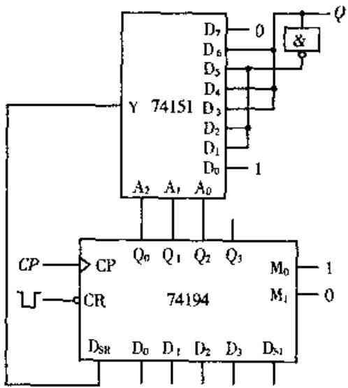

答案：
74194 的 $M_1 M_0 = 01$，处于右移的工作状态。$D_{SR}$ 取自 74151的输出。

题6.41的状态转移表

| $Q_0$ | $Q_1$ | $Q_2$ | $Q_3$ | 74151 选择的数据端 | $D_{SR}(Y)$ |
| :---: | :---: | :---: | :---: | :---: | :---: |
| 0 | 0 | 0 | 0 | $D_0$ | 1 |
| 1 | 0 | 0 | 0 | $D_4$ | 0 |
| 0 | 1 | 0 | 0 | $D_2$ | 1 |
| 1 | 0 | 1 | 0 | $D_5$ | 1 |
| 1 | 1 | 0 | 1 | $D_6$ | 1 |
| 1 | 1 | 1 | 0 | $D_7$ | 0 |
| 0 | 1 | 1 | 1 | $D_3$ | 1 |
| 1 | 0 | 1 | 1 | $D_5$ | 0 |
| 0 | 1 | 0 | 1 | $D_2$ | 0 |
| 0 | 0 | 1 | 0 | $D_1$ | 1 |
| 1 | 0 | 0 | 1 | $D_4$ | 1 |
| 1 | 1 | 0 | 0 | $D_6$ | 0 |
| 0 | 1 | 1 | 0 | $D_3$ | 0 |
| 0 | 0 | 1 | 1 | $D_1$ | 0 |
| 0 | 0 | 0 | 1 | $D_0$ | 1 |

$Q_0$ 处的序列信号为：01110100110001。

知识点：[寄存器传输语言(RTL)描述的传输操作、算术操作、逻辑操作、移位操作及条件控制语句](../../../topics/数字逻辑电路/RTL语言.md)、[完整数字系统设计流程实例（如乘法器、交通灯管理系统的算法规律、处理器设计与控制器实现）](../../../topics/数字逻辑电路/数字系统设计实例.md)

### 综合 42

用74194设计序列信号发生器产生序列信号：

（1）1110010，…；

（2）$101101, \ldots$

答案：
（1）列状态转移表：

| $Q_1$ | $Q_2$ | $Q_3$ | $D_{SL}$ |
| :---: | :---: | :---: | :---: |
| 1 | 1 | 1 | 0 |
| 1 | 1 | 0 | 0 |
| 1 | 0 | 0 | 1 |
| 0 | 0 | 1 | 0 |
| 0 | 1 | 0 | 1 |
| 1 | 0 | 1 | 1 |
| 0 | 1 | 1 | 1 |

# 数字电路与逻辑设计 B 第 6 章习题答案（第 29–32 页）

本部分为《数字电路与逻辑设计 B》第 6 章习题解答的整理，内容涵盖序列码发生器设计及尾灯控制电路设计，包含状态转移表、卡诺图化简及电路实现思路。

## 题 6.42

知识点：[完整数字系统设计流程实例（如乘法器、交通灯管理系统的算法规律、处理器设计与控制器实现）](../../../topics/数字逻辑电路/数字系统设计实例.md)、[寄存器传输语言(RTL)描述的传输操作、算术操作、逻辑操作、移位操作及条件控制语句](../../../topics/数字逻辑电路/RTL语言.md)、[控制器的四种硬件实现方法：每态一触发器法(SSI)、MSI法(MUX+寄存器+译码器)、PLA法(LSI)及对比](../../../topics/数字逻辑电路/控制器实现方法.md)

### 题 6.42（1）
**题干**：（接上文，涉及 $D_{SL}$ 的卡诺图分析）

**参考解答**：
（2）列状态转移表：

| $Q_1$ | $Q_2$ | $Q_3$ | $D_{SL}$ |
| :---: | :---: | :---: | :------: |
| 1 | 0 | 1 | 1 |
| 0 | 1 | 1 | 0 |
| 1 | 1 | 0 | 1 |

根据状态转移表可得输出函数表达式：
$$ D_{SL} = Q_1 $$

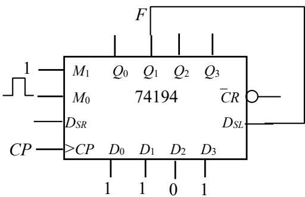

知识点：[控制器的四种硬件实现方法：每态一触发器法(SSI)、MSI法(MUX+寄存器+译码器)、PLA法(LSI)及对比](../../../topics/数字逻辑电路/控制器实现方法.md)、[根据文字描述建立ASM图的原则，以及从ASM图推导处理器明细表和控制器状态转移图](../../../topics/数字逻辑电路/ASM图建立与分析.md)、[完整数字系统设计流程实例（如乘法器、交通灯管理系统的算法规律、处理器设计与控制器实现）](../../../topics/数字逻辑电路/数字系统设计实例.md)

### 题 6.43
**题干**：试用 74161、74151 及少量与非门实现如下功能：当 S=0 时，产生序列 1011010；当 S=1 时，产生序列 1110100。

**参考解答**：
根据计数型序列码发生器，将 74161 通过异步复零法实现模长为 7 的计数器。

列输出序列函数的真值表：

| S | $Q_2$ | $Q_1$ | $Q_0$ | F |
| :---: | :---: | :---: | :---: | :---: |
| 0 | 0 | 0 | 0 | 1 |
| 0 | 0 | 0 | 1 | 0 |
| 0 | 0 | 1 | 0 | 1 |
| 0 | 0 | 1 | 1 | 1 |
| 0 | 1 | 0 | 0 | 0 |
| 0 | 1 | 0 | 1 | 1 |
| 0 | 1 | 1 | 0 | 1 |
| 0 | 1 | 1 | 1 | $\phi$ |
| 1 | 0 | 0 | 0 | 1 |
| 1 | 0 | 0 | 1 | 1 |
| 1 | 0 | 1 | 0 | 1 |
| 1 | 0 | 1 | 1 | 0 |
| 1 | 1 | 0 | 0 | 1 |
| 1 | 1 | 0 | 1 | 0 |
| 1 | 1 | 1 | 0 | 0 |
| 1 | 1 | 1 | 1 | $\phi$ |

F 的卡诺图（降维卡诺图）：

| $SQ_2 \setminus Q_1Q_0$ | 00 | 01 | 11 | 10 |
| :---: | :---: | :---: | :---: | :---: |
| **00** | 1 | - | 1 | 1 |
| **01** | - | 1 | $\phi$ | 1 |
| **11** | 1 | - | $\phi$ | - |
| **10** | 1 | 1 | - | 1 |

F 的降维卡诺图（以 $S$ 为变量）：

| $Q_1Q_0 \setminus Q_2$ | 00 | 01 | 11 | 10 |
| :---: | :---: | :---: | :---: | :---: |
| **0** | 1 | S | $\overline{S}$ | 1 |
| **1** | S | $\overline{S}$ | $\phi$ | $\overline{S}$ |

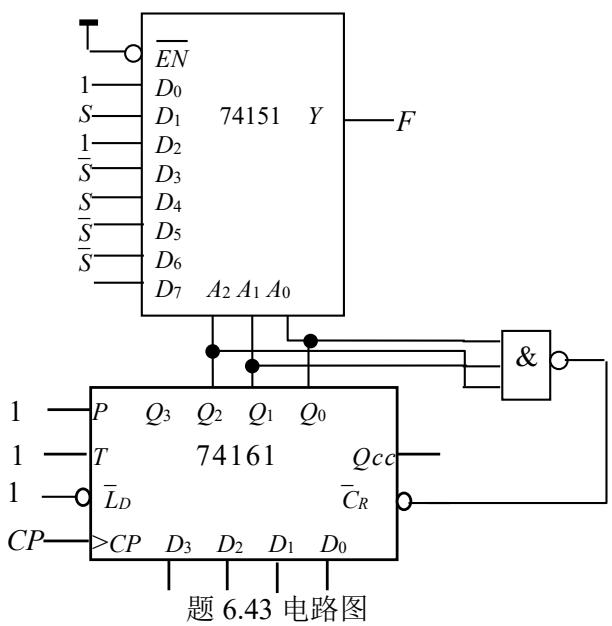

## 题 6.44
**题干**：试用 74161、74151 及若干与非门设计一电路同时输出两个不同的序列信号：$Z_1 = 111100010$ 和 $Z_2 = 101110001$。（不另加控制信号）

**参考解答**：
可以将 74161 变换成移位寄存器，实现移存型序列码发生器，产生序列码 $Z_1$，再将该 74161 和 74151 组合形成计数型序列码发生器产生序列码 $Z_2$。

列移存型序列码发生器的状态转移表和激励表：

| $Q_3$ | $Q_2$ | $Q_1$ | $Q_0$ | $D_{SL}$ |
| :---: | :---: | :---: | :---: | :------: |
| 1 | 1 | 1 | 1 | 0 |
| 1 | 1 | 1 | 0 | 0 |
| 1 | 1 | 0 | 0 | 0 |
| 1 | 0 | 0 | 0 | 1 |
| 0 | 0 | 0 | 1 | 0 |
| 0 | 0 | 1 | 0 | 1 |
| 0 | 1 | 0 | 1 | 1 |
| 1 | 0 | 1 | 1 | 1 |
| 0 | 1 | 1 | 1 | 1 |

由此得到反馈逻辑表达式：
$$ D_{SL} = \bar{Q}_2 \bar{Q}_0 + \bar{Q}_3 Q_2 + Q_3 \bar{Q}_2 $$

列计数型序列码发生器的真值表（对应 $Z_2$）：

| $Q_3$ | $Q_2$ | $Q_1$ | $Q_0$ | $Z_2$ |
| :---: | :---: | :---: | :---: | :---: |
| 1 | 1 | 1 | 1 | 1 |
| 1 | 1 | 1 | 0 | 0 |
| 1 | 1 | 0 | 0 | 1 |
| 1 | 0 | 0 | 0 | 1 |
| 0 | 0 | 0 | 1 | 1 |
| 0 | 0 | 1 | 0 | 0 |
| 0 | 1 | 0 | 1 | 0 |
| 1 | 0 | 1 | 1 | 0 |
| 0 | 1 | 1 | 1 | 1 |

$Z_2$ 的卡诺图以及降维卡诺图：

| $Q_1Q_0 \setminus Q_3Q_2$ | 00 | 01 | 11 | 10 |
| :---: | :---: | :---: | :---: | :---: |
| **00** | $\phi$ | 1 | $\phi$ | 0 |
| **01** | $\phi$ | $\phi$ | 1 | 0 |
| **11** | 1 | $\phi$ | 1 | 0 |
| **10** | 1 | $\phi$ | 0 | $\phi$ |

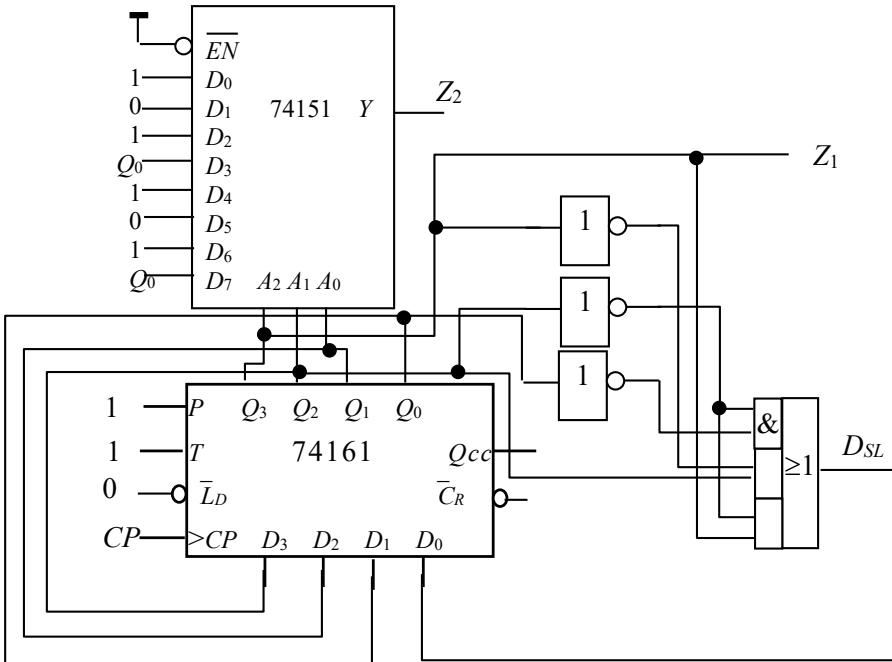

## 题 6.45
**题干**：设计一个小汽车尾灯控制电路。小汽车左、右两侧各有 3 个尾灯，要求：
1. 左转弯时，在左转弯开关控制，左侧 3 个灯按题图 P6.45 所示周期性地亮与灭；
2. 右转弯时，在右转弯开关控制，右侧 3 个灯按题图 P6.45 所示周期性地亮与灭；
3. 左、右两个开关都作用时，两侧的灯做同样的周期地亮与灭；
4. 在制动开关（制动器）作用时，6 个尾灯同时亮。若在转弯情况下制动，则 3 个转向尾灯正常动作，另一侧 3 个尾灯则均亮。

**参考解答**：
设右转弯开关用 $C_R$ 表示，高电平有效；
左转弯开关用 $C_L$ 表示，高电平有效；
制动开关用 $S_T$ 表示，高电平有效。

根据题意，左、右转弯 3 个尾灯的周期性亮灭可分别用两个 3 位模长为 4 的计数器实现。设计数器的状态为 $Q_A, Q_B, Q_C$。则状态转移图为：$000 \to 100 \to 010 \to 111$。若用 3 个 DFF 实现，则激励表如下：

| $Q_A$ | $Q_B$ | $Q_C$ | $D_A$ | $D_B$ | $D_C$ |
| :---: | :---: | :---: | :---: | :---: | :---: |
| 0 | 0 | 0 | 1 | 0 | 0 |
| 1 | 0 | 0 | 0 | 1 | 0 |
| 0 | 1 | 0 | 1 | 1 | 1 |
| 1 | 1 | 1 | 0 | 0 | 0 |

列三个激励函数的卡诺图：

# 数字电路与逻辑设计B 第6章习题答案（第33-36页）

本部分为《数字电路与逻辑设计B》第6章习题答案的剩余内容，包含汽车尾灯控制器状态机设计的后续推导及题6.46的波形分析。

## 一、综合分析与设计

知识点：[完整数字系统设计流程实例（如乘法器、交通灯管理系统的算法规律、处理器设计与控制器实现）](../../../topics/数字逻辑电路/数字系统设计实例.md)、[寄存器传输语言(RTL)描述的传输操作、算术操作、逻辑操作、移位操作及条件控制语句](../../../topics/数字逻辑电路/RTL语言.md)、[控制器的四种硬件实现方法：每态一触发器法(SSI)、MSI法(MUX+寄存器+译码器)、PLA法(LSI)及对比](../../../topics/数字逻辑电路/控制器实现方法.md)

### 综合 1（接上题：汽车尾灯控制器状态机设计）

**激励函数表达式：**

$$
D_A = \overline{Q}_A
$$

$$
D_B = Q_A \overline{Q}_B + Q_B \overline{Q}_C
$$

$$
D_C = Q_B \overline{Q}_C
$$

**自启动性分析：**
偏离态 001 的次态为 100，偏离态 011 的次态为 100，偏离态 101 的次态为 010，偏离态 110 的次态为 011。可以看出该计数器具有自启动性。两计数器都可以通过上述激励函数实现。

右尾灯计数器的状态用 $Q_{RA}, Q_{RB}, Q_{RC}$ 表示，激励函数用 $D_{RA}, D_{RB}, D_{RC}$ 表示，DFF 的异步清零和置一端用 $\overline{R}_{DR}, \overline{S}_{DR}$ 表示；左尾灯计数器的状态用 $Q_{LA}, Q_{LB}, Q_{LC}$ 表示，激励函数用 $D_{LA}, D_{LB}, D_{LC}$ 表示，DFF 的异步清零和置一端用 $\overline{R}_{DL}, S_{DL}$ 表示。

两计数器的工作状态（计数、清零、置 1）由右转弯开关 $C_R$、左转弯开关 $C_L$、制动开关 $S_T$ 控制，根据题意得到下述功能表：

| $S_T$ | $C_R$ | $C_L$ | 右尾灯计数器 | 左尾灯计数器 |
| :---: | :---: | :---: | :----------: | :----------: |
|   0   |   0   |   0   |      清0     |      清0     |
|   0   |   0   |   1   |      清0     |      计数    |
|   0   |   1   |   0   |      计数    |      清0     |
|   0   |   1   |   1   |      计数    |      计数    |
|   1   |   0   |   0   |      置1     |      置1     |
|   1   |   0   |   1   |      置1     |      计数    |
|   1   |   1   |   0   |      计数    |      置1     |
|   1   |   1   |   1   |      计数    |      计数    |

由此可以得到两计数器的 $R_D, S_D$ 的真值表。

| $S_T$ | $C_R$ | $C_L$ | $\overline{R}_{DR}$ | $\overline{S}_{DR}$ | $\overline{R}_{DL}$ | $\overline{S}_{DL}$ |
| :---: | :---: | :---: | :-----------------: | :-----------------: | :-----------------: | :-----------------: |
|   0   |   0   |   0   |          0          |          1          |          0          |          1          |
|   0   |   0   |   1   |          0          |          1          |          1          |          1          |
|   0   |   1   |   0   |          1          |          1          |          0          |          1          |
|   0   |   1   |   1   |          1          |          1          |          1          |          1          |
|   1   |   0   |   0   |          1          |          0          |          1          |          0          |
|   1   |   0   |   1   |          1          |          0          |          1          |          1          |
|   1   |   1   |   0   |          1          |          1          |          1          |          0          |
|   1   |   1   |   1   |          1          |          1          |          1          |          1          |

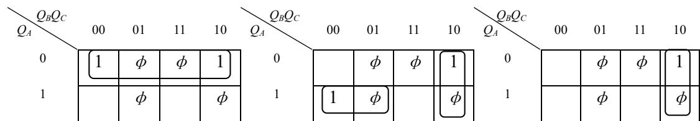

电路图如下：

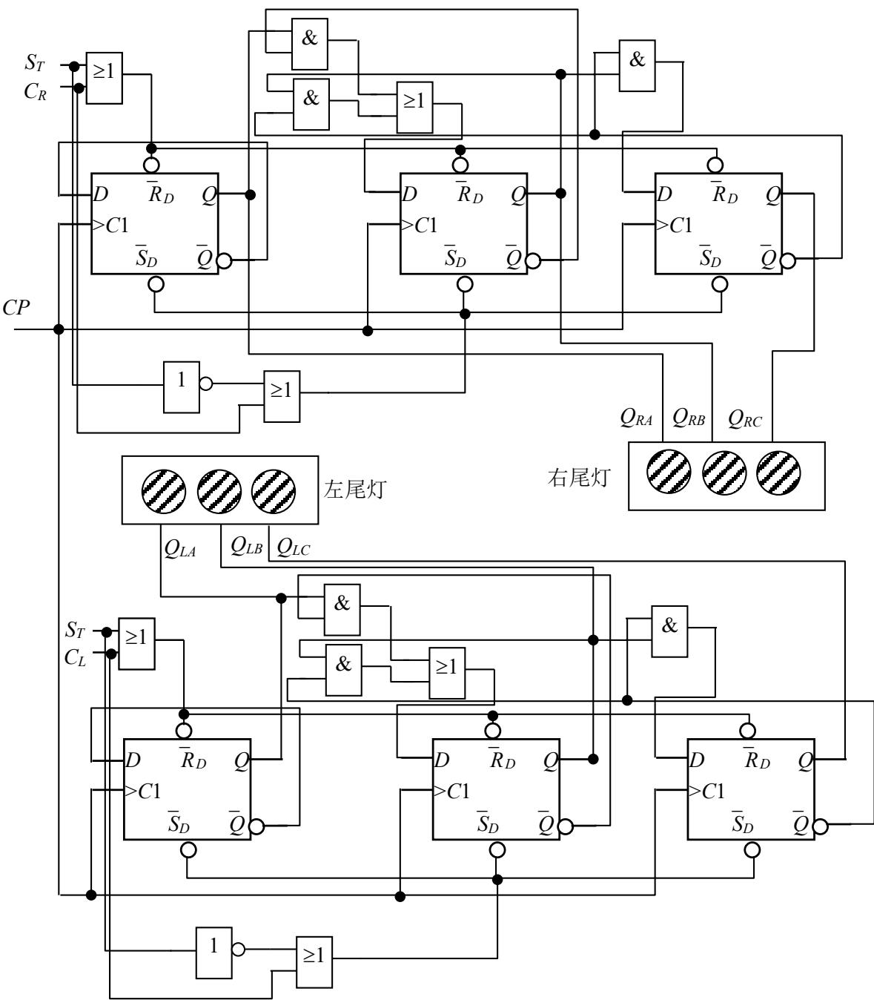

知识点：[完整数字系统设计流程实例（如乘法器、交通灯管理系统的算法规律、处理器设计与控制器实现）](../../../topics/数字逻辑电路/数字系统设计实例.md)、[控制器的四种硬件实现方法：每态一触发器法(SSI)、MSI法(MUX+寄存器+译码器)、PLA法(LSI)及对比](../../../topics/数字逻辑电路/控制器实现方法.md)

### 简答 46

**题目：**
已知由 T213 构成的电路如图 P6.46 所示，试作出 $Q_A, Q_B, Q_C, Q_D, Q_{CC}$ 的波形。

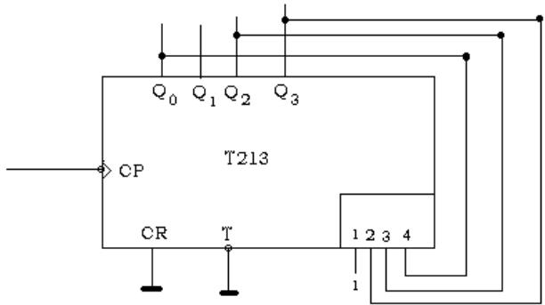

解：本题为 T213 通过异步清零法实现任意进制计数器，反馈状态为 13，因此模长为 13。

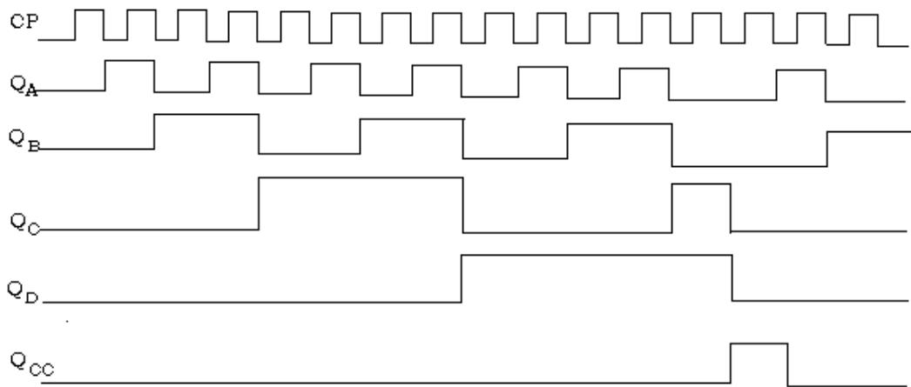

知识点：[数字系统的基本模型（数据处理器与控制器）及对最小时钟周期、异步信号同步化的约定](../../../topics/数字逻辑电路/数字系统模型.md)
